# NVIDIA H100 GPU Architecture
## Lesson 1 Companion Guide — A Deep Dive into Hopper

> **Target audience:** GPU programmers who want to understand the H100 at the hardware level before writing CUDA/PTX kernels.
> **Prerequisites:** Basic understanding of parallel computing concepts (threads, memory hierarchy).

**What this covers:** Every architectural concept in Lesson 1 — the TMA unit, asynchronous execution, Tensor Cores, the memory hierarchy from HBM3 through L2/L1 to registers, the SM microarchitecture (quadrants, warp schedulers, dispatch units, SFUs, LSUs), NVLink 4.0, shared memory banking, swizzling, and how thread blocks are distributed across SMs. Each section includes ASCII diagrams, worked examples with concrete numbers, and practical implications for kernel design.

**How to read this chapter.** Most sections open with a boxed ASCII diagram or a
specification block. Those boxes are the reference material; the prose around
them tells you what to look at and why it matters. On a first pass, read the
prose and skim the boxes — you can come back for the exact numbers when a later
chapter needs them. Nothing here requires you to write code yet.

---

## Table of Contents

1. [The Big Picture — Why H100 Matters](#1--the-big-picture)
2. [Asynchronous Execution & The TMA](#2--asynchronous-execution--the-tma)
3. [4th Generation Tensor Cores](#3--4th-generation-tensor-cores)
4. [The Full GPU Die — Top-Level Organization](#4--the-full-gpu-die)
5. [HBM3 Memory System](#5--hbm3-memory-system)
6. [L2 Cache](#6--l2-cache)
7. [GPCs — Graphics Processing Clusters](#7--gpcs--graphics-processing-clusters)
8. [NVLink 4.0](#8--nvlink-40)
9. [The Streaming Multiprocessor (SM)](#9--the-streaming-multiprocessor-sm)
10. [SM Quadrants (SMSPs)](#10--sm-quadrants-smsps)
11. [Warp Schedulers & Dispatch](#11--warp-schedulers--dispatch)
12. [Execution Units Deep Dive](#12--execution-units-deep-dive)
13. [Unified Shared Memory + L1 Cache](#13--unified-shared-memory--l1-cache)
14. [Registers](#14--registers)
15. [Instruction Caches (L0 & L1)](#15--instruction-caches-l0--l1)
16. [Thread Block Distribution](#16--thread-block-distribution)
17. [PCIe 5.0 Host Interface](#17--pcie-50-host-interface)
18. [Putting It All Together — Data Flow Summary](#18--putting-it-all-together)
19. [Quick Reference Tables](#19--quick-reference-tables)

---

## 1 — The Big Picture

Before any code, you need a mental picture of what kind of machine this is. This
section gives you two things: the H100's raw numbers, and the one idea that
separates Hopper from every GPU before it. If you remember nothing else from
this chapter, remember §1.2.

### 1.1 H100 at a Glance

Here is the whole chip on a single card. Don't try to memorise it — skim it now
and come back whenever a later section mentions a number you want to place.
Three lines matter most for kernel work: **132 SMs** (how many independent
processors you are programming), **3.35 TB/s** of HBM3 bandwidth (how fast you
can feed them), and **228 KB of shared memory per SM** (how much data you can
stage right next to the compute).

```
NVIDIA H100 (Hopper Architecture)
══════════════════════════════════════════════════════════════════

Released:            September 2022
Process:             TSMC 4N (custom variant of N4)
Transistors:         80 billion
Form factors:        SXM5 (700W)  |  PCIe Gen5 (300W)

Compute:
  SMs:               132 (enabled)
  Tensor Cores:      528 (4 per SM)
  FP32 CUDA Cores:   16,896 (128 per SM)
  FP64 Units:        8,448 (64 per SM)
  INT32 Units:       8,448 (64 per SM)

Memory:
  HBM3:              80 GB @ 3.35 TB/s
  L2 Cache:          50 MB
  Shared Mem/SM:     228 KB (configurable)
  Registers/SM:      256 KB

Interconnect:
  NVLink 4.0:        900 GB/s (18 links)
  PCIe 5.0:          128 GB/s bidirectional

Key Innovation:      Fully asynchronous execution via TMA
```

### 1.2 The Generational Leap

The single most important thing to understand about the H100 is that it represents a **paradigm shift from synchronous to asynchronous execution**. Every previous GPU architecture required the SM's threads to babysit data movement — issuing loads, waiting for them, then computing. The H100 introduces hardware that does the data movement *in the background* while the SM computes on previously loaded data.

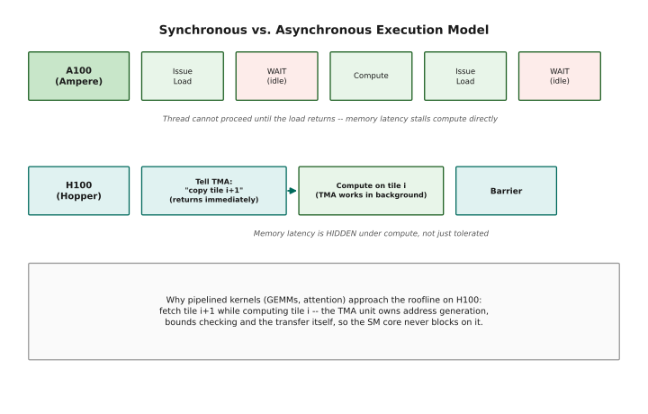

*Figure 1.5 — On the A100, a thread issues a load and stalls until it returns before it can compute. On the H100, the thread hands the copy to the TMA unit and computes immediately — the TMA works in the background and the thread only checks a barrier once it actually needs the data. Source: NVIDIA Hopper architecture whitepaper.*

This is why pipelined kernels (GEMMs, attention) can approach the theoretical roofline on the H100 — you fetch tile i+1 while computing tile i.

---

## 2 — Asynchronous Execution & The TMA

Section 1 claimed the H100 is asynchronous. This section makes that concrete.

The idea in one sentence: on older GPUs, threads had to fetch their own data and
then sit and wait for it; on the H100 a dedicated piece of hardware — the
**Tensor Memory Accelerator**, or TMA — does the fetching while those threads
keep computing.

We build up to it in four steps: what "asynchronous" means for a copy (§2.1),
what the TMA actually is (§2.2), a worked example where one TMA instruction
replaces roughly twenty thousand (§2.3), and the price you pay for all this —
bookkeeping (§2.4).

### 2.1 Synchronous vs Asynchronous Copies

A **synchronous copy** blocks the issuing thread (or warp) until the data arrives. The thread cannot execute any other instruction until the copy completes. Simple mental model: after the instruction, the data is ready.

An **asynchronous copy** only *starts* the transfer. The issuing thread can immediately continue doing other work — computing on previously loaded data, managing bookkeeping, etc. The thread later checks a barrier or fence to know when the copy has finished.

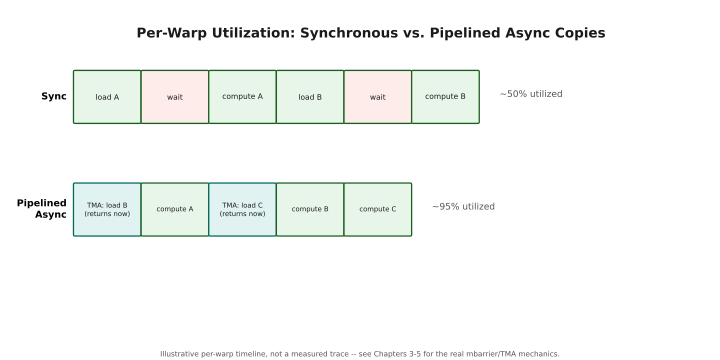

*Figure 2.1 — A synchronous copy leaves the warp idle for roughly half the timeline waiting on memory. An asynchronous, pipelined copy overlaps each load with the previous tile's compute, pushing utilization from roughly 50% to roughly 95%. Illustrative timeline, not measured cycle counts.*

### 2.2 The TMA Unit

Each SM in the H100 has a dedicated **Tensor Memory Accelerator (TMA)** unit. This is a hardware block — it has its own logic, its own connection to the memory hierarchy, and its own understanding of multi-dimensional tensor layouts.

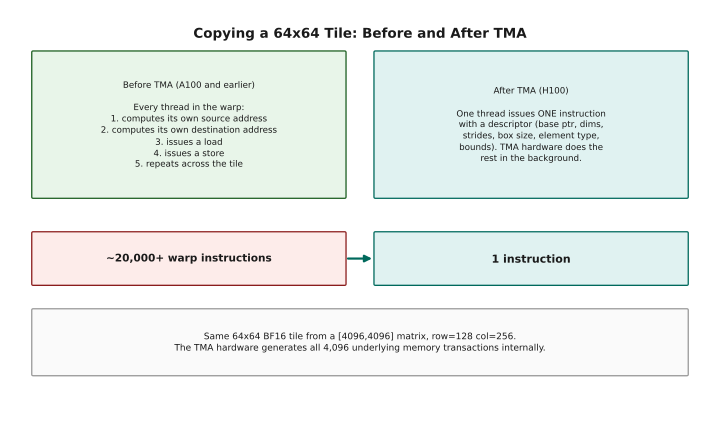

*Figure 2.2 — Before TMA, every thread in the warp computes its own source and destination addresses and issues its own loads and stores — dozens of instructions per warp. On the H100, one thread hands a descriptor (base pointer, dimensions, strides, box size, element type, bounds) to the TMA unit, which performs all address generation, bounds checking and the transfer itself in the background. Source: NVIDIA Hopper architecture whitepaper.*

### 2.3 TMA Descriptor — Concrete Example

The previous section described the TMA in the abstract. Here is the same copy
written both ways, with real numbers, so you can watch the instruction count
collapse. Read the traditional block first and count what each thread has to do;
then read the TMA block.

```
Scenario: Copy a 64×64 tile of BF16 from a [4096, 4096] matrix
starting at row=128, col=256

Traditional approach (per thread, 32 threads in a warp):
──────────────────────────────────────────────────────────
  // Each thread handles 64*64/32 = 128 elements
  for (int i = threadIdx.x; i < 64*64; i += 32) {
      int row = i / 64;
      int col = i % 64;
      int src_offset = (128 + row) * 4096 + (256 + col);  // address math
      smem[row * 64 + col] = global[src_offset];            // load + store
  }
  __syncthreads();  // everyone must finish before compute

  Instructions per thread: ~128 loads + 128 stores + ~384 address math
  Total warp instructions: ~20,000+ instructions


TMA approach (single thread):
──────────────────────────────────────────────────────────
  // Thread 0 issues one instruction:
  tma_copy_2d(descriptor, /*box_coord=*/{128, 256}, smem_ptr, barrier);
  // All other threads: skip straight to compute

  // The descriptor was set up once at kernel launch:
  //   base_ptr    = &matrix[0][0]
  //   dims        = {4096, 4096}
  //   strides     = {4096 * 2, 2}   (2 bytes per BF16)
  //   box_size    = {64, 64}
  //   element_sz  = 2 bytes

  Instructions: 1 (literally one PTX instruction)
  The TMA hardware generates all 4096 memory transactions internally
```

### 2.4 The Bookkeeping Cost

The tradeoff for async execution is complexity. You need barriers to know when data is ready:

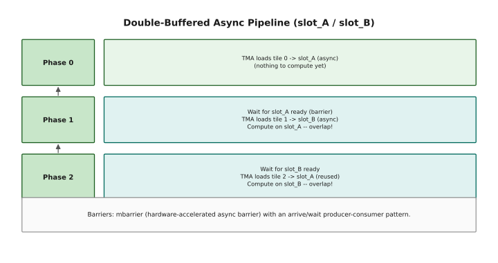

*Figure 2.3 — Double-buffering uses two shared-memory slots so the TMA can load the next tile while the SM computes on the current one. Each phase waits on a barrier for its slot, issues the next async load, and computes on the slot that is already full — the loads and the compute overlap by construction. Barriers: `mbarrier`, a hardware-accelerated async barrier using the producer/consumer arrive-wait pattern.*

---

## 3 — 4th Generation Tensor Cores

Almost all of the H100's advertised performance lives in its tensor cores. A
CUDA core does one multiply-add at a time; a tensor core does an entire small
matrix multiply in one operation, which is where the 10–100× gap comes from.

This section covers what they do (§3.1), the new Hopper unit of work called a
*warp group* (§3.2), the trick of agreeing to skip zeros (§3.3), and the number
formats they accept (§3.4). You don't need to write tensor core code yet —
Chapters 6 and 7 do that. Here you only need to know what the hardware offers.

### 3.1 What Tensor Cores Do

Tensor Cores are specialized matrix-multiply-accumulate (MMA) units. While CUDA cores process one FMA (fused multiply-add) per cycle per core, a Tensor Core processes an entire small matrix multiply in one operation.

```
CUDA Core (FP32):
  1 core does: a × b + c → d     (1 FMA = 2 FLOPs per cycle)
  128 cores/SM × 2 FLOPs = 256 FLOPS/cycle/SM (FP32)

Tensor Core (FP16, 4th Gen):
  1 tensor core does: A[m×k] × B[k×n] + C[m×n] → D[m×n]
  Where m=16, k=16, n=16 for wgmma (with warp groups)
  4 tensor cores/SM working together via WGMMA.

  A tensor core does not behave like a CUDA core (one fixed op/cycle) --
  one WGMMA instruction drives a whole small matrix multiply over several
  cycles, so the honest way to get FLOPS/cycle/SM is bottom-up from
  NVIDIA's own published full-GPU totals, not from an assumed per-core
  issue rate:

    FP16 / BF16 dense: 989.4 TFLOPS / 132 SMs / 1.98 GHz ≈ 3,786 FLOPS/cycle/SM
    FP8           dense: 1,979   TFLOPS / 132 SMs / 1.98 GHz ≈ 7,572 FLOPS/cycle/SM

    FP8 is exactly 2× FP16/BF16 -- "half the bits, double the rate" holds.

  FP8 peak for full GPU (132 SMs), checked against the spec sheet:
    7,572 FLOPS/cycle/SM × 132 SMs × 1.98 GHz ≈ 1,979 TFLOPS  ✓ matches
    Official spec (SXM5): 1,979 TFLOPS dense / 3,958 TFLOPS with 2:4 sparsity
    [NVIDIA H100 datasheet, PB-11773-001; boost clock 1,980 MHz confirmed
    independently via two GPU-database sources]

  (An earlier draft of this chapter had these swapped -- 989 TFLOPS
  labeled "dense" and 1,979 TFLOPS labeled "with sparsity." 1,979 TFLOPS
  is the real dense figure; 3,958 TFLOPS is the real sparse one. 989.4
  TFLOPS is actually the dense FP16/BF16 number, one precision tier down.)
```

### 3.2 Warp Group MMA (WGMMA)

The H100 introduces **Warp Group** operations, where 4 warps (128 threads) cooperate on a single matrix multiply:

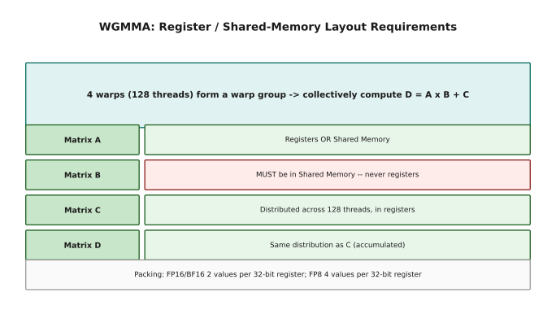

*Figure 3.1 — A warp group is 4 warps (128 threads) cooperating on one `D = A × B + C`. Matrix B must live in shared memory; A may be in registers or shared memory; C and D are distributed across the 128 threads' registers, each thread holding a small piece. FP16 operands pack 2 values per 32-bit register, FP8 packs 4 — WGMMA expects packed operands.*

### 3.3 Structured Sparsity

Sparsity is a way of buying throughput by agreeing not to store some of your
numbers. The hardware supports exactly one pattern — "2:4" — and the payoff is
simple: the tensor core reads half as much data, so it runs about twice as fast.

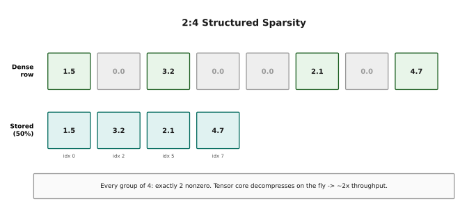

*Figure 3.2 — The H100 supports exactly one sparsity pattern: in every group of 4 consecutive elements, exactly 2 must be zero. Storage keeps only the non-zero values plus a small index mask (roughly 50% compression), and the tensor core decompresses on-the-fly during the MMA — throughput roughly doubles because it reads half the data. This is why the datasheet lists FP8 sparse throughput at exactly 2× FP8 dense.*

### 3.4 Precision Comparison

Lower precision buys throughput: the fewer bits per number, the more numbers a
tensor core can chew through per cycle. This table is the menu. The pattern to
notice is that halving the bit width roughly doubles the FLOPs — which is the
entire reason FP8 exists.

```
Precision     Bits  Range          Tensor Core FLOPS/cycle/SM*   Use Case
──────────────────────────────────────────────────────────────────────────
FP64          64    ±1.8×10^308    ~256                          Scientific
TF32          32**  ±3.4×10^38     ~1,893                        Training
FP32          32    ±3.4×10^38     (via CUDA cores only, 256)    General
FP16          16    ±65,504        ~3,786                        Training
BF16          16    ±3.4×10^38     ~3,786                        Training
FP8 (E4M3)     8    ±448           ~7,572                        Inference
FP8 (E5M2)     8    ±57,344        ~7,572                        Gradients
──────────────────────────────────────────────────────────────────────────
* Dense (no 2:4 sparsity). Derived from NVIDIA's published full-GPU
  TFLOPS totals (SXM5, 132 SMs, 1,980 MHz boost) the same way as the
  worked derivation in §3.1, not from an assumed per-core rate --
  every sparse variant is exactly 2× its dense row.
  [NVIDIA H100 datasheet, PB-11773-001]
** TF32 uses 32 bits of storage but a 10-bit mantissa internally.

The Transformer Engine dynamically selects FP8 E4M3 for forward
and E5M2 for backward, auto-scaling to prevent overflow.
```

---

## 4 — The Full GPU Die

Now we zoom out and look at the whole chip as a floor plan. Nearly everything
covered in the rest of this chapter is one of the boxes below, so it's worth a
minute here to see how the pieces sit relative to each other.

The rough shape: memory around the edges, 132 processors (SMs) in the middle
grouped into eight clusters, a large cache shared between them, and a hardware
scheduler deciding which processor runs what.

### 4.1 Top-Level Block Diagram

Read this from the outside in. Data either arrives at the bottom (over PCIe from
the CPU) or already lives at the top (in the HBM3 memory stacks). The SMs in the
middle are where your code actually runs, and the L2 cache between them is the
shared staging area that essentially all traffic passes through.

```
H100 SXM5 Die — Top Level
══════════════════════════════════════════════════════════════════════════

  ┌──────────────────────────────────────────────────────────────────┐
  │                     NVLink Hub & Switches                        │
  │  (18 NVLink 4.0 lanes → 900 GB/s GPU-to-GPU bandwidth)         │
  ├────────┬────────┬────────┬────────┬────────┬────────┬───────────┤
  │ HBM3   │ HBM3   │ HBM3   │ HBM3   │ HBM3   │(HBM3) │           │
  │Stack 0 │Stack 1 │Stack 2 │Stack 3 │Stack 4 │ dis-  │           │
  │ 16GB   │ 16GB   │ 16GB   │ 16GB   │ 16GB   │abled  │           │
  ├────────┴────────┴────────┴────────┴────────┴───────┴───────────┤
  │              10 × 512-bit Memory Controllers                     │
  │         (DRAM scheduling, row buffering, address mapping)        │
  ├────────────────────────────────────────────────────────────────┤
  │                                                                  │
  │  ┌──────────┐  ┌──────────┐  ┌──────────┐  ┌──────────┐        │
  │  │  GPC 0   │  │  GPC 1   │  │  GPC 2   │  │  GPC 3   │        │
  │  │ (18 SMs) │  │ (18 SMs) │  │ (18 SMs) │  │ (18 SMs) │        │
  │  └──────────┘  └──────────┘  └──────────┘  └──────────┘        │
  │                                                                  │
  │  ┌──────────┐  ┌──────────┐  ┌──────────┐  ┌──────────┐        │
  │  │  GPC 4   │  │  GPC 5   │  │  GPC 6   │  │  GPC 7   │        │
  │  │ (18 SMs) │  │ (18 SMs) │  │ (18 SMs) │  │ (18 SMs) │        │
  │  └──────────┘  └──────────┘  └──────────┘  └──────────┘        │
  │                                                                  │
  │          8 GPCs × 18 SMs/GPC = 144 SMs (132 enabled)            │
  │                                                                  │
  ├────────────────────────────────────────────────────────────────┤
  │             50 MB L2 Cache (25 MB per partition)                 │
  │           (128-byte lines, 32-byte sectors)                      │
  ├────────────────────────────────────────────────────────────────┤
  │                                                                  │
  │  ┌────────────────────────────────────────────────────────────┐  │
  │  │              GigaThread Engine                              │  │
  │  │  (CTA scheduling, cluster management, occupancy tracking)  │  │
  │  └────────────────────────────────────────────────────────────┘  │
  │                                                                  │
  │  ┌──────────────────────┐  ┌──────────────────────────────────┐  │
  │  │  PCIe 5.0 Interface  │  │  Transformer Engine Controller   │  │
  │  │  (128 GB/s bidir)    │  │  (FP8 auto-scaling)              │  │
  │  └──────────────────────┘  └──────────────────────────────────┘  │
  └──────────────────────────────────────────────────────────────────┘
```

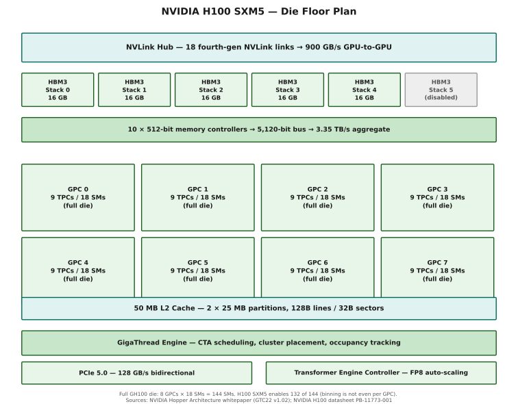

*Figure 1.1 — The H100 SXM5 die, drawn to the structure above. Sources: NVIDIA Hopper Architecture whitepaper (GTC22 v1.02); NVIDIA H100 datasheet PB-11773-001.*

> **On the 132-of-144 figure:** the full GH100 die really does have 8 GPCs
> of 18 SMs each (144 total) [NVIDIA Hopper Architecture whitepaper, GTC22,
> v1.02]. The SXM5 product binned down to 132 SMs, described in the same
> whitepaper as "8 GPCs, 66 TPCs" -- 66 TPCs ÷ 8 GPCs is not a whole number,
> so the 12 disabled SMs are not spread evenly as "1.5 per GPC." NVIDIA does
> not publish the exact per-GPC enabled-SM breakdown for SXM5; treat the
> 18-SMs-per-GPC diagram above as the full-die floor plan, not a literal
> picture of which SMs are switched on in a given chip.

### 4.2 The GigaThread Engine

The GigaThread Engine is the hardware scheduler that sits at the top of the GPU and manages the entire kernel launch lifecycle:

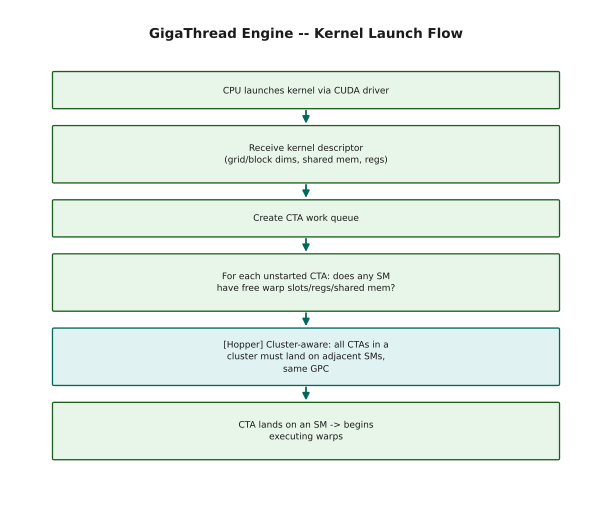

*Figure 4.2 — The GigaThread Engine receives the kernel descriptor, builds a CTA work queue, and for each unstarted CTA checks whether any SM has enough free warp slots, registers and shared memory before assigning it — otherwise the CTA waits. It tracks each CTA as NOT_STARTED, RUNNING or COMPLETED, and on Hopper it is cluster-aware: every CTA in a thread block cluster must land on adjacent SMs within the same GPC.*

---

## 5 — HBM3 Memory System

HBM3 is the GPU's main memory — the 80 GB your tensors live in. It is
enormously wide (5,120 bits) and enormously fast in aggregate (3.35 TB/s), and
also, relative to the compute, enormously slow: roughly 500 cycles to answer a
request.

That tension — huge bandwidth, terrible latency — is the reason the rest of the
chip is shaped the way it is. Caches exist to shrink the number of requests that
have to travel this far; the TMA exists so you don't have to wait on the ones
that do.

### 5.1 Physical Organization

The part to take away is the bandwidth ladder at the bottom of the diagram:
about 33 TB/s right next to the SM, 12 TB/s at L2, 3.35 TB/s at HBM. Every step
further from the compute costs you roughly 3×.

```
HBM3 — High Bandwidth Memory, 3rd Generation
══════════════════════════════════════════════════════════

  Total capacity:    80 GB
  Bandwidth:         3.35 TB/s
  Stacks:            6 manufactured, 5 enabled (yield optimization)
  Per stack:         16 GB
  Bus width:         5120 bits total (1024 bits per stack)

  Memory controllers: 10 independent 512-bit controllers
  Each controller manages:
    ├── DRAM protocol timing (activate/precharge/read/write)
    ├── Request reordering (maximize row buffer hits)
    └── Address mapping (channels → banks → rows → cols)
```

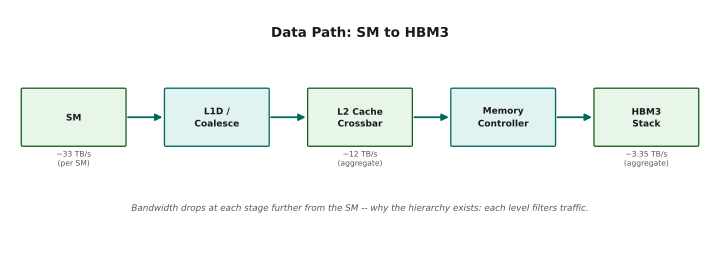

*Figure 5.1 — Bandwidth available to the SM drops at every stage further from compute: roughly 33 TB/s per-SM at L1D/coalescing, roughly 12 TB/s aggregate at the L2 crossbar, down to the official 3.35 TB/s aggregate at the memory controllers and HBM3 stacks themselves. This is why the cache hierarchy exists — each level filters how much traffic actually has to reach HBM.*

### 5.2 Why 5120-bit Bus Width Matters for TMA

A number like "5,120-bit bus" only becomes useful once you convert it into how
long your tile actually takes to arrive. That's what this does.

```
Bus width: 5120 bits = 640 bytes (10 × 512-bit memory controllers)
[NVIDIA Hopper Architecture whitepaper, GTC22, v1.02]

TMA can move 128 bytes of data at once in a single transaction.
This fits cleanly into the bus width:
  5120 bits / 8 = 640 bytes wide
  640 / 128 = 5 concurrent 128-byte transactions, bus-width-wise

For a 64×64 BF16 tile:
  64 × 64 × 2 bytes = 8,192 bytes

At the official aggregate HBM3 bandwidth of 3.35 TB/s
[NVIDIA H100 datasheet, PB-11773-001]:
  8,192 bytes / 3.35 TB/s ≈ 2.4 ns for one tile transfer once the
  request is in flight -- fast enough to keep tensor cores fed.

  Note: HBM3's own per-pin signaling clock runs far higher than, and
  in a completely separate clock domain from, the SM's 1,980 MHz boost
  clock. An earlier draft of this section estimated tile-transfer time
  from an assumed "~1.8 GHz memory clock," which conflated the two
  domains. This version derives the same number from the published
  aggregate bandwidth instead, so it doesn't need that assumption.
```

---

## 6 — L2 Cache

The L2 is a 50 MB staging area shared by every SM, and essentially all traffic
to and from HBM passes through it.

Two facts about it drive real kernel performance: it is organised into 128-byte
lines made of four 32-byte **sectors**, and it charges you per *sector touched*,
not per useful byte. That single detail is what "coalescing" means, and it is
why two kernels that move the same amount of data can differ by 32× in speed.

### 6.1 Structure and Behavior

Four behaviours are described below. The first two — sectors, and the penalty
for scattered access — are the ones you'll actively think about while writing
kernels. The last two happen for you, for free.

```
L2 Cache — 50 MB Unified
══════════════════════════════════════════════════════════

  Total size:        50 MB
  Partitions:        2 × 25 MB
  Cache line:        128 bytes
  Sectors per line:  4 × 32 bytes
  Total lines:       50 MB / 128 B = 409,600 lines

  Key behaviors:

  1. SECTOR-BASED FILLING
     A cache line is 128 bytes, but consists of 4 × 32-byte sectors.
     A memory request can touch 1-4 sectors of a single line.
     The cache can fill sector-by-sector (no need to load all 128 bytes).

  2. UNCOALESCED ACCESS PENALTY
     A warp of 32 threads issues a memory instruction.
     If threads access scattered addresses:
       Best case:  1 sector  (all 32 threads in same 32B)
       Worst case: 32 sectors (every thread in a different sector)

     Uncoalesced access explodes the number of sectors requested,
     consuming L2 bandwidth and evicting useful cache lines.

  3. GPC-LOCAL PARTITIONING
     Each GPC is "closer" to one L2 partition.
     Accesses to the nearby partition have lower latency.
     The memory subsystem tries to map addresses so that
     an SM's working set hits its local L2 partition.

  4. WRITE COALESCING
     The L2 absorbs small, messy writes from SMs (via L1)
     and batches them into clean, large writes to HBM.
     This is critical for scatter/atomic operations.
```

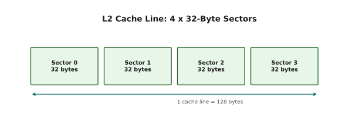

*Figure 6.1 — A cache line is 128 bytes made of four 32-byte sectors. The L2 can fill sector-by-sector rather than always loading the full 128 bytes, which is what makes the coalescing math in §6.2 work the way it does.*

### 6.2 Worked Example — L2 Sector Math

Same amount of data, two access patterns, a 32× difference in cost. Work through
both by hand — this is probably the most valuable arithmetic in the chapter.

```
Scenario: A warp of 32 threads each loads a float (4 bytes)
          from consecutive addresses starting at address 0x1000.

Thread  0: loads 4 bytes from 0x1000
Thread  1: loads 4 bytes from 0x1004
Thread  2: loads 4 bytes from 0x1008
...
Thread 31: loads 4 bytes from 0x107C

Total bytes: 32 × 4 = 128 bytes = exactly 1 cache line
Sectors touched: 4 (each sector = 32 bytes, 8 threads per sector)
L2 transactions: 1 cache line fetch (may fetch 1-4 sectors)

Result: PERFECTLY COALESCED — 1 L2 transaction for 32 threads.


Bad scenario: 32 threads each load a float with stride 128 bytes

Thread  0: 0x1000
Thread  1: 0x1080  (128 bytes later)
Thread  2: 0x1100
...
Thread 31: 0x1F80

Total bytes still 128, but spread across 32 different cache lines.
Sectors touched: 32 (one sector per thread, all different lines)
L2 transactions: 32 separate cache line fetches!

Result: 32× WORSE bandwidth usage for the same amount of data.
This is why coalescing matters so much.
```

---

## 7 — GPCs — Graphics Processing Clusters

The 132 SMs are not a flat pool. They are grouped into eight **Graphics
Processing Clusters** of 18 SMs each.

For most of GPU history this grouping was invisible to programmers. On Hopper it
stopped being invisible, because *thread block clusters* — groups of blocks that
can read each other's shared memory — only work within a single GPC. This is a
short section, but it is the reason cluster sizes cap out where they do.

### 7.1 GPC Internal Structure

One GPC, drawn out. The pieces to notice: the 18 SMs, their pairing into TPCs,
and the DSMEM interconnect that lets SMs read one another's shared memory
directly — without going out to L2 and back.

One GPC contains 18 Streaming Multiprocessors (SMs), organized into 9 Texture Processing Clusters (TPCs) of 2 SMs each, a connection to its local L2 cache partition, and a Distributed Shared Memory (DSMEM) network.

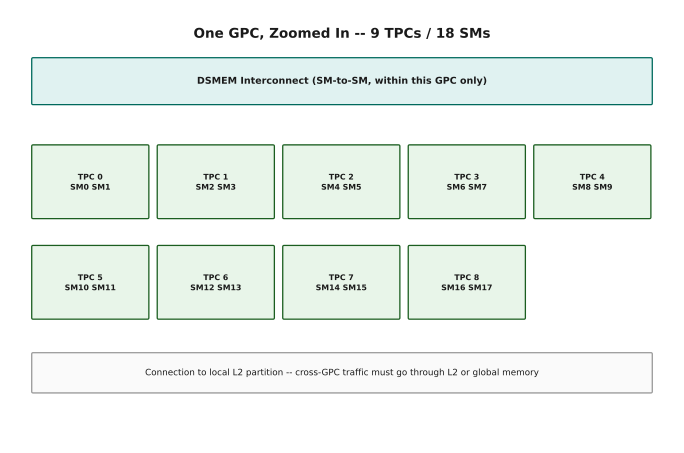

*Figure 7.1 — TPCs exist primarily to enable fast SM-to-SM communication for DSMEM — two SMs in the same TPC exchange data with minimal latency. DSMEM only exists within a GPC: cross-GPC communication must go through L2 or global memory, and traffic to HBM also flows through the GPC's local L2 partition.*

### 7.2 Why GPCs Matter for Kernel Design

The practical consequence of everything above: how large can a cluster be, and
what does each size cost you in synchronisation?

```
Implication for Thread Block Clusters:
═══════════════════════════════════════

  A cluster of thread blocks must all run on SMs within the SAME GPC.
  (Because clusters need DSMEM, and DSMEM only exists within a GPC.)

  GPC has 18 SMs → maximum cluster size = 16 thread blocks
  (leaves ~2 SMs available for other work or yield failures)

  Practical cluster sizes:
    Size  2: 9 clusters per GPC, low sync overhead (87 cycles)
    Size  4: 4 clusters per GPC, moderate sync overhead
    Size  8: 2 clusters per GPC, good utilization
    Size 16: 1 cluster per GPC, ~2 SMs idle, 150-cycle sync cost
```

---

## 8 — NVLink 4.0

Everything so far has been inside a single GPU. NVLink is the wire *between*
GPUs — 900 GB/s of it, roughly seven times what PCIe offers.

You won't program NVLink directly in this chapter (Chapter 11 does that). What
matters here is its speed relative to PCIe and HBM, because that ratio is what
decides where to put your model once it stops fitting on one card.

### 8.1 Physical Specifications

The one piece of physics worth knowing is PAM4 signalling: by using four voltage
levels on the wire instead of two, each symbol carries two bits instead of one —
doubling the data rate without raising the clock.

```
NVLink 4.0 — GPU-to-GPU Interconnect
══════════════════════════════════════════════════════════

  Total bandwidth:     900 GB/s (bidirectional)
  Links:               18 fourth-generation NVLink links
  Per link:            50 GB/s bidirectional
                        (25 GB/s per direction, via 2 differential
                        signal pairs per direction)
  Check:               18 × 50 GB/s = 900 GB/s  ✓
  [NVIDIA Hopper Architecture whitepaper, GTC22, v1.02]

  Signaling:           PAM4 (Pulse Amplitude Modulation, 4 levels)
  ┌─────────────────────────────────────────────────────────┐
  │  NRZ  (NVLink 1.0-3.0): 2 amplitude levels → 1 bit/symbol │
  │  PAM4 (NVLink 4.0+):    4 amplitude levels → 2 bits/symbol│
  │                                                            │
  │  Same baud rate, twice the bits per symbol →              │
  │  2× the data rate per differential pair.                  │
  │  (NVIDIA does not publish exact per-level voltages --      │
  │  only the 4-level/2-bit-per-symbol scheme is public.)      │
  └─────────────────────────────────────────────────────────┘

  Direct connections:  Up to 8 GPUs peer-to-peer
  NVSwitch fabric:     Up to 256 GPUs in a switched topology

  TMA integration:
    NVLink connects directly with the TMA unit.
    Within a DGX node, TMA can issue bulk copies to/from
    remote GPU memory without SM intervention.
```

### 8.2 Multi-GPU Topology

Eight GPUs, each able to reach every other at full speed. The bandwidth
comparison at the bottom is the part to remember.

```
DGX H100 Node (8 GPUs, fully connected via NVSwitch)
══════════════════════════════════════════════════════════

  ┌──────┐    NVLink     ┌──────┐
  │GPU 0 │◄────────────►│GPU 1 │
  │      │    900 GB/s    │      │
  └──┬───┘               └──┬───┘
     │ ╲                  ╱  │
     │   ╲    NVSwitch  ╱    │
     │     ╲          ╱      │
  ┌──┴───┐   ╲      ╱   ┌──┴───┐
  │GPU 2 │◄───╲──►╱───►│GPU 3 │
  └──┬───┘      ╳       └──┬───┘
     │        ╱   ╲         │
  ┌──┴───┐ ╱       ╲ ┌──┴───┐
  │GPU 4 │◄──────────►│GPU 5 │
  └──┬───┘            └──┬───┘
     │                    │
  ┌──┴───┐            ┌──┴───┐
  │GPU 6 │◄──────────►│GPU 7 │
  └──────┘            └──────┘

  Every GPU can talk to every other GPU at 900 GB/s.
  Total bisection bandwidth: 900 × 8 = 7.2 TB/s

  For comparison:
    PCIe 5.0: 128 GB/s (GPU ↔ CPU)
    NVLink:   900 GB/s (GPU ↔ GPU) → 7× faster than PCIe

  This is why multi-GPU training puts tensor/pipeline parallelism
  across NVLink, and data parallelism across network nodes.
```

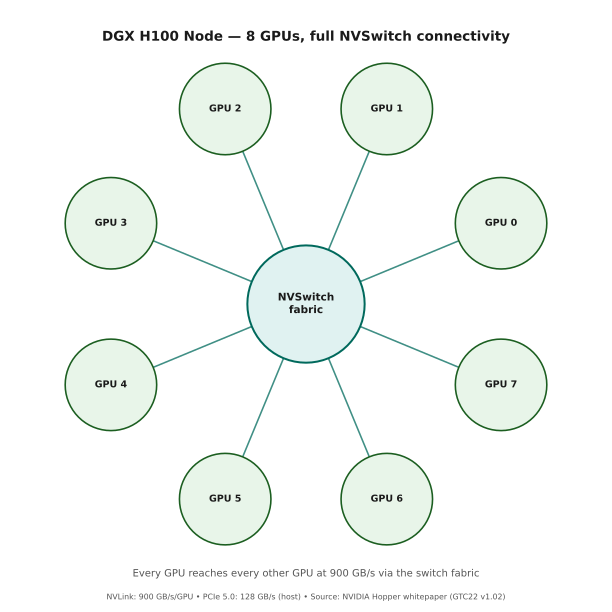

*Figure 1.3 — The same eight GPUs, drawn as a star through the switch rather than a mesh of direct links. Source: NVIDIA Hopper Architecture whitepaper (GTC22 v1.02).*

---

## 9 — The Streaming Multiprocessor (SM)

This is the heart of the chapter. The SM is the unit that actually runs your
code: one thread block lands on one SM and stays there until it finishes.

The next several sections take the SM apart layer by layer — the four quadrants
inside it (§10), how each quadrant decides which warp to run (§11), the
arithmetic units they feed (§12), the shared memory they all share (§13), and
the registers each thread owns (§14). The diagram below is the map for all of
them.

### 9.1 SM Overview

The SM is the fundamental execution unit of the GPU. It receives thread blocks from the GigaThread Engine and executes them to completion.

```
H100 SM — Internal Architecture
══════════════════════════════════════════════════════════════════

  ┌────────────────────────────────────────────────────────────┐
  │                    Streaming Multiprocessor                 │
  │                                                            │
  │  ┌──────────────────────────────────────────────────────┐  │
  │  │              L1 Instruction Cache (128 KB)           │  │
  │  │     (shared across all 4 quadrants)                  │  │
  │  └─────────────────────┬────────────────────────────────┘  │
  │                        │                                    │
  │  ┌──────────┬──────────┬──────────┬──────────┐            │
  │  │Quadrant 0│Quadrant 1│Quadrant 2│Quadrant 3│            │
  │  │ (SMSP 0) │ (SMSP 1) │ (SMSP 2) │ (SMSP 3) │            │
  │  │          │          │          │          │            │
  │  │ Warp     │ Warp     │ Warp     │ Warp     │            │
  │  │ Sched    │ Sched    │ Sched    │ Sched    │            │
  │  │          │          │          │          │            │
  │  │ L0 ICache│ L0 ICache│ L0 ICache│ L0 ICache│            │
  │  │          │          │          │          │            │
  │  │ 32 FP32  │ 32 FP32  │ 32 FP32  │ 32 FP32  │  = 128/SM │
  │  │ 16 FP64  │ 16 FP64  │ 16 FP64  │ 16 FP64  │  =  64/SM │
  │  │ 16 INT32 │ 16 INT32 │ 16 INT32 │ 16 INT32 │  =  64/SM │
  │  │ 1 Tensor │ 1 Tensor │ 1 Tensor │ 1 Tensor │  =   4/SM │
  │  │ 8 LSU    │ 8 LSU    │ 8 LSU    │ 8 LSU    │  =  32/SM │
  │  │ 4 SFU    │ 4 SFU    │ 4 SFU    │ 4 SFU    │  =  16/SM │
  │  │          │          │          │          │            │
  │  │ Dispatch │ Dispatch │ Dispatch │ Dispatch │            │
  │  │ Unit     │ Unit     │ Unit     │ Unit     │            │
  │  │          │          │          │          │            │
  │  │ Register │ Register │ Register │ Register │            │
  │  │  File    │  File    │  File    │  File    │            │
  │  │ (64 KB)  │ (64 KB)  │ (64 KB)  │ (64 KB)  │  = 256 KB │
  │  └──────────┴──────────┴──────────┴──────────┘            │
  │                        │                                    │
  │  ┌──────────────────────────────────────────────────────┐  │
  │  │        Unified Shared Memory / L1 Data Cache         │  │
  │  │            256 KB total (228 KB SMEM max)            │  │
  │  │         33 TB/s bandwidth, 32 banks × 4 bytes        │  │
  │  └──────────────────────────────────────────────────────┘  │
  │                        │                                    │
  │  ┌──────────────────────────────────────────────────────┐  │
  │  │                    TMA Unit                          │  │
  │  │   (async tensor copy, descriptor-based addressing)   │  │
  │  └──────────────────────────────────────────────────────┘  │
  └────────────────────────────────────────────────────────────┘
```


*Figure 1.2 — One SM, every unit from this section placed where it actually sits. Source: NVIDIA Hopper Architecture whitepaper (GTC22 v1.02).*

---

## 10 — SM Quadrants (SMSPs)

An SM is not one processor — it is four, and they schedule independently.

This matters for a reason you can act on immediately: if your block size isn't a
multiple of 128 threads, some of those four sit idle. §10.2 shows exactly how
that waste happens.

### 10.1 Quadrant Breakdown

Each SM is divided into 4 identical subdivisions. Each quadrant is an independently scheduling unit:

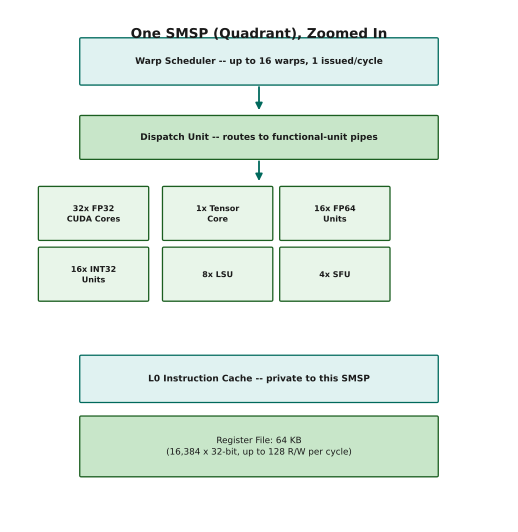

*Figure 10.1 — A single SMSP holds a warp scheduler (up to 16 resident warps, one selected per cycle), a dispatch unit, its own execution units (32 FP32 CUDA cores, 1 tensor core, 16 FP64 units, 16 INT32 units, 8 LSUs, 4 SFUs), a private L0 instruction cache, and a 64 KB register file (65,536 × 32-bit registers). Four of these make up one SM: 128 FP32 cores, 64 FP64 units, 64 INT32 units, 4 tensor cores, 32 LSUs, 16 SFUs, 256 KB registers, and 4 independent warp schedulers (up to 64 resident warps per SM).*

### 10.2 Why 4 Quadrants?

Here is the practical payoff of knowing the SM is four things rather than one.

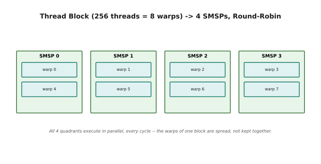

*Figure 10.2 — A 256-thread block is 8 warps; the hardware distributes them round-robin, two per quadrant (Q0: warps 0 and 4, Q1: warps 1 and 5, and so on), and all four quadrants schedule and execute in parallel. The practical rule follows directly: size blocks in multiples of 128 threads (4 warps) so every quadrant gets equal work — a 96-thread block (3 warps) leaves one quadrant idle, wasting 25% of the SM.*

---

## 11 — Warp Schedulers & Dispatch

Threads on a GPU do not run individually. They run in locked groups of 32 called
**warps**, and the hardware's entire latency-hiding strategy is to keep many
warps resident and switch between them the moment one stalls.

This section explains what a warp is (§11.1), how the scheduler picks one each
cycle (§11.2), and a hardware limit most people never hear about — dispatch
ports (§11.3).

### 11.1 What is a Warp?

Start here if *warp* is a new word. A warp is simply the granularity at which
the hardware thinks: 32 threads that fetch one instruction and execute it
together, in lockstep.

```
Warp = 32 Threads
══════════════════════════════════════════════════════════

  Thread block of 256 threads:
    Warp 0: threads   0 -  31
    Warp 1: threads  32 -  63
    Warp 2: threads  64 -  95
    Warp 3: threads  96 - 127
    Warp 4: threads 128 - 159
    Warp 5: threads 160 - 191
    Warp 6: threads 192 - 223
    Warp 7: threads 224 - 255

  Properties:
    ├── Created together from a thread block
    ├── Share a warp scheduler's attention
    ├── Execute the SAME instruction (mostly — divergence aside)
    ├── Each thread has PRIVATE registers
    └── Memory operations coalesce across the 32 threads

  Why 32?
    ├── Matches 32 memory banks in shared memory
    ├── 32 threads × 4 bytes = 128 bytes = 1 cache line
    ├── Good balance between control overhead and parallelism
    └── Hardware sweet spot for SIMT execution
```

### 11.2 Warp Scheduler Operation

Five steps, every cycle, in every quadrant. The reason the whole machine is
built this way is the sentence at the bottom of the block.

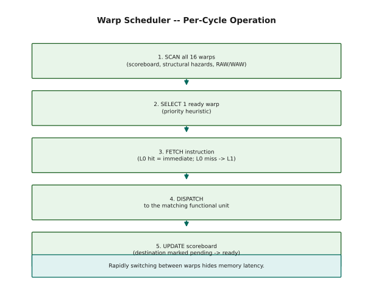

*Figure 11.1 — Every cycle, each SMSP's warp scheduler scans up to 16 resident warps against the scoreboard and structural/dependency hazards, selects one ready warp, fetches its instruction (L0 hit or a slower L1 fallback), dispatches it to the Dispatch Unit, and updates the scoreboard once it completes. Rapidly switching among 16 warps is how the scheduler hides memory latency — while one warp waits on a load, the others can be executing compute.*

### 11.3 The Dispatch Unit and Dispatch Ports

This is the one part of the SM that no occupancy calculator will show you, and
it explains why "the SM has 128 FP32 cores and 64 INT32 units" does not mean a
single warp can use both in the same cycle.

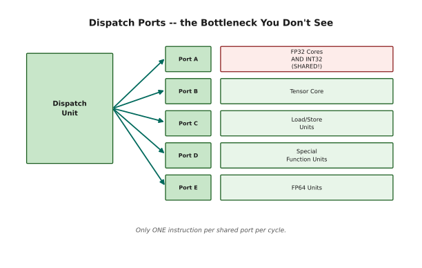

*Figure 11.2 — The dispatch unit has a limited number of physical ports, and Port A is shared between the FP32 CUDA cores and the INT32 units: only one instruction can issue through a shared port per cycle, so a warp can't issue an FP32 and an INT32 instruction in the same cycle even though both unit types exist. Ports B through E (tensor core, LSUs, SFUs, FP64) are dedicated. A port is only occupied for instruction launch, not for the full execution duration — a multi-cycle tensor core MMA frees its port after the first cycle.*

---

## 12 — Execution Units Deep Dive

The five kinds of arithmetic hardware inside each quadrant, one at a time.

Most of this is reference material — skim it now and come back. The two
subsections that will actually change how you write code are §12.2 (integer work
runs in parallel with floating-point, so address arithmetic is effectively free)
and §12.5 (load/store units, and coalescing).

### 12.1 FP32 CUDA Cores

The default workhorse. Anything that isn't a matrix multiply ends up here.

```
FP32 CUDA Cores
══════════════════════════════════════════════════════════

  Per SM:        128 (32 per quadrant)
  Total (SXM5):  16,896 (132 SMs × 128)
  Operations:    Standard 32-bit floating point
                 (add, multiply, FMA, comparison, conversion)

  Throughput:    128 FP32 FMA/cycle/SM = 256 FLOPS/cycle/SM
                 (each FMA = 2 FLOPs: multiply + add)

  These are the "default" compute units — used for:
    ├── General-purpose math
    ├── Reduction operations
    ├── Activation functions (when SFU isn't appropriate)
    └── Any FP32 work that doesn't map to tensor cores
```

### 12.2 INT32 Units

The important claim here is the one in capitals: integer and floating-point work
proceed at the same time, on separate datapaths. This is why the address
arithmetic in a tiled loop costs you almost nothing.

```
INT32 Units
══════════════════════════════════════════════════════════

  Per SM:        64 (16 per quadrant)
  Total (SXM5):  8,448

  Primary uses:
    ├── Memory address calculations (pointer arithmetic)
    ├── Loop control (counters, comparisons)
    ├── Index math for tiling patterns
    └── General integer arithmetic

  KEY FEATURE: Can execute SIMULTANEOUSLY with FP32 cores.
  The hardware has separate datapaths for INT and FP.

  This means: while the FP32 pipeline computes on data,
  the INT32 pipeline can be computing the next set of
  addresses — zero stall for address generation.

  Typical pattern in a GEMM kernel:
    FP32: compute partial sum  (data path)
    INT32: calculate next tile address  (address path)
    Both execute in the SAME cycle (different warps or instructions).
```

### 12.3 FP64 Units

Double precision. On the H100 it runs at deliberately half the FP32 rate — this
chip was designed for machine learning, not for simulation.

```
FP64 Units
══════════════════════════════════════════════════════════

  Per SM:        64 (16 per quadrant)
  Total (SXM5):  8,448

  FP64 throughput = exactly HALF of FP32.
  This is by design — H100 prioritizes ML (FP16/FP8/BF16)
  over scientific computing (FP64).

  Used for:
    ├── High-precision scientific simulations
    ├── Financial computations requiring exact precision
    └── Numerical methods where FP32 isn't sufficient

  For comparison:
    A100:  FP64 = 1/2 FP32 throughput
    H100:  FP64 = 1/2 FP32 throughput  (same ratio)
    The absolute FP64 throughput is higher because the clock is higher.
```

### 12.4 Special Function Units (SFUs)

When your code calls `exp()` or `sqrt()`, it does not run a software routine.
These units approximate the answer in hardware, trading a little accuracy for a
great deal of speed.

```
Special Function Units (SFUs)
══════════════════════════════════════════════════════════

  Per SM:     16 (4 per quadrant)
  Throughput: 1 instruction per cycle per SFU → 16 ops/cycle/SM

  Functions handled:
    ├── sin(x), cos(x)           (trigonometric)
    ├── exp(x), exp2(x)          (exponential)
    ├── log(x), log2(x)          (logarithmic)
    ├── sqrt(x), rsqrt(x)        (roots)
    ├── rcp(x)                    (reciprocal: 1/x)
    └── Other transcendental functions

  Implementation:
    ├── Polynomial approximations (Chebyshev or minimax)
    ├── Lookup tables + interpolation
    └── Sacrifice some precision for massive throughput

  Precision: ~22 bits of mantissa accuracy (vs 23 for full FP32).
  For most ML workloads, this is more than sufficient.

  WARNING: If ALL 32 threads in a warp call an SFU function,
  and there are only 4 SFUs per quadrant, the operation takes:
    32 threads / 4 SFUs = 8 cycles per warp (for one quadrant)

  This is still much faster than computing sin() in software
  on the CUDA cores, which would take ~20+ instructions.
```

### 12.5 Load/Store Units (LSUs)

Read this one twice. Coalescing — how well the 32 addresses in a warp merge into
cache-line requests — is the single biggest lever on memory performance in most
kernels, and this is where it happens.

```
Load/Store Units (LSUs)
══════════════════════════════════════════════════════════

  Per SM:     32 (8 per quadrant)
  Connection: Direct to L1 cache / shared memory

  Operations:
    ├── ld  (load from memory → register)
    ├── st  (store from register → memory)
    ├── atom (atomic read-modify-write)
    └── red  (reduction operations)

  Coalescing (the most important concept for memory performance):
  When a warp executes a load, 32 threads each provide an address.
  The LSU attempts to MERGE these 32 addresses into as few
  cache-line requests as possible.
```

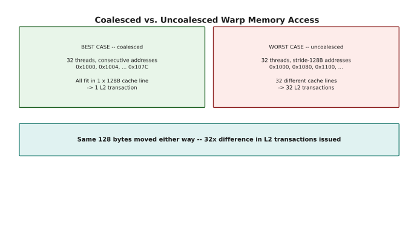

*Figure 12.1 — Best case: all 32 threads' addresses fall in one 128-byte cache line, so the LSU issues a single request that serves the whole warp. Worst case: every thread hits a different cache line, so the LSU issues 32 separate requests — 32× the bandwidth consumption for the same amount of data. When the L1 misses, the request cascades to L2 and then HBM, multiplying the waste at every level.*

---

## 13 — Unified Shared Memory + L1 Cache

Shared memory is the scratchpad you manage by hand: 228 KB per SM, roughly 100×
quicker to reach than HBM, and the place your tiles live while the tensor cores
work on them.

This section covers how much of it you get (§13.1), how large to make your tiles
(§13.2), the one easy way to accidentally make it 32× slower (§13.3–§13.4), and
the fix for that (§13.5).

### 13.1 The Configurable Split

Shared memory and the L1 data cache are the same 256 KB of silicon, split
however you ask for it. More shared memory suits tiled algorithms that stage
data deliberately; more L1 suits irregular access patterns you can't predict
ahead of time.

```
Unified Shared Memory / L1 Data Cache
══════════════════════════════════════════════════════════

  Total size:     256 KB per SM
  Max shared mem: 228 KB (configurable)
  Bandwidth:      33 TB/s per SM
  Banks:          32 banks × 4 bytes (32 bits) wide
  Cache line:     128 bytes
  Sector:         32 bytes (cache fills sector-by-sector)

  The 256 KB is shared between:
    ├── Shared memory (programmer-managed, explicit)
    └── L1 data cache (hardware-managed, automatic)
```

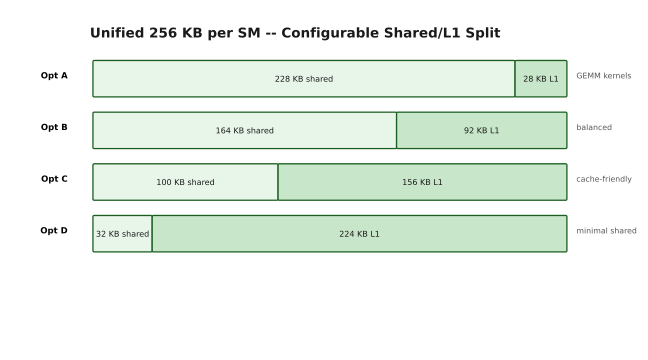

*Figure 13.1 — You choose the split of the 256 KB unified pool per kernel: Option A (228 KB shared + 28 KB L1) suits GEMM-style tiled kernels, Option B (164 KB + 92 KB) is a balanced default, Option C (100 KB + 156 KB) favors cache-friendly irregular access, and Option D (32 KB + 224 KB) is for kernels that barely use shared memory at all.*

```

  TRADEOFF:
    More shared memory → better for tiled algorithms (GEMM, attention)
                         but less L1 cache for spill/register pressure
    More L1 cache → better for irregular access patterns
                    but less space for explicit data staging

  Per-thread-block limit: 227 KB (1 KB reserved by CUDA runtime)
  Static __shared__ arrays: limited to 48 KB (compatibility)
  Beyond 48 KB: must use dynamic shared memory (extern __shared__)
```

### 13.2 Optimal Tile Sizing

Bigger tiles are not automatically better. Here is how to think about the
tradeoff in both directions.

```
Practical Tile Size Guidelines for GEMMs:
══════════════════════════════════════════════════════════

  The sweet spot is 64-128 KB per thread block.

  Why not use all 228 KB?
    ├── Larger tiles → more data to load before computing
    ├── First iteration has nothing to overlap with
    ├── Higher latency to fill the tile
    └── Fewer thread blocks fit per SM (hurts occupancy)

  Why not tiny tiles (e.g., 8 KB)?
    ├── Tile overhead (setup, sync) amortized over less compute
    ├── Lower compute-to-memory ratio
    └── More tiles needed → more kernel launch overhead

  Example for a BF16 GEMM:
    Tile = 128 × 128 × 2 bytes = 32 KB per matrix
    A tile + B tile = 64 KB ← fits well in shared memory
    Leaves room for double-buffering: 64 KB × 2 = 128 KB
    Still within the 228 KB limit with room for L1 cache
```

### 13.3 Bank Conflicts

Shared memory is fast because it is split into 32 independent **banks** that can
all be read in the same cycle. It stops being fast the instant two threads want
different addresses that happen to live in the same bank.

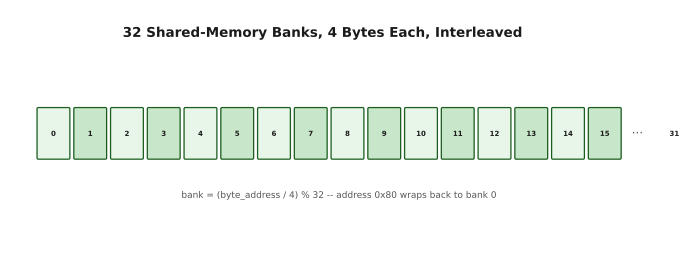

*Figure 13.2 — Shared memory is split into 32 banks of 4 bytes each, interleaved across consecutive words and wrapping every 128 bytes (`bank = (byte_address / 4) % 32`). 32 threads hitting 32 different banks — or all hitting the same address, which broadcasts — are served in a single cycle; two or more threads hitting different addresses in the same bank serialize into an N-way conflict costing N cycles.*

### 13.4 Worked Example — Bank Conflict

The worst case, worked out. A perfectly reasonable-looking access — read one
column of a matrix — collapses to a thirty-second of full speed.

```
Scenario: 32 threads load column 0 of a 64×64 BF16 matrix
stored row-major in shared memory.

Row layout: 64 elements × 2 bytes = 128 bytes per row

Thread 0 loads: row 0, col 0 → address 0x0000 → bank (0/4)%32 = 0
Thread 1 loads: row 1, col 0 → address 0x0080 → bank (128/4)%32 = 0
Thread 2 loads: row 2, col 0 → address 0x0100 → bank (256/4)%32 = 0
...
Thread 31 loads: row 31, col 0 → address 0x0F80 → bank = 0

ALL 32 THREADS HIT BANK 0!
This is a 32-way bank conflict → takes 32 cycles instead of 1.
That's a 32× performance loss on this access!

Why?
  Row size = 128 bytes = 32 × 4-byte words = exactly 32 banks
  So column 0 of every row maps to the same bank.
  stride (128 bytes) is a perfect multiple of bank width (128 bytes).

This is EXACTLY why swizzling exists.
```

### 13.5 Swizzling — The Fix for Bank Conflicts

The fix is to scramble where each row starts, so that a column no longer lands
in a single bank. That is swizzling — and the good news at the end is that the
TMA can apply it for you on the way in.

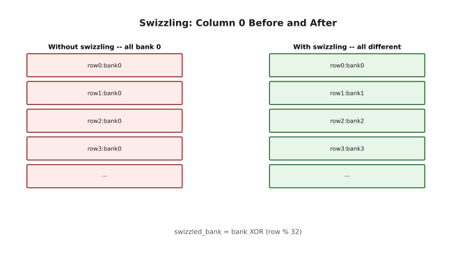

*Figure 13.3 — Without swizzling, column 0 of every row lands in bank 0 — a 32-way conflict. Swizzling XORs the row index into the bank calculation (`swizzled_bank = bank XOR (row % 32)`), so column 0 of row 0 is bank 0, row 1 is bank 1, row 2 is bank 2, and so on — every row lands in a different bank.*

```
  Swizzle formula (simplified):
    swizzled_bank = bank XOR (row % 32)

  Column 0 access after swizzling:
    Thread 0 (row 0): bank = 0 XOR 0 = 0
    Thread 1 (row 1): bank = 0 XOR 1 = 1
    Thread 2 (row 2): bank = 0 XOR 2 = 2
    Thread 3 (row 3): bank = 0 XOR 3 = 3
    ...
    Thread 31 (row 31): bank = 0 XOR 31 = 31

    ALL 32 threads hit DIFFERENT banks → conflict-free!

  The hardware (TMA) can apply swizzling automatically
  when copying into shared memory, so you don't need
  to do the XOR manually in your kernel code.
```

---

## 14 — Registers

Registers are the fastest storage on the chip and the scarcest: 256 KB per SM,
divided among every thread resident there.

The tension running through this section is that using more registers per thread
makes each thread faster, but lets fewer threads run at once — and past a
certain point that trade goes badly.

### 14.1 Register File Specifications

The specifications, plus the packing rules. Note that FP16 stores two values per
register and FP8 stores four — which is why tensor core operands have to be
packed before you hand them over.

```
Register File
══════════════════════════════════════════════════════════

  Per SM:        256 KB (65,536 × 32-bit registers)
  Per quadrant:  64 KB  (16,384 × 32-bit registers)
  Bandwidth:     Up to 128 reads/writes per cycle per SM
  Latency:       1 cycle (lowest of any storage)
  Energy:        30-50× more efficient than shared memory
                 1000×+ more efficient than HBM3

  Every thread gets a PRIVATE set of registers.
  Register allocation is determined at COMPILE TIME.

  Base unit: 32-bit slots
    ├── FP32:    1 register per value
    ├── FP64:    2 registers per value (register pair)
    ├── FP16:    2 values packed into 1 register
    ├── BF16:    2 values packed into 1 register
    ├── FP8:     4 values packed into 1 register
    ├── INT32:   1 register per value
    └── Pointers: 2 registers (64-bit address)
```

### 14.2 Occupancy Limiting

The tradeoff in numbers. Watch for the cliff: because the compiler allocates
registers in fixed-size chunks, two extra registers per thread can cost you an
entire warp's worth of occupancy.

```
Register Pressure — The Silent Performance Killer
══════════════════════════════════════════════════════════

  Per quadrant: 16,384 registers
  If your kernel uses R registers per thread:

  Max threads per quadrant = floor(16,384 / R)
    But also capped by other limits (warps, shared mem, etc.)

  Example calculations:
  ─────────────────────────────────────────────────
  Regs/thread    Max threads/quadrant    Max warps/quadrant
  ─────────────────────────────────────────────────
      32          512                     16 (max)
      64          256                      8
      96          170                      5
     128          128                      4
     160          102                      3
     192           85                      2
     255           64                      2
  ─────────────────────────────────────────────────

  CRITICAL CLIFF EFFECT:
    63 registers/thread → floor(16384/63) = 260 → 8 warps
    65 registers/thread → floor(16384/65) = 252 → 7 warps

    That's a 12.5% drop in occupancy from adding 2 registers!

    Register allocation has internal GRANULARITY (typically 8 regs).
    The compiler rounds UP to the next granularity boundary.
    A small change in code can push you over a boundary.
```

### 14.3 Register Spilling

What happens when you lose that fight, and how to notice that you have.

```
What Happens When You Run Out of Registers
══════════════════════════════════════════════════════════

  When the compiler needs more registers than the hardware has,
  it "spills" values to slower memory:

  Priority (best to worst):
    1. Registers          ← 1 cycle, lowest energy
    2. Shared memory      ← ~20 cycles (CUDA 13.0+ spill target)
    3. Local memory       ← ~200-400 cycles (lives in L2/HBM!)

  CUDA 13.0 improvement:
    Before: spill → local memory (through L2/HBM, very slow)
    After:  spill → shared memory first (much faster)
            Only falls back to local memory if shared mem is full

  How to detect spilling:
    nvcc --ptxas-options=-v  →  shows "spill loads" and "spill stores"
    If you see any, your kernel is likely register-pressure limited.

  How to reduce register usage:
    ├── __launch_bounds__(maxThreads, minBlocks)
    ├── Recompute values instead of storing them
    ├── Use smaller data types (FP16 → half the registers)
    └── Restructure code to reduce live variables
```

### 14.4 WGMMA Register Layout

A forward reference to Chapters 6 and 7. Tensor cores are particular about where
their operands live, and the rules are not symmetric between A, B, and C.

```
WGMMA Register Layout Requirements
══════════════════════════════════════════════════════════

  For Tensor Core operations (WGMMA):

  Matrix A:
    ├── Can be in shared memory OR registers
    ├── If in registers: must follow specific thread-to-element mapping
    └── FP16/BF16: packed 2 per 32-bit register

  Matrix B:
    ├── MUST be in shared memory (SMEM)
    ├── NEVER in registers
    └── This is a hard architectural constraint

  Matrix C (accumulator):
    ├── Distributed across 4 warps (128 threads)
    ├── Each thread holds a small fragment of the output
    ├── Stays in registers throughout the MMA
    └── FP32 accumulation is standard (higher precision)

  Packing requirements:
    FP16:  2 values per 32-bit register → register.xy = {val0, val1}
    BF16:  2 values per 32-bit register → same packing
    FP8:   4 values per 32-bit register → register.xyzw = {v0,v1,v2,v3}

    WGMMA instructions EXPECT packed data. If your data
    isn't packed correctly, the instruction produces garbage.
```

---

## 15 — Instruction Caches (L0 & L1)

Instructions have to be fetched too, and the same caching logic applies to them
as to data. There are two levels.

The only practical takeaway is at the end of §15.1: unrolling a loop too
aggressively can push your inner loop out of the tiny L0 cache and cost you more
than the unrolling saved.

### 15.1 L0 Instruction Cache

A very small buffer, private to each quadrant, whose entire job is to hold your
inner loop so the scheduler never waits on an instruction fetch.

```
L0 Instruction Cache — Per-Quadrant Micro-Buffer
══════════════════════════════════════════════════════════

  Purpose:    Feed the warp scheduler with instructions at wire speed
  Scope:      Private to each SMSP (quadrant 0 cannot use quadrant 1's L0)
  Size:       Very small (a few tight loops fit, not much more)
  Hit rate:   Extremely high for inner loops (GEMM, convolution)

  Without L0:
    Every cycle, the scheduler would have to fetch from L1.
    L1 is shared across all 4 quadrants → contention.
    L1 has higher latency → pipeline bubbles.

  With L0:
    Tight loops are captured in L0 after first execution.
    Subsequent iterations: instruction fetch = 1 cycle.
    The scheduler issues at full speed without waiting.

  What BREAKS the L0:
    ├── Aggressive loop unrolling (code doesn't fit in L0)
    ├── Heavy function inlining (expanded code too large)
    ├── Very branchy code (cache thrashing)
    └── Solution: balance unrolling vs. L0 cache pressure
```

### 15.2 L1 Instruction Cache

The larger backstop behind L0, shared by all four quadrants.

```
L1 Instruction Cache — Shared Across SM
══════════════════════════════════════════════════════════

  Size:     128 KB per SM
  Purpose:  Buffer SASS instructions for all 4 quadrants

  Without L1 I-Cache:
    Every instruction would come from L2 cache or HBM3.
    L2 access: ~30-50 cycles
    HBM3 access: ~300-500 cycles
    The pipeline would stall constantly.

  With L1 I-Cache:
    Kernel code is loaded once into L1.
    All 4 quadrants fetch from the same L1.
    Common loops served at ~5-10 cycle latency.

  The L1 I-Cache also handles:
    ├── Branch target buffering (jumps, loops)
    ├── Function call/return target caching
    └── Prefetching sequential instruction streams

  GEMM inner loop example:
    The inner loop of a tiled GEMM is typically ~50-200 instructions.
    This easily fits in the L1 I-Cache (128 KB).
    After the first iteration, all instruction fetches hit L1.
```

---

## 16 — Thread Block Distribution

This section closes the loop between the code you write — `kernel<<<grid,
block>>>` — and the hardware you've just been reading about.

Two questions get answered: how one block is placed on an SM and split into
warps (§16.1), and how many blocks can share an SM at once (§16.2). That second
number is what people mean when they say *occupancy*.

### 16.1 How CTAs Land on SMs

Follow one thread block from the scheduler through to execution. The step that
surprises most people is step 4: the warps of a single block are spread across
all four quadrants rather than kept together — which is why `__syncthreads()`
needs real barrier hardware behind it.

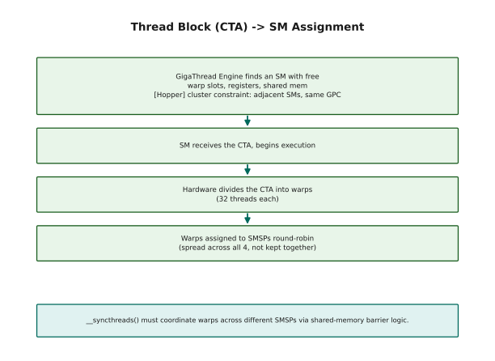

*Figure 16.1 — The GigaThread Engine picks an SM with enough free warp slots, registers and shared memory (and, on Hopper, satisfying the cluster constraint), the SM receives the CTA and splits it into warps, and those warps are assigned to the four SMSPs round-robin rather than kept together — a block is spread across all four quadrants unless it's tiny. This is exactly why `__syncthreads()` needs real barrier hardware: it has to put warps in different SMSPs to sleep until every warp in the block has arrived.*

### 16.2 Multiple CTAs Per SM

Occupancy in one worked example. Whichever resource runs out first — warp slots,
registers, or shared memory — is the one that sets your limit.

```
Multiple CTAs Running Concurrently on One SM
══════════════════════════════════════════════════════════

  An SM can run MULTIPLE thread blocks simultaneously,
  as long as total resources don't exceed limits.

  Example:
    SM capacity: 64 warps, 256 KB registers, 228 KB shared mem

    Block A: 128 threads (4 warps), 64 regs/thread, 32 KB shared
      Resources: 4 warps, 32 KB regs, 32 KB shared

    How many Block A's fit?
      Warps:  64 / 4 = 16 blocks
      Regs:   256 KB / 32 KB = 8 blocks
      Shared: 228 KB / 32 KB = 7 blocks
      Answer: min(16, 8, 7) = 7 blocks per SM

    With 7 blocks: 28 warps active, 224 KB regs, 224 KB shared
    That's 28/64 = 43.75% warp occupancy.

  Higher occupancy → more warps to hide latency → usually better.
  But diminishing returns after ~50-60% for compute-bound kernels.
```

---

## 17 — PCIe 5.0 Host Interface

The last link, and by a wide margin the slowest: the connection back to the CPU.
There is not much to design here, only one rule to internalise, and the
bandwidth comparison below makes it obvious.

```
PCIe 5.0 — CPU ↔ GPU Connection
══════════════════════════════════════════════════════════

  Bandwidth:     128 GB/s bidirectional (64 GB/s per direction)
  Generation:    PCIe Gen 5, x16 lanes

  Primary roles:
    1. Data highway: Transfer data between CPU memory and GPU memory
    2. Kernel launch: CPU sends kernel descriptors to GPU
    3. GPUDirect RDMA: Network cards (NICs) can read/write GPU
       memory directly without CPU involvement

  Bandwidth comparison:
    ├── HBM3:      3,350 GB/s (internal GPU memory bandwidth)
    ├── NVLink:      900 GB/s (GPU-to-GPU)
    ├── PCIe 5.0:    128 GB/s (CPU-to-GPU)
    └── Ethernet:     50 GB/s (400GbE network)

  PCIe is the SLOWEST link in the system.
  This is why:
    ├── Model weights should be loaded once and stay on GPU
    ├── Minimize CPU↔GPU data transfers during inference
    ├── GPUDirect RDMA bypasses CPU for network → GPU transfers
    └── NVLink (not PCIe) is used for multi-GPU communication
```

---

## 18 — Putting It All Together

Everything in this chapter, assembled into the path a single GEMM tile actually
takes: from host memory into HBM, up through L2 into shared memory, into
registers, through the tensor cores, and back out again.

If the individual sections felt disconnected, this is where they join up.

### 18.1 Complete Data Flow

Read the five steps in order, then read the note at the bottom — the entire point
is that steps 2 and 4 are happening at the same time, for different tiles.

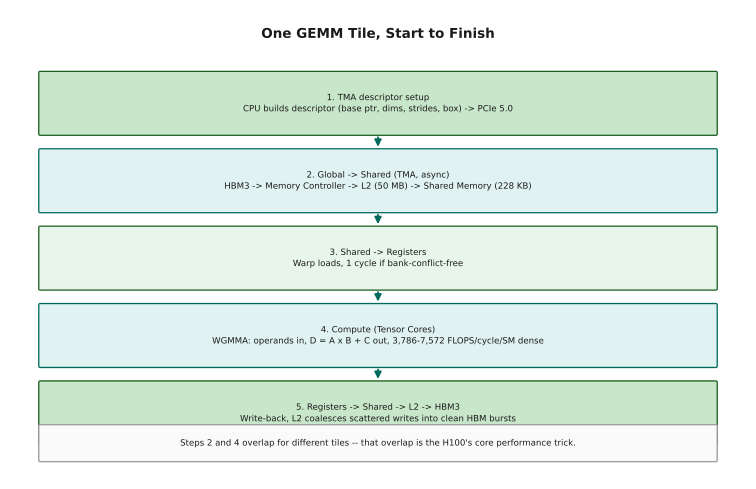

*Figure 18.1 — One GEMM tile end to end: (1) the CPU builds a TMA descriptor and sends it over PCIe 5.0; (2) the TMA asynchronously moves data HBM3 → memory controller → L2 (50 MB) → shared memory (228 KB); (3) a warp loads shared memory into registers, one cycle if bank-conflict-free; (4) the tensor cores compute `D = A × B + C` via WGMMA at 3,786–7,572 FLOPS/cycle/SM dense, depending on precision; (5) results write back registers → shared memory → L2 → HBM3, with L2 coalescing the scattered writes into clean bursts. Steps 2 and 4 overlap for different tiles — that overlap is the H100's core performance trick.*

### 18.2 Memory Hierarchy Summary

The hierarchy on one card. The right-hand columns are the ones worth
internalising: each level down costs roughly an order of magnitude more latency
and 10× more energy per access.

```
H100 Memory Hierarchy — Bandwidth vs Capacity
══════════════════════════════════════════════════════════

  Level          Size        Bandwidth       Latency    Energy
  ──────────────────────────────────────────────────────────────
  Registers     256 KB/SM    ~128 R/W/cycle   1 cycle   1×
  Shared Mem    228 KB/SM    33 TB/s/SM      ~20 cyc    30-50×
  L1 Cache      28-224 KB    (part of shared) ~30 cyc   30-50×
  L2 Cache      50 MB        ~12 TB/s agg    ~200 cyc   200×
  HBM3          80 GB        3.35 TB/s       ~500 cyc   1000×+
  ──────────────────────────────────────────────────────────────

  The ratio:
    HBM3 → L2:    ~3.5×  bandwidth amplification
    L2   → SMEM:  ~2.8×  per SM (33 TB/s vs 12 TB/s / 132 SMs)
    SMEM → Regs:  ~4×    effective (no bank conflicts)

  Each level filters traffic for the next:
    If L1 hits 90%, only 10% of requests reach L2.
    If L2 hits 80%, only 20% of L2 requests reach HBM.
    Total HBM traffic = 10% × 20% = 2% of original requests.

  This cascading filtering is what makes the hierarchy work.
```

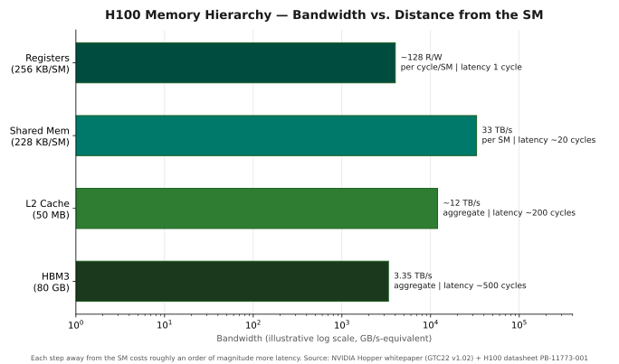

*Figure 1.4 — The table above, as a ladder: each step away from the SM gives up roughly an order of magnitude of bandwidth and gains one of latency. Sources: NVIDIA Hopper Architecture whitepaper (GTC22 v1.02); NVIDIA H100 datasheet PB-11773-001.*

---

## 19 — Quick Reference Tables

Nothing new here — these are the numbers from the chapter collected in one place
so you can come back to them without re-reading. The last block, the three laws,
is this entire chapter compressed to nine lines.

### Execution Unit Counts (SXM5, 132 SMs)

```
Unit                Per Quadrant    Per SM     Total GPU
──────────────────────────────────────────────────────────
FP32 CUDA Cores         32          128        16,896
FP64 Units              16           64         8,448
INT32 Units             16           64         8,448
Tensor Cores             1            4           528
Load/Store Units         8           32         4,224
Special Function Units   4           16         2,112
Warp Schedulers          1            4           528
Max Warps               16           64         8,448
```

### Memory Specifications

```
Component            Size        Bandwidth      Line/Sector
──────────────────────────────────────────────────────────────
HBM3                 80 GB       3.35 TB/s      —
L2 Cache             50 MB       ~12 TB/s       128B / 32B
Shared Mem (max)    228 KB/SM    33 TB/s/SM     32 banks × 4B
L1 Data Cache       28-224 KB    (part of shared) 128B / 32B
Register File       256 KB/SM    128 R/W/cycle   32-bit slots
L1 I-Cache          128 KB/SM    —               —
L0 I-Cache          tiny/SMSP    1 insn/cycle    —
```

### Key Formulas

```
Occupancy Limiters:
  Max warps from registers: floor(65536 / regs_per_thread) / 32
  Max warps from shared: floor(228 KB / shared_per_block) × warps_per_block
  Max warps from hardware: 64 per SM (16 per quadrant)
  Actual occupancy = min(all three) / 64

Bank Conflict:
  bank = (byte_address / 4) % 32
  Conflict: 2+ threads access different addresses in same bank
  No conflict: all threads access different banks OR same address

Swizzle:
  swizzled_bank = bank XOR (row_index % 32)

Tensor Core throughput (SXM5, derived from published full-GPU totals):
  FP16/BF16: ~3,786 FLOPS/cycle/SM (dense)
  FP8:       ~7,572 FLOPS/cycle/SM (dense)
  Sparse (2:4): 2× dense throughput
```

### The Three Laws of H100 Performance

```
1. ASYNC EVERYTHING
   Use TMA for all bulk data movement.
   Overlap loads with compute via double-buffering.
   Never block an SM waiting for memory.

2. FEED THE TENSOR CORES
   Tensor cores deliver 10-100× the throughput of CUDA cores.
   If your kernel isn't using tensor cores, you're leaving
   90%+ of the chip's capability on the table.

3. RESPECT THE HIERARCHY
   Registers > Shared Mem > L2 > HBM3
   Every access to a lower level is 10-1000× more expensive.
   Design your data layout to maximize hits at each level.
```

---

> **Next — Chapter 2: Clusters, Inline PTX, Data Types & Pointers**
>
> You now know what the hardware is. Chapter 2 covers the programming model that
> reaches it: thread block clusters and distributed shared memory, inline PTX
> assembly, state spaces, the deep-learning number formats, and the
> address-conversion instructions (`cvta`, `mapa`) that later chapters lean on
> constantly.
