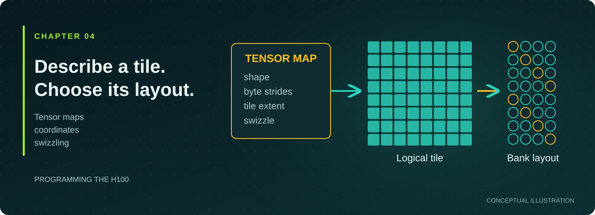
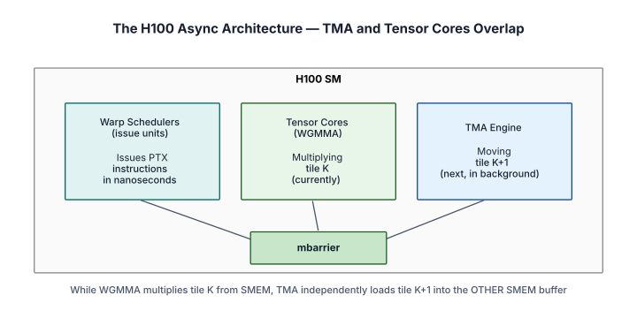
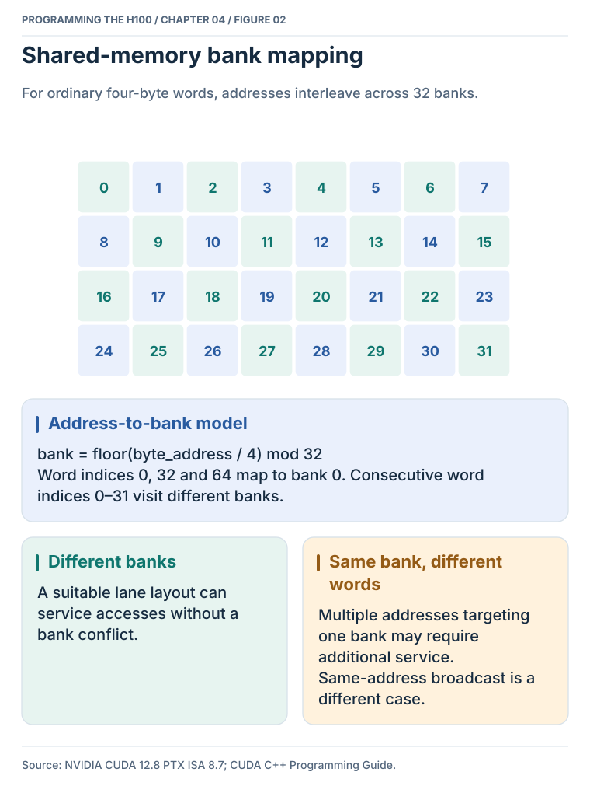
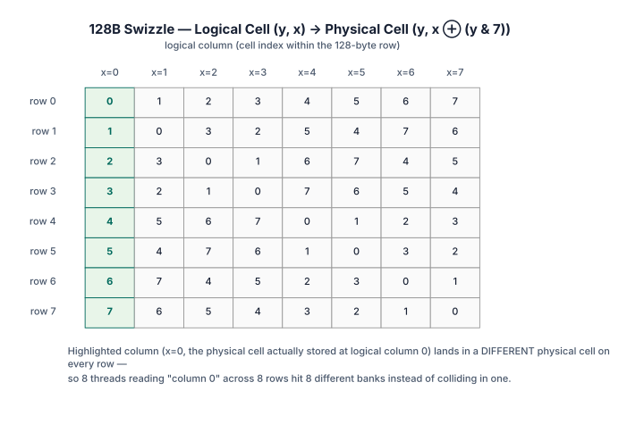
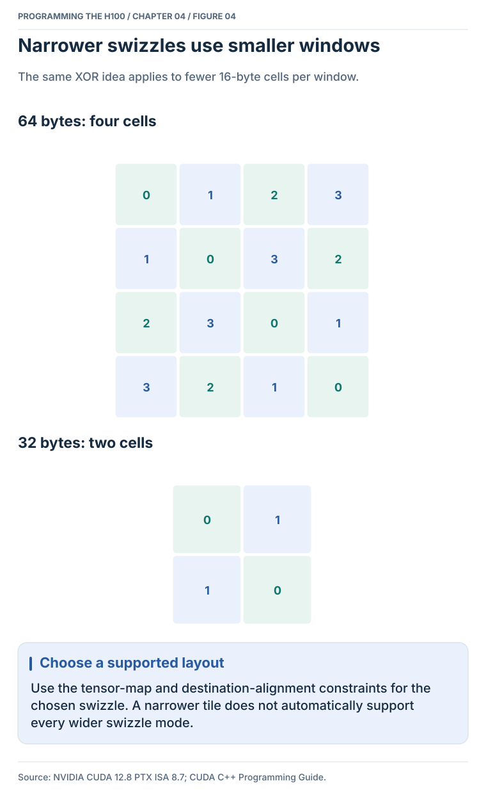
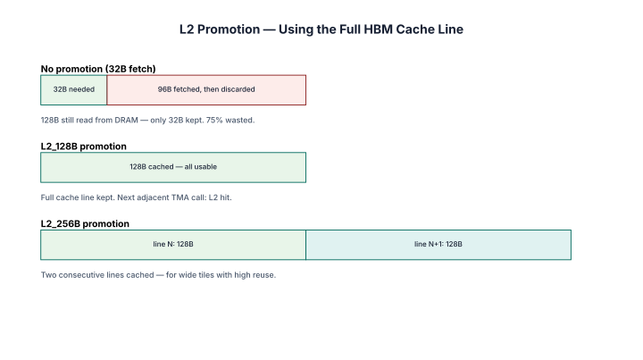
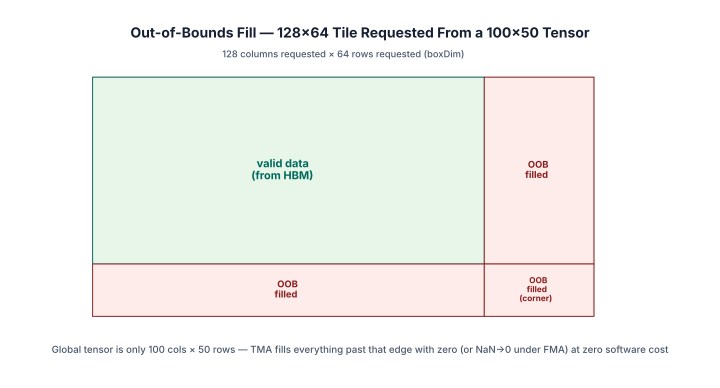

# cuTensorMap, TMA & Swizzling
## Lesson 4 Companion Guide — Programming the H100

[](images/chapter-openers/04-descriptors.svg)


> **Validation — November 17, 2026.** 2 complete CUDA programs compiled and executed successfully.
> **Follow-up:** the [final two-H100 audit](final-audit.md) records a fresh run of the complete programs. The original dated transcripts below remain available for provenance.
> **Execution system:** 1× H100 PCIe, 114 SMs, 80 GB class; Ubuntu 24.04.5 LTS; driver 580.105.08; CUDA Toolkit 12.8.93; `sm_90a`, C++17, `-O2`.
> [Full system information](validation/2026-11-17/system-information.txt) · [CUDA result manifest](validation/2026-11-17/results.json). Each tested source and captured output is linked beside its example. Diagrams open as original SVGs for zooming.


> **Baseline compiler flags — use each example’s full command below:** `nvcc -std=c++17 -arch=sm_90a -O2 <file>.cu -o <out>`
> **Run with:** `./<out>` on Hopper hardware matching the compiled target. `sm_90a` binaries are not a portable Blackwell build.


<!-- learning:start -->
!!! tip "Your goal in this chapter"

    Write tensor dimensions and byte strides with the innermost coordinate first; explain the difference between logical coordinates and swizzled shared-memory addresses.

    [Chapter 3](03-asynchronicity-mbarrier.md) supplies the completion protocol; [Chapter 5](05-cp-async-bulk-l2-hinting.md) issues the transfer described here.
<!-- learning:end -->

**What this covers:** Everything from Lesson 4 — what TMA is and why it exists, how descriptors replace manual address calculation, the full `cuTensorMapEncodeTiled()` API (all 12 parameters explained with worked examples), data types, tensor rank and global dimensions, stride semantics, box dimensions, swizzling (32B/64B/128B) and bank-conflict elimination with the XOR formula, interleaving for non-linear layouts (16B and 32B modes), L2 promotion policies for prefetching, and out-of-bounds fill behavior. Every section includes ASCII diagrams, manual worked examples with concrete numbers, and compileable code with full test harnesses.

**How to read this chapter.** Chapter 1 introduced the TMA as the piece of
hardware that fetches tiles while your threads compute. This chapter is about
the object you hand it: the **descriptor**, a small struct built once on the host
that tells the TMA the shape of your tensor, the size of the tile you want, and
how to lay it out in shared memory once it arrives.

Almost everything here happens *before* the kernel runs. The next chapter covers
the instruction that uses the descriptor; this one covers getting the descriptor
right — which is where the real difficulty lives, because invalid descriptor parameters may be rejected by the API, while a valid descriptor
with the wrong layout can copy plausible but incorrect bytes. Check the return code
and verify the full output.

The chapter runs in four movements. Sections 1–3 explain what a descriptor is
and why it replaces address arithmetic. Sections 4–8 walk the twelve parameters
of `cuTensorMapEncodeTiled()` one at a time — this is the reference core.
Sections 9–11 are about shared-memory layout: bank conflicts, swizzling, and
interleaving. Sections 12–13 cover two optional behaviours that cost nothing to
enable and are easy to overlook.

If you only read part of this chapter, read §7 and §8. Dimension ordering and
stride units are the two places where nearly every first descriptor goes wrong.

---

## ★ BEFORE YOU START — Hardware, Setup & Installation

The TMA is Hopper hardware, so there is no A100 fallback for this chapter. If
you already have an H100 and a working `nvcc`, skip to the Table of Contents.

### What Hardware Can You Use?

`sm_90a` or later. The trailing `a` is required — plain `sm_90` will not give
you the TMA instructions.

```
Hardware Compatibility Matrix
══════════════════════════════════════════════════════════════════════

  Architecture   Chip     SM Target   Example GPUs          TMA Support
  ─────────────────────────────────────────────────────────────────────
  Ampere         GA100    sm_80       A100 (AWS p4d, Lambda) cp.async only (no TMA)
  Hopper         GH100    sm_90a      H100 (AWS p5, Lambda)  FULL TMA ★
  Blackwell      GB100    sm_100a     B100/B200              FULL TMA + extensions

  KEY:
    cuTensorMap / cp.async.bulk.tensor → Hopper (sm_90a) or Blackwell ONLY
    All code in §5+ requires sm_90a or sm_100a.
    Conceptual sections §1-4 apply to all architectures.

  AMPERE vs HOPPER DIFFERENCE (the core motivation for this lesson):
    Ampere: threads compute addresses, issue cp.async (16 bytes at a time),
            SM is tethered to the copy engine for every chunk.
    Hopper: one thread fills a 128-byte descriptor, fires cp.async.bulk.tensor,
            One issuer launches the request; threads still manage readiness and reuse.
```

### Cloud GPU Rental — Lambda Labs

Check current provider availability and pricing.

```
Lambda Labs Setup (H100)
══════════════════════════════════════════════════════════════════════

  1. https://lambdalabs.com/ → sign up → Launch Instance
  2. Choose "1x H100 PCIe" (sufficient for the single-GPU examples)
  3. SSH: ssh -i ~/.ssh/your_key ubuntu@<INSTANCE_IP>
  4. Verify: nvcc --version && nvidia-smi
  5. Compile any example: nvcc -std=c++17 -arch=sm_90a -O2 file.cu -o out
```

### Cloud GPU Rental — AWS

`p5` is the H100 family; `p4d` is A100 and has no TMA.

```
AWS p5 Setup (H100)
══════════════════════════════════════════════════════════════════════

  Instance: p5.48xlarge (8× H100 SXM5)
  AMI: "Deep Learning AMI GPU PyTorch" (Ubuntu 22.04) — CUDA pre-installed
  ssh -i key.pem ubuntu@<IP>
  source activate pytorch
  nvcc --version && nvidia-smi
  For A100 (p4d): use sm_80. TMA / cuTensorMap sections will NOT work.
```

### Hopper vs Blackwell — What Changes

Read once if you are on a B100 or B200. The descriptor API carries over
essentially unchanged; only the compile flag differs.

```
Hopper (sm_90a) vs Blackwell (sm_100a) — TMA Differences
══════════════════════════════════════════════════════════════════════

  WHAT STAYS IDENTICAL:
    ├── cuTensorMapEncodeTiled() API and all 12 parameters
    ├── All swizzle modes (32B, 64B, 128B) and XOR formulas
    ├── All interleave modes (16B, 32B)
    ├── All L2 promotion flags
    ├── OOB fill behavior
    └── All code in this guide compiles and runs unchanged on sm_100a

  WHAT IS NEW IN BLACKWELL:
    ├── Larger maximum box dimensions supported
    ├── Additional data types (FP4/MX formats)
    ├── Tensor memory uses its own tcgen05 copy/MMA instructions;
    │   do not treat it as an ordinary TMA shared-memory destination
    └── New cuTensorMapEncodeTiledMemref() variant for tmem

  PORTING: Change -arch=sm_90a to -arch=sm_100a. Done.
```

### How to Compile and Run Each Example

The compile/run box format used throughout the chapter. Every code block comes
with one, so you can copy a file out and build it without guessing flags.

```
═══════════════════════════════════════════════════════
  FILE:    examples/exNN_name.cu
  COMPILE: nvcc -std=c++17 -arch=sm_90a -O2 exNN_name.cu -o exNN
           (Blackwell: replace sm_90a with sm_100a)
  RUN:     ./exNN
  EXPECT:  [description of expected output]
═══════════════════════════════════════════════════════
```

---

## Table of Contents

1. [What Is TMA — The Motivation](#1--what-is-tma)
2. [How Descriptors Replace Address Calculation](#2--how-descriptors-replace-address-calculation)
3. [cuTensorMap — The Descriptor Object](#3--cutensormap)
4. [cuTensorMapEncodeTiled — All 12 Parameters](#4--cutensormapencodetiled)
5. [Data Types](#5--data-types)
6. [Tensor Rank and Global Address](#6--tensor-rank-and-global-address)
7. [Global Dimensions and Strides](#7--global-dimensions-and-strides)
8. [Box Dimensions and Element Strides](#8--box-dimensions-and-element-strides)
9. [Shared Memory and Bank Conflicts](#9--shared-memory-and-bank-conflicts)
10. [Swizzling — Eliminating Bank Conflicts](#10--swizzling)
11. [Interleaving — Non-Linear Global Layouts](#11--interleaving)
12. [L2 Promotion — Prefetching Policy](#12--l2-promotion)
13. [Out-of-Bounds Fill](#13--out-of-bounds-fill)
14. [Putting It All Together — Full TMA Examples](#14--putting-it-all-together)
15. [Quick Reference](#15--quick-reference)

---

## 1 — What Is TMA

Start with the problem before the machinery.

Copying a 2D tile out of a large matrix sounds trivial and is not. Every thread
has to compute its own source address from a row, a column, and a stride; check
whether that address falls off the edge of the tensor; and issue its own load.
For a 64×64 tile that is thousands of instructions spent on arithmetic that has
nothing to do with your algorithm.

The TMA is a dedicated hardware unit that does all of it. One thread issues one
instruction, and the copy happens in the background. §1.1 covers the problem,
§1.2 what the unit can do, and §1.3 the property that matters most — it is
genuinely asynchronous, which is what makes real pipelining possible.

### 1.1 The Problem TMA Solves

To understand why TMA (Tensor Memory Accelerator) exists, you need to understand the bottleneck it eliminates. On every pre-Hopper GPU — and even on Ampere with `cp.async` — moving data from global memory (HBM) into shared memory required active thread involvement. Threads had to compute the source address of every chunk they wanted to copy, issue the copy instruction, and manage the pipeline manually.

This created a fundamental coupling: the SM (Streaming Multiprocessor) — the unit that does compute — was tethered to the data-movement operation. Even if the copy was "asynchronous" (as in Ampere's `cp.async`), threads still had to touch every 16-byte chunk and compute its address. The SM's instruction issue slots were consumed by housekeeping rather than arithmetic.

TMA breaks this coupling entirely. You describe the *entire* transfer — its shape, strides, destination, swizzle pattern — once in a 128-byte descriptor. Then a single thread fires one instruction referencing that descriptor. The issuer can proceed while hardware performs the transfer. Threads still manage synchronization, descriptor state and destination lifetime; overlap depends on available resources.

```
Evolution of GPU Data Movement — Pre-Hopper to Hopper
══════════════════════════════════════════════════════════════════════

  PRE-AMPERE (Volta, Turing): Synchronous thread-driven copies
  ─────────────────────────────────────────────────────────────────
  for (int i = tid; i < N; i += blockDim.x) {
      smem[i] = gmem[i];    // ld + st, fully synchronous
  }                         // thread BLOCKED until each copy done
  __syncthreads();          // must also sync all threads after

  Threads consumed:  ALL threads compute addresses and issue copies.
  SM utilization:    0% compute while copying. Fully blocking.

  ─── AMPERE: cp.async (partial improvement) ───────────────────────
  for (int i = 0; i < N; i += 16) {
      uint32_t smem_off = __cvta_generic_to_shared(smem) + i;
      uint64_t gmem_addr = base + block_offset + i;
      asm("cp.async.cg.shared.global [%0], [%1], 16;" ...);
  }
  cp.async.commit_group();
  cp.async.wait_group<0>();

  Threads consumed:  ALL threads compute addresses (every 16 bytes!).
  SM utilization:    SM is free BETWEEN issues, but still issues ~N/16 times.
  Improvement:       The copy is non-blocking, so math can overlap.
  Limitation:        SM is TETHERED: must keep issuing for every chunk.

  ─── HOPPER: TMA (full hardware offload) ──────────────────────────
  // On host: create descriptor ONCE
  cuTensorMapEncodeTiled(&tma_desc, ...);    // 128-byte descriptor

  // In kernel: one thread, one instruction
  if (elect_one_thread) {
      cp.async.bulk.tensor.2d.shared::cluster.global.mbarrier::complete_tx::bytes
          [smem_addr], [&tma_desc], {col_idx, row_idx};
  }
  // Thread IMMEDIATELY continues. TMA engine handles everything.

  Threads consumed:  1 thread fires the instruction. 0 threads for the copy.
  Potential overlap: Tensor Cores compute while TMA transfers another ready stage.
  Improvement:       COMPLETE decoupling of compute and memory.
  The SM is not involved AT ALL in the actual data movement.
```

### 1.2 What TMA Can Do

TMA is not just a faster `memcpy`. It is a programmable data-movement engine with capabilities that no previous GPU had:

```
TMA Capabilities Overview
══════════════════════════════════════════════════════════════════════

  1. MULTI-DIMENSIONAL TENSOR SUPPORT (1D through 5D)
  ─────────────────────────────────────────────────────────────────
  TMA understands tensor layouts natively. You give it the shape and
  strides of your tensor, and it fetches the right elements even if
  they are non-contiguous in memory. No manual stride arithmetic
  needed in kernel code.

  Example: 3D convolution input [N, H, W] stored as [N][stride_H][stride_W]
  TMA reads exactly the tile [n0:n1][h0:h1][w0:w1] with the right strides
  without threads computing a single address.

  2. DIRECT SMEM DELIVERY (bypasses L1 cache)
  ─────────────────────────────────────────────────────────────────
  TMA fetches from HBM → L2 → Shared Memory directly.
  Data is NOT polluting the L1 cache (which is valuable for register spills).
  This is the optimal path for streaming data used once per kernel launch.

  3. MULTICAST (one HBM fetch → multiple SMs simultaneously)
  ─────────────────────────────────────────────────────────────────
  With cluster-enabled kernels, one TMA instruction can deliver the
  same data to ALL blocks in a cluster simultaneously. This eliminates
  redundant HBM reads when multiple blocks need the same tile.
  Bandwidth savings = cluster_size× for broadcast-pattern access.

  4. SWIZZLED WRITES TO SMEM (automatic bank-conflict elimination)
  ─────────────────────────────────────────────────────────────────
  TMA can apply swizzling (XOR address permutation) as it writes data
  to shared memory. The data lands in a conflict-free layout without
  any software effort. Kernels reading the data see it in the right banks.

  5. INTERLEAVED LAYOUT SUPPORT (NCHW / NCxHWCx formats)
  ─────────────────────────────────────────────────────────────────
  For convolution and image data in interleaved formats (like NC8HWC8),
  TMA can de-interleave the data as it copies, presenting it in a
  linearized form to the kernel.
```

### 1.3 The Perfect Asynchronicity — Why TMA Enables True Pipelining

Hopper can overlap data movement and computation when dependencies, buffers and execution resources permit. Separate issue, TMA and Tensor Core resources make that overlap possible; they do not guarantee 100% utilization:

[](images/ch04/01-h100-tma-async-architecture.svg)

*Separate stages prevent the copy from overwriting the active operand.*

---

## 2 — How Descriptors Replace Address Calculation

The conceptual shift, and it is worth pausing on because everything else follows
from it.

Ordinarily, "where is element [i][j]" is a calculation your threads perform,
over and over, at run time. A descriptor turns that into a *declaration* made
once: here is the tensor's shape, here are its strides, here is the tile size I
want. From then on, you ask for a tile by coordinate — "give me the tile at row
128, column 256" — and the hardware works out the addresses.

§2.2's framing is the useful one: the descriptor is a job specification, not a
pointer.

### 2.1 The Old Way — Manual Address Computation

In pre-TMA code, every memory access required threads to compute the exact byte address of each element they wanted. For a 2D matrix tile, this meant computing `base + row * stride + col * element_size` for every thread, every iteration, every tile. This computation is simple but consumes instruction slots and registers.

```
Manual Address Computation — What Threads Had to Do
══════════════════════════════════════════════════════════════════════

  Task: Load tile [row_start : row_start+BM][col_start : col_start+BN]
        from a matrix stored in row-major format (rows × cols × sizeof(dtype))

  Thread-driven approach (Ampere cp.async):
  ─────────────────────────────────────────────────────────────────
  // Every thread computes its own source address
  int tile_row = threadIdx.y;
  int tile_col = threadIdx.x;
  int global_row = blockIdx.y * BM + tile_row;
  int global_col = blockIdx.x * BN + tile_col;

  // Address = base + row_offset + col_offset (in bytes)
  uint64_t addr = (uint64_t)matrix_base
                + (uint64_t)global_row * row_stride_bytes
                + (uint64_t)global_col * sizeof(float);

  // Each thread issues its own cp.async (16 bytes max per call)
  asm("cp.async.cg.shared.global [%0], [%1], 16;" ...);

  Problems:
  ├── Address computation consumes registers (global_row, global_col, addr...)
  ├── Instruction slots used for integer multiply/add instead of math
  ├── For a 128×128 BF16 tile: 128×128/16 = 1024 cp.async calls per block
  └── ALL threads are involved — zero parallelism with tensor cores

  ─── TMA Approach: Descriptor Encapsulates Everything ─────────────

  // On HOST (once, before any kernel calls):
  cuTensorMapEncodeTiled(
      &descriptor,          // 128-byte struct
      FLOAT32,              // element type
      2,                    // 2D tensor
      matrix_base,          // base pointer
      {cols, rows},         // global shape
      {row_stride_bytes},   // stride between rows
      {BN, BM},             // tile shape (box)
      {1, 1},               // element strides (dense)
      SWIZZLE_128B,         // bank conflict elimination
      ...
  );

  // In KERNEL (one thread, one instruction):
  cp.async.bulk.tensor.2d.shared::cluster.global.mbarrier::complete_tx::bytes
      [smem_dest], [&descriptor], {col_start, row_start};

  // DONE. TMA computes all addresses, handles strides, applies swizzle.
  // Threads are immediately free. SM does math while TMA does movement.
```

### 2.2 The Descriptor as a "Job Specification"

Think of the descriptor as a fully-specified job description handed to a specialist worker (the TMA engine). The descriptor says: "Here is the data source (base pointer), here is how it's laid out (shape, strides), here is what chunk I want (box dimensions), and here is how to arrange it in the destination (swizzle)." The TMA engine reads this job spec and executes it completely without further input.

```
Descriptor as Job Specification
══════════════════════════════════════════════════════════════════════

  ┌──────────────────────────────────────────────────────────────────┐
  │  cuTensorMap Descriptor (128 bytes in host/device memory)        │
  │                                                                  │
  │  ┌────────────────┬──────────────────────────────────────────┐   │
  │  │ Base pointer   │ 0x7F3A00000000 (HBM address of matrix)   │   │
  │  ├────────────────┼──────────────────────────────────────────┤   │
  │  │ Global shape   │ [4096, 2048] (4096 cols × 2048 rows)     │   │
  │  ├────────────────┼──────────────────────────────────────────┤   │
  │  │ Global strides │ [8192 bytes] (2048 cols × 4 bytes/float) │   │
  │  ├────────────────┼──────────────────────────────────────────┤   │
  │  │ Box (tile)     │ [128, 64] (128 cols × 64 rows per tile)  │   │
  │  ├────────────────┼──────────────────────────────────────────┤   │
  │  │ Data type      │ FLOAT32                                  │   │
  │  ├────────────────┼──────────────────────────────────────────┤   │
  │  │ Swizzle        │ SWIZZLE_128B (conflict-free SMEM layout) │   │
  │  ├────────────────┼──────────────────────────────────────────┤   │
  │  │ Interleave     │ NONE (linear memory layout)              │   │
  │  ├────────────────┼──────────────────────────────────────────┤   │
  │  │ L2 promotion   │ L2_128B (prefetch full 128B cache lines) │   │
  │  ├────────────────┼──────────────────────────────────────────┤   │
  │  │ OOB fill       │ ZERO (pad edges with zeros)              │   │
  │  └────────────────┴──────────────────────────────────────────┘   │
  │                                                                  │
  │  At kernel launch, a thread issues ONE instruction:              │
  │    cp.async.bulk.tensor [smem], [&desc], {col=256, row=128}      │
  │                                                                  │
  │  TMA reads descriptor → knows everything → fetches exactly       │
  │  matrix[128:192][256:384] → writes to SMEM in swizzled layout.  │
  │  Thread is already doing something else.                          │
  └──────────────────────────────────────────────────────────────────┘
```

---

## 3 — cuTensorMap — The Descriptor Object

The concrete type. A `CUtensorMap` is a 128-byte opaque struct — you never read
its fields directly, you fill it through an API and pass it to the kernel.

Two practical constraints appear here and both cause real bugs: it must be
64-byte aligned, and it should be built once on the host rather than
reconstructed per launch. §3.2 covers which encode function to use, since there
is more than one and `EncodeTiled` is the one this chapter is about.

### 3.1 The CUtensorMap Type

`CUtensorMap` is a fixed-size opaque struct defined by NVIDIA. It is exactly 128 bytes and encodes all the information the TMA hardware needs to perform an autonomous data transfer.

```
CUtensorMap — Physical Properties
══════════════════════════════════════════════════════════════════════

  Size:       128 bytes (fixed — always, regardless of tensor rank)
  Alignment:  MUST be 128-byte aligned in memory
  Location:   Typically created on HOST, passed to kernel via:
              ├── Kernel parameter (copied to .param space on launch)
              └── Pointer in global memory (passed as __device__ variable)
  Mutability: READ-ONLY from the device. Never modify in kernel code.
  Reuse:      One descriptor per (tensor, tile_size, swizzle) combination.
              Create multiple descriptors for different tile sizes.

  ─── Where the Descriptor Lives ──────────────────────────────────

  Typical pattern:
    CUtensorMap h_desc;                    // host-side: stack or heap
    cuTensorMapEncodeTiled(&h_desc, ...);  // fill on host

  Option A: Pass as kernel parameter (most common)
    my_kernel<<<grid, block>>>(h_desc, other_args...);
    // Descriptor is copied into .param space (fast, cached)
    // Access in kernel: &tma_desc (directly by value, not pointer)

  Option B: Store in __device__ (global) memory
    __device__ CUtensorMap d_desc;
    cudaMemcpyToSymbol(d_desc, &h_desc, sizeof(CUtensorMap));
    // Kernel accesses via: &d_desc (pointer to global memory)

  Option C: Allocate in device memory
    CUtensorMap* d_desc;
    cudaMalloc(&d_desc, sizeof(CUtensorMap));
    cudaMemcpy(d_desc, &h_desc, sizeof(CUtensorMap), H2D);
    // Kernel accesses via: d_desc pointer

  Alignment enforcement:
  ─────────────────────────────────────────────────────────────────
  // Stack (usually fine — compiler aligns structs naturally):
  alignas(128) CUtensorMap h_desc;

  // Heap allocation:
  CUtensorMap* h_desc = (CUtensorMap*)aligned_alloc(128, sizeof(CUtensorMap));
  // or
  void* p; posix_memalign(&p, 128, sizeof(CUtensorMap));
  CUtensorMap* h_desc = (CUtensorMap*)p;
```

### 3.2 Creating the Descriptor — Which Function to Use

NVIDIA provides two encoding functions. For this lesson we focus on `cuTensorMapEncodeTiled`, which handles the overwhelming majority of GEMM and convolution use cases.

```
cuTensorMapEncodeTiled vs cuTensorMapEncodeIm2col
══════════════════════════════════════════════════════════════════════

  cuTensorMapEncodeTiled:
  ─────────────────────────────────────────────────────────────────
  ├── For TILED access: fetch rectangular sub-regions (tiles) of a tensor
  ├── Used in: GEMM, attention, element-wise ops, most kernels
  ├── Coordinates specified as top-left corner of the tile
  └── This is what we cover in this lesson.

  cuTensorMapEncodeIm2col:
  ─────────────────────────────────────────────────────────────────
  ├── For IMPLICIT im2col: directly maps convolution filters to patches
  ├── Used in: direct convolution kernels (no explicit im2col transformation)
  ├── The hardware does the index remapping inside TMA
  └── Out of scope for this lesson.
```

---

## 4 — cuTensorMapEncodeTiled — All 12 Parameters

The heart of the chapter. Twelve parameters, and getting any one of them wrong
gives you a kernel that runs and produces wrong data.

§4.1 shows the whole signature at once so you can see the shape of it. §4.2 is
the more valuable half: a complete worked example that fills in all twelve for a
real tensor, with the arithmetic shown. Read the worked example first if the
bare signature looks impenetrable — it usually does.

Sections 5 through 8 then take the parameters in groups.

### 4.1 Function Signature — Complete View

All twelve parameters in one place. Don't try to absorb it — skim it for shape,
then read the worked example that follows.

```
cuTensorMapEncodeTiled — All 12 Parameters
══════════════════════════════════════════════════════════════════════

  CUresult cuTensorMapEncodeTiled(
      CUtensorMap*              tensorMap,        // [1] output descriptor
      CUtensorMapDataType       tensorDataType,   // [2] element data type
      cuuint32_t                tensorRank,       // [3] number of dimensions
      void*                     globalAddress,    // [4] base HBM pointer
      const cuuint64_t*         globalDim,        // [5] shape in elements
      const cuuint64_t*         globalStrides,    // [6] strides in bytes
      const cuuint32_t*         boxDim,           // [7] tile size in elements
      const cuuint32_t*         elementStrides,   // [8] intra-tile strides
      CUtensorMapInterleave     interleave,       // [9]  interleave mode
      CUtensorMapSwizzle        swizzle,          // [10] bank conflict mode
      CUtensorMapL2promotion    l2Promotion,      // [11] L2 prefetch policy
      CUtensorMapFloatOOBfill   oobFill           // [12] out-of-bounds fill
  );

  Return value: CUDA_SUCCESS on success. Check it — silent failures
  in descriptor setup cause hard-to-debug data corruption in kernels.

  ─── Parameter Map ────────────────────────────────────────────────

  [1]  tensorMap        → Output: where to write the 128-byte descriptor
  [2]  tensorDataType   → What type is each element? (FP16, BF16, FP32...)
  [3]  tensorRank       → How many dimensions? (1 to 5)
  [4]  globalAddress    → Where in HBM does the tensor start?
  [5]  globalDim        → How many elements in each dimension?
  [6]  globalStrides    → How many bytes to skip to advance one step in
                          each dimension? (innermost dim implicit)
  [7]  boxDim           → How many elements in each dim of the TILE?
  [8]  elementStrides   → Subsampling within the tile (almost always 1)
  [9]  interleave       → For non-linear global layouts (NCHW variants)
  [10] swizzle          → Bank-conflict elimination mode for SMEM writes
  [11] l2Promotion      → Prefetch chunk size from HBM to L2
  [12] oobFill          → What value to fill if tile extends beyond tensor edge?
```

### 4.2 Manual Worked Example — Setting Up All 12 Parameters

Before examining each parameter individually, let's trace through a complete realistic example: setting up TMA for loading 128×64 BF16 tiles from a 4096×2048 matrix stored in row-major format.

```
Manual Worked Example — 4096×2048 BF16 Matrix, 128×64 Tile
══════════════════════════════════════════════════════════════════════

  Global matrix: 4096 columns × 2048 rows, BF16 (2 bytes/element)
  Tile size: 128 columns × 64 rows (the chunk TMA loads per call)
  Storage: row-major (rows are contiguous, rows separated by 4096×2 bytes)

  Physical layout in HBM:
    Row 0:  [col0][col1]...[col4095]  ← 4096×2 = 8192 bytes
    Row 1:  [col0][col1]...[col4095]  ← next 8192 bytes
    ...
    Row 2047: ...                     ← last row

  Determining each parameter:

  [1] tensorMap:     &my_desc  (pointer to our CUtensorMap variable)

  [2] tensorDataType: CU_TENSOR_MAP_DATA_TYPE_BFLOAT16
      → TMA knows each element = 2 bytes, alignment = 2 bytes

  [3] tensorRank:    2  (2D matrix: rows and columns)

  [4] globalAddress: matrix_ptr  (must be 16-byte aligned)
      → Base pointer to matrix[0][0] in HBM

  [5] globalDim:     {4096, 2048}
      → globalDim[0] = 4096 (innermost: number of COLUMNS)
      → globalDim[1] = 2048 (outermost: number of ROWS)
      → Think of it as: the FASTEST-VARYING dimension is index 0

  [6] globalStrides: {8192}
      → Array size = rank - 1 = 1 (innermost stride is implicit)
      → globalStrides[0] = stride for globalDim[1] (rows)
      → To advance by 1 ROW: skip 4096 cols × 2 bytes = 8192 bytes ✓

  [7] boxDim:        {128, 64}
      → boxDim[0] = 128 columns per tile (innermost dimension)
      → boxDim[1] = 64 rows per tile (outermost dimension)
      → Total tile: 128 × 64 × 2 = 16384 bytes = 16 KB

  [8] elementStrides: {1, 1}
      → Dense tile: take every element (stride = 1 in each dim)
      → Use values > 1 for subsampling (rare)

  [9] interleave:    CU_TENSOR_MAP_INTERLEAVE_NONE
      → Linear row-major layout, no interleaving needed

  [10] swizzle:      CU_TENSOR_MAP_SWIZZLE_128B
       → Full 128-byte swizzle: maximally conflict-free for BF16/FP16

  [11] l2Promotion:  CU_TENSOR_MAP_L2_PROMOTION_L2_128B
       → Prefetch full 128-byte cache lines (standard for dense ops)

  [12] oobFill:      CU_TENSOR_MAP_FLOAT_OOB_FILL_NONE
       → Don't fill OOB regions (we handle padding manually)

  Full call:
    cuuint64_t gdim[2]    = {4096, 2048};
    cuuint64_t gstride[1] = {8192};          // bytes per row
    cuuint32_t bdim[2]    = {128, 64};
    cuuint32_t estride[2] = {1, 1};

    cuTensorMapEncodeTiled(
        &my_desc,
        CU_TENSOR_MAP_DATA_TYPE_BFLOAT16,
        2,
        matrix_ptr,
        gdim, gstride, bdim, estride,
        CU_TENSOR_MAP_INTERLEAVE_NONE,
        CU_TENSOR_MAP_SWIZZLE_128B,
        CU_TENSOR_MAP_L2_PROMOTION_L2_128B,
        CU_TENSOR_MAP_FLOAT_OOB_FILL_NONE
    );
```

---

## 5 — Data Types

The first parameter, and the simplest: what one element of your tensor is.

The list is worth a glance rather than a study, with one thing to notice — the
element size implied here is what every byte-based parameter later in the
descriptor gets measured against. Pick the wrong type and your strides are
silently wrong by a factor of two.

### 5.1 CUtensorMapDataType — Complete Reference

The data type parameter tells the TMA engine the size and interpretation of each element. TMA uses this to calculate transfer sizes and ensure correct alignment.

```
Data Types — All Options with Properties
══════════════════════════════════════════════════════════════════════

  Enum Value                              Size   Notes
  ─────────────────────────────────────────────────────────────────────
  CU_TENSOR_MAP_DATA_TYPE_UINT8           1 B    Quantized weights, int8 activations
  CU_TENSOR_MAP_DATA_TYPE_UINT16          2 B    Raw 16-bit integers
  CU_TENSOR_MAP_DATA_TYPE_UINT32          4 B    Raw 32-bit integers
  CU_TENSOR_MAP_DATA_TYPE_INT32           4 B    Signed 32-bit integers
  CU_TENSOR_MAP_DATA_TYPE_UINT64          8 B    Raw 64-bit integers
  CU_TENSOR_MAP_DATA_TYPE_INT64           8 B    Signed 64-bit integers
  CU_TENSOR_MAP_DATA_TYPE_FLOAT16         2 B    FP16 half precision ★
  CU_TENSOR_MAP_DATA_TYPE_FLOAT32         4 B    FP32 single precision ★
  CU_TENSOR_MAP_DATA_TYPE_FLOAT64         8 B    FP64 double precision
  CU_TENSOR_MAP_DATA_TYPE_BFLOAT16        2 B    BF16 brain float ★ (training)
  CU_TENSOR_MAP_DATA_TYPE_FLOAT32_FTZ     4 B    FP32 with flush-to-zero
  CU_TENSOR_MAP_DATA_TYPE_TFLOAT32        4 B    TF32 tensor float
  CU_TENSOR_MAP_DATA_TYPE_TFLOAT32_FTZ    4 B    TF32 with flush-to-zero

  ★ = most commonly used in deep learning workloads

  ─── Why Data Type Affects More Than Just Element Size ────────────

  1. Transfer granularity:
     TMA moves data in multiples of element size. For UINT8 (1 byte),
     it can transfer 1, 2, 4, 8... bytes. For FLOAT32 (4 bytes),
     minimum transfer unit is 4 bytes. This affects boxDim constraints.

  2. Global address alignment:
     globalAddress must be aligned to max(16, element_size) bytes.
     FLOAT16/BFLOAT16 (2B): 16-byte aligned.
     FLOAT32 (4B): 16-byte aligned.
     FLOAT64 (8B): 16-byte aligned.
     (16 bytes is the minimum requirement for all types.)

  3. swizzle compatibility:
     Some swizzle modes require minimum element sizes.
     SWIZZLE_128B with UINT8 requires special handling (boxDim[0] ≥ 128).

  ─── Flush-to-Zero (FTZ) Modes ───────────────────────────────────

  Subnormal (denormalized) numbers are very small values near zero that
  take longer to compute with than normal floats. FTZ mode replaces them
  with zero instead of computing them properly.

  Use FTZ when:
  ├── Performance matters more than handling of very small values
  ├── Your model won't encounter subnormals (common in quantized models)
  └── You are mimicking hardware behavior that already flushes to zero

  Use non-FTZ when:
  └── Numerical precision matters (scientific computing, careful ML training)

  ─── TF32 — The "Free Lunch" for FP32 Tensor Cores ───────────────

  TF32 uses 8-bit exponent (same range as FP32) + 10-bit mantissa.
  It occupies 32 bits of storage but only 19 bits are meaningful.
  H100 SXM dense TF32 peaks at about 494.7 TFLOP/s, half its
  approximately 989.4 TFLOP/s FP16 peak, with FP32's dynamic range.

  In practice: use CU_TENSOR_MAP_DATA_TYPE_TFLOAT32 when your data
  is stored as FP32 but you want tensor core acceleration with no
  precision loss from reduced range (only slightly reduced mantissa).
```

---

Source for the TF32/FP16 peak ratio: [NVIDIA Hopper architecture whitepaper](https://resources.nvidia.com/en-us-hopper-architecture).

## 6 — Tensor Rank and Global Address

Two parameters that look obvious and each carry a trap.

**Rank** (§6.1) is the number of dimensions, not the mathematical rank from
linear algebra — a full-rank 2D matrix and a degenerate one both have
`tensorRank = 2`. **globalAddress** (§6.2) points at element zero, must be
16-byte aligned, and is the origin every tile coordinate is measured from.

### 6.1 tensorRank — Number of Dimensions

Tensor rank in TMA is the number of dimensions of your data tensor. This is **not** the mathematical rank (from linear algebra) — it is simply the number of indices needed to address a single element.

```
Tensor Rank — Practical Examples
══════════════════════════════════════════════════════════════════════

  Rank 1: 1D array
  ─────────────────────────────────────────────────────────────────
  Example: embedding table [vocab_size]
    globalDim:    {vocab_size}            (1 element)
    globalStrides: {}                     (empty — rank-1 has no strides)
    boxDim:       {embed_dim}             (how many to fetch at once)

  Rank 2: 2D matrix (most common for GEMM)
  ─────────────────────────────────────────────────────────────────
  Example: weight matrix [K, N] (K rows, N cols)
    globalDim:     {N, K}                 (col-count, row-count)
    globalStrides: {N * sizeof(dtype)}    (bytes per row; 1 stride for rank-2)
    boxDim:        {tile_N, tile_K}

  Rank 3: 3D tensor (batched matrix, sequence+feature)
  ─────────────────────────────────────────────────────────────────
  Example: attention tensor [Batch, Seq, Head_dim]
    globalDim:     {head_dim, seq_len, batch}
    globalStrides: {head_dim*sizeof(T), seq_len*head_dim*sizeof(T)}
    boxDim:        {tile_hd, tile_seq, 1}

  Rank 4: 4D tensor (NHWC images)
  ─────────────────────────────────────────────────────────────────
  Example: image batch [N, H, W, C]
    globalDim:     {C, W, H, N}
    globalStrides: {C*sizeof(T), C*W*sizeof(T), C*W*H*sizeof(T)}
    boxDim:        {tile_C, tile_W, tile_H, 1}

  Rank 5: 5D (3D convolution inputs [N, D, H, W, C])
  Rank must be 1–5. Beyond 5 requires multiple TMA calls.

  ─── The Golden Rule for Dimension Ordering ──────────────────────

  CRITICAL: TMA uses the OPPOSITE convention from NumPy/C row-major!

  NumPy / C:  shape[0] = outermost (SLOWEST varying)
  TMA:        globalDim[0] = INNERMOST (FASTEST varying)

  Matrix with shape [rows, cols] in C:
    NumPy order: shape = [rows, cols]
    TMA order:   globalDim = {cols, rows}  ← REVERSED!

  Always reverse your dimension order when specifying globalDim.
  This is the single most common mistake when setting up cuTensorMap.
```

### 6.2 globalAddress — The Base Pointer

The `globalAddress` parameter points to the first element (`[0][0]...[0]`) of the tensor in HBM. All other element addresses are computed by TMA relative to this base using the strides.

```
globalAddress — Requirements and Common Mistakes
══════════════════════════════════════════════════════════════════════

  Requirements:
  ├── Must be a valid device (GPU) memory address
  ├── Must be 16-byte aligned (hardware requirement for TMA)
  │   cudaMalloc always returns at least 256-byte aligned memory ✓
  │   Manual offsets: ensure (base + offset) % 16 == 0
  └── Must remain valid for the entire lifetime of the kernel

  ─── Alignment Verification ──────────────────────────────────────

  // SAFE: cudaMalloc guarantees ≥ 256B alignment
  float* d_matrix;
  cudaMalloc(&d_matrix, rows * cols * sizeof(float));
  // d_matrix is 256B aligned → 16B aligned ✓

  // DANGEROUS: manual offset that may break alignment
  float* d_tile = d_matrix + 3;  // offset by 3 floats = 12 bytes
  // (uint64_t)d_tile % 16 = 12  ← NOT 16-byte aligned! ✗
  // TMA will silently read wrong data or crash.

  // SAFE: aligned offset
  float* d_tile = d_matrix + 4;  // offset by 4 floats = 16 bytes aligned ✓

  ─── What globalAddress Represents Visually ──────────────────────

  HBM layout for matrix[rows=4][cols=8], row-major, FP32:
  ┌────────────────────────────────────────────────────────────────┐
  │ Addr:  0x1000  0x1004  0x1008  ... 0x101C | 0x1020  ...      │
  │ Data:  [0][0]  [0][1]  [0][2]  ... [0][7] | [1][0]  ...      │
  │          ↑                                                     │
  │    globalAddress = 0x1000 (base of matrix[0][0])              │
  │                                                                │
  │  TMA computes addresses as:                                    │
  │    element[r][c] = globalAddress + r * stride_row + c * sizeof │
  │    matrix[2][3] = 0x1000 + 2*32 + 3*4 = 0x1000 + 76 = 0x104C │
  └────────────────────────────────────────────────────────────────┘
```

---

## 7 — Global Dimensions and Strides

This is the section where most first descriptors break, and the cause is always
one of two things.

The first is **ordering**. TMA expects dimensions innermost-first — the fastest-
varying dimension comes first in the array, which is the reverse of how you
would write the shape in NumPy or PyTorch. The second is **units**: `globalDim`
is counted in elements, `globalStrides` in *bytes*. Mixing them up produces a
descriptor that reads real memory at the wrong spacing, so you get plausible
numbers from the wrong locations.

Read both subsections carefully, and check your first descriptor against the
worked example rather than against your intuition.

### 7.1 globalDim — Tensor Shape in Elements

`globalDim` is an array specifying the number of elements in each dimension. It has `tensorRank` entries. The ordering is **innermost to outermost** (index 0 = fastest-varying dimension).

```
globalDim — Detailed Specification
══════════════════════════════════════════════════════════════════════

  Array layout:
    globalDim[0] = size of innermost dimension (columns for a matrix)
    globalDim[1] = size of next dimension (rows for a matrix)
    ...
    globalDim[rank-1] = size of outermost dimension

  Value constraints:
  ├── Each entry is a uint64_t (can be up to 2^32 ≈ 4 billion elements)
  ├── Must be > 0 (zero-size dimensions are not allowed)
  └── Represents element count, NOT byte count

  ─── Manual Worked Example: Matrix Slice ─────────────────────────

  Full 4096×2048 matrix (4096 cols, 2048 rows):
    globalDim = {4096, 2048}
    TMA can address any element [row ∈ 0..2047][col ∈ 0..4095]

  When TMA fetches a tile at coordinates (col_start=256, row_start=64):
    It accesses elements [64:64+boxDim[1]][256:256+boxDim[0]]
    = matrix[64..127][256..383] (if boxDim={128,64})

  ─── Bounds Checking ─────────────────────────────────────────────

  TMA performs automatic bounds checking against globalDim.
  If the tile extends beyond the global tensor boundary:
    - Elements within bounds: fetched normally from HBM
    - Elements out of bounds: filled with the oobFill value (§13)

  Example: tile at col=4000, boxDim[0]=128 → tile covers cols 4000-4127
    Cols 4000-4095: within globalDim[0]=4096, fetched normally
    Cols 4096-4127: OUT OF BOUNDS → filled with zero (if oobFill=ZERO)

  This automatic edge handling eliminates the need for boundary
  check code in kernels — TMA does it for free.
```

### 7.2 globalStrides — Byte Distances Between Dimensions

`globalStrides` defines how many bytes the TMA must skip in HBM to advance by one step in each dimension beyond the innermost. This is how TMA handles non-contiguous layouts (like matrices with padding, or 3D tensors).

```
globalStrides — Detailed Specification
══════════════════════════════════════════════════════════════════════

  CRITICAL FACTS:
  ├── Array size = tensorRank - 1  (innermost stride is IMPLICIT = element size)
  ├── Values are in BYTES (not elements!)
  ├── globalStrides[0] = byte distance between consecutive elements in dim[1]
  │   (how many bytes to advance ONE STEP in the second-innermost dimension)
  └── globalStrides[rank-2] = byte distance between consecutive elements in
      the outermost dimension

  ─── Computing Strides for Common Layouts ─────────────────────────

  ROW-MAJOR matrix [rows=2048][cols=4096] of BF16 (2 bytes each):
  ─────────────────────────────────────────────────────────────────
    In memory: [row0_col0][row0_col1]...[row0_col4095][row1_col0]...
                           ↑ cols are contiguous (innermost)
    stride for rows = 4096 cols × 2 bytes = 8192 bytes
    globalStrides = {8192}    ← only 1 stride for rank-2

  With ROW PADDING [rows=2048][cols=4096, padded to 4608 cols]:
  ─────────────────────────────────────────────────────────────────
    Allocated: 4608 cols × 2 bytes = 9216 bytes per row (but only 4096 used)
    stride for rows = 9216 bytes
    globalStrides = {9216}
    globalDim[0] = 4096  ← TMA still only addresses 4096 columns
    The extra 512 columns of padding are automatically skipped!

  3D TENSOR [batch=16][rows=2048][cols=4096] of FP32:
  ─────────────────────────────────────────────────────────────────
    bytes per row    = 4096 × 4 = 16384
    bytes per batch  = 2048 rows × 16384 = 33,554,432
    globalDim    = {4096, 2048, 16}
    globalStrides = {16384, 33554432}
    globalStrides[0] = bytes per row (stride for dim[1] = rows)
    globalStrides[1] = bytes per batch (stride for dim[2] = batches)

  ─── Visual: How Strides Navigate HBM ────────────────────────────

  Matrix layout in HBM (simplified to 4×3, FP32, row-major):
  ┌──────┬──────┬──────┬──────┬──────────────────────────────────┐
  │      │ col0 │ col1 │ col2 │ col3                             │
  ├──────┼──────┼──────┼──────┼──────────────────────────────────┤
  │ row0 │[0,0] │[0,1] │[0,2] │[0,3]   ← 4 × 4 = 16 bytes     │
  │ row1 │[1,0] │[1,1] │[1,2] │[1,3]   ← stride = 16 bytes     │
  │ row2 │[2,0] │[2,1] │[2,2] │[2,3]                            │
  └──────┴──────┴──────┴──────┴──────────────────────────────────┘

  To fetch element [1][2]:
    address = base + row_stride×1 + element_size×2
            = base + 16×1 + 4×2 = base + 24 ✓

  globalStrides = {16}  (16 bytes between consecutive rows)
  globalDim     = {4, 3}  (4 cols, 3 rows)
```

---

## 8 — Box Dimensions and Element Strides

Having described the tensor, you now describe the tile you want out of it.

**boxDim** (§8.1) is the tile size, in elements, in the same innermost-first
order as §7 — and it is what determines how much shared memory each copy needs.
**elementStrides** (§8.2) lets the TMA skip elements as it reads, taking every
second or every fourth value. That is a niche feature, and for most work you
will set it to all ones and move on.

### 8.1 boxDim — The Tile Size

`boxDim` specifies how many elements TMA fetches per dimension in each call. This is the tile size — the chunk of data that lands in shared memory when you issue `cp.async.bulk.tensor`.

```
boxDim — Tile Dimensions in Elements
══════════════════════════════════════════════════════════════════════

  Array size: tensorRank entries (one per dimension)
  Values: elements (NOT bytes)
  Ordering: same as globalDim (innermost = index 0)

  Constraints:
  ├── boxDim[0] × element_size MUST be a multiple of 16 bytes
  │   (TMA fetches in 16-byte aligned chunks)
  ├── boxDim[0] must be ≤ swizzle span (see §10 for swizzle constraints)
  ├── Product of all boxDim values must be ≤ some implementation limit
  │   (typically 2^20 elements ≈ 1M elements total per tile)
  └── Total tile bytes must fit in the SMEM allocation for the tile

  ─── Choosing boxDim for GEMM ─────────────────────────────────────

  For a 128×64 BF16 tile (128 cols × 64 rows):
    boxDim = {128, 64}
    Tile size = 128 × 64 × 2 bytes = 16384 bytes = 16 KB per tile

  For a 256×128 FP16 tile:
    boxDim = {256, 128}
    Tile size = 256 × 128 × 2 = 65536 bytes = 64 KB per tile
    (This fills 64 KB of SMEM — feasible with 228 KB total)

  ─── The innermost boxDim constraint with swizzle ─────────────────

  RULE: boxDim[0] × sizeof(element) ≤ swizzle_span_bytes

    SWIZZLE_32B:   boxDim[0] × sizeof ≤ 32 bytes
      BF16 (2B):   boxDim[0] ≤ 16 elements
      FP32 (4B):   boxDim[0] ≤ 8 elements

    SWIZZLE_64B:   boxDim[0] × sizeof ≤ 64 bytes
      BF16 (2B):   boxDim[0] ≤ 32 elements
      FP32 (4B):   boxDim[0] ≤ 16 elements

    SWIZZLE_128B:  boxDim[0] × sizeof ≤ 128 bytes  (recommended)
      BF16 (2B):   boxDim[0] ≤ 64 elements
      FP32 (4B):   boxDim[0] ≤ 32 elements

  Wait — but GEMM uses boxDim[0]=128 for BF16 with SWIZZLE_128B!
  That's 128 × 2 = 256 bytes > 128. How?

  Answer: SWIZZLE_128B operates on 128-byte rows, but the FULL TILE
  can span MULTIPLE swizzle rows. The boxDim[0] constraint means:
  the innermost dim must fit in ONE swizzle row = 64 BF16 elements.
  For wider tiles (128 cols), you use multiple columns of swizzle rows.
  The TMA descriptor handles this internally. In practice the rule is:
  boxDim[0] × sizeof must be a multiple of the swizzle atom (16 bytes)
  AND the inner dim must be ≤ 256 bytes (hardware limit).

  ─── Manual Worked Example: Computing Tile Bytes ─────────────────

  tile A (BF16): boxDim = {128, 64}
    Total = 128 × 64 × 2 = 16,384 bytes = 16 KB

  tile B (BF16): boxDim = {64, 128}
    Total = 64 × 128 × 2 = 16,384 bytes = 16 KB

  Both tiles: 16 KB each. For double-buffering: 2 × (16+16) = 64 KB
  H100 has 228 KB of shared memory per SM, but a single thread block
  can opt into at most 227 KB of it (CUDA reserves 1 KB per block).
  Leaves 227 - 64 = 163 KB for accumulator tiles, mbarrier, etc.
```

### 8.2 elementStrides — Subsampling Within the Tile

`elementStrides` controls subsampling: instead of fetching every element along a dimension, TMA can skip elements by a stride value. A stride of 1 means dense (fetch every element). A stride of 2 means fetch every other element.

```
elementStrides — Intra-Tile Subsampling
══════════════════════════════════════════════════════════════════════

  Array size: tensorRank entries
  Values: positive integers ≥ 1 (in element units, not bytes)
  Constraint: each value must be ≤ 8

  elementStrides = {1, 1, ...}  →  dense tile (almost always what you want)
  elementStrides = {2, 1}       →  take every other column, all rows
  elementStrides = {1, 2}       →  all columns, every other row

  When is elementStrides > 1 useful?
  ─────────────────────────────────────────────────────────────────
  ├── Pooling operations (max-pool, avg-pool) that subsample
  ├── Strided convolutions where the kernel skips input elements
  └── Rare in GEMM (almost always {1,1})

  The stride constraint (≤ 8):
  ─────────────────────────────────────────────────────────────────
  Each elementStride must be in [1, 8]. This is a hardware limitation.
  For larger skips, compute multiple descriptors or use manual indexing.

  Practical advice:
  Almost all GEMM and attention kernels use elementStrides = {1, 1, ...}.
  Only set this to something other than 1 for explicit subsampling needs.
```

---

## 9 — Shared Memory and Bank Conflicts

The chapter changes subject here. Sections 9 through 11 are not about the source
tensor at all — they are about how the tile gets *arranged* once it lands in
shared memory.

This section is the setup for that, and it recaps the bank-conflict material
from Chapter 1 §13.3 in the detail you need for §10. The short version: shared
memory is 32 independent banks, a warp can hit all 32 in one cycle, and any two
threads wanting different addresses in the same bank are serialised.

If Chapter 1's version is still fresh, skim to §10.

### 9.1 Shared Memory Banks — The Hardware Reality

Before explaining swizzling (§10), you need a solid understanding of why bank conflicts happen. This section gives you the mental model that makes swizzling's XOR formula intuitive.

Shared memory is physically divided into 32 banks. Each bank is an independently readable/writable memory array, 4 bytes wide. The 32 banks allow 32 threads (one warp) to perform 32 simultaneous independent accesses — one per bank — with no conflict. This is the ideal case.

[](images/ch04/02-shared-memory-banks.svg)

*For ordinary four-byte words, addresses interleave across 32 banks.*

Reference card — the two access patterns in the diagram, spelled out:

```
Conflict-Free Access — The Ideal Case
──────────────────────────────────────────────────────────────────────
Warp accesses smem[0], smem[1], smem[2], ..., smem[31]:
  thread 0 → smem[0]  → bank 0
  thread 1 → smem[1]  → bank 1
  thread 2 → smem[2]  → bank 2
  ...
  thread 31 → smem[31] → bank 31
All different banks → ALL serviced in 1 cycle. Ideal!

Bank Conflict — The Problem Case
──────────────────────────────────────────────────────────────────────
Warp accesses smem[0], smem[32], smem[64], ..., smem[31*32]:
(stride-32 access — typical in column-major reads of row-major matrix)
  thread 0  → smem[0]    = byte 0    → bank 0
  thread 1  → smem[32]   = byte 128  → bank 0  <- SAME BANK
  thread 2  → smem[64]   = byte 256  → bank 0  <- SAME BANK
  ...
  thread 31 → smem[31x32]= byte 3968 → bank 0  <- ALL IN BANK 0
32-way conflict: 32 cycles instead of 1. 32x SLOWDOWN.

Why This Happens in GEMM
──────────────────────────────────────────────────────────────────────
A[M][K] matrix stored row-major in SMEM: rows of K elements.
When we compute tile products, we need to read COLUMNS of A.
Reading column j: A[0][j], A[1][j], A[2][j], ... A[M-1][j]
These are K elements apart in memory -> stride K access -> conflict!

The fix: SWIZZLE the addresses so that what logically appears to be
the same bank maps to DIFFERENT physical banks.
```

### 9.2 Why 32 Banks Exist

Why the number is 32 and not something else — it lines up with the warp size and
with a 128-byte cache line, which is not a coincidence.

```
32 Banks — The Design Rationale
══════════════════════════════════════════════════════════════════════

  A warp has 32 threads.
  For conflict-free operation: we need at least 32 independent memory
  paths (one per thread in a warp).
  32 banks provides exactly this: 32 threads × 1 bank each = 1 cycle.

  Each bank is 4 bytes wide:
  ├── The minimum register transfer unit is 32 bits (4 bytes)
  ├── Matching bank width to register width means no waste
  └── A single warp accessing 32 unique 4-byte values = 32×4 = 128 bytes
      transferred in 1 cycle = 128 bytes/cycle throughput per SM

  Access patterns and their cost:
  ─────────────────────────────────────────────────────────────────
  1 thread   per bank → 1 cycle (conflict-free)  ← ideal
  N threads  per bank → N cycles (N-way conflict) ← need swizzle
  N threads read SAME address → 1 cycle (broadcast) ← hardware handles

  Note: Broadcast is conflict-free! If all threads in a warp read the
  SAME address (not just same bank, but identical address), hardware
  broadcasts the value in a single cycle. This is different from
  N threads reading DIFFERENT addresses in the SAME bank.
```

---

## 10 — Swizzling

The fix, and the most important section in the chapter after §7.

A naive tile layout puts every column of a matrix into a single bank, which
turns a column read into a 32-way conflict. Swizzling scrambles the layout as
the TMA writes — XORing part of the row index into the address — so that a
column spreads across all 32 banks instead.

The crucial part is that the TMA does this *for free*, in hardware, on the way
in. You enable it in the descriptor and never think about it again — except in
Chapter 6 §11, where you have to reproduce the same XOR to read the tile back
out.

§10.2 covers 128B swizzle, which is the right default for FP16 and BF16 GEMM.
§10.3 covers the narrower modes and when they apply.

### 10.1 What Swizzling Is — The Intuition

Swizzling is an address-mapping function applied to the bytes as TMA writes them to shared memory. Instead of writing element (y, x) to the "obvious" address `base + y * row_bytes + x * element_size`, TMA applies an XOR operation to the address bits, shuffling which bank each element lands in.

The key insight: swizzling rearranges data so that elements which would conflict (map to the same bank in a naive layout) are spread across different banks. From the thread's perspective, they still access the same logical coordinates. The logical-to-physical mapping must be applied by every access path. TMA and matching matrix descriptors can interpret it in hardware; ordinary shared loads/stores require the correct transformed address.

```
Swizzling — The XOR Formula
══════════════════════════════════════════════════════════════════════

  Swizzle formula (hardware applies this to compute physical address a'):

    a' = a ^ ((a & Y_mask) >> 3)

  where:
    a      = logical byte address in shared memory
    Y_mask = depends on swizzle mode (determines which bits are XORed)
    a'     = physical byte address actually used

  The formula XORs some of the LOW bits of a with some of the HIGH bits.
  LOW bits determine column position within a row (bank selection).
  HIGH bits encode the row index.
  By mixing row index bits into column bits: same column across different
  rows maps to DIFFERENT physical banks. Conflict eliminated!

  ─── The Bank ID Formula ──────────────────────────────────────────

  Bank ID comes from bits [6:2] of the physical address a':
    bank = (a' >> 2) & 0x1F   (bits 6 through 2, giving 0-31)

  After swizzling:
    a'[6:4] = a[6:4] XOR a[9:7]   (for 128B swizzle)
  This mixes row-index bits [9:7] into bank-selection bits [6:4].
  Different rows → different XOR values → different banks for same column.

  ─── Three Swizzle Modes ─────────────────────────────────────────

  Mode           Y_mask       XOR bits        Span    Atom
  ─────────────────────────────────────────────────────────────────
  SWIZZLE_32B    a[7] mask    a[4] ^= a[7]    256 B   16 B
  SWIZZLE_64B    a[8:7] mask  a[5:4] ^= a[8:7] 512 B  16 B
  SWIZZLE_128B   a[9:7] mask  a[6:4] ^= a[9:7] 1024 B 16 B

  All modes: low 4 bits a[3:0] are NEVER touched (16-byte alignment preserved)
```

### 10.2 128B Swizzle — Full Explanation

128B swizzling is the recommended default for FP16 and BF16 GEMM on H100. It eliminates bank conflicts completely for the most common access patterns.

[](images/ch04/03-swizzle-128b-grid.svg)

*A simplified aligned-row model shows how the row selects an XOR permutation.*

Reference card — the bank-level consequence, spelled out for a column-0 access:

```
Bank analysis for COLUMN 0 access (threads read logical col=0, rows 0-7):
  Row 0: physical addr = base + 128x0 + 16x0 = base+0    -> bank 0
  Row 1: physical addr = base + 128x1 + 16x1 = base+144  -> bank 4+...
  Row 2: physical addr = base + 128x2 + 16x2 = base+288  -> bank ...
  ...
  Each row maps to a DIFFERENT bank for the same logical column.
  No conflicts!

Summary: 128B swizzle permutes the 8 cells within each 128-byte row
based on the row index, ensuring that the same logical column position
maps to different physical addresses (and thus different banks) in
adjacent rows.
```

### 10.3 64B and 32B Swizzle — When to Use Each

Choose a supported mode for the tensor-map combination and the consumer layout.
For a non-interleaved tiled map, the innermost box extent in bytes must not
exceed the selected swizzle width; a short extent is not automatically illegal.

[](images/ch04/04-swizzle-64b-32b-grids.svg)

*The same XOR idea applies to fewer 16-byte cells per window.*

```
When to use 64B:
- FP16/BF16 tiles where the inner dimension is 32 elements (64 bytes)
- When 128B swizzle would be "too large" for the tile footprint
- Specific matrix shapes where the TMA inner dim = 64 bytes

When to use 32B:
- Required when interleave = CU_TENSOR_MAP_INTERLEAVE_32B
  (interleaving and swizzle are coupled -- see Sec 11)
- Narrow tiles whose inner extent and alignment satisfy the descriptor rules
- INT8/UINT8 data with specific narrow layouts

Swizzle Selection Rule of Thumb
──────────────────────────────────────────────────────────────────────
Check the exact tensor-map constraints before choosing a mode.
For non-interleaved tiled maps, boxDim[0] × element size must be a multiple
of 16 bytes and no greater than the selected 32/64/128-byte swizzle width.
The supported shared layout, destination alignment and consumer instructions
must agree. Benchmark bank conflicts for the actual access pattern.

```

### 10.4 Setting Up Swizzle in the Descriptor

The enumeration values. Note them down: Chapter 6's descriptor has its own
swizzle field, and the two must agree.

```
Swizzle Enumeration Values
══════════════════════════════════════════════════════════════════════

  CU_TENSOR_MAP_SWIZZLE_NONE     → No swizzling (risk of bank conflicts)
  CU_TENSOR_MAP_SWIZZLE_32B      → 32-byte swizzle span
  CU_TENSOR_MAP_SWIZZLE_64B      → 64-byte swizzle span
  CU_TENSOR_MAP_SWIZZLE_128B     → 128-byte swizzle span ★ (recommended)

  When swizzle = NONE:
    Data lands in SMEM at the "natural" address.
    Bank conflicts depend on element width, row stride and lane addresses.
    Column reads are not universally 32-way conflicting.

  Important: the swizzle in the descriptor must MATCH the SMEM layout
  that your kernel code expects when reading from SMEM.

  If TMA writes with SWIZZLE_128B, but your kernel reads using
  unswizzled addresses → you read garbage data. The swizzle is
  applied ONLY to the physical address in SMEM; the logical address
  you use to read must account for the same permutation.

  CUTLASS provides "SmemLayoutAtom" types that encode the correct
  logical→physical mapping for each swizzle mode, ensuring reads
  use the right swizzled address.
```

---

## 11 — Interleaving

A specialised feature with one clear use case: image data.

Deep learning frameworks often store feature maps as NCHW, where the channel
values for a single pixel are scattered far apart in memory. Convolution wants
them adjacent. Interleave mode lets the TMA gather from that non-linear layout
and deposit a linearised tile in shared memory.

If you are writing GEMM, skip this section. If you are writing convolution, note
§11.2 — interleave and swizzle are coupled, and only certain combinations are
legal.

### 11.1 What Interleaving Is and Why It Exists

Most deep learning frameworks store image and feature map data in NCHW (batch × channel × height × width) format for convolutions. But NVIDIA's cuDNN and TensorRT often prefer formats like NC8HWC8, where channels are "interleaved" in groups of 8. This means data for 8 channels is stored together before moving to the next spatial position.

TMA's interleave parameter allows loading from such non-linear global layouts and reconstructing a linearized tile in shared memory, without any software de-interleaving step.

```
Interleaved Layout — NC/8HWC8 Example
══════════════════════════════════════════════════════════════════════

  LINEAR layout (NCHW — standard):
    channel 0: [n,c0,h,w] for all (n,h,w)
    channel 1: [n,c1,h,w] for all (n,h,w)
    ...
    In memory: all values for channel 0, then channel 1, then...

  NC8HWC8 INTERLEAVED layout:
    For each spatial position (n,h,w):
      channels 0-7 are stored together: [c0,c1,c2,c3,c4,c5,c6,c7]
    Then next position (n,h,w+1):
      [c0,c1,c2,c3,c4,c5,c6,c7]
    ...

  ─── Why Interleaving Exists ─────────────────────────────────────

  For convolution on H100, reading 8 channels simultaneously (one
  per thread) is more efficient if those 8 channels are CONTIGUOUS
  in memory. Interleaved formats ensure that the 8 channels for one
  spatial position are adjacent → coalesced reads.

  WITHOUT TMA interleave: software must compute complex address
  formulas to navigate the interleaved layout when loading tiles.

  WITH TMA interleave: give TMA the interleaved base pointer and
  dimensions, and it de-interleaves into a linear tile in SMEM.
  Software sees a clean, contiguous tile.

  ─── Available Interleave Modes ──────────────────────────────────

  CU_TENSOR_MAP_INTERLEAVE_NONE:
    Linear layout. No de-interleaving needed.
    Use for: all standard GEMM and dense attention workloads.

  CU_TENSOR_MAP_INTERLEAVE_16B:
    NC/8HWC8 layout. 8 channels × 2 bytes (FP16) = 16 bytes per group.
    Behavior: TMA reads 16-byte chunks in interleaved pattern, linearizes.
    Requirement: globalAddress must be 16-byte aligned.
    Requirement: globalStrides must be multiples of 16.
    Requirement: tensorRank ≥ 3.

  CU_TENSOR_MAP_INTERLEAVE_32B:
    NC/16HWC16 layout. 16 channels × 2 bytes = 32 bytes per group.
    Behavior: TMA reads 32-byte interleaved chunks, linearizes.
    Requirement: globalAddress must be 32-byte aligned.
    Requirement: globalStrides must be multiples of 32.
    Requirement: tensorRank ≥ 3.
    Coupling: MUST use swizzle = CU_TENSOR_MAP_SWIZZLE_32B with this mode.
```

### 11.2 Interleave + Swizzle Coupling

The combinations that are legal. 32B interleave requires 32B swizzle — this is a
hardware constraint, not a recommendation.

```
The Coupling Requirement — 32B Interleave Must Use 32B Swizzle
══════════════════════════════════════════════════════════════════════

  Rule: interleave = INTERLEAVE_32B → swizzle MUST = SWIZZLE_32B.

  Why they are coupled:
  ─────────────────────────────────────────────────────────────────
  This is an explicit API compatibility constraint. Do not infer the
  ordinary 16-byte-atom swizzle mapping for this interleaved layout;
  follow the matching tensor-layout definition.

  If you set INTERLEAVE_32B but SWIZZLE_128B, the hardware behavior
  is invalid: check the cuTensorMapEncodeTiled return status before
  using the descriptor.

  Summary of valid combinations:
  ─────────────────────────────────────────────────────────────────
  Interleave          Allowed Swizzle values
  ────────────────────────────────────────────
  NONE                NONE, 32B, 64B, 128B  (any)
  INTERLEAVE_16B      NONE, 32B, 64B, 128B  (any — 16B de-interleave is flexible)
  INTERLEAVE_32B      32B ONLY              ← hard requirement

  Alignment requirements:
  ─────────────────────────────────────────────────────────────────
  INTERLEAVE_NONE:    globalAddress % 16 == 0  (element-size aligned)
  INTERLEAVE_16B:     globalAddress % 16 == 0, globalStrides % 16 == 0
  INTERLEAVE_32B:     globalAddress % 32 == 0, globalStrides % 32 == 0

  Minimum rank for interleaving: rank ≥ 3
    Reason: interleaving is a spatial concept that requires at least
    2 spatial dimensions plus 1 channel dimension = rank 3.
```

---

## 12 — L2 Promotion

L2 promotion chooses the granularity at which tensor-map requests fill L2
from DRAM. Larger fills can help when nearby bytes are reused before eviction,
and can waste bandwidth and cache capacity otherwise.

### 12.1 What L2 Promotion Does

A tensor map can request 64-, 128- or 256-byte promotion, or no promotion.
This policy does not imply that every small request physically reads a
128-byte HBM line and discards the unused bytes. Useful bytes, L2 sectors,
cache lines and external-memory traffic need separate accounting.

[](images/ch04/05-l2-promotion.svg)

*A promotion mode can request a larger cache granularity for tensor traffic.*

### 12.2 L2 Promotion Options — Complete Reference

| Setting | Candidate use to measure |
| --- | --- |
| `CU_TENSOR_MAP_L2_PROMOTION_NONE` | Avoid additional promotion when adjacent bytes have little reuse. |
| `CU_TENSOR_MAP_L2_PROMOTION_L2_64B` | Test 64-byte fetch granularity for nearby useful data. |
| `CU_TENSOR_MAP_L2_PROMOTION_L2_128B` | Test 128-byte granularity for spatial locality. |
| `CU_TENSOR_MAP_L2_PROMOTION_L2_256B` | Test 256-byte granularity when wider regions are reused. |

Tile width alone does not select an optimal mode. Compare elapsed kernel time,
L2 behavior and DRAM traffic for the actual workload; larger promotion may
cause overfetch or evict other useful data.

Source: [CUDA 12.8 `cuTensorMapEncodeTiled` L2 promotion parameter](https://docs.nvidia.com/cuda/archive/12.8.0/cuda-driver-api/group__CUDA__TENSOR__MEMORY.html).

---

## 13 — Out-of-Bounds Fill

The last parameter, and the one that quietly deletes a whole class of code from
your kernel.

Real matrix dimensions are rarely multiples of your tile size, so the tiles at
the edges hang over the end of the tensor. Ordinarily you would guard every
access with a bounds check. The TMA does it in hardware instead: out-of-range
elements arrive as zeros, at no cost, with no branch.

That is not a convenience feature — it is the reason TMA GEMM kernels have no
edge-case code path at all.

### 13.1 OOB Fill — Handling Tile Edge Cases

When a tile extends beyond the boundary of the global tensor, TMA can automatically fill the out-of-bounds regions with a constant value. This eliminates the need for software boundary-check code in kernels — a significant simplification for tiled algorithms where the last tile may be partially out of bounds.

[](images/ch04/06-oob-fill.svg)

*The descriptor defines the global tensor bounds; the requested box may extend past them.*

### 13.2 OOB Fill Options

`CU_TENSOR_MAP_FLOAT_OOB_FILL_NONE` selects ordinary zero filling for
out-of-bounds elements. It does not leave destination bytes unchanged. This
is the usual choice for a GEMM input tile: zero padding contributes nothing
to the dot product. Output stores still need their own bounds handling.

`CU_TENSOR_MAP_FLOAT_OOB_FILL_NAN_REQUEST_ZERO_FMA` selects a special
OOB-NaN encoding for supported floating-point types. PTX's explicit `fma.oob`
variant clamps its result to zero when either input is OOB-NaN. Do not infer
that ordinary floating-point arithmetic or every Tensor Core MMA treats this
encoding as zero; select the fill mode for the actual consuming instruction.

For example, a tile covering K indices [64, 128) of a K=100 input has real
values at [64, 100) and zeros at [100, 128) with `OOB_FILL_NONE`. Its input
padding requires no software stores. Integer tensors use ordinary zero fill;
there is no integer NaN interpretation to apply.

Sources: [CUDA 12.8 tensor-map API](https://docs.nvidia.com/cuda/archive/12.8.0/cuda-driver-api/group__CUDA__TENSOR__MEMORY.html),
[PTX out-of-boundary accesses and `fma.oob`](https://docs.nvidia.com/cuda/archive/12.8.0/parallel-thread-execution/index.html#tensor-oob-access).

---

## 14 — Putting It All Together

Two complete programs. §14.1 builds a descriptor for a 2D tensor and performs a
real TMA copy; §14.2 does the same for a 3D tensor, where the dimension-ordering
rule from §7 stops being merely theoretical.

Both begin with a hand-worked computation of every parameter before the code
appears. That is the habit worth taking away: compute the descriptor by hand,
then check the code against your arithmetic — not the other way round.

### 14.1 Full Example: cuTensorMap Setup and TMA Copy

**Manual Worked Example Before the Code:**

```
Setup: 1024×512 matrix of FP32. Load 64×32 tiles (64 cols × 32 rows).

Parameters:
  [1] tensorMap:        &desc
  [2] tensorDataType:   FLOAT32 (4 bytes/element)
  [3] tensorRank:       2
  [4] globalAddress:    d_matrix (cudaMalloc, 256B aligned ✓)
  [5] globalDim:        {1024, 512}
      → globalDim[0] = 1024 (cols, innermost)
      → globalDim[1] = 512  (rows, outermost)
  [6] globalStrides:    {4096}  (1024 cols × 4 bytes = 4096 bytes per row)
  [7] boxDim:           {64, 32}  (64 cols × 32 rows per tile)
      Tile bytes = 32 columns × 32 rows × 4 = 4096 bytes = 4 KB; the 128B swizzle requires the contiguous FP32 tile width to be at most 32 elements.
  [8] elementStrides:   {1, 1}  (dense)
  [9] interleave:       NONE
  [10] swizzle:         SWIZZLE_128B
       Inner dim: 32 × 4 = 128 bytes (within the 128B swizzle span)
  [11] l2Promotion:     L2_128B  (64×4=256B tile → need 2 cache lines)
  [12] oobFill:         NAN_REQUEST_ZERO_FMA

For tile at (col=0, row=0): fetches matrix[0:32][0:64]
For tile at (col=64, row=0): fetches matrix[0:32][64:128]
For tile at (col=0, row=32): fetches matrix[32:64][0:64]

Kernel launch coordinates: {col_start, row_start} where:
  col_start ∈ {0, 64, 128, ..., 960}   (1024/64 = 16 tile columns)
  row_start ∈ {0, 32, 64, ..., 480}    (512/32 = 16 tile rows)
```

```
═══════════════════════════════════════════════════════
  FILE:    ex01_tma_basic.cu
  COMPILE: nvcc -std=c++17 -arch=sm_90a -O2 ex01_tma_basic.cu -o ex01
           (Blackwell: replace sm_90a with sm_100a)
  RUN:     ./ex01
  EXPECT:  All tiles loaded correctly, values match source matrix.
═══════════════════════════════════════════════════════
```

```cuda
// ═══════════════════════════════════════════════════════════════════
// ex01_tma_basic.cu
//
// PURPOSE: Demonstrate cuTensorMap setup and TMA tile loading.
//
// WHAT THIS SHOWS:
//   1. cuTensorMapEncodeTiled — all 12 parameters explained
//   2. Kernel with TMA cp.async.bulk.tensor
//   3. mbarrier synchronization after TMA
//   4. Verification of loaded tile contents
//
// KERNEL: Each block loads one 64×32 FP32 tile using TMA,
//         then verifies the values match the source matrix.
//
// REQUIRES: sm_90a (H100) or sm_100a (Blackwell)
// ═══════════════════════════════════════════════════════════════════

#include <cstdio>
#include <cstdint>
#include <cmath>
#include <cuda.h>              // for CUtensorMap and cuTensorMapEncodeTiled

#define CHECK_CUDA(call) do { \
    cudaError_t _e = (call); \
    if (_e != cudaSuccess) { \
        fprintf(stderr, "CUDA ERROR %s:%d: %s\n", \
                __FILE__, __LINE__, cudaGetErrorString(_e)); exit(1); } } while(0)

#define CHECK_CU(call) do { \
    CUresult _r = (call); \
    if (_r != CUDA_SUCCESS) { \
        const char* _s; cuGetErrorString(_r, &_s); \
        fprintf(stderr, "CU ERROR %s:%d: %s\n", \
                __FILE__, __LINE__, _s); exit(1); } } while(0)

// Tile dimensions
static constexpr int TILE_COLS = 32;    // inner dimension (columns)
static constexpr int TILE_ROWS = 32;    // outer dimension (rows)
static constexpr int TILE_ELEMS = TILE_COLS * TILE_ROWS;
static constexpr int TILE_BYTES = TILE_ELEMS * sizeof(float);

// Matrix dimensions
static constexpr int MAT_COLS = 256;   // inner dimension
static constexpr int MAT_ROWS = 128;   // outer dimension

// ─────────────────────────────────────────────────────────────────
// KERNEL: each block loads one tile using TMA, verifies it
// ─────────────────────────────────────────────────────────────────
__global__ void tma_load_kernel(
    const __grid_constant__ CUtensorMap tma_desc,  // descriptor by value
    uint32_t* __restrict__ pass_count,
    int num_tile_cols)  // number of tiles per row
{
    // ── Shared memory ─────────────────────────────────────────────
    // The mbarrier MUST be 8-byte aligned.
    // The SMEM tile is where TMA will write the loaded data.
    __shared__ __align__(8) uint64_t mbar;
    // Swizzle_128B requires SMEM to be 1024-byte aligned for correctness.
    // Using __align__(1024) ensures TMA writes land in the right banks.
    __shared__ __align__(1024) float smem_tile[TILE_ROWS][TILE_COLS];

    int tid = threadIdx.x;
    uint32_t mbar_addr = __cvta_generic_to_shared(&mbar);

    // ── Determine this block's tile coordinates ───────────────────
    // blockIdx.x encodes the tile: blockIdx.x = tile_row * num_tile_cols + tile_col
    int tile_row = blockIdx.x / num_tile_cols;
    int tile_col = blockIdx.x % num_tile_cols;
    int col_start = tile_col * TILE_COLS;
    int row_start = tile_row * TILE_ROWS;

    // ── STEP 1: Initialize mbarrier ───────────────────────────────
    // Count = 1: only the elected producer thread calls arrive.expect_tx.
    if (tid == 0) {
        asm volatile(
            "mbarrier.init.shared::cta.b64 [%0], 1;"
            : : "r"(mbar_addr)
        );
    }
    asm volatile("fence.proxy.async.shared::cta;" ::: "memory");
    __syncthreads();

    // ── STEP 2: Producer thread sets up TMA ───────────────────────
    if (tid == 0) {
        uint32_t smem_dest = __cvta_generic_to_shared(&smem_tile[0][0]);

        // arrive.expect_tx: signal arrival AND set expected byte count.
        // The barrier will complete when TMA delivers TILE_BYTES bytes.
        asm volatile(
            "mbarrier.arrive.expect_tx.release.cta.shared::cta.b64 _, [%0], %1;"
            : : "r"(mbar_addr), "r"((uint32_t)TILE_BYTES)
        );

        // Issue the TMA load. Coordinates = top-left corner of tile.
        // Format: {innermost_coord, outermost_coord}
        // = {column_start, row_start} for a 2D matrix.
        asm volatile(
            "cp.async.bulk.tensor.2d.shared::cluster.global.mbarrier::complete_tx::bytes"
            " [%0], [%1, {%2, %3}], [%4];"
            :
            : "r"(smem_dest),       // SMEM destination (32-bit shared addr)
              "l"(&tma_desc),       // descriptor address (64-bit)
              "r"(col_start),       // coordinate[0] = column (innermost)
              "r"(row_start),       // coordinate[1] = row (outermost)
              "r"(mbar_addr)        // mbarrier for completion tracking
            : "memory"
        );
    }

    // ── STEP 3: Wait for TMA to complete ─────────────────────────
    // All threads spin until the barrier fires (both thread count
    // AND byte count have reached zero).
    {
        uint32_t done = 0;
        int phase = 0;  // wait for phase 0 to complete (flip to 1)
        while (!done) {
            asm volatile(
                "{\n\t"
                "  .reg .pred p;\n\t"
                "  mbarrier.try_wait.parity.acquire.cta.shared::cta.b64"
                "    p, [%1], %2;\n\t"
                "  selp.u32 %0, 1, 0, p;\n\t"
                "}\n\t"
                : "=r"(done)
                : "r"(mbar_addr), "r"((uint32_t)phase)
            );
        }
    }

    // After try_wait.acquire returns, all TMA writes to smem_tile are
    // visible to this thread. Safe to read smem_tile now.

    // ── STEP 4: Verify tile contents ─────────────────────────────
    // Expected: smem_tile[r][c] = (float)((row_start + r) * MAT_COLS + (col_start + c))
    // This is how we initialized the source matrix on the host.
    int local_pass = 0;
    for (int i = tid; i < TILE_ELEMS; i += blockDim.x) {
        int r = i / TILE_COLS;
        int c = i % TILE_COLS;
        float expected = (float)((row_start + r) * MAT_COLS + (col_start + c));
        // Undo the 128B TMA swizzle before reading the logical element.
        int offset = i * sizeof(float);
        offset ^= (offset >> 3) & 0x70;
        float got = *reinterpret_cast<float*>(reinterpret_cast<char*>(smem_tile) + offset);
        if (fabsf(got - expected) < 0.5f) local_pass++;
    }
    atomicAdd(pass_count, (uint32_t)local_pass);

    // All waiters must finish using the barrier before invalidation.
    __syncthreads();
    // Cleanup
    if (tid == 0) {
        asm volatile("mbarrier.inval.shared::cta.b64 [%0];" : : "r"(mbar_addr));
    }
}

int main() {
    printf("╔══════════════════════════════════════════════════════════╗\n");
    printf("║  ex01: cuTensorMap Setup + TMA Load + Verify             ║\n");
    printf("╚══════════════════════════════════════════════════════════╝\n\n");

    // Check hardware
    cudaDeviceProp prop;
    CHECK_CUDA(cudaGetDeviceProperties(&prop, 0));
    printf("GPU: %s (SM %d.%d)\n", prop.name, prop.major, prop.minor);
    if (prop.major < 9) {
        fprintf(stderr, "ERROR: TMA requires Hopper (SM 9.0+). "
                        "Your GPU is SM %d.%d\n", prop.major, prop.minor);
        return 1;
    }

    // Initialize CUDA driver API (needed for cuTensorMapEncodeTiled)
    CHECK_CU(cuInit(0));
    CUdevice cu_device; CUcontext cu_context;
    CHECK_CU(cuDeviceGet(&cu_device, 0));
    CHECK_CU(cuCtxCreate(&cu_context, 0, cu_device));

    const int N_ELEMS = MAT_COLS * MAT_ROWS;
    const int N_BYTES = N_ELEMS * sizeof(float);

    // Create and initialize host matrix: matrix[r][c] = r * MAT_COLS + c
    float* h_matrix = new float[N_ELEMS];
    for (int i = 0; i < N_ELEMS; i++) h_matrix[i] = (float)i;

    // Allocate device matrix (cudaMalloc ≥ 256B aligned → satisfies 16B req)
    float* d_matrix;
    CHECK_CUDA(cudaMalloc(&d_matrix, N_BYTES));
    CHECK_CUDA(cudaMemcpy(d_matrix, h_matrix, N_BYTES, cudaMemcpyHostToDevice));

    // ── Create the cuTensorMap descriptor ─────────────────────────
    // This is the central object of this lesson.
    CUtensorMap tma_desc;

    // [5] globalDim: {cols, rows} — innermost first!
    cuuint64_t global_dim[2]    = {MAT_COLS, MAT_ROWS};
    // [6] globalStrides: bytes per row (rank-1 entries)
    cuuint64_t global_stride[1] = {(cuuint64_t)MAT_COLS * sizeof(float)};
    // [7] boxDim: {tile_cols, tile_rows}
    cuuint32_t box_dim[2]       = {TILE_COLS, TILE_ROWS};
    // [8] elementStrides: dense (all 1s)
    cuuint32_t elem_stride[2]   = {1, 1};

    printf("Descriptor setup:\n");
    printf("  Matrix:       %d × %d FP32\n", MAT_COLS, MAT_ROWS);
    printf("  Tile:         %d × %d = %d elements = %d bytes\n",
           TILE_COLS, TILE_ROWS, TILE_ELEMS, TILE_BYTES);
    printf("  globalDim:    {%llu, %llu}\n", global_dim[0], global_dim[1]);
    printf("  globalStride: {%llu} bytes\n", global_stride[0]);
    printf("  boxDim:       {%u, %u}\n", box_dim[0], box_dim[1]);
    printf("  swizzle:      128B\n");
    printf("  l2Promotion:  128B\n\n");

    CHECK_CU(cuTensorMapEncodeTiled(
        &tma_desc,                                    // [1] output
        CU_TENSOR_MAP_DATA_TYPE_FLOAT32,              // [2] element type
        2,                                            // [3] rank
        d_matrix,                                     // [4] base pointer
        global_dim,                                   // [5] shape
        global_stride,                                // [6] byte strides
        box_dim,                                      // [7] tile shape
        elem_stride,                                  // [8] element strides
        CU_TENSOR_MAP_INTERLEAVE_NONE,                // [9]  no interleave
        CU_TENSOR_MAP_SWIZZLE_128B,                   // [10] 128B swizzle
        CU_TENSOR_MAP_L2_PROMOTION_L2_128B,           // [11] 128B prefetch
        CU_TENSOR_MAP_FLOAT_OOB_FILL_NAN_REQUEST_ZERO_FMA // [12] NaN fill
    ));
    printf("cuTensorMapEncodeTiled: SUCCESS\n\n");

    // Launch: one block per tile
    int num_tile_cols = MAT_COLS / TILE_COLS;   // = 4
    int num_tile_rows = MAT_ROWS / TILE_ROWS;   // = 4
    int num_tiles = num_tile_cols * num_tile_rows; // = 16
    int block_size = 64;

    uint32_t *d_passes, h_passes = 0;
    CHECK_CUDA(cudaMalloc(&d_passes, sizeof(uint32_t)));
    CHECK_CUDA(cudaMemset(d_passes, 0, sizeof(uint32_t)));

    printf("Launching %d tile blocks (%d×%d tiles)...\n",
           num_tiles, num_tile_cols, num_tile_rows);

    tma_load_kernel<<<num_tiles, block_size>>>(
        tma_desc, d_passes, num_tile_cols
    );
    CHECK_CUDA(cudaGetLastError());
    CHECK_CUDA(cudaDeviceSynchronize());

    CHECK_CUDA(cudaMemcpy(&h_passes, d_passes, sizeof(uint32_t),
                          cudaMemcpyDeviceToHost));

    uint32_t expected = (uint32_t)num_tiles * TILE_ELEMS;
    printf("Element checks: %u / %u passed\n", h_passes, expected);

    bool all_pass = (h_passes == expected);
    printf("\n╔══════════════════════════════════════════════════════════╗\n");
    printf("║  %-56s  ║\n", all_pass
           ? "✓ ALL PASS — TMA loaded all tiles correctly!"
           : "✗ FAILURES — check descriptor parameters");
    printf("╚══════════════════════════════════════════════════════════╝\n");

    delete[] h_matrix;
    CHECK_CUDA(cudaFree(d_matrix));
    CHECK_CUDA(cudaFree(d_passes));
    return all_pass ? 0 : 1;
}
```

<!-- validation:start:ex01_tma_basic.cu -->
**Captured output — ex01_tma_basic.cu**

> **Executed:** 2026-11-17T21:29:03.717488+00:00 (UTC). **Status:** Compile PASS; execution PASS.
> **System:** 1× NVIDIA H100 PCIe, 114 SMs, 80 GB class; Ubuntu 24.04.5 LTS, NVIDIA driver 580.105.08, CUDA Toolkit 12.8.93, C++17, `sm_90a`.
> Compiler exit: `0`; process exit: `0`. Timings and print ordering are specific to this run.

Save the [tested source](validation/2026-11-17/04-cutensormap-tma-swizzling/ex01_tma_basic/ex01_tma_basic.cu) as `ex01_tma_basic.cu`, then run:

```bash
nvcc -std=c++17 -arch=sm_90a -O2 ex01_tma_basic.cu -o ex01_tma_basic -lcuda
./ex01_tma_basic
```

[Compiler log](validation/2026-11-17/04-cutensormap-tma-swizzling/ex01_tma_basic/compile.log) · [Execution log](validation/2026-11-17/04-cutensormap-tma-swizzling/ex01_tma_basic/run.log)

```text
╔══════════════════════════════════════════════════════════╗
║  ex01: cuTensorMap Setup + TMA Load + Verify             ║
╚══════════════════════════════════════════════════════════╝

GPU: NVIDIA H100 PCIe (SM 9.0)
Descriptor setup:
  Matrix:       256 × 128 FP32
  Tile:         32 × 32 = 1024 elements = 4096 bytes
  globalDim:    {256, 128}
  globalStride: {1024} bytes
  boxDim:       {32, 32}
  swizzle:      128B
  l2Promotion:  128B

cuTensorMapEncodeTiled: SUCCESS

Launching 32 tile blocks (8×4 tiles)...
Element checks: 32768 / 32768 passed

╔══════════════════════════════════════════════════════════╗
║  ✓ ALL PASS — TMA loaded all tiles correctly!          ║
╚══════════════════════════════════════════════════════════╝
```
<!-- validation:end:ex01_tma_basic.cu -->


The top banner is a plain hardcoded string, so its border lines up exactly. The pass/fail banner is built with `printf("║  %-56s  ║\n", ...)`, and `%-56s` pads to 56 *bytes* — the same quirk from Chapter 3. `"✓ ALL PASS — TMA loaded all tiles correctly!"` is 44 display characters but 48 bytes (`✓` and `—` are each 3-byte UTF-8 sequences), so the field gets only 8 padding spaces instead of the 12 it would need to fill 56 *columns*. The closing `║` lands 2 columns short of the border above and below it.

### 14.2 Full Example: Multi-Dimensional TMA (3D Tensor)

**Manual Worked Example:**

```
Setup: attention tensor [batch=4][seq=128][head_dim=64], FP16.
Load tiles of [1][32][64] (1 batch × 32 seq positions × 64 head dims).

globalDim   = {64, 128, 4}     (head_dim, seq_len, batch) — innermost first
globalStride = {128 bytes,      (head_dim × 2 = 128 bytes per seq step)
                16384 bytes}    (128 seq × 128 bytes per seq step)
boxDim      = {64, 32, 1}      (64 head_dim, 32 seq, 1 batch per tile)
elementStrides = {1, 1, 1}

Tile at (hd=0, seq=32, batch=0): fetches tensor[0][32:64][0:64]
Tile bytes = 64 × 32 × 1 × 2 = 4096 bytes = 4 KB
```

```
═══════════════════════════════════════════════════════
  FILE:    ex02_tma_3d.cu
  COMPILE: nvcc -std=c++17 -arch=sm_90a -O2 ex02_tma_3d.cu -o ex02
  RUN:     ./ex02
  EXPECT:  All 3D tensor tiles loaded and verified correctly.
═══════════════════════════════════════════════════════
```

```cuda
// ═══════════════════════════════════════════════════════════════════
// ex02_tma_3d.cu
//
// PURPOSE: Demonstrate TMA with a 3D tensor (attention use case).
//   Batch × Sequence × HeadDim tensor, loading [1][SEQ_T][HD] tiles.
//
// Dimension ordering (CRITICAL — innermost first in TMA):
//   globalDim[0] = HEAD_DIM  (fastest varying — innermost)
//   globalDim[1] = SEQ_LEN   (middle dimension)
//   globalDim[2] = BATCH     (slowest varying — outermost)
//
// REQUIRES: sm_90a or sm_100a
// ═══════════════════════════════════════════════════════════════════

#include <cstdio>
#include <cstdint>
#include <cmath>
#include <cuda.h>
#include <cuda_fp16.h>

#define CHECK_CUDA(call) do { \
    cudaError_t _e = (call); if (_e != cudaSuccess) { \
    fprintf(stderr,"CUDA %s:%d %s\n",__FILE__,__LINE__,cudaGetErrorString(_e)); \
    exit(1);} } while(0)
#define CHECK_CU(call) do { CUresult _r=(call); if(_r!=CUDA_SUCCESS){ \
    const char* _s; cuGetErrorString(_r,&_s); \
    fprintf(stderr,"CU %s:%d %s\n",__FILE__,__LINE__,_s); exit(1);} } while(0)

static constexpr int BATCH    = 4;
static constexpr int SEQ_LEN  = 128;
static constexpr int HEAD_DIM = 64;
static constexpr int SEQ_TILE = 32;    // tile along sequence dim

static constexpr int TILE_ELEMS = HEAD_DIM * SEQ_TILE * 1;  // 64*32*1=2048
static constexpr int TILE_BYTES = TILE_ELEMS * sizeof(__half);  // 4096

__global__ void tma_3d_kernel(
    const __grid_constant__ CUtensorMap tma_desc,
    uint32_t* pass_count)
{
    __shared__ __align__(8)    uint64_t mbar;
    __shared__ __align__(1024) __half   smem_tile[SEQ_TILE][HEAD_DIM];

    int tid = threadIdx.x;
    uint32_t mbar_addr = __cvta_generic_to_shared(&mbar);

    // blockIdx encodes (batch_idx, seq_tile_idx):
    int batch_idx    = blockIdx.y;
    int seq_tile_idx = blockIdx.x;
    int seq_start    = seq_tile_idx * SEQ_TILE;

    // Init barrier
    if (tid == 0) {
        asm volatile("mbarrier.init.shared::cta.b64 [%0], 1;" : : "r"(mbar_addr));
    }
    __syncthreads();

    // Producer: set expected tx and launch TMA
    if (tid == 0) {
        uint32_t smem_dest = __cvta_generic_to_shared(&smem_tile[0][0]);
        asm volatile(
            "mbarrier.arrive.expect_tx.release.cta.shared::cta.b64 _, [%0], %1;"
            : : "r"(mbar_addr), "r"((uint32_t)TILE_BYTES)
        );
        // 3D TMA: coordinates = {hd_start=0, seq_start, batch_start}
        asm volatile(
            "cp.async.bulk.tensor.3d.shared::cluster.global.mbarrier::complete_tx::bytes"
            " [%0], [%1, {%2, %3, %4}], [%5];"
            :
            : "r"(smem_dest), "l"(&tma_desc),
              "r"(0),           // coord[0] = head_dim start
              "r"(seq_start),   // coord[1] = sequence start
              "r"(batch_idx),   // coord[2] = batch index
              "r"(mbar_addr)
            : "memory"
        );
    }

    // Wait for TMA
    {
        uint32_t done = 0;
        while (!done) {
            asm volatile(
                "{\n\t .reg .pred p;\n\t"
                "  mbarrier.try_wait.parity.acquire.cta.shared::cta.b64 p, [%1], 0;\n\t"
                "  selp.u32 %0, 1, 0, p;\n\t }\n\t"
                : "=r"(done) : "r"(mbar_addr)
            );
        }
    }

    // Verify: tensor[batch][seq][hd] = batch*SEQ_LEN*HEAD_DIM + seq*HEAD_DIM + hd
    int local_pass = 0;
    for (int i = tid; i < TILE_ELEMS; i += blockDim.x) {
        int s = i / HEAD_DIM;
        int h = i % HEAD_DIM;
        float expected = (float)(batch_idx * SEQ_LEN * HEAD_DIM
                               + (seq_start + s) * HEAD_DIM + h);
        // Match both the TMA swizzle and FP16 rounding in the source.
        expected = __half2float(__float2half(expected));
        int offset = i * sizeof(__half);
        offset ^= (offset >> 3) & 0x70;
        float got = __half2float(*reinterpret_cast<__half*>(reinterpret_cast<char*>(smem_tile) + offset));
        if (fabsf(got - expected) < 0.6f) local_pass++;
    }
    atomicAdd(pass_count, (uint32_t)local_pass);
    __syncthreads();

    if (tid == 0) {
        asm volatile("mbarrier.inval.shared::cta.b64 [%0];" : : "r"(mbar_addr));
    }
}

int main() {
    printf("╔══════════════════════════════════════════════════════════╗\n");
    printf("║  ex02: 3D TMA — Attention Tensor [B][S][D] Tile Load     ║\n");
    printf("╚══════════════════════════════════════════════════════════╝\n\n");

    cudaDeviceProp prop; CHECK_CUDA(cudaGetDeviceProperties(&prop, 0));
    printf("GPU: %s (SM %d.%d)\n", prop.name, prop.major, prop.minor);
    if (prop.major < 9) { fprintf(stderr,"ERROR: needs SM 9.0+\n"); return 1; }

    CHECK_CU(cuInit(0));
    CUdevice cud; CUcontext cuc;
    CHECK_CU(cuDeviceGet(&cud, 0)); CHECK_CU(cuCtxCreate(&cuc, 0, cud));

    const int N = BATCH * SEQ_LEN * HEAD_DIM;
    __half* h_tensor = new __half[N];
    for (int i = 0; i < N; i++) h_tensor[i] = __float2half((float)i);

    __half* d_tensor;
    CHECK_CUDA(cudaMalloc(&d_tensor, N * sizeof(__half)));
    CHECK_CUDA(cudaMemcpy(d_tensor, h_tensor, N*sizeof(__half), cudaMemcpyHostToDevice));

    // ── Descriptor for [BATCH][SEQ_LEN][HEAD_DIM] FP16 tensor ────
    CUtensorMap tma_desc;
    // globalDim: innermost first → {HEAD_DIM, SEQ_LEN, BATCH}
    cuuint64_t gdim[3]    = {HEAD_DIM, SEQ_LEN, BATCH};
    // globalStrides: bytes to advance dim[1] (SEQ) and dim[2] (BATCH)
    cuuint64_t gstride[2] = {
        (cuuint64_t)HEAD_DIM * sizeof(__half),                      // bytes per seq step
        (cuuint64_t)SEQ_LEN * HEAD_DIM * sizeof(__half)             // bytes per batch step
    };
    cuuint32_t bdim[3]    = {HEAD_DIM, SEQ_TILE, 1};  // tile: all head_dim, SEQ_TILE seq, 1 batch
    cuuint32_t estride[3] = {1, 1, 1};

    printf("3D Tensor: [%d][%d][%d] FP16\n", BATCH, SEQ_LEN, HEAD_DIM);
    printf("Tile:      [1][%d][%d] = %d elements = %d bytes\n\n",
           SEQ_TILE, HEAD_DIM, TILE_ELEMS, TILE_BYTES);

    CHECK_CU(cuTensorMapEncodeTiled(
        &tma_desc,
        CU_TENSOR_MAP_DATA_TYPE_FLOAT16,
        3,
        d_tensor,
        gdim, gstride, bdim, estride,
        CU_TENSOR_MAP_INTERLEAVE_NONE,
        CU_TENSOR_MAP_SWIZZLE_128B,
        CU_TENSOR_MAP_L2_PROMOTION_L2_128B,
        CU_TENSOR_MAP_FLOAT_OOB_FILL_NAN_REQUEST_ZERO_FMA
    ));
    printf("Descriptor created successfully.\n\n");

    int seq_tiles = SEQ_LEN / SEQ_TILE;  // = 4
    dim3 grid(seq_tiles, BATCH);          // grid = (4 seq tiles, 4 batches) = 16 blocks
    int  block = 64;

    uint32_t *d_passes, h_passes = 0;
    CHECK_CUDA(cudaMalloc(&d_passes, sizeof(uint32_t)));
    CHECK_CUDA(cudaMemset(d_passes, 0, sizeof(uint32_t)));

    printf("Launching %d blocks (%d seq_tiles × %d batches)...\n",
           seq_tiles * BATCH, seq_tiles, BATCH);

    tma_3d_kernel<<<grid, block>>>(tma_desc, d_passes);
    CHECK_CUDA(cudaGetLastError());
    CHECK_CUDA(cudaDeviceSynchronize());

    CHECK_CUDA(cudaMemcpy(&h_passes, d_passes, sizeof(uint32_t), cudaMemcpyDeviceToHost));
    uint32_t expected = (uint32_t)BATCH * seq_tiles * TILE_ELEMS;

    printf("Element checks: %u / %u passed\n", h_passes, expected);
    bool ok = (h_passes == expected);
    printf("\n╔══════════════════════════════════════════════════════════╗\n");
    printf("║  %-56s  ║\n", ok ? "✓ ALL PASS" : "✗ FAILURES");
    printf("╚══════════════════════════════════════════════════════════╝\n");

    delete[] h_tensor;
    CHECK_CUDA(cudaFree(d_tensor)); CHECK_CUDA(cudaFree(d_passes));
    return ok ? 0 : 1;
}
```

<!-- validation:start:ex02_tma_3d.cu -->
**Captured output — ex02_tma_3d.cu**

> **Executed:** 2026-11-17T21:29:06.638185+00:00 (UTC). **Status:** Compile PASS; execution PASS.
> **System:** 1× NVIDIA H100 PCIe, 114 SMs, 80 GB class; Ubuntu 24.04.5 LTS, NVIDIA driver 580.105.08, CUDA Toolkit 12.8.93, C++17, `sm_90a`.
> Compiler exit: `0`; process exit: `0`. Timings and print ordering are specific to this run.

Save the [tested source](validation/2026-11-17/04-cutensormap-tma-swizzling/ex02_tma_3d/ex02_tma_3d.cu) as `ex02_tma_3d.cu`, then run:

```bash
nvcc -std=c++17 -arch=sm_90a -O2 ex02_tma_3d.cu -o ex02_tma_3d -lcuda
./ex02_tma_3d
```

[Compiler log](validation/2026-11-17/04-cutensormap-tma-swizzling/ex02_tma_3d/compile.log) · [Execution log](validation/2026-11-17/04-cutensormap-tma-swizzling/ex02_tma_3d/run.log)

```text
╔══════════════════════════════════════════════════════════╗
║  ex02: 3D TMA — Attention Tensor [B][S][D] Tile Load     ║
╚══════════════════════════════════════════════════════════╝

GPU: NVIDIA H100 PCIe (SM 9.0)
3D Tensor: [4][128][64] FP16
Tile:      [1][32][64] = 2048 elements = 4096 bytes

Descriptor created successfully.

Launching 16 blocks (4 seq_tiles × 4 batches)...
Element checks: 32768 / 32768 passed

╔══════════════════════════════════════════════════════════╗
║  ✓ ALL PASS                                              ║
╚══════════════════════════════════════════════════════════╝
```
<!-- validation:end:ex02_tma_3d.cu -->


Worth noticing: this banner's string is `"✓ ALL PASS"` with no em dash — just the one 3-byte checkmark. That costs the field 2 bytes versus its visual width, so `%-56s` pads it with 2 fewer spaces than a pure-ASCII string of the same length would get — and here that shortfall exactly cancels out the box's own two-space margins, so the right border lands flush with the border above and below it. Contrast with ex01 above, where two multi-byte characters (`✓` and `—`) ate 4 extra bytes and the border came up 2 columns short. Same mechanism, different outcome, depending on how many non-ASCII characters happen to be in the string.

---

## 15 — Quick Reference

The chapter as cards. Two of these are worth more than the others: *Dimension
Ordering* is the rule that catches everyone, and *Common Mistakes* is a list of
failures that produce wrong data rather than error messages.

### cuTensorMapEncodeTiled Parameter Summary

All twelve parameters on one card, with units. The units column is the one to
check.

```
Parameter        Type                      Notes
──────────────────────────────────────────────────────────────────────────────
tensorMap        CUtensorMap*              Output. Must be 128B aligned.
tensorDataType   CUtensorMapDataType       Element type (FLOAT32, BFLOAT16...)
tensorRank       cuuint32_t                1 to 5 (number of dimensions)
globalAddress    void*                     Must be 16B aligned. GPU memory.
globalDim        const cuuint64_t[rank]    Size in ELEMENTS. Innermost = [0].
globalStrides    const cuuint64_t[rank-1]  Size in BYTES. [0] = stride of dim[1].
boxDim           const cuuint32_t[rank]    Tile size in ELEMENTS. Innermost = [0].
elementStrides   const cuuint32_t[rank]    Subsampling. Almost always all 1s.
interleave       CUtensorMapInterleave     NONE, 16B, or 32B.
swizzle          CUtensorMapSwizzle        NONE, 32B, 64B, or 128B.
l2Promotion      CUtensorMapL2promotion    NONE, 64B, 128B, or 256B.
oobFill          CUtensorMapFloatOOBfill   NONE or NAN_REQUEST_ZERO_FMA.
```

### Dimension Ordering — The Critical Rule

Innermost dimension first — the reverse of NumPy and PyTorch shape notation.
This single card prevents most descriptor bugs.

```
TMA uses INNERMOST-FIRST ordering (opposite of NumPy/C):

  Matrix [rows=R][cols=C]:
    globalDim     = {C, R}          ← cols first (innermost)!
    globalStrides = {C * sizeof(T)} ← bytes per row

  3D Tensor [B][S][D]:
    globalDim     = {D, S, B}
    globalStrides = {D*sizeof(T), S*D*sizeof(T)}

  MNEMONIC: "TMA counts from the inside out."
```

### Swizzle Selection Guide

Which swizzle mode for which tile width. When in doubt with BF16 or FP16, it is
128B.

```
Use Case                            Recommended Swizzle
──────────────────────────────────────────────────────────────────────
FP16/BF16 GEMM (inner ≥ 64 elem)   SWIZZLE_128B  ★ default
FP16/BF16 GEMM (inner = 32 elem)   SWIZZLE_64B
FP16/BF16 GEMM (inner = 16 elem)   SWIZZLE_32B
FP32 GEMM (inner ≥ 32 elem)        SWIZZLE_128B
FP32 GEMM (inner = 16 elem)        SWIZZLE_64B
INTERLEAVE_32B (required coupling)  SWIZZLE_32B only
No bank-conflict concerns           SWIZZLE_NONE
```

### L2 Promotion Selection Guide

Which promotion size suits which access pattern.

```
Use Case                            L2 Promotion
──────────────────────────────────────────────────────────────────────
Dense FP16/BF16/FP32 GEMM          L2_128B  ★ standard default
Very wide tiles (inner > 64 FP32)   L2_256B
FP16 narrow (32-element inner)      L2_64B
Sparse / embedding lookups          NONE (avoid over-fetching)
```

### OOB Fill Decision

Zero versus no-fill, in one line.

```
Condition                                      Recommendation
──────────────────────────────────────────────────────────────────────
Ordinary zero padding, including tensor edges     NONE
Explicit OOB-NaN consuming instruction             NAN_REQUEST_ZERO_FMA
Integer tensors                                   NONE (zero fill)
```

### Common Mistakes and Fixes

Worth reading before you debug anything. Every entry compiles cleanly and
returns the wrong data.

```
Mistake                               Symptom              Fix
──────────────────────────────────────────────────────────────────────────
globalDim in outermost-first order   Wrong elements loaded  Reverse: [0]=innermost
globalStrides in elements not bytes  Wrong elements loaded  Multiply by sizeof(T)
globalAddress not 16B aligned        Crash or silent error  Use cudaMalloc or align()
INTERLEAVE_32B with SWIZZLE_128B    Descriptor error       Must use SWIZZLE_32B
boxDim × sizeof > smem allocation   SMEM overflow          Reduce boxDim or smem
tensorRank < 3 with interleaving    API error              Use rank ≥ 3 for interleave
CUtensorMap not 128B aligned        Silent corruption      Use alignas(128)
```

<!-- practice:start -->
**Pause and explain it.** These are worked reasoning exercises, not additional hardware execution claims. Attempt each question before opening its answer.

**Self-check 4.1.** A row-major FP32 matrix has 128 rows and 256 columns. What are its 2D tensor-map dimensions and row stride?

??? success "Worked answer — 4.1"

    Dimensions are {256, 128}, innermost first. Advancing one row skips 256 × 4 = 1,024 bytes, so the rank-minus-one stride array is {1024}. A 32-column × 32-row tile contains 4,096 bytes.

**Self-check 4.2.** Why did the tested 64-column FP32 tile fail when configured with a 128-byte swizzle?

??? success "Worked answer — 4.2"

    Its contiguous width was 64 × 4 = 256 bytes. The example’s selected swizzle required an inner tile extent no larger than 128 bytes. The repaired program uses 32 FP32 columns and explicitly undoes the swizzle when verifying logical elements. Check the actual descriptor combination, not just alignment.

<!-- practice:end -->


---

> **Next — Chapter 5: cp.async.bulk, TMA Transfers & L2 Cache Hinting**
>
> You have built the descriptor; Chapter 5 covers the instruction that uses it.
> Tensor-aware versus raw copies, every state-space combination, the two
> completion mechanisms (`mbarrier` and `bulk_group`), L2 eviction hints, TMA
> multicast across a cluster, prefetching, and hardware-accelerated reductions
> with `cp.reduce.async`.
