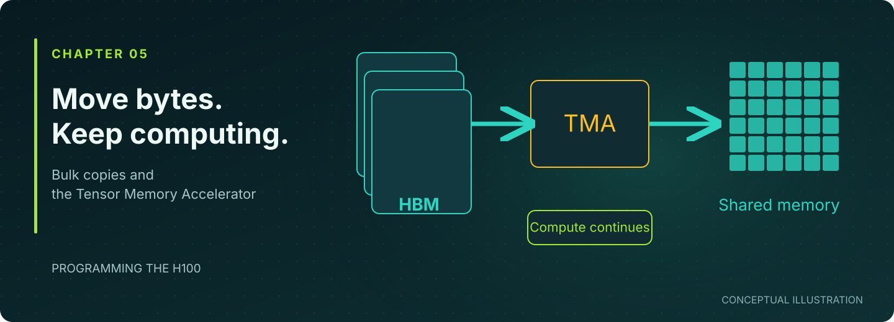
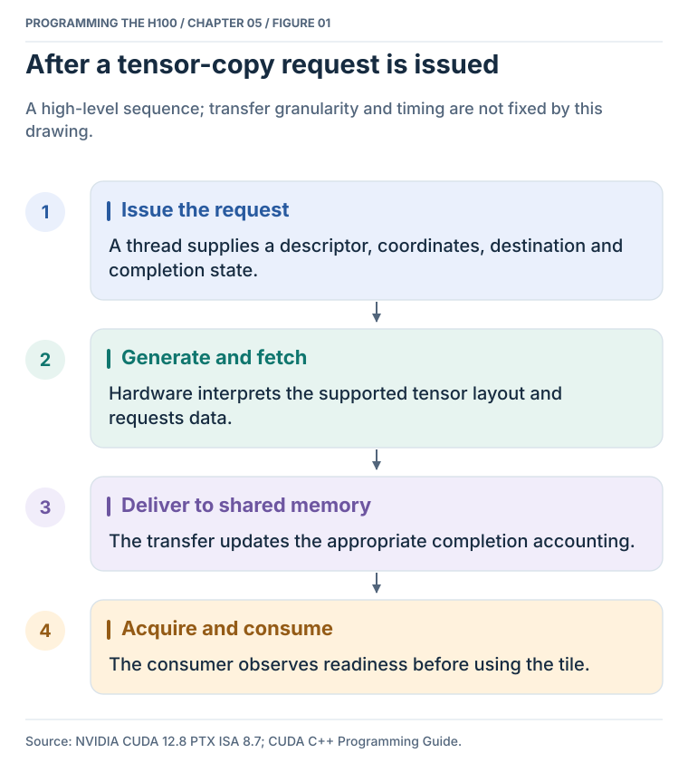
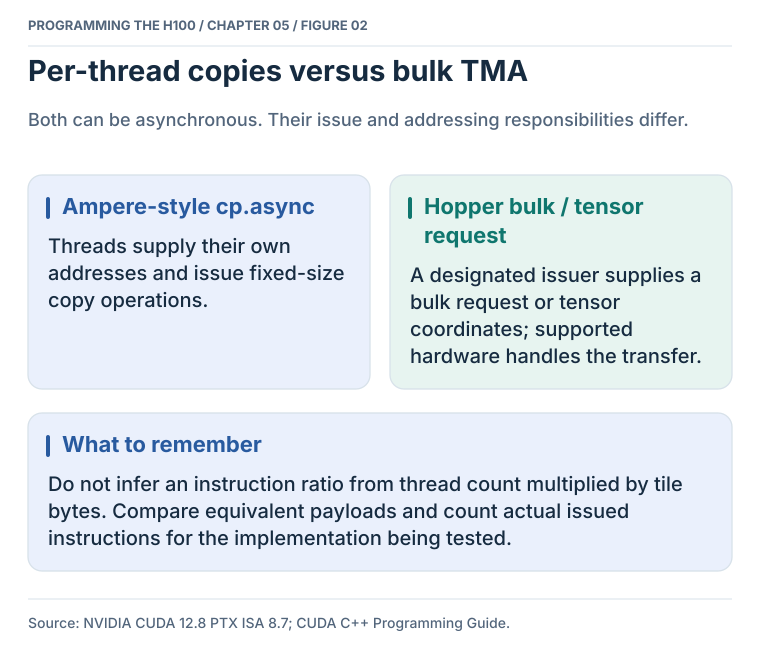
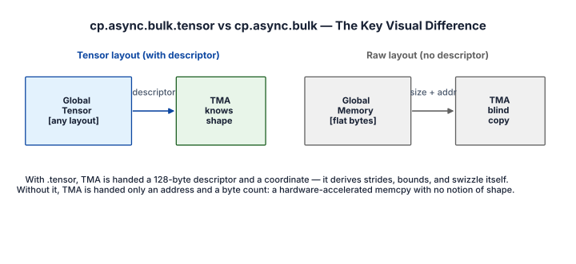
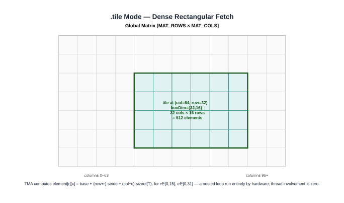
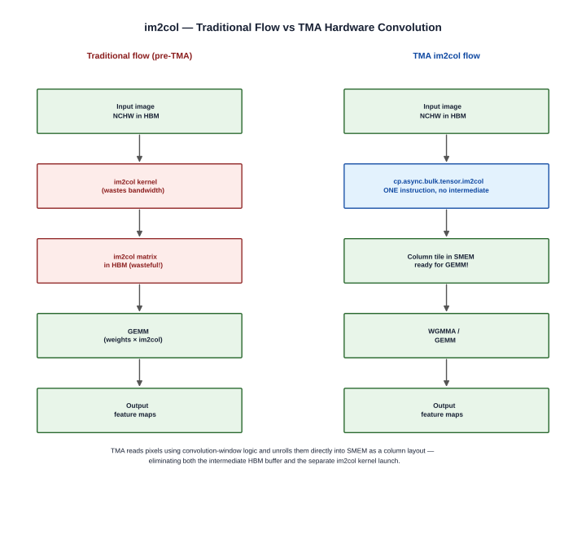
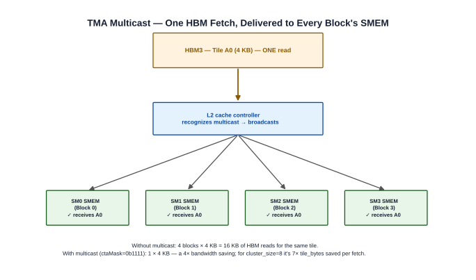
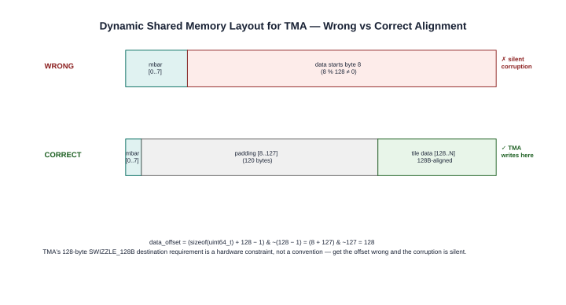
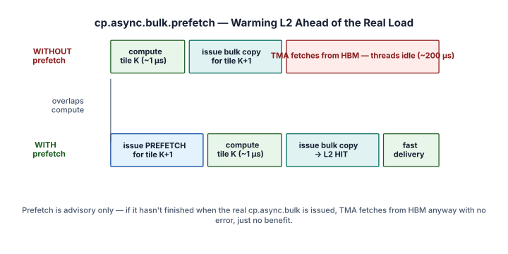

# cp.async.bulk, TMA Transfers & L2 Cache Hinting
## Lesson 5 Companion Guide — Programming the H100

[](images/chapter-openers/05-tma.svg)


> **Validation — November 17, 2026.** 2 complete CUDA programs compiled and executed successfully.
> **Follow-up:** the [final two-H100 audit](final-audit.md) records a fresh run of the complete programs. The original dated transcripts below remain available for provenance.
> **Execution system:** 1× H100 PCIe, 114 SMs, 80 GB class; Ubuntu 24.04.5 LTS; driver 580.105.08; CUDA Toolkit 12.8.93; `sm_90a`, C++17, `-O2`.
> [Full system information](validation/2026-11-17/system-information.txt) · [CUDA result manifest](validation/2026-11-17/results.json). Each tested source and captured output is linked beside its example. Diagrams open as original SVGs for zooming.


> **Baseline compiler flags — use each example’s full command below:** `nvcc -std=c++17 -arch=sm_90a -O2 <file>.cu -o <out>`
> **Run with:** `./<out>` on Hopper hardware matching the compiled target. `sm_90a` binaries are not a portable Blackwell build.


<!-- learning:start -->
!!! tip "Your goal in this chapter"

    Choose a raw bulk copy versus a tensor-map copy, compute the bytes associated with a completion barrier, and keep load completion distinct from bulk-store completion.

    Build a valid descriptor in [Chapter 4](04-cutensormap-tma-swizzling.md) before adding transfer instructions. Use [Chapter 3](03-asynchronicity-mbarrier.md) for phase and ownership reasoning.
<!-- learning:end -->

**What this covers:** Everything from Lesson 5 — the cp.async.bulk instruction family and how it differs from Ampere's cp.async, tensor-aware vs raw (linear) bulk copies, all instruction variants and state space combinations, completion mechanisms (mbarrier vs bulk_group), L2 cache hinting (evict_first/last/normal) for both loads and stores, the createpolicy descriptor, unstructured and structured copy operands, TMA multicast across a cluster, the ctaMask, shared memory layout for dynamic SMEM with TMA, prefetching with cp.async.bulk.prefetch, and cp.reduce.async for hardware-accelerated atomic tile reductions. Every section includes ASCII diagrams, manual worked examples with concrete numbers, and compileable code with full test harnesses.

**How to read this chapter.** Chapter 4 built the descriptor. This chapter is
the other half: `cp.async.bulk`, the instruction that actually uses it, and the
family of variants around it.

The split is worth holding onto. Chapter 4 was host-side setup — done once,
before the kernel launches. Everything here happens inside the kernel, on the
device, in the inner loop. If Chapter 4 was "describe the tensor", this is "go
and get me a tile."

Four movements. Sections 1–3 introduce the instruction family and the one
distinction that organises all of it — whether a copy is *tensor-aware* or just
a fast `memcpy`. Sections 4–7 cover the parts you choose per copy: the
`.tensor` modifier, state spaces, load modes, and how you find out the copy has
finished. Section 8 covers L2 cache hinting, which is separate from everything
else and easy to skip past — don't, it's cheap performance. Sections 9–14 are
the concrete variants, from raw byte copies up to multicast and hardware
reductions.

For a first pass, read §1–§3 and §7. Completion mechanisms are what you will
actually spend debugging time on.

---

## ★ BEFORE YOU START — Hardware, Setup & Installation

The examples in this chapter were validated on Hopper with `sm_90a`.
Ampere's `cp.async` is a separate instruction family; it cannot execute these
bulk-copy listings. Individual bulk-copy forms have their own target rules:
the base family starts at `sm_90`, rather than universally requiring an `a`
target. This book uses `sm_90a` consistently with its Hopper WGMMA examples.

### What Hardware Can You Use?

| Architecture | Scope of this chapter |
| --- | --- |
| Ampere / A100 | Use a separate `cp.async` implementation; bulk-copy examples are unsupported. |
| Hopper / H100 | Tested target: `sm_90a`, H100 PCIe. |
| Blackwell | Check each instruction variant and toolkit target support; these examples were not validated there. |

The availability of a copy instruction on a later GPU does not make a complete
Hopper WGMMA kernel portable. See the [PTX target notes](https://docs.nvidia.com/cuda/archive/12.8.0/parallel-thread-execution/index.html#data-movement-and-conversion-instructions-cp-async-bulk)
and [Blackwell compatibility guide](https://docs.nvidia.com/cuda/blackwell-compatibility-guide/index.html).

### Cloud GPU Rental — Lambda Labs

Choose an instance whose actual GPU model and count meet the chapter's requirements. Use the provider's current Linux GPU image, connect using its supplied SSH key and address, then inspect the environment:

```bash
nvidia-smi
nvcc --version
```

Follow [Getting Started: driver, CUDA and libraries](getting-started.md#3-check-the-driver-and-toolkit-separately). Keep a working provider driver; install only missing components. Select the toolkit explicitly rather than assuming a particular Conda environment exists. For the first launch, use the guide's [complete verified program](getting-started.md#5-compile-and-execute-your-first-verified-program).

### Cloud GPU Rental — AWS

Choose a Linux EC2 instance explicitly listing Hopper GPUs for the Hopper-specific examples; confirm its current hardware specification and GPU count. On a Deep Learning AMI, inspect the image's documented CUDA installations and select a matching toolkit. A PyTorch environment name is image-specific, and activating Python packages alone does not install the C++ compiler/toolkit.

Connect with the SSH command/key for that image, run `nvidia-smi` and `nvcc --version`, then follow the same [installation checklist](getting-started.md#3-check-the-driver-and-toolkit-separately). See [AWS's CUDA environment guidance](https://docs.aws.amazon.com/dlami/latest/devguide/tutorial-base.html). A100 is not a substitute for Hopper TMA/WGMMA examples, and changing only `-arch` does not port those kernels.

### Hopper vs Blackwell — What Changes

Treat Blackwell as a separate port and validation target. Match every copy,
reduction, cache-policy and multicast form to its documented target requirements,
then rebuild and rerun correctness checks. This chapter makes no claim that all
forms carry over unchanged or that changing one architecture flag is sufficient.
Tensor memory and `tcgen05` introduce additional rules outside these Hopper
examples; Chapter 6 explains why WGMMA requires a different implementation.

---

## Table of Contents

1. [cp.async.bulk — What It Is and Why It Exists](#1--cpasyncbulk)
2. [cp.async (Ampere) vs cp.async.bulk (Hopper)](#2--cpasync-ampere-vs-cpasyncbulk-hopper)
3. [Instruction Layout — The Full Syntax](#3--instruction-layout)
4. [Tensor-Aware Copies — cp.async.bulk.tensor](#4--tensor-aware-copies)
5. [State Spaces — Source and Destination](#5--state-spaces)
6. [Load Modes — tile and im2col](#6--load-modes)
7. [Completion Mechanisms — mbarrier vs bulk_group](#7--completion-mechanisms)
8. [L2 Cache Hinting](#8--l2-cache-hinting)
9. [Unstructured (Raw) Copies](#9--unstructured-raw-copies)
10. [Structured (Tensor) Copies — All Variants](#10--structured-tensor-copies)
11. [TMA Multicast — One Fetch, Many SMs](#11--tma-multicast)
12. [Dynamic Shared Memory Layout with TMA](#12--dynamic-shared-memory-layout)
13. [cp.async.bulk.prefetch — L2 Prefetching](#13--cpasyncbulkprefetch)
14. [cp.reduce.async — Hardware Atomic Reduction](#14--cpreduceasync)
15. [Putting It All Together — Full Examples](#15--putting-it-all-together)
16. [Quick Reference](#16--quick-reference)

---

## 1 — cp.async.bulk

The instruction, introduced plainly before any syntax.

`cp.async.bulk` copies a block of data from one place to another and returns
immediately, leaving the work to the TMA engine. "Bulk" is the operative word:
this is not a load that one thread issues on behalf of itself, it is a request
for a whole tile, issued once, by one thread, for the entire block.

§1.1 covers what it does; §1.2 covers the hardware doing it — worth reading,
because knowing the TMA is a separate engine on a separate path is what makes
the fences and completion mechanisms later in the chapter make sense.

### 1.1 What cp.async.bulk Is

`cp.async.bulk` is a family of PTX instructions that perform hardware-accelerated, fully asynchronous bulk memory transfers on Hopper GPUs. The key word is **bulk**: unlike Ampere's `cp.async` which handled one 16-byte chunk at a time and required thread involvement for every chunk, `cp.async.bulk` can transfer an entire tile — hundreds or thousands of bytes — with a single instruction from a single thread.

The transfers are offloaded entirely to the TMA (Tensor Memory Accelerator) hardware engine, which runs completely independently of the SM's compute pipeline. Once the instruction is issued, the SM is free. No threads are involved in the actual data movement whatsoever.

```
cp.async.bulk — Core Properties
══════════════════════════════════════════════════════════════════════

  ├── ONE instruction transfers an ENTIRE tile (up to the destination's
  │   available shared memory — up to ~227 KB per block on H100)
  ├── Issued by ONE thread; other 127 threads in the block are free
  ├── SM is immediately free after issuing; TMA does all the work
  ├── Supports 1D through 5D multi-dimensional tensor layouts
  ├── TMA handles all address calculations, stride navigation, loops
  ├── Requires barrier objects (mbarrier or bulk_group) for ordering
  ├── Can deliver data to multiple SMs simultaneously (multicast)
  └── Can apply swizzling as it writes to SMEM (bank-conflict-free)

  Two major families:
  ─────────────────────────────────────────────────────────────────
  cp.async.bulk         → Raw (linear) byte copies, no tensor semantics
  cp.async.bulk.tensor  → Smart copies using cuTensorMap descriptor
                          Understands dimensions, strides, swizzle, OOB fill
```

### 1.2 The Hardware: TMA Engine

Understanding what makes cp.async.bulk fast requires understanding the TMA hardware unit:

```
TMA Engine — What It Does Internally
══════════════════════════════════════════════════════════════════════

  When you issue cp.async.bulk.tensor, the TMA engine:

  1. Reads the cuTensorMap descriptor (128 bytes) — knows shape, strides, swizzle
  2. Computes the byte address of every element in the requested tile
  3. Requests source data through the memory hierarchy (L2 hits may avoid HBM)
  4. As data arrives in L2:
     ├── Applies swizzle pattern (XOR address permutation)
     └── Writes directly to shared memory — bypasses L1 cache
  5. Tracks progress via the mbarrier's tx-count (decrements as bytes arrive)
  6. Reports transaction completion; the phase completes when arrivals and bytes agree

  ALL of steps 1-6 happen in dedicated hardware with ZERO SM involvement.
```

[](images/ch05/01-tma-engine-timeline.svg)

*A high-level sequence; transfer granularity and timing are not fixed by this drawing.*

---

## 2 — cp.async (Ampere) vs cp.async.bulk (Hopper)

If you have written Ampere code, this section is the one that will change your
mental model — the two instructions share a name prefix and almost nothing else.

Ampere's `cp.async` still required every thread to compute its own address and
issue its own copy. The asynchrony was real but shallow: the threads were
freed from *waiting*, not from *working*. Hopper's `cp.async.bulk` is a true
offload — one thread hands over a descriptor and the entire block's worth of
address generation happens in hardware.

§2.3's comparison table is the fastest way to see the difference if you'd rather
not read the argument.

### 2.1 The Architecture Difference

To appreciate cp.async.bulk, you need to understand what Ampere's cp.async required of threads — and why it was still not good enough for true full overlap of compute and memory.

```
Ampere cp.async — Thread Involvement Required
══════════════════════════════════════════════════════════════════════

  Task: Load 4 KB tile into shared memory.

  Example: 128 participating threads, 16 bytes per thread per iteration.
  Each iteration covers 128 × 16 = 2048 bytes; two cover 4096 bytes.

  for (int chunk = threadIdx.x; chunk < 4096 / 16; chunk += blockDim.x) {
      // Each thread supplies distinct aligned 16-byte source/destination ranges.
      cp_async_16B(smem + 16 * chunk, global + 16 * chunk); // pseudocode
  }
  // Commit and wait with the appropriate cp.async protocol before reading.

  Across the block: 256 thread-level 16-byte copy operations in total.
  With four full warps: 2 iterations × 4 warps = 8 warp-issued copies.
  Address calculations, synchronization and compiler output add other work.
  Do not multiply the 256 total operations by the thread count again.

  Ampere cp.async already supports overlap of copies and independent compute.
```

### 2.2 Hopper cp.async.bulk — Bulk Offload

The Hopper path drawn out. Note how little the issuing thread does compared with
the Ampere diagram above.

```
Hopper cp.async.bulk — One Elected Issuer
══════════════════════════════════════════════════════════════════════

  Task: Load the same 4 KB tile into shared memory.

  Thread-level view:
  ─────────────────────────────────────────────────────────────────
  // Only ONE thread issues ONE instruction
  if (threadIdx.x == 0) {
      asm volatile(
          "cp.async.bulk.tensor.2d.shared::cluster.global.mbarrier::complete_tx::bytes"
          " [%0], [%1, {%2, %3}], [%4];"
          : : "r"(smem_dest), "l"(&tma_desc),
              "r"(col_start), "r"(row_start),
              "r"(mbar_addr)
      );
  }
  // Thread IMMEDIATELY returns and does something else.
  // The other 127 threads never touched this at all.

  What threads are doing:
  ├── Thread 0: issues ONE instruction, returns immediately
  ├── Other threads may perform independent work if dependencies allow
  └── Total instructions to launch a 4KB copy: EXACTLY 1

  Uses: TMA engine — NOT the LSU. NOT warp schedulers (beyond 1 issue).
```

[](images/ch05/02-ampere-vs-hopper-occupancy.svg)

*Both can be asynchronous. Their issue and addressing responsibilities differ.*

For a contiguous 4 KiB region, 256 distinct 16-byte chunks cover the data.
That is a count of thread-level copy operations, not 256 copies per thread or a
universal instruction-overhead speedup. The TMA request still needs descriptor
setup, barrier accounting and a completion protocol. Measure the whole pipeline.

### 2.3 Side-by-Side Comparison Table

The two instructions in one table, if you want the summary rather than the
reasoning.

```
cp.async (Ampere) vs cp.async.bulk (Hopper) — Full Comparison
══════════════════════════════════════════════════════════════════════

  Feature                    cp.async (A100)       cp.async.bulk (H100)
  ─────────────────────────────────────────────────────────────────────
  Hardware unit              LSU                   TMA engine
  Per-transfer involvement   Participating threads One elected issuer
  Copy requests (4 KiB)      256 thread-level      1 bulk request
  Address computation        By threads (runtime)  By TMA (descriptor)
  Transfer size              4/8/16B per thread    Bulk; variant constraints apply
  Tensor dimensions          1D only               1D to 5D
  Swizzle on write           No                    Yes (in descriptor)
  Multicast to cluster       No                    Yes (ctaMask)
  Completion tracking        commit/wait_group      mbarrier or bulk_group
  OOB boundary fill          No (manual)           Yes (descriptor)
  Stride-aware               No (manual striding)  Yes (descriptor strides)
  SM compute overlap         Supported             Supported; workload-dependent
```

---

## 3 — Instruction Layout

Now the syntax. `cp.async.bulk` is a long chain of dot-separated modifiers, and
this section provides the map.

The first fork is the one to internalise: with `.tensor`, the copy is
descriptor-driven and coordinate-addressed — the subject of Chapter 4. Without
it, the copy is a flat run of bytes with no notion of shape at all. Those two
families have different operands and different use cases, and almost every other
modifier depends on which one you're in.

### 3.1 The Two Instruction Families

cp.async.bulk has two top-level variants depending on whether you are working with structured (tensor-described) data or raw linear bytes:

```
cp.async.bulk — Two Major Forms
══════════════════════════════════════════════════════════════════════

  FORM 1: Tensor Layout (with cuTensorMap descriptor)
  ─────────────────────────────────────────────────────────────────
  cp.async.bulk.tensor.{ndim}.{dst_space}.{src_space}.{completion}{.cache}
      [dst_addr], [tensor_map], coord_array, [mbar_addr];

  Use when: Data has known multi-dimensional structure (matrices, tensors).
  Requires: A cuTensorMap descriptor (see Lesson 4).
  Knows about: Dimensions, strides, swizzle, OOB fill.

  Example:
    cp.async.bulk.tensor.2d.shared::cta.global.mbarrier::complete_tx::bytes
        [smem_dest], [tma_desc], {col, row}, [mbar_addr];

  ─────────────────────────────────────────────────────────────────
  FORM 2: Raw Layout (linear byte copy, no descriptor)
  ─────────────────────────────────────────────────────────────────
  cp.async.bulk.{dst_space}.{src_space}.{completion}{.cache}
      [dst_addr], [src_addr], size, [mbar_addr];

  Use when: Data is already a flat contiguous byte region.
  Requires: Only source and destination addresses + size in bytes.
  No knowledge of: Dimensions or strides.

  Example:
    cp.async.bulk.shared::cta.global.mbarrier::complete_tx::bytes
        [smem_dest], [gmem_src], 4096, [mbar_addr];

```

[](images/ch05/03-tensor-vs-raw-layout.svg)

*The request format determines what the hardware knows about the data.*

### 3.2 Full Instruction Template — Every Field Explained

Every field of the instruction, in order. Come back to this whenever a variant
in §9 or §10 has a modifier you don't recognise.

```
Full Instruction Template (Tensor Form)
══════════════════════════════════════════════════════════════════════

  cp.async.bulk.tensor.{ndim}.{dst}.{src}.{completion}{.cache}{.multicast}
      [dst_addr], [tensor_map], {coord0, coord1, ...}, [mbar_addr]{, ctaMask};

  Field-by-field breakdown:
  ─────────────────────────────────────────────────────────────────
  cp.async.bulk      → family name: bulk async copy
  .tensor            → use descriptor (cuTensorMap) mode
  .{ndim}            → 1d, 2d, 3d, 4d, or 5d (dimensions of the tensor)
  .{dst}             → destination state space (shared::cta, shared::cluster, global)
  .{src}             → source state space (global, shared::cta)
  .{completion}      → how to track completion (mbarrier::complete_tx::bytes | bulk_group)
  {.cache}           → optional L2 cache hint (.L2::cache_hint)
  {.multicast}       → optional multicast to cluster CTAs

  Operands:
  [dst_addr]         → 32-bit shared memory address (from __cvta_generic_to_shared)
  [tensor_map]       → 64-bit pointer to CUtensorMap descriptor (host-created)
  {coord0, coord1..} → tile coordinates (innermost first, matching ndim)
  [mbar_addr]        → 32-bit address of mbarrier in shared memory
  {ctaMask}          → 16-bit bitmask for multicast (which CTAs receive data)

  ─── Concrete Examples ───────────────────────────────────────────

  2D load (global → shared, mbarrier completion):
    cp.async.bulk.tensor.2d.shared::cta.global.mbarrier::complete_tx::bytes
        [smem], [desc], {col, row}, [mbar];

  3D load with L2 hint:
    cp.async.bulk.tensor.3d.shared::cta.global.mbarrier::complete_tx::bytes.L2::cache_hint
        [smem], [desc], {hd, seq, batch}, [mbar], [policy];

  2D multicast to 4 CTAs (ctaMask = 0x000F = bits 0-3 set):
    cp.async.bulk.tensor.2d.shared::cluster.global.mbarrier::complete_tx::bytes.multicast::cluster
        [smem], [desc], {col, row}, [mbar], ctaMask;

  Raw linear copy (no descriptor):
    cp.async.bulk.shared::cta.global.mbarrier::complete_tx::bytes
        [smem], [gmem], 4096, [mbar];

  Store (shared → global):
    cp.async.bulk.tensor.2d.global.shared::cta.bulk_group
        [desc], {col, row}, [smem];
```

---

## 4 — Tensor-Aware Copies

What the `.tensor` modifier actually buys, stated in one place.

With it, you no longer supply an address. You supply a *coordinate* — "the tile
at row 128, column 256" — and the descriptor from Chapter 4 supplies everything
else: the strides, the bounds checking, the swizzled destination layout.

That is a bigger shift than it sounds. Bounds checking in particular stops being
code you write and becomes a property of the descriptor, which is why TMA GEMM
kernels have no edge-case branches.

### 4.1 The .tensor Modifier — Why It Changes Everything

Adding `.tensor` to `cp.async.bulk` transforms a simple memory copy into a **smart, descriptor-driven transfer** that understands your data's structure. This is the switch that enables TMA to use the cuTensorMap descriptor created in Lesson 4.

```
With .tensor vs Without .tensor
══════════════════════════════════════════════════════════════════════

  WITHOUT .tensor (raw copy):
  ─────────────────────────────────────────────────────────────────
  cp.async.bulk.shared::cta.global.mbarrier::complete_tx::bytes
      [dst], [src], 4096, [mbar];

  TMA sees: "copy 4096 bytes starting at address src into dst"
  TMA knows NOTHING about:
    ├── How the data is arranged (rows? channels? batch?)
    ├── What strides separate rows (is it padded?)
    ├── Whether to swizzle for bank-conflict elimination
    └── What to fill if the copy goes out of bounds

  WITH .tensor (descriptor-driven):
  ─────────────────────────────────────────────────────────────────
  cp.async.bulk.tensor.2d.shared::cta.global.mbarrier::complete_tx::bytes
      [dst], [desc], {col_start, row_start}, [mbar];

  TMA sees: "fetch tile starting at (col_start, row_start) according to desc"
  TMA knows EVERYTHING:
    ├── Element type (e.g., BF16 = 2 bytes) → proper alignment
    ├── Global shape {4096, 2048} → boundary check enabled
    ├── Global strides {8192 bytes/row} → correct row navigation
    ├── Tile size {128, 64} → exactly how many elements to fetch
    ├── Swizzle mode (128B) → writes land in conflict-free SMEM banks
    └── OOB fill → handles edge tiles automatically

  ─── The ndim Field ──────────────────────────────────────────────

  .{ndim} tells TMA how many coordinates you will provide:
    .1d → 1 coordinate  (1D array: one index)
    .2d → 2 coordinates (2D matrix: column, row)
    .3d → 3 coordinates (3D tensor: dim0, dim1, dim2)
    .4d → 4 coordinates (4D tensor: dim0...dim3)
    .5d → 5 coordinates (5D tensor: dim0...dim4)

  The coordinates specify the TOP-LEFT corner of the tile.
  TMA uses boxDim from the descriptor to know how far to fetch.

  Manual example for .2d with boxDim={64,32}:
    Coordinates {col=128, row=64} → fetches tile covering:
      columns 128 to 128+64-1 = 191
      rows    64  to 64+32-1  = 95
    TMA computes all individual element addresses from this info.
```

---

## 5 — State Spaces

Where a copy can start and where it can end, using the state-space vocabulary
from Chapter 2 §7.

Not every combination exists. Global to shared is the common case — that is the
prefetch in your pipeline. Shared to global is the epilogue. Shared to
shared::cluster is the DSMEM path from Chapter 2. The table here is worth
scanning once so you know which of your ideas the hardware will actually
support.

### 5.1 Source and Destination State Spaces

The state space fields in the instruction tell TMA where to read from and where to write to. This is the same state space concept from Lesson 2, but now applied to bulk hardware transfers.

```
State Space Combinations — All Valid Options
══════════════════════════════════════════════════════════════════════

  Format:  cp.async.bulk.tensor.Nd.{dst}.{src}...

  LOADS (bring data INTO shared memory):
  ─────────────────────────────────────────────────────────────────
  dst = shared::cta      src = global
    → Standard load: HBM → this block's SMEM
    → Most common pattern for GEMM, attention, etc.

  dst = shared::cluster  src = global (with .multicast)
    → Multicast load: HBM → SMEM of MULTIPLE blocks simultaneously
    → Requires ctaMask operand specifying which CTAs receive data
    → One HBM read → delivered to N SMs in the cluster

  STORES (write data FROM shared memory back to global):
  ─────────────────────────────────────────────────────────────────
  dst = global           src = shared::cta
    → Standard store: SMEM → HBM
    → Used for writing computed results back out

  INTER-SMEM (cluster internal copies, no HBM involved):
  ─────────────────────────────────────────────────────────────────
  dst = shared::cta      src = shared::cluster
    → DSMEM copy: another block's SMEM → this block's SMEM
    → Uses cluster interconnect (SM-to-SM, not HBM)
    → Very low latency (~50-80 cycles vs ~500 for HBM)

  ─── Why This Matters ────────────────────────────────────────────

  The state space pair determines the HARDWARE PATH:
    global → shared::cta:  HBM → L2 → SMEM  (high latency, high bandwidth)
    global → shared::cluster: HBM → L2 → multicast → multiple SMEMs
    shared → global:       SMEM → L2 → HBM  (write-back path)
    shared::cluster → shared::cta: SM-to-SM network (low latency)

  Choosing the wrong state space:
  ├── Using shared::cta dst when you want multicast → only 1 CTA gets data
  ├── Using global src when your data is in SMEM → reads from wrong location
  └── These are compile-time errors if the instruction variant doesn't match.
```

---

## 6 — Load Modes

Two ways of interpreting the coordinates you hand a tensor copy.

`.tile` (§6.1) is the ordinary one: fetch a dense rectangular box. This is what
GEMM uses and probably what you want.

`im2col` (§6.2) is a genuine surprise — dedicated hardware for convolution. The
classic im2col transform expands overlapping convolution windows into a matrix,
and normally costs you a separate pass over memory plus the memory to hold the
result. In this mode the TMA performs the transform as it copies, so the
expansion never exists in memory at all.

### 6.1 tile — The Standard Load Mode

The `.tile` mode (the default for most uses) tells TMA to fetch a dense rectangular box of data. The coordinates you provide specify the top-left corner; the cuTensorMap's boxDim specifies the size. TMA fetches every element within that box, following the strides in the descriptor.

```
.tile Mode — Dense Rectangular Fetch
══════════════════════════════════════════════════════════════════════

  TMA uses: coordinates → locate top-left corner
            strides     → navigate to each row
            boxDim      → know when to stop
```

[](images/ch05/04-tile-mode-rectangular-fetch.svg)

*For the example box, 32 columns × 16 rows = 512 elements.*

### 6.2 im2col — Hardware-Accelerated Convolution

The `im2col` mode is a hardware feature specific to convolution. In traditional GPU convolution, you first transform the input image into a "column matrix" (the im2col transformation) and then perform a GEMM. The im2col step wastes memory bandwidth and register space.

TMA's `im2col` mode eliminates this preprocessing step entirely. You give TMA the coordinates of a convolution window's top-left corner, and TMA fetches exactly the pixels that the filter needs — unrolled and placed in shared memory as if they were already in column format.

```
im2col Mode — Hardware Convolution Acceleration
══════════════════════════════════════════════════════════════════════
```

[](images/ch05/05-im2col-flow-comparison.svg)

*Compare dataflow, not an assumed format-independent instruction recipe.*

```
  Benefits:
  ├── Eliminates the intermediate global memory buffer (saves HBM bandwidth)
  ├── Eliminates the im2col kernel launch (saves SM time)
  ├── Delivers data already in the layout convolution GEMM needs
  └── Hardware does the window-to-column remapping at HBM speed

  Instruction format:
    cp.async.bulk.tensor.{nd}.shared::cta.global.im2col
        .mbarrier::complete_tx::bytes [smem], [desc], {coords}, [mbar];

  Variants (real PTX ISA spelling — these relate to offset handling,
  not a width-vs-depth split):
    im2col              → standard im2col load
    im2col::w           → im2col, width-offset form
    im2col_no_offs::w   → im2col, width-offset form, no pixel offsets
    im2col::w::128      → im2col, width-offset form, 128-element granularity
```

---

## 7 — Completion Mechanisms

The section to read carefully, because this is where async pipelines actually go
wrong.

A non-blocking issue does not make the destination safe to read. The instruction
variant determines the completion mechanism; these are not interchangeable
quality levels. Global-to-shared loads use `mbarrier::complete_tx::bytes`, while
shared-to-global bulk stores use bulk async groups. For stores, a `.read` wait
allows source-buffer reuse after the source has been read; full transfer
completion is a separate guarantee. See the [PTX bulk-copy contract](https://docs.nvidia.com/cuda/archive/12.8.0/parallel-thread-execution/index.html#data-movement-and-conversion-instructions-cp-async-bulk).

### 7.1 mbarrier::complete_tx::bytes — Fine-Grained Tracking

The `mbarrier::complete_tx::bytes` completion mechanism ties the async copy directly to an mbarrier object. The transfer contributes transaction completion to the associated mbarrier. A phase completes only when both its pending arrivals and expected transaction count are satisfied; observing zero transaction bytes alone is insufficient.

Use the mechanism supported by the selected direction and variant; the load-side pipeline in Chapter 3 is built around transaction-counted mbarriers.

```
mbarrier::complete_tx::bytes — How It Works
══════════════════════════════════════════════════════════════════════

  Before issuing cp.async.bulk:
    Thread 0 calls mbarrier.arrive.expect_tx [mbar], TILE_BYTES
    → Sets mbarrier's tx-count = TILE_BYTES
    → Decrements thread arrival count by 1

  During cp.async.bulk execution (hardware):
  ─────────────────────────────────────────────────────────────────
  The transfer reports completion against expected transaction bytes.
  Exact internal burst sizes/timing are not the synchronization contract.
  When pending arrivals and transaction bytes are both satisfied, the phase
  completes; consumers observe that completion through the proper acquire wait.

  Consumer threads poll:
    mbarrier.try_wait.parity.acquire [mbar], phase
    → Returns true ONLY when all TILE_BYTES have arrived
    → The .acquire ensures all data is visible before proceeding

  ─── Key Requirement ─────────────────────────────────────────────

  The mbarrier address passed to cp.async.bulk MUST be the same
  address passed to mbarrier.arrive.expect_tx.
  Mismatch → tx-count never reaches zero → DEADLOCK (spin forever).

  ─── The Instruction Operand Order ───────────────────────────────

  cp.async.bulk.tensor.2d.shared::cta.global.mbarrier::complete_tx::bytes
      [smem_dest],    ← destination in shared memory
      [&tma_desc],    ← cuTensorMap descriptor pointer
      {col, row},     ← tile coordinates
      [mbar_addr];    ← mbarrier to signal upon completion

  The mbarrier address is the LAST operand. It is a 32-bit shared
  memory offset (from __cvta_generic_to_shared, NOT a generic pointer).
```

### 7.2 bulk_group — Lightweight Batch Tracking

`bulk_group` is a simpler, lighter-weight alternative to mbarrier for tracking groups of async copies. Instead of per-byte tracking, you commit a batch of copies into a named group and then wait for entire groups to complete.

```
bulk_group — How It Works
══════════════════════════════════════════════════════════════════════

  Three-step pattern:
  ─────────────────────────────────────────────────────────────────
  Step 1: Issue copies tagged with bulk_group
    cp.async.bulk.tensor.2d.shared::cta.global.bulk_group
        [smem_A], [desc], {col0, row0};   // uncommitted copy A

    cp.async.bulk.tensor.2d.shared::cta.global.bulk_group
        [smem_B], [desc], {col1, row1};   // uncommitted copy B

  Step 2: Commit all pending copies into a group
    cp.async.bulk.commit_group;
    // Copies A and B are now "Group N"
    // Future copies after this belong to Group N+1

  Step 3: Wait for groups to complete
    cp.async.bulk.wait_group 0;    // wait for ALL groups to complete
    // OR:
    cp.async.bulk.wait_group 1;    // wait until ≤1 group still pending

  ─── bulk_group vs mbarrier — When to Use Each ───────────────────

  Choose by the documented instruction form, not pipeline complexity:
  global→shared loads use transaction-counted mbarriers;
  shared→global stores use bulk async groups.

  The issuing thread commits and waits for its own bulk groups.
  A .read wait permits source-buffer reuse after source reads finish;
  a full wait also covers destination writes and visibility to that thread.
  Coordinate other participating threads separately. A wait is not a
  replacement for publishing generic shared stores before an async store.

```

---

## 8 — L2 Cache Hinting

A self-contained section about something most kernels leave on the table.

Every TMA fetch passes through L2 on its way to shared memory, and by default
the hardware decides how long it stays there. But you usually know better than
the hardware: a tile you will re-read next iteration should stay; a tile you
will never touch again may deserve lower retention priority. Hints do not
force eviction. L2 is shared across the enabled SMs, so this affects other CTAs.

§8.2 covers `createpolicy`, which packs your intent into a 64-bit descriptor.
§8.3 gives concrete recipes by workload — the fastest route if you want the
benefit without the theory.

### 8.1 Why L2 Cache Hinting Exists

When TMA fetches data from HBM, the data passes through the L2 cache on its way to shared memory. By default, L2 evicts data using a standard replacement policy (LRU-like). But you can give the hardware hints about how long to keep the data in L2, based on your access pattern.

This matters because the L2 cache is a shared resource (all SMs compete for it). Holding data in L2 longer than necessary evicts other useful data and hurts performance. Evicting data too quickly means re-fetching from HBM on the next access.

```
L2 Cache Hinting — The Three Policies
══════════════════════════════════════════════════════════════════════

  evict_normal (default):
  ─────────────────────────────────────────────────────────────────
  Default eviction priority; do not infer an exact replacement algorithm.

  evict_last:
  ─────────────────────────────────────────────────────────────────
  Request higher retention priority for data expected to be reused.
  This does not pin lines or guarantee a later hit.

  evict_first:
  ─────────────────────────────────────────────────────────────────
  Request earlier eviction priority for data with little expected reuse.
  This does not force immediate eviction or bypass L2.

  Example: a reused weight tile may benefit from evict_last if the working
  set and competing traffic allow retention. A one-pass input may benefit
  from evict_first if it would otherwise displace useful data.

  Loads and stores:
  ─────────────────────────────────────────────────────────────────
  Select a hint from the next consumer's reuse pattern, not just whether
  this is a load or store. An output read soon by another kernel may be
  worth retaining. Compare measured traffic and end-to-end timing.
```

These are performance hints, not memory-ordering or residency guarantees. See
[PTX cache eviction priority](https://docs.nvidia.com/cuda/archive/12.8.0/parallel-thread-execution/index.html#cache-eviction-priority-hints).

### 8.2 The createpolicy Instruction — Building a Cache Descriptor

To use L2 cache hinting in a cp.async.bulk instruction, you first create a 64-bit cache policy descriptor using the `createpolicy` PTX instruction. This descriptor is then passed as an additional operand to the copy instruction.

```
createpolicy — Building the Cache Descriptor
══════════════════════════════════════════════════════════════════════

  PTX syntax:
    createpolicy.fractional.L2::evict_last.b64  policy_reg, fraction;
    createpolicy.fractional.L2::evict_first.b64 policy_reg, fraction;

  Parameters:
    policy_reg:  64-bit destination register to hold the descriptor
    fraction:    Floating-point value in [0.0, 1.0]
                 Determines WHAT FRACTION of the data gets the policy.
                 1.0 = 100% of the data gets this cache policy.
                 0.5 = only 50% of the data gets the policy.

  When to use fraction < 1.0:
    If your tile is large and you only expect to reuse part of it,
    you can persist only a fraction. But 1.0 is correct for most uses.

  ─── Manual Worked Example ───────────────────────────────────────

  Scenario: Loading a weight matrix tile (will be reused for each batch).
    We want evict_last to keep it in L2 across all batch iterations.

  uint64_t policy;  // 64-bit register for the descriptor

  // Create: "persist 100% of this data as long as possible in L2"
  asm("createpolicy.fractional.L2::evict_last.b64 %0, 1.0;" : "=l"(policy));
  // policy is now a 64-bit opaque descriptor

  // Pass to cp.async.bulk as the cache policy operand:
  asm volatile(
      "cp.async.bulk.tensor.2d.shared::cta.global"
      ".mbarrier::complete_tx::bytes.L2::cache_hint"
      " [%0], [%1, {%2, %3}], [%4], %5;"
      : : "r"(smem_dest), "l"(&tma_desc),
          "r"(col), "r"(row),
          "r"(mbar_addr), "l"(policy)
  );
  // TMA will now mark the fetched data as evict_last in L2.

  ─── For Streaming Inputs (one-pass data) ─────────────────────────

  uint64_t stream_policy;
  asm("createpolicy.fractional.L2::evict_first.b64 %0, 1.0;"
      : "=l"(stream_policy));
  // Use stream_policy for activation tiles that are processed once.

  ─── For Stores (writing outputs back to global) ──────────────────

  uint64_t write_policy;
  asm("createpolicy.fractional.L2::evict_first.b64 %0, 1.0;"
      : "=l"(write_policy));
  // Request lower retention priority for outputs with no expected near-term reuse.
  // This does not guarantee immediate eviction or a cleaner cache.
```

### 8.3 Practical L2 Hinting Strategy

Start with the default policy. Then identify reuse across CTAs and launches,
not merely reuse inside one CTA's shared memory.

For GEMM, an A tile can be reused across N tiles and a B tile across M tiles.
Which benefits from retention depends on traversal, problem shape and the live
working set. Neither operand is universally a one-pass stream. For attention,
K/V tiles can be revisited by different query CTAs even when each CTA streams
them once; Q may already be retained in registers or shared memory.

Use `evict_last` as a candidate for data with useful cache-level reuse and
`evict_first` for data with little expected reuse. Profile both traffic and
ordinary execution time after changing a hint. The policy does not reserve L2,
ensure a cache hit, or replace the transfer's completion protocol.

---

## 9 — Unstructured (Raw) Copies

`cp.async.bulk` without `.tensor`: a hardware-accelerated `memcpy` that knows
nothing about shape.

No descriptor, no coordinates, no bounds checking, no swizzling — just a source,
a destination, and a byte count. That sounds like a downgrade, and for tiles it
is. But plenty of things you need to move are genuinely flat: weight vectors,
lookup tables, scratch buffers. For those, the descriptor machinery is pure
overhead and this is the right instruction.

### 9.1 cp.async.bulk Without .tensor — Linear Byte Copies

Raw `cp.async.bulk` (without `.tensor`) is essentially a hardware-accelerated `memcpy`. It treats memory as a flat stream of bytes and copies a specified number of bytes from source to destination. No descriptor needed, no dimension knowledge.

For raw bulk copies, both addresses must be 16-byte aligned and the size a multiple of 16 bytes. Tensor-map copies have additional layout and coordinate constraints: their shared-memory address must be 128-byte aligned. The associated mbarrier is independently 8-byte aligned. Neither a descriptor nor a completion wait repairs an invalid address. See [PTX bulk-copy instructions](https://docs.nvidia.com/cuda/archive/12.8.0/parallel-thread-execution/index.html#data-movement-and-conversion-instructions-cp-async-bulk-tensor).

```
Unstructured Copy Variants — All State Space Combinations
══════════════════════════════════════════════════════════════════════

  VARIANT 1: Global → Shared (load from HBM to SMEM)
  ─────────────────────────────────────────────────────────────────
  cp.async.bulk.shared::cta.global.mbarrier::complete_tx::bytes
      [dst_smem], [src_global], size, [mbar_addr];

  Operands:
    dst_smem:    32-bit SMEM address (from __cvta_generic_to_shared)
    src_global:  64-bit global memory address
    size:        number of bytes to copy (must be multiple of 16)
    mbar_addr:   32-bit SMEM address of the mbarrier

  Use when: Source is a contiguous byte array in global memory.
  No cuTensorMap needed. Just addresses and a byte count.

  ─────────────────────────────────────────────────────────────────
  VARIANT 2: Shared → Global (store from SMEM to HBM)
  ─────────────────────────────────────────────────────────────────
  cp.async.bulk.global.shared::cta.bulk_group
      [dst_global], [src_smem], size;

  Operands:
    dst_global:  64-bit global memory address
    src_smem:    32-bit SMEM address
    size:        number of bytes to copy

  Note: Stores typically use bulk_group (not mbarrier) for completion.
  With optional cache policy:
  cp.async.bulk.global.shared::cta.bulk_group.L2::cache_hint
      [dst_global], [src_smem], size, [cache_policy];

  ─────────────────────────────────────────────────────────────────
  VARIANT 3: Shared → DSMEM (cluster-internal copy)
  ─────────────────────────────────────────────────────────────────
  cp.async.bulk.shared::cluster.shared::cta.mbarrier::complete_tx::bytes
      [dst_dsmem], [src_smem], size, [mbar_addr];

  Operands:
    dst_dsmem:  cluster SMEM address (obtained via mapa instruction)
    src_smem:   source SMEM address (this block's shared memory)
    size:       bytes to copy

  Use when: Moving data between blocks within a cluster.
  Takes the SM-to-SM DSMEM network (not HBM) → ~50-80 cycles latency.
  Useful for cooperative algorithms that share computed partial results.

  ─── Manual Worked Example: Raw Global→SMEM ──────────────────────

  Copy 8192 bytes (2048 FP32 values) from global memory to SMEM:

  // Setup:
  __shared__ __align__(8) uint64_t mbar;
  __shared__ float smem_buf[2048];
  float* src_global = d_data + block_start;

  if (tid == 0) {
      uint32_t mbar_addr = __cvta_generic_to_shared(&mbar);
      uint32_t smem_dest = __cvta_generic_to_shared(smem_buf);
      uint64_t src_addr  = reinterpret_cast<uint64_t>(src_global);

      // Init mbarrier (1 thread arrival + 8192 tx bytes expected)
      asm("mbarrier.init.shared::cta.b64 [%0], 1;" : : "r"(mbar_addr));
      asm volatile("fence.proxy.async.shared::cta;" ::: "memory");
      asm("mbarrier.arrive.expect_tx.release.cta.shared::cta.b64 _, [%0], %1;"
          : : "r"(mbar_addr), "r"(8192u));

      // Issue raw bulk copy (no cuTensorMap!)
      asm volatile(
          "cp.async.bulk.shared::cta.global.mbarrier::complete_tx::bytes"
          " [%0], [%1], %2, [%3];"
          : : "r"(smem_dest), "l"(src_addr), "r"(8192u), "r"(mbar_addr)
          : "memory"
      );
  }
  __syncthreads();

  // All threads wait for copy to complete
  { uint32_t done=0; int phase=0;
    uint32_t mbar_addr = __cvta_generic_to_shared(&mbar);
    while(!done) asm volatile(
        "{ .reg .pred p; mbarrier.try_wait.parity.acquire.cta.shared::cta.b64"
        " p,[%1],%2; selp.u32 %0,1,0,p; }"
        : "=r"(done) : "r"(mbar_addr), "r"(phase)); }
  // smem_buf now contains the data
```

---

## 10 — Structured (Tensor) Copies — All Variants

The tensor-aware forms, one per direction, with full operand lists.

This is reference material rather than narrative — §10.1 is the load you will
write in every pipeline prologue, §10.2 the store you will write in every
epilogue. Read them once to see the shape, then come back when you need the
exact operand order.

### 10.1 Structured Load — Global to Shared (Standard)

The workhorse: the instruction at the top of every TMA pipeline.

```
Structured Copy: Global → Shared::CTA (Standard Load)
══════════════════════════════════════════════════════════════════════

  cp.async.bulk.tensor.{nd}.shared::cta.global
      .mbarrier::complete_tx::bytes{.L2::cache_hint}
      [dstMem], [tensorMap, tensorCoord], [mbar]{, cache_policy};

  Operands:
    dstMem:       32-bit SMEM address (destination)
    tensorMap:    64-bit pointer to CUtensorMap (host-created descriptor)
    tensorCoord:  Array of nd integers specifying tile coordinates
                  (innermost first: {col, row} for 2D)
    mbar:         32-bit SMEM address of mbarrier
    cache_policy: Optional 64-bit policy descriptor (from createpolicy)

  ─── Manual Worked Example: 2D Matrix Tile Load ──────────────────

  // Host creates descriptor for [2048 rows × 1024 cols] BF16 matrix:
  cuuint64_t gdim[2]    = {1024, 2048};
  cuuint64_t gstride[1] = {1024 * 2};    // 2048 bytes per row
  cuuint32_t bdim[2]    = {64, 32};      // 64 cols × 32 rows per tile
  cuuint32_t estride[2] = {1, 1};
  // ... cuTensorMapEncodeTiled(..., SWIZZLE_128B, L2_128B, NAN_FMA)

  // Kernel: load tile at (col=64, row=128)
  uint32_t smem_dest = __cvta_generic_to_shared(smem_tile);
  asm volatile(
      "cp.async.bulk.tensor.2d.shared::cta.global"
      ".mbarrier::complete_tx::bytes"
      " [%0], [%1, {%2, %3}], [%4];"
      :
      : "r"(smem_dest),    // dst (32-bit SMEM addr)
        "l"(&tma_desc),    // tensorMap (64-bit pointer)
        "r"(64),           // coord[0] = col = 64 (innermost)
        "r"(128),          // coord[1] = row = 128
        "r"(mbar_addr)     // mbarrier for completion
      : "memory"
  );
  // TMA fetches smem_tile[0:32][0:64] = matrix rows 128-159, cols 64-127
  // Data is written with 128B swizzle applied automatically.
```

### 10.2 Structured Store — Shared to Global

The reverse, for epilogues. Note that stores complete differently from loads —
there is no barrier to wait on, so you use `bulk_group` from §7.2.

```
Structured Copy: Shared::CTA → Global (Store / Write-back)
══════════════════════════════════════════════════════════════════════

  cp.async.bulk.tensor.{nd}.global.shared::cta
      .bulk_group{.L2::cache_hint}
      [tensorMap, tensorCoord], [srcMem]{, cache_policy};

  Operands:
    tensorMap:    64-bit pointer to CUtensorMap (with global destination)
    tensorCoord:  Tile coordinates for the write destination
    srcMem:       32-bit SMEM address of data to write out
    cache_policy: Optional eviction policy

  Key differences vs load:
  ├── dst and src are SWAPPED: tensor map is the destination!
  ├── Uses bulk_group completion; commit and the appropriate wait remain required
  ├── The cuTensorMap was created with the global array as the base
  └── TMA writes from SMEM back to the corresponding tile in HBM

  ─── Manual Worked Example: Store Computed Tile ──────────────────

  // After computing result in smem_result, write it back to global:
  uint64_t write_policy;
  asm("createpolicy.fractional.L2::evict_first.b64 %0, 1.0;"
      : "=l"(write_policy));
  // evict_first: result written to L2 then immediately eligible for eviction
  // Good: we won't read this output back on this SM.

  uint32_t smem_src = __cvta_generic_to_shared(smem_result);
  asm volatile(
      "cp.async.bulk.tensor.2d.global.shared::cta"
      ".bulk_group.L2::cache_hint"
      " [%0, {%1, %2}], [%3], %4;"
      :
      : "l"(&output_desc),  // cuTensorMap for global output array
        "r"(col_out),       // coord[0] = col of output tile
        "r"(row_out),       // coord[1] = row of output tile
        "r"(smem_src),      // source in SMEM
        "l"(write_policy)   // cache hint: evict immediately
      : "memory"
  );
  cp_async_bulk_commit_group();   // commit to bulk_group
  cp_async_bulk_wait_group<0>();  // wait for all stores to complete
```

---

## 11 — TMA Multicast

The optimisation Chapter 2 §3 promised, now with the actual mechanism.

Several blocks in a cluster may need the same global-memory tile. Multicast
lets one issued tensor transfer deliver it to the shared-memory destination in
each selected block. Every destination needs its own initialized completion
barrier and valid storage before issue.

### 11.1 The Problem Multicast Solves

Without multicast, four blocks issue four independent requests for the same
4 KiB tile. With multicast, one request names the four recipients. The delivered
shared-memory data is still 4 × 4 KiB: multicast reduces redundant source-side
requests rather than eliminating destination writes.

```
Four independent requests:   A0 → block 0, A0 → block 1,
                            A0 → block 2, A0 → block 3
One multicast request:      A0 → {block 0, block 1, block 2, block 3}

Destination payload in both cases: 4 × 4 KiB = 16 KiB
Source request payload: independent 16 KiB; multicast 4 KiB
```

[](images/ch05/06-tma-multicast-fanout.svg)

*Each selected rank receives its own shared-memory copy.*

Actual HBM traffic is not equal to this request count: independent requests can
hit L2 or share cached data. A fourfold request reduction therefore does not
promise a fourfold HBM-bandwidth reduction or speedup. Measure the cache and
memory traffic for the actual workload. See the [PTX tensor-copy multicast contract](https://docs.nvidia.com/cuda/archive/12.8.0/parallel-thread-execution/index.html#data-movement-and-conversion-instructions-cp-async-bulk-tensor).

### 11.2 The ctaMask — Selecting Participant Blocks

The `ctaMask` is a 16-bit integer where each bit corresponds to one block in the cluster. Setting bit `i` means block `i` will receive the multicast data.

```
ctaMask — How to Construct It
══════════════════════════════════════════════════════════════════════

  ctaMask is a 16-bit bitmask. Cluster supports up to 16 blocks (bits 0-15).

  Examples:
    ctaMask = 0x000F = 0b0000000000001111 → blocks 0, 1, 2, 3
    ctaMask = 0x00FF = 0b0000000011111111 → blocks 0 through 7
    ctaMask = 0xFFFF = 0b1111111111111111 → all 16 blocks
    ctaMask = 0x0001 = 0b0000000000000001 → only block 0 (= no multicast)

  Computing ctaMask at runtime:
  ─────────────────────────────────────────────────────────────────
  namespace cg = cooperative_groups;
  cg::cluster_group cluster = cg::this_cluster();
  uint16_t full_mask = (1 << cluster.num_blocks()) - 1;
  // For cluster_size=4: (1<<4)-1 = 0x000F → all 4 blocks

  // Selective: only blocks 0 and 2:
  uint16_t selective_mask = 0b0101;  // bits 0 and 2

  ─── The Leader Block Pattern ────────────────────────────────────

  Only ONE block in the cluster should issue the multicast instruction.
  Typically block with rank 0 (the "leader") is the producer:

  cg::cluster_group cluster = cg::this_cluster();
  if (cluster.block_rank() == 0) {
      // Only rank 0 issues the instruction for all blocks
      asm volatile(
          "cp.async.bulk.tensor.2d.shared::cluster.global"
          ".mbarrier::complete_tx::bytes.multicast::cluster"
          " [%0], [%1, {%2, %3}], [%4], %5;"
          :
          : "r"(smem_dest), "l"(&tma_desc),
            "r"(col), "r"(row),
            "r"(mbar_addr),  // mbarrier in THIS block's SMEM
            "h"(full_mask)   // ctaMask: all cluster blocks receive
          : "memory"
      );
  }
  // ALL blocks spin on THEIR OWN local mbarrier:
  { uint32_t done=0; while(!done) asm volatile(
      "{ .reg .pred p; mbarrier.try_wait.parity.acquire.cta.shared::cta.b64"
      " p,[%1],%2; selp.u32 %0,1,0,p; }"
      : "=r"(done) : "r"(mbar_addr), "r"(phase)); }
  // After this: ALL blocks have the tile in their own SMEM ✓
```

### 11.3 Multicast mbarrier Setup — The Critical Details

Multicast has specific rules for mbarrier setup that differ from single-block TMA. Getting these wrong causes deadlocks or data corruption.

```
Multicast mbarrier Rules — What Can Go Wrong and How to Avoid It
══════════════════════════════════════════════════════════════════════

  RULE 1: Each block initializes its OWN mbarrier independently.
  ─────────────────────────────────────────────────────────────────
  // CORRECT: every block creates a barrier at the SAME SMEM offset
  if (tid == 0) {
      uint32_t mbar_addr = __cvta_generic_to_shared(&mbar);
      asm("mbarrier.init.shared::cta.b64 [%0], 1;" : : "r"(mbar_addr));
      asm volatile("fence.proxy.async.shared::cta;" ::: "memory");
  }
  __syncthreads();
  // mbar is at the same RELATIVE offset in every block's SMEM.
  // TMA uses this offset to signal each block after delivering data.

  RULE 2: Every participating block calls arrive.expect_tx independently.
  ─────────────────────────────────────────────────────────────────
  // ALL blocks (including non-issuing blocks) must call expect_tx!
  // Otherwise their tx-count is never set → their barrier never fires.
  if (tid == 0) {
      uint32_t mbar_addr = __cvta_generic_to_shared(&mbar);
      asm("mbarrier.arrive.expect_tx.release.cta.shared::cta.b64 _, [%0], %1;"
          : : "r"(mbar_addr), "r"((uint32_t)TILE_BYTES));
  }
  // Even blocks that don't issue the cp.async.bulk instruction must
  // call expect_tx — because TMA will signal ALL ctaMask blocks.

  RULE 3: The mbar_addr in the cp.async.bulk instruction refers to
          the ISSUING block's mbar. TMA uses the offset to find all
          other blocks' mbar at the same relative SMEM position.
  ─────────────────────────────────────────────────────────────────
  // Only rank-0 issues the instruction:
  if (rank == 0 && tid == 0) {
      asm volatile(
          "cp.async.bulk.tensor.2d.shared::cluster.global"
          ".mbarrier::complete_tx::bytes.multicast::cluster"
          " [%0], [%1, {%2, %3}], [%4], %5;"
          : : "r"(smem_dest), "l"(&tma_desc), "r"(col), "r"(row),
              "r"(mbar_addr_of_rank0),  // THIS block's mbar
              "h"(ctaMask)
      );
  }
  // TMA looks at offset(mbar_addr_of_rank0 in rank0's SMEM)
  // → applies same offset in rank1's SMEM, rank2's SMEM, etc.
  // → signals each block's mbar independently as data arrives.

  RULE 4: Only blocks in ctaMask should call expect_tx.
  ─────────────────────────────────────────────────────────────────
  // If blocks 0 and 3 are in ctaMask but not blocks 1 and 2:
  //   Blocks 0,3: call expect_tx → their barriers will fire ✓
  //   Blocks 1,2: do NOT call expect_tx → would spin forever on barrier

  RULE 5: All participating blocks must perform barrier.cluster FIRST.
  ─────────────────────────────────────────────────────────────────
  // After local barrier initialization/publication and accounting,
  // before the elected CTA issues multicast:
  barrier.cluster.arrive;     // signal this block is ready
  barrier.cluster.wait;       // wait for all cluster blocks to be ready
  // This establishes readiness of every destination barrier/buffer.
  // Cluster scheduling alone does not establish initialization order.
```

---

## 12 — Dynamic Shared Memory Layout with TMA

A practical section about a problem you will hit the first time your tiles
outgrow 48 KB and you have to switch to `extern __shared__`.

With dynamic shared memory there is no compiler to lay out your variables — you
get one flat array and place everything by hand. TMA makes that fussier than
usual: mbarriers need 8-byte alignment and tensor-map copies need a 128-byte
aligned shared-memory address. Violating the instruction contract is undefined
behavior; it need not produce a predictable error or a particular corruption.

The template here is worth copying verbatim.

### 12.1 The Problem with Dynamic SMEM and TMA

When using dynamic shared memory (`extern __shared__ char smem[]`), you must manually lay out the mbarrier object and data tile within the shared memory region. Tensor-map copies require the shared-memory data address to be 128-byte aligned, including unswizzled copies; raw bulk copies instead require 16-byte data alignment. The mbarrier must be 8-byte aligned. Align the allocation base as well as each offset.

```
Dynamic Shared Memory Layout for TMA — The Right Way
══════════════════════════════════════════════════════════════════════

  WRONG approach (common mistake):
  ─────────────────────────────────────────────────────────────────
  extern __shared__ char smem[];
  uint64_t* bar_ptr = reinterpret_cast<uint64_t*>(smem);
  half*     data_ptr = reinterpret_cast<half*>(smem + sizeof(uint64_t));
  // smem = [8B mbar][unaligned data start]
  // Problem: data starts at byte 8, but TMA with SWIZZLE_128B needs
  // the data base to be 128-byte aligned!
  // byte 8 % 128 = 8  ← NOT 128B aligned → silent corruption!

  CORRECT approach:
  ─────────────────────────────────────────────────────────────────
  extern __shared__ char smem[];

  // Place mbarrier at the start (already 8-byte aligned via smem)
  uint64_t* bar_ptr = reinterpret_cast<uint64_t*>(smem);

  // Align the data to 128 bytes (required for TMA swizzle)
  int tma_alignment = 128;
  int data_offset = (sizeof(uint64_t) + tma_alignment - 1) & ~(tma_alignment - 1);
  // sizeof(uint64_t) = 8
  // (8 + 127) & ~127 = 135 & ~127 = 128 ← rounds UP to 128
  half* tile_ptr = reinterpret_cast<half*>(smem + data_offset);

  // Dynamic SMEM size needed:
  // 128 bytes (mbar + padding) + tile_bytes
  // Pass to kernel launch: my_kernel<<<grid, block, 128+TILE_BYTES>>>(...)
```

[](images/ch05/07-dynamic-smem-alignment.svg)

*This layout example uses an eight-byte barrier and a 128-byte-aligned tile start.*

```
  ─── Template for Multiple Tiles (double buffering) ───────────────

  extern __shared__ char smem[];

  // Two mbarriers + two tiles for double buffering
  uint64_t* mbar_A = reinterpret_cast<uint64_t*>(smem + 0);
  uint64_t* mbar_B = reinterpret_cast<uint64_t*>(smem + 8);
  // Next 128B-aligned offset after 2 × 8B = 16B:
  // Round 16 up to 128: (16 + 127) & ~127 = 128
  int tile_A_offset = 128;
  int tile_B_offset = 128 + TILE_BYTES;  // TILE_BYTES must be 128B-aligned too

  half* tile_A = reinterpret_cast<half*>(smem + tile_A_offset);
  half* tile_B = reinterpret_cast<half*>(smem + tile_B_offset);

  // SMEM total: 128 (mbar padding) + 2 × TILE_BYTES
```

---

## 13 — cp.async.bulk.prefetch

A hint rather than a copy: start pulling this data from HBM into L2, but don't
put it anywhere yet.

The use case is the start of a pipeline, where you have nothing to overlap the
first real fetch with. Prefetching a few tiles ahead warms L2 so those fetches
land in cache rather than going the full distance to HBM.

It is a hint, so it can be dropped. Treat it as an optimisation, never as a
guarantee that data will be there.

### 13.1 Prefetching — Warming the L2 Cache

`cp.async.bulk.prefetch` is a hint instruction that tells the memory system to start fetching data from HBM into the L2 cache without writing it to shared memory yet. A later `cp.async.bulk.tensor` load may benefit if the data has arrived and remains in L2; a prefetch neither guarantees residency nor establishes data readiness.

```
cp.async.bulk.prefetch — How It Works
══════════════════════════════════════════════════════════════════════

```

[](images/ch05/08-prefetch-timeline.svg)

*The real load still needs its normal ordering and completion protocol.*

```
  PTX syntax:
  ─────────────────────────────────────────────────────────────────
  cp.async.bulk.prefetch.tensor.{nd}.L2.global
      [tensor_map, coord_array];

  Operands:
    tensor_map:   Same cuTensorMap descriptor as the main copy
    coord_array:  Same coordinates as the tile you plan to load

  Example:
    // Early: prefetch tile K+1 into L2
    asm("cp.async.bulk.prefetch.tensor.2d.L2.global [%0, {%1, %2}];"
        : : "l"(&tma_desc), "r"(col_K1), "r"(row_K1));

    // Later: actual load (L2 likely warm by now)
    asm volatile(
        "cp.async.bulk.tensor.2d.shared::cta.global"
        ".mbarrier::complete_tx::bytes [%0], [%1, {%2, %3}], [%4];"
        : : "r"(smem), "l"(&tma_desc), "r"(col_K1), "r"(row_K1), "r"(mbar));

  ─── Important Limitations ───────────────────────────────────────

  1. PERFORMANCE HINT ONLY:
     The prefetch is advisory. If the prefetch hasn't completed by the
     time cp.async.bulk is issued, TMA fetches from HBM anyway. There
     is no error — just no benefit from the prefetch in that case.

  2. NO EFFECT ON SWIZZLE OR L2 PROMOTION:
     The prefetch brings data to L2 "raw" (no swizzle applied).
     The actual cp.async.bulk still applies swizzle when writing to SMEM.
     The L2 promotion setting in the cuTensorMap does NOT affect the
     prefetch — prefetch always fetches at the natural granularity.

  3. NO BARRIER NEEDED:
     The prefetch has no completion mechanism. It is truly fire-and-forget.
     Do not try to wait for the prefetch — it has no mbarrier or bulk_group.
```

---

## 14 — cp.reduce.async

The last variant, and the one that does more than move data.

Instead of overwriting the destination, `cp.reduce.async` combines with it —
adding, taking a maximum, ANDing — element by element, in hardware, as the
tile is written back. The alternative is reading the destination into
registers, combining, and writing it back, which costs a round trip and needs
atomics to be safe.

This is what split-K GEMM wants, where many blocks accumulate partial results
into the same output tile. Chapter 10's Stream-K scheduling leans on it
directly.

### 14.1 What cp.reduce.async Does

`cp.reduce.async` extends TMA beyond simple copies to perform **hardware-accelerated atomic reductions**. Instead of copying a tile of data from SMEM to global memory and adding to an existing global accumulator (which would require thread-driven atomics), cp.reduce.async offloads the entire tile reduction to TMA hardware.

TMA reads the tile from SMEM, applies the reduction operation to each element against the corresponding element in global memory, and writes the result back — all atomically, all in the background.

```
cp.reduce.async — The Problem It Solves
══════════════════════════════════════════════════════════════════════

  Traditional tile reduction (thread-driven):
  ─────────────────────────────────────────────────────────────────
  // After computing partial result in smem_partial:
  for (int i = tid; i < TILE_SIZE; i += blockDim.x) {
      atomicAdd(&global_accumulator[i], smem_partial[i]);
  }
  // Problems:
  // ├── All threads occupied with atomics (can't do other work)
  // ├── Each atomicAdd = read + modify + write to global (3 memory ops)
  // ├── Contention if multiple blocks reduce to same address simultaneously
  // └── Total: TILE_SIZE atomic operations, all thread-driven.

  With cp.reduce.async (TMA-driven):
  ─────────────────────────────────────────────────────────────────
  // After computing partial result in smem_partial:
  if (tid == 0) {
      cp.reduce.async.bulk.global.shared::cta.bulk_group.add.f32
          [global_accumulator], [smem_partial], TILE_BYTES;
  }
  // TMA reads smem_partial, atomically adds each element to
  // global_accumulator[i], writes back — in the background.
  // ALL threads immediately free for the next computation.

  Benefit:
  ├── 1 instruction vs TILE_SIZE thread instructions
  ├── SM completely free after the single issue
  ├── TMA batches the reduction more efficiently than thread atomics
  └── Overlaps perfectly with the next compute phase
```

### 14.2 cp.reduce.async — Full Instruction Reference

Every operation and type combination. Note that the supported set is narrower
than you might expect — check here before designing around a reduction.

```
cp.reduce.async — All Variants and Operands
══════════════════════════════════════════════════════════════════════

  VARIANT 1: Raw (linear) reduction
  ─────────────────────────────────────────────────────────────────
  cp.reduce.async.bulk.{dst}.{src}.{completion}{.cache}.{redOp}.{type}
      [dstMem], [srcMem], size{, cache_policy};

  VARIANT 2: Tensor (descriptor-based) reduction
  ─────────────────────────────────────────────────────────────────
  cp.reduce.async.bulk.tensor.{nd}.{dst}.{src}.{redOp}{.load_mode}
      .{completion}{.cache}
      [tensorMap, tensorCoords], [srcMem]{, cache_policy};

  Operands (raw variant):
    dstMem:       64-bit global memory address (destination of reduction)
    srcMem:       32-bit SMEM address (data to reduce FROM)
    size:         bytes to reduce
    cache_policy: Optional 64-bit eviction policy descriptor

  Operands (tensor variant):
    tensorMap:    64-bit pointer to cuTensorMap (global destination)
    tensorCoords: Tile coordinates in the global tensor
    srcMem:       32-bit SMEM address (source data)

  ─── Supported Reduction Operations (.redOp) ─────────────────────

  .add   → atomic add: dst[i] += src[i]
  .min   → atomic min: dst[i] = min(dst[i], src[i])
  .max   → atomic max: dst[i] = max(dst[i], src[i])
  .inc   → atomic increment: dst[i] = (dst[i] >= src[i]) ? 0 : dst[i]+1
  .dec   → atomic decrement
  .and   → atomic bitwise AND: dst[i] &= src[i]
  .or    → atomic bitwise OR:  dst[i] |= src[i]
  .xor   → atomic bitwise XOR: dst[i] ^= src[i]

  ─── Supported Data Types (.type) ─────────────────────────────────

  Type     redOps supported          Notes
  ──────────────────────────────────────────────────────────────────
  .f16     .add only (as .add.noftz.f16)   FP16 atomic add — .noftz required
  .bf16    .add only (as .add.noftz.bf16)  BF16 atomic add — .noftz required
  .b32     .and, .or, .xor          32-bit bitwise ops
  .u32     .add, .min, .max, .inc, .dec, .and, .or, .xor
  .s32     .add, .min, .max         signed 32-bit
  .b64     .and, .or, .xor          64-bit bitwise ops
  .u64     .add, .min, .max, .and, .or, .xor
  .s64     .add, .min, .max
  .f32     .add                     FP32 atomic add
  .f64     .add                     FP64 atomic add

  ─── Manual Worked Example ───────────────────────────────────────

  Scenario: 128 thread blocks each compute a partial sum tile.
  Final result = elementwise sum of all partial tiles.

  // In each block, after computing partial sum in smem_partial:
  if (threadIdx.x == 0) {
      uint32_t smem_src = __cvta_generic_to_shared(smem_partial);
      uint64_t dst_addr = reinterpret_cast<uint64_t>(global_accumulator);

      // Atomically add this block's partial tile to the global accumulator
      asm volatile(
          "cp.reduce.async.bulk.global.shared::cta"
          ".bulk_group.add.f32"
          " [%0], [%1], %2;"
          : : "l"(dst_addr), "r"(smem_src), "r"((uint32_t)TILE_BYTES)
          : "memory"
      );
  }
  // On the issuing thread, commit this reduction to its bulk group.
  // Wait for source reads before any thread overwrites smem_partial.
  // A full wait is needed before relying on destination completion;
  // coordinate the block before reusing collectively written storage.
```

---

## 15 — Putting It All Together

Two complete programs. §15.1 is the standard pipeline shape: a `cp.async.bulk`
load, an mbarrier wait, and L2 hinting applied — the three things from §7 and §8
working together. §15.2 covers the output side, pairing a TMA store with
`cp.reduce.async`.

Between them they contain the copy machinery that every kernel in Chapters 8
through 10 assumes you already have.

### 15.1 Full Example: cp.async.bulk with mbarrier and L2 Hinting

**Manual Worked Example Before the Code:**

```
Scenario: Load 4096 bytes (1024 FP32 values) from global memory to SMEM
          using raw cp.async.bulk (no cuTensorMap) with evict_last hint.
          Represents loading a reused weight tile in a GEMM-like loop.

Setup:
  SMEM: [0..7]=mbar, [8..127]=pad, [128..4223]=tile (4096 bytes)
  mbar_addr = smem offset 0
  tile_addr = smem offset 128

Step 1: tid=0 inits mbar (count=1)
Step 2: tid=0 calls arrive.expect_tx(mbar, 4096)
        → pending_threads: 1→0, pending_tx: 0→4096
Step 3: Create evict_last policy (keep weight in L2 for reuse)
Step 4: tid=0 issues cp.async.bulk with policy
Step 5: Threads acquire-wait for the phase whose arrivals and 4096 expected
        transaction bytes are satisfied; internal burst sizes are not assumed
Step 6: All threads use smem data
Step 7: phase ^= 1. Repeat for next tile.
```

```
═══════════════════════════════════════════════════════
  FILE:    ex01_bulk_raw.cu
  COMPILE: nvcc -std=c++17 -arch=sm_90a -O2 ex01_bulk_raw.cu -o ex01
  RUN:     ./ex01
  EXPECT:  All tiles loaded and verified, L2 hint applied correctly.
═══════════════════════════════════════════════════════
```

```cuda
// ═══════════════════════════════════════════════════════════════════
// ex01_bulk_raw.cu
//
// PURPOSE: Demonstrate raw cp.async.bulk (no cuTensorMap):
//   - Linear global→SMEM bulk copy with mbarrier
//   - L2 cache hinting (evict_last for reused data)
//   - Full mbarrier init/arrive.expect_tx/try_wait/reuse pipeline
//   - Dynamic shared memory layout with correct alignment
//
// REQUIRES: sm_90a (H100) or sm_100a (Blackwell)
// ═══════════════════════════════════════════════════════════════════

#include <cstdio>
#include <cstdint>
#include <cmath>

#define CHECK_CUDA(call) do { \
    cudaError_t _e=(call); if(_e!=cudaSuccess){ \
    fprintf(stderr,"CUDA %s:%d %s\n",__FILE__,__LINE__,cudaGetErrorString(_e)); \
    exit(1);} } while(0)

static constexpr int TILE_ELEMS = 1024;
static constexpr int TILE_BYTES = TILE_ELEMS * sizeof(float);  // 4096
static constexpr int K_TILES    = 6;

// Dynamic SMEM layout:
//   [0..7]:    mbarrier (8 bytes, 8B-aligned)
//   [8..127]:  padding to 128B boundary
//   [128..N]:  tile data (TILE_BYTES, 128B-aligned for TMA)
static constexpr int MBAR_OFFSET = 0;
static constexpr int TILE_OFFSET = 128;   // round(8, 128) = 128
static constexpr int SMEM_SIZE   = TILE_OFFSET + TILE_BYTES;

__global__ void bulk_raw_kernel(
    const float* __restrict__ src,
    uint32_t* __restrict__ pass_count,
    int K)
{
    extern __shared__ char smem[];   // SMEM_SIZE bytes

    // Extract typed pointers from dynamic SMEM
    uint64_t* mbar      = reinterpret_cast<uint64_t*>(smem + MBAR_OFFSET);
    float*    tile      = reinterpret_cast<float*>   (smem + TILE_OFFSET);

    int tid = threadIdx.x;
    uint32_t mbar_addr = __cvta_generic_to_shared(mbar);
    uint32_t tile_addr = __cvta_generic_to_shared(tile);

    // INIT mbarrier (once, before loop)
    if (tid == 0) {
        asm volatile("mbarrier.init.shared::cta.b64 [%0], 1;"
                     : : "r"(mbar_addr));
    }
    // Publish initialized barrier state to the bulk-async proxy.
    asm volatile("fence.proxy.async.shared::cta;" ::: "memory");
    __syncthreads();

    // Create L2 evict_last policy (for weight-like data: keep in L2)
    uint64_t l2_policy;
    asm("createpolicy.fractional.L2::evict_last.b64 %0, 1.0;"
        : "=l"(l2_policy));

    int phase = 0;

    for (int k = 0; k < K; k++) {
        // PRODUCER: arrive.expect_tx + issue raw bulk copy
        if (tid == 0) {
            // Set expected transaction count = TILE_BYTES
            asm volatile(
                "mbarrier.arrive.expect_tx.release.cta.shared::cta.b64 _, [%0], %1;"
                : : "r"(mbar_addr), "r"((uint32_t)TILE_BYTES)
            );

            // Source address in global memory for tile k
            uint64_t src_addr = reinterpret_cast<uint64_t>(src + k * TILE_ELEMS);

            // Raw bulk copy with L2 evict_last hint
            asm volatile(
                "cp.async.bulk.shared::cta.global"
                ".mbarrier::complete_tx::bytes.L2::cache_hint"
                " [%0], [%1], %2, [%3], %4;"
                :
                : "r"(tile_addr),       // SMEM destination (32-bit)
                  "l"(src_addr),        // global source (64-bit)
                  "r"((uint32_t)TILE_BYTES),  // size in bytes
                  "r"(mbar_addr),       // mbarrier for completion
                  "l"(l2_policy)        // L2 eviction policy
                : "memory"
            );
        }

        // CONSUMERS: spin until tile arrives
        {
            uint32_t done = 0;
            while (!done) {
                asm volatile(
                    "{\n\t"
                    "  .reg .pred p;\n\t"
                    "  mbarrier.try_wait.parity.acquire.cta.shared::cta.b64"
                    "    p, [%1], %2;\n\t"
                    "  selp.u32 %0, 1, 0, p;\n\t"
                    "}\n\t"
                    : "=r"(done)
                    : "r"(mbar_addr), "r"((uint32_t)phase)
                );
            }
        }

        // Verify: tile[i] should equal src[k*TILE_ELEMS + i]
        int local_ok = 0;
        for (int i = tid; i < TILE_ELEMS; i += blockDim.x) {
            float expected = (float)(k * TILE_ELEMS + i);
            if (fabsf(tile[i] - expected) < 0.5f) local_ok++;
        }
        atomicAdd(pass_count, (uint32_t)local_ok);

        phase ^= 1;   // flip phase for barrier reuse
        __syncthreads();
    }
}

int main() {
    printf("╔══════════════════════════════════════════════════════════╗\n");
    printf("║  ex01: Raw cp.async.bulk + mbarrier + L2 evict_last      ║\n");
    printf("╚══════════════════════════════════════════════════════════╝\n\n");

    cudaDeviceProp prop; CHECK_CUDA(cudaGetDeviceProperties(&prop, 0));
    printf("GPU: %s (SM %d.%d)\n", prop.name, prop.major, prop.minor);
    if (prop.major < 9) { fprintf(stderr,"Needs SM 9.0+\n"); return 1; }

    const int N = K_TILES * TILE_ELEMS;
    float *h_src = new float[N];
    for (int i = 0; i < N; i++) h_src[i] = (float)i;

    float* d_src; uint32_t *d_pass, h_pass = 0;
    CHECK_CUDA(cudaMalloc(&d_src, N * sizeof(float)));
    CHECK_CUDA(cudaMalloc(&d_pass, 4));
    CHECK_CUDA(cudaMemcpy(d_src, h_src, N*4, cudaMemcpyHostToDevice));
    CHECK_CUDA(cudaMemset(d_pass, 0, 4));

    printf("Config: %d tiles × %d FP32 = %d bytes per tile\n\n",
           K_TILES, TILE_ELEMS, TILE_BYTES);

    bulk_raw_kernel<<<1, 64, SMEM_SIZE>>>(d_src, d_pass, K_TILES);
    CHECK_CUDA(cudaGetLastError());
    CHECK_CUDA(cudaDeviceSynchronize());
    CHECK_CUDA(cudaMemcpy(&h_pass, d_pass, 4, cudaMemcpyDeviceToHost));

    uint32_t expected = (uint32_t)K_TILES * TILE_ELEMS;
    printf("Checks: %u / %u passed\n", h_pass, expected);
    bool ok = (h_pass == expected);
    printf("\n╔══════════════════════════════════════════════════════════╗\n");
    printf("║  %-56s  ║\n", ok ? "✓ ALL PASS" : "✗ FAILURES");
    printf("╚══════════════════════════════════════════════════════════╝\n");

    delete[] h_src;
    CHECK_CUDA(cudaFree(d_src)); CHECK_CUDA(cudaFree(d_pass));
    return ok ? 0 : 1;
}
```

<!-- revalidation:start:ex01_bulk_raw.cu -->
> **Additional execution — November 18, 2026: PASS.** 2× H100 80GB HBM3; NV18; CUDA 12.8.93; driver 580.105.08; `sm_90a`. Compiled UTC: `2026-11-18T11:19:29.952145+00:00`. Executed UTC: `2026-11-18T11:19:30.798016+00:00`.

Source SHA-256: `f355b8990f51c2e2f2784e0d693d90653acf4e07e36eae714b1ee434aa92a805`. [Exact source](validation/2026-11-18-two-h100/05-cp-async-bulk-l2-hinting/ex01_bulk_raw/ex01_bulk_raw.cu) · [Compile log](validation/2026-11-18-two-h100/05-cp-async-bulk-l2-hinting/ex01_bulk_raw/compile.log) · [Run log](validation/2026-11-18-two-h100/05-cp-async-bulk-l2-hinting/ex01_bulk_raw/run.log) · [System and rerun summary](revalidation-2026-11-18.md).

```bash
nvcc -std=c++17 -arch=sm_90a -O2 ex01_bulk_raw.cu -o ./example
./example
```

**Sample output — November 18 rerun**

```text
╔══════════════════════════════════════════════════════════╗
║  ex01: Raw cp.async.bulk + mbarrier + L2 evict_last      ║
╚══════════════════════════════════════════════════════════╝

GPU: NVIDIA H100 80GB HBM3 (SM 9.0)
Config: 6 tiles × 1024 FP32 = 4096 bytes per tile

Checks: 6144 / 6144 passed

╔══════════════════════════════════════════════════════════╗
║  ✓ ALL PASS                                              ║
╚══════════════════════════════════════════════════════════╝
```
<!-- revalidation:end:ex01_bulk_raw.cu -->


> **Barrier-initialization correction verified — ex01_bulk_raw.cu.** The current revision passed the November 18 H100 rerun and memcheck. See the dated record above.


<!-- validation:start:ex01_bulk_raw.cu -->
**Captured output — ex01_bulk_raw.cu**

> **Executed:** 2026-11-17T21:29:09.745589+00:00 (UTC). **Status:** Compile PASS; execution PASS.
> **System:** 1× NVIDIA H100 PCIe, 114 SMs, 80 GB class; Ubuntu 24.04.5 LTS, NVIDIA driver 580.105.08, CUDA Toolkit 12.8.93, C++17, `sm_90a`.
> Compiler exit: `0`; process exit: `0`. Timings and print ordering are specific to this run.

Save the [tested source](validation/2026-11-17/05-cp-async-bulk-l2-hinting/ex01_bulk_raw/ex01_bulk_raw.cu) as `ex01_bulk_raw.cu`, then run:

```bash
nvcc -std=c++17 -arch=sm_90a -O2 ex01_bulk_raw.cu -o ex01_bulk_raw
./ex01_bulk_raw
```

[Compiler log](validation/2026-11-17/05-cp-async-bulk-l2-hinting/ex01_bulk_raw/compile.log) · [Execution log](validation/2026-11-17/05-cp-async-bulk-l2-hinting/ex01_bulk_raw/run.log)

```text
╔══════════════════════════════════════════════════════════╗
║  ex01: Raw cp.async.bulk + mbarrier + L2 evict_last      ║
╚══════════════════════════════════════════════════════════╝

GPU: NVIDIA H100 PCIe (SM 9.0)
Config: 6 tiles × 1024 FP32 = 4096 bytes per tile

Checks: 6144 / 6144 passed

╔══════════════════════════════════════════════════════════╗
║  ✓ ALL PASS                                              ║
╚══════════════════════════════════════════════════════════╝
```
<!-- validation:end:ex01_bulk_raw.cu -->


`GPU:` varies with the card the binary runs on; everything else is deterministic. The host seeds `h_src[i] = (float)i`, so for each of the `K_TILES=6` tiles the verify loop checks `tile[i]` against `(float)(k * TILE_ELEMS + i)` — all `6 × 1024 = 6144` elements match. One cosmetic note: unlike the two-glyph PASS banners in earlier chapters, this one carries only a single 3-byte UTF-8 glyph (`✓`, no trailing em dash), so `%-56s`'s byte-counted padding comes up exactly even with the border instead of landing short.

### 15.2 Full Example: TMA Store + cp.reduce.async

**Manual Worked Example:**
```
Scenario: 4 blocks each compute a 256-element FP32 partial sum.
          Each block atomically accumulates its result into global_acc
          using cp.reduce.async.bulk.add.f32 in the background.

Block 0 partial: [1.0, 1.0, 1.0, ...]  (256 ones)
Block 1 partial: [2.0, 2.0, 2.0, ...]  (256 twos)
Block 2 partial: [3.0, 3.0, 3.0, ...]  (256 threes)
Block 3 partial: [4.0, 4.0, 4.0, ...]  (256 fours)

After all 4 cp.reduce.async.add:
  global_acc[i] = 1+2+3+4 = 10.0 for all i  ✓
```

```
═══════════════════════════════════════════════════════
  FILE:    ex02_reduce_async.cu
  COMPILE: nvcc -std=c++17 -arch=sm_90a -O2 ex02_reduce_async.cu -o ex02
  RUN:     ./ex02
  EXPECT:  All 256 elements = 10.0 (sum of 4 blocks' partial results)
═══════════════════════════════════════════════════════
```

```cuda
// ═══════════════════════════════════════════════════════════════════
// ex02_reduce_async.cu
//
// PURPOSE: Demonstrate cp.reduce.async for hardware-accelerated
//   atomic tile reduction. Each block adds its SMEM tile to a
//   global accumulator using TMA — no thread-driven atomics needed.
//
// REQUIRES: sm_90a (H100) or sm_100a (Blackwell)
// ═══════════════════════════════════════════════════════════════════

#include <cstdio>
#include <cstdint>
#include <cmath>

#define CHECK_CUDA(call) do { \
    cudaError_t _e=(call); if(_e!=cudaSuccess){ \
    fprintf(stderr,"CUDA %s:%d %s\n",__FILE__,__LINE__,cudaGetErrorString(_e)); \
    exit(1);} } while(0)

static constexpr int TILE_ELEMS = 256;
static constexpr int TILE_BYTES = TILE_ELEMS * sizeof(float);
static constexpr int NUM_BLOCKS = 4;

__global__ void reduce_async_kernel(float* global_acc) {
    __shared__ float smem_partial[TILE_ELEMS];

    int tid = threadIdx.x;
    int bid = blockIdx.x;

    // Each block fills SMEM with its block-specific value
    // Block 0: fills with 1.0, Block 1: with 2.0, etc.
    float my_val = (float)(bid + 1);
    for (int i = tid; i < TILE_ELEMS; i += blockDim.x)
        smem_partial[i] = my_val;
    __syncthreads();

    // Producer thread issues the async reduction
    if (tid == 0) {
        uint32_t smem_src = __cvta_generic_to_shared(smem_partial);
        uint64_t dst_addr = reinterpret_cast<uint64_t>(global_acc);

        // Create evict_first policy: output goes to L2 then evicted
        uint64_t write_policy;
        asm("createpolicy.fractional.L2::evict_first.b64 %0, 1.0;"
            : "=l"(write_policy));

        // cp.reduce.async: atomically add this block's tile to global_acc
        // TMA reads smem_partial and does:
        //   for i in [0, TILE_ELEMS): global_acc[i] += smem_partial[i]
        // All operations are atomic, all done by TMA hardware.
        asm volatile(
            "cp.reduce.async.bulk.global.shared::cta"
            ".bulk_group.add.f32.L2::cache_hint"
            " [%0], [%1], %2, %3;"
            :
            : "l"(dst_addr),            // global accumulator (64-bit)
              "r"(smem_src),            // SMEM source (32-bit)
              "r"((uint32_t)TILE_BYTES),// bytes to reduce
              "l"(write_policy)         // L2 evict_first for output
            : "memory"
        );

        // Commit the reduction to a bulk_group
        asm volatile("cp.async.bulk.commit_group;");
    }

    // Wait for this block's reduction to complete
    // (in a real pipeline, you'd do other work here instead)
    asm volatile("cp.async.bulk.wait_group 0;");
    // After wait_group 0: all committed bulk_group operations done.
    // global_acc has been atomically updated with this block's contribution.
}

int main() {
    printf("╔══════════════════════════════════════════════════════════╗\n");
    printf("║  ex02: cp.reduce.async — Atomic Tile Reduction           ║\n");
    printf("╚══════════════════════════════════════════════════════════╝\n\n");

    cudaDeviceProp prop; CHECK_CUDA(cudaGetDeviceProperties(&prop, 0));
    printf("GPU: %s (SM %d.%d)\n", prop.name, prop.major, prop.minor);
    if (prop.major < 9) { fprintf(stderr,"Needs SM 9.0+\n"); return 1; }

    float *d_acc, *h_acc;
    h_acc = new float[TILE_ELEMS];
    CHECK_CUDA(cudaMalloc(&d_acc, TILE_BYTES));
    CHECK_CUDA(cudaMemset(d_acc, 0, TILE_BYTES));  // initialize to 0

    printf("Config: %d blocks each adding their value (1,2,3,4) to %d elements\n",
           NUM_BLOCKS, TILE_ELEMS);
    printf("Expected result: every element = 1+2+3+4 = 10.0\n\n");

    reduce_async_kernel<<<NUM_BLOCKS, 64>>>(d_acc);
    CHECK_CUDA(cudaGetLastError());
    CHECK_CUDA(cudaDeviceSynchronize());

    CHECK_CUDA(cudaMemcpy(h_acc, d_acc, TILE_BYTES, cudaMemcpyDeviceToHost));

    int errors = 0;
    for (int i = 0; i < TILE_ELEMS; i++)
        if (fabsf(h_acc[i] - 10.0f) > 1e-4f) errors++;

    printf("Errors: %d / %d elements\n", errors, TILE_ELEMS);
    printf("Sample: acc[0]=%.1f acc[127]=%.1f acc[255]=%.1f\n",
           h_acc[0], h_acc[127], h_acc[255]);

    bool ok = (errors == 0);
    printf("\n╔══════════════════════════════════════════════════════════╗\n");
    printf("║  %-56s  ║\n", ok
           ? "✓ ALL PASS — cp.reduce.async works correctly!"
           : "✗ FAILURES — check reduction logic");
    printf("╚══════════════════════════════════════════════════════════╝\n");

    delete[] h_acc;
    CHECK_CUDA(cudaFree(d_acc));
    return ok ? 0 : 1;
}
```

<!-- revalidation:start:ex02_reduce_async.cu -->
> **Additional execution — November 18, 2026: PASS.** 2× H100 80GB HBM3; NV18; CUDA 12.8.93; driver 580.105.08; `sm_90a`. Compiled UTC: `2026-11-18T11:19:31.351016+00:00`. Executed UTC: `2026-11-18T11:19:32.175941+00:00`.

Source SHA-256: `52617e1a22a4619a1fd65dc92d4eac529b3bd02ee2ea34803ab51213f829f39a`. [Exact source](validation/2026-11-18-two-h100/05-cp-async-bulk-l2-hinting/ex02_reduce_async/ex02_reduce_async.cu) · [Compile log](validation/2026-11-18-two-h100/05-cp-async-bulk-l2-hinting/ex02_reduce_async/compile.log) · [Run log](validation/2026-11-18-two-h100/05-cp-async-bulk-l2-hinting/ex02_reduce_async/run.log) · [System and rerun summary](revalidation-2026-11-18.md).

```bash
nvcc -std=c++17 -arch=sm_90a -O2 ex02_reduce_async.cu -o ./example
./example
```

**Sample output — November 18 rerun**

```text
╔══════════════════════════════════════════════════════════╗
║  ex02: cp.reduce.async — Atomic Tile Reduction           ║
╚══════════════════════════════════════════════════════════╝

GPU: NVIDIA H100 80GB HBM3 (SM 9.0)
Config: 4 blocks each adding their value (1,2,3,4) to 256 elements
Expected result: every element = 1+2+3+4 = 10.0

Errors: 0 / 256 elements
Sample: acc[0]=10.0 acc[127]=10.0 acc[255]=10.0

╔══════════════════════════════════════════════════════════╗
║  ✓ ALL PASS — cp.reduce.async works correctly!         ║
╚══════════════════════════════════════════════════════════╝
```
<!-- revalidation:end:ex02_reduce_async.cu -->


<!-- validation:start:ex02_reduce_async.cu -->
**Captured output — ex02_reduce_async.cu**

> **Executed:** 2026-11-17T21:29:12.439860+00:00 (UTC). **Status:** Compile PASS; execution PASS.
> **System:** 1× NVIDIA H100 PCIe, 114 SMs, 80 GB class; Ubuntu 24.04.5 LTS, NVIDIA driver 580.105.08, CUDA Toolkit 12.8.93, C++17, `sm_90a`.
> Compiler exit: `0`; process exit: `0`. Timings and print ordering are specific to this run.

Save the [tested source](validation/2026-11-17/05-cp-async-bulk-l2-hinting/ex02_reduce_async/ex02_reduce_async.cu) as `ex02_reduce_async.cu`, then run:

```bash
nvcc -std=c++17 -arch=sm_90a -O2 ex02_reduce_async.cu -o ex02_reduce_async
./ex02_reduce_async
```

[Compiler log](validation/2026-11-17/05-cp-async-bulk-l2-hinting/ex02_reduce_async/compile.log) · [Execution log](validation/2026-11-17/05-cp-async-bulk-l2-hinting/ex02_reduce_async/run.log)

```text
╔══════════════════════════════════════════════════════════╗
║  ex02: cp.reduce.async — Atomic Tile Reduction           ║
╚══════════════════════════════════════════════════════════╝

GPU: NVIDIA H100 PCIe (SM 9.0)
Config: 4 blocks each adding their value (1,2,3,4) to 256 elements
Expected result: every element = 1+2+3+4 = 10.0

Errors: 0 / 256 elements
Sample: acc[0]=10.0 acc[127]=10.0 acc[255]=10.0

╔══════════════════════════════════════════════════════════╗
║  ✓ ALL PASS — cp.reduce.async works correctly!         ║
╚══════════════════════════════════════════════════════════╝
```
<!-- validation:end:ex02_reduce_async.cu -->


`GPU:` again varies with the card the binary runs on. Block `bid` fills its SMEM tile with `(float)(bid+1)`, so blocks 0-3 contribute 1.0, 2.0, 3.0, 4.0; each block's `cp.reduce.async.bulk...add.f32` atomically adds its tile into `global_acc`, so every one of the `256` elements ends up at `1+2+3+4 = 10.0` and `errors` stays `0`. This banner carries two 3-byte UTF-8 glyphs (`✓` and the em dash in `— cp.reduce.async`), so `%-56s`'s byte-counted padding lands 2 columns short of the border above it — the same quirk documented for the two-glyph banners in Chapters 3 and 4.

---

## 16 — Quick Reference

The chapter as cards. The *Multicast Checklist* and the *Dynamic SMEM Layout
Template* are the two worth keeping to hand — both describe setups where one
missing step causes a hang rather than an error.

### cp.async.bulk Instruction Family

Every variant in one table, organised by whether it's tensor-aware.

```
Instruction Variant                     Use Case
──────────────────────────────────────────────────────────────────────────
cp.async.bulk.shared::cta.global...     Linear load: HBM → SMEM
cp.async.bulk.global.shared::cta...     Linear store: SMEM → HBM
cp.async.bulk.shared::cluster.shared::cta... Cluster copy: SMEM → DSMEM
cp.async.bulk.tensor.Nd.shared::cta.global...    Tensor load (descriptor)
cp.async.bulk.tensor.Nd.global.shared::cta...    Tensor store (descriptor)
cp.async.bulk.tensor.Nd.shared::cluster.global.multicast... Multicast load
cp.async.bulk.prefetch.tensor.Nd.L2.global...    L2 prefetch hint
cp.reduce.async.bulk.global.shared::cta...       Atomic tile reduction
```

### Completion Mechanism Comparison

The copy direction and instruction variant determine the mechanism. Use the
load barrier for destination readiness; use the appropriate store-group wait
for source reuse or full completion.

```
Mechanism                    Typical direction    Observation
──────────────────────────────────────────────────────────────────────────
mbarrier::complete_tx::bytes   Global → shared      Barrier phase completion
bulk_group / commit+wait      Shared → global      Committed group completion
```

### L2 Cache Hinting Guide

Which policy for which access pattern, in one card.

```
Data Pattern                   Policy           PTX
──────────────────────────────────────────────────────────────────────────
Reused weights/embeddings       evict_last       createpolicy...evict_last...
Streaming input (one-pass)      evict_first      createpolicy...evict_first...
Output results (write once)     evict_first      createpolicy...evict_first...
General / unknown pattern       evict_normal     (default — no createpolicy needed)
```

### Multicast Checklist

Run through this before debugging a hung multicast. It is almost always an
mbarrier that wasn't initialised on every participating block.

```
Before using multicast, verify ALL of these:
  □ barrier.cluster.arrive + barrier.cluster.wait before any DSMEM op
  □ Every participating CTA inits its OWN mbarrier at the SAME SMEM offset
  □ Every participating CTA calls arrive.expect_tx with TILE_BYTES
  □ Exactly ONE CTA (rank 0) issues cp.async.bulk with multicast
  □ ctaMask correctly encodes which CTAs participate (bit i = CTA i)
  □ ctaMask is a uint16_t (16-bit) value
  □ Only CTAs in ctaMask call expect_tx; all others must not
  □ All CTAs spin on THEIR OWN local mbarrier (same offset, different SM)
```

### Dynamic SMEM Layout Template

Copy this rather than reinventing it — the alignment requirements are easy to
get subtly wrong.

```cpp
extern __shared__ char smem[];

// Alignment calculation:
//   mbar at offset 0 (8B, natural alignment)
//   tile at offset: ceil(sizeof(mbar), TMA_ALIGN) = ceil(8, 128) = 128
constexpr int TMA_ALIGN  = 128;
constexpr int MBAR_BYTES = sizeof(uint64_t);
constexpr int TILE_OFF   = (MBAR_BYTES + TMA_ALIGN - 1) & ~(TMA_ALIGN - 1);

uint64_t* mbar_ptr = reinterpret_cast<uint64_t*>(smem + 0);
half*     tile_ptr = reinterpret_cast<half*>    (smem + TILE_OFF);

// Kernel launch: <<<grid, block, TILE_OFF + TILE_BYTES>>>
```

### cp.reduce.async Supported Operations

The operation and type matrix. Narrower than you'd expect.

```
Type    Operations
──────────────────────────────────────────────────────────────────────────
.f16    .add  (spelled .add.noftz.f16  — .noftz is required)
.bf16   .add  (spelled .add.noftz.bf16 — .noftz is required)
.f32    .add
.f64    .add
.u32    .add, .min, .max, .inc, .dec, .and, .or, .xor
.s32    .add, .min, .max
.u64    .add, .min, .max, .and, .or, .xor
.s64    .add, .min, .max
.b32    .and, .or, .xor
.b64    .and, .or, .xor
```

### Common Mistakes and Fixes

Read before debugging. Note which entries cause hangs and which cause wrong
data — that distinction tells you where to look first.

```
Mistake                                 Symptom              Fix
──────────────────────────────────────────────────────────────────────────────
tile_addr not 128B-aligned with swizzle Silent corruption    Use TILE_OFF=128 calculation
mbarrier not 8B-aligned                 Crash/corruption     Use __align__(8) or offset=0
Wrong tx_count in expect_tx             Deadlock             Match EXACTLY to copy size
ctaMask missing a participating CTA     Partial write        Set all participating bits
Non-issuing CTA calls expect_tx in multicast Deadlock       Only ctaMask CTAs call expect_tx
Using "r" for 64-bit global ptr         Wrong address        Use "l" for all global addrs
Missing barrier.cluster before DSMEM    Crash               Always arrive+wait first
cp.async.bulk.prefetch with barrier     API error           Prefetch has no barrier; it's a hint
```

<!-- practice:start -->
**Pause and explain it.** These are worked reasoning exercises, not additional hardware execution claims. Attempt each question before opening its answer.

**Self-check 5.1.** Two BF16 tiles, A[64][16] and B[16][64], share a data-ready barrier. How many transaction bytes arrive if both complete through that barrier?

??? success "Worked answer — 5.1"

    Each tile has 1,024 two-byte elements, or 2,048 bytes. The combined expected transaction count is 4,096 bytes. Count transferred data, not descriptor size or the number of copy instructions.

**Self-check 5.2.** Should a dense strided 2D tensor tile always be flattened into one raw copy?

??? success "Worked answer — 5.2"

    Only if its source region really is contiguous in the required layout. Otherwise a single flat copy can include unwanted gaps or miss rows. A tensor-map load expresses multidimensional coordinates and strides. Choose from the source layout, then verify against nonuniform data.

<!-- practice:end -->


---

> **Next — Chapter 6: WGMMA — Warp Group Matrix Multiply-Accumulate**
>
> Data movement is done. Chapter 6 begins the arithmetic: the shift from warp to
> warp group, why `wgmma.mma_async` is non-blocking, the four-stage pipeline,
> `ldmatrix` with swizzle-correct addressing, and the 64-bit WGMMA descriptor
> field by field.
