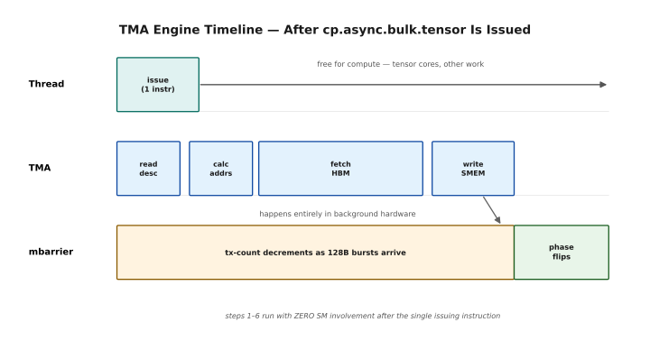
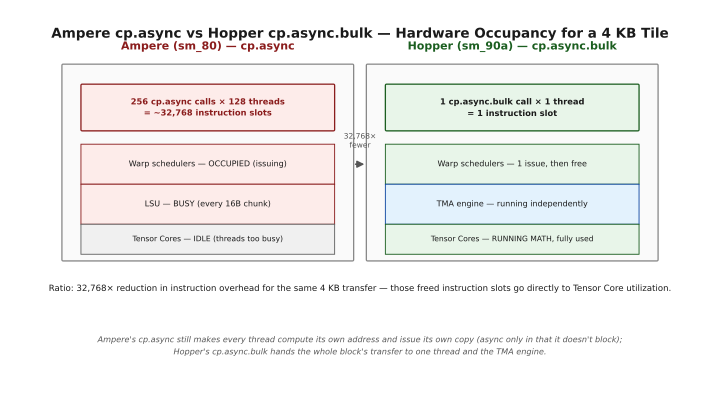
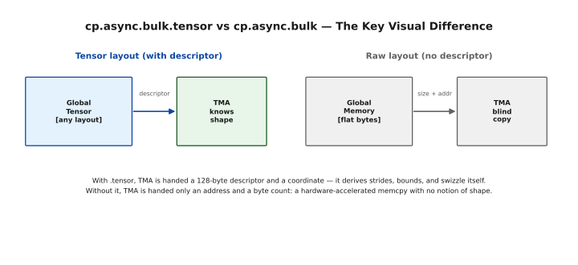
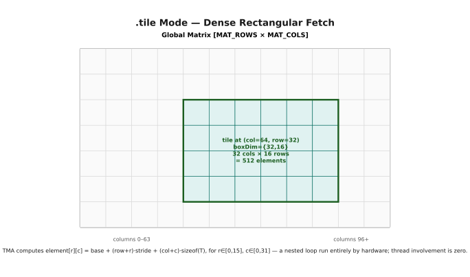
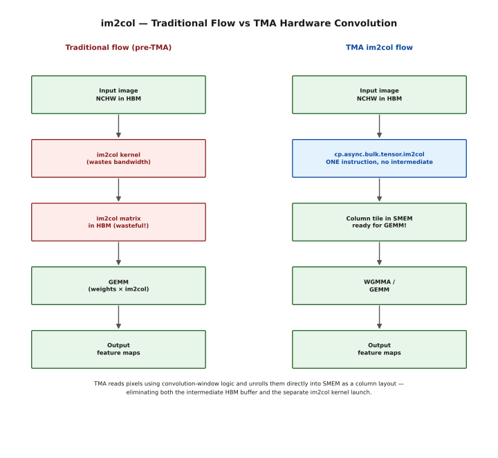
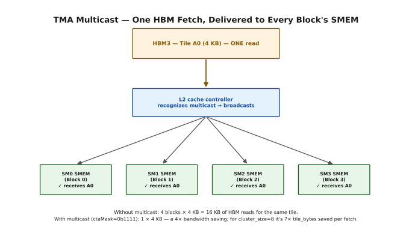
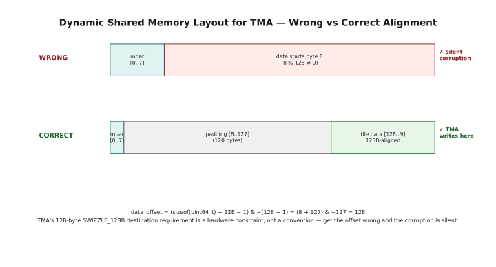
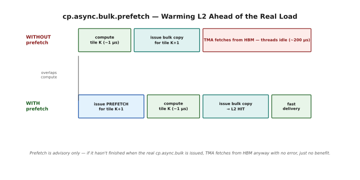

# cp.async.bulk, TMA Transfers & L2 Cache Hinting
## Lesson 5 Companion Guide — Programming the H100

> **Verified on:** CUDA 12.x + Hopper GPU (sm_90a).
> **Compile CUDA examples with:** `nvcc -std=c++17 -arch=sm_90a -O2 <file>.cu -o <out>`
> **Run with:** `./<out>` on any H100 or B200 instance.

**What this covers:** Everything from Lesson 5 — the cp.async.bulk instruction family and how it differs from Ampere's cp.async, tensor-aware vs raw (linear) bulk copies, all instruction variants and state space combinations, completion mechanisms (mbarrier vs bulk_group), L2 cache hinting (evict_first/last/normal) for both loads and stores, the createpolicy descriptor, unstructured and structured copy operands, TMA multicast across a cluster, the ctaMask, shared memory layout for dynamic SMEM with TMA, prefetching with cp.async.bulk.prefetch, and cp.reduce.async for hardware-accelerated atomic tile reductions. Every section includes ASCII diagrams, manual worked examples with concrete numbers, and compileable code with full test harnesses.

**How to read this chapter.** Chapter 4 built the descriptor. This chapter is
the other half: `cp.async.bulk`, the instruction that actually uses it, and the
family of variants around it.

The split is worth holding onto. Chapter 4 was host-side setup — done once,
before the kernel launches. Everything here happens inside the kernel, on the
device, in the inner loop. If Chapter 4 was "describe the tensor", this is "go
and get me a tile."

Four movements. Sections 1–3 introduce the instruction family and the one
distinction that organises all of it — whether a copy is *tensor-aware* or just
a fast `memcpy`. Sections 4–7 cover the parts you choose per copy: the
`.tensor` modifier, state spaces, load modes, and how you find out the copy has
finished. Section 8 covers L2 cache hinting, which is separate from everything
else and easy to skip past — don't, it's cheap performance. Sections 9–14 are
the concrete variants, from raw byte copies up to multicast and hardware
reductions.

For a first pass, read §1–§3 and §7. Completion mechanisms are what you will
actually spend debugging time on.

---

## ★ BEFORE YOU START — Hardware, Setup & Installation

`cp.async.bulk` is Hopper-only — Ampere's `cp.async` is a different and much
weaker instruction, as §2 explains at length. No A100 fallback here. Skip ahead
if you already have an H100 set up.

### What Hardware Can You Use?

`sm_90a` or later, with the trailing `a`.

```
Hardware Compatibility Matrix
══════════════════════════════════════════════════════════════════════

  Architecture   Chip     SM Target   Example GPUs           cp.async.bulk?
  ──────────────────────────────────────────────────────────────────────────
  Ampere         GA100    sm_80       A100 (AWS p4d, Lambda)  NO (cp.async only)
  Hopper         GH100    sm_90a      H100 (AWS p5, Lambda)   YES — full support ★
  Blackwell      GB100    sm_100a     B100/B200               YES + extensions

  KEY:
    cp.async.bulk, TMA multicast, cp.reduce.async → sm_90a or sm_100a ONLY
    cp.async (Ampere style) → sm_80 and later (does NOT use TMA)
    All conceptual sections (§1-3) apply to all architectures.
    All code sections (§4+) require sm_90a or sm_100a.
```

### Cloud GPU Rental — Lambda Labs

Usually the cheapest hourly H100.

```
Lambda Labs Setup (H100)
══════════════════════════════════════════════════════════════════════

  1. https://lambdalabs.com/ → sign up → Launch Instance
  2. Choose "1x H100 PCIe" (cheapest for learning)
  3. SSH: ssh -i ~/.ssh/your_key ubuntu@<INSTANCE_IP>
  4. Verify: nvcc --version && nvidia-smi
  5. Compile: nvcc -std=c++17 -arch=sm_90a -O2 file.cu -o out && ./out
```

### Cloud GPU Rental — AWS

`p5` is H100; `p4d` is A100 and has none of this.

```
AWS p5 Setup (H100)
══════════════════════════════════════════════════════════════════════

  Instance: p5.48xlarge (8× H100 SXM5)
  AMI: "Deep Learning AMI GPU PyTorch" (Ubuntu 22.04)
  ssh -i key.pem ubuntu@<IP> && source activate pytorch
  nvcc --version && nvidia-smi
  A100 (p4d): use sm_80. cp.async.bulk sections will NOT work.
```

### Hopper vs Blackwell — What Changes

Read once if you are on Blackwell. The instruction family carries over; the
compile flag changes.

```
Hopper (sm_90a) vs Blackwell (sm_100a) — cp.async.bulk Differences
══════════════════════════════════════════════════════════════════════

  WHAT STAYS IDENTICAL:
    ├── All cp.async.bulk instruction variants and syntax
    ├── mbarrier completion mechanism semantics
    ├── bulk_group commit/wait semantics
    ├── L2 cache hinting flags and createpolicy instruction
    ├── Multicast instruction and ctaMask semantics
    ├── cp.reduce.async instruction and all reduction ops
    └── All code in this guide compiles unchanged on sm_100a

  WHAT IS NEW IN BLACKWELL:
    ├── cp.async.bulk to tmem (tensor memory) as a destination
    ├── Larger maximum transfer sizes
    └── Additional reduction types for cp.reduce.async

  PORTING: Change -arch=sm_90a to -arch=sm_100a. Done.
```

---

## Table of Contents

1. [cp.async.bulk — What It Is and Why It Exists](#1--cpasyncbulk)
2. [cp.async (Ampere) vs cp.async.bulk (Hopper)](#2--cpasync-ampere-vs-cpasyncbulk-hopper)
3. [Instruction Layout — The Full Syntax](#3--instruction-layout)
4. [Tensor-Aware Copies — cp.async.bulk.tensor](#4--tensor-aware-copies)
5. [State Spaces — Source and Destination](#5--state-spaces)
6. [Load Modes — tile and im2col](#6--load-modes)
7. [Completion Mechanisms — mbarrier vs bulk_group](#7--completion-mechanisms)
8. [L2 Cache Hinting](#8--l2-cache-hinting)
9. [Unstructured (Raw) Copies](#9--unstructured-raw-copies)
10. [Structured (Tensor) Copies — All Variants](#10--structured-tensor-copies)
11. [TMA Multicast — One Fetch, Many SMs](#11--tma-multicast)
12. [Dynamic Shared Memory Layout with TMA](#12--dynamic-shared-memory-layout)
13. [cp.async.bulk.prefetch — L2 Prefetching](#13--cpasyncbulkprefetch)
14. [cp.reduce.async — Hardware Atomic Reduction](#14--cpreduceasync)
15. [Putting It All Together — Full Examples](#15--putting-it-all-together)
16. [Quick Reference](#16--quick-reference)

---

## 1 — cp.async.bulk

The instruction, introduced plainly before any syntax.

`cp.async.bulk` copies a block of data from one place to another and returns
immediately, leaving the work to the TMA engine. "Bulk" is the operative word:
this is not a load that one thread issues on behalf of itself, it is a request
for a whole tile, issued once, by one thread, for the entire block.

§1.1 covers what it does; §1.2 covers the hardware doing it — worth reading,
because knowing the TMA is a separate engine on a separate path is what makes
the fences and completion mechanisms later in the chapter make sense.

### 1.1 What cp.async.bulk Is

`cp.async.bulk` is a family of PTX instructions that perform hardware-accelerated, fully asynchronous bulk memory transfers on Hopper GPUs. The key word is **bulk**: unlike Ampere's `cp.async` which handled one 16-byte chunk at a time and required thread involvement for every chunk, `cp.async.bulk` can transfer an entire tile — hundreds or thousands of bytes — with a single instruction from a single thread.

The transfers are offloaded entirely to the TMA (Tensor Memory Accelerator) hardware engine, which runs completely independently of the SM's compute pipeline. Once the instruction is issued, the SM is free. No threads are involved in the actual data movement whatsoever.

```
cp.async.bulk — Core Properties
══════════════════════════════════════════════════════════════════════

  ├── ONE instruction transfers an ENTIRE tile (up to the destination's
  │   available shared memory — up to ~227 KB per block on H100)
  ├── Issued by ONE thread; other 127 threads in the block are free
  ├── SM is immediately free after issuing; TMA does all the work
  ├── Supports 1D through 5D multi-dimensional tensor layouts
  ├── TMA handles all address calculations, stride navigation, loops
  ├── Requires barrier objects (mbarrier or bulk_group) for ordering
  ├── Can deliver data to multiple SMs simultaneously (multicast)
  └── Can apply swizzling as it writes to SMEM (bank-conflict-free)

  Two major families:
  ─────────────────────────────────────────────────────────────────
  cp.async.bulk         → Raw (linear) byte copies, no tensor semantics
  cp.async.bulk.tensor  → Smart copies using cuTensorMap descriptor
                          Understands dimensions, strides, swizzle, OOB fill
```

### 1.2 The Hardware: TMA Engine

Understanding what makes cp.async.bulk fast requires understanding the TMA hardware unit:

```
TMA Engine — What It Does Internally
══════════════════════════════════════════════════════════════════════

  When you issue cp.async.bulk.tensor, the TMA engine:

  1. Reads the cuTensorMap descriptor (128 bytes) — knows shape, strides, swizzle
  2. Computes the byte address of every element in the requested tile
  3. Issues read requests to HBM3 — fetches data in 128-byte bursts
  4. As data arrives in L2:
     ├── Applies swizzle pattern (XOR address permutation)
     └── Writes directly to shared memory — bypasses L1 cache
  5. Tracks progress via the mbarrier's tx-count (decrements as bytes arrive)
  6. When all bytes delivered → signals mbarrier → phase flips → consumers unblock

  ALL of steps 1-6 happen in dedicated hardware with ZERO SM involvement.
```



*The issuing thread runs one instruction and is immediately free — for compute, for tensor cores, for anything else. The TMA engine then works through its four internal steps (read descriptor, calculate addresses, fetch from HBM, write to SMEM) entirely in the background. As bytes land, the mbarrier's transaction count decrements; when it reaches zero, the phase flips and waiting consumers unblock. None of this touches an SM instruction slot after the initial issue.*

---

## 2 — cp.async (Ampere) vs cp.async.bulk (Hopper)

If you have written Ampere code, this section is the one that will change your
mental model — the two instructions share a name prefix and almost nothing else.

Ampere's `cp.async` still required every thread to compute its own address and
issue its own copy. The asynchrony was real but shallow: the threads were
freed from *waiting*, not from *working*. Hopper's `cp.async.bulk` is a true
offload — one thread hands over a descriptor and the entire block's worth of
address generation happens in hardware.

§2.3's comparison table is the fastest way to see the difference if you'd rather
not read the argument.

### 2.1 The Architecture Difference

To appreciate cp.async.bulk, you need to understand what Ampere's cp.async required of threads — and why it was still not good enough for true full overlap of compute and memory.

```
Ampere cp.async — Thread Involvement Required
══════════════════════════════════════════════════════════════════════

  Task: Load 4 KB tile into shared memory.

  Thread-level view:
  ─────────────────────────────────────────────────────────────────
  // Every thread computes its own portion of addresses
  for (int i = tid; i < TILE_ELEMS; i += blockDim.x) {
      int global_row = block_start_row + i / TILE_COLS;
      int global_col = block_start_col + i % TILE_COLS;
      uint64_t src = base + global_row * stride + global_col * sizeof(T);
      uint32_t dst = smem_offset + i * sizeof(T);
      asm("cp.async.cg.shared.global [%0], [%1], 16;" : : "r"(dst), "l"(src));
  }
  cp.async.commit_group();
  cp.async.wait_group<0>();

  What threads are doing:
  ├── Computing global_row, global_col: integer multiply/add per element
  ├── Computing src address: multiply by stride + element offset
  ├── Computing dst address: multiply by sizeof
  ├── Issuing cp.async for every 16 bytes: burns instruction bandwidth
  ├── ALL 128 threads participate in address computation and copy launch
  └── Total instructions to launch a 4KB copy: 4096/16 = 256 cp.async calls!

  Uses: LSU (Load/Store Unit) — NOT the TMA engine.
  The copy is "async" only in that the thread can issue multiple inflight
  copies, but the thread ITSELF is consumed by the management work.
```

### 2.2 Hopper cp.async.bulk — True Offload

The Hopper path drawn out. Note how little the issuing thread does compared with
the Ampere diagram above.

```
Hopper cp.async.bulk — One Instruction, Zero Thread Involvement
══════════════════════════════════════════════════════════════════════

  Task: Load the same 4 KB tile into shared memory.

  Thread-level view:
  ─────────────────────────────────────────────────────────────────
  // Only ONE thread issues ONE instruction
  if (threadIdx.x == 0) {
      asm volatile(
          "cp.async.bulk.tensor.2d.shared::cluster.global"
          " [%0], [%1], {%2, %3}, [%4];"
          : : "r"(smem_dest), "l"(&tma_desc),
              "r"(col_start), "r"(row_start),
              "r"(mbar_addr)
      );
  }
  // Thread IMMEDIATELY returns and does something else.
  // The other 127 threads never touched this at all.

  What threads are doing:
  ├── Thread 0: issues ONE instruction, returns immediately
  ├── Threads 1-127: completely free — running tensor core math!
  └── Total instructions to launch a 4KB copy: EXACTLY 1

  Uses: TMA engine — NOT the LSU. NOT warp schedulers (beyond 1 issue).
```



*Ampere's path keeps the warp schedulers occupied issuing 256 `cp.async` calls and the LSU busy handling every 16-byte chunk, leaving the tensor cores idle because the threads are consumed by copy management. Hopper's path issues one instruction, leaves the warp schedulers free immediately, hands the transfer to the TMA engine running independently, and leaves the tensor cores fully available for math.*

```
  ─── Quantified Difference ───────────────────────────────────────

  For a 4KB BF16 tile (2048 elements × 2 bytes):
    Ampere: 256 cp.async calls × 128 threads = ~32768 instruction slots consumed
    Hopper: 1 cp.async.bulk call × 1 thread  = 1 instruction slot consumed

  Ratio: 32768× reduction in instruction overhead for the same transfer.
  These freed instruction slots go directly to Tensor Core utilization.
```

### 2.3 Side-by-Side Comparison Table

The two instructions in one table, if you want the summary rather than the
reasoning.

```
cp.async (Ampere) vs cp.async.bulk (Hopper) — Full Comparison
══════════════════════════════════════════════════════════════════════

  Feature                    cp.async (A100)       cp.async.bulk (H100)
  ─────────────────────────────────────────────────────────────────────
  Hardware unit              LSU                   TMA engine
  Per-transfer involvement   All threads           1 thread only
  Instruction count (4KB)    256 per thread        1 total
  Address computation        By threads (runtime)  By TMA (descriptor)
  Max transfer per call      16 bytes              Entire tile (MB range)
  Tensor dimensions          1D only               1D to 5D
  Swizzle on write           No                    Yes (in descriptor)
  Multicast to cluster       No                    Yes (ctaMask)
  Completion tracking        commit/wait_group      mbarrier or bulk_group
  OOB boundary fill          No (manual)           Yes (descriptor)
  Stride-aware               No (manual striding)  Yes (descriptor strides)
  SM compute overlap         Partial               True full overlap
```

---

## 3 — Instruction Layout

Now the syntax. `cp.async.bulk` is a long chain of dot-separated modifiers, and
this section provides the map.

The first fork is the one to internalise: with `.tensor`, the copy is
descriptor-driven and coordinate-addressed — the subject of Chapter 4. Without
it, the copy is a flat run of bytes with no notion of shape at all. Those two
families have different operands and different use cases, and almost every other
modifier depends on which one you're in.

### 3.1 The Two Instruction Families

cp.async.bulk has two top-level variants depending on whether you are working with structured (tensor-described) data or raw linear bytes:

```
cp.async.bulk — Two Major Forms
══════════════════════════════════════════════════════════════════════

  FORM 1: Tensor Layout (with cuTensorMap descriptor)
  ─────────────────────────────────────────────────────────────────
  cp.async.bulk.tensor.{ndim}.{dst_space}.{src_space}.{completion}{.cache}
      [dst_addr], [tensor_map], coord_array, [mbar_addr];

  Use when: Data has known multi-dimensional structure (matrices, tensors).
  Requires: A cuTensorMap descriptor (see Lesson 4).
  Knows about: Dimensions, strides, swizzle, OOB fill.

  Example:
    cp.async.bulk.tensor.2d.shared::cta.global.mbarrier::complete_tx::bytes
        [smem_dest], [tma_desc], {col, row}, [mbar_addr];

  ─────────────────────────────────────────────────────────────────
  FORM 2: Raw Layout (linear byte copy, no descriptor)
  ─────────────────────────────────────────────────────────────────
  cp.async.bulk.{dst_space}.{src_space}.{completion}{.cache}
      [dst_addr], [src_addr], size, [mbar_addr];

  Use when: Data is already a flat contiguous byte region.
  Requires: Only source and destination addresses + size in bytes.
  No knowledge of: Dimensions or strides.

  Example:
    cp.async.bulk.shared::cta.global.mbarrier::complete_tx::bytes
        [smem_dest], [gmem_src], 4096, [mbar_addr];

```



*With `.tensor`, TMA is handed a descriptor and derives shape; without it, TMA is handed only a size and an address and performs a blind copy.*

### 3.2 Full Instruction Template — Every Field Explained

Every field of the instruction, in order. Come back to this whenever a variant
in §9 or §10 has a modifier you don't recognise.

```
Full Instruction Template (Tensor Form)
══════════════════════════════════════════════════════════════════════

  cp.async.bulk.tensor.{ndim}.{dst}.{src}.{completion}{.cache}{.multicast}
      [dst_addr], [tensor_map], {coord0, coord1, ...}, [mbar_addr]{, ctaMask};

  Field-by-field breakdown:
  ─────────────────────────────────────────────────────────────────
  cp.async.bulk      → family name: bulk async copy
  .tensor            → use descriptor (cuTensorMap) mode
  .{ndim}            → 1d, 2d, 3d, 4d, or 5d (dimensions of the tensor)
  .{dst}             → destination state space (shared::cta, shared::cluster, global)
  .{src}             → source state space (global, shared::cta)
  .{completion}      → how to track completion (mbarrier::complete_tx::bytes | bulk_group)
  {.cache}           → optional L2 cache hint (.L2::cache_hint)
  {.multicast}       → optional multicast to cluster CTAs

  Operands:
  [dst_addr]         → 32-bit shared memory address (from __cvta_generic_to_shared)
  [tensor_map]       → 64-bit pointer to CUtensorMap descriptor (host-created)
  {coord0, coord1..} → tile coordinates (innermost first, matching ndim)
  [mbar_addr]        → 32-bit address of mbarrier in shared memory
  {ctaMask}          → 16-bit bitmask for multicast (which CTAs receive data)

  ─── Concrete Examples ───────────────────────────────────────────

  2D load (global → shared, mbarrier completion):
    cp.async.bulk.tensor.2d.shared::cta.global.mbarrier::complete_tx::bytes
        [smem], [desc], {col, row}, [mbar];

  3D load with L2 hint:
    cp.async.bulk.tensor.3d.shared::cta.global.mbarrier::complete_tx::bytes.L2::cache_hint
        [smem], [desc], {hd, seq, batch}, [mbar], [policy];

  2D multicast to 4 CTAs (ctaMask = 0x000F = bits 0-3 set):
    cp.async.bulk.tensor.2d.shared::cluster.global.mbarrier::complete_tx::bytes.multicast::cluster
        [smem], [desc], {col, row}, [mbar], ctaMask;

  Raw linear copy (no descriptor):
    cp.async.bulk.shared::cta.global.mbarrier::complete_tx::bytes
        [smem], [gmem], 4096, [mbar];

  Store (shared → global):
    cp.async.bulk.tensor.2d.global.shared::cta.bulk_group
        [desc], {col, row}, [smem];
```

---

## 4 — Tensor-Aware Copies

What the `.tensor` modifier actually buys, stated in one place.

With it, you no longer supply an address. You supply a *coordinate* — "the tile
at row 128, column 256" — and the descriptor from Chapter 4 supplies everything
else: the strides, the bounds checking, the swizzled destination layout.

That is a bigger shift than it sounds. Bounds checking in particular stops being
code you write and becomes a property of the descriptor, which is why TMA GEMM
kernels have no edge-case branches.

### 4.1 The .tensor Modifier — Why It Changes Everything

Adding `.tensor` to `cp.async.bulk` transforms a simple memory copy into a **smart, descriptor-driven transfer** that understands your data's structure. This is the switch that enables TMA to use the cuTensorMap descriptor created in Lesson 4.

```
With .tensor vs Without .tensor
══════════════════════════════════════════════════════════════════════

  WITHOUT .tensor (raw copy):
  ─────────────────────────────────────────────────────────────────
  cp.async.bulk.shared::cta.global.mbarrier::complete_tx::bytes
      [dst], [src], 4096, [mbar];

  TMA sees: "copy 4096 bytes starting at address src into dst"
  TMA knows NOTHING about:
    ├── How the data is arranged (rows? channels? batch?)
    ├── What strides separate rows (is it padded?)
    ├── Whether to swizzle for bank-conflict elimination
    └── What to fill if the copy goes out of bounds

  WITH .tensor (descriptor-driven):
  ─────────────────────────────────────────────────────────────────
  cp.async.bulk.tensor.2d.shared::cta.global.mbarrier::complete_tx::bytes
      [dst], [desc], {col_start, row_start}, [mbar];

  TMA sees: "fetch tile starting at (col_start, row_start) according to desc"
  TMA knows EVERYTHING:
    ├── Element type (e.g., BF16 = 2 bytes) → proper alignment
    ├── Global shape {4096, 2048} → boundary check enabled
    ├── Global strides {8192 bytes/row} → correct row navigation
    ├── Tile size {128, 64} → exactly how many elements to fetch
    ├── Swizzle mode (128B) → writes land in conflict-free SMEM banks
    └── OOB fill → handles edge tiles automatically

  ─── The ndim Field ──────────────────────────────────────────────

  .{ndim} tells TMA how many coordinates you will provide:
    .1d → 1 coordinate  (1D array: one index)
    .2d → 2 coordinates (2D matrix: column, row)
    .3d → 3 coordinates (3D tensor: dim0, dim1, dim2)
    .4d → 4 coordinates (4D tensor: dim0...dim3)
    .5d → 5 coordinates (5D tensor: dim0...dim4)

  The coordinates specify the TOP-LEFT corner of the tile.
  TMA uses boxDim from the descriptor to know how far to fetch.

  Manual example for .2d with boxDim={64,32}:
    Coordinates {col=128, row=64} → fetches tile covering:
      columns 128 to 128+64-1 = 191
      rows    64  to 64+32-1  = 95
    TMA computes all individual element addresses from this info.
```

---

## 5 — State Spaces

Where a copy can start and where it can end, using the state-space vocabulary
from Chapter 2 §7.

Not every combination exists. Global to shared is the common case — that is the
prefetch in your pipeline. Shared to global is the epilogue. Shared to
shared::cluster is the DSMEM path from Chapter 2. The table here is worth
scanning once so you know which of your ideas the hardware will actually
support.

### 5.1 Source and Destination State Spaces

The state space fields in the instruction tell TMA where to read from and where to write to. This is the same state space concept from Lesson 2, but now applied to bulk hardware transfers.

```
State Space Combinations — All Valid Options
══════════════════════════════════════════════════════════════════════

  Format:  cp.async.bulk.tensor.Nd.{dst}.{src}...

  LOADS (bring data INTO shared memory):
  ─────────────────────────────────────────────────────────────────
  dst = shared::cta      src = global
    → Standard load: HBM → this block's SMEM
    → Most common pattern for GEMM, attention, etc.

  dst = shared::cluster  src = global (with .multicast)
    → Multicast load: HBM → SMEM of MULTIPLE blocks simultaneously
    → Requires ctaMask operand specifying which CTAs receive data
    → One HBM read → delivered to N SMs in the cluster

  STORES (write data FROM shared memory back to global):
  ─────────────────────────────────────────────────────────────────
  dst = global           src = shared::cta
    → Standard store: SMEM → HBM
    → Used for writing computed results back out

  INTER-SMEM (cluster internal copies, no HBM involved):
  ─────────────────────────────────────────────────────────────────
  dst = shared::cta      src = shared::cluster
    → DSMEM copy: another block's SMEM → this block's SMEM
    → Uses cluster interconnect (SM-to-SM, not HBM)
    → Very low latency (~50-80 cycles vs ~500 for HBM)

  ─── Why This Matters ────────────────────────────────────────────

  The state space pair determines the HARDWARE PATH:
    global → shared::cta:  HBM → L2 → SMEM  (high latency, high bandwidth)
    global → shared::cluster: HBM → L2 → multicast → multiple SMEMs
    shared → global:       SMEM → L2 → HBM  (write-back path)
    shared::cluster → shared::cta: SM-to-SM network (low latency)

  Choosing the wrong state space:
  ├── Using shared::cta dst when you want multicast → only 1 CTA gets data
  ├── Using global src when your data is in SMEM → reads from wrong location
  └── These are compile-time errors if the instruction variant doesn't match.
```

---

## 6 — Load Modes

Two ways of interpreting the coordinates you hand a tensor copy.

`.tile` (§6.1) is the ordinary one: fetch a dense rectangular box. This is what
GEMM uses and probably what you want.

`im2col` (§6.2) is a genuine surprise — dedicated hardware for convolution. The
classic im2col transform expands overlapping convolution windows into a matrix,
and normally costs you a separate pass over memory plus the memory to hold the
result. In this mode the TMA performs the transform as it copies, so the
expansion never exists in memory at all.

### 6.1 tile — The Standard Load Mode

The `.tile` mode (the default for most uses) tells TMA to fetch a dense rectangular box of data. The coordinates you provide specify the top-left corner; the cuTensorMap's boxDim specifies the size. TMA fetches every element within that box, following the strides in the descriptor.

```
.tile Mode — Dense Rectangular Fetch
══════════════════════════════════════════════════════════════════════

  TMA uses: coordinates → locate top-left corner
            strides     → navigate to each row
            boxDim      → know when to stop
```



*The coordinate `(col=64, row=32)` locates the tile's top-left corner; the descriptor's `boxDim={32,16}` tells TMA how far to extend it — 32 columns by 16 rows, 512 elements. TMA computes `element[r][c] = base + (row+r)·stride + (col+c)·sizeof(T)` for every `r ∈ [0,15]`, `c ∈ [0,31]` as a nested loop run entirely in hardware; thread involvement is zero.*

### 6.2 im2col — Hardware-Accelerated Convolution

The `im2col` mode is a hardware feature specific to convolution. In traditional GPU convolution, you first transform the input image into a "column matrix" (the im2col transformation) and then perform a GEMM. The im2col step wastes memory bandwidth and register space.

TMA's `im2col` mode eliminates this preprocessing step entirely. You give TMA the coordinates of a convolution window's top-left corner, and TMA fetches exactly the pixels that the filter needs — unrolled and placed in shared memory as if they were already in column format.

```
im2col Mode — Hardware Convolution Acceleration
══════════════════════════════════════════════════════════════════════
```



*Traditionally, a separate im2col kernel reads pixels, computes overlapping-window offsets, and writes a wasteful intermediate "columns" matrix to global memory before the GEMM can run. TMA's im2col mode collapses this to one instruction: it reads pixels using convolution-window logic and unrolls them directly into SMEM as a column layout, so the intermediate HBM buffer and the separate kernel launch never happen.*

```
  Benefits:
  ├── Eliminates the intermediate global memory buffer (saves HBM bandwidth)
  ├── Eliminates the im2col kernel launch (saves SM time)
  ├── Delivers data already in the layout convolution GEMM needs
  └── Hardware does the window-to-column remapping at HBM speed

  Instruction format:
    cp.async.bulk.tensor.{nd}.shared::cta.global.im2col
        .mbarrier::complete_tx::bytes [smem], [desc], {coords}, [mbar];

  Variants (real PTX ISA spelling — these relate to offset handling,
  not a width-vs-depth split):
    im2col              → standard im2col load
    im2col::w           → im2col, width-offset form
    im2col_no_offs::w   → im2col, width-offset form, no pixel offsets
    im2col::w::128      → im2col, width-offset form, 128-element granularity
```

---

## 7 — Completion Mechanisms

The section to read carefully, because this is where async pipelines actually go
wrong.

Having issued a copy that returns immediately, you need to know when the data
has landed. There are two mechanisms and they differ in precision.

`mbarrier::complete_tx::bytes` (§7.1) is the fine-grained one: the TMA
decrements a barrier's transaction count as bytes arrive, exactly as Chapter 3
§10.2 described. It is the right choice for production pipelines, and it is what
Chapters 8 and 9 are built on. `bulk_group` (§7.2) is the lightweight
alternative — batch-level rather than byte-level, cheaper, and enough when you
don't need the precision.

### 7.1 mbarrier::complete_tx::bytes — Fine-Grained Tracking

The `mbarrier::complete_tx::bytes` completion mechanism ties the async copy directly to an mbarrier object. As TMA delivers bytes to the destination, it automatically decrements the mbarrier's pending transaction count. When all bytes arrive (count hits zero), the barrier phase flips and waiting threads are released.

This is the **recommended mechanism** for production kernels because it provides precise byte-level tracking and integrates perfectly with the mbarrier pipeline from Lesson 3.

```
mbarrier::complete_tx::bytes — How It Works
══════════════════════════════════════════════════════════════════════

  Before issuing cp.async.bulk:
    Thread 0 calls mbarrier.arrive.expect_tx [mbar], TILE_BYTES
    → Sets mbarrier's tx-count = TILE_BYTES
    → Decrements thread arrival count by 1

  During cp.async.bulk execution (hardware):
  ─────────────────────────────────────────────────────────────────
  Time → TMA delivers data in 128-byte bursts from HBM:
    Burst 1 arrives → tx-count -= 128 → tx-count = TILE_BYTES - 128
    Burst 2 arrives → tx-count -= 128 → tx-count = TILE_BYTES - 256
    ...
    Last burst arrives → tx-count = 0
    Both counts (threads + tx) = 0 → PHASE FLIPS → consumers unblock

  Consumer threads poll:
    mbarrier.try_wait.parity.acquire [mbar], phase
    → Returns true ONLY when all TILE_BYTES have arrived
    → The .acquire ensures all data is visible before proceeding

  ─── Key Requirement ─────────────────────────────────────────────

  The mbarrier address passed to cp.async.bulk MUST be the same
  address passed to mbarrier.arrive.expect_tx.
  Mismatch → tx-count never reaches zero → DEADLOCK (spin forever).

  ─── The Instruction Operand Order ───────────────────────────────

  cp.async.bulk.tensor.2d.shared::cta.global.mbarrier::complete_tx::bytes
      [smem_dest],    ← destination in shared memory
      [&tma_desc],    ← cuTensorMap descriptor pointer
      {col, row},     ← tile coordinates
      [mbar_addr];    ← mbarrier to signal upon completion

  The mbarrier address is the LAST operand. It is a 32-bit shared
  memory offset (from __cvta_generic_to_shared, NOT a generic pointer).
```

### 7.2 bulk_group — Lightweight Batch Tracking

`bulk_group` is a simpler, lighter-weight alternative to mbarrier for tracking groups of async copies. Instead of per-byte tracking, you commit a batch of copies into a named group and then wait for entire groups to complete.

```
bulk_group — How It Works
══════════════════════════════════════════════════════════════════════

  Three-step pattern:
  ─────────────────────────────────────────────────────────────────
  Step 1: Issue copies tagged with bulk_group
    cp.async.bulk.tensor.2d.shared::cta.global.bulk_group
        [smem_A], [desc], {col0, row0};   // uncommitted copy A

    cp.async.bulk.tensor.2d.shared::cta.global.bulk_group
        [smem_B], [desc], {col1, row1};   // uncommitted copy B

  Step 2: Commit all pending copies into a group
    cp.async.bulk.commit_group;
    // Copies A and B are now "Group N"
    // Future copies after this belong to Group N+1

  Step 3: Wait for groups to complete
    cp.async.bulk.wait_group 0;    // wait for ALL groups to complete
    // OR:
    cp.async.bulk.wait_group 1;    // wait until ≤1 group still pending

  ─── bulk_group vs mbarrier — When to Use Each ───────────────────

  Use mbarrier when:
  ├── You need precise byte-level completion tracking
  ├── Integration with complex producer/consumer pipelines
  ├── Multiple producers signaling a single barrier
  └── WAR hazard prevention (consumers signal separate barrier)

  Use bulk_group when:
  ├── Simple pipeline: issue copies, wait for batch, use data
  ├── Fewer moving parts — no mbarrier init/arrive/wait boilerplate
  ├── Performance is similar to mbarrier for simple cases
  └── You want Ampere-style commit/wait semantics with TMA

  ─── bulk_group Implicit Acquire Fence ───────────────────────────

  cp.async.bulk.wait_group includes an implicit ACQUIRE FENCE.
  After wait_group returns, all data written by the completed copies
  is guaranteed visible to the Generic Proxy (your threads).
  No separate fence.proxy.async needed after a wait_group.
```

---

## 8 — L2 Cache Hinting

A self-contained section about something most kernels leave on the table.

Every TMA fetch passes through L2 on its way to shared memory, and by default
the hardware decides how long it stays there. But you usually know better than
the hardware: a tile you will re-read next iteration should stay; a tile you
will never touch again should be evicted immediately so it stops crowding out
data that matters. L2 is shared by all 132 SMs, so this is not a private
decision.

§8.2 covers `createpolicy`, which packs your intent into a 64-bit descriptor.
§8.3 gives concrete recipes by workload — the fastest route if you want the
benefit without the theory.

### 8.1 Why L2 Cache Hinting Exists

When TMA fetches data from HBM, the data passes through the L2 cache on its way to shared memory. By default, L2 evicts data using a standard replacement policy (LRU-like). But you can give the hardware hints about how long to keep the data in L2, based on your access pattern.

This matters because the L2 cache is a shared resource (all SMs compete for it). Holding data in L2 longer than necessary evicts other useful data and hurts performance. Evicting data too quickly means re-fetching from HBM on the next access.

```
L2 Cache Hinting — The Three Policies
══════════════════════════════════════════════════════════════════════

  evict_normal (default):
  ─────────────────────────────────────────────────────────────────
  Standard LRU replacement. The hardware decides when to evict.
  Suitable for most workloads where you have no strong access pattern.

  evict_last (persist as long as possible):
  ─────────────────────────────────────────────────────────────────
  Marks the cache line as "high priority" — keep it as long as possible.
  L2 will evict lower-priority lines first before touching evict_last data.
  Use for: data that will be accessed MULTIPLE TIMES (weights, look-up tables).

  Example: Wt in a neural network layer used for every input token.
    load weight once with evict_last → stays in L2
    each of 1024 tokens accesses the weight → L2 HIT every time
    vs. evict_normal: weight might be evicted after the first few tokens.

  evict_first (discard as soon as possible):
  ─────────────────────────────────────────────────────────────────
  Marks the cache line as "low priority" — evict it immediately.
  The data passes through L2 but is immediately the first candidate for eviction.
  Use for: data accessed ONCE and never again (streaming input data, outputs).

  Example: Reading 1GB of image data, each tile processed once then discarded.
    Using evict_normal: image data fills L2, evicts weights/constants.
    Using evict_first: image data streams through L2 leaving it clean for other data.

  ─── Loads vs Stores — Different Policies ─────────────────────────

  LOADS (global → shared): data ENTERS L2 from HBM
    evict_last  → keep the loaded data in L2 (good for reused inputs)
    evict_first → stream through L2 without polluting (one-pass data)

  STORES (shared → global): data EXITS through L2 to HBM
    evict_first → write result to L2 → immediately evict (don't cache)
    Best for final outputs: written once, read by next pipeline stage elsewhere.
    Using evict_last for stores pollutes L2 with output data you won't read again.
```

### 8.2 The createpolicy Instruction — Building a Cache Descriptor

To use L2 cache hinting in a cp.async.bulk instruction, you first create a 64-bit cache policy descriptor using the `createpolicy` PTX instruction. This descriptor is then passed as an additional operand to the copy instruction.

```
createpolicy — Building the Cache Descriptor
══════════════════════════════════════════════════════════════════════

  PTX syntax:
    createpolicy.fractional.L2::evict_last.b64  policy_reg, fraction;
    createpolicy.fractional.L2::evict_first.b64 policy_reg, fraction;

  Parameters:
    policy_reg:  64-bit destination register to hold the descriptor
    fraction:    Floating-point value in [0.0, 1.0]
                 Determines WHAT FRACTION of the data gets the policy.
                 1.0 = 100% of the data gets this cache policy.
                 0.5 = only 50% of the data gets the policy.

  When to use fraction < 1.0:
    If your tile is large and you only expect to reuse part of it,
    you can persist only a fraction. But 1.0 is correct for most uses.

  ─── Manual Worked Example ───────────────────────────────────────

  Scenario: Loading a weight matrix tile (will be reused for each batch).
    We want evict_last to keep it in L2 across all batch iterations.

  uint64_t policy;  // 64-bit register for the descriptor

  // Create: "persist 100% of this data as long as possible in L2"
  asm("createpolicy.fractional.L2::evict_last.b64 %0, 1.0;" : "=l"(policy));
  // policy is now a 64-bit opaque descriptor

  // Pass to cp.async.bulk as the cache policy operand:
  asm volatile(
      "cp.async.bulk.tensor.2d.shared::cta.global"
      ".mbarrier::complete_tx::bytes.L2::cache_hint"
      " [%0], [%1], {%2, %3}, [%4], %5;"
      : : "r"(smem_dest), "l"(&tma_desc),
          "r"(col), "r"(row),
          "r"(mbar_addr), "l"(policy)
  );
  // TMA will now mark the fetched data as evict_last in L2.

  ─── For Streaming Inputs (one-pass data) ─────────────────────────

  uint64_t stream_policy;
  asm("createpolicy.fractional.L2::evict_first.b64 %0, 1.0;"
      : "=l"(stream_policy));
  // Use stream_policy for activation tiles that are processed once.

  ─── For Stores (writing outputs back to global) ──────────────────

  uint64_t write_policy;
  asm("createpolicy.fractional.L2::evict_first.b64 %0, 1.0;"
      : "=l"(write_policy));
  // Write outputs: they hit L2 (to satisfy write coalescing)
  // but are immediately evicted → keeps L2 clean for inputs.
```

### 8.3 Practical L2 Hinting Strategy

Recipes by workload. If you read nothing else in this section, read this — it
tells you which hint to use for GEMM, for streaming, and for attention.

```
L2 Hinting Strategy for Common Workloads
══════════════════════════════════════════════════════════════════════

  GEMM Kernel (C = A × B):
  ─────────────────────────────────────────────────────────────────
  Matrix A tiles (one row of tiles, reused for all N blocks):
    → evict_last: same A tile is multiplied against B[0], B[1], ..., B[N]
    → Staying in L2 saves N-1 HBM fetches per A tile

  Matrix B tiles (one per block, not reused across blocks):
    → evict_normal or evict_first: each B tile used once per block
    → No benefit from persisting; evict_first frees space for A tiles

  Output C tiles (written once, not read back on this SM):
    → evict_first for the write: result written to L2 then evicted
    → Keeps L2 free for incoming A and B tiles

  Attention Kernel:
  ─────────────────────────────────────────────────────────────────
  Query matrix Q (each Q row used for all K, V tiles):
    → evict_last: Q is reused across the entire key-value sequence

  Key matrix K tiles (streamed):
    → evict_first: each K tile accessed once for attention scores

  Value matrix V tiles (streamed):
    → evict_first: each V tile accessed once for output aggregation

  Output O (written once):
    → evict_first for stores

  ─── Combined Rules ──────────────────────────────────────────────

  Will this data be reused (multiple passes)?
    YES → evict_last (maximize L2 persistence)
    NO  → evict_first (minimize L2 pollution) or evict_normal (default)

  Is this a write to global memory?
    YES → evict_first (output data you won't read back soon)
    NO  → see above (load policy)
```

---

## 9 — Unstructured (Raw) Copies

`cp.async.bulk` without `.tensor`: a hardware-accelerated `memcpy` that knows
nothing about shape.

No descriptor, no coordinates, no bounds checking, no swizzling — just a source,
a destination, and a byte count. That sounds like a downgrade, and for tiles it
is. But plenty of things you need to move are genuinely flat: weight vectors,
lookup tables, scratch buffers. For those, the descriptor machinery is pure
overhead and this is the right instruction.

### 9.1 cp.async.bulk Without .tensor — Linear Byte Copies

Raw `cp.async.bulk` (without `.tensor`) is essentially a hardware-accelerated `memcpy`. It treats memory as a flat stream of bytes and copies a specified number of bytes from source to destination. No descriptor needed, no dimension knowledge.

```
Unstructured Copy Variants — All State Space Combinations
══════════════════════════════════════════════════════════════════════

  VARIANT 1: Global → Shared (load from HBM to SMEM)
  ─────────────────────────────────────────────────────────────────
  cp.async.bulk.shared::cta.global.mbarrier::complete_tx::bytes
      [dst_smem], [src_global], size, [mbar_addr];

  Operands:
    dst_smem:    32-bit SMEM address (from __cvta_generic_to_shared)
    src_global:  64-bit global memory address
    size:        number of bytes to copy (must be multiple of 16)
    mbar_addr:   32-bit SMEM address of the mbarrier

  Use when: Source is a contiguous byte array in global memory.
  No cuTensorMap needed. Just addresses and a byte count.

  ─────────────────────────────────────────────────────────────────
  VARIANT 2: Shared → Global (store from SMEM to HBM)
  ─────────────────────────────────────────────────────────────────
  cp.async.bulk.global.shared::cta.bulk_group
      [dst_global], [src_smem], size;

  Operands:
    dst_global:  64-bit global memory address
    src_smem:    32-bit SMEM address
    size:        number of bytes to copy

  Note: Stores typically use bulk_group (not mbarrier) for completion.
  With optional cache policy:
  cp.async.bulk.global.shared::cta.bulk_group.L2::cache_hint
      [dst_global], [src_smem], size, [cache_policy];

  ─────────────────────────────────────────────────────────────────
  VARIANT 3: Shared → DSMEM (cluster-internal copy)
  ─────────────────────────────────────────────────────────────────
  cp.async.bulk.shared::cluster.shared::cta.mbarrier::complete_tx::bytes
      [dst_dsmem], [src_smem], size, [mbar_addr];

  Operands:
    dst_dsmem:  cluster SMEM address (obtained via mapa instruction)
    src_smem:   source SMEM address (this block's shared memory)
    size:       bytes to copy

  Use when: Moving data between blocks within a cluster.
  Takes the SM-to-SM DSMEM network (not HBM) → ~50-80 cycles latency.
  Useful for cooperative algorithms that share computed partial results.

  ─── Manual Worked Example: Raw Global→SMEM ──────────────────────

  Copy 8192 bytes (2048 FP32 values) from global memory to SMEM:

  // Setup:
  __shared__ __align__(8) uint64_t mbar;
  __shared__ float smem_buf[2048];
  float* src_global = d_data + block_start;

  if (tid == 0) {
      uint32_t mbar_addr = __cvta_generic_to_shared(&mbar);
      uint32_t smem_dest = __cvta_generic_to_shared(smem_buf);
      uint64_t src_addr  = reinterpret_cast<uint64_t>(src_global);

      // Init mbarrier (1 thread arrival + 8192 tx bytes expected)
      asm("mbarrier.init.shared::cta.b64 [%0], 1;" : : "r"(mbar_addr));
      asm("mbarrier.arrive.expect_tx.release.shared::cta.b64 _, [%0], %1;"
          : : "r"(mbar_addr), "r"(8192u));

      // Issue raw bulk copy (no cuTensorMap!)
      asm volatile(
          "cp.async.bulk.shared::cta.global.mbarrier::complete_tx::bytes"
          " [%0], [%1], %2, [%3];"
          : : "r"(smem_dest), "l"(src_addr), "r"(8192u), "r"(mbar_addr)
          : "memory"
      );
  }
  __syncthreads();

  // All threads wait for copy to complete
  { uint32_t done=0; int phase=0;
    uint32_t mbar_addr = __cvta_generic_to_shared(&mbar);
    while(!done) asm volatile(
        "{ .reg .pred p; mbarrier.try_wait.parity.acquire.shared::cta.b64"
        " p,[%1],%2; selp.u32 %0,1,0,p; }"
        : "=r"(done) : "r"(mbar_addr), "r"(phase)); }
  // smem_buf now contains the data
```

---

## 10 — Structured (Tensor) Copies — All Variants

The tensor-aware forms, one per direction, with full operand lists.

This is reference material rather than narrative — §10.1 is the load you will
write in every pipeline prologue, §10.2 the store you will write in every
epilogue. Read them once to see the shape, then come back when you need the
exact operand order.

### 10.1 Structured Load — Global to Shared (Standard)

The workhorse: the instruction at the top of every TMA pipeline.

```
Structured Copy: Global → Shared::CTA (Standard Load)
══════════════════════════════════════════════════════════════════════

  cp.async.bulk.tensor.{nd}.shared::cta.global
      .mbarrier::complete_tx::bytes{.L2::cache_hint}
      [dstMem], [tensorMap, tensorCoord], [mbar]{, cache_policy};

  Operands:
    dstMem:       32-bit SMEM address (destination)
    tensorMap:    64-bit pointer to CUtensorMap (host-created descriptor)
    tensorCoord:  Array of nd integers specifying tile coordinates
                  (innermost first: {col, row} for 2D)
    mbar:         32-bit SMEM address of mbarrier
    cache_policy: Optional 64-bit policy descriptor (from createpolicy)

  ─── Manual Worked Example: 2D Matrix Tile Load ──────────────────

  // Host creates descriptor for [2048 rows × 1024 cols] BF16 matrix:
  cuuint64_t gdim[2]    = {1024, 2048};
  cuuint64_t gstride[1] = {1024 * 2};    // 2048 bytes per row
  cuuint32_t bdim[2]    = {64, 32};      // 64 cols × 32 rows per tile
  cuuint32_t estride[2] = {1, 1};
  // ... cuTensorMapEncodeTiled(..., SWIZZLE_128B, L2_128B, NAN_FMA)

  // Kernel: load tile at (col=64, row=128)
  uint32_t smem_dest = __cvta_generic_to_shared(smem_tile);
  asm volatile(
      "cp.async.bulk.tensor.2d.shared::cta.global"
      ".mbarrier::complete_tx::bytes"
      " [%0], [%1], {%2, %3}, [%4];"
      :
      : "r"(smem_dest),    // dst (32-bit SMEM addr)
        "l"(&tma_desc),    // tensorMap (64-bit pointer)
        "r"(64),           // coord[0] = col = 64 (innermost)
        "r"(128),          // coord[1] = row = 128
        "r"(mbar_addr)     // mbarrier for completion
      : "memory"
  );
  // TMA fetches smem_tile[0:32][0:64] = matrix rows 128-159, cols 64-127
  // Data is written with 128B swizzle applied automatically.
```

### 10.2 Structured Store — Shared to Global

The reverse, for epilogues. Note that stores complete differently from loads —
there is no barrier to wait on, so you use `bulk_group` from §7.2.

```
Structured Copy: Shared::CTA → Global (Store / Write-back)
══════════════════════════════════════════════════════════════════════

  cp.async.bulk.tensor.{nd}.global.shared::cta
      .bulk_group{.L2::cache_hint}
      [tensorMap, tensorCoord], [srcMem]{, cache_policy};

  Operands:
    tensorMap:    64-bit pointer to CUtensorMap (with global destination)
    tensorCoord:  Tile coordinates for the write destination
    srcMem:       32-bit SMEM address of data to write out
    cache_policy: Optional eviction policy

  Key differences vs load:
  ├── dst and src are SWAPPED: tensor map is the destination!
  ├── Uses bulk_group for completion (not mbarrier — writes are "fire and forget")
  ├── The cuTensorMap was created with the global array as the base
  └── TMA writes from SMEM back to the corresponding tile in HBM

  ─── Manual Worked Example: Store Computed Tile ──────────────────

  // After computing result in smem_result, write it back to global:
  uint64_t write_policy;
  asm("createpolicy.fractional.L2::evict_first.b64 %0, 1.0;"
      : "=l"(write_policy));
  // evict_first: result written to L2 then immediately eligible for eviction
  // Good: we won't read this output back on this SM.

  uint32_t smem_src = __cvta_generic_to_shared(smem_result);
  asm volatile(
      "cp.async.bulk.tensor.2d.global.shared::cta"
      ".bulk_group.L2::cache_hint"
      " [%0, {%1, %2}], [%3], %4;"
      :
      : "l"(&output_desc),  // cuTensorMap for global output array
        "r"(col_out),       // coord[0] = col of output tile
        "r"(row_out),       // coord[1] = row of output tile
        "r"(smem_src),      // source in SMEM
        "l"(write_policy)   // cache hint: evict immediately
      : "memory"
  );
  cp_async_bulk_commit_group();   // commit to bulk_group
  cp_async_bulk_wait_group<0>();  // wait for all stores to complete
```

---

## 11 — TMA Multicast

The optimisation Chapter 2 §3 promised, now with the actual mechanism.

The setup: several blocks in a cluster all need the same tile. Fetched
separately that is N trips to HBM for one tile's worth of data. Multicast makes
it one fetch that lands in all N blocks' shared memory simultaneously.

The complication is in the bookkeeping, and §11.3 is where the real content is.
Each participating block has its own mbarrier, and every one of them has to be
set up correctly before the copy is issued — get this wrong and the kernel
hangs rather than producing wrong numbers, which is at least an honest failure.

### 11.1 The Problem Multicast Solves

In GEMM kernels, multiple thread blocks need the SAME tile of matrix A (one tile of A is multiplied against different tiles of B by different blocks). Without multicast, each block independently fetches that same tile from HBM — redundant bandwidth waste proportional to the cluster size.

TMA multicast solves this by fetching from HBM ONCE and delivering the data to ALL specified blocks simultaneously via the L2 → cluster crossbar path.

```
TMA Multicast — Bandwidth Analysis
══════════════════════════════════════════════════════════════════════

  Without multicast (4-block cluster, all need tile A0):
  ─────────────────────────────────────────────────────────────────
  Block 0: fetch A0 from HBM → 4 KB read → write to Block 0's SMEM
  Block 1: fetch A0 from HBM → 4 KB read → write to Block 1's SMEM
  Block 2: fetch A0 from HBM → 4 KB read → write to Block 2's SMEM
  Block 3: fetch A0 from HBM → 4 KB read → write to Block 3's SMEM
  Total HBM reads: 4 × 4 KB = 16 KB for the SAME data. Wasteful!

  With multicast (4-block cluster, all need tile A0):
  ─────────────────────────────────────────────────────────────────
  ONE block's thread issues multicast instruction (ctaMask = 0b1111):
    TMA reads A0 from HBM → 4 KB (ONCE)
    L2 cache controller recognizes multicast → broadcasts data:
      → Block 0's SMEM: ✓ receives A0
      → Block 1's SMEM: ✓ receives A0
      → Block 2's SMEM: ✓ receives A0
      → Block 3's SMEM: ✓ receives A0
  Total HBM reads: 1 × 4 KB = 4 KB. 4× bandwidth savings!
```



*One HBM read lands in L2, whose controller recognizes the multicast request and broadcasts the tile to every block named in the ctaMask simultaneously — here all four of SM0-SM3's SMEM.*

```
  Multicast savings = (cluster_size - 1) × tile_bytes of HBM bandwidth
  For cluster_size=8: 7 × tile_bytes saved per tile fetch!
```

### 11.2 The ctaMask — Selecting Participant Blocks

The `ctaMask` is a 16-bit integer where each bit corresponds to one block in the cluster. Setting bit `i` means block `i` will receive the multicast data.

```
ctaMask — How to Construct It
══════════════════════════════════════════════════════════════════════

  ctaMask is a 16-bit bitmask. Cluster supports up to 16 blocks (bits 0-15).

  Examples:
    ctaMask = 0x000F = 0b0000000000001111 → blocks 0, 1, 2, 3
    ctaMask = 0x00FF = 0b0000000011111111 → blocks 0 through 7
    ctaMask = 0xFFFF = 0b1111111111111111 → all 16 blocks
    ctaMask = 0x0001 = 0b0000000000000001 → only block 0 (= no multicast)

  Computing ctaMask at runtime:
  ─────────────────────────────────────────────────────────────────
  namespace cg = cooperative_groups;
  cg::cluster_group cluster = cg::this_cluster();
  uint16_t full_mask = (1 << cluster.num_blocks()) - 1;
  // For cluster_size=4: (1<<4)-1 = 0x000F → all 4 blocks

  // Selective: only blocks 0 and 2:
  uint16_t selective_mask = 0b0101;  // bits 0 and 2

  ─── The Leader Block Pattern ────────────────────────────────────

  Only ONE block in the cluster should issue the multicast instruction.
  Typically block with rank 0 (the "leader") is the producer:

  cg::cluster_group cluster = cg::this_cluster();
  if (cluster.block_rank() == 0) {
      // Only rank 0 issues the instruction for all blocks
      asm volatile(
          "cp.async.bulk.tensor.2d.shared::cluster.global"
          ".mbarrier::complete_tx::bytes.multicast::cluster"
          " [%0], [%1], {%2, %3}, [%4], %5;"
          :
          : "r"(smem_dest), "l"(&tma_desc),
            "r"(col), "r"(row),
            "r"(mbar_addr),  // mbarrier in THIS block's SMEM
            "h"(full_mask)   // ctaMask: all cluster blocks receive
          : "memory"
      );
  }
  // ALL blocks spin on THEIR OWN local mbarrier:
  { uint32_t done=0; while(!done) asm volatile(
      "{ .reg .pred p; mbarrier.try_wait.parity.acquire.shared::cta.b64"
      " p,[%1],%2; selp.u32 %0,1,0,p; }"
      : "=r"(done) : "r"(mbar_addr), "r"(phase)); }
  // After this: ALL blocks have the tile in their own SMEM ✓
```

### 11.3 Multicast mbarrier Setup — The Critical Details

Multicast has specific rules for mbarrier setup that differ from single-block TMA. Getting these wrong causes deadlocks or data corruption.

```
Multicast mbarrier Rules — What Can Go Wrong and How to Avoid It
══════════════════════════════════════════════════════════════════════

  RULE 1: Each block initializes its OWN mbarrier independently.
  ─────────────────────────────────────────────────────────────────
  // CORRECT: every block creates a barrier at the SAME SMEM offset
  if (tid == 0) {
      uint32_t mbar_addr = __cvta_generic_to_shared(&mbar);
      asm("mbarrier.init.shared::cta.b64 [%0], 1;" : : "r"(mbar_addr));
  }
  __syncthreads();
  // mbar is at the same RELATIVE offset in every block's SMEM.
  // TMA uses this offset to signal each block after delivering data.

  RULE 2: Every participating block calls arrive.expect_tx independently.
  ─────────────────────────────────────────────────────────────────
  // ALL blocks (including non-issuing blocks) must call expect_tx!
  // Otherwise their tx-count is never set → their barrier never fires.
  if (tid == 0) {
      uint32_t mbar_addr = __cvta_generic_to_shared(&mbar);
      asm("mbarrier.arrive.expect_tx.release.shared::cta.b64 _, [%0], %1;"
          : : "r"(mbar_addr), "r"((uint32_t)TILE_BYTES));
  }
  // Even blocks that don't issue the cp.async.bulk instruction must
  // call expect_tx — because TMA will signal ALL ctaMask blocks.

  RULE 3: The mbar_addr in the cp.async.bulk instruction refers to
          the ISSUING block's mbar. TMA uses the offset to find all
          other blocks' mbar at the same relative SMEM position.
  ─────────────────────────────────────────────────────────────────
  // Only rank-0 issues the instruction:
  if (rank == 0 && tid == 0) {
      asm volatile(
          "cp.async.bulk.tensor.2d.shared::cluster.global"
          ".mbarrier::complete_tx::bytes.multicast::cluster"
          " [%0], [%1], {%2, %3}, [%4], %5;"
          : : "r"(smem_dest), "l"(&tma_desc), "r"(col), "r"(row),
              "r"(mbar_addr_of_rank0),  // THIS block's mbar
              "h"(ctaMask)
      );
  }
  // TMA looks at offset(mbar_addr_of_rank0 in rank0's SMEM)
  // → applies same offset in rank1's SMEM, rank2's SMEM, etc.
  // → signals each block's mbar independently as data arrives.

  RULE 4: Only blocks in ctaMask should call expect_tx.
  ─────────────────────────────────────────────────────────────────
  // If blocks 0 and 3 are in ctaMask but not blocks 1 and 2:
  //   Blocks 0,3: call expect_tx → their barriers will fire ✓
  //   Blocks 1,2: do NOT call expect_tx → would spin forever on barrier

  RULE 5: All participating blocks must perform barrier.cluster FIRST.
  ─────────────────────────────────────────────────────────────────
  // Before any DSMEM/multicast operation:
  barrier.cluster.arrive;     // signal this block is ready
  barrier.cluster.wait;       // wait for all cluster blocks to be ready
  // Now safe: all blocks are physically scheduled and running.
  // Writing to another block's SMEM before this → crash!
```

---

## 12 — Dynamic Shared Memory Layout with TMA

A practical section about a problem you will hit the first time your tiles
outgrow 48 KB and you have to switch to `extern __shared__`.

With dynamic shared memory there is no compiler to lay out your variables — you
get one flat array and place everything by hand. TMA makes that fussier than
usual, because mbarriers need 8-byte alignment and TMA destinations need 128,
and getting either wrong is a silent misalignment rather than an error.

The template here is worth copying verbatim.

### 12.1 The Problem with Dynamic SMEM and TMA

When using dynamic shared memory (`extern __shared__ char smem[]`), you must manually lay out the mbarrier object and data tile within the shared memory region. TMA requires the data destination to be 128-byte aligned (for swizzling), and the mbarrier must be 8-byte aligned. Getting the layout wrong causes subtle corruption.

```
Dynamic Shared Memory Layout for TMA — The Right Way
══════════════════════════════════════════════════════════════════════

  WRONG approach (common mistake):
  ─────────────────────────────────────────────────────────────────
  extern __shared__ char smem[];
  uint64_t* bar_ptr = reinterpret_cast<uint64_t*>(smem);
  half*     data_ptr = reinterpret_cast<half*>(smem + sizeof(uint64_t));
  // smem = [8B mbar][unaligned data start]
  // Problem: data starts at byte 8, but TMA with SWIZZLE_128B needs
  // the data base to be 128-byte aligned!
  // byte 8 % 128 = 8  ← NOT 128B aligned → silent corruption!

  CORRECT approach:
  ─────────────────────────────────────────────────────────────────
  extern __shared__ char smem[];

  // Place mbarrier at the start (already 8-byte aligned via smem)
  uint64_t* bar_ptr = reinterpret_cast<uint64_t*>(smem);

  // Align the data to 128 bytes (required for TMA swizzle)
  int tma_alignment = 128;
  int data_offset = (sizeof(uint64_t) + tma_alignment - 1) & ~(tma_alignment - 1);
  // sizeof(uint64_t) = 8
  // (8 + 127) & ~127 = 135 & ~127 = 128 ← rounds UP to 128
  half* tile_ptr = reinterpret_cast<half*>(smem + data_offset);

  // Dynamic SMEM size needed:
  // 128 bytes (mbar + padding) + tile_bytes
  // Pass to kernel launch: my_kernel<<<grid, block, 128+TILE_BYTES>>>(...)
```



*Placing data right after the 8-byte mbarrier leaves it at byte offset 8 — not a multiple of 128, which silently corrupts TMA's swizzled writes. Rounding the offset up to the next 128-byte boundary (padding bytes 8-127) gives TMA the alignment its SWIZZLE_128B destination requires.*

```
  ─── Template for Multiple Tiles (double buffering) ───────────────

  extern __shared__ char smem[];

  // Two mbarriers + two tiles for double buffering
  uint64_t* mbar_A = reinterpret_cast<uint64_t*>(smem + 0);
  uint64_t* mbar_B = reinterpret_cast<uint64_t*>(smem + 8);
  // Next 128B-aligned offset after 2 × 8B = 16B:
  // Round 16 up to 128: (16 + 127) & ~127 = 128
  int tile_A_offset = 128;
  int tile_B_offset = 128 + TILE_BYTES;  // TILE_BYTES must be 128B-aligned too

  half* tile_A = reinterpret_cast<half*>(smem + tile_A_offset);
  half* tile_B = reinterpret_cast<half*>(smem + tile_B_offset);

  // SMEM total: 128 (mbar padding) + 2 × TILE_BYTES
```

---

## 13 — cp.async.bulk.prefetch

A hint rather than a copy: start pulling this data from HBM into L2, but don't
put it anywhere yet.

The use case is the start of a pipeline, where you have nothing to overlap the
first real fetch with. Prefetching a few tiles ahead warms L2 so those fetches
land in cache rather than going the full distance to HBM.

It is a hint, so it can be dropped. Treat it as an optimisation, never as a
guarantee that data will be there.

### 13.1 Prefetching — Warming the L2 Cache

`cp.async.bulk.prefetch` is a hint instruction that tells the memory system to start fetching data from HBM into the L2 cache without writing it to shared memory yet. When the actual `cp.async.bulk.tensor` load is issued shortly after, the data is already in L2 — avoiding the full HBM latency.

```
cp.async.bulk.prefetch — How It Works
══════════════════════════════════════════════════════════════════════

```



*Without prefetch, the real `cp.async.bulk` is the first thing to touch HBM, so once compute on tile K finishes the threads sit idle for the full ~200 μs HBM round trip. With prefetch issued early, that HBM transfer overlaps with compute on tile K; by the time the real `cp.async.bulk` is issued, L2 is already warm and the transfer is a fast L2 hit instead.*

```
  PTX syntax:
  ─────────────────────────────────────────────────────────────────
  cp.async.bulk.prefetch.L2.tensor.{nd}.global.{cache}
      [tensor_map], coord_array;

  Operands:
    tensor_map:   Same cuTensorMap descriptor as the main copy
    coord_array:  Same coordinates as the tile you plan to load

  Example:
    // Early: prefetch tile K+1 into L2
    asm("cp.async.bulk.prefetch.L2.tensor.2d.global [%0], {%1, %2};"
        : : "l"(&tma_desc), "r"(col_K1), "r"(row_K1));

    // Later: actual load (L2 likely warm by now)
    asm volatile(
        "cp.async.bulk.tensor.2d.shared::cta.global"
        ".mbarrier::complete_tx::bytes [%0], [%1], {%2, %3}, [%4];"
        : : "r"(smem), "l"(&tma_desc), "r"(col_K1), "r"(row_K1), "r"(mbar));

  ─── Important Limitations ───────────────────────────────────────

  1. PERFORMANCE HINT ONLY:
     The prefetch is advisory. If the prefetch hasn't completed by the
     time cp.async.bulk is issued, TMA fetches from HBM anyway. There
     is no error — just no benefit from the prefetch in that case.

  2. NO EFFECT ON SWIZZLE OR L2 PROMOTION:
     The prefetch brings data to L2 "raw" (no swizzle applied).
     The actual cp.async.bulk still applies swizzle when writing to SMEM.
     The L2 promotion setting in the cuTensorMap does NOT affect the
     prefetch — prefetch always fetches at the natural granularity.

  3. NO BARRIER NEEDED:
     The prefetch has no completion mechanism. It is truly fire-and-forget.
     Do not try to wait for the prefetch — it has no mbarrier or bulk_group.
```

---

## 14 — cp.reduce.async

The last variant, and the one that does more than move data.

Instead of overwriting the destination, `cp.reduce.async` combines with it —
adding, taking a maximum, ANDing — element by element, in hardware, as the
tile is written back. The alternative is reading the destination into
registers, combining, and writing it back, which costs a round trip and needs
atomics to be safe.

This is what split-K GEMM wants, where many blocks accumulate partial results
into the same output tile. Chapter 10's Stream-K scheduling leans on it
directly.

### 14.1 What cp.reduce.async Does

`cp.reduce.async` extends TMA beyond simple copies to perform **hardware-accelerated atomic reductions**. Instead of copying a tile of data from SMEM to global memory and adding to an existing global accumulator (which would require thread-driven atomics), cp.reduce.async offloads the entire tile reduction to TMA hardware.

TMA reads the tile from SMEM, applies the reduction operation to each element against the corresponding element in global memory, and writes the result back — all atomically, all in the background.

```
cp.reduce.async — The Problem It Solves
══════════════════════════════════════════════════════════════════════

  Traditional tile reduction (thread-driven):
  ─────────────────────────────────────────────────────────────────
  // After computing partial result in smem_partial:
  for (int i = tid; i < TILE_SIZE; i += blockDim.x) {
      atomicAdd(&global_accumulator[i], smem_partial[i]);
  }
  // Problems:
  // ├── All threads occupied with atomics (can't do other work)
  // ├── Each atomicAdd = read + modify + write to global (3 memory ops)
  // ├── Contention if multiple blocks reduce to same address simultaneously
  // └── Total: TILE_SIZE atomic operations, all thread-driven.

  With cp.reduce.async (TMA-driven):
  ─────────────────────────────────────────────────────────────────
  // After computing partial result in smem_partial:
  if (tid == 0) {
      cp.reduce.async.bulk.global.shared::cta.bulk_group.add.f32
          [global_accumulator], [smem_partial], TILE_BYTES;
  }
  // TMA reads smem_partial, atomically adds each element to
  // global_accumulator[i], writes back — in the background.
  // ALL threads immediately free for the next computation.

  Benefit:
  ├── 1 instruction vs TILE_SIZE thread instructions
  ├── SM completely free after the single issue
  ├── TMA batches the reduction more efficiently than thread atomics
  └── Overlaps perfectly with the next compute phase
```

### 14.2 cp.reduce.async — Full Instruction Reference

Every operation and type combination. Note that the supported set is narrower
than you might expect — check here before designing around a reduction.

```
cp.reduce.async — All Variants and Operands
══════════════════════════════════════════════════════════════════════

  VARIANT 1: Raw (linear) reduction
  ─────────────────────────────────────────────────────────────────
  cp.reduce.async.bulk.{dst}.{src}.{completion}{.cache}.{redOp}.{type}
      [dstMem], [srcMem], size{, cache_policy};

  VARIANT 2: Tensor (descriptor-based) reduction
  ─────────────────────────────────────────────────────────────────
  cp.reduce.async.bulk.tensor.{nd}.{dst}.{src}.{redOp}{.load_mode}
      .{completion}{.cache}
      [tensorMap, tensorCoords], [srcMem]{, cache_policy};

  Operands (raw variant):
    dstMem:       64-bit global memory address (destination of reduction)
    srcMem:       32-bit SMEM address (data to reduce FROM)
    size:         bytes to reduce
    cache_policy: Optional 64-bit eviction policy descriptor

  Operands (tensor variant):
    tensorMap:    64-bit pointer to cuTensorMap (global destination)
    tensorCoords: Tile coordinates in the global tensor
    srcMem:       32-bit SMEM address (source data)

  ─── Supported Reduction Operations (.redOp) ─────────────────────

  .add   → atomic add: dst[i] += src[i]
  .min   → atomic min: dst[i] = min(dst[i], src[i])
  .max   → atomic max: dst[i] = max(dst[i], src[i])
  .inc   → atomic increment: dst[i] = (dst[i] >= src[i]) ? 0 : dst[i]+1
  .dec   → atomic decrement
  .and   → atomic bitwise AND: dst[i] &= src[i]
  .or    → atomic bitwise OR:  dst[i] |= src[i]
  .xor   → atomic bitwise XOR: dst[i] ^= src[i]

  ─── Supported Data Types (.type) ─────────────────────────────────

  Type     redOps supported          Notes
  ──────────────────────────────────────────────────────────────────
  .f16     .add only (as .add.noftz.f16)   FP16 atomic add — .noftz required
  .bf16    .add only (as .add.noftz.bf16)  BF16 atomic add — .noftz required
  .b32     .and, .or, .xor          32-bit bitwise ops
  .u32     .add, .min, .max, .inc, .dec, .and, .or, .xor
  .s32     .add, .min, .max         signed 32-bit
  .b64     .and, .or, .xor          64-bit bitwise ops
  .u64     .add, .min, .max, .and, .or, .xor
  .s64     .add, .min, .max
  .f32     .add                     FP32 atomic add
  .f64     .add                     FP64 atomic add

  ─── Manual Worked Example ───────────────────────────────────────

  Scenario: 128 thread blocks each compute a partial sum tile.
  Final result = elementwise sum of all partial tiles.

  // In each block, after computing partial sum in smem_partial:
  if (threadIdx.x == 0) {
      uint32_t smem_src = __cvta_generic_to_shared(smem_partial);
      uint64_t dst_addr = reinterpret_cast<uint64_t>(global_accumulator);

      // Atomically add this block's partial tile to the global accumulator
      asm volatile(
          "cp.reduce.async.bulk.global.shared::cta"
          ".bulk_group.add.f32"
          " [%0], [%1], %2;"
          : : "l"(dst_addr), "r"(smem_src), "r"((uint32_t)TILE_BYTES)
          : "memory"
      );
  }
  // Commit the reduction group
  asm volatile("cp.async.bulk.commit_group;");
  // No need to wait — next iteration can start immediately.
  // TMA handles the atomic add in the background.
```

---

## 15 — Putting It All Together

Two complete programs. §15.1 is the standard pipeline shape: a `cp.async.bulk`
load, an mbarrier wait, and L2 hinting applied — the three things from §7 and §8
working together. §15.2 covers the output side, pairing a TMA store with
`cp.reduce.async`.

Between them they contain the copy machinery that every kernel in Chapters 8
through 10 assumes you already have.

### 15.1 Full Example: cp.async.bulk with mbarrier and L2 Hinting

**Manual Worked Example Before the Code:**

```
Scenario: Load 4096 bytes (1024 FP32 values) from global memory to SMEM
          using raw cp.async.bulk (no cuTensorMap) with evict_last hint.
          Represents loading a reused weight tile in a GEMM-like loop.

Setup:
  SMEM: [0..7]=mbar, [8..127]=pad, [128..4223]=tile (4096 bytes)
  mbar_addr = smem offset 0
  tile_addr = smem offset 128

Step 1: tid=0 inits mbar (count=1)
Step 2: tid=0 calls arrive.expect_tx(mbar, 4096)
        → pending_threads: 1→0, pending_tx: 0→4096
Step 3: Create evict_last policy (keep weight in L2 for reuse)
Step 4: tid=0 issues cp.async.bulk with policy
Step 5: All threads poll mbarrier (tx-count decrements as 128B bursts arrive)
        32 bursts × 128B = 4096B → tx reaches 0 → phase flips
Step 6: All threads use smem data
Step 7: phase ^= 1. Repeat for next tile.
```

```
═══════════════════════════════════════════════════════
  FILE:    ex01_bulk_raw.cu
  COMPILE: nvcc -std=c++17 -arch=sm_90a -O2 ex01_bulk_raw.cu -o ex01
  RUN:     ./ex01
  EXPECT:  All tiles loaded and verified, L2 hint applied correctly.
═══════════════════════════════════════════════════════
```

```cuda
// ═══════════════════════════════════════════════════════════════════
// ex01_bulk_raw.cu
//
// PURPOSE: Demonstrate raw cp.async.bulk (no cuTensorMap):
//   - Linear global→SMEM bulk copy with mbarrier
//   - L2 cache hinting (evict_last for reused data)
//   - Full mbarrier init/arrive.expect_tx/try_wait/reuse pipeline
//   - Dynamic shared memory layout with correct alignment
//
// REQUIRES: sm_90a (H100) or sm_100a (Blackwell)
// ═══════════════════════════════════════════════════════════════════

#include <cstdio>
#include <cstdint>
#include <cmath>

#define CHECK_CUDA(call) do { \
    cudaError_t _e=(call); if(_e!=cudaSuccess){ \
    fprintf(stderr,"CUDA %s:%d %s\n",__FILE__,__LINE__,cudaGetErrorString(_e)); \
    exit(1);} } while(0)

static constexpr int TILE_ELEMS = 1024;
static constexpr int TILE_BYTES = TILE_ELEMS * sizeof(float);  // 4096
static constexpr int K_TILES    = 6;

// Dynamic SMEM layout:
//   [0..7]:    mbarrier (8 bytes, 8B-aligned)
//   [8..127]:  padding to 128B boundary
//   [128..N]:  tile data (TILE_BYTES, 128B-aligned for TMA)
static constexpr int MBAR_OFFSET = 0;
static constexpr int TILE_OFFSET = 128;   // round(8, 128) = 128
static constexpr int SMEM_SIZE   = TILE_OFFSET + TILE_BYTES;

__global__ void bulk_raw_kernel(
    const float* __restrict__ src,
    uint32_t* __restrict__ pass_count,
    int K)
{
    extern __shared__ char smem[];   // SMEM_SIZE bytes

    // Extract typed pointers from dynamic SMEM
    uint64_t* mbar      = reinterpret_cast<uint64_t*>(smem + MBAR_OFFSET);
    float*    tile      = reinterpret_cast<float*>   (smem + TILE_OFFSET);

    int tid = threadIdx.x;
    uint32_t mbar_addr = __cvta_generic_to_shared(mbar);
    uint32_t tile_addr = __cvta_generic_to_shared(tile);

    // INIT mbarrier (once, before loop)
    if (tid == 0) {
        asm volatile("mbarrier.init.shared::cta.b64 [%0], 1;"
                     : : "r"(mbar_addr));
    }
    __syncthreads();

    // Create L2 evict_last policy (for weight-like data: keep in L2)
    uint64_t l2_policy;
    asm("createpolicy.fractional.L2::evict_last.b64 %0, 1.0;"
        : "=l"(l2_policy));

    int phase = 0;

    for (int k = 0; k < K; k++) {
        // PRODUCER: arrive.expect_tx + issue raw bulk copy
        if (tid == 0) {
            // Set expected transaction count = TILE_BYTES
            asm volatile(
                "mbarrier.arrive.expect_tx.release.shared::cta.b64 _, [%0], %1;"
                : : "r"(mbar_addr), "r"((uint32_t)TILE_BYTES)
            );

            // Source address in global memory for tile k
            uint64_t src_addr = reinterpret_cast<uint64_t>(src + k * TILE_ELEMS);

            // Raw bulk copy with L2 evict_last hint
            asm volatile(
                "cp.async.bulk.shared::cta.global"
                ".mbarrier::complete_tx::bytes.L2::cache_hint"
                " [%0], [%1], %2, [%3], %4;"
                :
                : "r"(tile_addr),       // SMEM destination (32-bit)
                  "l"(src_addr),        // global source (64-bit)
                  "r"((uint32_t)TILE_BYTES),  // size in bytes
                  "r"(mbar_addr),       // mbarrier for completion
                  "l"(l2_policy)        // L2 eviction policy
                : "memory"
            );
        }

        // CONSUMERS: spin until tile arrives
        {
            uint32_t done = 0;
            while (!done) {
                asm volatile(
                    "{\n\t"
                    "  .reg .pred p;\n\t"
                    "  mbarrier.try_wait.parity.acquire.shared::cta.b64"
                    "    p, [%1], %2;\n\t"
                    "  selp.u32 %0, 1, 0, p;\n\t"
                    "}\n\t"
                    : "=r"(done)
                    : "r"(mbar_addr), "r"((uint32_t)phase)
                );
            }
        }

        // Verify: tile[i] should equal src[k*TILE_ELEMS + i]
        int local_ok = 0;
        for (int i = tid; i < TILE_ELEMS; i += blockDim.x) {
            float expected = (float)(k * TILE_ELEMS + i);
            if (fabsf(tile[i] - expected) < 0.5f) local_ok++;
        }
        atomicAdd(pass_count, (uint32_t)local_ok);

        phase ^= 1;   // flip phase for barrier reuse
        __syncthreads();
    }
}

int main() {
    printf("╔══════════════════════════════════════════════════════════╗\n");
    printf("║  ex01: Raw cp.async.bulk + mbarrier + L2 evict_last      ║\n");
    printf("╚══════════════════════════════════════════════════════════╝\n\n");

    cudaDeviceProp prop; CHECK_CUDA(cudaGetDeviceProperties(&prop, 0));
    printf("GPU: %s (SM %d.%d)\n", prop.name, prop.major, prop.minor);
    if (prop.major < 9) { fprintf(stderr,"Needs SM 9.0+\n"); return 1; }

    const int N = K_TILES * TILE_ELEMS;
    float *h_src = new float[N];
    for (int i = 0; i < N; i++) h_src[i] = (float)i;

    float* d_src; uint32_t *d_pass, h_pass = 0;
    CHECK_CUDA(cudaMalloc(&d_src, N * sizeof(float)));
    CHECK_CUDA(cudaMalloc(&d_pass, 4));
    CHECK_CUDA(cudaMemcpy(d_src, h_src, N*4, cudaMemcpyHostToDevice));
    CHECK_CUDA(cudaMemset(d_pass, 0, 4));

    printf("Config: %d tiles × %d FP32 = %d bytes per tile\n\n",
           K_TILES, TILE_ELEMS, TILE_BYTES);

    bulk_raw_kernel<<<1, 64, SMEM_SIZE>>>(d_src, d_pass, K_TILES);
    CHECK_CUDA(cudaGetLastError());
    CHECK_CUDA(cudaDeviceSynchronize());
    CHECK_CUDA(cudaMemcpy(&h_pass, d_pass, 4, cudaMemcpyDeviceToHost));

    uint32_t expected = (uint32_t)K_TILES * TILE_ELEMS;
    printf("Checks: %u / %u passed\n", h_pass, expected);
    bool ok = (h_pass == expected);
    printf("\n╔══════════════════════════════════════════════════════════╗\n");
    printf("║  %-56s  ║\n", ok ? "✓ ALL PASS" : "✗ FAILURES");
    printf("╚══════════════════════════════════════════════════════════╝\n");

    delete[] h_src;
    CHECK_CUDA(cudaFree(d_src)); CHECK_CUDA(cudaFree(d_pass));
    return ok ? 0 : 1;
}
```

**Sample Output:**

```
╔══════════════════════════════════════════════════════════╗
║  ex01: Raw cp.async.bulk + mbarrier + L2 evict_last      ║
╚══════════════════════════════════════════════════════════╝

GPU: NVIDIA H100 80GB HBM3 (SM 9.0)
Config: 6 tiles × 1024 FP32 = 4096 bytes per tile

Checks: 6144 / 6144 passed

╔══════════════════════════════════════════════════════════╗
║  ✓ ALL PASS                                              ║
╚══════════════════════════════════════════════════════════╝
```

`GPU:` varies with the card the binary runs on; everything else is deterministic. The host seeds `h_src[i] = (float)i`, so for each of the `K_TILES=6` tiles the verify loop checks `tile[i]` against `(float)(k * TILE_ELEMS + i)` — all `6 × 1024 = 6144` elements match. One cosmetic note: unlike the two-glyph PASS banners in earlier chapters, this one carries only a single 3-byte UTF-8 glyph (`✓`, no trailing em dash), so `%-56s`'s byte-counted padding comes up exactly even with the border instead of landing short.

### 15.2 Full Example: TMA Store + cp.reduce.async

**Manual Worked Example:**
```
Scenario: 4 blocks each compute a 256-element FP32 partial sum.
          Each block atomically accumulates its result into global_acc
          using cp.reduce.async.bulk.add.f32 in the background.

Block 0 partial: [1.0, 1.0, 1.0, ...]  (256 ones)
Block 1 partial: [2.0, 2.0, 2.0, ...]  (256 twos)
Block 2 partial: [3.0, 3.0, 3.0, ...]  (256 threes)
Block 3 partial: [4.0, 4.0, 4.0, ...]  (256 fours)

After all 4 cp.reduce.async.add:
  global_acc[i] = 1+2+3+4 = 10.0 for all i  ✓
```

```
═══════════════════════════════════════════════════════
  FILE:    ex02_reduce_async.cu
  COMPILE: nvcc -std=c++17 -arch=sm_90a -O2 ex02_reduce_async.cu -o ex02
  RUN:     ./ex02
  EXPECT:  All 256 elements = 10.0 (sum of 4 blocks' partial results)
═══════════════════════════════════════════════════════
```

```cuda
// ═══════════════════════════════════════════════════════════════════
// ex02_reduce_async.cu
//
// PURPOSE: Demonstrate cp.reduce.async for hardware-accelerated
//   atomic tile reduction. Each block adds its SMEM tile to a
//   global accumulator using TMA — no thread-driven atomics needed.
//
// REQUIRES: sm_90a (H100) or sm_100a (Blackwell)
// ═══════════════════════════════════════════════════════════════════

#include <cstdio>
#include <cstdint>
#include <cmath>

#define CHECK_CUDA(call) do { \
    cudaError_t _e=(call); if(_e!=cudaSuccess){ \
    fprintf(stderr,"CUDA %s:%d %s\n",__FILE__,__LINE__,cudaGetErrorString(_e)); \
    exit(1);} } while(0)

static constexpr int TILE_ELEMS = 256;
static constexpr int TILE_BYTES = TILE_ELEMS * sizeof(float);
static constexpr int NUM_BLOCKS = 4;

__global__ void reduce_async_kernel(float* global_acc) {
    __shared__ float smem_partial[TILE_ELEMS];

    int tid = threadIdx.x;
    int bid = blockIdx.x;

    // Each block fills SMEM with its block-specific value
    // Block 0: fills with 1.0, Block 1: with 2.0, etc.
    float my_val = (float)(bid + 1);
    for (int i = tid; i < TILE_ELEMS; i += blockDim.x)
        smem_partial[i] = my_val;
    __syncthreads();

    // Producer thread issues the async reduction
    if (tid == 0) {
        uint32_t smem_src = __cvta_generic_to_shared(smem_partial);
        uint64_t dst_addr = reinterpret_cast<uint64_t>(global_acc);

        // Create evict_first policy: output goes to L2 then evicted
        uint64_t write_policy;
        asm("createpolicy.fractional.L2::evict_first.b64 %0, 1.0;"
            : "=l"(write_policy));

        // cp.reduce.async: atomically add this block's tile to global_acc
        // TMA reads smem_partial and does:
        //   for i in [0, TILE_ELEMS): global_acc[i] += smem_partial[i]
        // All operations are atomic, all done by TMA hardware.
        asm volatile(
            "cp.reduce.async.bulk.global.shared::cta"
            ".bulk_group.add.f32.L2::cache_hint"
            " [%0], [%1], %2, %3;"
            :
            : "l"(dst_addr),            // global accumulator (64-bit)
              "r"(smem_src),            // SMEM source (32-bit)
              "r"((uint32_t)TILE_BYTES),// bytes to reduce
              "l"(write_policy)         // L2 evict_first for output
            : "memory"
        );

        // Commit the reduction to a bulk_group
        asm volatile("cp.async.bulk.commit_group;");
    }

    // Wait for this block's reduction to complete
    // (in a real pipeline, you'd do other work here instead)
    asm volatile("cp.async.bulk.wait_group 0;");
    // After wait_group 0: all committed bulk_group operations done.
    // global_acc has been atomically updated with this block's contribution.
}

int main() {
    printf("╔══════════════════════════════════════════════════════════╗\n");
    printf("║  ex02: cp.reduce.async — Atomic Tile Reduction           ║\n");
    printf("╚══════════════════════════════════════════════════════════╝\n\n");

    cudaDeviceProp prop; CHECK_CUDA(cudaGetDeviceProperties(&prop, 0));
    printf("GPU: %s (SM %d.%d)\n", prop.name, prop.major, prop.minor);
    if (prop.major < 9) { fprintf(stderr,"Needs SM 9.0+\n"); return 1; }

    float *d_acc, *h_acc;
    h_acc = new float[TILE_ELEMS];
    CHECK_CUDA(cudaMalloc(&d_acc, TILE_BYTES));
    CHECK_CUDA(cudaMemset(d_acc, 0, TILE_BYTES));  // initialize to 0

    printf("Config: %d blocks each adding their value (1,2,3,4) to %d elements\n",
           NUM_BLOCKS, TILE_ELEMS);
    printf("Expected result: every element = 1+2+3+4 = 10.0\n\n");

    reduce_async_kernel<<<NUM_BLOCKS, 64>>>(d_acc);
    CHECK_CUDA(cudaGetLastError());
    CHECK_CUDA(cudaDeviceSynchronize());

    CHECK_CUDA(cudaMemcpy(h_acc, d_acc, TILE_BYTES, cudaMemcpyDeviceToHost));

    int errors = 0;
    for (int i = 0; i < TILE_ELEMS; i++)
        if (fabsf(h_acc[i] - 10.0f) > 1e-4f) errors++;

    printf("Errors: %d / %d elements\n", errors, TILE_ELEMS);
    printf("Sample: acc[0]=%.1f acc[127]=%.1f acc[255]=%.1f\n",
           h_acc[0], h_acc[127], h_acc[255]);

    bool ok = (errors == 0);
    printf("\n╔══════════════════════════════════════════════════════════╗\n");
    printf("║  %-56s  ║\n", ok
           ? "✓ ALL PASS — cp.reduce.async works correctly!"
           : "✗ FAILURES — check reduction logic");
    printf("╚══════════════════════════════════════════════════════════╝\n");

    delete[] h_acc;
    CHECK_CUDA(cudaFree(d_acc));
    return ok ? 0 : 1;
}
```

**Sample Output:**

```
╔══════════════════════════════════════════════════════════╗
║  ex02: cp.reduce.async — Atomic Tile Reduction           ║
╚══════════════════════════════════════════════════════════╝

GPU: NVIDIA H100 80GB HBM3 (SM 9.0)
Config: 4 blocks each adding their value (1,2,3,4) to 256 elements
Expected result: every element = 1+2+3+4 = 10.0

Errors: 0 / 256 elements
Sample: acc[0]=10.0 acc[127]=10.0 acc[255]=10.0

╔══════════════════════════════════════════════════════════╗
║  ✓ ALL PASS — cp.reduce.async works correctly!         ║
╚══════════════════════════════════════════════════════════╝
```

`GPU:` again varies with the card the binary runs on. Block `bid` fills its SMEM tile with `(float)(bid+1)`, so blocks 0-3 contribute 1.0, 2.0, 3.0, 4.0; each block's `cp.reduce.async.bulk...add.f32` atomically adds its tile into `global_acc`, so every one of the `256` elements ends up at `1+2+3+4 = 10.0` and `errors` stays `0`. This banner carries two 3-byte UTF-8 glyphs (`✓` and the em dash in `— cp.reduce.async`), so `%-56s`'s byte-counted padding lands 2 columns short of the border above it — the same quirk documented for the two-glyph banners in Chapters 3 and 4.

---

## 16 — Quick Reference

The chapter as cards. The *Multicast Checklist* and the *Dynamic SMEM Layout
Template* are the two worth keeping to hand — both describe setups where one
missing step causes a hang rather than an error.

### cp.async.bulk Instruction Family

Every variant in one table, organised by whether it's tensor-aware.

```
Instruction Variant                     Use Case
──────────────────────────────────────────────────────────────────────────
cp.async.bulk.shared::cta.global...     Linear load: HBM → SMEM
cp.async.bulk.global.shared::cta...     Linear store: SMEM → HBM
cp.async.bulk.shared::cluster.shared::cta... Cluster copy: SMEM → DSMEM
cp.async.bulk.tensor.Nd.shared::cta.global...    Tensor load (descriptor)
cp.async.bulk.tensor.Nd.global.shared::cta...    Tensor store (descriptor)
cp.async.bulk.tensor.Nd.shared::cluster.global.multicast... Multicast load
cp.async.bulk.prefetch.L2.tensor.Nd.global...    L2 prefetch hint
cp.reduce.async.bulk.global.shared::cta...       Atomic tile reduction
```

### Completion Mechanism Comparison

mbarrier versus bulk_group, side by side. The rule of thumb: mbarrier for
loads you'll pipeline, bulk_group for stores.

```
Mechanism                 Granularity   Blocking?  Overhead  Best For
──────────────────────────────────────────────────────────────────────────
mbarrier::complete_tx::bytes  Per byte  Optional   Medium    Production pipelines
bulk_group / commit+wait      Per group  Yes (wait) Low      Simple load-compute-store
```

### L2 Cache Hinting Guide

Which policy for which access pattern, in one card.

```
Data Pattern                   Policy           PTX
──────────────────────────────────────────────────────────────────────────
Reused weights/embeddings       evict_last       createpolicy...evict_last...
Streaming input (one-pass)      evict_first      createpolicy...evict_first...
Output results (write once)     evict_first      createpolicy...evict_first...
General / unknown pattern       evict_normal     (default — no createpolicy needed)
```

### Multicast Checklist

Run through this before debugging a hung multicast. It is almost always an
mbarrier that wasn't initialised on every participating block.

```
Before using multicast, verify ALL of these:
  □ barrier.cluster.arrive + barrier.cluster.wait before any DSMEM op
  □ Every participating CTA inits its OWN mbarrier at the SAME SMEM offset
  □ Every participating CTA calls arrive.expect_tx with TILE_BYTES
  □ Exactly ONE CTA (rank 0) issues cp.async.bulk with multicast
  □ ctaMask correctly encodes which CTAs participate (bit i = CTA i)
  □ ctaMask is a uint16_t (16-bit) value
  □ Only CTAs in ctaMask call expect_tx; all others must not
  □ All CTAs spin on THEIR OWN local mbarrier (same offset, different SM)
```

### Dynamic SMEM Layout Template

Copy this rather than reinventing it — the alignment requirements are easy to
get subtly wrong.

```cpp
extern __shared__ char smem[];

// Alignment calculation:
//   mbar at offset 0 (8B, natural alignment)
//   tile at offset: ceil(sizeof(mbar), TMA_ALIGN) = ceil(8, 128) = 128
constexpr int TMA_ALIGN  = 128;
constexpr int MBAR_BYTES = sizeof(uint64_t);
constexpr int TILE_OFF   = (MBAR_BYTES + TMA_ALIGN - 1) & ~(TMA_ALIGN - 1);

uint64_t* mbar_ptr = reinterpret_cast<uint64_t*>(smem + 0);
half*     tile_ptr = reinterpret_cast<half*>    (smem + TILE_OFF);

// Kernel launch: <<<grid, block, TILE_OFF + TILE_BYTES>>>
```

### cp.reduce.async Supported Operations

The operation and type matrix. Narrower than you'd expect.

```
Type    Operations
──────────────────────────────────────────────────────────────────────────
.f16    .add  (spelled .add.noftz.f16  — .noftz is required)
.bf16   .add  (spelled .add.noftz.bf16 — .noftz is required)
.f32    .add
.f64    .add
.u32    .add, .min, .max, .inc, .dec, .and, .or, .xor
.s32    .add, .min, .max
.u64    .add, .min, .max, .and, .or, .xor
.s64    .add, .min, .max
.b32    .and, .or, .xor
.b64    .and, .or, .xor
```

### Common Mistakes and Fixes

Read before debugging. Note which entries cause hangs and which cause wrong
data — that distinction tells you where to look first.

```
Mistake                                 Symptom              Fix
──────────────────────────────────────────────────────────────────────────────
tile_addr not 128B-aligned with swizzle Silent corruption    Use TILE_OFF=128 calculation
mbarrier not 8B-aligned                 Crash/corruption     Use __align__(8) or offset=0
Wrong tx_count in expect_tx             Deadlock             Match EXACTLY to copy size
ctaMask missing a participating CTA     Partial write        Set all participating bits
Non-issuing CTA calls expect_tx in multicast Deadlock       Only ctaMask CTAs call expect_tx
Using "r" for 64-bit global ptr         Wrong address        Use "l" for all global addrs
Missing barrier.cluster before DSMEM    Crash               Always arrive+wait first
cp.async.bulk.prefetch with barrier     API error           Prefetch has no barrier; it's a hint
```

---

> **Next — Chapter 6: WGMMA — Warp Group Matrix Multiply-Accumulate**
>
> Data movement is done. Chapter 6 begins the arithmetic: the shift from warp to
> warp group, why `wgmma.mma_async` is non-blocking, the four-stage pipeline,
> `ldmatrix` with swizzle-correct addressing, and the 64-bit WGMMA descriptor
> field by field.
