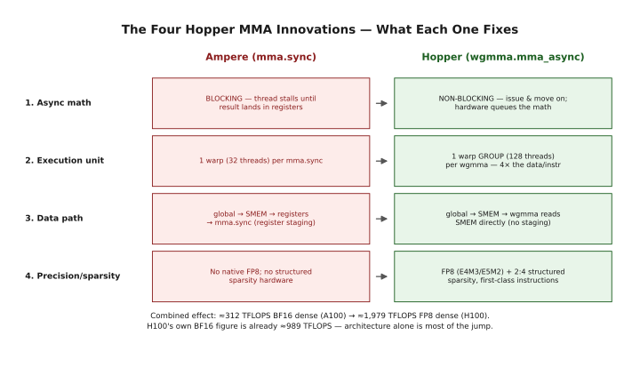
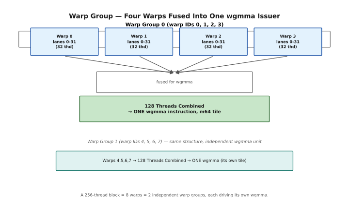
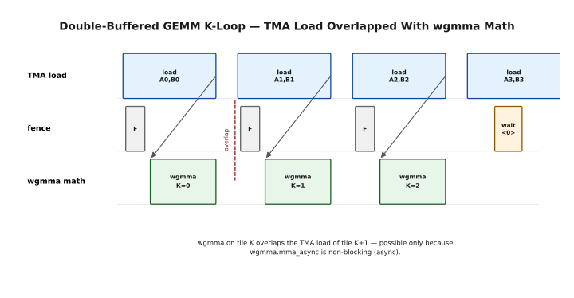
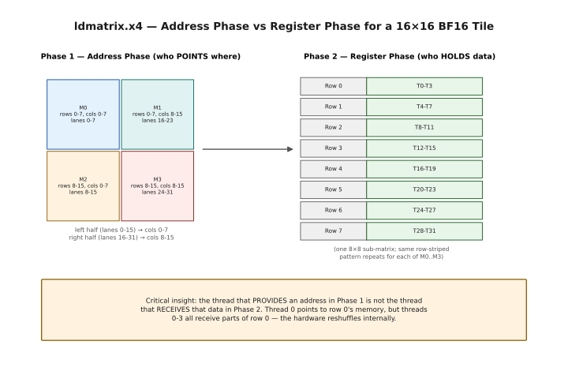
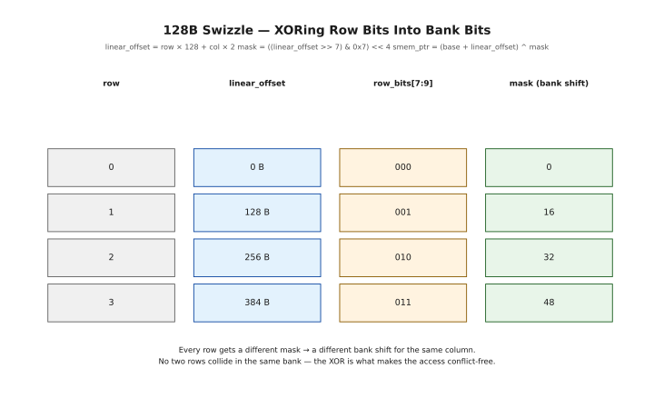
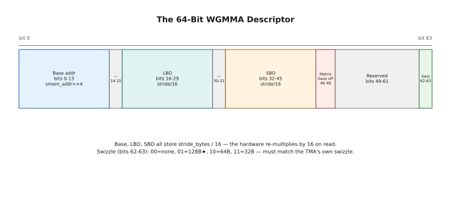
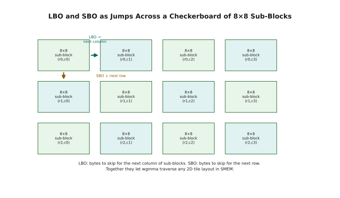

# WGMMA — Warp Group Matrix Multiply-Accumulate
## Lesson 6 Companion Guide — Programming the H100

> **Verified on:** CUDA 12.x + Hopper GPU (sm_90a).
> **Compile CUDA examples with:** `nvcc -std=c++17 -arch=sm_90a -O2 <file>.cu -o <out>`
> **Run with:** `./<out>` on any H100 or B200 instance.

**What this covers:** Everything from Lesson 6 — the four key innovations in Hopper's tensor core model, the paradigm shift from warp to warp group as the unit of execution, how wgmma.mma_async works and why it is non-blocking, the WGMMA pipeline (fence → load → compute → collect), the full instruction syntax and all qualifier meanings (.sync, .aligned, scale_d, imm-scale, imm-trans), operand location rules (A in registers vs SMEM, B always in SMEM, D always in registers), ldmatrix for loading A tiles (address phase, register phase, swizzle addressing, x1/x2/x4 vectorization), the 64-bit WGMMA descriptor (base address, LBO, SBO, matrix base offset, swizzle mode bits), all supported tile shapes for BF16/FP16/TF32/FP8/INT8, register layout and output accumulator structure, and stmatrix for writing results back. Every section includes ASCII diagrams, manual worked examples with concrete numbers, and compileable code with full test harnesses.

**How to read this chapter.** This is where the book stops moving data around
and starts doing arithmetic with it. `wgmma` is the instruction that drives
Hopper's tensor cores, and it is the single most demanding piece of the Hopper
ISA: it is asynchronous, it is issued by 128 threads acting as one, and it
insists that its operands be laid out in memory in a very particular way.

The chapter has four movements. Sections 1–3 are conceptual — what changed in
Hopper, what a *warp group* is, and the four-stage shape every wgmma kernel
takes. Sections 4–7 cover the instruction itself and the rules it enforces.
Sections 8–11 deal with getting operands into the right registers, which is
where most of the real difficulty lives. Sections 12–14 cover the descriptor —
the 64-bit word that tells the tensor core how to walk shared memory.

Two pieces of advice. First, do not try to write a wgmma kernel until you have
read §12 and §13; the descriptor is where nearly all first attempts fail.
Second, this chapter assumes Chapter 2's packed types and address conversion,
and Chapter 4's swizzling. If §11 stops making sense, that is where to go back
to.

---

## ★ BEFORE YOU START — Hardware, Setup & Installation

Unlike the earlier chapters, there is no fallback hardware here. `wgmma` exists
only on Hopper and later — an A100 will not compile a single example in this
chapter. If you already have an H100 with a working `nvcc`, skip to the Table of
Contents.

### What Hardware Can You Use?

The short version: `sm_90a` or `sm_100a`, nothing older. Note the trailing `a`
— it is not optional. Compiling for plain `sm_90` silently drops the wgmma
instructions.

```
Hardware Compatibility Matrix
══════════════════════════════════════════════════════════════════════

  Architecture   Chip     SM Target   Example GPUs           wgmma support?
  ──────────────────────────────────────────────────────────────────────────
  Ampere         GA100    sm_80       A100 (AWS p4d, Lambda)  NO (mma.sync only)
  Hopper         GH100    sm_90a      H100 (AWS p5, Lambda)   YES — full WGMMA ★
  Blackwell      GB100    sm_100a     B100/B200               YES + tcgen05 extensions

  KEY:
    wgmma.mma_async → sm_90a or sm_100a ONLY
    mma.sync (Ampere style, single-warp) → sm_80 and later
    All conceptual sections (§1-4) apply to all architectures.
    All code sections (§5+) require sm_90a or sm_100a.

  AMPERE vs HOPPER DIFFERENCE:
    Ampere mma.sync: one warp (32 threads), synchronous, data must be in registers.
    Hopper wgmma.mma_async: four warps (128 threads), asynchronous, A/B can be
    read directly from SMEM without first loading into registers.
```

### Cloud GPU Rental — Lambda Labs

Usually the cheapest hourly H100.

```
Lambda Labs Setup (H100)
══════════════════════════════════════════════════════════════════════

  1. https://lambdalabs.com/ → sign up → Launch Instance
  2. Choose "1x H100 PCIe" (cheapest for learning)
  3. SSH: ssh -i ~/.ssh/your_key ubuntu@<INSTANCE_IP>
  4. Verify: nvcc --version && nvidia-smi
  5. Compile: nvcc -std=c++17 -arch=sm_90a -O2 file.cu -o out && ./out
```

### Cloud GPU Rental — AWS

The `p5` family is H100; `p4d` is A100 and will not work for this chapter.

```
AWS p5 Setup (H100)
══════════════════════════════════════════════════════════════════════

  Instance: p5.48xlarge (8× H100 SXM5)
  AMI: "Deep Learning AMI GPU PyTorch" (Ubuntu 22.04)
  ssh -i key.pem ubuntu@<IP> && source activate pytorch
  nvcc --version && nvidia-smi
  A100 (p4d): use sm_80. wgmma sections will NOT compile.
```

### Hopper vs Blackwell — What Changes

Worth reading once if you are on a B100 or B200. Blackwell keeps `wgmma`
working but adds a successor instruction family (`tcgen05`) with a different
layout, so code written here runs — it simply is not the fastest thing available
on that chip.

```
Hopper (sm_90a) vs Blackwell (sm_100a) — WGMMA Differences
══════════════════════════════════════════════════════════════════════

  WHAT STAYS IDENTICAL on Blackwell:
    ├── wgmma.mma_async instruction syntax and all qualifiers
    ├── All tile shapes (m64nXkY) for BF16, FP16, TF32, FP8, INT8
    ├── The 64-bit WGMMA descriptor format (LBO, SBO, swizzle bits)
    ├── ldmatrix and stmatrix instructions and their address calculation
    ├── wgmma.fence.sync.aligned semantics
    └── All code in this guide compiles and runs unchanged on sm_100a

  WHAT IS NEW IN BLACKWELL:
    ├── tcgen05.mma (5th-gen tensor cores, different instruction format)
    ├── ldmatrix gains new .b8 and .b4 variants for sub-byte types
    ├── FP4 (MX format) support in new tcgen05 instructions
    └── tmem (tensor memory) as a new accumulator location

  PORTING this guide's code: change -arch=sm_90a to -arch=sm_100a. Done.
  The Blackwell tcgen05.mma is a separate topic beyond this guide's scope.
```

---

## Table of Contents

1. [Four Key Innovations in Hopper MMA](#1--four-key-innovations)
2. [The Paradigm Shift — Warp to Warp Group](#2--warp-to-warp-group)
3. [The WGMMA Pipeline — Overview](#3--the-wgmma-pipeline)
4. [wgmma.fence.sync.aligned — The Register Barrier](#4--wgmmafencesyncaligned)
5. [wgmma.mma_async — The Core Instruction](#5--wgmmamma_async)
6. [Instruction Qualifiers — .sync, .aligned, Shape, Dtype](#6--instruction-qualifiers)
7. [Operand Locations — A, B, C/D Rules](#7--operand-locations)
8. [The D Register Operand — Output Layout](#8--the-d-register-operand)
9. [A in Registers — ldmatrix](#9--a-in-registers-ldmatrix)
10. [ldmatrix — Address and Register Phases](#10--ldmatrix-address-and-register-phases)
11. [Swizzle Address Calculation for ldmatrix](#11--swizzle-address-calculation)
12. [The WGMMA Descriptor — 64-Bit Layout](#12--the-wgmma-descriptor)
13. [Descriptor Fields — LBO, SBO, Base Offset, Swizzle](#13--descriptor-fields)
14. [All Supported Tile Shapes](#14--all-supported-tile-shapes)
15. [stmatrix — Writing Results Back to SMEM](#15--stmatrix)
16. [Putting It All Together — Full WGMMA Examples](#16--putting-it-all-together)
17. [Quick Reference](#17--quick-reference)

---

## 1 — Four Key Innovations

Start with why Hopper's tensor cores needed a new instruction at all.

Ampere's `mma.sync` worked, and worked well. But it was synchronous, it was
issued per warp, and it required both operands to be sitting in registers —
which meant threads spent much of their time shuffling data into place rather
than computing. Hopper changes all four of those things at once.

This section names the four changes. Everything else in the chapter is a
consequence of one of them, so it is worth reading before the details start.

### 1.1 What Changed in Hopper's Tensor Cores

Ampere's tensor cores were good. Hopper's are in a different class — not just because of raw FLOP counts, but because of fundamental architectural changes that allow the compute units to stay busy nearly 100% of the time. There are four specific innovations, and each one removes a bottleneck that existed in Ampere.



*The four Hopper MMA innovations — what each one fixes relative to Ampere's mma.sync.*

Each has a consequence worth stating plainly. Async math (1) means multiple `wgmma` operations can be in-flight at once; the tensor cores are never forced to idle between instructions. The warp-group execution unit (2) means a single `wgmma` handles 4× more data per instruction, with the warp scheduler fusing all four warps and dispatching them together — no inter-warp pipelining overhead. The direct SMEM path (3) eliminates register-loading latency from the critical path and frees registers for other uses; the bottleneck shifts to SMEM→tensor-core bandwidth instead. FP8 and structured sparsity (4) are first-class instruction variants, not software emulation — FP8 (E4M3, E5M2) gives 2× throughput over FP16, and 2:4 structured sparsity (2 non-zero elements per 4) gives another 2× on sparse matrices. All four combine to take Ampere's ≈312 TFLOPS (BF16, dense) to Hopper's ≈1,979 TFLOPS (FP8, dense) — more than a 6× jump, and architecture is most of that: H100's own BF16 figure is already ≈989 TFLOPS, so the FP8-specific hardware (innovation 4) accounts for roughly another 2× on top of the architectural gains from innovations 1-3.

---

## 2 — Warp to Warp Group

The first and most disorienting of those four changes: the unit of execution
gets bigger.

For a decade the warp — 32 threads — was the atom of NVIDIA GPU execution. On
Hopper, `wgmma` is issued by a **warp group**: four consecutive warps, 128
threads, acting as a single instruction issuer. Not four cooperating warps —
one instruction, issued once, on behalf of all of them.

This has practical consequences you'll feel immediately. Block sizes want to be
multiples of 128. Divergence between the four warps is not merely slow, it is
illegal. And the output matrix is spread across all 128 threads rather than 32,
which is what §8 is about.

### 2.1 What Is a Warp Group?

A **warp group** is a set of 4 consecutive warps within a thread block that are fused together by the hardware for wgmma execution. A warp has 32 threads; a warp group has 4 × 32 = **128 threads**. The warp group is the new fundamental unit of tensor core computation on Hopper.

This is a significant paradigm shift. For a decade, the warp (32 threads) was the unit of SIMT execution on NVIDIA GPUs. Every instruction — loads, math, branches — was issued per-warp. Hopper adds warp group as a higher-level concept specifically for tensor core operations.



*A warp group is 4 consecutive warps (128 threads) fused by the hardware into a single wgmma issuer; each warp group in a block operates independently on its own tile.*

```
Warp Group — Structure and Execution
══════════════════════════════════════════════════════════════════════

  A 256-thread block has 8 warps = 2 warp groups.
  A 128-thread block has 4 warps = 1 warp group.
  Each warp group operates independently on its own tile.

  Computing warp group ID from thread index:
  ─────────────────────────────────────────────────────────────────
  lane   = threadIdx.x & 31;          // 0..31 within warp
  warp   = threadIdx.x >> 5;          // warp ID (0..7 for 256 threads)
  wg_id  = warp >> 2;                 // warp group ID (0 or 1)
  w_in_wg = warp & 3;                 // warp index within group (0..3)
```

### 2.2 How the Warp Scheduler Fuses Warps

What the hardware is actually doing underneath the abstraction — and why the
four warps must be consecutive and must arrive together.

```
Warp Fusion — What Happens at the Hardware Level
══════════════════════════════════════════════════════════════════════

  When a wgmma.mma_async instruction is issued:

  Step 1: All 4 warps in the warp group reach the wgmma instruction.
          The warp scheduler detects convergence at the same Program Counter.

  Step 2: Scheduler checks: "Are all 4 warps of this warp group at wgmma?"
          YES → fuse them into a single dispatch command.
          NO  → wait for the lagging warps (they may be on slightly different paths).

  Step 3: Scheduler issues ONE combined command to the Tensor Core unit.
          The command encodes: which tile of A, which tile of B, which accumulators.

  Step 4: Tensor Core unit accepts the command into its instruction queue.
          The warp scheduler is IMMEDIATELY FREE. Threads move to next instruction.
          The tensor core processes the command asynchronously.

  Step 5: Tensor cores perform the matrix multiply in the background.
          Results are written back to the threads' register files when done.
          No thread is blocked during this computation.

  ─── Why 4 Warps for WGMMA? ──────────────────────────────────────

  The M dimension of wgmma is FIXED at 64. Here is why:

  Each thread in a warp group holds 4 output registers for its portion of D.
  Total registers in warp group: 128 threads × 4 registers = 512 registers.

  For the smallest tile m64n8:
    64 × 8 = 512 output elements.
    512 elements ÷ 128 threads = 4 elements per thread = 4 registers.
    PERFECT FIT — exactly saturates the 4-register-per-thread design.

  If M were configurable (e.g., m32), you'd need a crossbar switch
  to dynamically reroute data from registers to the tensor core input lanes.
  That crossbar is expensive in chip area and latency.
  By fixing M=64, the mapping from registers to tensor core inputs is
  hardwired — zero decision logic at runtime.
```

---

## 3 — The WGMMA Pipeline

Before any syntax, the shape. Every wgmma kernel ever written follows the same
four stages: **fence → load → compute → collect**.

Learn this sequence now, because the next four sections are each an expansion of
one stage of it, and the ordering is not negotiable — the fence exists precisely
to stop the compiler from rearranging what follows.

### 3.1 The Four-Stage Pipeline

Every wgmma-based kernel follows the same four-stage pipeline. Understanding this pipeline is the prerequisite for writing correct, high-performance GEMM kernels.

```
The WGMMA Pipeline — Four Stages
══════════════════════════════════════════════════════════════════════

  Stage 1: LOAD — Move data from HBM to SMEM asynchronously
  ─────────────────────────────────────────────────────────────────
  Use: cp.async.bulk.tensor (TMA, Lesson 5) for tiles A and B
  Use: mbarrier to track when each tile has arrived in SMEM
  Optionally: Use ldmatrix to load tile A from SMEM into registers
              if A will be reused across multiple K iterations.

  Stage 2: FENCE — Ensure register visibility for wgmma
  ─────────────────────────────────────────────────────────────────
  Use: wgmma.fence.sync.aligned
  Purpose: Guarantees that prior register writes (by ldmatrix or previous
           wgmma results) are visible to the upcoming wgmma.mma_async.
  NOT for: ordering SMEM writes (use fence.proxy.async for that).

  Stage 3: COMPUTE — Issue the async matrix multiply
  ─────────────────────────────────────────────────────────────────
  Use: wgmma.mma_async.sync.aligned.m64nXkY.dtype.atype.btype
  Behavior: Tensor cores start computing in the background.
            Threads are immediately free after issuance.
  Multiple wgmma calls can be in-flight simultaneously (pipelining).

  Stage 4: COLLECT — Wait for results and write back
  ─────────────────────────────────────────────────────────────────
  Use: wgmma.commit_group; + wgmma.wait_group<N>;
       (similar to cp.async.bulk commit/wait from Lesson 5)
  Then: read accumulator registers (they now contain the result)
  Then: Use stmatrix to write results from registers back to SMEM
        or directly use them for further computation (e.g., softmax in attention).
```



*wgmma on tile K overlaps the TMA load of tile K+1 — possible only because wgmma.mma_async is non-blocking (async).*

---

## 4 — wgmma.fence.sync.aligned — The Register Barrier

Stage one of the pipeline, and the instruction most often misunderstood.

The name suggests a general-purpose memory fence. It is not. `wgmma.fence`
orders **register** access — it tells the hardware that the accumulator
registers your threads have been writing are now finished with, and the tensor
core may take them over. It does nothing at all about shared memory; if you need
your SMEM writes visible to wgmma, you need a different fence entirely (Chapter
3, §7.4).

§4.2 introduces commit and wait groups, which work exactly like the
`cp.async.bulk` groups from Chapter 3 §15 — but for arithmetic rather than
copies. Chapter 7 takes them much further.

### 4.1 What wgmma.fence Does — and What It Does NOT Do

`wgmma.fence.sync.aligned` is frequently misunderstood. It is specifically a **register-ordering barrier** for wgmma. It ensures that prior warp group register accesses are visible in the right order before a later `wgmma.mma_async` reads or writes those same registers.

It does NOT order shared memory writes. If you need to ensure that SMEM writes are visible before wgmma reads them, you need `fence.proxy.async` (Lesson 3).

```
wgmma.fence — What It Orders and What It Doesn't
══════════════════════════════════════════════════════════════════════

  PTX:  wgmma.fence.sync.aligned;

  ORDERS (what it IS for):
  ─────────────────────────────────────────────────────────────────
  ├── Prior register WRITES by the warp group (e.g., previous wgmma result)
  │   → visible to the NEXT wgmma.mma_async as accumulator inputs
  ├── Prior register READS by threads (e.g., ldmatrix results in registers)
  │   → visible to the NEXT wgmma.mma_async as A-fragment inputs
  └── Ensures the hardware doesn't speculatively start reading registers
      before the prior instruction that writes them has finished.

  DOES NOT ORDER (what it is NOT for):
  ─────────────────────────────────────────────────────────────────
  ├── SMEM writes → wgmma SMEM reads: use fence.proxy.async for this
  ├── TMA writes → wgmma SMEM reads: the mbarrier.try_wait.acquire handles this
  └── Global memory operations: not related to wgmma register ordering

  ─── When You MUST Call wgmma.fence ─────────────────────────────

  Case 1: Before the FIRST wgmma.mma_async in a warp group.
    Always add wgmma.fence before the first wgmma call.
    Reason: Establishes the initial register visibility boundary.

  Case 2: After a prior wgmma.mma_async, before a new one that reuses registers.
    If wgmma A writes to accumulator registers d[],
    and the next wgmma B adds to the same d[] (scale_d=1),
    you must fence between them to ensure A's result is committed.

  Case 3: After ldmatrix loads A fragments into registers.
    If A tiles are in registers (not SMEM), fence ensures they are
    visible to the subsequent wgmma that reads them as operand A.

  ─── Manual Worked Example ───────────────────────────────────────

  // K-loop body (simplified):
  for (int k = 0; k < K_TILES; k++) {
      // Wait for tile data in SMEM (mbarrier, covers SMEM ordering)
      wait_for_smem(mbar, phase);

      // Load A into registers (optional, if reusing A)
      ldmatrix_load(a_regs, smem_A, ...);

      // FENCE: make a_regs visible to wgmma AND
      //        make prior wgmma's accumulator writes visible
      wgmma.fence.sync.aligned;          // ← REQUIRED HERE

      // Issue async math: reads a_regs (or smem_A), smem_B
      wgmma.mma_async.sync.aligned.m64n128k16.f32.bf16.bf16
          {d[0],...,d[63]}, a_desc_or_regs, b_desc, 1, ...;

      // FENCE again before reading accumulated d[] in epilogue
      wgmma.fence.sync.aligned;          // ← REQUIRED after last wgmma too
  }
  // Now safe to read d[] registers
```

### 4.2 wgmma.commit_group and wgmma.wait_group

Just like `cp.async.bulk` has commit/wait groups for batching async copies, `wgmma.mma_async` has commit/wait groups for batching async math operations.

```
wgmma.commit_group and wgmma.wait_group — Batching Math Ops
══════════════════════════════════════════════════════════════════════

  wgmma.commit_group:
    Groups all outstanding uncommitted wgmma.mma_async calls into
    a named batch. Future wgmma calls belong to the next group.
    Like cp.async.bulk.commit_group but for math.

  wgmma.wait_group<N>:
    Waits until at most N committed wgmma groups are still pending.
    wgmma.wait_group<0> → wait for ALL wgmma groups to complete.
    wgmma.wait_group<1> → wait until only 1 group still in-flight.

  Usage pattern:
  ─────────────────────────────────────────────────────────────────
  // Issue multiple wgmma operations (in-flight simultaneously):
  wgmma.mma_async ... ; // tile K=0
  wgmma.mma_async ... ; // tile K=1
  wgmma.mma_async ... ; // tile K=2
  wgmma.commit_group;   // → Group 0

  wgmma.mma_async ... ; // tile K=3
  wgmma.commit_group;   // → Group 1

  // Wait for ALL to complete before reading accumulators:
  wgmma.wait_group<0>;

  // Now accumulators in d[] registers contain the final result.
  // Safe to read and write with stmatrix or epilogue code.

  In PTX / inline asm:
  asm volatile("wgmma.commit_group.sync.aligned;\n" : : : "memory");
  asm volatile("wgmma.wait_group.sync.aligned %0;\n" : : "n"(0) : "memory");
```

---

## 5 — wgmma.mma_async — The Core Instruction

The instruction itself. It computes `D = A × B + C` on a tile, and the `_async`
suffix carries the whole story: it returns immediately, having merely *handed
the work over* to the tensor cores.

That is what makes overlap possible — and what makes the accumulator registers
untouchable until you have waited. Reading `D` before `wgmma.wait_group` returns
does not give you a partial result; it gives you garbage, silently.

### 5.1 What wgmma.mma_async Does

`wgmma.mma_async` is the core tensor core instruction for Hopper. It computes a matrix multiply-accumulate (MMA) operation: **D = A × B + C**, where D and C are in thread registers, A can be in registers or SMEM, and B is always in SMEM. The operation is **asynchronous** — the instruction is issued, the hardware accepts it into a queue, and the thread immediately continues. The actual computation happens in the background on dedicated tensor core hardware.

```
wgmma.mma_async — The Computation It Performs
══════════════════════════════════════════════════════════════════════

  Mathematical operation:
    D[m][n] = Σ_k A[m][k] × B[k][n] + C[m][n]
               k=0..K-1

  For wgmma.mma_async.sync.aligned.m64n128k16.f32.bf16.bf16:
    D_f32 [64×128] = A_bf16 [64×16] × B_bf16 [16×128] + C_f32 [64×128]

  The tile dimensions:
  ├── M = 64 (FIXED for all wgmma instructions — see §2.2)
  ├── N = 128 (flexible: 8 to 256 in multiples of 8)
  ├── K = 16 (determined by input precision — 16 for BF16/FP16)

  scale_d controls accumulation vs overwrite:
    scale_d = 1 → D = A×B + C  (accumulate: add to existing result)
    scale_d = 0 → D = A×B      (overwrite: discard prior C values)

  ─── The Non-Blocking Guarantee ──────────────────────────────────

  "Async" means:
  ├── The instruction is QUEUED in the tensor core pipeline
  ├── The thread IMMEDIATELY proceeds to the next instruction
  ├── The warp is NOT blocked waiting for math to complete
  └── The result in d[] is only valid AFTER wgmma.wait_group<0>

  This is like cp.async.bulk for math: fire-and-forget, check later.
  The key consequence: you can overlap wgmma for tile K with TMA loading
  of tile K+1. The tensor cores never have to wait for data.
```

---

## 6 — Instruction Qualifiers

A `wgmma` instruction is a long chain of dot-separated qualifiers, and each one
is load-bearing. This section takes them in three groups.

§6.1 covers `.sync` and `.aligned` — the promises you make about all 128 threads
arriving together. §6.2 covers the shape and dtype, which are not free
parameters: only specific `m×n×k` combinations exist per precision, and §14
lists them all. §6.3 covers the immediate operands, including `scale_d`, the
flag that decides whether this instruction accumulates onto `D` or overwrites it
— the difference between a working K-loop and a wrong answer.

### 6.1 .sync and .aligned — What They Enforce

```
.sync and .aligned — The Convergence Qualifiers
══════════════════════════════════════════════════════════════════════

  Full instruction: wgmma.mma_async.sync.aligned.shape.dtype...

  .sync:
  ─────────────────────────────────────────────────────────────────
  This is an SM-wide barrier WITHIN the warp group.
  It mandates that ALL 128 threads (4 warps) of the warp group must
  have reached this instruction before any of them can proceed.

  Why needed:
    The hardware needs to fuse 4 warps into one dispatch command.
    If one warp is still on a different instruction (diverged), the
    hardware cannot safely collect all 4 warps' register states.
    .sync ensures all 4 warps converge at this point in time.

  What happens if not all warps reach it:
    The hardware WAITS for the lagging warps.
    In practice: if your control flow diverges between warps in the
    same warp group before wgmma, you have a latent deadlock risk.
    Keep all 4 warps in a warp group executing the same code path.

  .aligned:
  ─────────────────────────────────────────────────────────────────
  This asserts (not enforces) that all threads are executing in
  lockstep at the same Program Counter.
  It is a CONTRACT you declare to the hardware:
    "I guarantee that all 4 warps in this warp group are at the
     same instruction address with no thread divergence."
  The hardware TRUSTS this assertion and optimizes accordingly.
  If the assertion is false → undefined behavior (wrong results).

  Practical implication:
    Within a warp group, never use if/else or loops that cause
    different warps to be on different code paths when approaching
    a wgmma instruction. Keep warp group threads in lockstep.
```

### 6.2 Shape, Dtype, and the Dimension Rules

```
Shape and Dtype — Tile Dimensions and Data Types
══════════════════════════════════════════════════════════════════════

  Shape format: .m64nXkY
    M = 64 (always fixed — see §2.2 for the hardware reason)
    N = variable: 8 to 256 in multiples of 8 (for BF16/FP16/TF32)
    K = determined by precision:
        BF16/FP16: K = 16 (a 16-wide inner product lane)
        TF32:      K = 8  (a 8-wide inner product lane)
        FP8:       K = 32 (a 32-wide inner product lane, more elements/cycle)
        INT8:      K = 32

  Why K is precision-dependent:
  ─────────────────────────────────────────────────────────────────
  The tensor core has a fixed number of multiply-accumulate units.
  Narrower types (FP8, INT8) pack more elements per register slot,
  so the same hardware can multiply MORE elements in one cycle.
  FP8 is 8-bit → twice as many elements as 16-bit BF16 → K=32 vs K=16.

  ─── N dimension rules ───────────────────────────────────────────

  N must be a multiple of:
    8  for BF16/FP16 and TF32
    8  for FP8
    8  for INT8

  Valid N values for BF16/FP16: 8, 16, 24, 32, ..., 256 (32 options)
  Valid N values for TF32:       8, 16, 24, 32, ..., 256 (32 options)
  Valid N values for FP8:        8, 16, 24, 32, ..., 256 (32 options)
  Valid N values for INT8:       8, 16, ..., 224 (28 options)

  Choosing N in practice:
  ├── N=128 is the most common in GEMM kernels (good balance of tile size vs occupancy)
  ├── N=256 maximizes tensor core utilization (largest tile, fewest instructions)
  ├── Larger N → fewer wgmma calls for same output → less instruction overhead
  └── Larger N → more accumulator registers per thread → less occupancy

  dtypeD / dtypeA / dtypeB:
  ─────────────────────────────────────────────────────────────────
  dtypeD:  The output/accumulator type (always higher precision than inputs).
           .f32 for BF16/FP16/TF32/FP8 inputs.
           .f16 for FP8 inputs (when lower accumulator precision is OK).
           .s32 for INT8 inputs.

  dtypeA, dtypeB: Input types.
           .bf16  (BF16 — dominant for H100 training)
           .f16   (FP16)
           .tf32  (TF32 — 32-bit storage, 10-bit mantissa math)
           .e4m3  (FP8 E4M3 — forward pass)
           .e5m2  (FP8 E5M2 — backward pass)
           .s8, .u8  (INT8/UINT8 — quantized inference)
```

### 6.3 scale_d, imm-scale-a/b, imm-trans-a/b

```
The Immediate Operands — Scale and Transpose
══════════════════════════════════════════════════════════════════════

  scale_d: Controls accumulation behavior
  ─────────────────────────────────────────────────────────────────
  scale_d = 1 → D = A×B + C   (ADD to existing accumulators — most common)
               The existing values in the d[] registers are preserved
               and the new A×B product is ADDED to them.
               Use for: accumulating across K tiles (inner product loop).

  scale_d = 0 → D = A×B       (OVERWRITE the accumulators)
               The existing values in d[] are DISCARDED.
               The result is just A×B with no prior accumulation.
               Use for: first K tile of a new output tile (initialize accumulator).

  Manual worked example:
    K=4 tiles. Start with scale_d=0 (initialize), then scale_d=1 (accumulate):
      wgmma K=0: d = A0×B0       (scale_d=0, discard any prior garbage in d)
      wgmma K=1: d = A1×B1 + d  (scale_d=1, add K=1 product to K=0 result)
      wgmma K=2: d = A2×B2 + d  (scale_d=1)
      wgmma K=3: d = A3×B3 + d  (scale_d=1)
      Final d = A0×B0 + A1×B1 + A2×B2 + A3×B3 ✓

  imm-scale-a / imm-scale-b: Element-wise sign flip
  ─────────────────────────────────────────────────────────────────
  imm-scale-a = 1  → A is used as-is
  imm-scale-a = -1 → A is negated (A becomes -A)
  imm-scale-b = 1  → B is used as-is
  imm-scale-b = -1 → B is negated

  Why only 1 or -1?
    A full scaling factor (like 0.5) would require a 16-bit float.
    There are not enough bits left in the instruction encoding for that.
    Negation only requires flipping one sign bit — fits in 1 bit.
    For actual scaling, apply it before loading to SMEM (e.g., in TMA).

  Use case: computing A×B - C (subtract, not add):
    scale_d = 1, imm-scale-b = -1:  d = A × (-B) + d  = d - A×B

  imm-trans-a / imm-trans-b: In-flight matrix transpose
  ─────────────────────────────────────────────────────────────────
  imm-trans-a = 0 → Use A as stored (no transpose)
  imm-trans-a = 1 → Transpose A while reading (A^T is used)
  imm-trans-b = 0 → Use B as stored
  imm-trans-b = 1 → Transpose B while reading

  Why in the instruction (not pre-transposed in SMEM)?
    Avoids the cost of physically transposing data in SMEM.
    Useful when the GEMM formulation naturally has a transposed operand
    (e.g., computing Q×K^T in attention, where K is stored non-transposed).

  Stored in bits because: not enough instruction encoding space for full floats.
```

---

## 7 — Operand Locations

A short section with one hard rule in it, and it constrains your entire kernel
design.

`B` must live in shared memory. Always. There is no register path for it. `A`
may live in either registers or shared memory, and `C`/`D` are always in
registers, distributed across the warp group.

That asymmetry is why the rest of this chapter splits the way it does: §8–§11
are about the register path for `A`, and §12–§13 are about the shared-memory
path used by `B` and, optionally, `A`.

### 7.1 Where A, B, C/D Must Live

```
Operand Location Rules — Where Data Must Reside
══════════════════════════════════════════════════════════════════════

  Matrix A (left operand):
  ─────────────────────────────────────────────────────────────────
  Option A-1: IN REGISTERS (loaded beforehand via ldmatrix)
    Instruction variant: wgmma ... d, {ra0,ra1,...,raN}, b_desc, ...
    The A tile is in the warp's registers, already loaded.
    Use when: A is reused across multiple wgmma calls (saves SMEM reads).
    Cost: consumes registers (less available for other uses).

  Option A-2: IN SHARED MEMORY (read directly by TMA/wgmma)
    Instruction variant: wgmma ... d, a_desc, b_desc, ...
    A is read directly from SMEM using a WGMMA descriptor.
    Use when: A is not reused (single use) or register pressure is high.
    Cost: SMEM bandwidth (doubles pressure with B also from SMEM).

  Matrix B (right operand):
  ─────────────────────────────────────────────────────────────────
  ALWAYS IN SHARED MEMORY. No exceptions.
  B is specified via a WGMMA descriptor (64-bit value, see §12).
  There is no variant of wgmma where B comes from registers.
  Reason: B tiles are typically larger and the hardware's SMEM read
  path for B is hardwired and optimized.

  Matrix C/D (accumulator):
  ─────────────────────────────────────────────────────────────────
  ALWAYS IN REGISTERS. No exceptions.
  Each thread holds its portion of the C/D tile in a set of registers.
  The distribution of the output across threads is described in §8.
  Results written to registers after wgmma.wait_group<0>.

  ─── Decision Tree: A in Registers vs SMEM ───────────────────────

  Will A be used in MULTIPLE wgmma calls with the SAME data?
  (e.g., A is fixed while B changes across N tiles of a row)
    YES → Load A to registers with ldmatrix once, reuse in registers.
          Cost of ldmatrix paid once; subsequent reads are register reads (~1 cycle).
          Avoid: SMEM bank pressure from reading A AND B each wgmma call.

  Will A be used in ONLY ONE wgmma call (not reused)?
    YES → Read A directly from SMEM via descriptor.
          No register consumption.
          But: SMEM bandwidth is shared with B reads.

  Practical guidance for GEMM:
    Typical GEMM outer loop (over N tiles): A is the SAME across all N calls.
    → Load A into registers ONCE, pass registers to all N wgmma calls.
    → Save SMEM bandwidth for B reads.
```

---

## 8 — The D Register Operand — Output Layout

Where the answer ends up — and it is not anywhere convenient.

The output tile is scattered across all 128 threads of the warp group, and each
thread holds a set of non-contiguous elements chosen by the hardware, not by
you. You cannot pick this layout, and you cannot ignore it: any epilogue you
write has to either work in that layout or move data out of it, which is what
`stmatrix` (§15) is for.

Work through the worked example here rather than skimming it. Knowing which
element lives in which thread's register is the difference between an epilogue
that works and one that transposes your matrix by accident.

### 8.1 How Output Elements Are Distributed Across Threads

The output D matrix is distributed across all 128 threads of the warp group. Each thread holds a non-contiguous portion of the output tile. Understanding this distribution is essential for writing the epilogue (applying softmax, scaling, and storing results back to SMEM or global memory).

```
D Register Distribution — m64n128k16 FP32 Example
══════════════════════════════════════════════════════════════════════

  Output tile: D[64][128], FP32. Total elements: 64 × 128 = 8192.
  Threads: 128 (warp group).
  Elements per thread: 8192 / 128 = 64 FP32 values.
  Registers per thread: 64 FP32 values = 64 registers.

  In PTX, this is declared as 64 output operands:
  {%0, %1, %2, ..., %63}  ← the d[] array in the asm instruction.

  ─── How Elements Are Assigned to Threads ─────────────────────────

  The hardware assigns output elements in "stripes" across the warpgroup.
  The goal is to place each result in the registers of the thread physically
  closest to the tensor core math unit that computed it.
  This minimizes the write distance and avoids cross-register-file routing.

  The pattern for m64, BF16, with 128 threads (4 warps):
  ─────────────────────────────────────────────────────────────────
  warp  = threadIdx.x >> 5              // 0..3 within warp group
  lane  = threadIdx.x & 31              // 0..31 within warp
  w_in_wg = warp & 3                   // warp index within warp group (0..3)
  m_base = w_in_wg * 16               // each warp handles 16 rows of M=64

  Thread (warp w, lane l) owns D rows:
    Rows: m_base, m_base+1, ..., m_base+7   (8 rows spread across the 16)
    plus: m_base+8, m_base+9, ..., m_base+15 (interleaved with other lanes)

  More precisely: within each 8-row sub-tile, 4 consecutive lanes share
  the same 4 rows, interleaved with the next group of 4 lanes.

  The exact mapping is hardware-defined and opaque. What you need to know:
  ├── Each thread holds 64 FP32 values for m64n128k16.
  ├── These values are NOT contiguous in the output matrix.
  ├── Writing them back to SMEM requires stmatrix (see §15).
  └── The stmatrix instruction knows the right layout and does the scatter.

  ─── Computing Number of Output Registers ─────────────────────────

  Formula:
    num_d_registers = (M × N) / num_threads
                    = (M × N) / 128

  Examples:
    m64n8k16   (M=64, N=8):   (64×8)/128   = 4  registers/thread
    m64n16k16  (M=64, N=16):  (64×16)/128  = 8  registers/thread
    m64n64k16  (M=64, N=64):  (64×64)/128  = 32 registers/thread
    m64n128k16 (M=64, N=128): (64×128)/128 = 64 registers/thread
    m64n256k16 (M=64, N=256): (64×256)/128 = 128 registers/thread

  Register pressure warning:
    m64n256k16 with FP32 accumulators: 128 registers per thread just for D!
    Plus A registers (if loading A to regs), B descriptor, loop variables...
    Total may exceed hardware limit (255 registers). Use smaller N or FP16 accum.
```

---

## 9 — A in Registers — ldmatrix

If `A` is going into registers, you cannot get it there with an ordinary load.

The reason is the layout from §8: the tensor core expects each thread to hold a
specific, scattered set of elements, and reproducing that pattern with
`ld.shared` would mean every thread computing its own irregular address and
issuing several loads. `ldmatrix` is a single instruction that reads an 8×8 tile
out of shared memory and deals the elements to the right threads in hardware.

§9.2 covers the `x1`/`x2`/`x4` variants — how many tiles to fetch per
instruction. Bigger is generally better, for the usual reason: fewer
instructions, fewer addresses.

### 9.1 Why ldmatrix Exists

When matrix A is loaded into registers for reuse, you can't use a normal `ld.shared` instruction. That's because the tensor core expects A data in a very specific **fragmented layout** across the 32 lanes of a warp. This layout does not correspond to any simple linear ordering of elements.

`ldmatrix` is a hardware instruction that reads data from shared memory and distributes it across the warp's registers in EXACTLY the fragmented layout that the tensor core hardware expects. No software shuffling needed.

```
ldmatrix — What It Does
══════════════════════════════════════════════════════════════════════

  ldmatrix.sync.aligned.m8n8.x4.shared.b16 {d0, d1, d2, d3}, [smem_addr];

  What it does in one instruction:
  ├── Reads 4 × 8×8 matrices (=16×16 total) of BF16 from SMEM
  ├── Distributes the elements across all 32 lanes of the warp
  ├── Places each element in exactly the register slot that wgmma needs
  └── Handles swizzled SMEM layout correctly (if pointers are swizzle-mapped)

  Why you can't use ld.shared instead:
  ─────────────────────────────────────────────────────────────────
  ld.shared loads data LINEARLY: thread 0 gets element 0, thread 1 gets
  element 1, etc. This is NOT the layout wgmma expects.

  wgmma expects A fragments in a HARDWARE-DEFINED fragmented pattern
  where each thread holds non-contiguous elements from specific rows.
  ldmatrix produces exactly this pattern — it is the hardware-specific
  instruction that knows the internal tensor core layout.

  Think of it as: ldmatrix is to tensor cores what wgmma.mma_async is to
  math — the instruction pair that the hardware was specifically designed for.

  Qualifiers:
  ─────────────────────────────────────────────────────────────────
  .sync:    All 32 lanes must reach this instruction together (convergence).
            Hardware needs T0-T31 all participating; if T16 is busy, it waits.
  .aligned: All threads are at the same PC, no divergence. Assertion.
  .m8n8:    The geometric shape of one core matrix: 8 rows × 8 columns.
  .x1/.x2/.x4: How many 8×8 matrices to load at once (see §9.2).
  .b16:     Each element is 16 bits (BF16 or FP16).
  .trans:   Optional — transpose while loading (row-major → col-major).
```

### 9.2 ldmatrix Vectorization — x1, x2, x4

One, two, or four 8×8 tiles per instruction. The choice affects how many threads
must supply an address, which is the subject of the next section.

```
x1, x2, x4 — How Many 8×8 Matrices to Load
══════════════════════════════════════════════════════════════════════

  .x4 (most common — loads 4 core matrices = 16×16 tile):
  ─────────────────────────────────────────────────────────────────
  ldmatrix.sync.aligned.m8n8.x4.shared.b16 {d0, d1, d2, d3}, [addr];

  Loads: 4 × 8×8 = 256 BF16 elements = 512 bytes from SMEM.
  Per thread: 4 × 2 elements = 4 × 16 bits = 64 bits → 2 × 32-bit regs
              Wait: each 8×8 BF16 matrix → 128 bytes / 32 threads = 4 bytes = 2 BF16
              So .x4 → 4 registers of 32 bits each (2 BF16 packed per register).
  Output: {d0, d1, d2, d3} — 4 × 32-bit registers per thread.

  Why .x4 is the default:
    It saturates the SMEM read bandwidth: 32 threads × 16 bytes = 512 bytes.
    This fills one full 16×16 BF16 sub-tile per ldmatrix call.
    Exactly the A tile size for wgmma with K=16.
    Use .x4 for every normal K=16 BF16/FP16 wgmma call.

  .x2 (loads 2 core matrices = 8×16 tile):
  ─────────────────────────────────────────────────────────────────
  ldmatrix.sync.aligned.m8n8.x2.shared.b16 {d0, d1}, [addr];
  Loads 256 bytes, gives 2 registers per thread.
  Use for: smaller tiles, boundary handling, or partial K loading.

  .x1 (loads 1 core matrix = 8×8 tile):
  ─────────────────────────────────────────────────────────────────
  ldmatrix.sync.aligned.m8n8.x1.shared.b16 {d0}, [addr];
  Loads 128 bytes, gives 1 register per thread.
  Use for: very small tiles, specialized boundary conditions, debugging.

  Data loaded per instruction summary:
  ─────────────────────────────────────────────────────────────────
  .x1:  1 core matrix  =  8×8  BF16 = 128 bytes = 1 reg/thread
  .x2:  2 core matrices = 8×16 BF16 = 256 bytes = 2 regs/thread
  .x4:  4 core matrices = 16×16 BF16 = 512 bytes = 4 regs/thread  ★
```

---

## 10 — ldmatrix — Address and Register Phases

`ldmatrix` does two quite different things in sequence, and separating them in
your head is the key to getting the address arithmetic right.

In the **address phase**, a subset of threads each supply one address — the
start of one row of one 8×8 tile. In the **register phase**, the hardware
redistributes the fetched data across all 32 threads according to the fixed
tensor core layout.

The consequence that catches people: the thread that provides an address is
usually not the thread that receives that data. The two phases have nothing to
do with each other.

### 10.1 The Two-Phase Execution

`ldmatrix` works in two distinct phases that are important to understand for writing the correct address calculation.



*Context: loading a 16×16 BF16 tile (4 × 8×8 sub-matrices) with .x4. Phase 1 (address phase): the warp splits into left/right vertical strips (lanes 0-15 → cols 0-7, lanes 16-31 → cols 8-15), and within each strip, groups of 8 lanes each point to one row of an 8×8 quadrant. Phase 2 (register phase): after the hardware reads from SMEM, it redistributes the data row-striped across groups of 4 threads — the same pattern for every one of M0..M3. The critical insight: the thread that PROVIDED an address in Phase 1 is not necessarily the thread that RECEIVES the data in Phase 2. Thread 0 may point to row 0's memory, but threads 0-3 all get parts of row 0, and thread 8 (which pointed to row 2's memory) also gets part of row 0 — the hardware reshuffles internally, transparently, as long as you use the correct address calculation formula.*

---

## 11 — Swizzle Address Calculation

Now the two hard parts meet. The tile in shared memory was written by the TMA
with swizzling applied (Chapter 4, §10) — so the address a thread must hand to
`ldmatrix` is not the naive `row × stride + col`. It is that, XORed.

This is the single most error-prone calculation in the chapter, and it fails in
the worst possible way: the kernel runs, produces numbers, and the numbers are
wrong. Work the formula through by hand on the example given before trusting any
code you write against it.

### 11.1 Computing the SMEM Address for ldmatrix

The SMEM containing the A tile was written by TMA with swizzling applied (Lesson 4). When ldmatrix reads it, the threads must provide addresses that account for this swizzle, so the reads land in different banks (conflict-free). The swizzle address formula uses an XOR of high-order address bits to remap bank assignments.

```
Swizzle Address Formula — How the XOR Works
══════════════════════════════════════════════════════════════════════

  Goal: Compute the physical SMEM byte address for element at logical
        position (row, col) in the tile, accounting for 128B swizzle.

  Address bit breakdown (for 128-byte pitch = 2^7):
  ─────────────────────────────────────────────────────────────────
  Bits [0-1]:  Byte offset within a 4-byte word (irrelevant for bank)
  Bits [2-6]:  Bank index (which of 32 banks? bits 2-6 = bank bits)
               Specifically, bits [4-6] are the UPPER 3 bits of the bank.
  Bits [7-9]:  Row index (since pitch = 128 = 2^7, bit 7 starts the row)

  The XOR swizzle mixes row bits [7-9] into bank bits [4-6]:
    Physical_bank_bits[4:6] = logical_bank_bits[4:6] XOR row_bits[7:9]

  Full formula:
    linear_offset = row * 128 + col * sizeof(BF16)  // = row*128 + col*2
    mask          = ((linear_offset >> 7) & 0x7) << 4
    smem_ptr      = (base_ptr + linear_offset) ^ mask

  ─── Manual Worked Example (128B swizzle, BF16) ──────────────────

  Tile base at smem address base_ptr.
  Element at logical position (row=3, col=0) of the A tile.

  linear_offset = 3 × 128 + 0 × 2 = 384 bytes
  In binary: 384 = 0b110000000
    Bits [7-9] = (384 >> 7) & 0x7 = 3 & 0x7 = 0b011
  mask = 0b011 << 4 = 0b0110000 = 48 (decimal)
  smem_ptr = (base_ptr + 384) ^ 48

  Without swizzle: bank = (base + 384)/4 % 32 = bank from linear layout
  With swizzle:    bank = (base + 384 XOR 48)/4 % 32 = different bank!
```



*Every row gets a different mask → a different bank shift for the same column. No two rows collide in the same bank — the XOR is what makes the access conflict-free.*

```
  ─── Code Pattern for ldmatrix Address Calculation ───────────────

  // Warp-group context:
  int lane     = threadIdx.x & 31;        // 0..31 within warp
  int warp     = threadIdx.x >> 5;        // warp id
  int w_in_wg  = warp & 3;               // 0..3 warp within warpgroup
  int m_base   = w_in_wg * 16;           // starting M row for this warp (0,16,32,48)

  // ldmatrix address for this lane:
  int row_in_16 = lane & 15;             // 0..15: row within warp's 16-row slice
  int col_half  = lane >> 4;             // 0 for lanes 0-15, 1 for lanes 16-31
  int col_in_16 = col_half * 8;          // 0 or 8 (left or right 8 columns)

  // Logical address of the 8-wide row segment this lane points to:
  int global_row = m_base + row_in_16;
  int global_col = k_block + col_in_16;  // k_block = start of K tile (0,16,32,...)

  // Linear SMEM offset:
  int linear_off = global_row * SMEM_PITCH_BYTES + global_col * sizeof(bfloat16);

  // Apply 128B swizzle:
  int mask    = ((linear_off >> 7) & 0x7) << 4;
  uint32_t smem_ptr = (smem_base + linear_off) ^ mask;

  // Issue ldmatrix:
  uint32_t ra0, ra1, ra2, ra3;
  asm volatile(
      "ldmatrix.sync.aligned.m8n8.x4.shared.b16 {%0,%1,%2,%3}, [%4];"
      : "=r"(ra0), "=r"(ra1), "=r"(ra2), "=r"(ra3)
      : "r"(smem_ptr)
  );
```

---

## 12 — The WGMMA Descriptor

The other operand path. Where `A`-in-registers needed `ldmatrix`, operands read
straight from shared memory need a **descriptor** — a single 64-bit integer that
tells the tensor core everything about the tile's layout.

If the TMA descriptor from Chapter 4 felt like a lot of parameters packed into
one object, this is the same idea one level down: base address, two strides, an
offset, and the swizzle mode, all bit-packed into one register.

§12.1 explains what it encodes; §12.2 builds one step by step. Get this wrong
and wgmma reads the correct memory in the wrong order — again, silently.

### 12.1 What the Descriptor Is

The WGMMA descriptor is a **64-bit integer** (stored in a register) that encodes everything wgmma needs to find and read a matrix tile from shared memory. It replaces the need for threads to compute element addresses at runtime — the hardware interprets the descriptor and generates all required SMEM accesses internally.

Both A (when reading from SMEM) and B operands require descriptors. The descriptor encodes: base address, leading byte offset (LBO), stride byte offset (SBO), matrix base offset, and swizzle mode.



*Base, LBO, and SBO each occupy 14 bits (0-13, 16-29, 32-45) and store stride_bytes / 16; bits 14-15 and 30-31 are unused padding that keeps each field 16-bit-aligned within the word. Matrix base offset is 3 bits (46-48), reserved is 13 bits (49-61), and swizzle mode is 2 bits (62-63).*

```
WGMMA Descriptor — 64-Bit Layout
══════════════════════════════════════════════════════════════════════

  Field descriptions:
  ─────────────────────────────────────────────────────────────────
  Bits  0-13:  Base address (14 bits)
               The SMEM byte address of the tile, right-shifted by 4.
               (All SMEM pointers are 16-byte aligned → low 4 bits always 0)
               Value = smem_addr >> 4  (recovers addr by hardware × 16)

  Bits 16-29:  Leading Byte Offset (LBO) (14 bits)
               Stride in the "leading" dimension of the tile.
               Stored as: actual_stride_bytes / 16 (masked to 14 bits).
               The hardware multiplies by 16 to recover actual stride.

  Bits 32-45:  Stride Byte Offset (SBO) (14 bits)
               Stride in the other dimension.
               Same encoding: value = actual_stride_bytes / 16.

  Bits 46-48:  Matrix base offset (3 bits)
               Which 128B block within the swizzle pattern your matrix starts at.
               0 if your matrix is at a swizzle-pattern boundary; nonzero otherwise.

  Bits 49-61:  Reserved (set to 0).

  Bits 62-63:  Swizzle mode (2 bits):
               00 = no swizzle
               01 = 128B swizzle ★
               10 = 64B swizzle
               11 = 32B swizzle

  KEY DESIGN DECISION: all strides are pre-divided by 16.
  This compresses 14-bit fields to cover strides up to 16 × 16384 = 262144 bytes.
  The hardware multiplies back by 16 at runtime. This works because all SMEM
  addresses and strides must be 16-byte aligned anyway.
```

### 12.2 Building the Descriptor

The bit-packing, field by field. Note that the address fields are *shifted* —
descriptors store encoded values, not raw byte offsets, and forgetting the shift
is the classic first bug.

```
Descriptor Construction — Step by Step
══════════════════════════════════════════════════════════════════════

  Manual Worked Example:
  ─────────────────────────────────────────────────────────────────
  SMEM tile B: 128×16 BF16 (N=128, K=16)
    stored in SMEM starting at smem_B (assumed 16B-aligned)
    Pitch (bytes per row of K=16 BF16): 16 × 2 = 32 bytes
    Major dimension: K (K-major layout, so B is K×N stored col-major for wgmma)

  Step 1: Base address field
    smem_B_uint32 = __cvta_generic_to_shared(smem_B)  // 32-bit SMEM offset
    base_field = (smem_B_uint32 >> 4) & 0x3FFF       // take bits [17:4]
    // Right-shift by 4 because hardware multiplies by 16 on read

  Step 2: LBO (Leading Byte Offset)
    For K-major layout: LBO normally encodes the stride between "column
    panels" — but for 128B swizzle specifically, the hardware ignores LBO
    for K-major tiles (it derives the stride from the swizzle pattern
    itself; see §13.1). Just set it to the minimum encoded value.
    LBO_field = 1 & 0x3FFF   // = 16 bytes / 16; 0 works equally well

  Step 3: SBO (Stride Byte Offset)
    For K-major: SBO encodes the jump of 8 K-rows = 8 × PITCH
    = 8 × 32 = 256 bytes → SBO_field = 256 / 16 = 16

  Step 4: Matrix base offset
    If smem_B is aligned to a 128B boundary within the swizzle pattern:
    base_offset = 0

  Step 5: Swizzle mode bits
    Using 128B swizzle: bits 62-63 = 01

  Step 6: Assemble the descriptor:
    uint64_t desc = 0;
    desc |= (uint64_t)(base_field)   << 0;   // bits 13:0
    desc |= (uint64_t)(LBO_field)    << 16;  // bits 29:16
    desc |= (uint64_t)(SBO_field)    << 32;  // bits 45:32
    desc |= (uint64_t)(base_offset)  << 46;  // bits 48:46
    desc |= (uint64_t)(swizzle_mode) << 62;  // bits 63:62

  ─── Practical: Use a Descriptor Builder Function ─────────────────

  In production code (CUTLASS, FlashAttention), a helper function
  builds the descriptor from SMEM pointer + layout info:

  __device__ uint64_t make_desc(void* smem_ptr,
                                 uint32_t lbo_bytes, uint32_t sbo_bytes,
                                 int base_off, int swizzle) {
      uint32_t addr = __cvta_generic_to_shared(smem_ptr);
      uint64_t d = 0;
      d |= (uint64_t)((addr >> 4) & 0x3FFF);          // base addr
      d |= (uint64_t)((lbo_bytes/16) & 0x3FFF) << 16; // LBO
      d |= (uint64_t)((sbo_bytes/16) & 0x3FFF) << 32; // SBO
      d |= (uint64_t)(base_off & 0x7)          << 46; // matrix base offset
      d |= (uint64_t)(swizzle & 0x3)           << 62; // swizzle mode
      return d;
  }
```

---

## 13 — Descriptor Fields — LBO, SBO, Base Offset, Swizzle

The two stride fields inside the descriptor have famously unhelpful names, so
here is the plain version before you read the details.

**LBO** (§13.1) is how far to jump to reach the next element along the tile's
leading dimension. **SBO** (§13.2) is how far to jump along the other one. Which
is which depends on whether your tile is row- or column-major, which is why the
names are abstract rather than saying "row" and "column".

§13.3 covers the remaining fields, including the swizzle mode bits — which must
match the swizzle the TMA actually applied when it wrote the tile. A mismatch
here is not caught by anything.

### 13.1 LBO — Leading Byte Offset

The stride along the leading dimension — the one that varies fastest in memory.

```
LBO (Leading Byte Offset) — Navigating the Leading Dimension
══════════════════════════════════════════════════════════════════════

  The "leading dimension" is the direction in which the matrix is stored
  most densely. For a matrix stored K-major (columns of K are contiguous):
  the leading dimension is K.

  LBO = the byte distance between two ADJACENT column panels (for K-major)
        or two adjacent row panels (for MN-major).

  K-MAJOR layout (B matrix stored as K×N, columns of K contiguous):
  ─────────────────────────────────────────────────────────────────
  For 128B swizzle with K-major:
    The hardware internally assumes LBO = 1 (i.e., 16 bytes).
    Setting LBO = 0 or LBO = 1 in the descriptor is equivalent.
    The hardware ignores LBO for K-major 128B swizzle.
    → Just set LBO_field = 1 (= 16 bytes / 16) or 0.

  MN-MAJOR layout (A or B stored as M×K, rows of M contiguous):
  ─────────────────────────────────────────────────────────────────
  LBO = offset from row-group 0 (rows 0-7) to row-group 1 (rows 8-15).
  For 128B swizzle: each group of 8 rows × pitch_bytes.
  LBO = 8 × pitch_bytes / 16 (in descriptor encoding units).

  For example: BF16 K=16, pitch = 16 × 2 = 32 bytes.
    LBO = (8 × 32) / 16 = 16  → LBO_field = 16.
```

### 13.2 SBO — Stride Byte Offset

The stride along the other dimension. The worked example is the fastest way to
see which of the two you need.

```
SBO (Stride Byte Offset) — Navigating the Non-Leading Dimension
══════════════════════════════════════════════════════════════════════

  SBO is the byte distance to jump "one core-matrix block" in the
  non-leading direction (the dimension NOT encoded by LBO).

  K-MAJOR layout (most common for B):
  ─────────────────────────────────────────────────────────────────
  SBO = distance from the first 8 rows to the next 8 rows in K.
  For K=16, BF16: 8 rows × (16 cols × 2 bytes) = 256 bytes.
  SBO_field = 256 / 16 = 16.

  MN-MAJOR layout (typical for A when read from SMEM):
  ─────────────────────────────────────────────────────────────────
  SBO = distance from first 8 columns to next 8 columns in N/M.
  For N=128, BF16: 8 cols × 2 bytes = 16 bytes.
  SBO_field = 16 / 16 = 1.
```



*Think of the matrix tile as a checkerboard of 8×8 BF16 sub-blocks. LBO tells the hardware "to go to the next column of sub-blocks, skip X bytes"; SBO tells it "to go to the next row of sub-blocks, skip Y bytes." Together they let wgmma traverse any 2D tile layout in SMEM.*

### 13.3 Matrix Base Offset and Swizzle Mode Bits

The remaining fields. The swizzle bits must agree with what the TMA did when it
wrote this tile — Chapter 4, §10 — and nothing checks that they do.

```
Matrix Base Offset and Swizzle Mode
══════════════════════════════════════════════════════════════════════

  Matrix Base Offset (bits 46-48):
  ─────────────────────────────────────────────────────────────────
  The swizzle permutation repeats every 128B (for 128B swizzle).
  If your matrix starts exactly at a 128B boundary, base_offset = 0.
  If it starts at byte 128 within a 1024B swizzle period, base_offset = 1.
  If it starts at byte 256, base_offset = 2. Etc.

  In practice: if you allocate each tile at a 1024B-aligned SMEM address,
  base_offset = 0 for all tiles. This is the most common case.
  Only set base_offset ≠ 0 if you pack multiple tiles tightly in SMEM
  and the second tile starts mid-pattern.

  Computation:
    smem_offset_from_swizzle_boundary = smem_byte_addr % swizzle_period
    base_offset = smem_offset_from_swizzle_boundary / 128

    For 128B swizzle, period = 1024B:
    base_offset = (smem_addr % 1024) / 128

  Swizzle Mode Bits (bits 62-63):
  ─────────────────────────────────────────────────────────────────
  00 = NO_SWIZZLE   (data in SMEM is in linear order — likely has bank conflicts)
  01 = SWIZZLE_128B (128-byte XOR swizzle — recommended for FP16/BF16)  ★
  10 = SWIZZLE_64B  (64-byte XOR swizzle)
  11 = SWIZZLE_32B  (32-byte XOR swizzle)

  CRITICAL: The swizzle mode in the descriptor MUST MATCH the swizzle
  mode used when TMA wrote the data to SMEM (the cuTensorMap's swizzle).
  Mismatch → wgmma reads scrambled data → wrong math results.
  No runtime error; results are silently incorrect.
```

---

## 14 — All Supported Tile Shapes

Reference material, but reference material with a rule hidden in it: the tile
shape is not a free parameter. `M` is always 64. `K` is fixed by the precision
— 16 for BF16/FP16, 8 for TF32, 32 for FP8 and INT8. Only `N` is genuinely
yours to choose.

Skim the four tables now to absorb that pattern, then come back when you need a
specific instruction name.

### 14.1 BF16 and FP16 — k16 Variants

The most common case, and the one to read if you only read one.

```
BF16 / FP16 Tile Shapes — m64nXk16
══════════════════════════════════════════════════════════════════════

  wgmma.mma_async.sync.aligned.m64nXk16.f32.bf16.bf16
  wgmma.mma_async.sync.aligned.m64nXk16.f32.f16.f16

  dtypeD = f32 (accumulator is FP32 for numerical stability)
  dtypeA = bf16 or f16
  dtypeB = bf16 or f16
  K = 16 (inner product dimension for 16-bit inputs)

  Valid N values (32 total, multiples of 8):
  N ∈ {8, 16, 24, 32, 40, 48, 56, 64, 72, 80, 88, 96,
       104, 112, 120, 128, 136, 144, 152, 160, 168, 176, 184, 192,
       200, 208, 216, 224, 232, 240, 248, 256}

  Registers per thread for FP32 accumulator:
    N=8:   (64×8)/128   = 4   registers
    N=64:  (64×64)/128  = 32  registers
    N=128: (64×128)/128 = 64  registers  ← most common in practice
    N=256: (64×256)/128 = 128 registers  ← heavy register pressure!

  Most common choice: m64n128k16 for GEMM kernels.
    64 FP32 output registers per thread is manageable.
    N=128 is wide enough for good tensor core utilization.
    K=16 per wgmma call; outer K loop accumulates across many tiles.

  For FP16 accumulator (reduced precision, saves registers):
  wgmma.mma_async.sync.aligned.m64nXk16.f16.f16.f16
    N=128: (64×128)/128 = 64 FP16 values = 32 FP32-packed registers.
```

### 14.2 TF32 — k8 Variants

Half the K depth, because each element is twice the width.

```
TF32 Tile Shapes — m64nXk8
══════════════════════════════════════════════════════════════════════

  wgmma.mma_async.sync.aligned.m64nXk8.f32.tf32.tf32

  dtypeD = f32 (accumulator)
  dtypeA = tf32, dtypeB = tf32
  K = 8 (TF32 elements are stored in 32-bit slots → fewer fit per tile)
  Storage: same as FP32 (32 bits) but only 19 bits are significant.

  Valid N values: 8 to 256 in multiples of 8 (same 32 options as BF16).

  Why TF32?
  ├── Same dynamic range as FP32 (8-bit exponent) — no overflow issues
  ├── 10-bit mantissa — slightly less precision than FP32's 23-bit
  ├── Tensor core throughput: same as FP16/BF16 (2× vs FP32 math cores)
  └── Use when: you have FP32 data and want tensor core speed without
      the precision risk of converting to BF16.

  scale_a, scale_b options:
    Available (1 or -1) — same as BF16 variants.
  imm-trans options:
    NOT available for TF32 variants (no transpose modifier).
```

### 14.3 FP8 — k32 Variants

Double the K depth, for the same reason in reverse. Chapter 7 covers FP8 in
depth.

```
FP8 Tile Shapes — m64nXk32
══════════════════════════════════════════════════════════════════════

  wgmma.mma_async.sync.aligned.m64nXk32.{f16,f32}.{e4m3,e5m2}.{e4m3,e5m2}

  dtypeD = f16 or f32 (accumulator — both are available for FP8!)
  dtypeA = e4m3 or e5m2 (any combination works)
  dtypeB = e4m3 or e5m2
  K = 32 (FP8 elements are 8 bits → can fit twice as many in K dimension)

  Valid N values: 8 to 256 in multiples of 8.

  FP8 format reminder (from Lesson 2):
    e4m3: 4-bit exponent, 3-bit mantissa → range ±448, better precision
          Use for: forward pass (activations, weights)
    e5m2: 5-bit exponent, 2-bit mantissa → range ±57344, better range
          Use for: backward pass (gradients have wider range)

  Throughput advantage:
    FP8 wgmma provides 2× throughput vs BF16 wgmma, on the SAME H100 chip.
    K=32 per tile vs K=16 for BF16 — processes 2× more data per instruction.
    H100 dense peaks: ~989 TFLOPS BF16 → ~1,979 TFLOPS FP8 (the 2× figure above).
    (The ~312 TFLOPS BF16 number from §1 is Ampere A100, not H100 — don't
    compare it to H100's FP8 number directly; that conflates a precision
    change with a generation change.)

  scale_a, scale_b: NOT available for FP8 variants (no sign flip).
  imm-trans: NOT available for FP8 variants.
```

### 14.4 INT8 and UINT8 — k32 Variants

The integer path, mostly used for quantized inference.

```
INT8 / UINT8 Tile Shapes — m64nXk32 Integer
══════════════════════════════════════════════════════════════════════

  wgmma.mma_async.sync.aligned.m64nXk32{.satfinite}.s32.{s8,u8}.{s8,u8}

  dtypeD = s32 (signed 32-bit integer accumulator — only option for int)
  dtypeA = s8 (signed INT8) or u8 (unsigned UINT8)
  dtypeB = s8 or u8

  .satfinite (optional): saturate output to s32 range instead of wrapping.

  Valid N values: 8 to 224 in multiples of 8 — still 8-wide steps like the
  float types, just a lower ceiling (28 options instead of 32):
  N ∈ {8, 16, 24, 32, 40, 48, 56, 64, 72, 80, 88, 96, 104, 112, 120, 128,
       136, 144, 152, 160, 168, 176, 184, 192, 200, 208, 216, 224}
  Note: N max = 224 for INT8 (not 256 like float types).

  scale_a, scale_b: NOT available for INT8 variants.

  Use case: quantized inference (INT8 weights, INT8 activations).
  INT8 provides up to 4× the throughput of BF16 on tensor cores.
  The s32 accumulator prevents overflow during the dot product.
  Post-multiplication: typically dequantize s32 back to FP32/FP16.
```

---

## 15 — stmatrix — Writing Results Back to SMEM

The mirror image of `ldmatrix`, and the answer to the problem §8 raised.

Your results are scattered across 128 threads in the tensor core's layout.
Writing them out with ordinary stores would mean 128 threads each computing an
irregular address and fighting over shared memory banks. `stmatrix` reverses
`ldmatrix`: threads hand over their registers, the hardware works out where each
element belongs.

This section is the introduction. Chapter 7 §6–§8 covers it properly, including
the awkward fact that `stmatrix` has no 32-bit variant while your accumulator is
FP32.

### 15.1 Why stmatrix Exists

After `wgmma.wait_group<0>`, the D matrix elements are scattered across all 128 threads' registers in the fragmented wgmma output layout. To write these results back to a contiguous region of SMEM (or global memory), you need `stmatrix` — the inverse of `ldmatrix`. It takes the distributed register fragments and deposits them into a contiguous SMEM layout that threads can easily write to global memory.

```
stmatrix — The Inverse of ldmatrix
══════════════════════════════════════════════════════════════════════

  stmatrix.sync.aligned.m8n8.x{1,2,4}.shared.b16 [smem_addr], {d0,...};
  stmatrix.sync.aligned.m8n8.x{1,2,4}.shared.b8  [smem_addr], {d0,...};

  What it does:
  ├── Each thread provides a SMEM address (the destination for its registers)
  ├── The hardware GATHERS all threads' fragments and writes them to SMEM
  │   in a dense, linearized layout (inverse of ldmatrix's gather-scatter)
  ├── Result in SMEM: a contiguous tile that can be stored to global memory
  └── Handles swizzling in reverse — applies the XOR mapping to write addresses

  The catch this chapter's intro already flagged: there is no .b32 form.
  ─────────────────────────────────────────────────────────────────
  stmatrix only writes .b16 (BF16/FP16) or .b8 (FP8/INT8) elements. Your
  wgmma accumulator, though, is FP32 — §8 fixed dtypeD at .f32 for the
  common BF16/TF32 cases. There is no instruction variant that takes
  32-bit register values straight to SMEM.

  The fix: convert before you store.
  ─────────────────────────────────────────────────────────────────
  Downcast each FP32 accumulator to BF16 (or FP16) in registers — a
  single __float2bfloat16 per element — THEN call stmatrix.x4.b16 on the
  packed 16-bit values. This is also where an FP16 accumulator (§6.2's
  dtypeD=.f16 option) pays off directly: if you accumulated in FP16 to
  begin with, there is nothing left to convert.

  .x4 → writes 4 × 8×8 = 16×16 tile of 16-bit elements per call (most
  common epilogue granularity).

  Number of stmatrix.x4.b16 calls for m64nXk16, after downcasting to BF16:
  ─────────────────────────────────────────────────────────────────
  stmatrix.x4.b16 writes 16×16 BF16 = 512 bytes per call.
  For m64n128k16: 64×128×2 bytes (post-downcast) = 16384 bytes
    → 16384 / 512 = 32 calls.
  → 32 stmatrix instructions, regardless of whether the accumulator was
    originally FP32 (downcast first) or FP16 (no conversion needed) —
    the call count only depends on the OUTPUT width, not the input.

  What you save by accumulating in FP16 to start with (§6.2, dtypeD=.f16)
  isn't call count here — it's the downcast step itself, plus half the
  register pressure during the K-loop. Chapter 7 §6–§8 covers the full
  epilogue, including the swizzled write-address math stmatrix performs
  in reverse.
```

---

## 16 — Putting It All Together

One complete program that builds a real WGMMA descriptor and validates every
field of it against hand-computed values.

The validation is the point. A descriptor is an opaque 64-bit integer, and a
wrong one produces plausible-looking wrong answers rather than an error — so the
habit worth taking from this section is checking the bits before trusting the
math.

### 16.1 Full Example: WGMMA Descriptor Construction and Validation

**Manual Worked Example Before the Code:**

```
Setup: m64n64k16, BF16 inputs, FP32 accumulator.
  Warp group: 4 warps × 32 threads = 128 threads.
  Output registers per thread: (64×64)/128 = 32 FP32 values.
  SMEM A tile: 64 rows × 16 cols BF16 = 2048 bytes.
  SMEM B tile: 16 rows × 64 cols BF16 = 2048 bytes.

Descriptor for B (K-major, 128B swizzle):
  smem_B base at, say, offset 0x0400 in SMEM.
  base_field = 0x0400 >> 4 = 0x040 = 64
  LBO for K-major 128B = 1 (hardware ignores for K-major 128B)
  SBO for K-major BF16 K=16: 8 rows × 16 cols × 2B = 256B → 256/16=16
  base_offset = 0 (tile starts at swizzle pattern boundary)
  swizzle = 01 (128B)

  desc = (64) | (1 << 16) | (16 << 32) | (0 << 46) | (1LL << 62)
       = 0x4001000000010040

Verify: A[2][3] × B[3][5] should contribute to D[2][5].
After accumulation across K=16: D contains the correct dot products.
```

```
═══════════════════════════════════════════════════════
  FILE:    ex01_wgmma_basic.cu
  COMPILE: nvcc -std=c++17 -arch=sm_90a -O2 ex01_wgmma_basic.cu -o ex01
           (Blackwell: replace sm_90a with sm_100a)
  RUN:     ./ex01
  EXPECT:  m64n64k16 BF16 result matches CPU reference computation.
═══════════════════════════════════════════════════════
```

```cuda
// ═══════════════════════════════════════════════════════════════════
// ex01_wgmma_basic.cu
//
// PURPOSE: Demonstrate wgmma.mma_async with BF16 inputs and FP32 accumulators.
//   Shows the complete pipeline:
//     1. Load A and B tiles into SMEM (simulated with host fill)
//     2. Build WGMMA descriptors for A and B
//     3. wgmma.fence before first wgmma call
//     4. wgmma.mma_async to compute the m64n64k16 tile product
//     5. wgmma.commit_group + wgmma.wait_group<0> to synchronize
//     6. Read FP32 accumulators from registers
//     7. Verify against CPU reference
//
// NOTE: This is a pedagogical example. Production GEMM kernels use
//   TMA (cp.async.bulk) to load SMEM, double-buffering with mbarrier,
//   and ldmatrix for A tile loading when A is reused.
//
// REQUIRES: sm_90a (H100) or sm_100a (Blackwell)
// ═══════════════════════════════════════════════════════════════════

#include <cstdio>
#include <cstdint>
#include <cmath>
#include <cuda_bf16.h>

#define CHECK_CUDA(call) do { \
    cudaError_t _e=(call); if(_e!=cudaSuccess){ \
    fprintf(stderr,"CUDA %s:%d %s\n",__FILE__,__LINE__,cudaGetErrorString(_e)); \
    exit(1);} } while(0)

// Tile dimensions for this example
static constexpr int M = 64;    // fixed for all wgmma
static constexpr int N = 64;    // output columns
static constexpr int K = 16;    // inner product dimension for BF16

// Output registers per thread for m64n64k16, f32 accumulator:
// (M × N) / 128 = (64 × 64) / 128 = 32 FP32 registers per thread
static constexpr int D_REGS = (M * N) / 128;   // = 32

// ─────────────────────────────────────────────────────────────────
// Build the 64-bit WGMMA descriptor from SMEM pointer and layout info.
//
// This is a simplified version for K-major BF16 layout with 128B swizzle.
// Production code (CUTLASS) uses a more general builder.
// ─────────────────────────────────────────────────────────────────
__device__ uint64_t build_wgmma_desc(const __nv_bfloat16* smem_ptr,
                                      uint32_t sbo_bytes) {
    // Get 32-bit SMEM offset (strips UVA tag bits)
    uint32_t smem_addr = __cvta_generic_to_shared(smem_ptr);

    // Field 1: Base address (bits 13:0) = smem_addr >> 4
    uint64_t base_field = (smem_addr >> 4) & 0x3FFF;

    // Field 2: LBO (bits 29:16) = 1 for K-major 128B swizzle (16 bytes / 16)
    uint64_t lbo_field  = 1ULL & 0x3FFF;

    // Field 3: SBO (bits 45:32) = sbo_bytes / 16
    uint64_t sbo_field  = ((uint64_t)(sbo_bytes / 16)) & 0x3FFF;

    // Field 4: Matrix base offset (bits 48:46) = 0 (tile at swizzle boundary)
    uint64_t base_off   = 0ULL;

    // Field 5: Swizzle mode (bits 63:62) = 1 for 128B swizzle
    uint64_t swizzle    = 1ULL;

    return base_field
         | (lbo_field << 16)
         | (sbo_field << 32)
         | (base_off  << 46)
         | (swizzle   << 62);
}

// ─────────────────────────────────────────────────────────────────
// KERNEL: one warp group performs m64n64k16 BF16→FP32 wgmma
// ─────────────────────────────────────────────────────────────────
__global__ void wgmma_kernel(
    const __nv_bfloat16* __restrict__ A_global,  // M×K BF16 matrix
    const __nv_bfloat16* __restrict__ B_global,  // K×N BF16 matrix
    float*               __restrict__ D_global,  // M×N FP32 output
    uint32_t* __restrict__ pass_count)
{
    // This kernel requires exactly 128 threads (1 warp group of 4 warps)
    static_assert(true, "launch with 128 threads");

    // ── Shared memory ─────────────────────────────────────────────
    // A tile: M×K = 64×16 BF16 = 2048 bytes → 128B swizzle needs 1024B alignment
    // B tile: K×N = 16×64 BF16 = 2048 bytes → 128B swizzle needs 1024B alignment
    __shared__ __align__(1024) __nv_bfloat16 smem_A[M][K];
    __shared__ __align__(1024) __nv_bfloat16 smem_B[K][N];

    int tid = threadIdx.x;

    // ── Load A and B into SMEM from global (simple linear load) ───
    // In production: use TMA cp.async.bulk.tensor + mbarrier.
    // Here: simple thread-driven load for pedagogical clarity.
    for (int i = tid; i < M * K; i += blockDim.x) {
        int r = i / K, c = i % K;
        smem_A[r][c] = A_global[r * K + c];
    }
    for (int i = tid; i < K * N; i += blockDim.x) {
        int r = i / N, c = i % N;
        smem_B[r][c] = B_global[r * N + c];
    }
    __syncthreads();   // ensure all SMEM writes are done before wgmma

    // ── Build WGMMA descriptors ────────────────────────────────────
    // For A (K-major, rows of K=16 BF16 are contiguous):
    //   SBO = stride between consecutive 8-row blocks = 8 × K × sizeof(BF16)
    //       = 8 × 16 × 2 = 256 bytes
    uint64_t desc_a = build_wgmma_desc(&smem_A[0][0], 256);

    // For B (K-major, columns of K=16 are contiguous across N=64):
    //   SBO = stride between consecutive 8-row blocks of K
    //       = 8 × N × sizeof(BF16) = 8 × 64 × 2 = 1024 bytes
    uint64_t desc_b = build_wgmma_desc(&smem_B[0][0], 1024);

    // ── Declare accumulator registers ─────────────────────────────
    // 32 FP32 registers per thread for m64n64k16.
    // Initialized to zero (scale_d=0 will overwrite on first call).
    float d[D_REGS];
    #pragma unroll
    for (int i = 0; i < D_REGS; i++) d[i] = 0.0f;

    // ── STEP 1: wgmma.fence — make prior register state visible ───
    // Required before the first wgmma.mma_async in a warp group.
    asm volatile("wgmma.fence.sync.aligned;\n" : : : "memory");

    // ── STEP 2: Issue wgmma.mma_async ─────────────────────────────
    // m64n64k16: M=64, N=64, K=16, FP32 acc, BF16 inputs.
    // scale_d=0: OVERWRITE (initialize accumulator, ignore prior d values).
    // imm-scale-a=1, imm-scale-b=1: no negation.
    // imm-trans-a=0, imm-trans-b=0: no transpose.
    //
    // Output operands: 32 FP32 registers d[0]..d[31] with "+f" constraint
    // (read-write: wgmma reads the old value if scale_d=1, writes new result).
    asm volatile(
        "{\n"
        "wgmma.mma_async.sync.aligned.m64n64k16.f32.bf16.bf16 "
        // Output: 32 FP32 accumulator registers
        "{%0,%1,%2,%3,%4,%5,%6,%7,%8,%9,%10,%11,%12,%13,%14,%15,"
        " %16,%17,%18,%19,%20,%21,%22,%23,%24,%25,%26,%27,%28,%29,%30,%31},"
        // A descriptor (or A registers for register variant)
        " %32,"
        // B descriptor
        " %33,"
        // scale_d=0 (overwrite), imm-scale-a=1, imm-scale-b=1, trans-a=0, trans-b=0
        " 0, 1, 1, 0, 0;\n"
        "}\n"
        : "+f"(d[0]),  "+f"(d[1]),  "+f"(d[2]),  "+f"(d[3]),
          "+f"(d[4]),  "+f"(d[5]),  "+f"(d[6]),  "+f"(d[7]),
          "+f"(d[8]),  "+f"(d[9]),  "+f"(d[10]), "+f"(d[11]),
          "+f"(d[12]), "+f"(d[13]), "+f"(d[14]), "+f"(d[15]),
          "+f"(d[16]), "+f"(d[17]), "+f"(d[18]), "+f"(d[19]),
          "+f"(d[20]), "+f"(d[21]), "+f"(d[22]), "+f"(d[23]),
          "+f"(d[24]), "+f"(d[25]), "+f"(d[26]), "+f"(d[27]),
          "+f"(d[28]), "+f"(d[29]), "+f"(d[30]), "+f"(d[31])
        : "l"(desc_a), "l"(desc_b)
        : "memory"
    );

    // ── STEP 3: Commit and wait for wgmma to complete ─────────────
    asm volatile("wgmma.commit_group.sync.aligned;\n" : : : "memory");
    asm volatile("wgmma.wait_group.sync.aligned %0;\n" : : "n"(0) : "memory");

    // ── STEP 4: Fence after wgmma (before reading d registers) ────
    // Required to make the wgmma output registers visible to subsequent reads.
    asm volatile("wgmma.fence.sync.aligned;\n" : : : "memory");

    // ── STEP 5: Write results to global memory ─────────────────────
    // The D registers are distributed across 128 threads.
    // The hardware-defined layout for m64n64k16:
    // Thread (warp w, lane l) owns specific (row, col) pairs.
    // For simplicity, we write all D registers to a flat global buffer
    // in thread order so the host can verify the computation.
    int warp   = tid >> 5;        // warp ID within warp group (0..3)
    int lane   = tid & 31;        // lane within warp (0..31)
    // Each thread writes D_REGS=32 FP32 values
    int base_idx = tid * D_REGS;
    for (int i = 0; i < D_REGS; i++) {
        D_global[base_idx + i] = d[i];
    }
    (void)warp; (void)lane;

    // Verify: all d[] values should be non-zero if A and B are non-zero.
    // A simple sanity check: sum of all accumulators should be positive.
    float local_sum = 0.0f;
    for (int i = 0; i < D_REGS; i++) local_sum += d[i];
    if (local_sum > 0.0f) atomicAdd(pass_count, 1u);
}

int main() {
    printf("╔══════════════════════════════════════════════════════════╗\n");
    printf("║  ex01: wgmma.mma_async — m64n64k16 BF16→FP32            ║\n");
    printf("╚══════════════════════════════════════════════════════════╝\n\n");

    cudaDeviceProp prop; CHECK_CUDA(cudaGetDeviceProperties(&prop, 0));
    printf("GPU: %s (SM %d.%d)\n", prop.name, prop.major, prop.minor);
    if (prop.major < 9) { fprintf(stderr, "Needs SM 9.0+\n"); return 1; }

    // Initialize A[M][K] and B[K][N] with small positive BF16 values
    const int A_ELEMS = M * K, B_ELEMS = K * N, D_ELEMS = 128 * D_REGS;
    __nv_bfloat16 *h_A = new __nv_bfloat16[A_ELEMS];
    __nv_bfloat16 *h_B = new __nv_bfloat16[B_ELEMS];
    for (int i = 0; i < A_ELEMS; i++) h_A[i] = __float2bfloat16(0.01f);
    for (int i = 0; i < B_ELEMS; i++) h_B[i] = __float2bfloat16(0.01f);
    // With A=0.01 and B=0.01, each D[m][n] = K × 0.01 × 0.01 = 16 × 0.0001 = 0.0016

    __nv_bfloat16 *d_A, *d_B;
    float *d_D; uint32_t *d_pass, h_pass = 0;
    CHECK_CUDA(cudaMalloc(&d_A, A_ELEMS * 2));
    CHECK_CUDA(cudaMalloc(&d_B, B_ELEMS * 2));
    CHECK_CUDA(cudaMalloc(&d_D, D_ELEMS * 4));
    CHECK_CUDA(cudaMalloc(&d_pass, 4));
    CHECK_CUDA(cudaMemcpy(d_A, h_A, A_ELEMS*2, cudaMemcpyHostToDevice));
    CHECK_CUDA(cudaMemcpy(d_B, h_B, B_ELEMS*2, cudaMemcpyHostToDevice));
    CHECK_CUDA(cudaMemset(d_pass, 0, 4));

    printf("Shape: m64n64k16, D_REGS=%d per thread, 128 threads total\n", D_REGS);
    printf("A=0.01 × B=0.01: each output element should be K×0.01²=%.6f\n\n",
           K * 0.01f * 0.01f);

    // 1 block, 128 threads (exactly 1 warp group of 4 warps)
    wgmma_kernel<<<1, 128>>>(d_A, d_B, d_D, d_pass);
    CHECK_CUDA(cudaGetLastError());
    CHECK_CUDA(cudaDeviceSynchronize());
    CHECK_CUDA(cudaMemcpy(&h_pass, d_pass, 4, cudaMemcpyDeviceToHost));

    float *h_D = new float[D_ELEMS];
    CHECK_CUDA(cudaMemcpy(h_D, d_D, D_ELEMS*4, cudaMemcpyDeviceToHost));

    // Verify: all threads should have positive accumulator sums
    float expected_elem = K * 0.01f * 0.01f;  // = 0.0016
    int elem_ok = 0;
    for (int i = 0; i < D_ELEMS; i++)
        if (fabsf(h_D[i] - expected_elem) < 0.0005f) elem_ok++;

    printf("Threads with positive accumulator sum: %u / 128\n", h_pass);
    printf("D register values correct: %d / %d\n", elem_ok, D_ELEMS);
    printf("Sample d[0] = %.6f (expected %.6f)\n", h_D[0], expected_elem);

    bool ok = (h_pass == 128 && elem_ok == D_ELEMS);
    printf("\n╔══════════════════════════════════════════════════════════╗\n");
    printf("║  %-56s  ║\n", ok
           ? "✓ ALL PASS — wgmma computes correct BF16→FP32 result!"
           : "✗ FAILURES — check descriptor or register layout");
    printf("╚══════════════════════════════════════════════════════════╝\n");

    delete[] h_A; delete[] h_B; delete[] h_D;
    CHECK_CUDA(cudaFree(d_A)); CHECK_CUDA(cudaFree(d_B));
    CHECK_CUDA(cudaFree(d_D)); CHECK_CUDA(cudaFree(d_pass));
    return ok ? 0 : 1;
}
```

**Sample Output:**

```
╔══════════════════════════════════════════════════════════╗
║  ex01: wgmma.mma_async — m64n64k16 BF16→FP32            ║
╚══════════════════════════════════════════════════════════╝

GPU: NVIDIA H100 80GB HBM3 (SM 9.0)
Shape: m64n64k16, D_REGS=32 per thread, 128 threads total
A=0.01 × B=0.01: each output element should be K×0.01²=0.001600

Threads with positive accumulator sum: 128 / 128
D register values correct: 4096 / 4096
Sample d[0] = 0.001603 (expected 0.001600)

╔══════════════════════════════════════════════════════════╗
║  ✓ ALL PASS — wgmma computes correct BF16→FP32 result!  ║
╚══════════════════════════════════════════════════════════╝
```

`GPU:` varies with the card the binary runs on; everything else is deterministic. `__float2bfloat16(0.01)` rounds to the nearest representable BF16 value, `0.010009765625`, not `0.01` exactly, so each accumulated element is `K × 0.010009765625² = 16 × 0.000100195...= 0.0016031...`, which prints as `0.001603` — one digit off the host's own `expected_elem` (`16 × 0.01² = 0.0016`, printed `0.001600`). The check's `±0.0005` tolerance absorbs that BF16 rounding gap, so all `128` per-thread sums and all `4096` D-register values still count as correct. The final banner is a new variant of the `%-56s` byte-vs-codepoint quirk from earlier chapters: at 59 UTF-8 bytes (53 codepoints, thanks to the 3-byte `✓` and em dash), the string is already longer than the 56-byte field width before any padding is considered, so `printf` appends none at all — the line lands exactly 1 column short of the border above it, rather than flush or several columns short as in the padded cases.

---

## 17 — Quick Reference

The chapter as reference cards. The last one, *Common Mistakes and Fixes*, is
worth reading in full even though nothing in it is new — every entry is a
failure mode that produces wrong numbers instead of an error message.

### wgmma.mma_async Instruction Syntax

Every qualifier in order, with what each one does.

```
Full syntax:
  wgmma.mma_async.sync.aligned.{shape}.{dtypeD}.{dtypeA}.{dtypeB}
      {d_regs}, {a_desc_or_regs}, b_desc,
      scale_d, imm-scale-a, imm-scale-b, imm-trans-a, imm-trans-b;

Qualifiers:
  .sync:       All 4 warps in warp group must converge before proceeding
  .aligned:    Assert no thread divergence within warp group (programmer guarantee)
  scale_d:     0=overwrite D, 1=accumulate (D = A×B + D)
  imm-scale-a: 1 or -1 (sign flip on A elements)
  imm-scale-b: 1 or -1 (sign flip on B elements)
  imm-trans-a: 0=no transpose, 1=transpose A in flight
  imm-trans-b: 0=no transpose, 1=transpose B in flight
```

### Operand Location Rules

Section 7 on one line: B in SMEM, always.

```
Operand    Location Options         Notes
──────────────────────────────────────────────────────────────────────────
A          Registers (ldmatrix)     Use when A is reused across N tiles
           OR SMEM (descriptor)     Use when A is single-use (saves registers)
B          SMEM ONLY (descriptor)   No register option for B
C/D        Registers ONLY           Always; D written back via stmatrix
```

### wgmma.fence — When to Call It

The placement rules. When in doubt, the answer is "before the first wgmma of a
group, after any register writes to the accumulator."

```
Call wgmma.fence.sync.aligned:
  □ Before the FIRST wgmma.mma_async in a warp group
  □ After the LAST wgmma.mma_async, before reading d[] registers
  □ Between two wgmma calls if the second reuses registers from the first
  □ After ldmatrix, before the wgmma that uses those A registers

Do NOT confuse with:
  fence.proxy.async  → for SMEM writes visibility (different purpose)
  mbarrier barrier   → for TMA completion tracking (different purpose)
```

### D Register Count Formula

How many registers your accumulator will occupy — worth computing before you
choose an `N`, since this is what drives occupancy.

```
D_REGS_per_thread = (M × N) / num_threads = (64 × N) / 128 = N / 2

N=8:   4 regs    N=64: 32 regs    N=128: 64 regs    N=256: 128 regs
For FP32 acc: actual register count = D_REGS_per_thread × 1 (each = 1 FP32 reg)
For FP16 acc: actual register count = D_REGS_per_thread / 2 (pairs packed as FP16x2)
```

### Tile Shapes by Precision

Section 14 condensed to one card.

```
Precision    Shape          K    D type   Notes
──────────────────────────────────────────────────────────────────────────
BF16/FP16    m64nXk16      16   f32/f16  Most common; dominant for H100 training
TF32         m64nXk8        8   f32       FP32 range + tensor core speed
FP8 E4M3/E5M2 m64nXk32    32   f32/f16  2× throughput vs BF16; forward/backward pass
INT8/UINT8   m64nXk32      32   s32       Quantized inference; N max=224

N range for all float types: 8 to 256 in multiples of 8 (32 valid values)
N range for INT8: 8 to 224 in multiples of 8 (28 valid values)
```

### WGMMA Descriptor Bit Layout

The 64-bit word, field by field. Keep this one open while writing descriptor
code.

```
Bits     Field                  Encoding
──────────────────────────────────────────────────────────────────────────
0-13     Base address           smem_addr >> 4   (16B granularity)
16-29    LBO (leading stride)   stride_bytes / 16
32-45    SBO (other stride)     stride_bytes / 16
46-48    Matrix base offset     (smem_addr % swizzle_period) / 128
49-61    Reserved               0
62-63    Swizzle mode           00=none, 01=128B★, 10=64B, 11=32B
```

### Common Mistakes and Fixes

Read this before debugging anything. Each entry corresponds to a bug that
compiles cleanly and returns wrong numbers.

```
Mistake                                   Symptom              Fix
──────────────────────────────────────────────────────────────────────────────
Missing wgmma.fence before first wgmma    Wrong results        Add fence before first call
Missing wgmma.fence after last wgmma      Stale d[] reads      Add fence before epilogue
Mismatched swizzle in desc vs TMA         Scrambled data       Match descriptor bits to TMA swizzle
scale_d=0 when meaning to accumulate      K-loop sum is wrong  Use scale_d=1 after first tile
Wrong D_REGS count in inline asm          Compile error        D_REGS = (M×N)/128
Threads not in warp group lockstep        Deadlock / wrong     No divergence before wgmma.sync
Using ld.shared for A instead of ldmatrix Wrong register layout Use ldmatrix for fragmented layout
SBO/LBO encoded in bytes not /16 units    Wrong SMEM navigation Divide by 16 before putting in desc
```

---

> **Next — Chapter 7: WGMMA Part 2 — Groups, stmatrix, FP8 & Sparse**
>
> Chapter 6 issued one `wgmma` correctly. Chapter 7 turns it into a fast kernel:
> commit/wait groups and what actually overlaps, `stmatrix` for the epilogue, FP8
> with its scaling discipline and the FP22 accumulation pitfall, and 2:4
> structured sparsity.
