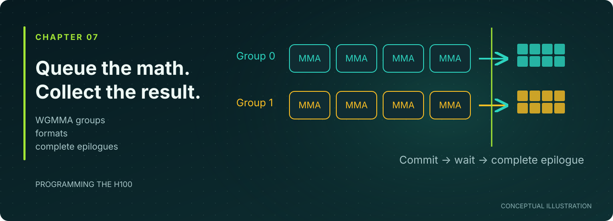
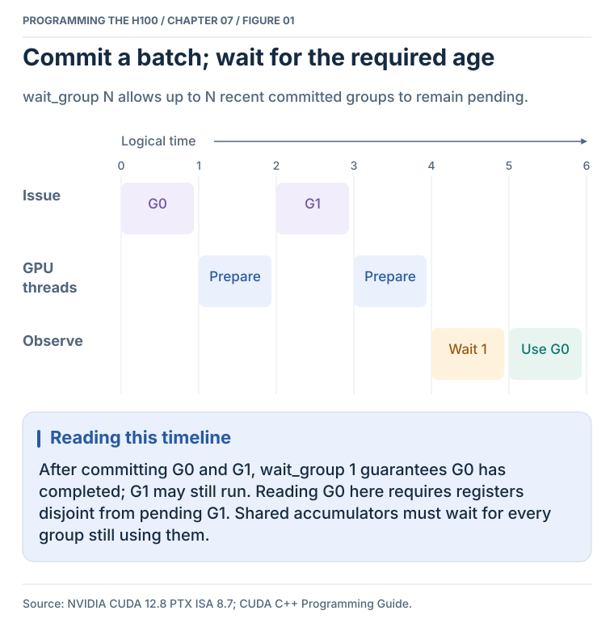
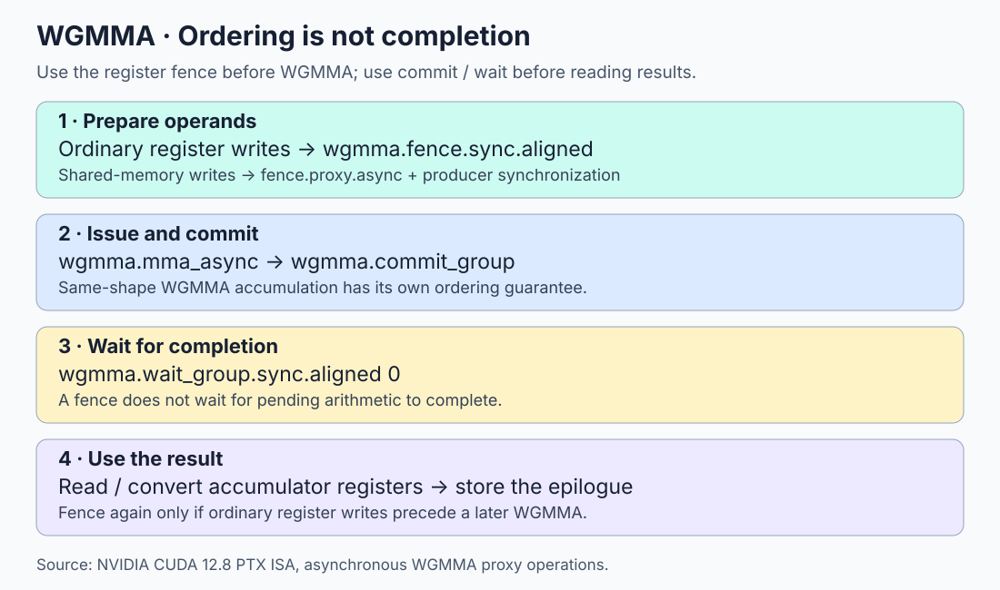
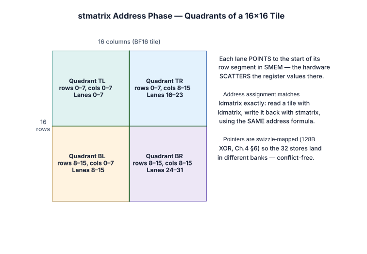
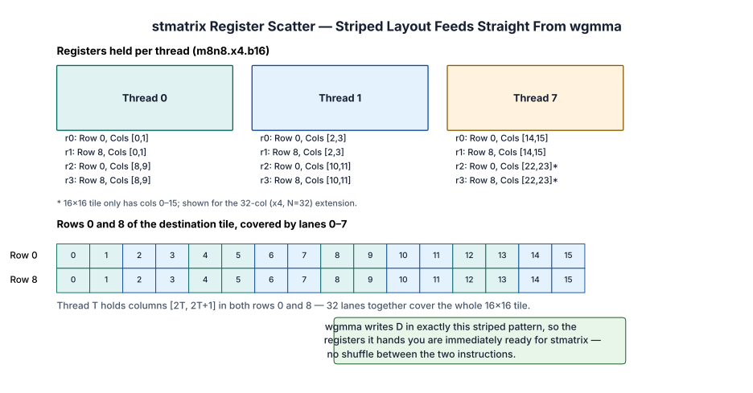
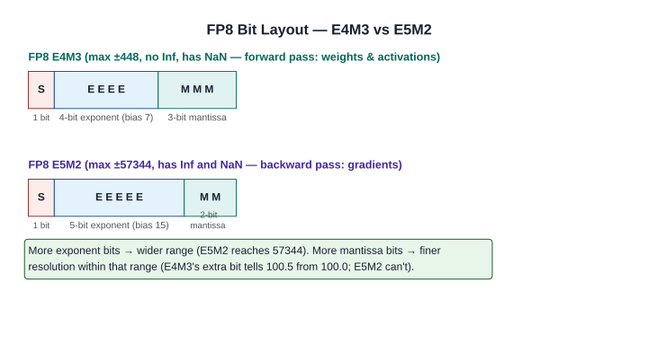
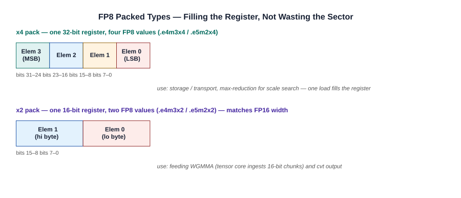
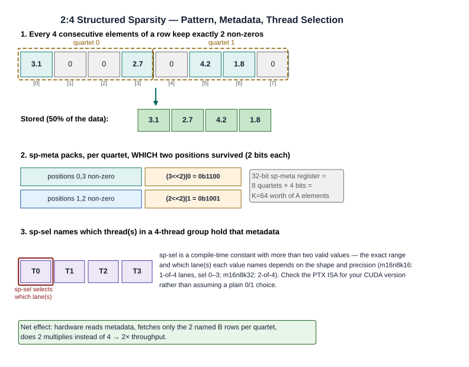

# WGMMA Part 2 — Groups, stmatrix, FP8 & Sparse

## Lesson 7 Companion Guide — Programming the H100

[](images/chapter-openers/07-groups.svg)


> **Validation — November 17, 2026.** 1 complete CUDA program compiled and executed successfully.
> **Follow-up:** the [final two-H100 audit](final-audit.md) records a fresh run of the complete programs. The original dated transcripts below remain available for provenance.
> **Execution system:** 1× H100 PCIe, 114 SMs, 80 GB class; Ubuntu 24.04.5 LTS; driver 580.105.08; CUDA Toolkit 12.8.93; `sm_90a`, C++17, `-O2`.
> [Full system information](validation/2026-11-17/system-information.txt) · [CUDA result manifest](validation/2026-11-17/results.json). Each tested source and captured output is linked beside its example. Diagrams open as original SVGs for zooming.


> **Baseline compiler flags — use each example’s full command below:** `nvcc -std=c++17 -arch=sm_90a -O2 <file>.cu -o <out>`
> **Run with:** `./<out>` on a Hopper H100/H200 instance.


<!-- learning:start -->
!!! tip "Your goal in this chapter"

    Drain the correct WGMMA groups, choose a supported accumulator type, and prove that the epilogue stores every output element.

    Use the [Chapter 6](06-wgmma-part-1.md) accumulator layout first. The pipeline program here tests both complete output tiles.
<!-- learning:end -->

**What this covers:** Everything from Lesson 7 — commit/wait group mechanics for overlapping wgmma with data preparation (the pipeline-friendly API), wgmma.fence register ordering and its distinction from commit/wait completion, stmatrix for cooperative accumulator writeback (address phase, register layout, x1/x2/x4 variants, FP32 vs FP16 accumulator paths), the FP8 paradigm shift (E4M3 vs E5M2 formats, scaling factors, packed types e4m3x2/x4, the cvt.satfinite quantization instruction, K-major layout requirement, precision pitfalls with large K), and Sparse WGMMA (2:4 structured sparsity, sp-meta register, sp-sel thread selector, metadata packing for FP16/BF16/FP8/TF32). Every section includes ASCII diagrams, manual worked examples with concrete numbers, and compileable code with full test harnesses.

**How to read this chapter.** Chapter 6 got a single `wgmma` instruction to
issue correctly. This one is about everything that turns that instruction into a
fast kernel — and about the two ways Hopper lets you go faster still.

There are four independent parts, and they can be read in any order. Sections
1–5 are about **pipelining**: commit and wait groups, and what actually overlaps
with what. Sections 6–8 are about the **epilogue** — getting results out of the
accumulator registers and back into shared memory with `stmatrix`. Sections 9–14
are about **FP8**, which is less a data type than a small numerical discipline
you have to adopt. Sections 15–17 are about **structured sparsity**.

If you are here to make an existing wgmma kernel faster, read §1–§5. If you are
here because your epilogue is transposing your matrix, read §6–§8. If you are
here for FP8, start at §9 and read straight through to §14 — especially §14,
which documents a hardware behaviour that is not in the official numbers.

---

## ★ BEFORE YOU START — Hardware, Setup & Installation

Same WGMMA target as Chapter 6: Hopper, compiled for `sm_90a`. Ampere already
supports structured sparse MMA, and Ada supports FP8 MMA; these are different
instruction paths, not fallbacks for the WGMMA listings. Skip ahead if you
already have a machine set up.

### What Hardware Can You Use?

The WGMMA examples target **Hopper `sm_90a`**. Compile with the architecture-specific `a` target. Plain `sm_90` does not enable WGMMA; assembly fails rather than silently removing the instruction.

```
Architecture   Example GPUs   WGMMA examples in this chapter
Ampere         A100           Unsupported; use a separate mma.sync implementation
Hopper         H100/H200      sm_90a; H100 PCIe tested on November 17, 2026
Blackwell      B100/B200      Unsupported; requires a tcgen05 implementation
```

`stmatrix.b16` and other individual instructions have their own target rules. Their availability on a later GPU does not make a whole WGMMA kernel portable.

### Cloud GPU Rental — Lambda Labs

Choose an instance whose actual GPU model and count meet the chapter's requirements. Use the provider's current Linux GPU image, connect using its supplied SSH key and address, then inspect the environment:

```bash
nvidia-smi
nvcc --version
```

Follow [Getting Started: driver, CUDA and libraries](getting-started.md#3-check-the-driver-and-toolkit-separately). Keep a working provider driver; install only missing components. Select the toolkit explicitly rather than assuming a particular Conda environment exists. For the first launch, use the guide's [complete verified program](getting-started.md#5-compile-and-execute-your-first-verified-program).

### Cloud GPU Rental — AWS

Choose a Linux EC2 instance explicitly listing Hopper GPUs for the Hopper-specific examples; confirm its current hardware specification and GPU count. On a Deep Learning AMI, inspect the image's documented CUDA installations and select a matching toolkit. A PyTorch environment name is image-specific, and activating Python packages alone does not install the C++ compiler/toolkit.

Connect with the SSH command/key for that image, run `nvidia-smi` and `nvcc --version`, then follow the same [installation checklist](getting-started.md#3-check-the-driver-and-toolkit-separately). See [AWS's CUDA environment guidance](https://docs.aws.amazon.com/dlami/latest/devguide/tutorial-base.html). A100 is not a substitute for Hopper TMA/WGMMA examples, and changing only `-arch` does not port those kernels.

### Hopper vs Blackwell — What Changes

Blackwell does **not** execute Hopper WGMMA kernels unchanged. It uses the `tcgen05` Tensor Core programming model, including tensor memory, with different instructions and synchronization. Changing `-arch=sm_90a` to `-arch=sm_100a` is insufficient. NVIDIA's [Blackwell CUTLASS example](https://github.com/NVIDIA/cutlass/blob/main/examples/70_blackwell_gemm/70_blackwell_fp16_gemm.cu) explicitly documents this incompatibility. Architecture-specific Hopper PTX is also not forward compatible with Blackwell; see the [Blackwell compatibility guide](https://docs.nvidia.com/cuda/blackwell-compatibility-guide/index.html).


---

## Table of Contents

1. [WGMMA Groups — Why Grouping Exists](#1-wgmma-groups)
2. [wgmma.commit_group — Closing a Batch](#2-wgmmacommit_group)
3. [wgmma.wait_group — The Synchronization Point](#3-wgmmawait_group)
4. [The Commit/Wait Pipeline — What Actually Overlaps](#4-the-commitwait-pipeline-what-actually-overlaps)
5. [wgmma.fence — Dual Role Review](#5-wgmmafence-dual-role-review)
6. [stmatrix — Writing Accumulators Back to SMEM](#6-stmatrix-writing-accumulators-back-to-smem)
7. [stmatrix — Address and Register Phases](#7-stmatrix-address-and-register-phases)
8. [stmatrix and FP32 Accumulators — The Conversion Requirement](#8-stmatrix-and-fp32-accumulators-the-conversion-requirement)
9. [FP8 — The Paradigm Shift](#9-fp8-the-paradigm-shift)
10. [FP8 Formats — E4M3 vs E5M2](#10-fp8-formats-e4m3-vs-e5m2)
11. [FP8 Packed Types — e4m3x2/x4 and e5m2x2/x4](#11--fp8-packed-types)
12. [FP8 Quantization — cvt.satfinite](#12-fp8-quantization-cvtsatfinite)
13. [FP8 WGMMA — Instruction and Layout Rules](#13-fp8-wgmma-instruction-and-layout-rules)
14. [FP8 Precision Pitfalls — K-Slicing](#14-fp8-precision-pitfalls-k-slicing)
15. [Sparse WGMMA — 2:4 Structured Sparsity](#15-sparse-wgmma-24-structured-sparsity)
16. [sp-meta — The Metadata Register](#16-sp-meta-the-metadata-register)
17. [sp-sel — The Thread Selector](#17-sp-sel-the-thread-selector)
18. [Putting It All Together — Full Examples](#18-putting-it-all-together)
19. [Quick Reference](#19-quick-reference)

---

## 1 — WGMMA Groups

Chapter 6 §5 made the essential point: `wgmma.mma_async` returns immediately and
leaves the tensor cores working in the background. This section asks the obvious
follow-up — how do you find out when they're done?

The answer is not "wait for instruction number seven." The hardware does not
track individual wgmma instructions; it tracks *batches* of them. You draw a
line under a set of instructions, and then you wait on the batch.

That indirection is what makes deep pipelining possible, and it is what §2 and
§3 are about.

### 1.1 Why Grouping Exists — The Tracking Problem

`wgmma.mma_async` launches tensor core operations asynchronously — each call puts a matrix multiply "in flight" and returns immediately. This is great for latency hiding, but it creates a bookkeeping challenge: how do you know when a specific set of wgmma operations is done?

If the hardware had to track each individual wgmma separately, the scoreboard overhead would be enormous. And if you had to wait for every single wgmma individually, you would lose all the overlap benefit. The solution is **grouping**: batch several wgmma calls into a named group, then wait for entire groups rather than individual operations.

This is the same design philosophy as `cp.async.bulk.commit_group` / `cp.async.bulk.wait_group` from Lesson 5 — but for math instead of memory operations.

```
The Tracking Problem — Why Individual Wait Would Be Slow
══════════════════════════════════════════════════════════════════════

  Scenario: Accumulating eight K-slices into a 64×256 output tile
            uses eight m64n256k16 instructions (one per K-slice).

  WITHOUT grouping (hypothetical "wait for each"):
  ─────────────────────────────────────────────────────────────────
  wgmma call 0  → WAIT → wgmma call 1  → WAIT → wgmma call 2 → ...
  All sequential. No overlap. Tensor core idle between waits.
  Time = 8 × (wgmma latency + wait overhead). Slow.

  WITH grouping (commit + wait N):
  ─────────────────────────────────────────────────────────────────
  wgmma call 0 }
  wgmma call 1 }  → commit_group → Group 0
  wgmma call 2 }
  ...
  wgmma call 7 }

  While Group 0 is computing, prepare data for Group 1:
    → TMA load next tiles
    → Update pointers, compute indices
    → Stage next SMEM buffer
  Group 0 finishes in background.

  wgmma call 8  }
  wgmma call 9  }  → commit_group → Group 1
  ...
  wgmma call 15 }

  wait_group<1>: wait until Group 0 done (Group 1 still running in background)
  Read Group 0 accumulators, write back.
  wait_group<0>: wait for Group 1.
  Read Group 1 accumulators.

  Total time = max(compute + overhead) vs sequential sum. Much faster.

  ─── The Pipeline-Friendly Granularity ───────────────────────────

  Groups give you exactly the right level of control:
  ├── Too fine-grained (individual wgmma):  too much overhead to track
  ├── Too coarse-grained (wait for all):    no overlap possible
  └── Groups (batches of wgmma):           overlap preparation of N+1 with
                                            computation of N. Goldilocks.
```

---

## 2 — wgmma.commit_group

The instruction that draws the line. Everything issued since the last
`commit_group` becomes one countable batch.

It does not wait, it does not synchronise, and it costs essentially nothing — it
is pure bookkeeping. The mental model that helps: you are pushing a marker onto
a queue.

### 2.1 What commit_group Does

`wgmma.commit_group.sync.aligned` closes the currently open batch of wgmma operations and makes them trackable as a single named unit (a "group"). Any `wgmma.mma_async` calls issued AFTER this point belong to the NEXT group.

```
wgmma.commit_group — Mechanics
══════════════════════════════════════════════════════════════════════

  PTX:  wgmma.commit_group.sync.aligned;

  What it does:
  ├── Takes all uncommitted wgmma.mma_async calls since the last commit_group
  ├── Seals them as "Group N" (where N is an implicit counter)
  ├── Registers Group N with the hardware's scoreboard
  ├── Future wgmma.mma_async calls go into Group N+1 (automatically)
  └── Returns immediately — does NOT wait for Group N to complete

  What it does NOT do:
  ├── Does NOT stall threads
  ├── Does NOT wait for any math to complete
  └── Does NOT flush or synchronize SMEM

  ─── Group Numbering ─────────────────────────────────────────────

  Groups are tracked implicitly (no explicit ID you choose).
  The hardware maintains an internal counter of committed-but-pending groups.
  wait_group<N> says "wait until the counter is ≤ N" not "wait for group #N".

  ─── When to Commit ──────────────────────────────────────────────

  Commit after you have issued all the wgmma calls for ONE logical tile
  of output. Typical pattern:

  // All wgmma calls for output tile at (block_m, block_n):
  wgmma.mma_async ... // K tile 0
  wgmma.mma_async ... // K tile 1
  wgmma.mma_async ... // K tile 2
  wgmma.mma_async ... // K tile 3  (all K tiles for this output tile)
  wgmma.commit_group.sync.aligned;  // ← seal this output tile as one group

  Now prepare the NEXT output tile's data while this group runs:
    - TMA load for next A and B tiles
    - Update smem buffer pointers
    - Advance loop counters

  ─── Multiple Groups In-Flight ───────────────────────────────────

  Multiple committed groups may be outstanding. That lets ordinary
  instructions and memory movement overlap asynchronous MMA progress;
  it does not promise concurrent execution of multiple tensor-core
  instructions from this warpgroup. Independent output tiles require
  distinct accumulator fragments. Reusing a shared-memory operand slot
  also requires waiting for every WGMMA group still reading that slot.
```

---

## 3 — wgmma.wait_group

The other half, and the one with the counter-intuitive argument.

`wgmma.wait_group<N>` waits until at most **N** groups remain outstanding — not
until N groups have completed. So `wait_group<0>` means "wait for everything",
and `wait_group<1>` means "let one batch stay in flight."

That second form is the whole point. Keeping one group running while you prepare
the next is how you stop the tensor cores from ever going idle, and picking N is
the main tuning knob in a wgmma kernel.

### 3.1 What wait_group Does

`wgmma.wait_group.sync.aligned N` is the synchronization point. It stalls the thread until the number of still-pending committed groups drops to N or fewer. This gives precise control over how many groups can be "in flight" at once.

```
wgmma.wait_group — The Synchronization Point
══════════════════════════════════════════════════════════════════════

  PTX:  wgmma.wait_group.sync.aligned N;

  Semantics: "Stall this thread until there are at most N committed
             wgmma groups still pending (not yet complete)."

  ─── Key Values of N ─────────────────────────────────────────────

  N = 0 → Wait for EVERYTHING to finish.
    All committed groups must be complete before proceeding.
    Use when: you are about to read the final result from D registers
              and write it to global memory (epilogue).
    This is the "drain" point — ensures all math is done.

  N = 1 → Wait until only 1 group is still pending.
    The most recent group may still be running.
    All OLDER groups are guaranteed complete.
    Use when: you want to pipeline — let the newest group keep computing
              while you read and store the result of the completed older groups.

  N = K (valid immediate 0–7) → Allow at most K groups to remain pending.
    Useful for deep pipelining where you overlap multiple in-flight groups.
    Requires careful management to avoid overwriting active accumulator registers.

  ─── Manual Worked Example: N=1 for Pipelining ───────────────────

  State before wait: Groups 0, 1, 2 all committed and pending.
    wgmma.wait_group.sync.aligned 1;

  After wait: At most 1 group remains pending.
    If any remains pending, it is the MOST RECENTLY committed group (Group 2).
    Groups 0 and 1 are DONE.

  Assuming Groups 0/1 use registers disjoint from pending Group 2:
  What you can now safely do:
    ├── Read D registers for Group 0's output — they are final ✓
    ├── Stage Group 0 fragments via stmatrix, then store to global memory ✓
    └── Keep Group 2 running in the background ✓ (it's the 1 permitted)

  What you CANNOT do:
    └── Read registers still used by pending Group 2, even if an older
        group also wrote them. Wait for every group using those registers.

  ─── wait_group Implicit Fence ───────────────────────────────────

  Like cp.async.bulk.wait_group, wgmma.wait_group includes an implicit
  ordering fence. After it returns, all accumulator writes from the
  completed groups are visible to the reading threads.
  No separate wgmma.fence is needed after wait_group for register reads
  — wait_group itself acts as the final ordering point.

  (Fence again when ordinary instructions prepare or update registers
   for a subsequent WGMMA sequence; a commit boundary alone is not the trigger.)
```

---

## 4 — The Commit/Wait Pipeline — What Actually Overlaps

It is easy to write a commit/wait pipeline that looks right and overlaps
nothing. This section is about telling the two apart.

The question to keep asking is: between issuing the math and waiting for it,
what work is there that does not touch the accumulator registers? Loading the
next tile qualifies. Computing the next set of descriptors qualifies. Reading
`D` does not — that is exactly what you are waiting for.

The timeline diagrams here are worth the time; they show where the cycles
actually go.

### 4.1 The Complete Overlap Pattern

The real power of groups becomes clear when you see the full pipeline. The key insight is that you are not just "commit then wait" — you are interleaving math, data preparation, and synchronization to reduce avoidable idle time. Benefit depends on the workload.

[](images/ch07/01-commit-wait-pipeline-timeline.svg)

*wait_group N allows up to N recent committed groups to remain pending.*

```
The Pipelined wgmma Pattern — Complete Timeline
══════════════════════════════════════════════════════════════════════

  Notation: [W] = wgmma.mma_async call, [C] = commit_group, [P] = wait

  Naive (no pipelining):
  ─────────────────────────────────────────────────────────────────
  [W][W][W][W] [C] [wait 0] [store] [W][W][W][W] [C] [wait 0] [store] ...
       K-loop            epilogue         K-loop         epilogue
  Tensor cores: ████░░░░████░░░░  (idle during wait and store)

  Pipelined (overlap math with store):
  ─────────────────────────────────────────────────────────────────
  Outer loop over output tiles (tile_m, tile_n):

  // Issue ALL wgmma for tile (m, n):
  for each K tile:
      wgmma.mma_async ...          // K tiles for (m,n)
  wgmma.commit_group;              // → Group G

  // Start preparing NEXT tile's data (while Group G runs):
      TMA load A, B for (m, n+1)  // async, hardware runs it
      Update pointers, addresses
      [optional] TMA load for (m, n+2) as well

  // Use a DISTINCT accumulator set and a ready, separately owned SMEM stage.
  // Wait for its load completion before issuing the next tile’s WGMMA.
  // wgmma for NEXT tile:
  for each K tile:
      wgmma.mma_async ...          // K tiles for (m, n+1)
  wgmma.commit_group;              // → Group G+1

  // DRAIN: wait for Group G (older one is done, G+1 may still run):
  wgmma.wait_group 1;             // ← wait until ≤ 1 group pending
                                   //   Group G is guaranteed done
                                   //   Group G+1 may still run

  // Epilogue for tile (m, n), assuming no pending group uses its registers:
  stmatrix → smem, then TMA store smem → global

  // Now drain Group G+1:
  wgmma.wait_group 0;
  stmatrix → smem, TMA store ...

  Tensor cores:  overlapping work is possible; this is not a measured trace.
  Epilogue work: ░░░░░░[store]░░░░[store] (overlapped with math!)

  ─── The Five-Step Rhythm ────────────────────────────────────────

  Step 1: Issue a set of wgmma for one tile (K-loop)
  Step 2: wgmma.commit_group → seal as Group G
  Step 3: Prepare next tile (TMA, pointer math — while G runs!)
  Step 4: wgmma.wait_group N → wait for older groups (keep newest running)
  Step 5: convert / stmatrix / store → epilogue for completed group
  → Repeat from Step 1 with next tile.
```

---

## 5 — wgmma.fence — Dual Role Review

`wgmma.fence` orders prior ordinary accesses to registers that WGMMA
will use as accumulator or register-A operands. Completion is a separate job
for `wgmma.commit_group` and `wgmma.wait_group`.

### 5.1 The Two Things wgmma.fence Controls

The two register classes covered by this ordering are accumulator registers
and register-A fragments. Execute the required fence before their first use
by WGMMA, including after ordinary instructions prepare or update them for a
new sequence. A fence neither commits a group nor waits for arithmetic to
finish. Consecutive compatible WGMMA operations can accumulate without a
fence between every instruction or committed group.

[](images/ch07/02-wgmma-fence-placement.svg)

```
  Prepare accumulator / register-A operands with ordinary instructions
  wgmma.fence.sync.aligned;       // register ordering before WGMMA
  wgmma.mma_async ...;
  wgmma.mma_async ...;
  wgmma.commit_group.sync.aligned;
  ... independent work ...
  wgmma.wait_group.sync.aligned 0; // complete all committed groups
  Read / convert / store d[]      // no post-wait fence required
```

For shared-memory operands written by ordinary stores, use the required
`fence.proxy.async.shared::cta` and inter-thread synchronization before
WGMMA reads them. For TMA-produced operands, observe their mbarrier completion.
These memory handoffs are separate from register ordering.

Source: [CUDA 12.8 PTX WGMMA fence, commit and wait instructions](https://docs.nvidia.com/cuda/archive/12.8.0/parallel-thread-execution/index.html#asynchronous-warpgroup-level-matrix-instructions-wgmma-fence).

---

## 6 — stmatrix — Writing Accumulators Back to SMEM

The epilogue problem, stated plainly.

When `wait_group<0>` returns, your answer exists — scattered across 128 threads'
registers in a layout the hardware chose. Getting it into shared memory as a
coherent tile with ordinary stores would mean every thread computing an
irregular address, and 128 threads colliding on 32 memory banks while they do
it.

`stmatrix` is the hardware's answer: threads hand over registers, the hardware
works out where each element belongs. It is `ldmatrix` (Chapter 6, §9) run
backwards, deliberately so.

### 6.1 Why stmatrix Exists — The Scatter Problem

After `wgmma.wait_group<0>` completes, the D matrix elements are scattered across 128 threads' registers in the hardware-defined wgmma output layout. This layout is highly non-contiguous — each thread holds elements from multiple non-adjacent rows and columns.

Writing these back to SMEM with normal `st.shared` instructions would be a nightmare: each thread would need to compute complex, non-linear addresses to place its register values in the right SMEM locations. And even then, the result might have bank conflicts.

`stmatrix` stores the inverse of its corresponding `ldmatrix` fragment mapping. A WGMMA epilogue must select and pack matching fragments and supply valid addresses. Conflict behavior depends on those addresses and the layout; the instruction does not infer or fix them.

```
stmatrix — The Scatter Operation
══════════════════════════════════════════════════════════════════════

  Problem: wgmma output in registers is NON-CONTIGUOUS.
  ─────────────────────────────────────────────────────────────────
  Thread 0 holds: D[0][0], D[0][1], D[8][0], D[8][1]  (non-adjacent rows!)
  Thread 1 holds: D[0][2], D[0][3], D[8][2], D[8][3]
  Thread 2 holds: D[0][4], D[0][5], D[8][4], D[8][5]
  ...
  Thread 31 holds: D[7][6], D[7][7], D[15][6], D[15][7]

  If Thread 0 used st.shared at addresses [row=0,col=0] and [row=0,col=1]:
    fine for those two, but [row=8,col=0] requires a completely different address.
  And the address calculation requires knowing the full wgmma layout — complex!

  stmatrix Solution:
  ─────────────────────────────────────────────────────────────────
  ├── Every thread provides a SMEM destination address (Phase 1)
  ├── Every thread provides its register values (Phase 2)
  ├── Hardware SCATTERS registers to the SMEM addresses, reordering as needed
  ├── Result in SMEM: CONTIGUOUS, row-major matrix tile ✓
  └── Hardware applies the SAME address-provision pattern as ldmatrix (decoupled)

  The data provider and address provider are DECOUPLED:
    Thread 0 provides an address, but that might not be where Thread 0's data lands.
    The hardware internally routes the right data to the right address.
    This is the exact inverse symmetry of ldmatrix.

  stmatrix instruction:
    stmatrix.sync.aligned.m8n8.x4.shared.b16 [smem_addr], {r0, r1, r2, r3};

  Qualifiers:
  ─────────────────────────────────────────────────────────────────
  .sync:    All 32 lanes must reach this instruction together.
            Hardware needs all threads' addresses and data simultaneously.
  .aligned: All threads in the warp are at the same PC (programmer assertion).
  .m8n8:    The atomic unit: one 8×8 tile of 16-bit elements.
  .x1/.x2/.x4: How many 8×8 matrices to store per call.
  .shared:  Destination is always Shared Memory (not global).
  .b16:     16-bit elements (BF16 or FP16 packed as .b32 pairs).
  .b8:      8-bit elements on supported Blackwell targets, not Hopper.
```

---

## 7 — stmatrix — Address and Register Phases

Like `ldmatrix`, `stmatrix` runs in two phases — and they are the *same* two
phases, which is the useful part.

§7.1 covers the address phase: which threads supply addresses, and what those
addresses mean. §7.2 covers the register phase: the striped layout each thread's
registers must be in.

The symmetry with `ldmatrix` is intentional and worth leaning on. If you can
read a tile in with one, you can write it out with the other using the same
address arithmetic.

### 7.1 Phase 1: Address Responsibility

The address assignment in stmatrix follows the SAME pattern as ldmatrix. This symmetry is intentional — if you read with ldmatrix and write with stmatrix using the same address formula, the corresponding ldmatrix fragments are reconstructed. WGMMA accumulators still require the correct fragment selection and packing.

[](images/ch07/03-stmatrix-address-quadrants.svg)

*This is the same four-submatrix address ordering used for a 16 × 16 x4 composition.*

```
stmatrix Address Phase — Who Points Where
══════════════════════════════════════════════════════════════════════

  For stmatrix.m8n8.x4 (four 8×8 tiles = one 16×16 tile):

  The 32 lanes are split into groups based on which QUADRANT they handle:

  ┌──────────────────┬──────────────────┐
  │   Quadrant TL    │   Quadrant TR    │  Top half (rows 0-7)
  │   (rows 0-7,     │   (rows 0-7,     │
  │    cols 0-7)     │    cols 8-15)    │
  ├──────────────────┼──────────────────┤
  │   Quadrant BL    │   Quadrant BR    │  Bottom half (rows 8-15)
  │   (rows 8-15,    │   (rows 8-15,    │
  │    cols 0-7)     │    cols 8-15)    │
  └──────────────────┴──────────────────┘

  Address assignment (matches ldmatrix exactly):
    Lanes 0-7:   point to rows 0-7 of the LEFT HALF  (TL quadrant, cols 0-7)
    Lanes 8-15:  point to rows 8-15 of the LEFT HALF (BL quadrant, cols 0-7)
    Lanes 16-23: point to rows 0-7 of the RIGHT HALF (TR quadrant, cols 8-15)
    Lanes 24-31: point to rows 8-15 of the RIGHT HALF (BR quadrant, cols 8-15)

  Each lane points to the START of its row segment in SMEM.
  The hardware writes 16 bytes (one 8×16-bit row) starting from each pointer.
  Because the pointers are swizzle-mapped (same formula as ldmatrix),
  the stores land in different banks → conflict-free.

  ─── Manual Worked Example ───────────────────────────────────────

  Storing a 16×16 BF16 tile (256 elements = 512 bytes) to SMEM:

  int warp    = threadIdx.x >> 5;         // 0..3 in warpgroup
  int lane    = threadIdx.x & 31;         // 0..31 within warp
  int w_in_wg = warp & 3;
  int m_base  = w_in_wg * 16;            // row offset for this warp (0,16,32,48)

  // Same formula as ldmatrix:
  int row_in_16 = lane & 15;             // which row in our 16-row slice
  int col_half  = lane >> 4;             // 0=left 8 cols, 1=right 8 cols
  int col_in_16 = col_half * 8;          // 0 or 8

  int global_row = m_base + row_in_16;
  int global_col = n_block + col_in_16;  // n_block = start column of N tile

  // Linear SMEM offset:
  int linear_off = global_row * SMEM_PITCH + global_col * sizeof(__nv_bfloat16);

  // Apply 128B swizzle:
  int mask = ((linear_off >> 7) & 0x7) << 4;
  uint32_t smem_ptr = (smem_base + linear_off) ^ mask;

  // Issue stmatrix:
  asm volatile(
      "stmatrix.sync.aligned.m8n8.x4.shared.b16 [%0], {%1,%2,%3,%4};\n"
      : : "r"(smem_ptr), "r"(r0), "r"(r1), "r"(r2), "r"(r3)
  );
```

### 7.2 Phase 2: Register Source Layout

The register layout for stmatrix assigns two adjacent 16-bit values from each submatrix to each lane. A WGMMA epilogue must select matching fragments and perform any required conversion and packing before storing them.

[](images/ch07/04-stmatrix-register-scatter.svg)

*For each 8 × 8, 16-bit submatrix, four lanes contribute a row’s eight values.*

```
stmatrix Register Source — The Striped Layout
══════════════════════════════════════════════════════════════════════

  For stmatrix.m8n8.x4.b16, each thread holds 4 registers (r0,r1,r2,r3).
  Each register holds 2 BF16 values packed as a .b32.

  Thread 0's register mapping (for a 16×16 BF16 tile):
  ─────────────────────────────────────────────────────────────────
  r0: Quadrant TL (rows 0-7, cols 0-7) → Row 0, Cols [0,1]
  r1: Quadrant BL (rows 8-15, cols 0-7) → Row 8, Cols [0,1]
  r2: Quadrant TR (rows 0-7, cols 8-15) → Row 0, Cols [8,9]
  r3: Quadrant BR (rows 8-15, cols 8-15) → Row 8, Cols [8,9]

  Thread 1's register mapping:
  r0 → Row 0, Cols [2,3]    (next pair in same row)
  r1 → Row 8, Cols [2,3]
  r2 → Row 0, Cols [10,11]
  r3 → Row 8, Cols [10,11]

  Pattern within each 8×8 submatrix:
    row = lane / 4; col = 2 * (lane % 4).
    Each group of four lanes covers one complete row.
    Add row offset 8 for r1/r3, column offset 8 for r2/r3.
    All 32 lanes together cover the full 16×16 x4 composition.

  Matching WGMMA output:
    Wait for completion, select the appropriate per-warp fragments,
    and convert/pack FP32 results when a 16-bit output is intended.
    Compatible FP16 accumulator fragments may already be packed correctly;
    this is a layout-specific property, not a rule for all WGMMA variants.

  Serialization for a 64×N output:
    Each thread owns N/2 result elements: N/2 scalar registers for FP32,
    or N/4 packed 32-bit registers for FP16 accumulators.
    For N divisible by 16, each warp can store its 16×N slice in
    N/16 stmatrix.x4.b16 calls, with matching fragment selection.
    Each x4 call consumes four packed registers per lane and writes four
    8×8 matrices, arranged here as 16×16 values.
    For N=128: eight calls per warp; for N=256: sixteen calls per warp.
    N can also be 8 modulo 16: use a supported smaller composition
    (for example x2 for a 16×8 remainder) or ordinary stores; N/16
    is not an integral x4-only call count for those shapes.
    Source register selection and destination addresses must agree with
    the chosen WGMMA fragment layout and shared-memory layout.

```

---

## 8 — stmatrix and FP32 Accumulators — The Conversion Requirement

And here is the catch that trips up every first epilogue.

`stmatrix` on Hopper handles 16-bit elements. The 8-bit form requires a supported Blackwell target. Neither form stores 32-bit elements. But your
accumulator is FP32, because that is what wgmma accumulates in. So the two do
not connect directly — you must convert down to BF16 or FP16 first, in
registers, before `stmatrix` will take your data.

That is usually fine, since you probably wanted to store BF16 anyway. But it has
to be a deliberate step in your epilogue, and the section covers what the
conversion costs and where to put it.

### 8.1 The FP32 Problem — stmatrix Only Supports 16-bit

`stmatrix` supports `.b16` on Hopper; `.m16n8.b8` requires a supported Blackwell target. There is no `.b32` variant. This creates a critical divergence in the epilogue path depending on whether your wgmma used FP32 or FP16 accumulators.

```
stmatrix and FP32 — The Conversion Requirement
══════════════════════════════════════════════════════════════════════

  CASE A: FP16 Accumulator (.f16 output from wgmma)
  ─────────────────────────────────────────────────────────────────
  wgmma output: packed .f16x2 values already in .b32 registers.
  Each register: [FP16_element_N+1 | FP16_element_N] packed 32-bit.
  stmatrix expects .b16 → treats the .b32 as two 16-bit chunks.

  PIPELINE:
    wgmma → d[] contains FP16x2 in .b32 registers
    stmatrix.m8n8.x4.b16 [smem], {r0,r1,r2,r3}  ← feeds directly!
    No conversion needed. Clean and fast.

  CASE B: FP32 Accumulator (.f32 output from wgmma) — REQUIRES CONVERSION
  ─────────────────────────────────────────────────────────────────
  wgmma output: individual .f32 values in registers.
  stmatrix has NO .f32 variant — cannot feed .f32 directly!
  You must convert (downcast) from FP32 to FP16 before stmatrix.

  Step 1: Pack two adjacent FP32 values into a .f16x2 register:
    // Convert d[0] and d[1] from FP32 to FP16, pack into one register
    uint32_t packed;
    asm("cvt.rn.f16x2.f32 %0, %1, %2;" : "=r"(packed) : "f"(d[1]), "f"(d[0]));
    // packed = [FP16(d[1]) | FP16(d[0])] in one 32-bit register

  Step 2: Feed packed into stmatrix.b16:
    asm("stmatrix.sync.aligned.m8n8.x1.shared.b16 [%0], {%1};"
        : : "r"(smem_ptr), "r"(packed));

  LOSS: Converting FP32→FP16 is LOSSY. You lose FP32 mantissa bits.
  This is acceptable for many applications (final output in FP16).
  If you need FP32 in global memory: write via st.global.f32 directly
  from the d[] registers WITHOUT using stmatrix.

  ─── The FP32 → SMEM Path (without stmatrix) ─────────────────────

  Option: Bypass stmatrix entirely for FP32 output:
    // Thread-driven scatter for FP32 accumulators
    // Requires careful address computation for the non-linear layout
    uint32_t addr = compute_smem_addr_for_thread(tid, slice_idx);
    asm volatile("st.shared.f32 [%0], %1;" : : "r"(addr), "f"(d[i]));
    // One st.shared per element — expensive but correct for FP32 output.

  Alternative: Use __syncthreads + a gather step (slower but simpler):
    smem_scratch[flat_idx_for_this_thread] = d[i];  // scatter to flat temp buffer
    __syncthreads();
    // Now SMEM has all FP32 values in a known layout
    // Threads copy from smem_scratch to smem_output in order

  BF16-input Hopper WGMMA accumulates in FP32. Convert to the desired
  output type in the epilogue; there is no BF16-input/FP16-accumulator variant.
```

---

## 9 — FP8 — The Paradigm Shift

The chapter changes subject here. Sections 9 through 14 are about FP8.

The headline is simple: half the bits, twice the tensor core throughput, half
the memory traffic. The reason it is a "paradigm shift" rather than just another
dtype is what comes with it. BF16 was close enough to FP32 that you could mostly
swap it in and carry on. FP8 is not: with a maximum representable value of 448,
ordinary neural network activations overflow it immediately.

So FP8 is not a type you adopt. It is a type plus a scaling discipline, and
§10–§14 build that discipline up piece by piece.

### 9.1 Why FP8 Matters

FP8 represents the same kind of paradigm shift for AI inference and training that BF16 represented in 2020. By halving the bit width of FP16 (from 16 bits to 8 bits), FP8 delivers roughly double the tensor core throughput and halves memory bandwidth requirements for the matrix multiply operations that dominate AI workloads.

```
FP8 Impact on H100 Throughput
══════════════════════════════════════════════════════════════════════

  H100 Tensor Core Throughput (Dense, no sparsity):
  ─────────────────────────────────────────────────────────────────
  FP32 (cuda cores, not tensor):    ~67 TFLOPS
  TF32  (tensor cores):            ~494 TFLOPS
  FP16/BF16 (tensor cores):        ~989 TFLOPS
  FP8 E4M3/E5M2 (tensor cores):   ~1979 TFLOPS  ← ~2× vs FP16 ★

  With 2:4 sparsity (see §15):
  FP8 + sparse:  ~3958 TFLOPS (theoretical peak)

  Where does the 2× come from?
  ─────────────────────────────────────────────────────────────────
  FP8 elements are 8 bits each (vs 16 bits for BF16).
  In the same K=16 inner dimension cycle of a BF16 wgmma:
    BF16 processes 16 elements (16 × 2 bytes = 32 bytes per row)
    FP8  processes 32 elements (32 × 1 byte  = 32 bytes per row)
  Same hardware, same time, 2× the elements processed.
  This is why FP8 wgmma has K=32 (vs K=16 for BF16).

  Real-world models using FP8:
  ─────────────────────────────────────────────────────────────────
  ├── DeepSeek V3: trained in FP8, achieved state-of-the-art results
  ├── Kimi K2: INT4 quantization-aware training (even more extreme)
  ├── Meta Llama 3.1: FP8 inference deployed at scale on H100
  └── NVIDIA NeMo: FP8 training pipeline using Transformer Engine

  Memory bandwidth benefits:
  ├── FP8 weights: 2× more parameters fit in VRAM vs FP16
  ├── FP8 activations: 2× larger batch size for same memory budget
  └── HBM bandwidth: 2× more effective for matmul-heavy layers
```

---

## 10 — FP8 Formats — E4M3 vs E5M2

There are two FP8 formats, and the split tells you something about what floating
point actually buys you.

With only eight bits to spend, you must choose between **range** and
**precision**. E4M3 spends more bits on the mantissa: finer resolution, maximum
value 448. E5M2 spends more on the exponent: coarser, but reaching to 57,344.

§10.1 reviews IEEE 754 briefly if the sign/exponent/mantissa split isn't fresh.
§10.2 explains why both formats exist — forward passes and backward passes want
different things, and the Transformer Engine switches between them accordingly.

### 10.1 IEEE 754 Floating Point Review

Before diving into FP8, it helps to review how floating point numbers are encoded. Every floating point number has three fields: sign, exponent, and mantissa. The key tradeoff in any reduced-precision format is how to split the available bits between exponent (which controls dynamic range) and mantissa (which controls precision).

```
Floating Point Format Review — Sign, Exponent, Mantissa
══════════════════════════════════════════════════════════════════════

  IEEE 754 encoding:  (-1)^S × 2^(E - bias) × (1 + M)
    S = sign bit (1 bit)
    E = biased exponent (determines scale/range)
    M = mantissa fraction (determines precision within the scale)

  Bias = 2^(exponent_bits - 1) - 1
    For 4-bit exponent: bias = 2^3 - 1 = 7
    For 5-bit exponent: bias = 2^4 - 1 = 15
    For 8-bit exponent: bias = 2^7 - 1 = 127 (FP32)

  ─── Format Comparison ───────────────────────────────────────────

  Format  Bits  Sign  Exponent  Mantissa  Max Value   Bias
  ──────────────────────────────────────────────────────────────
  FP32    32     1     8-bit    23-bit    ~3.4×10^38  127
  FP16    16     1     5-bit    10-bit    65504        15
  BF16    16     1     8-bit     7-bit    ~3.4×10^38  127
  FP8 E4M3 8     1     4-bit     3-bit    448           7
  FP8 E5M2  8     1     5-bit     2-bit    57344        15

  Key insight: More exponent bits → wider range.
               More mantissa bits → more precision within the range.
               The 8 bits of FP8 force a painful tradeoff between the two.
```

### 10.2 E4M3 vs E5M2 — Different Tools for Different Phases

The practical division: E4M3 forward, E5M2 backward. The reason is that
gradients span a far wider range than activations, and range is what E5M2 buys.

[](images/ch07/05-fp8-bit-layout-e4m3-e5m2.svg)

*The stored fraction bits affect resolution; exponent bits affect range.*

```
E4M3 vs E5M2 — Why Two Formats Exist
══════════════════════════════════════════════════════════════════════

  FP8 E4M3 (4-bit exponent, 3-bit mantissa):
  ─────────────────────────────────────────────────────────────────
  Bit layout: [S|EEEE|MMM]
  Max finite: (1 + 6/8) × 2^(15-7) = 1.75 × 256 = 448
  Min normal: 2^(1-7) = 2^(-6) = 0.015625
  Precision: 3-bit mantissa → 1 in 8 fractional resolution

  Represents NaN (but NOT Inf — unique property of E4M3).
  Range: ±448. Values > 448 would overflow.

  USE FOR: Forward pass — weights and activations.
  WHY: Activations and weights are typically bounded (post-normalization),
       so ±448 range is sufficient. The extra mantissa bit (vs E5M2) gives
       better precision for representing small differences in activations.

  ─────────────────────────────────────────────────────────────────
  FP8 E5M2 (5-bit exponent, 2-bit mantissa):
  ─────────────────────────────────────────────────────────────────
  Bit layout: [S|EEEEE|MM]
  Max value: 57344 (= 1.11 × 2^30 × 2^(-15) = ... large!)
             More precisely: max normal = (1 + 3/4) × 2^(30-15) = 1.75 × 32768 = 57344
  Min normal: 2^(1-15) ≈ 6×10^-5
  Precision: 2-bit mantissa → only 4 distinct fractional values

  Represents Inf AND NaN.
  Range: ±57344. Much wider than E4M3.

  USE FOR: Backward pass — gradients.
  WHY: Gradients can span many orders of magnitude during training
       (from very small near convergence to very large in unstable phases).
       The extra exponent bit (vs E4M3) extends the range to ±57344,
       preventing overflow. The reduced mantissa (2 bits vs 3) is
       acceptable because gradient updates can tolerate lower precision.

  ─── The Core Tradeoff ───────────────────────────────────────────

  Value: 100.5

  In E4M3 (±448 range, 3-bit mantissa):
    Nearest value: 104.0 (neighbors are 96 and 104; error ≈3.5%)

  In E5M2 (±57344 range, 2-bit mantissa):
    Nearest value: 96.0 (neighbors are 96 and 112; error ≈4.5%)

  Value: 5000.0 (a large gradient spike)

  In E4M3 (±448): OVERFLOW! Clamps to 448 or becomes NaN ✗
  In E5M2 (±57344): 5000.0 → 5120.0 (nearest; error 2.4%)
```

---

## 11 — FP8 Packed Types

Packing places several FP8 values in one register-sized word. It matters for
conversion and instruction operand formats, but it is distinct from memory
coalescing: neighboring lanes can access adjacent scalar bytes and still share
transactions. A scalar byte access does not universally waste 31 bytes.

### 11.1 Why Packing Is Useful

Use the pack required by each instruction. Hopper FP8 register-A WGMMA fragments
use `.b32` registers containing four FP8 values; conversion instructions commonly
produce two-value `.b16` packs. Descriptor-based operands instead refer to a
supported shared-memory layout. See [PTX FP8 fragments](https://docs.nvidia.com/cuda/archive/12.8.0/parallel-thread-execution/index.html#matrix-fragments-for-wgmma-mma-async-m64nnk32).

[](images/ch07/06-fp8-packed-x4-x2.svg)

*A storage pack and an instruction operand pack are not automatically the same layout.*

```
FP8 Packed Types — x2 and x4
══════════════════════════════════════════════════════════════════════

  ─── x4 Pack (Four FP8 Values in One 32-bit Register) ────────────

  Type: .e4m3x4 or .e5m2x4
  Size: 32 bits = 4 × 8 bits
  Fills: One standard GPU register exactly.

  Memory layout (little-endian, Element 0 in LSB):
  ┌─────────────────────────────────────────────────────────────┐
  │ Bits 31-24 │ Bits 23-16 │ Bits 15-8 │ Bits 7-0            │
  │ Element 3  │ Element 2  │ Element 1 │ Element 0            │
  │ (MSB)                                          (LSB) →     │
  └─────────────────────────────────────────────────────────────┘

  Use for:
  ├── Storage and transport (load/store 4 FP8 values at once)
  ├── Finding max values across a tensor (for scaling factor computation)
  ├── Any element-wise operation on FP8 data
  └── It is the PRIMARY format when moving FP8 data around.

  ─── x2 Pack (Two FP8 Values in One 16-bit Register) ─────────────

  Type: .e4m3x2 or .e5m2x2
  Size: 16 bits = 2 × 8 bits (same size as FP16)
  Matches: FP16 register size — H100 is designed to transition from FP16 to FP8.

  Memory layout:
  ┌─────────────────────┬──────────────────────┐
  │ Bits 15-8           │ Bits 7-0             │
  │ Element 1 (hi byte) │ Element 0 (lo byte)  │
  └─────────────────────┴──────────────────────┘

  Use for:
  ├── Conversion/transport when a two-value pack matches the instruction
  ├── Converting from FP16/FP32 (cvt instructions produce x2 output)
  └── The hardware has dedicated logic to convert FP16→FP8 in x2 format.

  ─── Why Two Formats? ─────────────────────────────────────────────

  x4: Matches register width → efficient for register-based operations.
      One load instruction fills a register with 4 FP8 values.
      Good for: scale factor search, max reduction, general processing.

  x2: Holds two conversion results in a .b16 operand.
      Combine/rearrange packs when a later instruction requires .b32 fragments.

  Most workflows:
    Load from SMEM/HBM: use x4 (load 32-bit registers)
    Feed register A:   use the documented four-value .b32 fragment mapping
    Convert FP16→FP8:   use x2 output (cvt produces x2 format)
```

---

## 12 — FP8 Quantization — cvt.satfinite

How data actually becomes FP8 — and it is not a cast.

§12.1 covers `cvt.satfinite`, the conversion instruction, and specifically the
`satfinite` part: values too large to represent clamp to the maximum rather than
becoming infinity. That saturation is a deliberate design choice, and it is what
makes FP8 survivable at all.

§12.2 covers scaling factors, which is the real content of this section.
Multiply your tensor by a scale before converting, divide it back out after —
so that its actual range lands inside FP8's tiny window instead of clipping.
Getting that scale right, per tensor and per step, is what the Transformer
Engine automates.

### 12.1 Converting to FP8 — The Quantization Step

Before FP8 data can be fed to WGMMA, it must be converted (quantized) from the higher-precision format (FP32 or FP16) in which it was computed. The key instruction is `cvt.rn.satfinite.e4m3x2.f16x2` (and its variants), which converts two FP16 values to two FP8 E4M3 values in a single instruction.

```
cvt.satfinite — FP8 Quantization Instruction
══════════════════════════════════════════════════════════════════════

  PTX:
    cvt.rn.satfinite.e4m3x2.f16x2  fp8_pair, fp16_pair;
    cvt.rn.satfinite.e5m2x2.f16x2  fp8_pair, fp16_pair;
    cvt.rn.satfinite.e4m3x2.f32    fp8_pair, f32_hi, f32_lo;
    cvt.rn.satfinite.e5m2x2.f32    fp8_pair, f32_hi, f32_lo;

  What it does:
  ├── .rn: Round to nearest (IEEE 754 default rounding mode)
  ├── .satfinite: Apply SATURATION — clamp to max representable value instead of Inf/NaN
  ├── Input: one 32-bit register holding two FP16 values (f16x2 format)
  │          OR: two FP32 registers (f32_lo and f32_hi)
  ├── Output: one 16-bit register holding two FP8 values (e4m3x2 or e5m2x2)
  └── The two FP8 values are packed: Element 0 in low 8 bits, Element 1 in high 8 bits.

  .satfinite semantics:
    If input value < -max_fp8: result = -max_fp8 (clamp, preserve sign)
    If input value > +max_fp8: result = +max_fp8 (clamp)
    For E4M3: max = 448, so values [-448, +448] are representable without clamping.
    Values outside this range are clamped rather than becoming Inf or NaN.

  WHY satfinite matters:
  ─────────────────────────────────────────────────────────────────
  Without satfinite:  value 500.0 → Inf or NaN → destroys training immediately.
  With satfinite:     value 500.0 → 448.0 (max FP8 E4M3) → distorted but finite.
  Use satfinite for TRAINING (stability over exactness).
  PTX conversions to FP8 x2 require .satfinite. C++ conversion APIs
  separately expose __NV_NOSAT; E4M3 has no infinity encoding.

  ─── Manual Worked Example ───────────────────────────────────────

  Input: two FP16 values [300.0h, 450.0h] packed in one f16x2 register.
  Target: FP8 E4M3 (max = 448).

  Element 0: 300.0 → within ±448 → rounds to nearest E4M3 = 288.0
  Element 1: 450.0 → EXCEEDS 448 → .satfinite CLAMPS to 448.0

  Output: [E4M3(288.0) | E4M3(448.0)] packed in 16 bits.

  In CUDA C++ (using CUDA 12+ intrinsics):
  ─────────────────────────────────────────────────────────────────
  __half2 fp16_pair = __floats2half2_rn(300.0f, 450.0f);

  // Method 1: PTX directly
  uint16_t fp8_pair;
  asm("cvt.rn.satfinite.e4m3x2.f16x2 %0, %1;"
      : "=h"(fp8_pair) : "r"(*reinterpret_cast<uint32_t*>(&fp16_pair)));

  // Method 2: CUDA intrinsic; packed conversion is supported from sm_89.
  __half2_raw raw_pair = static_cast<__half2_raw>(fp16_pair);
  __nv_fp8x2_storage_t result = __nv_cvt_halfraw2_to_fp8x2(
      raw_pair, __NV_SATFINITE, __NV_E4M3);
```

### 12.2 Scaling Factors — Why Quantization Needs Them

Raw FP8 conversion almost always produces poor results because the model's actual value range rarely fits nicely into FP8's limited range. Scaling factors bring the values into the representable range before quantization, then remove the scaling after dequantization.

```
Scaling Factors — The Core Curriculum of FP8
══════════════════════════════════════════════════════════════════════

  The problem:
  ─────────────────────────────────────────────────────────────────
  FP8 E4M3 max = 448. Your activation tensor max value = 12.5.
  Without scaling: you only use the range [0, 12.5] out of [0, 448].
  E4M3 has 85 nonnegative finite encodings at or below 12.5, out of 127.
  Floating-point spacing is logarithmic; this is not integer quantization.
  Scaling positions the range to manage overflow, subnormals and underflow;
  it does not add mantissa bits or guarantee better relative precision.

  With scaling:
    scale = 448.0 / 12.5 = 35.84
    Before quantization: multiply tensor by scale → values in [0, 448] ✓
    After dequantization: multiply by 1/scale → recover original range.

  ─── Three Scaling Granularities ─────────────────────────────────

  TENSOR-WISE SCALING (one scale per tensor):
  ─────────────────────────────────────────────────────────────────
  max_val = max(|entire tensor|)
  scale = FP8_MAX / max_val  (FP8_MAX = 448 for E4M3)
  Quantize: fp8_val = fp32_val * scale, then cvt to FP8
  Dequantize: fp32_val = fp8_val / scale

  Pros: simple, lowest overhead, one scale per layer
  Cons: rare large outliers force the scale down, reducing precision for typical values

  VECTOR-WISE SCALING (one scale per row or column):
  ─────────────────────────────────────────────────────────────────
  Each row/column gets its own scale factor.
  Better precision when different rows have different magnitudes.
  Used by some frameworks for weight quantization.

  BLOCK-WISE / MICRO-SCALING (one scale per small tile, e.g., 16×16 or 32×32):
  ─────────────────────────────────────────────────────────────────
  Generic block scaling is not automatically the standardized MXFP8 format.
  The scale type and block shape are part of the chosen numerical scheme.
  Best precision but highest overhead (store and apply many scale factors).
  Used in DeepSeek V3 and other frontier models.
  Blackwell natively supports MX formats; Hopper needs software assist.

  ─── Where Scale Factors Live ────────────────────────────────────

  Scale factors are typically stored as FP32 values in global memory.
  Before a GEMM: the tensor is quantized in a preprocessing kernel.
  After the GEMM: the result is dequantized in the epilogue.

  Transformer Engine (from NVIDIA) automates this:
  ├── Monitors statistics (max values) per tensor per step
  ├── Computes optimal scales automatically
  ├── Applies quantization/dequantization transparently
  └── No manual loss scaling needed (unlike FP16 training)
```

---

## 13 — FP8 WGMMA — Instruction and Layout Rules

FP8 imposes constraints that BF16 does not, and this is where they get stated.

§13.1 gives the instruction form — note `k32`, twice the K depth of BF16, since
each element is half the size. §13.2 covers the operand paths, and contains the
rule to remember: for FP8, the layout requirements are stricter than you are
used to. A K-major layout that was optional before becomes mandatory here.

### 13.1 The FP8 WGMMA Instruction

The instruction form. `k32` rather than `k16` — the K depth doubles because the
elements halve.

```
FP8 WGMMA — Complete Instruction Form
══════════════════════════════════════════════════════════════════════

  wgmma.mma_async.sync.aligned.m64nNk32.f32.e4m3.e4m3
      {d_regs}, a_desc_or_regs, b_desc, scale_d, imm-scale-a, imm-scale-b;

  KEY DIFFERENCES from BF16 wgmma:
  ─────────────────────────────────────────────────────────────────
  K = 32 (vs K=16 for BF16) — FP8 processes twice as many elements per call
  dtypeD = f32 or f16 (both are available — f32 is more common for stability)
  dtypeA = e4m3 or e5m2 (can MIX: e4m3 for A and e5m2 for B, or any combo!)
  dtypeB = e4m3 or e5m2

  No imm-trans-a, imm-trans-b — transpose NOT available for FP8 (see §13.3)
  scale_d: {0, 1} — overwrite or accumulate (same as BF16)
  imm-scale-a: {1, -1} — same as BF16
  imm-scale-b: {1, -1} — same as BF16

  Valid shapes:
  ─────────────────────────────────────────────────────────────────
  m64nNk32 where N ∈ {8, 16, 24, 32, 40, 48, 56, 64, 72, 80, 88, 96,
                       104, 112, 120, 128, 136, 144, 152, 160, 168, 176,
                       184, 192, 200, 208, 216, 224, 232, 240, 248, 256}
  Same 32 valid N values as BF16, but K=32 for every shape.

  Output registers per thread (FP32 accumulator):
    D_REGS = (64 × N) / 128 = N/2
    N=128: 64 registers per thread (same as BF16 m64n128k16)
    N=256: 128 registers (heavy register pressure)
```

### 13.2 A Operand: Registers (RS) vs Descriptor (SS) for FP8

The two paths for getting `A` in, and the layout each one demands. This is
stricter than the BF16 case in Chapter 6 §7.

```
FP8 A Loading — SS vs RS Path (Hopper AND Blackwell)
══════════════════════════════════════════════════════════════════════

  On Hopper, ldmatrix.b16 moves bytes and can load a K-major packed
  8-bit A fragment in its non-transposed form. It does not convert FP8.
  There is no corresponding Hopper 8-bit transpose instruction.
  Blackwell adds its own b8 forms; its instruction contracts differ.

  This means you have two options for loading FP8 A tiles into registers:

  ─── Option 1: Descriptor-based (SS path) — A from SMEM ──────────

  Use a wgmma descriptor for A (same as B):
    wgmma.mma_async ... {d_regs}, a_desc, b_desc, ...
  Both A and B are read directly from SMEM via descriptors.
  No register loading of A required.

  Pros: Simple, no ldmatrix complication, avoids register-fragment staging.
  Cons: Doubles SMEM bandwidth pressure (both A and B streaming from SMEM).
  Use when: A is NOT reused, or register pressure is already high.

  ─── Option 2: Register-based (RS path) — A in registers ──────────

  Load a K-major packed fragment with non-transposed ldmatrix.b16,
  or explicitly assemble it with ld.shared.b32 as illustrated here:
    uint32_t a_reg[4];   // 4 × 32-bit registers = 16 bytes = 16 FP8 E4M3 values
    uint32_t smem_addr = compute_fp8_a_address(tid, k_block, m_block);
    asm("ld.shared.b32 %0, [%1];" : "=r"(a_reg[0]) : "r"(smem_addr));
    // Load more registers...

  IMPORTANT: The registers must be arranged in the EXACT layout that
  FP8 wgmma expects. This is NOT the same as loading one 32-bit chunk per thread.
  The FP8 RS register layout is tightly coupled to the K=32 structure:
    Each 32-bit register holds 4 FP8 values (x4 packing).
    The positions of these values correspond to specific K-dimension offsets.

  Pros: A data stays in registers for reuse (saves SMEM re-reads for N-loop).
  Cons: Complex manual address computation, must match FP8 RS layout exactly.

  In practice:
  Most H100 FP8 GEMM implementations use the SS (descriptor) path for simplicity.
  The RS path is used when A is heavily reused (the K-loop is the outer loop in
  some split-K implementations).

  ─── K-Major Layout Requirement ──────────────────────────────────

  Unlike BF16 wgmma (which supports imm-trans to handle MN-major layout),
  FP8 wgmma has NO transpose option.

  RULE: FP8 tiles in SMEM MUST be in K-major layout.
  ─────────────────────────────────────────────────────────────────
  K-major for A[M][K]: elements along K are contiguous in memory.
    Row 0: A[0][0], A[0][1], ..., A[0][K-1]  (K elements, contiguous)
    Row 1: A[1][0], A[1][1], ..., A[1][K-1]
    This is standard row-major for the A tile.

  K-major for B[K][N]: elements along N are NOT contiguous — K is.
    Col 0: B[0][0], B[1][0], ..., B[K-1][0]  (K elements, contiguous)
    This is COLUMN-major for B (or equivalently, row-major for B^T).

  If your data is in MN-major layout, you MUST transpose it before
  staging it in SMEM for FP8 wgmma. There is no hardware shortcut.
  Transposing during SMEM staging adds overhead, which is why
  staging FP8 data in K-major is the strongly recommended approach.
```

---

## 14 — FP8 Precision Pitfalls — K-Slicing

An FP32 destination register does not by itself specify a scalar-FMA rounding
sequence. Accumulation precision depends on the instruction contract and the
implementation. Long reductions also compound input quantization and rounding.
Measure numerical error against a higher-precision reference over representative
shapes and value ranges, including cancellation and outliers.

Two-level accumulation periodically drains a Tensor Core partial sum and adds it
into a separate FP32 total with ordinary arithmetic. This can improve accuracy,
at a cost in registers, instructions and synchronization.

### 14.1 The "FP22" Accumulation Issue

Published implementations report reduced internal precision in particular FP8
matrix paths. [SageAttention2](https://arxiv.org/abs/2411.10958) calls its observed
behavior “FP22”; the [DeepSeek-V3 report, §3.3.2](https://arxiv.org/html/2412.19437v1#S3.SS3.SSS2)
reports about 14 retained bits on its H800 path and periodic promotion after
128 reduction elements. These are empirical findings from those implementations,
not a portable 22-bit-mantissa guarantee. FP32 itself has 24 significant binary
digits including the implicit leading bit, rather than 32 mantissa bits.

```
Two-level accumulation — conceptual protocol
══════════════════════════════════════════════════════════════════════
  total_fp32 = 0
  for each K slice:
      issue WGMMA into a separate/reset partial accumulator
      commit and wait for every group using that partial
      total_fp32 += partial       // ordinary FP32 arithmetic
      prepare/reset partial and fence before its next WGMMA use

  Apply each slice's dequantization scale at the correct point if its
  A/B scale product differs across K. A single final scale is insufficient
  when different slices were quantized with different scales.
```

Choose slice depth by an accuracy/performance sweep. Neither K≤512 nor any
fixed slice size guarantees acceptable error for every input. FP32 reduction
avoids introducing a BF16 rounding step between partials; the improvement still
depends on data, cancellation, quantization and the selected instruction path.

---

## 15 — Sparse WGMMA — 2:4 Structured Sparsity

The last subject, and the second way to double throughput.

The bargain is this: if you can arrange for exactly two of every four
consecutive elements in `A` to be zero, the hardware will store only the
non-zeros and run the multiply at twice the rate. Half the data read, half the
work done, same answer.

The catch is bookkeeping. The tensor core needs to know *which* two of each four
survived, and that information has to be encoded and handed over alongside the
values — which is what §16 and §17 are for.

### 15.1 What Sparse WGMMA Is

Sparse WGMMA is a variant where matrix A is **structured sparse**: for every group of 4 consecutive elements in each row, at most 2 are nonzero; two retained values and their positions are encoded. This "2:4 sparsity" pattern lets the hardware skip the zero multiplications and effectively double the throughput — the tensor core only needs to do half the work.

The catch: the hardware needs to know WHICH 2 of the 4 elements are non-zero. This information is encoded in a "metadata" register (sp-meta) that accompanies the sparse A matrix.

[](images/ch07/07-sparse-wgmma-2-4-metadata.svg)

*2:4 structured sparsity stores values plus position metadata.*

```
2:4 Structured Sparsity — The Pattern and Its Benefits
══════════════════════════════════════════════════════════════════════

  The 2:4 rule: in every consecutive 4 elements of a row, at most 2 are nonzero.
  ─────────────────────────────────────────────────────────────────

  Example row of A (K=8, stored as 2 quartets):
  Position:  [0] [1] [2] [3]  [4] [5] [6] [7]
  Values:    [3.1] [0] [0] [2.7]  [0] [4.2] [1.8] [0]
              ↑ non-zero  ↑ non-zero  ↑ non-zero  ↑ non-zero
  Pattern:   [1,0,0,1]              [0,1,1,0]
             (indices 0,3 non-zero) (indices 1,2 non-zero)

  What gets STORED:
    Values: [3.1, 2.7]  [4.2, 1.8]  ← only the 2 non-zeros per quartet
    50% of the storage! (K elements stored, but only K/2 values)

  What the hardware does:
  ─────────────────────────────────────────────────────────────────
  Without sparsity: B column is multiplied by ALL 4 A values, 2 of which are 0.
    → 4 multiplications per quartet, 2 are wasted (multiply by 0).

  With sparsity metadata:
    Hardware reads metadata → knows positions 0 and 3 are non-zero.
    Selects B[0] and B[3] from the B column.
    Only computes: 3.1 × B[0] + 2.7 × B[3].
    2 multiplications instead of 4 → 2× throughput!

  ─── Throughput Numbers ───────────────────────────────────────────

  Dense FP8 wgmma:   ~1979 TFLOPS (H100)
  Sparse FP8 wgmma:  ~3958 TFLOPS (H100) — 2× via structured sparsity!

  But: achieving this requires the model to actually have 2:4 sparsity in A.
  This requires Sparsity-Aware Training (SAT) or post-training pruning.
  Randomly zeroing 50% of elements does NOT create 2:4 structured sparsity.

  ─── Sparse WGMMA Instruction Syntax ────────────────────────────

  wgmma.mma_async.sp.sync.aligned.m64nNkK.dtype.atype.btype
      {d_regs}, a_desc_or_regs, b_desc, sp_meta, sp_sel,
      scale_d, imm-scale-a, imm-scale-b;

  New operands vs dense wgmma:
    .sp:     The sparse qualifier (distinguishes from dense wgmma)
    sp_meta: A 32-bit register containing packed sparsity metadata
    sp_sel:  A compile-time constant (0 or 1) selecting which threads provide metadata
```

---

## 16 — sp-meta — The Metadata Register

Where the "which two" information lives.

`sp-meta` records retained positions in the instruction’s prescribed fragment
layout. For 2:4 inputs, two 2-bit indices form a 4-bit field per quartet;
two bits total would not encode all six possible pairs.

The encoding is fiddly and differs by data type. Work through the worked example
rather than trusting your reading of the table.

### 16.1 What sp-meta Encodes

For FP16/BF16/FP8/INT8 2:4 sparsity, each quartet uses two 2-bit
position indices packed into one 4-bit metadata field. Positions 0 and 3
encode as `(3 << 2) | 0 = 0b1100`; positions 1 and 2 encode as
`0b1001`. A `.b32` metadata register holds eight such fields. Which
matrix coordinates those fields describe depends on the instruction's
fragment layout and the contributing lane.

TF32 uses 1:2 sparsity. Each retained element uses a **4-bit** position
field: `0b0100` or `0b1110`, with eight fields packed into a `.b32`
metadata register. These are per-pair position encodings, not alternating
whole-register constants for successive K iterations.

There is no automatic metadata cursor across WGMMA calls. Supply the
metadata corresponding to each call's A tile. Advancing K requires updating
the operands and metadata according to the documented matrix layout; the
ISA does not require a four-call or two-call unroll to cycle metadata.

Source: [CUDA 12.8 PTX sparse WGMMA layouts and metadata](https://docs.nvidia.com/cuda/archive/12.8.0/parallel-thread-execution/index.html#asynchronous-multiply-and-accumulate-instruction-wgmma-mma-async-sp).

---

## 17 — sp-sel — The Thread Selector

### 17.1 What sp-sel Does

`sp-sel` is an immediate selecting which lanes contribute metadata within
each consecutive group of four threads. It does not select a nibble or
advance through the metadata register. For Hopper sparse WGMMA, the CUDA
12.8 PTX rules are:

| Input precision | K per instruction | Valid sp-sel | Contributing lanes in each group of four |
| --- | --- | --- | --- |
| FP16 / BF16 | 32 | 0 or 1 | 0 selects T0/T1; 1 selects T2/T3 |
| TF32 | 16 | 0 or 1 | 0 selects T0/T1; 1 selects T2/T3 |
| FP8 E4M3 / E5M2 | 64 | 0 only | All four lanes |
| INT8 / UINT8 | 64 | 0 only | All four lanes |

Other values produce undefined behavior. The selector rules for a related
warp-level `mma.sp` shape cannot be substituted for WGMMA's rules. Populate
each contributing lane's register with the metadata for its assigned matrix
coordinates; broadcasting a single register value is only correct when the
actual sparsity pattern makes those lane-specific fields identical.

Source: [PTX sparse WGMMA sparsity selector](https://docs.nvidia.com/cuda/archive/12.8.0/parallel-thread-execution/index.html#asynchronous-multiply-and-accumulate-instruction-wgmma-mma-async-sp).

---

## 18 — Putting It All Together

One complete kernel that uses most of the chapter at once: a pipelined `wgmma`
loop with commit/wait groups from §1–§5, and an `stmatrix` epilogue from
§6–§8.

This checked teaching kernel demonstrates two independent output-tile accumulator sets and an `stmatrix` epilogue. Chapters 8 and 9 explain how warp specialisation and persistent scheduling build on these primitives; their executable teaching references are scoped beside their listings.

### 18.1 Full Example: Pipelined wgmma with commit/wait and stmatrix Epilogue

**Manual Worked Example Before the Code:**

```
Scenario: m64n64k16, FP16→FP16 accumulator (to avoid FP32→FP16 conversion in epilogue).
  TWO output tiles computed in pipeline: tile A (first) and tile B (second).
  Goal: demonstrate commit/wait overlap and stmatrix epilogue.

  Registers per thread: (64×64)/128 = 32 FP16 values = 16 packed .b32 registers.

  Pipeline:
    Issue wgmma for tile A → commit → (prepare tile B's data) → wgmma tile B → commit
    wait_group<1>: tile A is done, tile B may still run
    stmatrix tile A's accumulators → SMEM → thread-driven global stores
    wait_group<0>: tile B is done
    stmatrix tile B → SMEM → thread-driven global stores
```

```
═══════════════════════════════════════════════════════
  FILE:    ex01_wgmma_pipeline.cu
  COMPILE: nvcc -std=c++17 -arch=sm_90a -O2 ex01_wgmma_pipeline.cu -o ex01
           (Hopper only; Blackwell needs a different kernel)
  RUN:     ./ex01
  EXPECT:  Both tiles computed correctly, stmatrix epilogue verified.
═══════════════════════════════════════════════════════
```

```cuda
// ═══════════════════════════════════════════════════════════════════
// ex01_wgmma_pipeline.cu
//
// PURPOSE: Demonstrate wgmma commit/wait groups with stmatrix epilogue.
//   Shows:
//     1. wgmma.commit_group to batch math operations
//     2. wgmma.wait_group<1> to allow overlap (1 group still running)
//     3. wgmma.wait_group<0> to drain all groups
//     4. wgmma.fence before and after wgmma sequences
//     5. stmatrix for writing FP16 accumulators back to SMEM
//     6. Verification of both tile results
//
// Uses FP16 accumulators (not FP32) to enable direct stmatrix without conversion.
// REQUIRES: Hopper sm_90a (H100/H200); not a Blackwell kernel
// ═══════════════════════════════════════════════════════════════════

#include <cstdio>
#include <cstdint>
#include <cmath>
#include <cuda_fp16.h>
#include <cuda_bf16.h>

#define CHECK_CUDA(call) do { \
    cudaError_t _e=(call); if(_e!=cudaSuccess){ \
    fprintf(stderr,"CUDA %s:%d %s\n",__FILE__,__LINE__,cudaGetErrorString(_e)); \
    exit(1);} } while(0)

static constexpr int M = 64;
static constexpr int N = 64;
static constexpr int K = 16;
// FP16 accumulator: (M×N)/128 = 32 FP16 values = 16 packed .b32 registers
static constexpr int D_REGS_F16 = (M * N) / 128 / 2;  // 16 .b32 registers

// ─────────────────────────────────────────────────────────────────
// Build WGMMA descriptor (simplified K-major FP16, 128B swizzle)
// ─────────────────────────────────────────────────────────────────
__device__ uint64_t make_desc(const void* smem_ptr,
                               uint32_t sbo_bytes, int swizzle_mode = 0) {
    uint32_t addr = __cvta_generic_to_shared(smem_ptr);
    uint64_t d = 0;
    d |= (uint64_t)((addr >> 4) & 0x3FFF);
    d |= (uint64_t)(8ULL & 0x3FFF) << 16;               // LBO=128B for no-swizzle core matrices
    d |= (uint64_t)((sbo_bytes/16) & 0x3FFF) << 32;     // SBO
    d |= (uint64_t)(0ULL) << 49;                          // base offset = 0
    d |= (uint64_t)((uint64_t)swizzle_mode) << 62;       // swizzle mode bits
    return d;
}

// ─────────────────────────────────────────────────────────────────
// KERNEL: demonstrates commit/wait pipeline + stmatrix epilogue
// Two tiles A and B are multiplied; results verified in SMEM.
// ─────────────────────────────────────────────────────────────────
__global__ void wgmma_pipeline_kernel(
    const __half* A_glob,
    const __half* B_glob,
    __half* out_A,
    __half* out_B,
    uint32_t* pass_count)
{
    // ── Shared memory (two A tiles + two B tiles for two output tiles) ──
    // Tile A's A matrix and B matrix, then Tile B's A and B matrices.
    __shared__ __align__(1024) __half smem_Aa[M][K];  // A input for tile A
    __shared__ __align__(1024) __half smem_Ba[K][N];  // B input for tile A
    __shared__ __align__(1024) __half smem_Ab[M][K];  // A input for tile B
    __shared__ __align__(1024) __half smem_Bb[K][N];  // B input for tile B
    // Output staging buffer (reused for both tiles)
    __shared__ __align__(1024) __half smem_out[M][N];

    int tid = threadIdx.x;

    // ── Load input tiles from global memory (simple thread-driven) ───
    for (int i = tid; i < M*K; i += blockDim.x) {
        int r = i/K, c = i%K;
        reinterpret_cast<__half*>(smem_Aa)[(r/8)*128+(c/8)*64+(r%8)*8+c%8] = A_glob[r*K+c];
        reinterpret_cast<__half*>(smem_Ab)[(r/8)*128+(c/8)*64+(r%8)*8+c%8] = A_glob[r*K+c];  // same A for both tiles in this demo
    }
    for (int i = tid; i < K*N; i += blockDim.x) {
        int r = i/N, c = i%N;
        reinterpret_cast<__half*>(smem_Ba)[(c/8)*128+(r/8)*64+(c%8)*8+r%8] = B_glob[r*N+c];
        reinterpret_cast<__half*>(smem_Bb)[(c/8)*128+(r/8)*64+(c%8)*8+r%8] = B_glob[r*N+c];  // same B for both tiles in this demo
    }
    asm volatile("fence.proxy.async.shared::cta;" ::: "memory");
    __syncthreads();

    // ── Build descriptors ─────────────────────────────────────────
    // SBO for K-major FP16: 8 rows × K cols × 2 bytes = 8×16×2=256 for K=16
    uint64_t desc_Aa = make_desc(&smem_Aa[0][0], 8*K*2);
    uint64_t desc_Ba = make_desc(&smem_Ba[0][0], 8*K*2);
    uint64_t desc_Ab = make_desc(&smem_Ab[0][0], 8*K*2);
    uint64_t desc_Bb = make_desc(&smem_Bb[0][0], 8*K*2);

    // ── Declare FP16 accumulator registers ───────────────────────
    // D_REGS_F16=16 .b32 registers per thread, each holds 2 FP16 values.
    uint32_t dA[D_REGS_F16], dB[D_REGS_F16];
    #pragma unroll
    for (int i = 0; i < D_REGS_F16; i++) { dA[i] = 0; dB[i] = 0; }

    // ── STEP 1: Fence before first wgmma sequence ─────────────────
    asm volatile("wgmma.fence.sync.aligned;\n" : : : "memory");

    // ── STEP 2: Issue wgmma for TILE A ───────────────────────────
    // m64n64k16, f16 acc, f16 inputs. scale_d=0 (overwrite).
    // Note: f16 accumulator → 16 .b32 output registers ("+r" constraint)
    asm volatile(
        "wgmma.mma_async.sync.aligned.m64n64k16.f16.f16.f16 "
        "{%0,%1,%2,%3,%4,%5,%6,%7,%8,%9,%10,%11,%12,%13,%14,%15},"
        " %16, %17, 0, 1, 1, 0, 0;\n"
        : "+r"(dA[0]),  "+r"(dA[1]),  "+r"(dA[2]),  "+r"(dA[3]),
          "+r"(dA[4]),  "+r"(dA[5]),  "+r"(dA[6]),  "+r"(dA[7]),
          "+r"(dA[8]),  "+r"(dA[9]),  "+r"(dA[10]), "+r"(dA[11]),
          "+r"(dA[12]), "+r"(dA[13]), "+r"(dA[14]), "+r"(dA[15])
        : "l"(desc_Aa), "l"(desc_Ba)
        : "memory"
    );

    // ── STEP 3: Commit tile A as Group 0 ─────────────────────────
    asm volatile("wgmma.commit_group.sync.aligned;\n" : : : "memory");

    // ── STEP 4: Prepare tile B (while Group 0 runs in background) ─
    // In a real kernel: TMA loads next tile, updates pointers, etc.
    // Here: the data is already loaded; we just demonstrate the pattern.
    // fence again before the next wgmma sequence:
    asm volatile("wgmma.fence.sync.aligned;\n" : : : "memory");

    // ── STEP 5: Issue wgmma for TILE B ───────────────────────────
    asm volatile(
        "wgmma.mma_async.sync.aligned.m64n64k16.f16.f16.f16 "
        "{%0,%1,%2,%3,%4,%5,%6,%7,%8,%9,%10,%11,%12,%13,%14,%15},"
        " %16, %17, 0, 1, 1, 0, 0;\n"
        : "+r"(dB[0]),  "+r"(dB[1]),  "+r"(dB[2]),  "+r"(dB[3]),
          "+r"(dB[4]),  "+r"(dB[5]),  "+r"(dB[6]),  "+r"(dB[7]),
          "+r"(dB[8]),  "+r"(dB[9]),  "+r"(dB[10]), "+r"(dB[11]),
          "+r"(dB[12]), "+r"(dB[13]), "+r"(dB[14]), "+r"(dB[15])
        : "l"(desc_Ab), "l"(desc_Bb)
        : "memory"
    );

    // ── STEP 6: Commit tile B as Group 1 ─────────────────────────
    asm volatile("wgmma.commit_group.sync.aligned;\n" : : : "memory");

    // ── STEP 7: wait_group<1> — tile A done, tile B may still run ─
    // After this: Group 0 (tile A) is guaranteed complete.
    //             Group 1 (tile B) may still be running.
    asm volatile("wgmma.wait_group.sync.aligned %0;\n" : : "n"(1) : "memory");

    // ── STEP 8: Fence + stmatrix for tile A ──────────────────────
    asm volatile("wgmma.fence.sync.aligned;\n" : : : "memory");

    int warp = tid / 32, lane = tid % 32;
    // Each x4 call writes four 8×8 matrices: two row halves × two column halves.
    for (int slice = 0; slice < 4; ++slice) {
        int row = warp * 16 + lane % 16;
        int col = slice * 16 + (lane / 16) * 8;
        uint32_t address = (uint32_t)__cvta_generic_to_shared(&smem_out[row][col]);
        asm volatile("stmatrix.sync.aligned.m8n8.x4.shared.b16 [%0], {%1,%2,%3,%4};"
            :: "r"(address), "r"(dA[slice*4]), "r"(dA[slice*4+1]),
               "r"(dA[slice*4+2]), "r"(dA[slice*4+3]) : "memory");
    }
    __syncthreads();
    // Copy first few elements to output for verification:
    for (int i = tid; i < M * N; i += blockDim.x) {
        out_A[i] = smem_out[i/N][i%N];
    }
    __syncthreads();

    // ── STEP 9: wait_group<0> — drain tile B ─────────────────────
    asm volatile("wgmma.wait_group.sync.aligned %0;\n" : : "n"(0) : "memory");
    asm volatile("wgmma.fence.sync.aligned;\n" : : : "memory");

    // Each x4 call writes four 8×8 matrices: two row halves × two column halves.
    for (int slice = 0; slice < 4; ++slice) {
        int row = warp * 16 + lane % 16;
        int col = slice * 16 + (lane / 16) * 8;
        uint32_t address = (uint32_t)__cvta_generic_to_shared(&smem_out[row][col]);
        asm volatile("stmatrix.sync.aligned.m8n8.x4.shared.b16 [%0], {%1,%2,%3,%4};"
            :: "r"(address), "r"(dB[slice*4]), "r"(dB[slice*4+1]),
               "r"(dB[slice*4+2]), "r"(dB[slice*4+3]) : "memory");
    }
    __syncthreads();
    for (int i = tid; i < M * N; i += blockDim.x) {
        out_B[i] = smem_out[i/N][i%N];
    }

    // Sanity check: all output values should be non-zero
    float sumA = 0.0f, sumB = 0.0f;
    for (int i = 0; i < D_REGS_F16; i++) {
        uint16_t lo = dA[i] & 0xFFFF;
        uint16_t hi = dA[i] >> 16;
        sumA += __half2float(*reinterpret_cast<__half*>(&lo));
        sumA += __half2float(*reinterpret_cast<__half*>(&hi));
        lo = dB[i] & 0xFFFF; hi = dB[i] >> 16;
        sumB += __half2float(*reinterpret_cast<__half*>(&lo));
        sumB += __half2float(*reinterpret_cast<__half*>(&hi));
    }
    if (sumA > 0.0f && sumB > 0.0f) atomicAdd(pass_count, 1u);
}

int main() {
    printf("╔══════════════════════════════════════════════════════════╗\n");
    printf("║  ex01: wgmma commit/wait pipeline + stmatrix epilogue    ║\n");
    printf("╚══════════════════════════════════════════════════════════╝\n\n");

    cudaDeviceProp prop; CHECK_CUDA(cudaGetDeviceProperties(&prop, 0));
    printf("GPU: %s (SM %d.%d)\n", prop.name, prop.major, prop.minor);
    if (prop.major != 9) { fprintf(stderr,"Requires Hopper SM 9.0; Blackwell needs tcgen05\n"); return 1; }

    const int A_N = M*K, B_N = K*N, D_N = M*N;
    __half *hA = new __half[A_N];
    __half *hB = new __half[B_N];
    for (int i = 0; i < A_N; i++) hA[i] = __float2half(0.01f);
    for (int i = 0; i < B_N; i++) hB[i] = __float2half(0.01f);

    __half *dA, *dB; __half *dOA, *dOB;
    uint32_t *dpass, hpass = 0;
    CHECK_CUDA(cudaMalloc(&dA,   A_N*2)); CHECK_CUDA(cudaMalloc(&dB,   B_N*2));
    CHECK_CUDA(cudaMalloc(&dOA,  D_N*2)); CHECK_CUDA(cudaMalloc(&dOB,  D_N*2));
    CHECK_CUDA(cudaMalloc(&dpass, 4));
    CHECK_CUDA(cudaMemcpy(dA, hA, A_N*2, cudaMemcpyHostToDevice));
    CHECK_CUDA(cudaMemcpy(dB, hB, B_N*2, cudaMemcpyHostToDevice));
    CHECK_CUDA(cudaMemset(dpass, 0, 4));

    printf("Shape: m64n64k16, FP16 accumulator, 2 tiles pipelined\n");
    printf("Expected: all acc values = K×0.01² = %.6f\n\n", K*0.01f*0.01f);

    wgmma_pipeline_kernel<<<1, 128>>>(dA, dB, dOA, dOB, dpass);
    CHECK_CUDA(cudaGetLastError()); CHECK_CUDA(cudaDeviceSynchronize());
    CHECK_CUDA(cudaMemcpy(&hpass, dpass, 4, cudaMemcpyDeviceToHost));

    __half *hOA = new __half[D_N];
    CHECK_CUDA(cudaMemcpy(hOA, dOA, D_N*2, cudaMemcpyDeviceToHost));
    printf("Threads with non-zero sums in BOTH tiles: %u / 128\n", hpass);
    printf("Sample out_A[0] = %.6f\n", __half2float(hOA[0]));

    __half *hOB = new __half[D_N];
    CHECK_CUDA(cudaMemcpy(hOB, dOB, D_N*2, cudaMemcpyDeviceToHost));
    float rounded = __half2float(__float2half(0.01f));
    float expected = K * rounded * rounded;
    int errors = 0;
    for (int i = 0; i < D_N; ++i) {
        if (!std::isfinite(__half2float(hOA[i])) ||
            fabsf(__half2float(hOA[i]) - expected) > 0.00002f) ++errors;
        if (!std::isfinite(__half2float(hOB[i])) ||
            fabsf(__half2float(hOB[i]) - expected) > 0.00002f) ++errors;
    }
    printf("Output verification: %d errors across both 64×64 tiles\n", errors);
    delete[] hOB;
    bool ok = hpass == 128 && errors == 0;
    printf("\n╔══════════════════════════════════════════════════════════╗\n");
    printf("║  %-56s  ║\n", ok
           ? "✓ ALL PASS — commit/wait pipeline + stmatrix working!"
           : "✗ FAILURES — check fence/commit/wait placement");
    printf("╚══════════════════════════════════════════════════════════╝\n");

    delete[] hA; delete[] hB; delete[] hOA;
    CHECK_CUDA(cudaFree(dA)); CHECK_CUDA(cudaFree(dB));
    CHECK_CUDA(cudaFree(dOA)); CHECK_CUDA(cudaFree(dOB)); CHECK_CUDA(cudaFree(dpass));
    return ok ? 0 : 1;
}
```

<!-- revalidation:start:ex01_wgmma_pipeline.cu -->
> **Additional execution — November 18, 2026: PASS.** 2× H100 80GB HBM3; NV18; CUDA 12.8.93; driver 580.105.08; `sm_90a`. Compiled UTC: `2026-11-18T11:19:34.697322+00:00`. Executed UTC: `2026-11-18T11:19:36.086020+00:00`.

Source SHA-256: `76960b5ead233cd05431fe9c4c7847f859e3270a7407461f4dbe91006c1c2790`. [Exact source](validation/2026-11-18-two-h100/07-wgmma-part-2/ex01_wgmma_pipeline/ex01_wgmma_pipeline.cu) · [Compile log](validation/2026-11-18-two-h100/07-wgmma-part-2/ex01_wgmma_pipeline/compile.log) · [Run log](validation/2026-11-18-two-h100/07-wgmma-part-2/ex01_wgmma_pipeline/run.log) · [System and rerun summary](revalidation-2026-11-18.md).

```bash
nvcc -std=c++17 -arch=sm_90a -O2 ex01_wgmma_pipeline.cu -o ./example
./example
```

**Sample output — November 18 rerun**

```text
╔══════════════════════════════════════════════════════════╗
║  ex01: wgmma commit/wait pipeline + stmatrix epilogue    ║
╚══════════════════════════════════════════════════════════╝

GPU: NVIDIA H100 80GB HBM3 (SM 9.0)
Shape: m64n64k16, FP16 accumulator, 2 tiles pipelined
Expected: all acc values = K×0.01² = 0.001600

Threads with non-zero sums in BOTH tiles: 128 / 128
Sample out_A[0] = 0.001600
Output verification: 0 errors across both 64×64 tiles

╔══════════════════════════════════════════════════════════╗
║  ✓ ALL PASS — commit/wait pipeline + stmatrix working!  ║
╚══════════════════════════════════════════════════════════╝
```
<!-- revalidation:end:ex01_wgmma_pipeline.cu -->


<!-- validation:start:ex01_wgmma_pipeline.cu -->
**Captured output — ex01_wgmma_pipeline.cu**

> **Executed:** 2026-11-17T21:38:15.857900+00:00 (UTC). **Status:** Compile PASS; execution PASS.
> **System:** 1× NVIDIA H100 PCIe, 114 SMs, 80 GB class; Ubuntu 24.04.5 LTS, NVIDIA driver 580.105.08, CUDA Toolkit 12.8.93, C++17, `sm_90a`.
> Compiler exit: `0`; process exit: `0`. Timings and print ordering are specific to this run.

Save the [tested source](validation/2026-11-17/07-wgmma-part-2/ex01_wgmma_pipeline/ex01_wgmma_pipeline.cu) as `ex01_wgmma_pipeline.cu`, then run:

```bash
nvcc -std=c++17 -arch=sm_90a -O2 ex01_wgmma_pipeline.cu -o ex01_wgmma_pipeline
./ex01_wgmma_pipeline
```

[Compiler log](validation/2026-11-17/07-wgmma-part-2/ex01_wgmma_pipeline/compile.log) · [Execution log](validation/2026-11-17/07-wgmma-part-2/ex01_wgmma_pipeline/run.log)

```text
╔══════════════════════════════════════════════════════════╗
║  ex01: wgmma commit/wait pipeline + stmatrix epilogue    ║
╚══════════════════════════════════════════════════════════╝

GPU: NVIDIA H100 PCIe (SM 9.0)
Shape: m64n64k16, FP16 accumulator, 2 tiles pipelined
Expected: all acc values = K×0.01² = 0.001600

Threads with non-zero sums in BOTH tiles: 128 / 128
Sample out_A[0] = 0.001600
Output verification: 0 errors across both 64×64 tiles

╔══════════════════════════════════════════════════════════╗
║  ✓ ALL PASS — commit/wait pipeline + stmatrix working!  ║
╚══════════════════════════════════════════════════════════╝
```
<!-- validation:end:ex01_wgmma_pipeline.cu -->


The tested listing retains conservative `wgmma.fence` calls after waits. These calls are unnecessary for reading completed results; the waits provide completion. Its source comments are preserved with the executed artifact.

`GPU:` identifies the tested SKU. This example uses **FP16 inputs and FP16 accumulators**: the PTX WGMMA BF16 input variant requires FP32 accumulators. Inputs are rounded to FP16 before the reference is computed. Both complete 64×64 output tiles are checked, including all four `stmatrix.x4` slices per warp; checking only positive register sums would miss an incomplete epilogue. The uniform input makes every expected output equal: this catches missing stores and nonfinite values, but cannot detect every transposition or permutation. Before reusing the epilogue with new layouts, add nonuniform inputs and check each logical coordinate against a reference. See the [CUDA 12.8 PTX WGMMA specification](https://docs.nvidia.com/cuda/archive/12.8.0/parallel-thread-execution/index.html#asynchronous-multiply-and-accumulate-instruction-wgmma-mma-async).

!!! note "Stronger nonuniform audit test"

    From the repository root, `python3 tools/audit_nonuniform_epilogue.py` prepares an audit variant and checks its reference pattern on the CPU. It uses 4,096 distinct, exactly representable FP16 output values to expose coordinate permutations. The device implementation is preserved; only host inputs and coordinate checks change.

    `python3 tools/audit_nonuniform_epilogue.py --run` additionally compiles and executes that variant on a suitable Hopper host, saving separate timestamped source hashes and logs under `build/audit/`. **The follow-up GPU test passed on November 17, 2026:** zero coordinate errors across both 64×64 output tiles on an H100 80GB HBM3. See the [captured source, commands and output](final-audit.md). This checks the implemented shape and layout; it does not establish correctness for arbitrary layouts.


The closing banner repeats Chapter 6's byte-vs-codepoint `%-56s` quirk, with this chapter's own numbers: `✓ ALL PASS — commit/wait pipeline + stmatrix working!` is 53 codepoints but 57 UTF-8 bytes (`✓` and `—` each cost 3 bytes for 1 displayed column, wasting 2 bytes apiece). Since 57 already exceeds the 56-byte field width, `printf` pads with nothing, and the line prints at its raw length. Measured in the columns a terminal actually draws, that puts the whole bordered line — the fixed `"║  "` and `"  ║"` margins plus 53 content columns, 59 in total — exactly 1 column short of the 60-column border above it, the same shortfall Chapter 6 hit with a differently-worded message of the same coincidental 53-codepoint length.

---

## 19 — Quick Reference

The chapter as reference cards. As in Chapter 6, the *Common Mistakes* card at
the end is worth reading even though nothing in it is new — these are the bugs
that compile cleanly.

### wgmma Group API

Commit and wait in one card. Remember that `N` is how many groups may remain
outstanding, not how many to wait for.

```
Instruction                              Purpose
──────────────────────────────────────────────────────────────────────────
wgmma.commit_group.sync.aligned          Seal pending wgmma ops into a group
wgmma.wait_group.sync.aligned N          Wait until ≤ N groups still pending
wgmma.fence.sync.aligned                 Order prior ordinary register accesses before WGMMA

N=0: drain ALL groups → safe to read d[] for epilogue
N=1: wait for all except 1 → read older groups while newest runs
N>1: keep multiple groups in flight → deep pipeline (rare)
```

### stmatrix Reference

The instruction forms, and the reminder that there is no 32-bit variant.

```
Variant                                        Data    Output      Use Case
──────────────────────────────────────────────────────────────────────────────
stmatrix.sync.aligned.m8n8.x4.shared.b16       FP16x2  16×16      FP16/BF16 accumulator ★
stmatrix.sync.aligned.m8n8.x2.shared.b16       FP16x2   8×16      Half-tile writes
stmatrix.sync.aligned.m8n8.x1.shared.b16       FP16x2   8×8       Minimal tile / boundary
stmatrix.sync.aligned.m16n8.x4.trans.shared.b8 8-bit   4×(16×8)   Blackwell-family only (sm_100a+)
stmatrix.sync.aligned.m16n8.x1/x2.trans.shared.b8  8-bit  1-2×(16×8)  Blackwell-family only

CORRECTION: there is no "m8n8 + .b8" stmatrix on Hopper — that combination
is not a documented instruction. The ONLY 8-bit stmatrix shape is m16n8,
it is TRANSPOSE-ONLY (.trans is mandatory, not optional), and it requires
Blackwell-family targets (sm_100a and newer) — not sm_90a. On Hopper, an
INT8 uses s32 accumulators; store them with integer stores or explicitly convert.
FP8 inputs support f16/f32 accumulators; choose the corresponding output path.


FP32 accumulators: stmatrix has NO .f32 variant!
  Option A: cvt.rn.f16x2.f32 to downcast + pack → stmatrix.b16 (lossy)
  Option B: st.shared.f32 directly from d[] registers (correct FP32, manual scatter)
```

### FP8 Formats at a Glance

E4M3 and E5M2 side by side — bit layout, range, and which phase each one is for.

```
Format   Bits  E  M  Max Value  Best For              Notes
──────────────────────────────────────────────────────────────────────────
E4M3     8     4  3  448        Forward pass (weights, acts)  Has NaN, no Inf
E5M2     8     5  2  57344      Backward pass (gradients)     Has Inf and NaN
e4m3x2   16    —  —  —          Conversion/transport pack       2 E4M3 packed
e4m3x4   32    —  —  —          Storage, transport            4 E4M3 packed
e5m2x2   16    —  —  —          cvt output (not a full RS register)  2 E5M2 packed
e5m2x4   32    —  —  —          Storage, transport            4 E5M2 packed
```

### FP8 Quantization Instructions

The conversion instructions, with their saturation behaviour.

```
Instruction                                   Input   Output    Notes
──────────────────────────────────────────────────────────────────────────
cvt.rn.satfinite.e4m3x2.f16x2  fp8, fp16x2   f16x2  e4m3x2   2 FP16 → 2 FP8 E4M3
cvt.rn.satfinite.e5m2x2.f16x2  fp8, fp16x2   f16x2  e5m2x2   2 FP16 → 2 FP8 E5M2
cvt.rn.satfinite.e4m3x2.f32    fp8, f32, f32  2×f32  e4m3x2   2 FP32 → 2 FP8 E4M3
.satfinite: out-of-range values clamp to ±max (don't become Inf/NaN)
```

### Sparse WGMMA sp-sel and sp-meta Rules

| Precision | Sparsity | K/op | sp-sel | Metadata per retained position/group |
| --- | --- | --- | --- | --- |
| TF32 | 1:2 | 16 | 0 or 1, thread pair | One 4-bit index per pair: 4 or 14 |
| FP16/BF16 | 2:4 | 32 | 0 or 1, thread pair | Two 2-bit indices per quartet |
| FP8 E4M3/E5M2 | 2:4 | 64 | 0, all four threads | Two 2-bit indices per quartet |
| INT8/UINT8 | 2:4 | 64 | 0, all four threads | Two 2-bit indices per quartet |

Update metadata for the actual A tile; no mandatory metadata cycling or loop
unrolling follows from these encodings. See the primary-source layout links
in §§16–17.

### wgmma.fence Placement Checklist

Section 5 as a checklist. Run through it when a pipeline produces intermittently
wrong results.

```
  □ BEFORE the first wgmma.mma_async in any new warpgroup sequence
  □ Wait for all groups using d[] before reading it; no post-wait fence needed
  □ AFTER ldmatrix (if A is loaded to registers) and BEFORE wgmma that uses them
  □ After ordinary register updates, before a new WGMMA uses those registers

  Do NOT use wgmma.fence for:
  ✗ Ordering SMEM writes visible to wgmma → use mbarrier.try_wait.acquire
  ✗ Cross-proxy ordering → use fence.proxy.async
  ✗ Ordering global memory operations → use fence.sc.gpu or similar
```

### Common Mistakes and Fixes

Each entry is a bug that produces wrong numbers rather than an error message.
Check here before reaching for a profiler.

```
Mistake                                    Symptom              Fix
──────────────────────────────────────────────────────────────────────────────
Missing fence before first wgmma.mma_async Wrong accumulator     Add wgmma.fence before
Fence used instead of completion wait      Pending d[] accesses  Commit and wait for the relevant groups
Reading d[] while group still pending       Race condition         wait_group<0> first
stmatrix.b16 with FP32 d[] registers        Type mismatch compile  cvt to FP16 first
FP8 data in MN-major layout for wgmma      Scrambled results      Stage in K-major SMEM
Using ldmatrix.b8 on Hopper (sm_90a)       Compile error          Use SS or a matching non-transposed ldmatrix.b16 packed-byte load
sp-sel nonzero for FP8 sparse wgmma        Wrong/undefined result Use sp-sel=0 for FP8/INT8
Metadata does not match the current A tile Wrong sparse product Supply correct per-lane metadata
TF32 metadata uses 1-bit indices          Invalid encoding      Pack 4-bit indices 4 or 14
FP8 numerical error exceeds tolerance      Accuracy failure      Test scaling and FP32 two-level accumulation
```

<!-- practice:start -->
**Pause and explain it.** These are worked reasoning exercises, not additional hardware execution claims. Attempt each question before opening its answer.

**Self-check 7.1.** How many collective stmatrix.x4.b16 stores cover one 64×64 FP16 result?

??? success "Worked answer — 7.1"

    The output contains 64 × 64 × 2 = 8,192 bytes. One warp-collective x4 store writes 512 bytes, so the warpgroup needs 16 such collective stores in total: four calls per warp across four warps. A single call per warp leaves most of the tile unstored.

**Self-check 7.2.** Why is “all accumulator sums are positive” a weak correctness check?

??? success "Worked answer — 7.2"

    It can pass with permuted values, missing stores, or a partly written output. Check every output against a reference, reject nonfinite values, and use position-dependent inputs to expose layout permutations. The tested pipeline also checks both full stored tiles.

<!-- practice:end -->


---

> **Next — Chapter 8: Kernel Design, Warp Specialization & Pipelining**
>
> Part V assembles everything so far into real kernels. Chapter 8 opens with the
> roofline model — deciding whether a kernel is compute- or memory-bound before
> optimising it — then covers producer/consumer warp specialisation, `setmaxnreg`
> for dynamic register allocation, and multi-stage circular buffering.

**Shared-stage lifetime.** A committed WGMMA group may still read its shared operands. Wait until the last group using a stage completes before releasing that stage to TMA or another producer. Commit is not release, and waiting solely before the epilogue does not protect a buffer that is overwritten earlier. A 64×256 output slice can be covered by one `m64n256k16` instruction per K step; eight `m64n32k16` calls are only one possible decomposition, not a hardware requirement.
