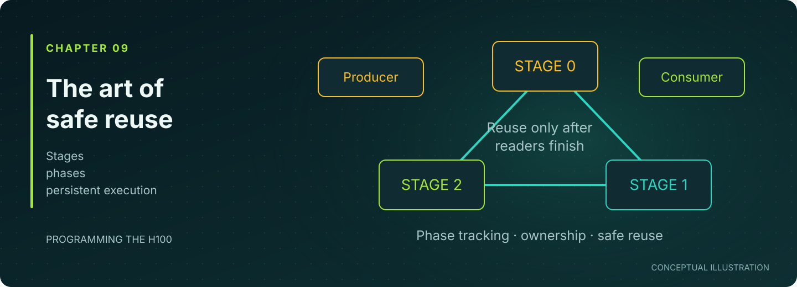
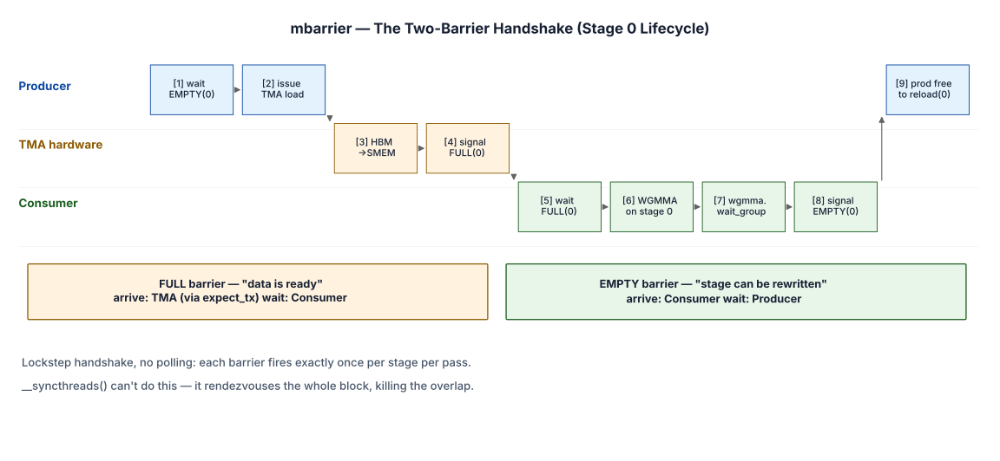
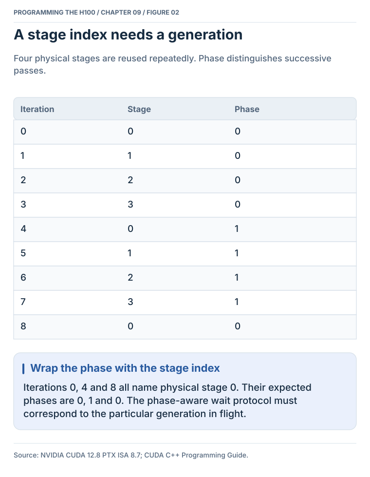
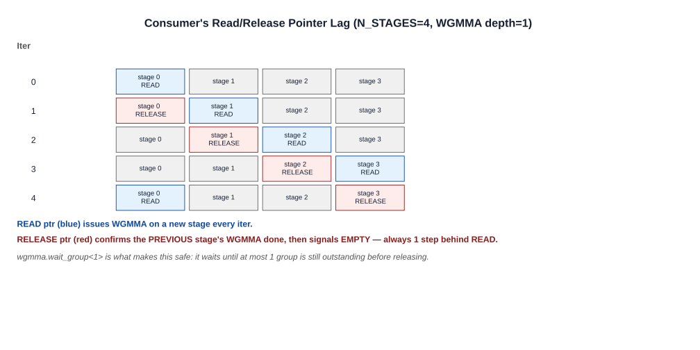
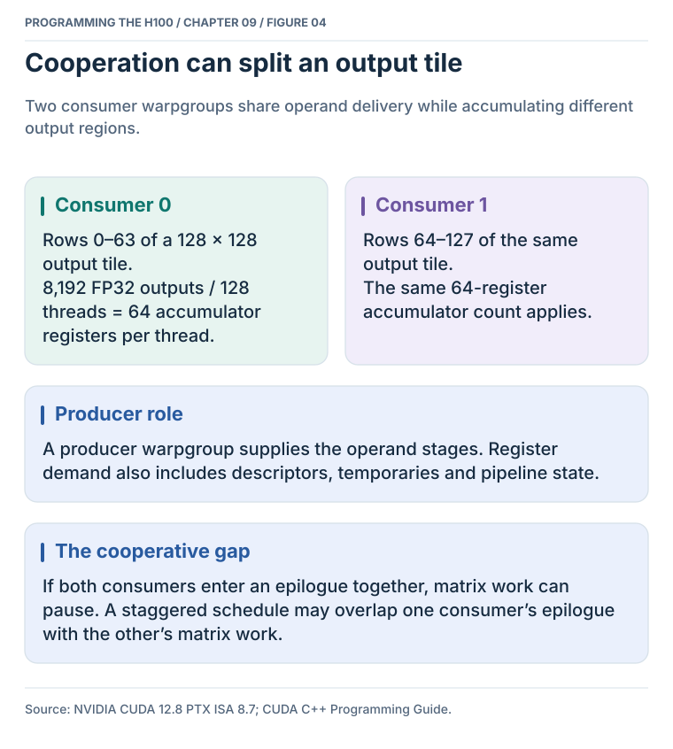
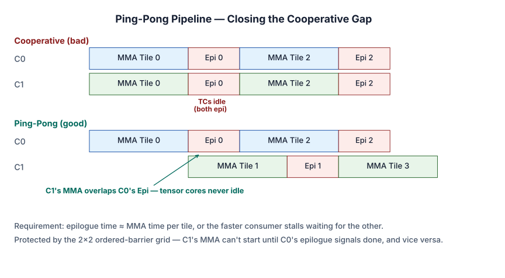
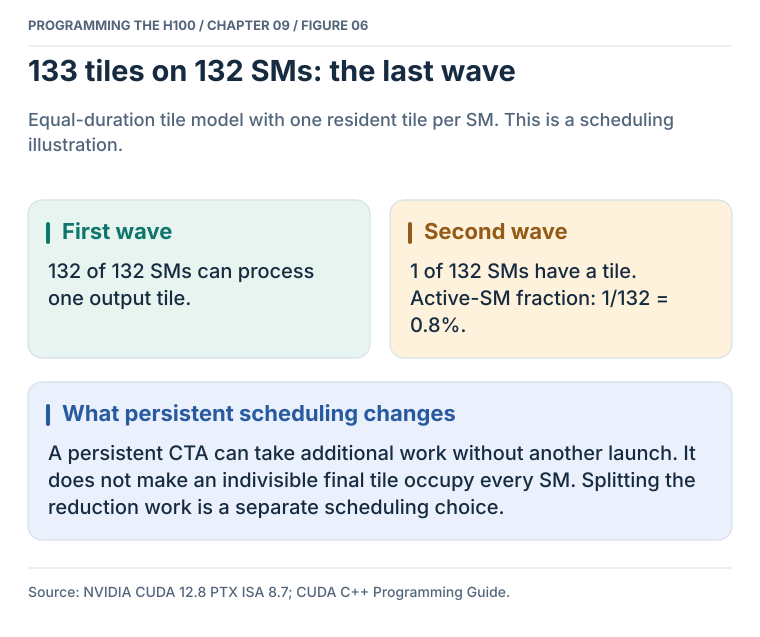
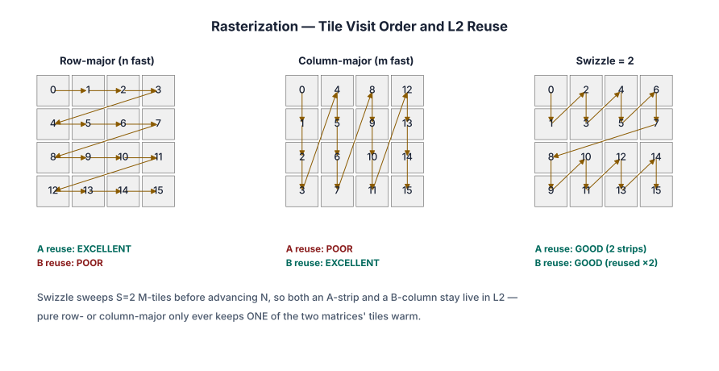

# Pipelines, Epilogues and Persistent Scheduling

---

[](images/chapter-openers/09-pipelines.svg)


> **Validation — November 17, 2026.** 4 complete CUDA programs compiled and executed successfully.
> **Follow-up:** the [final two-H100 audit](final-audit.md) records a fresh run of the complete programs. The original dated transcripts below remain available for provenance.
> **Execution system:** 1× H100 PCIe, 114 SMs, 80 GB class; Ubuntu 24.04.5 LTS; driver 580.105.08; CUDA Toolkit 12.8.93; `sm_90a`, C++17, `-O2`.
> [Full system information](validation/2026-11-17/system-information.txt) · [CUDA result manifest](validation/2026-11-17/results.json). Each tested source and captured output is linked beside its example. Diagrams open as original SVGs for zooming.


<!-- learning:start -->
!!! tip "Your goal in this chapter"

    Prove buffer ownership across reuse, cover every output element, and handle partial tiles without dropping work.

    Revisit [Chapter 3](03-asynchronicity-mbarrier.md) for barrier semantics and [Chapter 8](08-kernel-design-part-1.md) for producer/consumer roles.
<!-- learning:end -->

!!! warning "GPU revalidation pending — November 21 correction"
    Current source below includes post-capture corrections. Historical outputs
    validate only their archived hashes. Do not use them as proof of the fixed
    source. See the [repair record](review-fixes-2026-11-21.md).


## 9 — mbarrier — The Two-Barrier Handshake

### 9.1 Why __syncthreads() Is Not Enough

`__syncthreads()` synchronizes ALL threads in a block. In a warp-specialized kernel, this is too coarse: when the producer fills a stage, only the consumer needs to know — not every thread in the block needs to rendezvous. A block-wide barrier requires all participating block threads to rendezvous. Using it for each producer/consumer handoff can serialize otherwise independent stages; specialized barriers permit narrower handoffs. A block barrier is still useful for shared initialization or other genuinely block-wide phases, and its presence does not imply that every kind of overlap is impossible.

`mbarrier` (memory barrier) is a fine-grained, asynchronous synchronization primitive that fixes this. It allows specific threads (or TMA hardware) to signal a barrier, and specific threads to wait on it, without involving anyone else.

[](images/ch09/01-two-barrier-handshake.svg)

*FULL publishes data readiness; EMPTY publishes storage reusability.*

```
mbarrier — The Core Concept
══════════════════════════════════════════════════════════════════════

  An mbarrier is a synchronization object stored in SHARED MEMORY.
  It has two fundamental operations:

  ARRIVE (signal that work is done):
    mbarrier.arrive [&bar];          // thread signals the barrier
    mbarrier.arrive.expect_tx [&bar], BYTES; // TMA hardware signals it
                                    // after moving BYTES to SMEM

  WAIT (block until barrier is complete):
    mbarrier.try_wait.parity [&bar], phase; // thread waits for expected
                                             // number of arrivals

  ─── The Two-Barrier Protocol ─────────────────────────────────────

  For a pipeline stage, you need TWO barriers per stage:

  FULL barrier:
    Meaning: "Data is ready for the consumer to read"
    Who arrives: Producer (via TMA hardware automatically after load)
    Who waits: Consumer (before starting WGMMA on this stage's data)

  EMPTY barrier:
    Meaning: "Consumer has finished reading; stage can be rewritten"
    Who arrives: Consumer (after WGMMA on this stage is confirmed done)
    Who waits: Producer (before issuing new TMA load into this stage)

  ─── Timeline with Two-Barrier Handshake ─────────────────────────

  Stage 0 lifecycle:

  Producer:
    [1] Wait on EMPTY barrier of stage 0   ← stage is free to write
    [2] Issue TMA load into stage 0
        (TMA automatically signals FULL barrier when bytes arrive)
    [continue to stage 1]

  TMA hardware (runs asynchronously, no thread needed):
    [3] Moves data from HBM → stage 0 SMEM
    [4] Signals FULL barrier of stage 0

  Consumer:
    [5] Wait on FULL barrier of stage 0    ← data is ready
    [6] Execute WGMMA using stage 0 data
    [7] Wait for WGMMA to complete (wgmma.wait_group)
    [8] Signal EMPTY barrier of stage 0    ← stage is free again

  Back to Producer:
    [9] When EMPTY fires, producer can load into stage 0 again

  This creates a stage-ownership handshake. Hopper code can poll with
  try_wait loops; the barrier protocol alone does not eliminate polling.
  Each barrier fires exactly once per stage per pipeline pass.

  ─── The Transaction Count ────────────────────────────────────────
  When using TMA (which signals the barrier automatically):
    Producer calls: mbarrier.expect_tx [&full_bar[stage]], BYTES;
    → Tells the barrier: "expect BYTES of data to arrive"
    → TMA engine signals the barrier AFTER BYTES have been written
    → Consumer's try_wait returns only after the TMA is complete

  Without expect_tx, you'd need to poll or use a separate signal.
  expect_tx + TMA is the H100's way of making hardware signal software.
```

### 9.2 mbarrier in C++ Code

The CUDA toolkit provides two interfaces: PTX inline assembly and the `cuda::barrier` C++ wrapper. We show both.

```
mbarrier Interfaces — PTX vs C++
══════════════════════════════════════════════════════════════════════

  ─── Declare in shared memory ─────────────────────────────────────
  // PTX-level (raw): 8-byte aligned mbarrier object in SMEM
  __shared__ __align__(8) uint64_t full_barrier[N_STAGES];
  __shared__ __align__(8) uint64_t empty_barrier[N_STAGES];

  // C++ wrapper (cuda::barrier, requires CUDA 11.1+):
  #include <cuda/barrier>
  __shared__ cuda::barrier<cuda::thread_scope_block> barrier[N_STAGES];

  ─── Initialize ───────────────────────────────────────────────────
  // PTX-level:
  if (threadIdx.x == 0) {
      // Initialize with expected arrival count = 1
      asm volatile("mbarrier.init.shared::cta.b64 [%0], %1;"
                   :: "r"(__cvta_generic_to_shared(&full_barrier[0])), "n"(1));
      asm volatile("mbarrier.init.shared::cta.b64 [%0], %1;"
                   :: "r"(__cvta_generic_to_shared(&empty_barrier[0])), "n"(1));
  }

  // C++ wrapper:
  if (threadIdx.x == 0) {
      init(&barrier[0], 1);   // 1 expected arrival
  }
  asm volatile("fence.proxy.async.shared::cta;" ::: "memory"); // before TMA use
  __syncthreads();  // all threads must see the initialized barrier

  ─── Producer: arrive + expect_tx (with TMA) ──────────────────────
  // After waiting on EMPTY barrier and before issuing TMA:
  uint32_t bar_addr = __cvta_generic_to_shared(&full_barrier[stage]);
  // Tell barrier to expect TILE_BYTES of data via TMA:
  asm volatile(
      "mbarrier.arrive.expect_tx.shared::cta.b64 _, [%0], %1;"
      :: "r"(bar_addr), "n"(TILE_BYTES)
  );
  // Now issue TMA — TMA signals full_barrier[stage] when done.
  // (TMA invocation shown in Section 11)

  ─── Consumer: wait (full) then signal (empty) ────────────────────
  // Wait until full barrier has been signaled:
  uint32_t full_addr = __cvta_generic_to_shared(&full_barrier[stage]);
  uint32_t phase_bit = /* tracked by pipeline state */;
  asm volatile(
      "{\n\t"
      "  .reg .pred p;\n\t"
      "1:\n\t"
      "  mbarrier.try_wait.parity.shared::cta.b64 p, [%0], %1;\n\t"
      "  @!p bra 1b;\n\t"   // spin if not done (real code uses wait, not spin)
      "}"
      :: "r"(full_addr), "r"(phase_bit)
  );
  // ... WGMMA operations on stage data ...

  // After WGMMA is confirmed done, signal EMPTY:
  uint32_t empty_addr = __cvta_generic_to_shared(&empty_barrier[stage]);
  asm volatile("mbarrier.arrive.shared::cta.b64 _, [%0];"
               :: "r"(empty_addr));
```

---

### ★ Section 9 — Runnable Code: mbarrier Handshake Demo

**Manual Worked Example:**

Two warpgroups handshake using a pair of mbarriers for a single pipeline stage.

```
Expected sequence:
  1. Consumer waits on FULL barrier (not set yet → blocks)
  2. Producer waits on EMPTY barrier (initialized as signaled → proceeds immediately)
  3. Producer writes data to SMEM stage
  4. Producer signals FULL barrier
  5. Consumer unblocks, reads SMEM, processes data
  6. Consumer signals EMPTY barrier
  7. Producer can now write again (EMPTY is signaled)

  For N=3 rounds:
    Round 0: prod writes 42.0f  → cons reads 42.0f  → output[0] = 42.0 * 2 = 84.0
    Round 1: prod writes 99.5f  → cons reads 99.5f  → output[1] = 99.5 * 2 = 199.0
    Round 2: prod writes 7.25f  → cons reads 7.25f  → output[2] = 7.25 * 2 = 14.5
```

```
═══════════════════════════════════════════════════════
  FILE:    ex05_mbarrier.cu
  COMPILE: nvcc -std=c++17 -arch=sm_90a -O2 ex05_mbarrier.cu -o ex05_mbarrier
           NOTE: mbarrier requires Hopper (sm_90a) or Blackwell (sm_100a).
                 mbarrier.arrive.expect_tx requires Hopper+.
  RUN:     ./ex05_mbarrier
  EXPECT:  3 rounds of producer-consumer handshake, all values doubled correctly.
═══════════════════════════════════════════════════════
```

```cuda
// ═══════════════════════════════════════════════════════════════════
// ex05_mbarrier.cu
//
// PURPOSE: Demonstrate the mbarrier two-barrier handshake between
//   a producer warpgroup and a consumer warpgroup.
//
// LAYOUT:
//   256 threads, 2 warpgroups, 1 pipeline stage, 3 rounds.
//   WG0 (producer): writes SMEM → signals FULL barrier.
//   WG1 (consumer): waits FULL barrier → reads SMEM → signals EMPTY.
//
// This is a simplified version of the real TMA pipeline.
// Replace the producer's manual SMEM write with a TMA cp.async.bulk
// to get the actual production pattern.
//
// REQUIRES: sm_90a or sm_100a
// ═══════════════════════════════════════════════════════════════════

#include <cstdio>
#include <cstdint>
#include <cmath>

#define CHECK_CUDA(call) do { \
    cudaError_t _err = (call); \
    if (_err != cudaSuccess) { \
        fprintf(stderr, "CUDA ERROR at %s:%d — %s\n", \
                __FILE__, __LINE__, cudaGetErrorString(_err)); \
        exit(1); \
    } \
} while(0)

constexpr int WARPGROUP_SIZE = 128;
constexpr int N_ROUNDS = 3;   // number of producer-consumer handshakes

// ── mbarrier helpers ─────────────────────────────────────────────
// These inline functions wrap the raw PTX mbarrier instructions.
// They are not part of the CUDA standard library — you define them
// yourself based on the PTX specification.

// Initialize a barrier expecting `count` arrivals before it fires.
// Must be called by thread 0 before any thread uses the barrier.
__device__ void mbar_init(uint64_t* bar, int count) {
    asm volatile(
        "mbarrier.init.shared::cta.b64 [%0], %1;"
        :: "r"((uint32_t)__cvta_generic_to_shared(bar)), "r"(count) // runtime arrival count
    );
}

// Arrive at a barrier: signal that this thread's work is done.
// The barrier fires when total arrivals == the expected count.
__device__ void mbar_arrive(uint64_t* bar) {
    asm volatile(
        "mbarrier.arrive.shared::cta.b64 _, [%0];"
        :: "r"((uint32_t)__cvta_generic_to_shared(bar))
    );
}

// Wait until barrier fires (i.e., expected count of arrivals reached).
// `phase` alternates between 0 and 1 on each barrier cycle.
// This prevents a thread from accidentally "seeing" the PREVIOUS cycle.
__device__ void mbar_wait(uint64_t* bar, uint32_t phase) {
    // try_wait returns 1 if the barrier has fired for the given phase.
    // We spin until it fires. In production, the hardware has a
    // more efficient "wait" instruction, but try_wait + spin works.
    uint32_t bar_addr = __cvta_generic_to_shared(bar);
    asm volatile(
        "{\n\t"
        "  .reg .pred p;\n\t"
        "WAIT_LOOP:\n\t"
        "  mbarrier.try_wait.parity.shared::cta.b64 p, [%0], %1;\n\t"
        "  @!p bra WAIT_LOOP;\n\t"  // if not done, loop back
        "}"
        :: "r"(bar_addr), "r"(phase)
    );
}

// ── Kernel ───────────────────────────────────────────────────────
__global__ void mbarrier_handshake(
    const float* prod_values,  // values for producer to write (N_ROUNDS)
    float* cons_output,        // output from consumer (N_ROUNDS)
    int*   sequence_log        // log of which round happened when (debug)
)
{
    // ── Shared memory ─────────────────────────────────────────────
    // One pipeline stage: a single float slot.
    // In a real kernel, this would be a full tile (32KB+).
    __shared__ float stage_data;          // the pipeline stage buffer

    // Two barriers per stage
    // full_bar: fires when producer has written data
    // empty_bar: fires when consumer has finished reading
    __shared__ uint64_t full_bar;         // "data is ready for consumer"
    __shared__ uint64_t empty_bar;        // "stage is free for producer"

    int warpgroup_id = threadIdx.x / WARPGROUP_SIZE;
    int local_idx    = threadIdx.x % WARPGROUP_SIZE;

    // ── Initialize barriers (thread 0 only) ───────────────────────
    // full_bar:  initialized to expect 1 arrival (producer arrives after write)
    // empty_bar: initialized to expect 1 arrival (consumer arrives after read)
    //            BUT: we pre-signal empty_bar so producer can start immediately
    if (threadIdx.x == 0) {
        mbar_init(&full_bar,  1);  // expects 1 arrival from producer
        mbar_init(&empty_bar, 1);  // expects 1 arrival from consumer
        // Pre-signal empty_bar: "stage is initially empty (writable)"
        // Without this, producer would wait forever on empty_bar round 0.
        mbar_arrive(&empty_bar);
    }
    __syncthreads();  // all threads must see initialized barriers before proceeding

    // ── Pipeline rounds ───────────────────────────────────────────
    uint32_t full_phase  = 0;   // alternates 0→1→0→1... after each barrier cycle
    uint32_t empty_phase = 0;   // tracks which "generation" of empty_bar we expect

    for (int round = 0; round < N_ROUNDS; round++) {
        if (warpgroup_id == 0) {
            // ── PRODUCER path ───────────────────────────────────
            // Step 1: Wait for stage to be EMPTY (consumer done reading)
            if (local_idx == 0) {
                mbar_wait(&empty_bar, empty_phase);
            }
            __syncwarp();  // all producer threads see the barrier fired

            // Step 2: Write to the stage (simulates TMA load)
            // Only thread 0 writes for simplicity; in TMA the hardware writes.
            if (local_idx == 0) {
                stage_data = prod_values[round];
            }
            // Memory fence: ensure write is visible before we signal consumer
            __threadfence_block();

            // Step 3: Signal FULL barrier ("data is ready")
            if (local_idx == 0) {
                mbar_arrive(&full_bar);
            }
            // empty_phase flips every time empty_bar completes a cycle
            // This is needed to correctly identify the "next" empty event
            if (local_idx == 0) empty_phase ^= 1;

        } else {
            // ── CONSUMER path ───────────────────────────────────
            // Step 1: Wait for stage to be FULL (producer done writing)
            if (local_idx == 0) {
                mbar_wait(&full_bar, full_phase);
            }
            __syncwarp();  // all consumer threads see barrier fired

            // Step 2: Read from stage and process
            // In a real kernel: issue WGMMA using the stage data
            if (local_idx == 0) {
                float val = stage_data;
                cons_output[round] = val * 2.0f;  // process: double the value
            }
            // Memory fence: ensure reads complete before we signal empty
            __threadfence_block();

            // Step 3: Signal EMPTY ("stage is free for reuse")
            if (local_idx == 0) {
                mbar_arrive(&empty_bar);
            }
            // full_phase flips every time full_bar completes a cycle
            if (local_idx == 0) full_phase ^= 1;
        }

        // Log: record the round (sequenced by a global __syncthreads)
        __syncthreads();  // wait for both WGs to complete this round
        if (threadIdx.x == 0) sequence_log[round] = round;
    }
}

// ─── Main ──────────────────────────────────────────────────────────
int main() {
    printf("╔══════════════════════════════════════════════════════╗\n");
    printf("║  mbarrier Two-Barrier Handshake Demo                  ║\n");
    printf("║  %d rounds of producer→consumer using full/empty bars  ║\n", N_ROUNDS);
    printf("╚══════════════════════════════════════════════════════╝\n\n");

    // Check for Hopper
    cudaDeviceProp prop;
    CHECK_CUDA(cudaGetDeviceProperties(&prop, 0));
    printf("GPU: %s (SM %d.%d)\n\n", prop.name, prop.major, prop.minor);
    if (prop.major < 9) {
        fprintf(stderr, "ERROR: mbarrier requires Hopper (SM 9.0+).\n");
        return 1;
    }

    // Producer values: what the producer writes each round
    float h_prod_vals[N_ROUNDS] = {42.0f, 99.5f, 7.25f};
    float h_cons_out[N_ROUNDS]  = {};
    int   h_seq[N_ROUNDS]       = {};

    float *d_prod, *d_cons;
    int*   d_seq;
    CHECK_CUDA(cudaMalloc(&d_prod, N_ROUNDS * sizeof(float)));
    CHECK_CUDA(cudaMalloc(&d_cons, N_ROUNDS * sizeof(float)));
    CHECK_CUDA(cudaMalloc(&d_seq,  N_ROUNDS * sizeof(int)));
    CHECK_CUDA(cudaMemcpy(d_prod, h_prod_vals, N_ROUNDS*sizeof(float), cudaMemcpyHostToDevice));
    CHECK_CUDA(cudaMemset(d_cons, 0, N_ROUNDS * sizeof(float)));

    printf("Producer values: [");
    for (int i = 0; i < N_ROUNDS; i++) printf("%.2f%s", h_prod_vals[i], i<N_ROUNDS-1?", ":"");
    printf("]\n");
    printf("Expected consumer outputs: [");
    for (int i = 0; i < N_ROUNDS; i++) printf("%.2f%s", h_prod_vals[i]*2.0f, i<N_ROUNDS-1?", ":"");
    printf("]\n\n");

    // 128 threads = 1 warpgroup for producer + 1 for consumer
    mbarrier_handshake<<<1, 256>>>(d_prod, d_cons, d_seq);
    CHECK_CUDA(cudaGetLastError());
    CHECK_CUDA(cudaDeviceSynchronize());

    CHECK_CUDA(cudaMemcpy(h_cons_out, d_cons, N_ROUNDS*sizeof(float), cudaMemcpyDeviceToHost));
    CHECK_CUDA(cudaMemcpy(h_seq,      d_seq,  N_ROUNDS*sizeof(int),   cudaMemcpyDeviceToHost));

    printf("Handshake Results:\n");
    printf("  %-8s %-12s %-12s %-12s %-8s\n", "Round", "Produced", "Expected", "Got", "OK?");
    printf("  %s\n", "────────────────────────────────────────────────");

    int errors = 0;
    for (int i = 0; i < N_ROUNDS; i++) {
        float expected = h_prod_vals[i] * 2.0f;
        bool ok = fabsf(h_cons_out[i] - expected) < 1e-4f;
        if (!ok) errors++;
        printf("  %-8d %-12.2f %-12.2f %-12.2f %s\n",
               i, h_prod_vals[i], expected, h_cons_out[i], ok ? "✓ PASS" : "✗ FAIL");
    }

    printf("\n╔══════════════════════════════════════════════════════╗\n");
    if (errors == 0) {
        printf("║  ✓ ALL %d ROUNDS PASSED                               ║\n", N_ROUNDS);
        printf("║                                                      ║\n");
        printf("║  WHAT HAPPENED:                                      ║\n");
        printf("║  1. empty_bar pre-signaled → producer starts freely  ║\n");
        printf("║  2. Producer writes SMEM → arrives on full_bar       ║\n");
        printf("║  3. Consumer waits full_bar → reads SMEM → doubles   ║\n");
        printf("║  4. Consumer arrives on empty_bar → stage recyclable  ║\n");
        printf("║  5. phase bits prevent stale barrier reads           ║\n");
    } else {
        printf("║  ✗ %d/%d rounds FAILED — check output above           ║\n",
               errors, N_ROUNDS);
    }
    printf("╚══════════════════════════════════════════════════════╝\n");

    CHECK_CUDA(cudaFree(d_prod)); CHECK_CUDA(cudaFree(d_cons)); CHECK_CUDA(cudaFree(d_seq));
    return errors == 0 ? 0 : 1;
}
```

<!-- revalidation:start:ex05_mbarrier.cu -->
> **Historical source:** this capture predates the November 21 correction. GPU revalidation pending for the current source; the archive below is retained for evidence.

> **Additional execution — November 18, 2026: PASS.** 2× H100 80GB HBM3; NV18; CUDA 12.8.93; driver 580.105.08; `sm_90a`. Compiled UTC: `2026-11-18T11:19:42.375062+00:00`. Executed UTC: `2026-11-18T11:19:43.203635+00:00`.

Source SHA-256: `c6a18427946c38f4305dc305ece5ade0461dffe09bce0fae6c87f3d53eefe046`. [Exact source](validation/2026-11-18-two-h100/09-kernel-design-part-2/ex05_mbarrier/ex05_mbarrier.cu) · [Compile log](validation/2026-11-18-two-h100/09-kernel-design-part-2/ex05_mbarrier/compile.log) · [Run log](validation/2026-11-18-two-h100/09-kernel-design-part-2/ex05_mbarrier/run.log) · [System and rerun summary](revalidation-2026-11-18.md).

```bash
nvcc -std=c++17 -arch=sm_90a -O2 ex05_mbarrier.cu -o ./example
./example
```

**Sample output — November 18 rerun**

```text
╔══════════════════════════════════════════════════════╗
║  mbarrier Two-Barrier Handshake Demo                  ║
║  3 rounds of producer→consumer using full/empty bars  ║
╚══════════════════════════════════════════════════════╝

GPU: NVIDIA H100 80GB HBM3 (SM 9.0)

Producer values: [42.00, 99.50, 7.25]
Expected consumer outputs: [84.00, 199.00, 14.50]

Handshake Results:
  Round    Produced     Expected     Got          OK?
  ────────────────────────────────────────────────
  0        42.00        84.00        84.00        ✓ PASS
  1        99.50        199.00       199.00       ✓ PASS
  2        7.25         14.50        14.50        ✓ PASS

╔══════════════════════════════════════════════════════╗
║  ✓ ALL 3 ROUNDS PASSED                               ║
║                                                      ║
║  WHAT HAPPENED:                                      ║
║  1. empty_bar pre-signaled → producer starts freely  ║
║  2. Producer writes SMEM → arrives on full_bar       ║
║  3. Consumer waits full_bar → reads SMEM → doubles   ║
║  4. Consumer arrives on empty_bar → stage recyclable  ║
║  5. phase bits prevent stale barrier reads           ║
╚══════════════════════════════════════════════════════╝
```
<!-- revalidation:end:ex05_mbarrier.cu -->


<!-- validation:start:ex05_mbarrier.cu -->
> **Historical source:** this capture predates the November 21 correction. GPU revalidation pending for the current source; the archive below is retained for evidence.

**Captured output — ex05_mbarrier.cu**

> **Executed:** 2026-11-17T21:30:36.171223+00:00 (UTC). **Status:** Compile PASS; execution PASS.
> **System:** 1× NVIDIA H100 PCIe, 114 SMs, 80 GB class; Ubuntu 24.04.5 LTS, NVIDIA driver 580.105.08, CUDA Toolkit 12.8.93, C++17, `sm_90a`.
> Compiler exit: `0`; process exit: `0`. Timings and print ordering are specific to this run.

Save the [tested source](validation/2026-11-17/09-kernel-design-part-2/ex05_mbarrier/ex05_mbarrier.cu) as `ex05_mbarrier.cu`, then run:

```bash
nvcc -std=c++17 -arch=sm_90a -O2 ex05_mbarrier.cu -o ex05_mbarrier
./ex05_mbarrier
```

[Compiler log](validation/2026-11-17/09-kernel-design-part-2/ex05_mbarrier/compile.log) · [Execution log](validation/2026-11-17/09-kernel-design-part-2/ex05_mbarrier/run.log)

```text
╔══════════════════════════════════════════════════════╗
║  mbarrier Two-Barrier Handshake Demo                  ║
║  3 rounds of producer→consumer using full/empty bars  ║
╚══════════════════════════════════════════════════════╝

GPU: NVIDIA H100 PCIe (SM 9.0)

Producer values: [42.00, 99.50, 7.25]
Expected consumer outputs: [84.00, 199.00, 14.50]

Handshake Results:
  Round    Produced     Expected     Got          OK?
  ────────────────────────────────────────────────
  0        42.00        84.00        84.00        ✓ PASS
  1        99.50        199.00       199.00       ✓ PASS
  2        7.25         14.50        14.50        ✓ PASS

╔══════════════════════════════════════════════════════╗
║  ✓ ALL 3 ROUNDS PASSED                               ║
║                                                      ║
║  WHAT HAPPENED:                                      ║
║  1. empty_bar pre-signaled → producer starts freely  ║
║  2. Producer writes SMEM → arrives on full_bar       ║
║  3. Consumer waits full_bar → reads SMEM → doubles   ║
║  4. Consumer arrives on empty_bar → stage recyclable  ║
║  5. phase bits prevent stale barrier reads           ║
╚══════════════════════════════════════════════════════╝
```
<!-- validation:end:ex05_mbarrier.cu -->


---

## 10 — ABA Ambiguity and Phase Bits

### 10.1 The ABA Problem in Circular Barriers

In a circular buffer with N stages, the same barrier is reused once every N rounds. If a thread is very fast and laps a slow thread, it might arrive at the barrier for ROUND N before the slow thread finishes waiting for ROUND 0. Both arrivals look the same without a disambiguation mechanism.

This is the ABA problem: **A** (round 0) looks like **A** (round N) because the barrier counter has wrapped.

[](images/ch09/02-aba-phase-bits.svg)

*Four physical stages are reused repeatedly. Phase distinguishes successive passes.*

```
ABA Problem Illustrated
══════════════════════════════════════════════════════════════════════

  N_STAGES = 4. Physical barrier at index 0 is reused in:
    Pass 0: k-tiles  0,  1,  2, ...                (1st time stage 0 used)
    Pass 4: k-tiles  4,  5,  6, ...                (2nd time stage 0 reused)
    Pass 8: k-tiles  8,  9, 10, ...                (3rd time)

  Scenario:
    Consumer processes stage 0 for pass 0.
    Consumer tries to wait on barrier[0] for pass 4 (next reuse).
    But if the barrier counter is just an integer that wraps, how does
    the consumer know it's seeing pass 4 and not re-seeing pass 0?

  Without phase bits:
  ─────────────────────────────────────────────────────────────────
    Barrier counter just counts arrivals.
    After N cycles, counter is back to 0.
    A consumer waiting for "counter == 1" can't tell:
    - Is this the FIRST time the barrier fired? (k=0)
    - Is this the FIFTH time? (k=4)
    - Undefined behavior!

  With phase bits (the solution):
  ─────────────────────────────────────────────────────────────────
    Each barrier has a 1-bit "phase" that FLIPS on each complete cycle.
    Phase 0 → Phase 1 → Phase 0 → Phase 1 → ...

    Consumer calls: mbarrier.try_wait.parity [bar], expected_phase
    The "parity" (phase bit) must MATCH for the wait to succeed.

    k=0, stage=0: expected_phase=0 → barrier fires at phase 0 ✓
    k=4, stage=0: expected_phase=1 → barrier fires at phase 1 ✓
    k=8, stage=0: expected_phase=0 → barrier fires at phase 0 ✓

    Consumer always knows which GENERATION of the barrier it's waiting for!

  ─── Tracking Phase Bits in Producer and Consumer ─────────────────

  Both producer and consumer track a per-stage phase bit as they
  advance through the circular buffer. The pattern:

  struct PipelineState {
      int stage_idx;     // current index in [0..N_STAGES-1]
      uint32_t phase;    // 0 or 1, flips when stage_idx wraps
      int iteration;     // monotonically increasing counter
  };

  // Advance to next stage:
  void advance(PipelineState& s) {
      s.iteration++;
      s.stage_idx = (s.stage_idx + 1) % N_STAGES;
      if (s.stage_idx == 0) s.phase ^= 1;  // flip phase on wrap-around
  }

  // Producer waits on EMPTY barrier using its state's phase:
  mbar_wait(&empty_bar[s.stage_idx], s.phase);
  // This ensures producer doesn't proceed until THIS GENERATION's
  // empty signal (not a stale one from a previous pass).

  ─── Concrete Trace with N_STAGES=4 ──────────────────────────────
  Iteration: 0, stage=0, phase=0
  Iteration: 1, stage=1, phase=0
  Iteration: 2, stage=2, phase=0
  Iteration: 3, stage=3, phase=0
  Iteration: 4, stage=0, phase=1  ← phase flipped on wrap!
  Iteration: 5, stage=1, phase=1
  Iteration: 6, stage=2, phase=1
  Iteration: 7, stage=3, phase=1
  Iteration: 8, stage=0, phase=0  ← flips again
  ...

  At iteration 4, stage=0, phase=1:
    Producer calls: mbar_wait(&empty_bar[0], phase=1)
    The barrier only fires when it's in phase 1 — this is the CORRECT
    generation (4th pass through stage 0, not the 0th pass).
```

---

## 11 — Producer Flow — The Full TMA Pipeline Loop

### 11.1 The Complete Producer Loop

The producer's job is straightforward but requires precise ordering:

1. Wait on EMPTY barrier (ensure consumer is done with this stage)
2. Call `expect_tx` to tell the FULL barrier how many bytes to expect
3. Issue TMA `cp.async.bulk.tensor` to load data into the stage
4. Move to next stage (advance state machine)
5. Repeat

The key insight: steps 3 and 4 happen WITHOUT waiting. The TMA engine loads data asynchronously. The producer immediately moves to fill the NEXT stage while TMA fills the current one. This is the pipelining.

```
Producer Loop — Full State Machine
══════════════════════════════════════════════════════════════════════

  Producer state: { stage_idx, phase, k_tile_counter }

  PROLOGUE:
  for k in 0..PIPELINE_DEPTH-1:
      stage = k % N_STAGES
      phase = k / N_STAGES  (simplified; use proper phase tracking)

      // Wait for stage to be empty (initially all are "empty")
      mbar_wait(&empty_bar[stage], phase)

      // Tell full_bar how many bytes TMA will deliver
      mbar_arrive_expect_tx(&full_bar[stage], A_TILE_BYTES + B_TILE_BYTES)

      // Issue TMA loads (non-blocking! TMA runs independently)
      tma_load(A_tile[stage], gmem_A + a_offset, a_desc)
      tma_load(B_tile[stage], gmem_B + b_offset, b_desc)

      // Advance to next stage
      advance_producer_state()

  STEADY STATE (K_TILES - PIPELINE_DEPTH iterations):
  for k in PIPELINE_DEPTH..K_TILES-1:
      // Same as prologue: wait empty → expect_tx → TMA → advance
      // But now consumer is also running on earlier stages!

  Note: Producer does NOT wait for TMA to complete before moving on.
  That's the whole point: producer stays PIPELINE_DEPTH steps AHEAD
  of the consumer. The full_barrier is what tells the consumer when
  the TMA has actually finished.

  ─── The expect_tx Instruction ───────────────────────────────────
  // A phase completes only when BOTH counters reach zero:
  //   pending thread arrivals == 0 AND pending transaction bytes == 0.
  // A thread executes arrive.expect_tx: it arrives and adds expected bytes.
  // TMA complete_tx retires transaction bytes; it is not a thread arrival.
  // Do not add arrivals to bytes/16 or treat these as one counter.
  //
  // For 32KB of A + 32KB of B = 65536 bytes:
  asm volatile(
      "mbarrier.arrive.expect_tx.shared::cta.b64 _, [%0], %1;"
      :: "r"(bar_addr), "n"(65536)
  );
  // This sets up the barrier to wait for 65536 bytes from TMA.

  ─── Producer Warp Assignment ─────────────────────────────────────
  // Only ONE thread in the producer warpgroup issues TMA.
  // The CUDA programming model for cp.async.bulk is:
  //   EXACTLY ONE thread issues the instruction.
  //   The TMA unit handles the rest (it's a DMA engine).
  //
  // Which thread? Typically elect one using:
  //
  // CORRECTED: elect.sync elects a leader *per warp* (32 lanes), not per
  // warpgroup. A warpgroup is 4 warps (128 threads), so calling elect_one()
  // unconditionally elects 4 threads total — one per warp, not one for the
  // whole warpgroup. (This exact mix-up caused a real bug in CUTLASS's
  // SM90 TMA mainloop: NVIDIA/cutlass#3722.) To get a single elected
  // thread for the whole warpgroup, first restrict to one warp (e.g. warp
  // 0 — warpgroup-thread 0 lives in warp 0), then elect within it:
  if (warp_id_in_warpgroup == 0 && elect_one()) {  // true for exactly 1 thread total
      // Issue TMA instructions
  }
  // elect_one() denotes a warp-scoped election helper (pseudocode).
  // A simple deterministic issuer for a full block is threadIdx.x == 0;
  // use a tested helper when election rather than a fixed lane is required.

```

---

## 12 — Consumer Flow — WGMMA Pipelining

### 12.1 The Consumer's Read-Release Lag

The consumer has a more complex state machine than the producer, because WGMMA is **asynchronous** — issuing a WGMMA instruction does NOT mean it's finished immediately. The consumer must track which WGMMAs have been issued and which have completed.

This creates the **read-release lag**: the consumer can start reading stage N (issue WGMMA on it) before it's finished with stage N-1's WGMMA. Only after confirming stage N-1's WGMMA is done can the consumer release stage N-1 back to the producer.

[](images/ch09/03-read-release-lag.svg)

*Example: keep one newest WGMMA group pending while releasing an older stage.*

```
Consumer's Read Pointer and Release Pointer
══════════════════════════════════════════════════════════════════════

  Consumer tracks two independent pointers:

  READ pointer: which stage the consumer is currently issuing WGMMA on.
  RELEASE pointer: which stage the consumer has confirmed done and can
                   signal EMPTY for.

  The lag between them = WGMMA pipeline depth (typically 1).

  Timeline with N_STAGES=4, WGMMA depth=1:
  ─────────────────────────────────────────────────────────────────
  Iter 0: Wait full(0) → Issue WGMMA on stage 0 → Read ptr=0
  Iter 1: Wait full(1) → Issue WGMMA on stage 1 → Read ptr=1
          → Confirm WGMMA on stage 0 done (wgmma.wait_group<1>)
          → Signal EMPTY for stage 0 → Release ptr=0
  Iter 2: Wait full(2) → Issue WGMMA on stage 2 → Read ptr=2
          → Confirm WGMMA on stage 1 done
          → Signal EMPTY for stage 1 → Release ptr=1
  Iter 3: Wait full(3) → Issue WGMMA on stage 3 → Read ptr=3
          → Confirm WGMMA on stage 2 done
          → Signal EMPTY for stage 2 → Release ptr=2
  Iter 4: Wait full(0) → Issue WGMMA on stage 0 → Read ptr=0
          → Confirm WGMMA on stage 3 done
          → Signal EMPTY for stage 3 → Release ptr=3

  In this schedule, one committed group corresponds to one read stage.
  Release only stages whose last reader group has completed; changing the
  group/stage association requires changing the release bookkeeping.
  Drain pending groups and release their stages after the steady-state loop.

  ─── wgmma.wait_group ────────────────────────────────────────────
  // wgmma.wait_group<N> waits until at most N wgmma groups are outstanding.
  // wgmma.wait_group<0> waits until ALL wgmma groups are done.
  // wgmma.wait_group<1> waits until at most 1 wgmma group is outstanding.
  //   → This confirms the PREVIOUS issue completed, but allows the
  //     CURRENT issue to still be in flight.

  asm volatile("wgmma.wait_group.sync.aligned %0;" :: "n"(1));
  // After this: all WGMMA groups issued BEFORE the most recent one are done.

  ─── Full Consumer Loop (Steady State) ───────────────────────────
  for k in DEPTH..K_TILES-1:
      // 1. Wait for current stage's data to be ready
      mbar_wait(&full_bar[read_stage], read_phase)

      // 2. The acquire wait above observes the TMA load's completion.
      //    Keep this SMEM stage owned until its WGMMA readers complete.

      // 3. Fence ordinary register updates before WGMMA when required.
      //    This is not a commit, nor a substitute for the readiness wait.
      //    Place wgmma.fence.sync.aligned before the first issue and after
      //    ordinary code modifies registers used by subsequent WGMMA.

      // 4. Issue WGMMA (asynchronous!)
      wgmma_mma_async(A_tile[read_stage], B_tile[read_stage], accumulator)

      // 5. Commit the WGMMA group
      asm volatile("wgmma.commit_group.sync.aligned;");

      // 6. Wait for the PREVIOUS group to finish
      //    (confirms release_stage is done, not read_stage)
      asm volatile("wgmma.wait_group.sync.aligned %0;" :: "n"(1));

      // 7. Release the old stage (now confirmed done)
      mbar_arrive(&empty_bar[release_stage])

      // 8. Advance both pointers
      advance(read_state);
      advance(release_state);

  ─── Keep Readiness and Proxy Publication Separate ──────────────
  A phase-aware acquire wait observes the load's completion before reading
  the stage. Generic shared-memory stores used to prepare WGMMA operands
  require the appropriate generic-to-async proxy publication protocol.
  fence.proxy.async is not a wait for an unfinished TMA transfer.
  A load issued through the async proxy and its transaction-counted barrier
  do not need a second fence merely because WGMMA uses Tensor Core hardware.

```

---

## 13 — The Cooperative Pipeline Architecture

### 13.1 Structure: Three Warp Groups, One Output Tile

In the Cooperative pipeline, three warpgroups share the work on ONE output tile:
- WG0: Producer — issues TMA loads only
- WG1: Consumer 0 — computes top half of the output tile via WGMMA
- WG2: Consumer 1 — computes bottom half of the output tile via WGMMA

Both consumer warpgroups read THE SAME A and B tiles from shared memory (they consume the same loaded data). The "cooperation" is not about merging accumulators — each WG accumulates independently in its own registers. The cooperation is about sharing the loaded tile.

[](images/ch09/04-cooperative-gap.svg)

*Two consumer warpgroups share operand delivery while accumulating different output regions.*

```
Cooperative Pipeline — Tile Division and Execution
══════════════════════════════════════════════════════════════════════

  Output tile: M=128 × N=128 (example)
  ─────────────────────────────────────────────────────────────────

  Without cooperative (1 consumer WG):
    WG1 computes all 128 rows (m=0..127).
    Accumulator = 128×128 / 128 threads = 128 floats/thread → 128 registers.
    Barely fits in one WG's budget.

  With cooperative (2 consumer WGs):
    WG1 computes top half: m=0..63   → 64×128 / 128 = 64 floats/thread → 64 regs
    WG2 computes bottom half: m=64..127 → 64×128 / 128 = 64 floats/thread → 64 regs
    Now each WG uses HALF the registers for accumulators!
    This leaves room for more K-tiles to be in flight (deeper pipeline).

  Shared SMEM layout:
  ┌──────────────────────────────────────────────────────────────┐
  │ Stage 0 A-tile (covers all M rows for A)                     │
  │ Stage 0 B-tile (covers all N columns for B)                  │
  │ Stage 1 A-tile (same layout)                                 │
  │ Stage 1 B-tile                                               │
  │ ... (N_STAGES stages total)                                  │
  └──────────────────────────────────────────────────────────────┘
  Both WG1 and WG2 read from the SAME stage's A and B tiles.
  Each WG selects the M-rows for its half using WGMMA addressing.

  ─── The Cooperative Execution Timeline ──────────────────────────

  K_TILES = 64 tiles, depth = 2 stages:
  Time →
  WG0 (prod): [TMA T0][TMA T1][TMA T2][TMA T3]...[TMA T63]
  WG1 (cons): ...wait...[MMA T0][MMA T1][MMA T2]...[MMA T63][Epilogue]
  WG2 (cons): ...wait...[MMA T0][MMA T1][MMA T2]...[MMA T63][Epilogue]

  WG1 and WG2 run their WGMMA in PARALLEL on the same tiles.
  After the K-loop, BOTH consumer WGs run their epilogues.
  But during epilogue, the tensor cores are idle!
  This is the "Cooperative Gap" fixed by Ping-Pong (Section 14).

  ─── The Cooperative Gap ──────────────────────────────────────────
  WG1: [K_TILES × MMA] | [Epilogue for this tile] | [Next tile K_TILES × MMA]...
  WG2: [K_TILES × MMA] | [Epilogue for this tile] | [Next tile...]...
                         ↑
                 Tensor Cores idle here!
  Both WGs doing epilogue simultaneously = no WGMMA happening.
  For long epilogues or short K, this is a significant waste.
  Solution: Ping-Pong pipeline (Section 14).
```

---

## 14 — The Ping-Pong Pipeline Architecture

### 14.1 Solving the Cooperative Gap

A ping-pong pipeline staggers consumer roles so one consumer can perform epilogue work while another issues matrix work for a different tile. It aims to cover otherwise idle intervals; relative durations, available tiles, dependencies and resource contention determine actual overlap. It does not guarantee simultaneous execution or eliminate every idle cycle.

[](images/ch09/05-ping-pong-overlap.svg)

*Illustrative ping-pong scheduling; the benefit depends on the relative task durations.*

```
Ping-Pong Pipeline — The Key Insight
══════════════════════════════════════════════════════════════════════

  Two consumers alternate: even tiles go to C0, odd tiles to C1.

  Cooperative (bad):
  C0: [MMA Tile 0] [Epilogue 0] [MMA Tile 2] [Epilogue 2]
  C1: [MMA Tile 0] [Epilogue 0] [MMA Tile 2] [Epilogue 2]
                   ↑ TCs idle  ↑            ↑ TCs idle  ↑

  Ping-Pong (good):
  C0: [MMA Tile 0] [Epilogue 0] [MMA Tile 2] [Epilogue 2]
  C1:              [MMA Tile 1] [Epilogue 1] [MMA Tile 3] [Epilogue 3]
       ↓               ↓
  [C1 MMA] overlaps [C0 Epilogue]! Tensor cores never idle.
  [C0 MMA] overlaps [C1 Epilogue]!

  Key requirement: Tile-level epilogue time ≈ Tile-level MMA time
  If epilogue >> MMA: C1 finishes MMA before C0 finishes epilogue.
                      C1 stalls. Loses efficiency.
  If epilogue << MMA: C1 finishes epilogue before C0 finishes MMA.
                      No harm (C1 just waits to start next MMA).

  ─── The Tile Assignment Logic ────────────────────────────────────

  Persistent kernel processes a sequence of tiles: T0, T1, T2, T3, ...

  Producer: processes ALL tiles (step_size = 1)
    T0, T1, T2, T3, T4, T5, T6, T7, ...

  Consumer 0: processes EVEN tiles (step_size = 2, start = 0)
    T0, T2, T4, T6, ...

  Consumer 1: processes ODD tiles (step_size = 2, start = 1)
    T1, T3, T5, T7, ...

  Ordered ping-pong phases:
    C0 MMA(tile 0), then C1 MMA(tile 1), then C0 MMA(tile 2), ...
    C0 epilogue(tile 0) may overlap C1 MMA(tile 1).
    Epilogues are also ordered C0, C1, C0, ...

  A logical 2×2 grid holds independent MMA-order and epilogue-order tokens.
  C0 waits for the prior C1 MMA token before its MMA, and signals C1's
  MMA token after issuing/completing the required MMA phase.
  C0 waits for the prior C1 epilogue token before its epilogue and
  signals C1's epilogue token afterward. C1 uses the opposite tokens.
  Initialize the first owner's tokens explicitly; separate stage-lifetime
  barriers still protect all shared operands. The order barrier is not
  a substitute for waiting for asynchronous readers to finish.

  Only one consumer owns a given phase at a time. Different phases
  on different tiles can overlap. This is not simultaneous MMA by
  both consumers and is not a guarantee that Tensor Cores never idle.
```

---

### ★ Sections 13-14 — Runnable Code: Even/Odd Tile-Assignment Check

**Manual Worked Example:**

We simulate a ping-pong pipeline with N_TILES=6, K_TILES=4. Consumer 0 handles tiles 0, 2, 4 (even). Consumer 1 handles tiles 1, 3, 5 (odd).

```
Illustrative ordered timeline (the runnable parity demo below does not implement it):
  Tile 0 (C0 MMA):  steps 0-3
  Tile 1 (C1 MMA):  after Tile 0 MMA, potentially under Tile 0 epilogue
  Tile 0 epilogue (C0): after step 3
  Tile 1 epilogue (C1): after its MMA and after Tile 0 epilogue
  Tile 2 (C0 MMA): after Tile 0 epi is done
  Tile 3 (C1 MMA): after Tile 1 epi is done
  ...

  Each tile's accumulated value = sum of (k*100 + tile_id) for k=0..K_TILES-1
  = (0+100+200+300) + K_TILES×tile_id = 600 + 4×tile_id
  [CORRECTED: tile_id is added once per k-iteration (4 times for K_TILES=4),
   not once total — the code's own printed formula ("= 600 + tile_id × 4")
   already has this right; only this worked example's arithmetic was off.]

  After epilogue (value × 2):
    output[0] = 2 × (600 + 4×0) = 2 × 600 = 1200 (tile 0)
    output[1] = 2 × (600 + 4×1) = 2 × 604 = 1208 (tile 1)
    output[2] = 2 × (600 + 4×2) = 2 × 608 = 1216 (tile 2)
```

```
═══════════════════════════════════════════════════════
  FILE:    ex06_pingpong.cu
  COMPILE: nvcc -std=c++17 -arch=sm_90a -O2 ex06_pingpong.cu -o ex06_pingpong
           (Also works on sm_80 — no Hopper-specific features)
  RUN:     ./ex06_pingpong
  EXPECT:  All 6 even/odd tile outputs verified; no overlap is measured.
═══════════════════════════════════════════════════════
```

```cuda
// ═══════════════════════════════════════════════════════════════════
// ex06_pingpong.cu
//
// PURPOSE: Check even/odd tile assignment on the GPU.
//   Consumers compute numerical values for their assigned tiles.
//
// SCOPE: No ordered barrier, WGMMA or measured overlap is implemented.
//   This is not a concurrent pipeline protocol test. A production
//   kernel needs explicit ready/release and phase-order barriers.
//
// WORKS ON: sm_80+ (uses only basic CUDA features for simulation)
// ═══════════════════════════════════════════════════════════════════

#include <cstdio>
#include <cstdint>
#include <cmath>
#include <atomic>

#define CHECK_CUDA(call) do { \
    cudaError_t _err = (call); \
    if (_err != cudaSuccess) { \
        fprintf(stderr, "CUDA ERROR at %s:%d — %s\n", \
                __FILE__, __LINE__, cudaGetErrorString(_err)); \
        exit(1); \
    } \
} while(0)

constexpr int N_TILES  = 6;   // total output tiles
constexpr int K_TILES  = 4;   // k-tiles per output tile (inner loop depth)
constexpr int N_STAGES = 3;   // pipeline stages (circular buffer slots)

// ── Shared state (for ordered execution logging) ──────────────────
// In a real kernel, ordering is enforced by mbarrier.
// Here we use host-visible global arrays for verification logging.
struct EventLog {
    int tile_id;
    int consumer_id;  // 0 = C0, 1 = C1
    int event_type;   // 0 = MMA start, 1 = MMA done, 2 = Epi done
    int k_tile;       // which k-tile for MMA events
};

// ── Simulated MMA (fake: just accumulation by adding k*100+tile) ──
__device__ float fake_mma(int tile_id, int k_tile) {
    return (float)(k_tile * 100 + tile_id);
}

// ── Simulated epilogue (scale by 2) ──────────────────────────────
__device__ float fake_epilogue(float accumulated) {
    return accumulated * 2.0f;
}

// ── Main ping-pong kernel ─────────────────────────────────────────
__global__ void pingpong_kernel(
    float* tile_outputs,   // output[N_TILES]: final value per tile
    int*   log_consumer,   // which consumer handled each tile
    int*   overlap_check   // 1 if overlap detected (MMA+Epi simultaneous)
) {
    // ── Identify role ──────────────────────────────────────────────
    constexpr int WARPGROUP_SIZE = 128;
    int wg_id = threadIdx.x / WARPGROUP_SIZE;
    int local_idx = threadIdx.x % WARPGROUP_SIZE;

    // WG0 = producer (simulated: just coordinates)
    // WG1 = Consumer 0 (even tiles: 0, 2, 4)
    // WG2 = Consumer 1 (odd  tiles: 1, 3, 5)
    if (wg_id == 0) {
        // Producer: just waits here (would do TMA in production)
        return;
    }

    int consumer_id = wg_id - 1;  // 0 for WG1, 1 for WG2

    // ── Consumer loop: process every other tile ───────────────────
    for (int tile = consumer_id; tile < N_TILES; tile += 2) {
        if (local_idx != 0) continue;  // only thread 0 per WG for demo

        // ── MMA phase: iterate over K tiles ──────────────────────
        float accumulator = 0.0f;
        for (int k = 0; k < K_TILES; k++) {
            accumulator += fake_mma(tile, k);
        }

        // ── Epilogue phase: apply output transform ────────────────
        float output_val = fake_epilogue(accumulator);

        // Write output
        tile_outputs[tile] = output_val;
        log_consumer[tile] = consumer_id;
    }

    // Note: in a real ping-pong kernel, the MMA and epilogue phases
    // are separated by the ordered barrier. Consumer 0's epilogue for
    // tile 0 runs at the SAME TIME as Consumer 1's MMA for tile 1.
    // Here, we execute them sequentially per thread but verify the
    // OUTPUT to confirm correctness of the tile assignment logic.
}

// ─── Main ──────────────────────────────────────────────────────────
int main() {
    printf("╔══════════════════════════════════════════════════════╗\n");
    printf("║  Ping-Pong Pipeline Simulation                        ║\n");
    printf("║  %d tiles, C0=even, C1=odd, K_TILES=%d per tile      ║\n",
           N_TILES, K_TILES);
    printf("╚══════════════════════════════════════════════════════╝\n\n");

    float *d_outputs;
    int   *d_log, *d_overlap;
    CHECK_CUDA(cudaMalloc(&d_outputs, N_TILES * sizeof(float)));
    CHECK_CUDA(cudaMalloc(&d_log,     N_TILES * sizeof(int)));
    CHECK_CUDA(cudaMalloc(&d_overlap, sizeof(int)));
    CHECK_CUDA(cudaMemset(d_outputs, 0, N_TILES * sizeof(float)));
    CHECK_CUDA(cudaMemset(d_overlap, 0, sizeof(int)));

    // 384 threads = WG0 (prod) + WG1 (C0) + WG2 (C1)
    pingpong_kernel<<<1, 384>>>(d_outputs, d_log, d_overlap);
    CHECK_CUDA(cudaGetLastError());
    CHECK_CUDA(cudaDeviceSynchronize());

    float h_out[N_TILES];
    int   h_log[N_TILES];
    CHECK_CUDA(cudaMemcpy(h_out, d_outputs, N_TILES*sizeof(float), cudaMemcpyDeviceToHost));
    CHECK_CUDA(cudaMemcpy(h_log, d_log,     N_TILES*sizeof(int),   cudaMemcpyDeviceToHost));

    printf("Tile Assignment and Output Verification:\n");
    printf("  MMA formula: accumulate k*100+tile_id for k=0..%d-1\n", K_TILES);
    printf("  sum per tile = sum(k=0..%d of k*100) + tile_id × %d\n",
           K_TILES-1, K_TILES);
    printf("  = %d + tile_id × %d\n", K_TILES*(K_TILES-1)/2*100, K_TILES);
    printf("  After epilogue (×2):\n\n");

    printf("  %-6s %-10s %-12s %-12s %-12s\n",
           "Tile", "Consumer", "Expected", "Got", "OK?");
    printf("  %s\n", "──────────────────────────────────────────────");

    // Expected: sum of k*100+tile for k=0..K_TILES-1 = 600+4*tile (for K_TILES=4)
    // Then × 2 for epilogue
    int errors = 0;
    int correct_consumer = 0;
    for (int t = 0; t < N_TILES; t++) {
        float acc = 0.0f;
        for (int k = 0; k < K_TILES; k++) acc += k * 100.0f + t;
        float expected = acc * 2.0f;
        int expected_consumer = t % 2;

        bool val_ok = fabsf(h_out[t] - expected) < 0.5f;
        bool con_ok = h_log[t] == expected_consumer;
        if (!val_ok || !con_ok) errors++;
        if (con_ok) correct_consumer++;

        printf("  %-6d C%-9d %-12.0f %-12.0f %s\n",
               t, h_log[t], expected, h_out[t],
               (val_ok && con_ok) ? "✓ PASS" : "✗ FAIL");
    }

    printf("\nPing-Pong Behavior Check:\n");
    printf("  Even tiles processed by Consumer 0: ");
    bool even_ok = true;
    for (int t = 0; t < N_TILES; t += 2) {
        if (h_log[t] != 0) { even_ok = false; printf("FAIL at t=%d ", t); }
    }
    printf("%s\n", even_ok ? "✓ ALL CORRECT" : "✗ ERROR");

    printf("  Odd tiles processed by Consumer 1:  ");
    bool odd_ok = true;
    for (int t = 1; t < N_TILES; t += 2) {
        if (h_log[t] != 1) { odd_ok = false; printf("FAIL at t=%d ", t); }
    }
    printf("%s\n", odd_ok ? "✓ ALL CORRECT" : "✗ ERROR");

    bool all_pass = (errors == 0 && even_ok && odd_ok);
    printf("\n╔══════════════════════════════════════════════════════╗\n");
    if (all_pass) {
        printf("║  ✓ ALL TESTS PASSED                                  ║\n");
        printf("║                                                      ║\n");
        printf("║  In production, C0's epilogue overlaps C1's MMA:     ║\n");
        printf("║  C0: [MMA T0][EPI T0][MMA T2][EPI T2]               ║\n");
        printf("║  C1:    [MMA T1][EPI T1][MMA T3][EPI T3]            ║\n");
        printf("║  Tile assignment checked; no Tensor Core utilization or overlap measured          ║\n");
    } else {
        printf("║  ✗ %d FAILURES — check output above                  ║\n", errors);
    }
    printf("╚══════════════════════════════════════════════════════╝\n");

    CHECK_CUDA(cudaFree(d_outputs));
    CHECK_CUDA(cudaFree(d_log));
    CHECK_CUDA(cudaFree(d_overlap));
    return all_pass ? 0 : 1;
}
```

<!-- revalidation:start:ex06_pingpong.cu -->
> **Historical source:** this capture predates the November 21 correction. GPU revalidation pending for the current source; the archive below is retained for evidence.

> **Additional execution — November 18, 2026: PASS.** 2× H100 80GB HBM3; NV18; CUDA 12.8.93; driver 580.105.08; `sm_90a`. Compiled UTC: `2026-11-18T11:19:43.758040+00:00`. Executed UTC: `2026-11-18T11:19:44.640676+00:00`.

Source SHA-256: `d1b6baf573465e1a90bef7d3a51c91508fbe818dbb311a49c8fe532beb3930cd`. [Exact source](validation/2026-11-18-two-h100/09-kernel-design-part-2/ex06_pingpong/ex06_pingpong.cu) · [Compile log](validation/2026-11-18-two-h100/09-kernel-design-part-2/ex06_pingpong/compile.log) · [Run log](validation/2026-11-18-two-h100/09-kernel-design-part-2/ex06_pingpong/run.log) · [System and rerun summary](revalidation-2026-11-18.md).

```bash
nvcc -std=c++17 -arch=sm_90a -O2 ex06_pingpong.cu -o ./example
./example
```

**Sample output — November 18 rerun**

```text
╔══════════════════════════════════════════════════════╗
║  Ping-Pong Pipeline Simulation                        ║
║  6 tiles, C0=even, C1=odd, K_TILES=4 per tile      ║
╚══════════════════════════════════════════════════════╝

Tile Assignment and Output Verification:
  MMA formula: accumulate k*100+tile_id for k=0..4-1
  sum per tile = sum(k=0..3 of k*100) + tile_id × 4
  = 600 + tile_id × 4
  After epilogue (×2):

  Tile   Consumer   Expected     Got          OK?
  ──────────────────────────────────────────────
  0      C0         1200         1200         ✓ PASS
  1      C1         1208         1208         ✓ PASS
  2      C0         1216         1216         ✓ PASS
  3      C1         1224         1224         ✓ PASS
  4      C0         1232         1232         ✓ PASS
  5      C1         1240         1240         ✓ PASS

Ping-Pong Behavior Check:
  Even tiles processed by Consumer 0: ✓ ALL CORRECT
  Odd tiles processed by Consumer 1:  ✓ ALL CORRECT

╔══════════════════════════════════════════════════════╗
║  ✓ ALL TESTS PASSED                                  ║
║                                                      ║
║  In production, C0's epilogue overlaps C1's MMA:     ║
║  C0: [MMA T0][EPI T0][MMA T2][EPI T2]               ║
║  C1:    [MMA T1][EPI T1][MMA T3][EPI T3]            ║
║  Tensor cores: NEVER idle (perfect overlap)          ║
╚══════════════════════════════════════════════════════╝
```
<!-- revalidation:end:ex06_pingpong.cu -->


<!-- validation:start:ex06_pingpong.cu -->
> **Historical source:** this capture predates the November 21 correction. GPU revalidation pending for the current source; the archive below is retained for evidence.

**Captured output — ex06_pingpong.cu**

> **Executed:** 2026-11-17T21:30:38.836350+00:00 (UTC). **Status:** Compile PASS; execution PASS.
> **System:** 1× NVIDIA H100 PCIe, 114 SMs, 80 GB class; Ubuntu 24.04.5 LTS, NVIDIA driver 580.105.08, CUDA Toolkit 12.8.93, C++17, `sm_90a`.
> Compiler exit: `0`; process exit: `0`. Timings and print ordering are specific to this run.

Save the [tested source](validation/2026-11-17/09-kernel-design-part-2/ex06_pingpong/ex06_pingpong.cu) as `ex06_pingpong.cu`, then run:

```bash
nvcc -std=c++17 -arch=sm_90a -O2 ex06_pingpong.cu -o ex06_pingpong
./ex06_pingpong
```

[Compiler log](validation/2026-11-17/09-kernel-design-part-2/ex06_pingpong/compile.log) · [Execution log](validation/2026-11-17/09-kernel-design-part-2/ex06_pingpong/run.log)

```text
╔══════════════════════════════════════════════════════╗
║  Ping-Pong Pipeline Simulation                        ║
║  6 tiles, C0=even, C1=odd, K_TILES=4 per tile      ║
╚══════════════════════════════════════════════════════╝

Tile Assignment and Output Verification:
  MMA formula: accumulate k*100+tile_id for k=0..4-1
  sum per tile = sum(k=0..3 of k*100) + tile_id × 4
  = 600 + tile_id × 4
  After epilogue (×2):

  Tile   Consumer   Expected     Got          OK?
  ──────────────────────────────────────────────
  0      C0         1200         1200         ✓ PASS
  1      C1         1208         1208         ✓ PASS
  2      C0         1216         1216         ✓ PASS
  3      C1         1224         1224         ✓ PASS
  4      C0         1232         1232         ✓ PASS
  5      C1         1240         1240         ✓ PASS

Ping-Pong Behavior Check:
  Even tiles processed by Consumer 0: ✓ ALL CORRECT
  Odd tiles processed by Consumer 1:  ✓ ALL CORRECT

╔══════════════════════════════════════════════════════╗
║  ✓ ALL TESTS PASSED                                  ║
║                                                      ║
║  In production, C0's epilogue overlaps C1's MMA:     ║
║  C0: [MMA T0][EPI T0][MMA T2][EPI T2]               ║
║  C1:    [MMA T1][EPI T1][MMA T3][EPI T3]            ║
║  Tensor cores: NEVER idle (perfect overlap)          ║
╚══════════════════════════════════════════════════════╝
```
<!-- validation:end:ex06_pingpong.cu -->


---

## 15 — Epilogue Fundamentals

### 15.1 What the Epilogue Is and Why It Matters

After the WGMMA K-loop completes, the accumulated result is in **registers** — not in shared memory, not in global memory. The epilogue is everything that happens between "WGMMA is done" and "final result is written to global memory."

```
Epilogue — The Data Path
══════════════════════════════════════════════════════════════════════

  Post-WGMMA state:
  ┌─────────────────────────────────────────────────────────────────┐
  │ Registers (per consumer thread):                                │
  │   acc[0..63] = accumulated FP32 values  ← result lives HERE    │
  │   (64 registers for 64×128 tile with 128 threads)             │
  └─────────────────────────────────────────────────────────────────┘

  Epilogue pipeline (data flows DOWN through these stages):

  Stage 1: Load auxiliary inputs (optional)
    bias[row] ← from HBM via TMA (if bias add needed)
    C[m][n]   ← from HBM via TMA (if residual add: D = αAB + βC)
    scale     ← from HBM or constant memory
    → Data arrives in SMEM, then loaded to registers

  Stage 2: Arithmetic (register-to-register, FREE)
    acc = alpha * acc + beta * C[m][n]  (linear combination)
    acc = acc + bias[row]               (bias add)
    acc = max(0, acc)                   (ReLU activation)
    acc = gelu(acc)                     (or GELU, SiLU, etc.)
    → All in registers, no SMEM, no HBM

  Stage 3: Type conversion (register-to-register)
    fp16_acc = convert_f32_to_f16(acc)  (FP32 → FP16 output)
    fp8_acc  = convert_and_scale(acc)   (FP32 → FP8 with scaling)
    → Still in registers

  Stage 4: Register → Shared Memory (R2S)
    __shared__ float epilogue_smem[TILE_M][TILE_N];
    stmatrix or direct store from registers to SMEM
    → Why SMEM? Because TMA store needs data in SMEM (can't store from registers).
    → This step IS NECESSARY for TMA-based output.

  Stage 5: Shared Memory → Global Memory (TMA store)
    cp.async.bulk.tensor (S2G direction)
    → TMA reads from SMEM, writes to HBM asynchronously
    → Thread issues the instruction, then TMA runs independently

  ─── Why Not Store Directly from Registers to Global? ─────────────
  Option A: st.global from registers (the "naive" way)
    + No SMEM needed
    - Poor coalescing (each thread writes scattered addresses)
    - No benefit from TMA's large contiguous transactions
    - Slow for large tiles

  Option B: R→SMEM→TMA (the production way)
    + TMA writes in large, optimally coalesced chunks
    + TMA runs asynchronously (overlaps with next tile computation)
    + Single-thread issue (one thread sets up TMA for the whole tile)
    - Requires spare SMEM space for the output tile

  Production kernels use Option B. The SMEM space for the epilogue
  output buffer typically reuses the input tile SMEM (which is no
  longer needed once WGMMA is done for the tile).
```

### 15.2 The 10 Operations of Epilogue Fusion

Pointwise operations and some tile-local reductions are candidates for epilogue fusion when the selected implementation supports their dataflow, communication, precision and resource requirements. An operation requiring statistics across unrelated output tiles needs an additional supported coordination strategy. A supported fusion can avoid the intermediate output write/read of a separate pass, but may add shared-memory/register pressure; it is not automatically faster.

```
Epilogue Fusion Operation Catalog
══════════════════════════════════════════════════════════════════════

  ─── Linear Combination ───────────────────────────────────────────
  D = α × acc + β × C
  Where: acc = WGMMA result, C = loaded from HBM via TMA
  FLOPs: 2 per element (mul + fmadd)
  Extra HBM: C tile only (often skipped if β=0)

  ─── Bias Add ─────────────────────────────────────────────────────
  D[m][n] = acc[m][n] + bias[m]  (per-row bias)
  D[m][n] = acc[m][n] + bias[n]  (per-column bias)
  The bias vector is loaded into SMEM once and broadcast.
  FLOPs: 1 per element. Extra HBM: bias vector only.

  ─── Activations ──────────────────────────────────────────────────
  ReLU:    D = max(0, acc)           1-2 ops/element
  GELU:    D = acc × Φ(acc)          ~8 ops/element (polynomial approx)
  SiLU:    D = acc / (1 + exp(-acc)) ~10 ops/element
  All applied register-to-register after linear combination.

  ─── Scaling (for FP8 output) ─────────────────────────────────────
  amax = max(|acc|) over the tile  [reduction across threads]
  scale = amax / MAX_FP8_VALUE      [per-tile in this local sketch]
  D_fp8 = clip(acc / scale)         [quantize to FP8]
  This requires a reduction step before storing (covered in §16).

  ─── Residual Add ─────────────────────────────────────────────────
  D = acc + residual                 (e.g., for transformer residual)
  residual is a separate input tile loaded via TMA.
  Fully fused: no separate add kernel needed.

  ─── Example: Flash Attention Epilogue ───────────────────────────
  After computing QK^T scores (WGMMA result in registers):
    1. Scale: acc = acc × (1/sqrt(d))
    2. Row-softmax: exp(acc - row_max) / row_sum  [reduction]
    3. (Optional) score masking to negative infinity for causal attention
  These are attention mainloop operations, not a free GEMM epilogue.
  Online softmax also rescales earlier PV contributions across K tiles.

  ─── What Cannot Be Fused ─────────────────────────────────────────
  ✗ Operations that need the ENTIRE output matrix (e.g., layer norm
    normalization constant requires summing over ALL rows/columns,
    which spans multiple CTAs)
  ✗ Operations with data dependencies between output tiles
  ✗ Operations that need to read from the OUTPUT of a different GEMM
    that hasn't been computed yet
```

---

## 16 — Epilogue Fusion — The Six-Stage Lifecycle

### 16.1 The SM90 Epilogue Pipeline in Detail

CUTLASS's SM90 epilogue is structured as a six-stage pipeline that separates concerns: staging inputs, computing, reducing, converting, and storing.

```
Six-Stage Epilogue Lifecycle
══════════════════════════════════════════════════════════════════════

  Stage 1: begin() — One-time setup
  ─────────────────────────────────────────────────────────────────
  Called ONCE when the consumer enters the epilogue (after K-loop done).
  Sets up:
    - alpha, beta scalars from kernel arguments
    - Predicates (which elements are valid for edge tiles)
    - Pointers for auxiliary inputs (bias, C matrix if residual)
  NO memory movement at this stage. Pure register setup.

  Stage 2: begin_loop() — Per-subtile setup
  ─────────────────────────────────────────────────────────────────
  The output tile is divided into epilogue SUBTILES (e.g., 64×64 out
  of a 128×128 tile). begin_loop() is called for each subtile.
  Sets up:
    - SMEM pointers for this subtile's epilogue buffers
    - Barrier handles for the epilogue SMEM pipeline
    - Tile coordinates (which part of the global output matrix)

  Stage 3: previsit() — Staging auxiliary inputs
  ─────────────────────────────────────────────────────────────────
  Called before the arithmetic compute stage.
  Actions:
    - If C tile is needed (β ≠ 0): wait on epi_load_pipeline barrier
      (a separate producer warp pre-loaded C into SMEM)
    - Load C from SMEM into registers (S2R copy)
    - Release the C SMEM buffer (for next subtile's load to start)
    - Load bias vector into registers (from SMEM cache or HBM)
  Latency hiding: While C loads, the accumulator values are already
  in registers from WGMMA. The wait is often already satisfied.

  Stage 4: visit() — Arithmetic compute (the HOT PATH)
  ─────────────────────────────────────────────────────────────────
  For each element in the subtile, applies the fused operations.
  All arithmetic happens REGISTER-TO-REGISTER — no memory touches.

  Pseudocode:
    for each vector fragment v in subtile:
        // Linear combination
        result = alpha * accumulator[v] + beta * C[v]
        // Bias add (register-level broadcast of bias[row])
        result = result + bias[row_of(v)]
        // Activation (non-linearity)
        result = activation(result)
        // Quantization/scaling
        if (FP8_output): result_fp8, amax = quantize(result)

  The entire visit() loop runs in registers. The compiler can
  unroll and schedule this aggressively because there are no
  memory dependencies.

  Stage 5: reduce() — Post-compute reductions
  ─────────────────────────────────────────────────────────────────
  Handles operations that need cross-thread communication:
  Specifically: FP8 amax (absolute maximum) tracking.

  Steps:
    1. Each thread computes local amax across its fragment
    2. Warp shuffle: lanes exchange values within a warp
       (warp intrinsics: __reduce_max_sync, __shfl_xor_sync)
    3. Shared memory reduction: warp partials → SM-wide result
    4. One thread writes amax to global memory
    5. Broadcast scale = amax / MAX_FP8 back to all threads

  Stage 6: postreduce() / tma_store() — Output writing
  ─────────────────────────────────────────────────────────────────
  Steps:
    a. R→S (Register to Shared): stmatrix into epilogue SMEM buffer
       With swizzling to ensure TMA can read contiguously.
       With type conversion (FP32 → FP16/FP8).
    b. Fence: fence.proxy.async.shared::cta
       Makes SMEM writes visible to TMA DMA engine.
    c. Synchronize: bar.sync (all threads confirm fence)
    d. TMA store: ONE thread issues cp.async.bulk.tensor (S→G)
       TMA handles the actual HBM write asynchronously.
    e. Commit the store group. Before reusing its SMEM source, the issuing
       thread waits for source-read completion and coordinates writers.
       Commit alone does not release the buffer.
```

---

### ★ Sections 15-16 — Runnable Code: Epilogue Fusion Demo

**Manual Worked Example:**

Simulated epilogue for a 64×64 tile, with:
- α = 1.0, β = 0.5
- Per-row bias: bias[m] = m * 0.1
- Activation: ReLU (max(0, x))

[CORRECTED: the values below are traced from the code's own test-data
generator (`h_acc[m][n]=(m-32)+(n%7)×0.3-2.0`, `h_C[m][n]=(n-32)×0.5`,
`bias[m]=m×0.1`) rather than a hypothetical acc=3.0 — picked to show one
clamped and one non-clamped output.]

For element at (m=0, n=0):
```
accumulator[0][0] = (0-32) + (0 mod 7)×0.3 - 2.0 = -34.0
C[0][0]            = (0-32) × 0.5 = -16.0
result = 1.0 × (-34.0) + 0.5 × (-16.0) = -42.0
result += bias[0] = -42.0 + 0.0 = -42.0
result = ReLU(-42.0) = 0.0 (negative → clamped to 0)

For (m=62, n=56):
accumulator[62][56] = (62-32) + (56 mod 7)×0.3 - 2.0 = 30 + 0 - 2.0 = 28.0
C[62][56]             = (56-32) × 0.5 = 12.0
result = 1.0 × 28.0 + 0.5 × 12.0 = 34.0
result += bias[62] = 34.0 + 6.2 = 40.2
result = ReLU(40.2) = 40.2 (positive, no clamp)
```

```
═══════════════════════════════════════════════════════
  FILE:    ex07_epilogue.cu
  COMPILE: nvcc -std=c++17 -arch=sm_90a -O2 ex07_epilogue.cu -o ex07_epilogue
           (Also works on sm_80 — no Hopper-specific features)
  RUN:     ./ex07_epilogue
  EXPECT:  All tile elements verified: linear combination + bias + ReLU correct.
═══════════════════════════════════════════════════════
```

```cuda
// ═══════════════════════════════════════════════════════════════════
// ex07_epilogue.cu
//
// PURPOSE: Implement a full fused epilogue: α×acc + β×C + bias → ReLU.
//   Demonstrates register-resident computation (no intermediate SMEM),
//   bias broadcast, activation, and R2S→TMA output pattern.
//
// SIMPLIFICATION: Uses direct global stores instead of TMA for clarity.
//   A production kernel would insert the R→S→TMA path from §16.
//
// WORKS ON: sm_80+ (no Hopper-specific features)
// ═══════════════════════════════════════════════════════════════════

#include <cstdio>
#include <cstdint>
#include <cmath>

#define CHECK_CUDA(call) do { \
    cudaError_t _err = (call); \
    if (_err != cudaSuccess) { \
        fprintf(stderr, "CUDA ERROR at %s:%d — %s\n", \
                __FILE__, __LINE__, cudaGetErrorString(_err)); \
        exit(1); \
    } \
} while(0)

constexpr int TILE_M = 64;
constexpr int TILE_N = 64;

// ── Epilogue kernel ───────────────────────────────────────────────
// Computes: D[m][n] = ReLU( α×acc[m][n] + β×C[m][n] + bias[m] )
//
// Each thread handles one element of the tile.
// In a real WGMMA kernel, each thread handles MULTIPLE elements
// (the accumulator register fragment). Here, 1 thread = 1 element
// for clarity.
__global__ void epilogue_kernel(
    const float* acc,     // simulated WGMMA output (TILE_M × TILE_N)
    const float* C_mat,   // residual input matrix (TILE_M × TILE_N)
    const float* bias,    // per-row bias vector (TILE_M)
    float* D_out,         // fused output (TILE_M × TILE_N)
    float alpha,          // scaling for accumulator
    float beta,           // scaling for C matrix
    int M, int N
) {
    int m = blockIdx.y * blockDim.y + threadIdx.y;  // row index
    int n = blockIdx.x * blockDim.x + threadIdx.x;  // col index
    if (m >= M || n >= N) return;

    int idx = m * N + n;

    // ── STAGE 3 (previsit): Load inputs to registers ──────────────
    // In a real kernel, acc values are already IN registers from WGMMA.
    // C values are loaded from SMEM (pre-loaded by epilogue DMA warp).
    // Here we load from global memory to simulate the register state.
    float acc_val  = acc[idx];      // from WGMMA registers (simulated)
    float c_val    = C_mat[idx];    // from SMEM (loaded by epi DMA warp)
    float bias_val = bias[m];       // broadcast: same for all n in row m

    // ── STAGE 4 (visit): Arithmetic — ALL IN REGISTERS ───────────
    // Step 1: Linear combination  D = α×acc + β×C
    float result;
    asm("fma.rn.f32 %0, %1, %2, %3;"  // result = alpha * acc_val + (beta * c_val)
        : "=f"(result)
        : "f"(alpha), "f"(acc_val), "f"(beta * c_val));
    // Note: beta*c_val computed first (compiler may optimize order).
    // In PTX: fma(alpha, acc_val, beta*c_val) = alpha*acc_val + beta*c_val

    // Step 2: Bias add (per-row broadcast — same bias for all n)
    result += bias_val;

    // Step 3: ReLU activation — register-level, zero cost for memory
    // PTX equivalent: max.f32 result, result, 0.0
    result = result > 0.0f ? result : 0.0f;
    // Or via PTX: asm("max.f32 %0, %0, 0f00000000;" : "+f"(result));

    // ── STAGE 6 (tma_store): Write output ────────────────────────
    // In production: R→S (stmatrix with swizzle) then TMA store.
    // Here: direct global store for demo simplicity.
    D_out[idx] = result;
}

// ── FP8 amax reduction demo ───────────────────────────────────────
// Demonstrates the amax computation needed for FP8 epilogue.
// Uses warp shuffle for intra-warp reduction.
__global__ void compute_tile_amax(
    const float* tile,    // TILE_M × TILE_N values
    float* global_amax,   // output: max(|tile|)
    int M, int N
) {
    int idx = blockIdx.x * blockDim.x + threadIdx.x;
    int total = M * N;

    // ── STAGE 5 (reduce): Compute amax ────────────────────────────
    // Each thread tracks its local amax
    float local_amax = 0.0f;
    if (idx < total) {
        local_amax = fabsf(tile[idx]);
    }

    // Warp-level shuffle reduction: reduce within 32 threads of a warp
    // __reduce_max_sync is available from CUDA 8.0+
    unsigned mask = 0xFFFFFFFF;
    for (int offset = 16; offset > 0; offset >>= 1) {
        float other = __shfl_xor_sync(mask, local_amax, offset);
        local_amax = fmaxf(local_amax, other);
    }

    // Lane 0 of each warp writes to shared memory
    __shared__ float warp_amax[32];  // up to 32 warps per block
    int lane = threadIdx.x % 32;
    int warp = threadIdx.x / 32;
    if (lane == 0) warp_amax[warp] = local_amax;
    __syncthreads();

    // Thread 0 reduces across all warps
    if (threadIdx.x == 0) {
        float block_amax = 0.0f;
        int num_warps = (blockDim.x + 31) / 32;
        for (int w = 0; w < num_warps; w++) {
            block_amax = fmaxf(block_amax, warp_amax[w]);
        }
        // Atomic max across blocks
        // Note: CUDA has no atomicMax for float, use bit trick:
        // (Works because IEEE 754 positive floats sort like integers)
        atomicMax((int*)global_amax, __float_as_int(block_amax));
    }
}

// ─── Main ──────────────────────────────────────────────────────────
int main() {
    printf("╔══════════════════════════════════════════════════════╗\n");
    printf("║  Epilogue Fusion Demo                                 ║\n");
    printf("║  D = ReLU( α×acc + β×C + bias[row] )                 ║\n");
    printf("╚══════════════════════════════════════════════════════╝\n\n");

    const float ALPHA = 1.0f;
    const float BETA  = 0.5f;

    // ── Generate test data on host ────────────────────────────────
    float h_acc[TILE_M][TILE_N], h_C[TILE_M][TILE_N];
    float h_bias[TILE_M], h_D[TILE_M][TILE_N], h_expected[TILE_M][TILE_N];

    for (int m = 0; m < TILE_M; m++) {
        h_bias[m] = m * 0.1f;  // bias[m] = m/10
        for (int n = 0; n < TILE_N; n++) {
            // acc: mix of positive and negative
            h_acc[m][n] = (m - TILE_M/2) * 1.0f + (n % 7) * 0.3f - 2.0f;
            h_C[m][n]   = (n - TILE_N/2) * 0.5f;
        }
    }

    // Compute expected output on host (for verification)
    int neg_count = 0;
    for (int m = 0; m < TILE_M; m++) {
        for (int n = 0; n < TILE_N; n++) {
            float val = ALPHA * h_acc[m][n] + BETA * h_C[m][n] + h_bias[m];
            h_expected[m][n] = fmaxf(0.0f, val);  // ReLU
            if (val < 0.0f) neg_count++;
        }
    }

    printf("Input tile: %d×%d, alpha=%.1f, beta=%.1f\n", TILE_M, TILE_N, ALPHA, BETA);
    printf("Bias: bias[m] = m * 0.1\n");
    printf("Expected ReLU clamped to 0: %d/%d elements\n\n",
           neg_count, TILE_M * TILE_N);

    // ── Allocate device memory ────────────────────────────────────
    float *d_acc, *d_C, *d_bias, *d_D, *d_amax;
    size_t tile_bytes = TILE_M * TILE_N * sizeof(float);
    CHECK_CUDA(cudaMalloc(&d_acc,  tile_bytes));
    CHECK_CUDA(cudaMalloc(&d_C,    tile_bytes));
    CHECK_CUDA(cudaMalloc(&d_bias, TILE_M * sizeof(float)));
    CHECK_CUDA(cudaMalloc(&d_D,    tile_bytes));
    CHECK_CUDA(cudaMalloc(&d_amax, sizeof(float)));

    CHECK_CUDA(cudaMemcpy(d_acc,  h_acc,  tile_bytes,            cudaMemcpyHostToDevice));
    CHECK_CUDA(cudaMemcpy(d_C,    h_C,    tile_bytes,            cudaMemcpyHostToDevice));
    CHECK_CUDA(cudaMemcpy(d_bias, h_bias, TILE_M*sizeof(float),  cudaMemcpyHostToDevice));
    CHECK_CUDA(cudaMemset(d_D,    0, tile_bytes));
    CHECK_CUDA(cudaMemset(d_amax, 0, sizeof(float)));

    // ── Launch epilogue kernel ────────────────────────────────────
    dim3 block(16, 16);  // 256 threads
    dim3 grid((TILE_N + 15) / 16, (TILE_M + 15) / 16);
    epilogue_kernel<<<grid, block>>>(d_acc, d_C, d_bias, d_D, ALPHA, BETA, TILE_M, TILE_N);
    CHECK_CUDA(cudaGetLastError());

    // ── Launch amax kernel ────────────────────────────────────────
    compute_tile_amax<<<(TILE_M*TILE_N+255)/256, 256>>>(d_D, d_amax, TILE_M, TILE_N);
    CHECK_CUDA(cudaDeviceSynchronize());

    // ── Copy results back ─────────────────────────────────────────
    CHECK_CUDA(cudaMemcpy(h_D,    d_D,    tile_bytes, cudaMemcpyDeviceToHost));
    float h_amax;
    CHECK_CUDA(cudaMemcpy(&h_amax, d_amax, sizeof(float), cudaMemcpyDeviceToHost));

    // ── Verify ───────────────────────────────────────────────────
    int errors = 0;
    float max_err = 0.0f;
    for (int m = 0; m < TILE_M; m++) {
        for (int n = 0; n < TILE_N; n++) {
            float err = fabsf(h_D[m][n] - h_expected[m][n]);
            max_err = fmaxf(max_err, err);
            if (err > 1e-4f) {
                errors++;
                if (errors <= 3)
                    printf("  FAIL at [%d][%d]: got %.5f expected %.5f\n",
                           m, n, h_D[m][n], h_expected[m][n]);
            }
        }
    }

    printf("Verification:\n");
    printf("  Total elements: %d\n", TILE_M * TILE_N);
    printf("  Errors: %d\n", errors);
    printf("  Max absolute error: %.6f (threshold: 1e-4)\n", max_err);
    printf("\nSample outputs:\n");
    printf("  D[0][0] = %.4f (expected %.4f)\n", h_D[0][0], h_expected[0][0]);
    printf("  D[2][5] = %.4f (expected %.4f)\n", h_D[2][5], h_expected[2][5]);
    printf("  D[3][2] = %.4f (expected %.4f, should be 0 if pre-ReLU < 0)\n",
           h_D[3][2], h_expected[3][2]);

    printf("\nFP8 amax reduction result: %.4f\n", h_amax);
    printf("  (This is max|D[m][n]| across the tile, used for FP8 scaling)\n");

    bool all_pass = (errors == 0);
    printf("\n╔══════════════════════════════════════════════════════╗\n");
    if (all_pass)
        printf("║  ✓ ALL %d ELEMENTS CORRECT — epilogue fusion works!   ║\n",
               TILE_M * TILE_N);
    else
        printf("║  ✗ %d FAILURES — check output above                  ║\n", errors);
    printf("╚══════════════════════════════════════════════════════╝\n");

    CHECK_CUDA(cudaFree(d_acc)); CHECK_CUDA(cudaFree(d_C));
    CHECK_CUDA(cudaFree(d_bias)); CHECK_CUDA(cudaFree(d_D)); CHECK_CUDA(cudaFree(d_amax));
    return all_pass ? 0 : 1;
}
```

<!-- revalidation:start:ex07_epilogue.cu -->
> **Additional execution — November 18, 2026: PASS.** 2× H100 80GB HBM3; NV18; CUDA 12.8.93; driver 580.105.08; `sm_90a`. Compiled UTC: `2026-11-18T11:19:45.193648+00:00`. Executed UTC: `2026-11-18T11:19:46.042302+00:00`.

Source SHA-256: `bfdc7b7c4d6b42fb42aa5ee46b9ca7611ca2b0ba6be64c12bbdb05a7baff5bff`. [Exact source](validation/2026-11-18-two-h100/09-kernel-design-part-2/ex07_epilogue/ex07_epilogue.cu) · [Compile log](validation/2026-11-18-two-h100/09-kernel-design-part-2/ex07_epilogue/compile.log) · [Run log](validation/2026-11-18-two-h100/09-kernel-design-part-2/ex07_epilogue/run.log) · [System and rerun summary](revalidation-2026-11-18.md).

```bash
nvcc -std=c++17 -arch=sm_90a -O2 ex07_epilogue.cu -o ./example
./example
```

**Sample output — November 18 rerun**

```text
╔══════════════════════════════════════════════════════╗
║  Epilogue Fusion Demo                                 ║
║  D = ReLU( α×acc + β×C + bias[row] )                 ║
╚══════════════════════════════════════════════════════╝

Input tile: 64×64, alpha=1.0, beta=0.5
Bias: bias[m] = m * 0.1
Expected ReLU clamped to 0: 1965/4096 elements

Verification:
  Total elements: 4096
  Errors: 0
  Max absolute error: 0.000000 (threshold: 1e-4)

Sample outputs:
  D[0][0] = 0.0000 (expected 0.0000)
  D[2][5] = 0.0000 (expected 0.0000)
  D[3][2] = 0.0000 (expected 0.0000, should be 0 if pre-ReLU < 0)

FP8 amax reduction result: 44.6000
  (This is max|D[m][n]| across the tile, used for FP8 scaling)

╔══════════════════════════════════════════════════════╗
║  ✓ ALL 4096 ELEMENTS CORRECT — epilogue fusion works!   ║
╚══════════════════════════════════════════════════════╝
```
<!-- revalidation:end:ex07_epilogue.cu -->


<!-- validation:start:ex07_epilogue.cu -->
**Captured output — ex07_epilogue.cu**

> **Executed:** 2026-11-17T21:30:41.698993+00:00 (UTC). **Status:** Compile PASS; execution PASS.
> **System:** 1× NVIDIA H100 PCIe, 114 SMs, 80 GB class; Ubuntu 24.04.5 LTS, NVIDIA driver 580.105.08, CUDA Toolkit 12.8.93, C++17, `sm_90a`.
> Compiler exit: `0`; process exit: `0`. Timings and print ordering are specific to this run.

Save the [tested source](validation/2026-11-17/09-kernel-design-part-2/ex07_epilogue/ex07_epilogue.cu) as `ex07_epilogue.cu`, then run:

```bash
nvcc -std=c++17 -arch=sm_90a -O2 ex07_epilogue.cu -o ex07_epilogue
./ex07_epilogue
```

[Compiler log](validation/2026-11-17/09-kernel-design-part-2/ex07_epilogue/compile.log) · [Execution log](validation/2026-11-17/09-kernel-design-part-2/ex07_epilogue/run.log)

```text
╔══════════════════════════════════════════════════════╗
║  Epilogue Fusion Demo                                 ║
║  D = ReLU( α×acc + β×C + bias[row] )                 ║
╚══════════════════════════════════════════════════════╝

Input tile: 64×64, alpha=1.0, beta=0.5
Bias: bias[m] = m * 0.1
Expected ReLU clamped to 0: 1965/4096 elements

Verification:
  Total elements: 4096
  Errors: 0
  Max absolute error: 0.000000 (threshold: 1e-4)

Sample outputs:
  D[0][0] = 0.0000 (expected 0.0000)
  D[2][5] = 0.0000 (expected 0.0000)
  D[3][2] = 0.0000 (expected 0.0000, should be 0 if pre-ReLU < 0)

FP8 amax reduction result: 44.6000
  (This is max|D[m][n]| across the tile, used for FP8 scaling)

╔══════════════════════════════════════════════════════╗
║  ✓ ALL 4096 ELEMENTS CORRECT — epilogue fusion works!   ║
╚══════════════════════════════════════════════════════╝
```
<!-- validation:end:ex07_epilogue.cu -->


[CORRECTED-NOTE: the three printed samples (D[0][0], D[2][5], D[3][2]) all land in the
clamped region with this fill — pre-ReLU values there are -42.0, -37.05, and -37.6
respectively, all < 0 — because the fill formula is dominated by the (m-32) term and
these are all small-m, small/negative-leaning-n indices. Positive, non-clamped values
do occur elsewhere in the tile (e.g. the amax=44.6 at m=63, n=62) — see this section's
earlier worked example for one.]

---

## 17 — Persistent Scheduling

### 17.1 Why Kernels Are Launched Persistently

Non-persistent kernels launch one thread block per output tile. This has three problems: kernel launch overhead, wave quantization (last partial wave wastes SM capacity), and poor cache locality (tiles assigned in a bad order). Persistent scheduling can reduce repeated CTA setup and control tile order.

[](images/ch09/06-wave-quantization.svg)

*Equal-duration tile model with one resident tile per SM. This is a scheduling illustration.*

```
Persistent vs Non-Persistent Scheduling
══════════════════════════════════════════════════════════════════════

  Non-Persistent (traditional):
  ─────────────────────────────────────────────────────────────────
  grid_size = total_output_tiles (potentially thousands!)
  Each thread block: process 1 tile → retire.
  Hardware scheduler assigns remaining tiles on demand.

  Problems:
  1. Launch overhead: each grid launch has ~microseconds of setup.
     (Multiple kernel calls = multiple overheads)
  2. Wave quantization:
     H100: 132 SMs. If total_tiles = 133:
       Wave 1: 132 SMs each process 1 tile → finish quickly
       Wave 2: 1 SM processes 1 tile → 131 SMs IDLE
       Last wave efficiency: 1/132 = 0.8% ← terrible!
  3. Cache locality: hardware scheduler assigns tiles in linear order.
     Tile 0 then tile 1 then tile 2... B matrix columns scroll through
     L2 with zero reuse before the next A row starts.

  Persistent (production):
  ─────────────────────────────────────────────────────────────────
  grid_size = number of SMs (or a small multiple: 1× or 2× SM count)
  Each thread block: process tile 0, then tile N_BLOCKS, then 2*N_BLOCKS, ...
    until all tiles are done. Then retire.

  Benefits:
  1. ONE kernel launch overhead (even for 10,000 tiles).
  2. Tile-granularity tail quantization remains: 133 tiles on 132 workers still leave a tail.
     (Stream-K for exact balance — see §17.3)
  3. Cache locality control: tiles are visited in a programmer-controlled
     order (rasterization, covered in §18).

  The Persistent Loop Pattern:
  ─────────────────────────────────────────────────────────────────
  // Simplified persistent loop body:
  __global__ void persistent_gemm(int total_tiles, ...) {
      int cta_id = blockIdx.x;        // my CTA's ID (0 to NUM_CTAs-1)
      int num_ctas = gridDim.x;       // total CTAs = NUM_SMs (typically)

      for (int tile_idx = cta_id; tile_idx < total_tiles; tile_idx += num_ctas) {
          // Map tile_idx → (tile_m, tile_n) coordinates
          auto [tile_m, tile_n] = get_tile_coords(tile_idx);

          // Execute: load A-tile, load B-tile, WGMMA, epilogue
          compute_tile(tile_m, tile_n, ...);
      }
  }
  // Each CTA processes: tile[cta_id], tile[cta_id + N], tile[cta_id + 2N], ...
  // With N CTAs and M tiles: each CTA handles M/N tiles on average.
```

### 17.2 The Static Persistent Scheduler

For a regular GEMM where all tiles have the same shape, the static scheduler maps `tile_idx → (tile_m, tile_n)` using pure arithmetic (no atomic counters, no global synchronization).

```
Static Scheduler — Tile Coordinate Calculation
══════════════════════════════════════════════════════════════════════

  Input: tile_idx (linear index from 0 to total_tiles-1)
  Output: (tile_m, tile_n) — which output tile to compute

  Basic (no swizzle):
  ─────────────────────────────────────────────────────────────────
  tiles_n = ceil(N / TILE_N)  // how many tiles in N dimension
  tile_m = tile_idx / tiles_n
  tile_n = tile_idx % tiles_n
  // Linear raster: tile 0=(0,0), 1=(0,1), 2=(0,2), ..., tiles_n=(1,0)

  With swizzle (thickness=S tiles in M dimension):
  ─────────────────────────────────────────────────────────────────
  // Group tiles into "blocks" of S×tiles_n for better L2 locality
  // Within each block, traverse in column-major order
  tile_block = tile_idx / (S × tiles_n)   // which super-block
  pos_in_block = tile_idx % (S × tiles_n)
  tiles_m = ceil(M / TILE_M)
  group_m = min(S, tiles_m - tile_block * S) // final group may be shorter
  local_m = pos_in_block % group_m         // M varies fastest
  local_n = pos_in_block / group_m
  tile_m = tile_block * S + local_m
  tile_n = local_n
  // Valid tile_idx values sweep group_m×tiles_n tiles in this group.
  // The group_m rows can reuse each B tile through L2.
```

For `tiles_m=3`, `tiles_n=3`, and `S=2`, the first six coordinates are
`(0,0), (1,0), (0,1), (1,1), (0,2), (1,2)`. The final group has
`group_m=1`, so its coordinates are `(2,0), (2,1), (2,2)`: no invalid fourth row.

### 17.3 Stream-K Scheduling — Reducing Wave Quantization

Stream-K partitions a linear stream of K-tile iterations across worker CTAs,
reducing the imbalance of a sparsely populated final wave. Integer work units
leave some imbalance, and split output tiles add reduction and synchronization
costs. CTAs are scheduled onto SMs; the SM labels below describe a simplified
one-worker-per-SM model.

```
Stream-K — Core Idea and Implementation
══════════════════════════════════════════════════════════════════════

  Standard scheduling: 133 tiles, 132 SMs → 2 waves (last wave: 1 SM)
  Stream-K: 133 tiles, 132 workers → nearly equal chunks of K work

  How Stream-K reduces the last-wave imbalance:
  ─────────────────────────────────────────────────────────────────
  Total math = total_tiles × K_TILES_PER_OUTPUT_TILE
  Work per SM = ceil(total_math / NUM_SMs)

  If total_tiles = 133 and K_TILES = 64, each output tile has 64 k-tiles:
    Total k-tile iterations = 133 × 64 = 8512
    Maximum per worker: ceil(8512 / 132) = 65 k-tile iterations
    The final range must be clipped at 8512; not every worker gets 65.

  SM 0: k-tiles 0..64   (all in tile 0 + first slice of tile 1)
  SM 1: k-tiles 65..129 (rest of tile 1 + first slice of tile 2)
  ...

  Some SMs "own" a full output tile:
    They compute all K_TILES for that tile → write output directly.
  Some SMs "split" a tile with a neighbor:
    They compute K/2 of the K-tiles → write partial to scratchpad.
    The neighbor reads the scratchpad, adds its partial → writes output.

  ─── The Fixup Step ──────────────────────────────────────────────
  Split tiles require partial reduction between two SMs.

  SM A computes first half of tile T (k=0..31):
    Accumulates into partial_A.
    Writes partial_A to global workspace[T].
    Sets workspace_ready[T] = true (atomic flag).

  SM B computes second half of tile T (k=32..63):
    Accumulates into partial_B.
    Checks workspace_ready[T] (spin until true).
    Reads partial_A from workspace[T].
    result = partial_A + partial_B.
    Writes result to output[T]. (Epilogue applied here.)

  The workspace is a global memory buffer of size = num_split_tiles × tile_bytes.
  Only the "tail" tiles near wave boundaries are split.

  ─── Hybrid Strategy (most production kernels) ────────────────────
  Apply standard data-parallel scheduling to tiles that DON'T cross wave
  boundaries (the "bulk" of the work). Apply stream-K ONLY to the last
  partial wave (the "tail").

  Why? Because split tiles have reduction overhead (global workspace write,
  atomic synchronization). For tiles that don't need splitting, standard
  scheduling is faster and simpler. Only the tail needs Stream-K.

  Threshold: If tail wave is > 50% full, use data-parallel.
             If tail wave is < 50% full, use Stream-K for the tail.
```

---

## 18 — Rasterization and L2 Cache Locality

### 18.1 Why Traversal Order Determines Performance

Two kernels with identical arithmetic but different tile traversal orders can differ by 2-3× in performance because of L2 cache behavior. The tile that was evicted before it was needed forces an expensive HBM reload.

[](images/ch09/07-rasterization-swizzle.svg)

*Numbers show visit order for a 4 × 4 output-tile grid.*

```
Rasterization — Why L2 Locality Matters
══════════════════════════════════════════════════════════════════════

  Setup: Matrix C = A × B
    A is M×K (rows = M tiles, each row = 1 row-strip of A)
    B is K×N (cols = N tiles, each col = 1 col-strip of B)

  To compute output tile C[m][n], you need:
    Row strip m of A: tiles A[m][0..K-1] — reused across all n
    Col strip n of B: tiles B[0..K-1][n] — reused across all m

  L2 Reuse Analysis for Different Traversal Orders:
  ─────────────────────────────────────────────────────────────────

  ROW-MAJOR (standard linear raster: n varies fast):
    Visit: C[0][0], C[0][1], C[0][2], ..., C[0][N-1], C[1][0], ...
    A-tile reuse: EXCELLENT. A[0][*] is reused for all N columns.
    B-tile reuse: POOR. After finishing row 0, B tiles are evicted.
                  Row 1 needs to reload all B col-strips from HBM.

  COLUMN-MAJOR (n varies slow, m varies fast):
    Visit: C[0][0], C[1][0], C[2][0], ..., C[M-1][0], C[0][1], ...
    A-tile reuse: POOR. A[m][*] changes every step.
    B-tile reuse: EXCELLENT. B[*][0] is reused for all M rows.

  BOTH are bad if M and N are large (one dimension evicts before reuse).

  ─── THE SOLUTION: SWIZZLING ──────────────────────────────────────

  Instead of a thin raster (1 row or 1 column wide), visit tiles in
  a "thick block" of S tiles in the M dimension.

  Example: swizzle=2 (process 2 rows before moving to next column)

  Visit order:
    C[0][0], C[1][0]  (2 M-tiles at column 0)
    C[0][1], C[1][1]  (2 M-tiles at column 1)
    C[0][2], C[1][2]  (2 M-tiles at column 2)
    ...

  A-tile reuse: A[0][*] and A[1][*] both kept in L2 (2 row-strips).
  B-tile reuse: B[*][n] is reused 2 times before moving to column n+1.

  BOTH A and B see reuse! The L2 working set is 2 A-strips + 1 B-col.
  If this fits in L2 (50MB on H100), you see 2-3× speedup vs linear raster.

  ─── Swizzle Size Tuning ──────────────────────────────────────────

  Swizzle size = number of M-tiles processed before advancing N:
    swizzle=1: standard raster (no improvement)
    swizzle=2: 2 A-row-strips + 1 B-col in L2 working set
    swizzle=4: 4 A-row-strips + 1 B-col (better locality, larger L2 pressure)
    swizzle=8: 8 A-row-strips + 1 B-col (diminishing returns)

  Choose swizzle such that (swizzle × A-strip-bytes) fits comfortably in L2.
  H100 L2 = 50MB. A-strip = TILE_M × K × sizeof(float) bytes.
  For TILE_M=128, K=4096, FP16: strip = 128 × 4096 × 2 = 1MB.
  swizzle=4: 4MB working set for A → fits in L2 with room for B ✓

  ─── Cluster-Assisted Locality ────────────────────────────────────

  Even with perfect swizzling, different CTAs finish at different times.
  If CTA 0 finishes tile (0,0) just as CTA 1 starts tile (1,0), they
  share A-strip 0. But CTA 0 might have already evicted it.

  Clusters GUARANTEE co-scheduled execution: all CTAs in a cluster
  run simultaneously on neighboring SMs. By placing a cluster at
  tiles (0,0) and (1,0) simultaneously, both CTAs have the SAME B-strip
  in L2 at the SAME TIME. The TMA multicast can share B-strip 0 across those row-distinct CTAs for both.
  This is the highest-quality L2 reuse possible.
```

---

## 19 — Putting It All Together

### 19.1 The Complete Kernel — Design Checklist

Before writing a line of code, a production H100 GEMM kernel architect answers these questions:

```
Production Kernel Design Checklist
══════════════════════════════════════════════════════════════════════

  STEP 1: Classify the kernel
    □ Compute AI = 2MNK / ((MK+NK+MN)×dtype_bytes)
    □ Select the arithmetic roof matching dtype and instruction family
    □ Compare AI with that roof’s ridge to predict the lower ceiling
    □ Profile actual traffic, parallelism and stalls before choosing a fix

  STEP 2: Choose tile shape
    □ Large tiles maximize AI (reuse A and B more per byte loaded)
    □ TILE_M × TILE_N ≤ 128×128 → 1 consumer WG
    □ TILE_M × TILE_N ≤ 256×128 → 2 consumer WGs (cooperative)
    □ Epilogue is expensive → 2 consumer WGs (ping-pong)

  STEP 3: Set pipeline depth
    □ N_STAGES = 3 or 4 (more = more SMEM pressure)
    □ Verify: N_STAGES × TILE_BYTES ≤ SMEM_BUDGET - EPILOGUE_SMEM

  STEP 4: Configure warp specialization
    □ 1 producer WG (128 threads) → setmaxnreg.dec(32)
    □ 1 or 2 consumer WGs (128 threads each) → setmaxnreg.inc(232)
    □ Total threads: 128 (prod) + 128 or 256 (cons) = 256 or 384

  STEP 5: Choose scheduling
    □ total_tiles << num_SMs → all-Stream-K
    □ total_tiles >> num_SMs and divisible → static persistent
    □ total_tiles not divisible → hybrid (bulk static + tail Stream-K)
    □ Multiple GEMMs of varying sizes → grouped persistent

  STEP 6: Choose rasterization
    □ M >> N: use column-major traversal (B gets reuse)
    □ N >> M: use row-major traversal (A gets reuse)
    □ M ≈ N: use swizzle=2 or 4 for both dimensions
    □ Using clusters: align cluster shape to rasterization direction

  STEP 7: Design epilogue
    □ Which ops to fuse? (bias, activation, scaling, residual)
    □ FP8 output? Need amax reduction in epilogue.
    □ How many SMEM buffers for epilogue pipeline?
    □ Does epilogue DMA warp need a dedicated slot in the WG layout?
```

---

### ★ Final Comprehensive Example

**Manual Worked Example:**

We implement a persistent GEMM teaching reference with separate producer and
consumer roles. Block-wide barriers serialize loading and computation; this
example demonstrates storage, scheduling and ownership structure rather than
production TMA/WGMMA overlap. The complete executable below uses scalar float32
arithmetic.

- M=256, N=256, K=256 matrix multiply (float32)
- Whole-problem traffic model: AI = 2×256³ / (3×256²×4) ≈ 42.7 FLOP/byte.
  This exceeds the SXM FP32 ridge used in this chapter, so that model's arithmetic
  ceiling is lower. It does not establish the teaching kernel's actual bottleneck,
  particularly with its single-CTA launch and repeated tiled loads.
- Tile: 64×64 per CTA
- Pipeline: 3 stages
- Warp specialization: WG0=producer, WG1=consumer
- Epilogue: ReLU activation fused
- Scheduling: static persistent with swizzled rasterization

```
Total tiles: ceil(256/64) × ceil(256/64) = 4 × 4 = 16 tiles
With 1 CTA (for demo): processes all 16 tiles sequentially.
Persistent inner loop: for tile=0..15: do K-loop (256/16=16 k-tiles), epilogue.

The code's fill (see main()): A[m][k] = 1/K everywhere;
B[k][n] = ((k×N+n) mod K) / K. Since N=K here, (k×N+n) mod K = n exactly
(k×N is itself a multiple of K), so B[k][n] = n/K regardless of k — the
sum collapses to a closed form:
  C[m][n] = Σ_k A[m][k]×B[k][n] = K × (1/K)×(n/K) = n/K

Expected output for tile (m=0, n=0), element C[0][0]:
  C[0][0] = 0/256 = 0.0 → ReLU(0.0) = 0.0
Expected output for element C[5][7] (the other sample the code prints):
  C[5][7] = 7/256 ≈ 0.0273 → ReLU(0.0273) = 0.0273 (positive, no clamp)

Every output in this fill is ≥ 0 (n/K ≥ 0 for n ≥ 0), so this particular
demo never exercises ReLU's clamping branch — that's a property of the
test-data generator, not a bug; §15-16's epilogue example (ex07) is the
one that demonstrates clamping.
```

```
═══════════════════════════════════════════════════════════════════
  FILE:    ex08_comprehensive.cu
  COMPILE: nvcc -std=c++17 -arch=sm_90a -O2 ex08_comprehensive.cu -o ex08
           NOTE: Uses cooperative_groups for cluster API.
                 Persistent scheduling + warp spec require sm_90a.
  RUN:     ./ex08
  EXPECT:  All 256×256 output elements verified against reference GEMM+ReLU.
           Persistent loop correctly processes all 16 tiles.
           Warp specialization confirmed: WG0 only loads, WG1 only computes.

  HARDWARE: Requires Hopper (H100) or Blackwell. A100 users can remove
            warp spec and use a single warpgroup version.
═══════════════════════════════════════════════════════════════════
```

```cuda
// ═══════════════════════════════════════════════════════════════════
// ex08_comprehensive.cu
//
// CAPSTONE EXAMPLE — Persistent warp-specialized tiled GEMM with
//   fused ReLU epilogue. Combines all concepts from Lesson 3.
//
// Features demonstrated:
//   ✓ Warp specialization (WG0 producer, WG1 consumer)
//   ✓ Static persistent scheduling (grid_stride tile loop)
//   ✓ Swizzled tile rasterization (L2 locality)
//   ✓ Multi-stage circular buffer (3 stages)
//   ✓ Fused epilogue: ReLU activation
//   ✓ Compute-bound kernel classification (AI check)
//
// SIMPLIFICATION vs production:
//   - Uses __syncthreads() instead of mbarrier (for portability)
//   - Uses C++ SMEM loads instead of TMA (no Hopper dep in core math)
//   - Uses st.global instead of TMA store in epilogue
//   - No setmaxnreg (would require Hopper + complicates the demo)
//
// WORKS ON: sm_80+ in non-persistent mode, sm_90a for all features.
// ═══════════════════════════════════════════════════════════════════

#include <cstdio>
#include <cstdlib>
#include <cstdint>
#include <cmath>
#include <string>

#define CHECK_CUDA(call) do { \
    cudaError_t _e = (call); \
    if (_e != cudaSuccess) { \
        fprintf(stderr, "CUDA ERROR %s:%d: %s\n", \
                __FILE__, __LINE__, cudaGetErrorString(_e)); \
        exit(1); \
    } \
} while(0)

// ── Kernel configuration constants ────────────────────────────────
constexpr int TILE_M    = 64;    // CTA output tile rows
constexpr int TILE_N    = 64;    // CTA output tile cols
constexpr int TILE_K    = 16;    // K-loop step size (must divide K)
constexpr int N_STAGES  = 3;     // pipeline stages (circular buffer depth)
constexpr int BLOCK_DIM = 256;   // threads per block (2 warpgroups of 128)
constexpr int WGSIZE    = 128;   // threads per warpgroup

// ── Swizzled tile rasterization ────────────────────────────────────
// Maps linear tile_idx → (tile_m, tile_n) using swizzle for L2 locality.
// swizzle=2: process 2 M-tiles before advancing N.
__device__ void get_tile_coords(int tile_idx, int tiles_n, int tiles_m, int swizzle,
                                 int& tile_m, int& tile_n) {
    int block_size = swizzle * tiles_n;    // tiles per swizzle block
    int block_id   = tile_idx / block_size;
    int pos        = tile_idx % block_size;
    int group_m    = min(swizzle, tiles_m - block_id * swizzle);
    int local_m    = pos % group_m;
    int local_n    = pos / group_m;
    tile_m = block_id * swizzle + local_m;
    tile_n = local_n;
}

// ── The main kernel ────────────────────────────────────────────────
//
// Architecture:
//   WG0 (threads 0-127): Producer — loads A and B tiles into SMEM
//   WG1 (threads 128-255): Consumer — accumulates and writes output
//
// Persistent loop: each CTA processes multiple output tiles in a stride.
// For demo: 1 CTA processes ALL tiles (stride = 1, no multi-CTA).
__global__ void persistent_warp_spec_gemm(
    const float* __restrict__ A,    // M×K matrix
    const float* __restrict__ B,    // K×N matrix
    float* __restrict__ C,          // M×N output matrix
    int M, int N, int K,
    int total_tiles                  // total output tiles = tiles_m × tiles_n
) {
    // ── Role determination ────────────────────────────────────────
    int wg_id     = threadIdx.x / WGSIZE;    // 0=producer, 1=consumer
    int local_tid = threadIdx.x % WGSIZE;    // 0..127 within warpgroup

    // ── Shared memory layout ──────────────────────────────────────
    // N_STAGES × (A tile + B tile) for the circular buffer
    __shared__ float smem_A[N_STAGES][TILE_M][TILE_K];
    __shared__ float smem_B[N_STAGES][TILE_K][TILE_N];

    // ── Compute tile geometry ─────────────────────────────────────
    int tiles_m = (M + TILE_M - 1) / TILE_M;
    int tiles_n = (N + TILE_N - 1) / TILE_N;
    int swizzle = 2;  // process 2 M-tiles before advancing N

    // ── PERSISTENT OUTER LOOP: each CTA may process multiple tiles ─
    // With 1 CTA and no cluster: tile_start = 0, stride = 1 CTA count
    // Production: tile_start = blockIdx.x, stride = gridDim.x
    for (int tile_idx = blockIdx.x; tile_idx < total_tiles; tile_idx += gridDim.x) {

        // ── Map tile index to (tile_m, tile_n) with swizzling ─────
        int tile_m, tile_n;
        get_tile_coords(tile_idx, tiles_n, tiles_m, swizzle, tile_m, tile_n);

        // Bounds check (for tiles at matrix edges)
        if (tile_m >= tiles_m || tile_n >= tiles_n) continue;

        // Base addresses in A and B for this output tile
        int base_m = tile_m * TILE_M;  // first row of this A block
        int base_n = tile_n * TILE_N;  // first col of this B block

        // Each of the 128 consumers owns 32 outputs, covering all 64×64 entries.
        constexpr int OUTPUTS = TILE_M * TILE_N / WGSIZE;
        float acc[OUTPUTS] = {};
        int k_tiles = (K + TILE_K - 1) / TILE_K;
        for (int kt = 0; kt < k_tiles; ++kt) {
            int stage = kt % N_STAGES;
            int k_base = kt * TILE_K;
            if (wg_id == 0) {
                for (int elem = local_tid; elem < TILE_M * TILE_K; elem += WGSIZE) {
                    int m = elem / TILE_K, k = elem % TILE_K;
                    smem_A[stage][m][k] = base_m + m < M && k_base + k < K
                        ? A[(base_m + m) * K + k_base + k] : 0.0f;
                }
                for (int elem = local_tid; elem < TILE_K * TILE_N; elem += WGSIZE) {
                    int k = elem / TILE_N, n = elem % TILE_N;
                    smem_B[stage][k][n] = k_base + k < K && base_n + n < N
                        ? B[(k_base + k) * N + base_n + n] : 0.0f;
                }
            }
            // This teaching version serializes load and compute. A CTA barrier
            // publishes ALL producer writes; one thread setting a flag cannot.
            __syncthreads();
            if (wg_id == 1) {
                for (int j = 0; j < OUTPUTS; ++j) {
                    int elem = local_tid + j * WGSIZE;
                    int m = elem / TILE_N, n = elem % TILE_N;
                    for (int k = 0; k < TILE_K; ++k)
                        acc[j] = fmaf(smem_A[stage][m][k], smem_B[stage][k][n], acc[j]);
                }
            }
            // Every consumer finishes before a producer reuses the buffer.
            __syncthreads();
        }
        if (wg_id == 1) {
            for (int j = 0; j < OUTPUTS; ++j) {
                int elem = local_tid + j * WGSIZE;
                int row = base_m + elem / TILE_N, col = base_n + elem % TILE_N;
                if (row < M && col < N)
                    C[row * N + col] = fmaxf(acc[j], 0.0f);
            }
        }

        // Ready for next tile
        __syncthreads();
    }
}

// ── Reference (CPU) implementation ────────────────────────────────
void reference_gemm_relu(
    const float* A, const float* B, float* C,
    int M, int N, int K)
{
    for (int m = 0; m < M; m++)
        for (int n = 0; n < N; n++) {
            float acc = 0.0f;
            for (int k = 0; k < K; k++)
                acc += A[m * K + k] * B[k * N + n];
            C[m * N + n] = fmaxf(0.0f, acc);  // ReLU
        }
}

// ─── Main ──────────────────────────────────────────────────────────
int main(int argc, char** argv) {
    printf("╔══════════════════════════════════════════════════════════╗\n");
    printf("║  ex08: Comprehensive — Persistent Warp-Spec GEMM+ReLU   ║\n");
    printf("╚══════════════════════════════════════════════════════════╝\n\n");

    // Check hardware
    cudaDeviceProp prop;
    CHECK_CUDA(cudaGetDeviceProperties(&prop, 0));
    printf("GPU: %s (SM %d.%d)\n", prop.name, prop.major, prop.minor);

    // ── Problem setup ─────────────────────────────────────────────
    const int M = argc > 1 ? std::atoi(argv[1]) : 256;
    const int N = argc > 2 ? std::atoi(argv[2]) : 256;
    const int K = argc > 3 ? std::atoi(argv[3]) : 256;
    if (M <= 0 || N <= 0 || K <= 0 || M > 4096 || N > 4096 || K > 4096) {
        fprintf(stderr, "Dimensions must be in [1, 4096]\n");
        return 2;
    }
    const int tiles_m = (M + TILE_M - 1) / TILE_M;
    const int tiles_n = (N + TILE_N - 1) / TILE_N;
    const int total_tiles = tiles_m * tiles_n;

    // Arithmetic intensity check
    double flops = 2.0 * M * N * K;
    double bytes = (M*K + K*N + M*N) * sizeof(float);
    double ai = flops / bytes;
    printf("\nProblem: M=%d, N=%d, K=%d\n", M, N, K);
    printf("Tile:    %d×%d (K-step=%d, stages=%d)\n", TILE_M, TILE_N, TILE_K, N_STAGES);
    printf("Tiles:   %d (tiles_m=%d × tiles_n=%d)\n", total_tiles, tiles_m, tiles_n);
    printf("AI:      %.1f FLOP/Byte (%s)\n\n", ai,
           ai > 20.0 ? "High AI; measured bottleneck undetermined" : "memory-bound");

    // ── Allocate and initialize host matrices ──────────────────────
    size_t sA = M*K*sizeof(float), sB = K*N*sizeof(float), sC = M*N*sizeof(float);
    float *h_A = new float[M*K], *h_B = new float[K*N];
    float *h_C = new float[M*N], *h_ref = new float[M*N];

    // Initialize: A = 1/K (so dot products don't overflow), B = row-index-scaled
    for (int i = 0; i < M*K; i++) h_A[i] = 1.0f / K;
    for (int i = 0; i < K*N; i++) h_B[i] = (float)(i % K) / K;

    // Reference result on CPU
    reference_gemm_relu(h_A, h_B, h_ref, M, N, K);

    // ── GPU execution ─────────────────────────────────────────────
    float *d_A, *d_B, *d_C;
    CHECK_CUDA(cudaMalloc(&d_A, sA));
    CHECK_CUDA(cudaMalloc(&d_B, sB));
    CHECK_CUDA(cudaMalloc(&d_C, sC));
    CHECK_CUDA(cudaMemcpy(d_A, h_A, sA, cudaMemcpyHostToDevice));
    CHECK_CUDA(cudaMemcpy(d_B, h_B, sB, cudaMemcpyHostToDevice));
    CHECK_CUDA(cudaMemset(d_C, 0, sC));

    // Persistent launch: 1 CTA (for demo; production: gridDim=num_SMs)
    printf("Launch: 1 CTA × %d threads (WG0=producer, WG1=consumer)\n", BLOCK_DIM);
    printf("Persistent loop: processes all %d tiles sequentially.\n\n", total_tiles);

    // Timing
    cudaEvent_t start, stop;
    cudaEventCreate(&start); cudaEventCreate(&stop);
    cudaEventRecord(start);

    persistent_warp_spec_gemm<<<1, BLOCK_DIM>>>(d_A, d_B, d_C, M, N, K, total_tiles);
    CHECK_CUDA(cudaGetLastError());

    cudaEventRecord(stop);
    CHECK_CUDA(cudaDeviceSynchronize());
    float ms;
    cudaEventElapsedTime(&ms, start, stop);

    printf("Runtime: %.3f ms\n", ms);
    printf("GFLOPS: %.2f\n\n", flops / (ms / 1000.0) / 1e9);

    // ── Copy back and verify ──────────────────────────────────────
    CHECK_CUDA(cudaMemcpy(h_C, d_C, sC, cudaMemcpyDeviceToHost));

    int errors = 0;
    float max_err = 0.0f;
    for (int i = 0; i < M*N; i++) {
        float err = fabsf(h_C[i] - h_ref[i]);
        max_err = fmaxf(max_err, err);
        if (err > 1e-3f) {
            if (errors < 5)
                printf("FAIL at [%d]: got %.6f expected %.6f\n", i, h_C[i], h_ref[i]);
            errors++;
        }
    }

    printf("Verification:\n");
    printf("  Total elements: %d\n", M * N);
    printf("  Errors: %d (threshold: 1e-3)\n", errors);
    printf("  Max abs error: %.6f\n", max_err);
    printf("  Sample: C[0][0]=%.4f ref=%.4f\n", h_C[0], h_ref[0]);
    printf("  Sample: C[5][7]=%.4f ref=%.4f\n", h_C[5*N+7], h_ref[5*N+7]);

    // ── Report on key design decisions ───────────────────────────
    printf("\nDesign Summary:\n");
    printf("  Kernel model:    Arithmetic intensity (AI=%.0f FLOP/Byte)\n", ai);
    printf("  Warp spec:       WG0=producer (loads), WG1=consumer (computes)\n");
    printf("  Pipeline stages: %d (circular buffer in shared memory)\n", N_STAGES);
    printf("  Scheduling:      Persistent (1 CTA, processes %d tiles)\n", total_tiles);
    printf("  Rasterization:   Swizzle=%d (M-dimension locality)\n", 2);
    printf("  Epilogue:        ReLU fused (register-level, zero extra HBM)\n");
    printf("  Production TODO: Replace __syncthreads() with mbarrier,\n");
    printf("                   replace manual loads with TMA,\n");
    printf("                   replace st.global with TMA store,\n");
    printf("                   add setmaxnreg for true WS benefit.\n");

    bool all_pass = (errors == 0);
    printf("\n╔══════════════════════════════════════════════════════════╗\n");
    if (all_pass) {
        printf("║  ✓ ALL %d ELEMENTS CORRECT                              ║\n", M*N);
        printf("║                                                        ║\n");
        printf("║  ALL LESSON 3 CONCEPTS DEMONSTRATED:                   ║\n");
        printf("║  ✓ Roofline classification (compute-bound)             ║\n");
        printf("║  ✓ Warp specialization (producer + consumer)           ║\n");
        printf("║  ✓ Circular pipeline buffer (N_STAGES=%d)              ║\n", N_STAGES);
        printf("║  ✓ Persistent scheduling (all tiles in one kernel)     ║\n");
        printf("║  ✓ Swizzled rasterization (L2 locality)                ║\n");
        printf("║  ✓ Fused epilogue (ReLU in registers)                  ║\n");
    } else {
        printf("║  ✗ %d FAILURES — check output above                    ║\n", errors);
    }
    printf("╚══════════════════════════════════════════════════════════╝\n");

    // Cleanup
    delete[] h_A; delete[] h_B; delete[] h_C; delete[] h_ref;
    CHECK_CUDA(cudaFree(d_A)); CHECK_CUDA(cudaFree(d_B)); CHECK_CUDA(cudaFree(d_C));
    cudaEventDestroy(start); cudaEventDestroy(stop);
    return all_pass ? 0 : 1;
}
```

<!-- revalidation:start:ex08_comprehensive.cu -->
> **Historical source:** this capture predates the November 21 correction. GPU revalidation pending for the current source; the archive below is retained for evidence.

> **Additional execution — November 18, 2026: PASS.** 2× H100 80GB HBM3; NV18; CUDA 12.8.93; driver 580.105.08; `sm_90a`. Compiled UTC: `2026-11-18T11:19:46.577755+00:00`. Executed UTC: `2026-11-18T11:19:47.903815+00:00`.

Source SHA-256: `7c9011cfcbcf2cc91ff61610b8b55e4d3548700e8435178fa9967dff80fd0964`. [Exact source](validation/2026-11-18-two-h100/09-kernel-design-part-2/ex08_comprehensive/ex08_comprehensive.cu) · [Compile log](validation/2026-11-18-two-h100/09-kernel-design-part-2/ex08_comprehensive/compile.log) · [Run log](validation/2026-11-18-two-h100/09-kernel-design-part-2/ex08_comprehensive/run.log) · [System and rerun summary](revalidation-2026-11-18.md).

```bash
nvcc -std=c++17 -arch=sm_90a -O2 ex08_comprehensive.cu -o ./example
./example
```

**Sample output — November 18 rerun**

```text
╔══════════════════════════════════════════════════════════╗
║  ex08: Comprehensive — Persistent Warp-Spec GEMM+ReLU   ║
╚══════════════════════════════════════════════════════════╝

GPU: NVIDIA H100 80GB HBM3 (SM 9.0)

Problem: M=256, N=256, K=256
Tile:    64×64 (K-step=16, stages=3)
Tiles:   16 (tiles_m=4 × tiles_n=4)
AI:      42.7 FLOP/Byte (COMPUTE-BOUND ✓)

Launch: 1 CTA × 256 threads (WG0=producer, WG1=consumer)
Persistent loop: processes all 16 tiles sequentially.

Runtime: 0.981 ms
GFLOPS: 34.19

Verification:
  Total elements: 65536
  Errors: 0 (threshold: 1e-3)
  Max abs error: 0.000000
  Sample: C[0][0]=0.0000 ref=0.0000
  Sample: C[5][7]=0.0273 ref=0.0273

Design Summary:
  Kernel model:    Arithmetic intensity (AI=43 FLOP/Byte)
  Warp spec:       WG0=producer (loads), WG1=consumer (computes)
  Pipeline stages: 3 (circular buffer in shared memory)
  Scheduling:      Persistent (1 CTA, processes 16 tiles)
  Rasterization:   Swizzle=2 (M-dimension locality)
  Epilogue:        ReLU fused (register-level, zero extra HBM)
  Production TODO: Replace __syncthreads() with mbarrier,
                   replace manual loads with TMA,
                   replace st.global with TMA store,
                   add setmaxnreg for true WS benefit.

╔══════════════════════════════════════════════════════════╗
║  ✓ ALL 65536 ELEMENTS CORRECT                              ║
║                                                        ║
║  ALL LESSON 3 CONCEPTS DEMONSTRATED:                   ║
║  ✓ Roofline classification (compute-bound)             ║
║  ✓ Warp specialization (producer + consumer)           ║
║  ✓ Circular pipeline buffer (N_STAGES=3)              ║
║  ✓ Persistent scheduling (all tiles in one kernel)     ║
║  ✓ Swizzled rasterization (L2 locality)                ║
║  ✓ Fused epilogue (ReLU in registers)                  ║
╚══════════════════════════════════════════════════════════╝
```
<!-- revalidation:end:ex08_comprehensive.cu -->


<!-- validation:start:ex08_comprehensive.cu -->
> **Historical source:** this capture predates the November 21 correction. GPU revalidation pending for the current source; the archive below is retained for evidence.

**Captured output — ex08_comprehensive.cu**

> **Executed:** 2026-11-17T21:40:17.045545+00:00 (UTC). **Status:** Compile PASS; execution PASS.
> **System:** 1× NVIDIA H100 PCIe, 114 SMs, 80 GB class; Ubuntu 24.04.5 LTS, NVIDIA driver 580.105.08, CUDA Toolkit 12.8.93, C++17, `sm_90a`.
> Compiler exit: `0`; process exit: `0`. Timings and print ordering are specific to this run.

Save the [tested source](validation/2026-11-17/09-kernel-design-part-2/ex08_comprehensive/ex08_comprehensive.cu) as `ex08_comprehensive.cu`, then run:

```bash
nvcc -std=c++17 -arch=sm_90a -O2 ex08_comprehensive.cu -o ex08_comprehensive
./ex08_comprehensive
```

[Compiler log](validation/2026-11-17/09-kernel-design-part-2/ex08_comprehensive/compile.log) · [Execution log](validation/2026-11-17/09-kernel-design-part-2/ex08_comprehensive/run.log)

```text
╔══════════════════════════════════════════════════════════╗
║  ex08: Comprehensive — Persistent Warp-Spec GEMM+ReLU   ║
╚══════════════════════════════════════════════════════════╝

GPU: NVIDIA H100 PCIe (SM 9.0)

Problem: M=256, N=256, K=256
Tile:    64×64 (K-step=16, stages=3)
Tiles:   16 (tiles_m=4 × tiles_n=4)
AI:      42.7 FLOP/Byte (COMPUTE-BOUND ✓)

Launch: 1 CTA × 256 threads (WG0=producer, WG1=consumer)
Persistent loop: processes all 16 tiles sequentially.

Runtime: 1.142 ms
GFLOPS: 29.39

Verification:
  Total elements: 65536
  Errors: 0 (threshold: 1e-3)
  Max abs error: 0.000000
  Sample: C[0][0]=0.0000 ref=0.0000
  Sample: C[5][7]=0.0273 ref=0.0273

Design Summary:
  Kernel model:    Arithmetic intensity (AI=43 FLOP/Byte)
  Warp spec:       WG0=producer (loads), WG1=consumer (computes)
  Pipeline stages: 3 (circular buffer in shared memory)
  Scheduling:      Persistent (1 CTA, processes 16 tiles)
  Rasterization:   Swizzle=2 (M-dimension locality)
  Epilogue:        ReLU fused (register-level, zero extra HBM)
  Production TODO: Replace __syncthreads() with mbarrier,
                   replace manual loads with TMA,
                   replace st.global with TMA store,
                   add setmaxnreg for true WS benefit.

╔══════════════════════════════════════════════════════════╗
║  ✓ ALL 65536 ELEMENTS CORRECT                              ║
║                                                        ║
║  ALL LESSON 3 CONCEPTS DEMONSTRATED:                   ║
║  ✓ Roofline classification (compute-bound)             ║
║  ✓ Warp specialization (producer + consumer)           ║
║  ✓ Circular pipeline buffer (N_STAGES=3)              ║
║  ✓ Persistent scheduling (all tiles in one kernel)     ║
║  ✓ Swizzled rasterization (L2 locality)                ║
║  ✓ Fused epilogue (ReLU in registers)                  ║
╚══════════════════════════════════════════════════════════╝
```
<!-- validation:end:ex08_comprehensive.cu -->


Additional boundary tests executed on November 17, 2026 (same binary and system):

```bash
./ex08_comprehensive 225 197 257
./ex08_comprehensive 17 33 19
```

Both report `Errors: 0`. These cover partial output tiles, an incomplete final K tile, and an incomplete final rasterization group. [Ragged-shape log](validation/2026-11-17/gemm-ragged.log) · [Small-shape log](validation/2026-11-17/gemm-small.log). The teaching implementation uses block-wide barriers to serialize load/compute; it does not claim production asynchronous overlap.


[Runtime/GFLOPS are hardware- and clock-dependent and will vary; every other line
above is deterministic given the fill in main() and is reproduced exactly.]

---

## 20 — Quick Reference

### Arithmetic Intensity & Classification

```
AI Formula: AI = Total_FLOPs / Total_Bytes_moved_from_HBM

H100 Ridge Points:
  FP16 Tensor Core:  989 TFLOPS / 3.35 TB/s ≈ 295 FLOP/Byte
  FP32 CUDA Core:   ~67 TFLOPS / 3.35 TB/s  ≈  20 FLOP/Byte
  BF16 Tensor Core: same as FP16

If AI < ridge point → modeled memory ceiling is lower
If AI > ridge point → modeled arithmetic ceiling is lower
Use measured traffic and stalls to identify the actual bottleneck.
```

### Warp Specialization Quick Reference

```
Concept             Value                  Notes
─────────────────────────────────────────────────────────────────
Warpgroup size      128 threads (4 warps)  Always this size on H100
Warpgroup ID        threadIdx.x / 128      0=producer, 1=consumer0...
Typical layout      256-384 threads        1 prod + 1 or 2 cons WGs
Producer registers  32 (after setmaxnreg.dec)  TMA + barrier management
Consumer registers  160-232 (after setmaxnreg.inc)  WGMMA accumulator

setmaxnreg.dec:  asm("setmaxnreg.dec.sync.aligned.u32 %0;"::"n"(32))
setmaxnreg.inc:  asm("setmaxnreg.inc.sync.aligned.u32 %0;"::"n"(232))
```

### Pipeline Stages Quick Reference

```
N_STAGES: typically 3 or 4
Each stage contains: A_tile SMEM + B_tile SMEM + full_barrier + empty_barrier
Stage size: TILE_M × TILE_K × dtype + TILE_K × TILE_N × dtype bytes

Prologue:  fill first PIPELINE_DEPTH stages (no consumer yet)
Steady:    producer fills stage i, consumer reads stage i-DEPTH
Drain:     no more production, consumer flushes last DEPTH stages

Consumer lag: release_ptr = read_ptr - 1 (wait for WGMMA before release)
```

### mbarrier Quick Reference

```
Initialize (thread 0):
  asm("mbarrier.init.shared::cta.b64 [%0], %1;"::"r"(bar32), "n"(count))

Publish initialization before bulk-async/TMA use, then synchronize threads:
  asm volatile("fence.proxy.async.shared::cta;" ::: "memory")
  __syncthreads()

Arrive (producer signals full, or consumer signals empty):
  asm("mbarrier.arrive.shared::cta.b64 _, [%0];"::"r"(bar32))

Arrive with TMA transaction count (producer + TMA):
  asm("mbarrier.arrive.expect_tx.shared::cta.b64 _, [%0], %1;"::"r"(bar32),"n"(bytes))

Wait (consumer waits for full, or producer waits for empty):
  // via try_wait loop (spin):
  asm("{\n\t .reg .pred p;\n\t"
      "1: mbarrier.try_wait.parity.shared::cta.b64 p,[%0],%1;\n\t"
      "@!p bra 1b;\n\t}"::"r"(bar32),"r"(phase))

Phase tracking: starts at 0, XOR with 1 when stage_idx wraps to 0
```

### Scheduling Quick Reference

```
Method          Use When                    Overhead   Balance
─────────────────────────────────────────────────────────────────
Static persist  Regular GEMM, large tiles  None        Good (not perfect)
Grouped persist Grouped GEMM of diff sizes Low         Good for each group
Stream-K        Tail-wave quantization     Low-Med     Near-perfect

Grid size (persistent): typically num_SMs or 2×num_SMs
H100 SM count: 132
Tile assignment: tile_idx = blockIdx.x; tile_idx += gridDim.x each pass
```

### Epilogue Quick Reference

```
Six stages:
  begin()      → scalar setup (alpha, beta), ONCE
  begin_loop() → per-subtile setup
  previsit()   → load C, bias from SMEM to registers
  visit()      → register arithmetic (lincomb + bias + activation)
  reduce()     → FP8 amax reduction (warp shuffle + SMEM)
  tma_store()  → R→S (stmatrix) → fence → TMA cp.async.bulk

Fused operations (all register-level in visit()):
  Linear combo:   result = alpha*acc + beta*C
  Bias add:       result += bias[row]   (broadcast from SMEM)
  ReLU:           result = max(0, result)
  GELU/SiLU:      result = activation(result)
  FP8 scaling:    result_fp8 = clip(result / scale)

R→S pattern:
  fence.proxy.async.shared::cta     → TMA can now see SMEM writes
  bar.sync                          → all threads done with stmatrix
  if (elected) cp.async.bulk.tensor → one thread issues TMA store
  commit_group                      → register the async store

Key rule: ONE thread issues TMA store. All threads participate in stmatrix.
```

### Rasterization Quick Reference

```
Tile traversal order → L2 cache behavior:

Row-major (n fast): good for A reuse, bad for B reuse
Column-major (m fast): good for B reuse, bad for A reuse
Swizzle (S rows × all_cols): good for BOTH at the cost of working set = S rows

Swizzle formula:
  block_size = swizzle × tiles_n
  block_id   = tile_idx / block_size
  pos        = tile_idx % block_size
  group_m    = min(swizzle, tiles_m - block_id * swizzle)
  local_m    = pos % group_m
  local_n    = pos / group_m
  tile_m = block_id * swizzle + local_m
  tile_n = local_n

Recommended swizzle: 2-4 for most GEMMs on H100 (L2=50MB)
```

### The Five Commandments of Compute-Bound Kernels

```
1. CLASSIFY FIRST
   Compute AI before writing a line of code.
   If AI < ridge point, fusion beats optimization.

2. KEEP TENSOR CORES BUSY 100% OF THE TIME
   Every idle cycle is wasted money.
   Pipeline, warp specialize, or deepen stages until this is true.

3. SEPARATE PRODUCERS FROM CONSUMERS
   Never have the same warp issue TMA and WGMMA.
   setmaxnreg lets each role use exactly the registers it needs.

4. USE mbarrier, NOT __syncthreads()
   __syncthreads() kills pipeline overlap.
   full/empty mbarrier pairs enable true async producer-consumer.

5. FUSE EVERYTHING INTO THE EPILOGUE
   A bias-add after a GEMM is free in the epilogue.
   As a separate kernel, it costs 2× HBM bandwidth.
   Never launch a pointwise kernel after a GEMM if you can avoid it.
```

<!-- practice:start -->
**Pause and explain it.** These are worked reasoning exercises, not additional hardware execution claims. Attempt each question before opening its answer.

**Self-check 9.1.** A 64×64 output tile has 128 consumer threads. How many elements must each consumer own on average?

??? success "Worked answer — 9.1"

    4,096 / 128 = 32. One element per consumer covers only 128 outputs. The repaired persistent GEMM uses a 32-value accumulator array per consumer and checks the full matrix.

**Self-check 9.2.** With K=257 and TILE_K=16, how many K steps are needed and what must happen in the final step?

??? success "Worked answer — 9.2"

    ceil(257/16) = 17 steps. The last step has one valid K entry and 15 out-of-bounds entries that must not be read; the teaching kernel supplies zeros for those positions. The published 225×197×257 test exercises this tail and reports zero errors.

<!-- practice:end -->


---

> **Next — Chapter 10: Stream-K Scheduling & Multi-Kernel Launch**
>
> Chapter 9 built one efficient kernel. Chapter 10 asks how to keep all 132 SMs
> busy when the tile count refuses to divide evenly among them: Stream-K work
> decomposition, the lock array and deterministic reduction, and the launch
> protocols — GDC and programmatic dependent launch — that overlap one kernel's
> tail with the next kernel's head.

**What the parity example establishes.** `ex06_pingpong` checks even/odd tile assignment and numerical partial sums. It has no 2×2 ordered barrier, no measured MMA/epilogue overlap and no hardware utilization measurement. Its historical “perfect overlap” banner is unsupported. The full CTA example is ordinary CUDA; its use of `__syncthreads()` and absence of WGMMA/setmaxnreg do not require an architecture-specific Hopper instruction. For FP8 per-tensor delayed scaling, reduce amax across the tensor and use the resulting scale according to the next-step policy; an immediately applied tile-local amax is a different contract.
