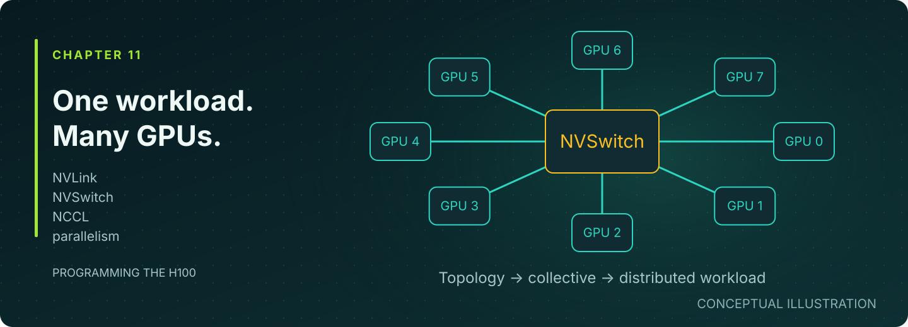
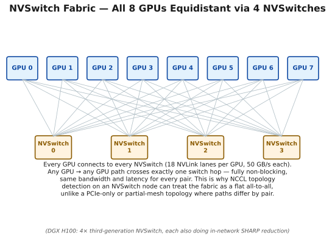
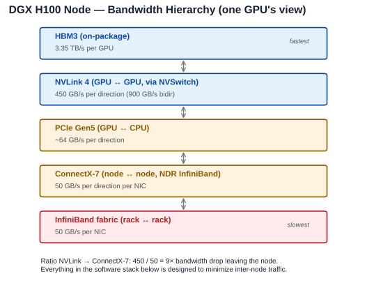
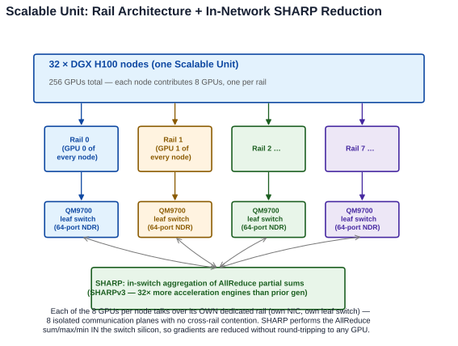
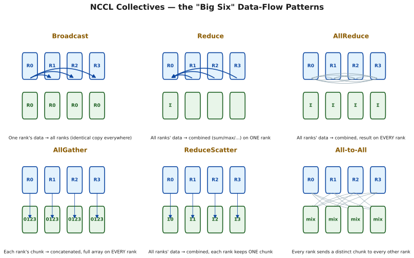
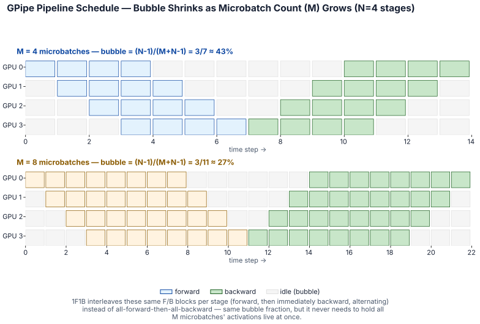
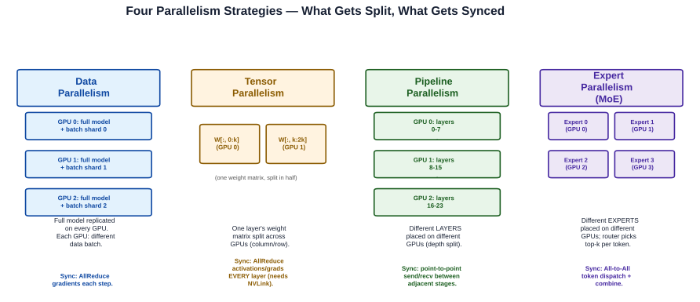

# Multi-GPU Systems, NCCL, and Distributed Training

[](images/chapter-openers/11-multigpu.svg)


<!-- learning:start -->
!!! tip "Your goal in this chapter"

    Separate topology from GPU count, match a collective to the required mathematical result, and state the hardware coverage of a distributed test.

    Understand the [Chapter 1](01-h100-architecture.md) bandwidth scopes first. A successful single-GPU run does not validate a multi-GPU communication path.
<!-- learning:end -->

!!! warning "GPU revalidation pending — November 21 correction"
    Current source below includes post-capture corrections. Historical outputs
    validate only their archived hashes. Do not use them as proof of the fixed
    source. See the [repair record](review-fixes-2026-11-21.md).


## Lesson 5 Companion Guide — Hardware Topology to Collective Primitives

> **Validation — November 17–18, 2026.** The [two-H100 follow-up audit](final-audit.md) compiled all three complete programs and executed the corrected peer-transfer benchmark and NCCL AllReduce with full-buffer checks. The revised portable training program subsequently passed on [eight A100 GPUs](eight-gpu-validation.md), targeting `sm_80`, with full final-weight and per-step loss comparisons against a CPU reference. This was not an eight-H100 run. All three programs have successful execution records linked below; earlier raw archives remain downloadable from the validation page.
> **Execution system:** 1× H100 PCIe, 114 SMs, 80 GB class; Ubuntu 24.04.5 LTS; driver 580.105.08; CUDA Toolkit 12.8.93; `sm_90a`, C++17, `-O2`.
> [Full system information](validation/2026-11-17/system-information.txt) · [CUDA result manifest](validation/2026-11-17/results.json). Each tested source and captured output is linked beside its example. Diagrams open as original SVGs for zooming.


---

## ★ BEFORE YOU START — Prerequisites & Setup

### What You Need to Know First

This guide covers the hardware and software stack that sits above single-kernel
optimization. You should be comfortable with:

```
Prerequisites Checklist
══════════════════════════════════════════════════════════════════════

  From Lessons 2-4:
    ✓ CUDA streams, cudaMemcpy, device pointers
    ✓ Basic kernel launch (<<<grid, block>>>)
    ✓ cudaDeviceSynchronize, cudaEvent timing
    ✓ Arithmetic intensity and bandwidth concepts (Lesson 3, §1)

  New concepts introduced HERE (no prior knowledge needed):
    ★ NVLink / NVSwitch — GPU-to-GPU interconnect topology
    ★ Unified Virtual Addressing (UVA) and peer access
    ★ SLURM workload manager — job scripts and rank identity
    ★ PMIx — exascale process management and KVS
    ★ NCCL — collective communications library
    ★ ncclUniqueId / communicator initialization
    ★ AllReduce, ReduceScatter, AllGather, Broadcast, Reduce, All-to-All
    ★ Data, Tensor, Pipeline, and Expert parallelism
    ★ Sequence parallelism and AllReduce decomposition

  Hardware assumed:
    H100 DGX node (8× SXM5 H100, 4× NVSwitch, 8× ConnectX-7)
    Concepts apply to A100 DGX with appropriate bandwidth numbers
    Single-node examples work on any multi-GPU machine
```

### Compile Commands for This Guide

```
Compile Patterns
══════════════════════════════════════════════════════════════════════

  # Single-node multi-GPU (NVLink P2P)
  nvcc -std=c++17 -arch=sm_90a -O2 example.cu -o example

  # NCCL examples (link against NCCL)
  nvcc -std=c++17 -arch=sm_90a -O2 example.cu \
       -lnccl -o example

  # Multi-process NCCL (run with mpirun or srun)
  nvcc -std=c++17 -arch=sm_90a -O2 example.cu \
       -lnccl -lmpi -o example
  mpirun -np 8 ./example

  # With PMIx (HPC cluster)
  nvcc -std=c++17 -arch=sm_90a -O2 example.cu \
       -lnccl -lpmix -o example
  srun --mpi=pmix -n 8 --gpus-per-task=1 ./example

  # Verify NVLink topology on your system
  nvidia-smi topo -m        # shows NVLink/PCIe topology matrix
  nvidia-smi nvlink -s      # NVLink per-GPU bandwidth status
```

---

## Table of Contents

1.  [Why Multi-GPU — The Arithmetic of Scale](#1-why-multi-gpu)
2.  [NVLink — The GPU-to-GPU Interconnect](#2-nvlink)
3.  [NVSwitch — Full Non-Blocking Fabric](#3-nvswitch)
4.  [The DGX H100 Node — Full Hardware Layout](#4-the-dgx-h100-node)
5.  [ConnectX-7 and the Inter-Node Bottleneck](#5-connectx-7-and-the-inter-node-bottleneck)
6.  [The SuperPOD — Cluster-Scale Architecture](#6-the-superpod)
7.  [Rail Networks and SHARP](#7-rail-networks-and-sharp)
8.  [InfiniBand Topology — Leaf, Spine, Core](#8-infiniband-topology-leaf-spine-core)
9.  [UVA and Peer Access — Software Abstractions](#9-uva-and-peer-access)
10. [SLURM — Workload Management and Rank Identity](#10-slurm)
11. [PMIx — Exascale Process Management](#11--pmix)
12. [NCCL — Architecture and Communicator Init](#12-nccl)
13. [NCCL Collective Primitives — The Big Six](#13-nccl-collective-primitives-the-big-six)
14. [Data Parallelism](#14-data-parallelism)
15. [Tensor Parallelism and Sequence Parallelism](#15-tensor-parallelism-and-sequence-parallelism)
16. [Pipeline Parallelism](#16-pipeline-parallelism)
17. [Expert Parallelism and MoE](#17-expert-parallelism-and-moe)
18. [Putting It All Together — Production Checklist](#18-putting-it-all-together-production-checklist)
19. [Quick Reference](#19-quick-reference)

---

## 1 — Why Multi-GPU

### 1.1 The Arithmetic of Scale

Before writing a line of multi-GPU code, understand why it is necessary. The
compute requirements of frontier AI are so large that single-GPU training is not
just slow — it is astronomically infeasible.

```
Training a 1T Parameter Model on 10T Tokens — Cost Estimate
══════════════════════════════════════════════════════════════════════

  Empirical rule for transformer training:
    FLOPs per token ≈ 6 × num_parameters
    (2× forward pass + 4× backward pass, approximate)

  Total training FLOPs:
    FLOPs = 6 × 1×10¹² params × 1×10¹³ tokens
           = 6×10²⁵ FLOPs

  Theoretical throughput on one H100 (BF16 tensor core):
    Peak: ~989 TFLOPS = ~10¹⁵ FLOP/s
    Realistic MFU (model FLOP utilization): ~40% → ~4×10¹⁴ FLOP/s

  Time on one H100:
    t = 6×10²⁵ / 4×10¹⁴ ≈ 1.5×10¹¹ seconds ≈ 4,755 years

  Time on 1,000 H100s:
    t = 4,755 / 1000 ≈ 4.75 years  (still unacceptable)

  Time on 10,000 H100s (a realistic frontier cluster):
    t = 4,755 / 10,000 ≈ 174 days  (feasible at high cost)

  ─── The Communication Problem ────────────────────────────────────

  It is not enough to have 10,000 GPUs. They must exchange gradients,
  activations, and parameters constantly. If communication is slow,
  GPUs idle waiting for data.

  The entire engineering challenge of multi-GPU training is keeping
  every GPU busy at all times, which requires:
    1. A fast intra-node interconnect (NVLink, 900 GB/s per GPU)
    2. A fast inter-node interconnect (InfiniBand, 400 Gb/s per port)
    3. Software that hides communication behind computation
    4. Schedulers that decompose the model efficiently
```

---

## 2 — NVLink

### 2.1 Physical Architecture and Bandwidth

NVLink is NVIDIA's proprietary direct GPU-to-GPU interconnect, bypassing the
CPU and PCIe bus entirely. On H100, it provides dramatically higher bandwidth
than PCIe Gen 5.

```
NVLink Gen 4 — H100 Physical Specifications
══════════════════════════════════════════════════════════════════════

  Bandwidth:
    900 GB/s bidirectional per GPU
    = 450 GB/s in each direction simultaneously

  PCIe Gen 5 comparison:
    PCIe Gen 5 ×16: ~128 GB/s bidirectional
    NVLink Gen 4:   ~900 GB/s bidirectional
    Ratio:          ~7× faster than PCIe

  Physical implementation:
    18 individual NVLink "links" per H100 GPU
    Each link: 2 high-speed differential pairs (down from 4 in Gen 3)
    → More links in the same physical space (density-optimized)
    → Each link: ~50 GB/s bidirectional
    → 18 links × 50 GB/s = 900 GB/s total

  ─── Why Bypassing PCIe Matters ──────────────────────────────────

  PCIe path (old way):
    GPU A → PCIe bus → CPU/Root Complex → PCIe bus → GPU B
    Latency: ~5-10 µs for a round trip
    Budget: 128 GB/s bidirectional; 64 GB/s per direction

  NVLink path (direct):
    GPU A → NVLink fabric → GPU B
    Latency: ~1-2 µs for a round trip
    Per-GPU budget: 900 GB/s bidirectional; 450 GB/s per direction

  Ideal one-way transfer model for 1 GB (decimal):
    PCIe path: 1 GB / 64 GB/s ≈ 15.6 ms per one-way transfer
    NVLink:    1 GB / 450 GB/s ≈ 2.2 ms per transfer
    These are link-budget lower bounds, not AllReduce runtimes.

  ─── What NVLink Enables ─────────────────────────────────────────

  Unified memory access:
    GPU 0 can load/store to GPU 1's HBM3 memory directly from a kernel.
    The address is a virtual pointer; hardware translates and routes.

  Peer-to-peer DMA:
    cudaMemcpyPeer() moves data GPU-to-GPU over NVLink at full speed.

  In-network reduction (via NVSwitch ALUs):
    The NVSwitch chips on the HGX board contain ALUs. AllReduce is
    performed IN THE SWITCH as data transits, not by the GPUs.
    NVLS can offload supported reductions when the topology and NCCL tuner select it.
    It does not make an eight-GPU AllReduce equal to a one-GPU transfer.
```

---

## 3 — NVSwitch

### 3.1 Full Non-Blocking Fabric

On an 8-GPU HGX board (like in the DGX H100), four NVSwitch chips connect all
eight GPUs. Each H100 SXM has a product-peak NVLink budget of **900 GB/s aggregate bidirectional bandwidth**, or **450 GB/s per direction**. That endpoint budget is shared across its peers; each pair does not receive an independent 900 GB/s allocation. A non-blocking fabric supports simultaneous routes within the endpoint and fabric budgets, while achieved throughput depends on the traffic pattern and software. See [NVIDIA’s Hopper architecture description](https://developer.nvidia.com/blog/nvidia-hopper-architecture-in-depth/).

```
NVSwitch Topology — 8 GPUs via 4 NVSwitch Chips
══════════════════════════════════════════════════════════════════════

  Physical layout:

  GPU 0 ─── SW0 ─── GPU 1
  GPU 0 ─── SW1 ─── GPU 2
  GPU 0 ─── SW2 ─── GPU 3     Each GPU connects to all 4 switches
  GPU 0 ─── SW3 ─── GPU 4     Each switch connects to all 8 GPUs
  ...

  Connectivity matrix (✓ = switched peer path; shared endpoint budget):
  ┌─────┬────┬────┬────┬────┬────┬────┬────┬────┐
  │     │ G0 │ G1 │ G2 │ G3 │ G4 │ G5 │ G6 │ G7 │
  ├─────┼────┼────┼────┼────┼────┼────┼────┼────┤
  │ G0  │  ─ │  ✓ │  ✓ │  ✓ │  ✓ │  ✓ │  ✓ │  ✓ │
  │ G1  │  ✓ │  ─ │  ✓ │  ✓ │  ✓ │  ✓ │  ✓ │  ✓ │
  │ G2  │  ✓ │  ✓ │  ─ │  ✓ │  ✓ │  ✓ │  ✓ │  ✓ │
  │ ... │ ..   ...  ...  ...  ...  ...  ...  ... │
  └─────┴────┴────┴────┴────┴────┴────┴────┴────┘

  "Non-blocking" means: GPU 0→GPU 7 at full speed WHILE
  GPU 1→GPU 6, GPU 2→GPU 5, GPU 3→GPU 4 are all also running.
  No link is shared, no packet must wait in line.

  ─── NVSwitch ALUs — In-Network Reduction ────────────────────────

  NVSwitch is not just a crossbar. It contains arithmetic units
  (ALUs) that can perform reductions AS DATA TRANSITS:

  One available path is NCCL NVLS (NVLink SHARP), not every AllReduce:
    Participating GPUs submit data; supported reductions use the fabric.
    For payload D, ideal per-endpoint send volume is about D versus
    2(N-1)D/N for ring AllReduce; receive volumes follow the same convention.
    This suggests at most about 2x bandwidth-bound improvement in that
    simplified model, not N-fold scaling or a guaranteed measured speedup.
    NCCL selects algorithms per collective using size, operation and topology.

  ─── NVLink Switch System (external, for >8 GPUs) ────────────────

  For clusters of 16-256 GPUs, NVIDIA uses NVLink Switch System:
    External trays containing NVSwitch chips.
    Connect up to 256 H100 GPUs at native chip speeds.
    32 DGX H100 servers → one "SuperPOD" with NVLink everywhere.

  ─── 4-5 NVLink ports per switch (HGX board) ─────────────────────

  On the HGX H100 board:
    Each GPU's 18 links are distributed 5/4/4/5 across four NVSwitches.
    Each GPU has 18 total NVLink links → split across 4 switches:
    Across eight GPUs there are 8×18 = 144 GPU-side links.
```

[](images/ch11/02-nvswitch-fabric.svg)

---

## 4 — The DGX H100 Node

### 4.1 Full Hardware Layout and Bandwidth Budget

The DGX H100 is NVIDIA's flagship single-node configuration. Understanding its
physical structure tells you exactly where your bandwidth budget comes from and
where the bottlenecks are.

```
DGX H100 Single Node — Complete Hardware Layout
══════════════════════════════════════════════════════════════════════

  Compute:
    8× H100 SXM5 GPUs
    Each GPU: 80 GB HBM3, 3.35 TB/s HBM bandwidth, 989 TFLOPS BF16
    Total node HBM: 640 GB
    Total node BF16 FLOPS: 7.9 PFLOPS

  Intra-node interconnect:
    4× NVSwitch Gen 3 chips
    Each GPU: 900 GB/s bidirectional NVLink bandwidth
    Total node bisection bandwidth: ~3.6 TB/s
    Topology: fully non-blocking all-to-all between 8 GPUs

  Inter-node networking:
    8× NVIDIA ConnectX-7 NICs (one per GPU, dedicated)
    Each NIC: 400 Gb/s (= 50 GB/s) NDR InfiniBand
    (Correction: this is NDR, not HDR -- HDR is the PREVIOUS generation
     at 200 Gb/s per port. ConnectX-7 is NDR-capable at 400 Gb/s.)
    Total node network bandwidth: 3.2 Tb/s = 400 GB/s
    Physical connectors: 4× OSFP cages (twin-port = 2×400Gb per cage)

  CPU:
    2× Intel Xeon Platinum 8480C (DGX H100; OEM HGX configurations vary)
    Primarily manages scheduling; GPUs bypass CPU for data

  Storage:
    Separate PCIe network cards for storage fabric
    Fat-tree or leaf-spine to NFS/Lustre/GPFS storage arrays
    Separate from compute fabric (does not share OSFP cages)

  ─── Bandwidth Hierarchy on one Node ─────────────────────────────

  HBM3 (GPU internal):      3.35 TB/s per GPU   (fastest)
       ↕
  NVLink (GPU-to-GPU):      450 GB/s per direction per GPU
       ↕
  PCIe Gen5 (GPU→CPU):      ~64 GB/s per direction
       ↕
  ConnectX-7 (node→node):   50 GB/s per direction per NIC
       ↕
  InfiniBand (rack→rack):   50 GB/s per NIC                (slowest)

  The ratio between NVLink and ConnectX-7:
    450 / 50 = 9× bandwidth drop when leaving the node.
  This is the most critical engineering constraint in cluster training.
  Everything is designed to minimize inter-node traffic.

  ─── GPU Direct RDMA ─────────────────────────────────────────────

  ConnectX-7 supports GPU Direct RDMA:
    GPU memory ←→ network NIC, BYPASSING CPU and system RAM.
    The NIC reads/writes GPU HBM directly over PCIe.
    CPU is not interrupted; it does not copy data.
    This is how inter-node AllReduce achieves near-theoretical speed.
```

[](images/ch11/01-bandwidth-hierarchy.svg)

---

## 5 — ConnectX-7 and the Inter-Node Bottleneck

### 5.1 The 9× Drop — Engineering the Handoff

Within a DGX H100 node, each GPU shares an NVLink budget of 450 GB/s per direction across its peers. Across nodes, traffic also traverses ConnectX-7 NICs and InfiniBand switches. Compare budgets with the same direction convention and account for the NICs assigned to each GPU; the difference is a link-budget model, not a fixed application slowdown.

```
The Inter-Node Bandwidth Gap
══════════════════════════════════════════════════════════════════════

  Intra-node (NVLink):    900 GB/s bidirectional per GPU
  Inter-node (ConnectX):  100 GB/s bidirectional per GPU (2×50 GB/s NIC)
  Ratio:                  9× slower when crossing node boundary

  For a 128-GPU cluster training a large model:
    AllReduce traffic: gradients × 2×(N-1)/N ≈ 2× gradient size per step
    With 128 GPUs, gradient tensor = 1 GB (typical):
    Inter-node traffic per step ≈ 2 GB per GPU per step

    At 100 GB/s inter-node bandwidth:
      Transfer time ≈ 2 GB / 50 GB/s = 40 ms (per-direction ideal bound) per step
    If forward + backward = 100 ms per step:
      Communication = 20% of total time → significant

  ─── How ConnectX-7 Minimizes the Penalty ────────────────────────

  1. GPU Direct RDMA:
     NIC reads/writes GPU HBM directly, no CPU copy.
     Eliminates: 2× PCIe crossings and 2× memory copies.
     Saves: ~5-10 µs of latency per transfer.

  2. In-network reduction (SHARP):
     The InfiniBand switches themselves perform arithmetic reductions.
     Like NVSwitch ALUs for intra-node, SHARP does it for inter-node.
     Reduces endpoint traffic for supported collectives; aggregate traffic still grows with the number of endpoints (see §7).

  3. Rail alignment:
     GPU 0 from every node connects to the SAME set of switches.
     Traffic from GPU 0→GPU 0 (different nodes) never shares a link
     with GPU 1→GPU 1. Eight isolated planes of connectivity.

  ─── OSFP Cages — Physical Connectors ────────────────────────────

  The DGX H100 has 4 OSFP (Octal Small Form-factor Pluggable) cages.
  Each cage uses twin-port technology: one cage = two 400 Gb/s links.

  4 cages × 2 links = 8 links of 400 Gb/s each
  One link per GPU, one per ConnectX-7 NIC.
  Total: 8 × 400 Gb/s = 3.2 Tb/s aggregate node bandwidth.

  OSFP cages are ONLY for compute fabric.
  Storage traffic uses separate standard PCIe NICs on the back panel.
  This physical separation ensures gradient traffic never competes
  with checkpoint I/O for the same links.
```

---

## 6 — The SuperPOD

### 6.1 Cluster-Scale Architecture

The DGX H100 SuperPOD is NVIDIA's reference cluster design for scaling from
8 GPUs to 4,096 GPUs. It is organized into a strict hierarchy of Scalable Units
(SUs), each designed around the port counts of standard switch hardware.

```
SuperPOD Hierarchy — 128 GPUs to 4096 GPUs
══════════════════════════════════════════════════════════════════════

  Building block: DGX H100 node
    8 GPUs per node, one ConnectX-7 NIC per GPU

  Scalable Unit (SU):
    32 DGX H100 nodes = 256 GPUs
    Why 32 nodes?
      Each Quantum-2 QM9700 switch has 64 ports.
      32 nodes × 8 GPUs/node = 256 GPU-facing ports needed.
      32 downlink ports (to 32 nodes, one per rail) +
      32 uplink ports (to spine layer) = 64 ports exactly.
      → One QM9700 handles one rail of one SU perfectly.

  Illustrative four-SU configuration:
    4 × 32 nodes = 128 nodes = 1,024 GPUs in a simple capacity model.
    Actual reference configurations reserve management/service capacity;
    four SUs is not a universal minimum deployment size. Check the
    selected NVIDIA SuperPOD reference architecture and port plan.

  SuperPOD with NVLink Switching:
    16 SUs = 512 nodes = 4,096 GPUs (connected across nodes with InfiniBand; not a 4,096-GPU NVLink domain)
    Or: 256 GPUs connected via NVLink Switch System for ultra-fast
    intra-cluster AllReduce before InfiniBand scale-out.

  ─── The Port-Count Design Principle ─────────────────────────────

  32 nodes per SU is not arbitrary:
    Standard InfiniBand switch: 64 ports
    Ports needed per SU per rail: 32 (one port per node, for that rail)
    Remaining ports: 32 → uplinks to spine

  This creates a perfect 1:1 ratio between downlinks and uplinks at
  the leaf layer. The network is "full-bisection bandwidth" within
  one SU — any node can talk to any other node at line rate.

  ─── Why 8 NICs Per Node Matters ─────────────────────────────────

  The SuperPOD is organized around the fact that each DGX node has
  8 separate NICs (one per GPU). This enables the Rail architecture.

  If nodes had only 1 NIC (like commodity servers):
    All 8 GPUs share one 400 Gb/s link → 50 Gb/s per GPU for inter-node
    No rail separation possible → all-or-nothing congestion
    No SHARP per-GPU isolation

  With 8 NICs:
    Each GPU has a DEDICATED 400 Gb/s inter-node link
    → 8 independent communication planes (Rails)
    → SHARP on each rail independently
    → No GPU's gradient traffic interferes with another's
```

---

## 7 — Rail Networks and SHARP

### 7.1 The Rail Architecture

The "rail" concept is the key architectural decision that enables linear scaling of
AllReduce across thousands of GPUs. Each GPU's network traffic travels on its
own dedicated, isolated plane of switches.

```
Rail Architecture — 8 Isolated Communication Planes
══════════════════════════════════════════════════════════════════════

  ─── Standard Network (what a commodity cluster looks like) ───────

  Node 1: GPU 0-7 → [single NIC] → [switch] → any destination
  Node 2: GPU 0-7 → [single NIC] → [switch] → any destination

  Problem: all 8 GPUs share one 400 Gb/s link = 50 Gb/s per GPU.
  During AllReduce, GPU 0 competes with GPU 7 for the same wire.
  Congestion is unavoidable.

  ─── Rail Architecture (DGX H100 SuperPOD) ────────────────────────

  Rail 1: [GPU 0, Node 1] ─── [Leaf Switch R1] ─── [GPU 0, Node 2]
                                                 └── [GPU 0, Node 3]
                                                 └── [GPU 0, Node N]

  Rail 2: [GPU 1, Node 1] ─── [Leaf Switch R2] ─── [GPU 1, Node 2]
                                                 └── [GPU 1, Node 3]
                                                 └── [GPU 1, Node N]
  ...
  Rail 8: [GPU 7, Node 1] ─── [Leaf Switch R8] ─── [GPU 7, Node 2]

  Key properties:
    Traffic on Rail 1 physically CANNOT interfere with Rail 2.
    They use different cables, different switches, different ports.
    GPU 0's gradient traffic is completely isolated from GPU 7's.

  NCCL and SHARP can now do:
    GPU 0 AllReduce: entirely within Rail 1 infrastructure.
    GPU 1 AllReduce: entirely within Rail 2 infrastructure.
    Both happening simultaneously at full line rate.

  ─── SHARP — In-Network Computation ─────────────────────────────

  SHARP (Scalable Hierarchical Aggregation and Reduction Protocol):
    Offloads gradient reduction arithmetic INTO the switch ASICs.
    The Quantum-2 switch performs additions on packets in transit.
    SHARPv3 on QM9700 is 32x more capable than the previous generation
    -- confirmed real: NVIDIA's own NVIDIA Quantum-2 announcement states
    SHARPv3 "provides 32x more acceleration engines for AI applications
    compared with the previous generation."

  Ring AllReduce traffic, payload D across N endpoints:
    Sent bytes per endpoint: 2(N-1)D/N, approaching 2D.
    Sum of sent bytes over endpoints: 2(N-1)D, which is O(ND).
    Receiving contributes the same endpoint volume; do not mix conventions.

  In-network reduction can reduce endpoint injection and repeated traffic
  on shared upper links. A simple reduction/broadcast model sends D and
  receives D per endpoint. Aggregate endpoint volume remains O(ND),
  not O(D). Topology, implementation, latency and supported operations
  determine actual performance; this is not a linear-scaling guarantee.

  The ConnectX-7 NIC works with SHARP:
    NIC and switch handshake to create a "reduction tree" in hardware.
    The NIC offloads the AllReduce to the switch fabric.
    GPU sees: enqueue gradient, receive result. No N-way coordination.
```

[](images/ch11/03-rail-sharp-architecture.svg)

---

## 8 — InfiniBand Topology: Leaf, Spine, Core

### 8.1 The Three-Layer Fat Tree

For clusters beyond a single SU (>256 GPUs), InfiniBand switches are organized
in a fat-tree hierarchy. Traffic between SUs must pass through multiple switch
layers.

```
Three-Layer Fat Tree — Full SuperPOD Network
══════════════════════════════════════════════════════════════════════

  ─── Layer 1: Leaf (Connection to Nodes) ─────────────────────────

  Where: physically at the top of each rack, or end-of-row
  What:  QM9700 switches, 64 ports each
  Who talks to whom:
    32 downlink ports → 32 nodes (one port per GPU per rail)
    32 uplink ports   → Spine layer switches

  Within-SU traffic STAYS at the leaf layer:
    GPU 0 (Node 1) → Leaf Switch (Rail 1) → GPU 0 (Node 2)
    Never goes to Spine or Core. Minimal hops = minimum latency.

  Adaptive routing at the leaf (for upward traffic):
    Multiple spine switches available for upward traffic.
    Leaf switch monitors queue depth on each uplink port.
    Per-packet (or per-flow) routing to least congested spine port.
    Avoids hot-spots when multiple nodes send to the same destination.

  ─── Layer 2: Spine (Connection Between SUs) ─────────────────────

  Where: core of the data center, dedicated switch rows
  What:  QM9700 (or larger) switches
  Who talks to whom:
    Downlinks → Leaf switches in multiple SUs
    Provides cross-SU paths for inter-SU AllReduce

  Rail isolation maintained at Spine:
    Spine Group 1 connects ONLY to Leaf switches handling Rail 1.
    Spine Group 2 connects ONLY to Rail 2 leaf switches.
    → Rail 1 gradient traffic NEVER shares a Spine with Rail 2.

  Cross-SU traffic path:
    GPU 0 (SU1, Node 1) → Leaf(SU1, Rail 1) → Spine(Group 1)
    → Leaf(SU2, Rail 1) → GPU 0 (SU2, Node 1)

  Link-failure self-healing (SHIELD; distinct from adaptive routing):
    SHIELD (Self-Healing Interconnect Enhancement for Intelligent Datacenters) is the Quantum-2 hardware fault recovery system.
    If a link fails, SHIELD detects it IN HARDWARE (not software).
    Recovery time: microseconds (vs 5-30 seconds for software) --
    confirmed real: NVIDIA/Mellanox's own SHIELD whitepaper cites
    ~1 microsecond hardware reroute vs. traditional subnet-manager
    recovery of up to 5 seconds (1,000-node clusters) or 30 seconds
    (10,000+-node clusters).
    How: switch checks local routing table for alternative path,
         updates its own table, signals upstream if no path found.
    Without SHIELD: one bad cable can crash a training run.
    With SHIELD: the run sees a brief stall (<1 ms), then continues.

  ─── Layer 3: Core / Super-Spine (Maximum Scale) ─────────────────

  Where: added only for clusters > 4 SUs (> 1,024 GPUs)
  What:  connects Pods (clusters of SUs) together
  Optics: 800G optical transceivers (2 × 400G logical links)
          optical because cable lengths too long for copper

  Traffic path (full 3 layers):
    GPU 0 → Leaf(SU1) → Spine(Group1) → Core → Spine(Group1,Pod2)
    → Leaf(SU5) → GPU 0 (SU5, Node 1)

  Each additional layer adds ~100-300 ns latency.
  Fat-tree bisection bandwidth remains full even at 3 layers.
```

---

## 9 — UVA and Peer Access

### 9.1 Unified Virtual Addressing

Before writing any NCCL code, you need to understand the software layer that
makes GPU-to-GPU memory access possible: Unified Virtual Addressing (UVA) and
peer access.

```
UVA and Peer Access — How GPUs See Each Other's Memory
══════════════════════════════════════════════════════════════════════

  ─── Before UVA (CUDA < 4.0) ─────────────────────────────────────

  CPU has its own virtual address space: [0x00000000 ... 0x7FFFFFFF]
  GPU 0 has its own: [0x0000000000 ... 0x1FFFFFFFFFF]
  GPU 1 has its own: [0x0000000000 ... 0x1FFFFFFFFFF]  ← SAME RANGE!

  You had to manually track which device a pointer belonged to.
  cudaMemcpy needed explicit src/dst device specification.
  Cross-GPU access was impossible from kernel code.

  ─── With UVA (CUDA 4.0+) ────────────────────────────────────────

  The system partitions the virtual address space:
    CPU RAM:          [0x00000000_00000000 ... 0x00000000_7FFFFFFF]
    GPU 0 HBM:        [0x00000020_00000000 ... 0x00000020_1FFFFFFF]
    GPU 1 HBM:        [0x00000040_00000000 ... 0x00000040_1FFFFFFF]
    GPU 2 HBM:        [0x00000060_00000000 ... ...]
    ...

  Effect:
    A pointer VALUE alone tells you which device it lives on.
    cudaPointerGetAttributes() reveals device, type, etc.
    cudaMemcpy() automatically routes based on pointer values.

  ─── Peer Access ─────────────────────────────────────────────────

  cudaDeviceCanAccessPeer reports address-access capability, not link type.
  Enable the direction used by the kernel: GPU 0 accessing GPU 1 memory.
  Peer traffic may traverse NVLink or PCIe according to the actual topology.
  Record nvidia-smi topo -m (and platform documentation) before labeling a link.

  More blocks can expose more independent memory requests; one block or SM
  does not correspond to one NVLink lane. Kernel copies and cudaMemcpyPeer
  use different execution paths, and either can benefit from sufficient work.
  NCCL selects algorithms/protocols for collectives; it is not merely a DMA
  wrapper, nor does raw peer access inherently prevent fabric saturation.

```

---

### ★ Section 9 — Runnable Code: NVLink P2P Bandwidth

**Manual Worked Example:**

This example measures three complete-buffer paths and checks every destination byte:
1. GPU 0 → pinned host memory → GPU 1 (staged copy).
2. GPU 0 → GPU 1 using the CUDA peer-copy API.
3. A kernel on GPU 0 reading GPU 1 memory, with one block or an SM-count-sized grid.

Bandwidth is payload bytes divided by elapsed time. Staged timing includes both
legs and their synchronization; kernel and peer-copy timings use events on GPU 0.
These scopes differ. Peer capability does not establish NVLink presence: record
`nvidia-smi topo -m` and the host configuration before interpreting any number.
No fixed speedup or link saturation is promised.

```
FILE: ex11_nvlink_bandwidth.cu
COMPILE: nvcc -std=c++17 -arch=sm_90a -O2 ex11_nvlink_bandwidth.cu -o ex11_nvlink_bandwidth
RUN: ./ex11_nvlink_bandwidth
EXPECT: Full-buffer verification PASS for each executed path; timings vary.
```

```cuda
// ex11_nvlink_bandwidth.cu — complete-buffer P2P audit benchmark.
// Peer capability is not proof of NVLink. Record nvidia-smi topo -m separately.
#include <cstdio>
#include <cstdlib>
#include <chrono>
#include <cuda_runtime.h>

static inline void check_cuda_status(cudaError_t status, const char* file, int line) {
    if (status != cudaSuccess) {
        fprintf(stderr, "CUDA %s:%d: %s\n", file, line, cudaGetErrorString(status));
        exit(1);
    }
}
#define CHECK_CUDA(call) check_cuda_status((call), __FILE__, __LINE__)

__global__ void peer_copy_kernel(const float* __restrict__ src,
                                 float* __restrict__ dst, size_t n) {
    // Every launch covers all n, including the one-block configuration.
    for (size_t i = (size_t)blockIdx.x * blockDim.x + threadIdx.x;
         i < n; i += (size_t)blockDim.x * gridDim.x)
        dst[i] = src[i];
}

double rate(size_t bytes, double ms) {
    if (!(ms > 0.0)) { fprintf(stderr, "Invalid elapsed time\n"); exit(1); }
    return (double)bytes / (ms * 1e6);
}

float elapsed(cudaEvent_t begin, cudaEvent_t end) {
    float ms;
    CHECK_CUDA(cudaEventElapsedTime(&ms, begin, end));
    return ms;
}

// Copy back and inspect every byte outside the timed region.
bool verify(int owner, const void* dst, unsigned char* host,
            size_t bytes, unsigned char expected, const char* label) {
    CHECK_CUDA(cudaSetDevice(owner));
    CHECK_CUDA(cudaMemcpy(host, dst, bytes, cudaMemcpyDeviceToHost));
    size_t errors = 0;
    for (size_t i = 0; i < bytes; ++i) {
        if (host[i] != expected) {
            if (errors < 4) fprintf(stderr, "%s byte %zu: got %u expected %u\n",
                                   label, i, (unsigned)host[i], (unsigned)expected);
            ++errors;
        }
    }
    printf("  %s full-buffer verification: %s (%zu byte errors)\n",
           label, errors == 0 ? "PASS" : "FAIL", errors);
    return errors == 0;
}

int main() {
    int count;
    CHECK_CUDA(cudaGetDeviceCount(&count));
    printf("GPUs detected: %d\n", count);
    for (int dev = 0; dev < count; ++dev) {
        cudaDeviceProp p;
        CHECK_CUDA(cudaGetDeviceProperties(&p, dev));
        printf("GPU %d: %s, SM %d.%d, %d SMs\n",
               dev, p.name, p.major, p.minor, p.multiProcessorCount);
    }
    if (count < 2) { fprintf(stderr, "Requires at least 2 GPUs\n"); return 2; }
    const int dev0 = 0, dev1 = 1, warmup = 3, iters = 10;
    const size_t n = 32 * 1024 * 1024, bytes = n * sizeof(float);
    float *src0, *dst0, *src1, *dst1;
    unsigned char* host;
    CHECK_CUDA(cudaMallocHost(&host, bytes));
    CHECK_CUDA(cudaSetDevice(dev0));
    CHECK_CUDA(cudaMalloc(&src0, bytes)); CHECK_CUDA(cudaMalloc(&dst0, bytes));
    CHECK_CUDA(cudaMemset(src0, 0x01, bytes));
    CHECK_CUDA(cudaDeviceSynchronize());
    CHECK_CUDA(cudaSetDevice(dev1));
    CHECK_CUDA(cudaMalloc(&src1, bytes)); CHECK_CUDA(cudaMalloc(&dst1, bytes));
    CHECK_CUDA(cudaMemset(src1, 0x02, bytes));
    // Complete GPU 1 initialization before GPU 0 can read its peer source.
    CHECK_CUDA(cudaDeviceSynchronize());

    int can01 = 0;
    CHECK_CUDA(cudaDeviceCanAccessPeer(&can01, dev0, dev1));
    printf("GPU 0 can access GPU 1 memory: %s (does not identify NVLink)\n",
           can01 ? "YES" : "NO");
    printf("Record topology with nvidia-smi topo -m. Payload: %zu bytes\n", bytes);
    bool enabled_by_us = false;
    CHECK_CUDA(cudaSetDevice(dev0));
    if (can01) {
        cudaError_t e = cudaDeviceEnablePeerAccess(dev1, 0);
        if (e == cudaErrorPeerAccessAlreadyEnabled) {
            (void)cudaGetLastError(); // consume the expected already-enabled status
        } else {
            CHECK_CUDA(e);
            enabled_by_us = true;
        }
    }
    cudaEvent_t start, stop;
    CHECK_CUDA(cudaEventCreate(&start)); CHECK_CUDA(cudaEventCreate(&stop));
    bool ok = true;

    // Staged path, GPU 0 -> host -> GPU 1; host timing covers both devices.
    CHECK_CUDA(cudaSetDevice(dev1));
    CHECK_CUDA(cudaMemset(dst1, 0, bytes)); CHECK_CUDA(cudaDeviceSynchronize());
    double staged_ms = 0;
    for (int i = -warmup; i < iters; ++i) {
        auto begin = std::chrono::steady_clock::now();
        CHECK_CUDA(cudaSetDevice(dev0));
        CHECK_CUDA(cudaMemcpy(host, src0, bytes, cudaMemcpyDeviceToHost));
        CHECK_CUDA(cudaSetDevice(dev1));
        CHECK_CUDA(cudaMemcpy(dst1, host, bytes, cudaMemcpyHostToDevice));
        CHECK_CUDA(cudaDeviceSynchronize());
        auto end = std::chrono::steady_clock::now();
        if (i >= 0) staged_ms += std::chrono::duration<double, std::milli>(end-begin).count();
    }
    staged_ms /= iters;
    ok &= verify(dev1, dst1, host, bytes, 0x01, "Staged 0->1");
    printf("  Staged complete-transfer time: %.6f ms, payload %.3f GB/s\n",
           staged_ms, rate(bytes, staged_ms));

    // Peer-copy API; the runtime chooses the path supported by this system.
    CHECK_CUDA(cudaSetDevice(dev1));
    CHECK_CUDA(cudaMemset(dst1, 0, bytes)); CHECK_CUDA(cudaDeviceSynchronize());
    CHECK_CUDA(cudaSetDevice(dev0));
    double peer_ms = 0;
    for (int i = -warmup; i < iters; ++i) {
        CHECK_CUDA(cudaEventRecord(start));
        CHECK_CUDA(cudaMemcpyPeerAsync(dst1, dev1, src0, dev0, bytes, 0));
        CHECK_CUDA(cudaEventRecord(stop)); CHECK_CUDA(cudaEventSynchronize(stop));
        if (i >= 0) peer_ms += elapsed(start, stop);
    }
    peer_ms /= iters;
    ok &= verify(dev1, dst1, host, bytes, 0x01, "Peer API 0->1");
    printf("  Peer API transfer time: %.6f ms, payload %.3f GB/s (link unclassified)\n",
           peer_ms, rate(bytes, peer_ms));

    if (can01) {
        cudaDeviceProp p;
        CHECK_CUDA(cudaGetDeviceProperties(&p, dev0));
        const int grids[] = {1, p.multiProcessorCount};
        for (int blocks : grids) {
            CHECK_CUDA(cudaSetDevice(dev0));
            CHECK_CUDA(cudaMemset(dst0, 0, bytes)); CHECK_CUDA(cudaDeviceSynchronize());
            double ms = 0;
            for (int i = -warmup; i < iters; ++i) {
                CHECK_CUDA(cudaEventRecord(start));
                peer_copy_kernel<<<blocks, 256>>>(src1, dst0, n);
                CHECK_CUDA(cudaGetLastError());
                CHECK_CUDA(cudaEventRecord(stop)); CHECK_CUDA(cudaEventSynchronize(stop));
                if (i >= 0) ms += elapsed(start, stop);
            }
            ms /= iters;
            ok &= verify(dev0, dst0, host, bytes, 0x02, "Kernel 1->0");
            printf("  Kernel grid %d blocks: %.6f ms, payload %.3f GB/s\n",
                   blocks, ms, rate(bytes, ms));
        }
    } else printf("Kernel peer reads skipped: GPU 0 cannot access GPU 1 memory.\n");

    // Events belong to GPU 0; destroy them while their owner is current.
    CHECK_CUDA(cudaSetDevice(dev0));
    CHECK_CUDA(cudaEventDestroy(start)); CHECK_CUDA(cudaEventDestroy(stop));
    if (enabled_by_us) CHECK_CUDA(cudaDeviceDisablePeerAccess(dev1));
    CHECK_CUDA(cudaFree(src0)); CHECK_CUDA(cudaFree(dst0));
    CHECK_CUDA(cudaSetDevice(dev1));
    CHECK_CUDA(cudaFree(src1)); CHECK_CUDA(cudaFree(dst1));
    CHECK_CUDA(cudaFreeHost(host));
    printf("Full-buffer checks: %s\n", ok ? "PASS" : "FAIL");
    return ok ? 0 : 1;
}
```

<!-- revalidation:start:ex11_nvlink_bandwidth.cu -->
> **Historical source:** this capture predates the November 21 correction. GPU revalidation pending for the current source; the archive below is retained for evidence.

> **Additional execution — November 18, 2026: PASS.** 2× H100 80GB HBM3; NV18; CUDA 12.8.93; driver 580.105.08; `sm_90a`. Compiled UTC: `2026-11-18T11:19:53.204677+00:00`. Executed UTC: `2026-11-18T11:19:54.198165+00:00`.

Source SHA-256: `67e71f448fd51c1e130ef1c87abeece5d694e5546f6c32c837ca44db30b6c305`. [Exact source](validation/2026-11-18-two-h100/11-multi-gpu-nccl/ex11_nvlink_bandwidth/ex11_nvlink_bandwidth.cu) · [Compile log](validation/2026-11-18-two-h100/11-multi-gpu-nccl/ex11_nvlink_bandwidth/compile.log) · [Run log](validation/2026-11-18-two-h100/11-multi-gpu-nccl/ex11_nvlink_bandwidth/run.log) · [System and rerun summary](revalidation-2026-11-18.md).

```bash
nvcc -std=c++17 -arch=sm_90a -O2 ex11_nvlink_bandwidth.cu -o ./example
./example
```

**Sample output — November 18 rerun**

```text
GPUs detected: 2
GPU 0: NVIDIA H100 80GB HBM3, SM 9.0, 132 SMs
GPU 1: NVIDIA H100 80GB HBM3, SM 9.0, 132 SMs
GPU 0 can access GPU 1 memory: YES (does not identify NVLink)
Record topology with nvidia-smi topo -m. Payload: 134217728 bytes
  Staged 0->1 full-buffer verification: PASS (0 byte errors)
  Staged complete-transfer time: 4.860716 ms, payload 27.613 GB/s
  Peer API 0->1 full-buffer verification: PASS (0 byte errors)
  Peer API transfer time: 0.347011 ms, payload 386.782 GB/s (link unclassified)
  Kernel 1->0 full-buffer verification: PASS (0 byte errors)
  Kernel grid 1 blocks: 137.613831 ms, payload 0.975 GB/s
  Kernel 1->0 full-buffer verification: PASS (0 byte errors)
  Kernel grid 132 blocks: 1.070992 ms, payload 125.321 GB/s
Full-buffer checks: PASS
```
<!-- revalidation:end:ex11_nvlink_bandwidth.cu -->


!!! info "Corrected benchmark — two-GPU execution passed"

    The grid-stride benchmark compiled and passed every full-buffer check on two H100 GPUs. Its captured result is shown below; dated source and logs are downloadable with the result.

**Current two-GPU result — ex11_nvlink_bandwidth.cu**

> Executed: `2026-11-17T23:36:24.075201+00:00` (UTC). Compile PASS; execution PASS. System: 2× H100 80GB HBM3, 132 SMs each, NV18 topology; CUDA 12.8.93, driver 580.105.08, Ubuntu 24.04.5 LTS.

[Archived tested source](validation/2026-11-17-final-audit/11-multi-gpu-nccl/ex11_nvlink_bandwidth/ex11_nvlink_bandwidth.cu) · [Compiler log](validation/2026-11-17-final-audit/11-multi-gpu-nccl/ex11_nvlink_bandwidth/compile.log) · [Execution log](validation/2026-11-17-final-audit/11-multi-gpu-nccl/ex11_nvlink_bandwidth/run.log) · [Full audit](final-audit.md).

```bash
nvcc -std=c++17 -arch=sm_90a -O2 ex11_nvlink_bandwidth.cu -o ex11_nvlink_bandwidth
./ex11_nvlink_bandwidth
```

```text
GPUs detected: 2
GPU 0: NVIDIA H100 80GB HBM3, SM 9.0, 132 SMs
GPU 1: NVIDIA H100 80GB HBM3, SM 9.0, 132 SMs
GPU 0 can access GPU 1 memory: YES (does not identify NVLink)
Record topology with nvidia-smi topo -m. Payload: 134217728 bytes
  Staged 0->1 full-buffer verification: PASS (0 byte errors)
  Staged complete-transfer time: 4.878781 ms, payload 27.511 GB/s
  Peer API 0->1 full-buffer verification: PASS (0 byte errors)
  Peer API transfer time: 0.347469 ms, payload 386.273 GB/s (link unclassified)
  Kernel 1->0 full-buffer verification: PASS (0 byte errors)
  Kernel grid 1 blocks: 131.141272 ms, payload 1.023 GB/s
  Kernel 1->0 full-buffer verification: PASS (0 byte errors)
  Kernel grid 132 blocks: 1.070518 ms, payload 125.376 GB/s
Full-buffer checks: PASS
```


Use the two-GPU record above for the current source and measured peer-bandwidth results. These measurements describe this topology and payload; they are not universal performance guarantees.

---

## 10 — SLURM

### 10.1 Workload Management and Rank Identity

See [Slurm’s GPU management documentation](https://slurm.schedmd.com/gres.html#GPU_Management) for job-step visibility, ordinal remapping and configuration-dependent cgroup restrictions.

SLURM (Simple Linux Utility for Resource Management) is the job scheduler used
on most HPC clusters. It is responsible for allocating GPUs, setting up process
environments, and launching your program across potentially thousands of nodes.

```
SLURM Concepts — Terminology Reference
══════════════════════════════════════════════════════════════════════

  Job:
    The resource allocation. Created when you run sbatch or salloc.
    Defines: how many nodes, how many GPUs, how much time, memory.

  Task:
    A single running process of your application.
    --ntasks-per-node=8 → 8 tasks per node (one per GPU typical).

  Global Rank:
    The unique ID of a task across the ENTIRE job.
    8 nodes × 8 tasks/node = 64 tasks total → ranks 0 to 63.

  Local Rank:
    The unique ID of a task within a SINGLE node.
    Always 0 to (tasks_per_node - 1).
    KEY: use local rank to determine which GPU this process owns.

  Namespace:
    The SLURM job ID, shared by all tasks in the same job.
    May be used by an application as part of a rendezvous namespace.

  ─── Device Isolation ─────────────────────────────────────────────

  GPU visibility and isolation depend on the cluster configuration:

  1. CUDA_VISIBLE_DEVICES:
     For local rank 0: CUDA_VISIBLE_DEVICES=0    → sees only GPU 0
     For local rank 1: CUDA_VISIBLE_DEVICES=1    → sees only GPU 1
     If each task sees exactly one GPU: cudaSetDevice(0).
     If multiple GPUs are visible, use the launcher’s binding policy.
     cudaGetDevice(&device) queries the current logical ordinal.
     CONSEQUENCE: if you print "GPU 0" in logs, it might physically
     be GPU 5. Use cudaDeviceGetPCIBusId() to get the true device.

  2. Linux cgroups (control groups):
     Kernel-level device allowlist.
     With device constraints enabled, the OS restricts device access.
     Do not assume this policy is enabled on every cluster.

  ─── A Minimal SLURM Script ───────────────────────────────────────

  #!/bin/bash
  #SBATCH --job-name=gemm_train       # job name for queue display
  #SBATCH --nodes=4                   # number of nodes
  #SBATCH --ntasks-per-node=8         # one task per GPU
  #SBATCH --gpus-per-task=1           # one GPU per task
  #SBATCH --time=02:00:00             # max wall time (HH:MM:SS)
  #SBATCH --partition=gpu_h100        # queue/partition name
  #SBATCH --exclusive                 # no sharing with other jobs

  # Load CUDA and NCCL modules
  module load cuda/12.3 nccl/2.18

  # Launch: srun creates tasks on all nodes simultaneously
  # --mpi=pmix tells srun to use PMIx for process management
  srun --mpi=pmix ./my_training_binary

  ─── What sbatch Does ─────────────────────────────────────────────

  CPU side:
    Reads the #SBATCH directives for resource requirements.
    Queues the job; waits for resources to become available.
    When resources are free: runs the script body.

  srun --mpi=pmix side:
    Logs into all N nodes simultaneously (no SSH handshake).
    Launches the binary on all N×8 tasks at once.
    Sets SLURM_PROCID (global rank), SLURM_LOCALID (local rank),
    CUDA_VISIBLE_DEVICES (which GPU to use) for each task.
    All tasks see the same binary; they differentiate by rank.
```

---

## 11 — PMIx

### 11.1 Exascale Process Management

When SLURM launches 1,000 processes across 125 nodes, those processes start as
"isolated islands" — each knows it is alive but does not know the network addresses
of any other process. PMIx (Process Management Interface for Exascale) solves this
bootstrapping problem.

```
PMIx — The Bootstrap Key-Value Store
══════════════════════════════════════════════════════════════════════

  ─── The Problem PMIx Solves ─────────────────────────────────────

  After srun launches 1,000 processes:
    Process 0 knows: my rank is 0, my node is n001, my GPU is 0
    Process 0 does NOT know: IP address of process 999, or its GPU

  Before NCCL can build communicators, every process must be able
  to reach every other. They need a shared directory of metadata.
  PMIx provides that directory.

  ─── PMIx API ────────────────────────────────────────────────────

  PMIx_Put(scope, key, value):
    Push local metadata into the PMIx server.
    scope: PMIX_LOCAL (node-level) or PMIX_GLOBAL (cluster-level)
    key:   arbitrary string (e.g., "nccl_id_bytes")
    value: binary data (IP address, port, CUDA IPC handle, etc.)

  PMIx_Commit():
    Flush local puts to the PMIx server.
    Must call before data is visible to other processes.

  PMIx_Fence(procs, nprocs, info, ninfo):
    Global barrier. Blocks until ALL processes have called Fence.
    Ensures data from ALL PMIx_Put/Commit calls is visible.
    Without this: a process might read stale or missing data.

  PMIx_Get(proc, key, info, ninfo, val):
    Retrieve a value that another process posted.
    proc: which process's data you want (rank + namespace)
    key:  same key string used in PMIx_Put

  ─── Initialization Sequence ─────────────────────────────────────

  Step 1: Connect to SLURM daemon
    PMIx_Init(&myproc, NULL, 0);
    After this, myproc.nspace = job namespace, myproc.rank = global rank.

  Step 2: Get local rank (which GPU to use)
    PMIx_Get(&myproc, PMIX_LOCAL_RANK, NULL, 0, &val);
    local_rank = val->data.uint16;
    int visible = 0; cudaGetDeviceCount(&visible);
    cudaSetDevice(visible == 1 ? 0 : local_rank); // respect per-task GPU visibility

  Step 3: Get total job size (for NCCL nranks)
    PMIx_Get(&myproc, PMIX_JOB_SIZE, NULL, 0, &val);
    nranks = val->data.uint32;

  Step 4: Exchange NCCL unique ID (see Section 12)

  Step 5: Initialize NCCL communicator

  Step 6: Run your kernels

  Step 7: Finalize
    ncclCommDestroy(comm);
    PMIx_Finalize(NULL, 0);   // tells SLURM: this process is done

  ─── Why PMIx Scales (vs old SSH-based MPI) ──────────────────────

  Old way (mpirun + SSH):
    For each process: SSH into node, check hostname, exchange keys.
    1,000 processes → ~1,000 SSH connections → minutes of startup.
    Each SSH can fail independently → brittle at scale.

  PMIx way (srun + PMIx):
    Shared daemon already running on all nodes (started by SLURM).
    PMIx_Init() is a local socket connection: microseconds.
    PMIx_Fence() is a collective barrier handled by SLURM daemons.
    1,000 processes ready in seconds, not minutes.
    PMIX_GLOBAL ensures data is available cluster-wide.
```

---

## 12 — NCCL

### 12.1 What NCCL Is and How It Works

NCCL (NVIDIA Collective Communications Library) is the GPU-focused library for
all-GPU collective operations. It sits between your training code and the hardware,
selecting optimal communication algorithms based on topology.

```
NCCL Architecture — From API Call to Hardware
══════════════════════════════════════════════════════════════════════

  Your training code:
    ncclAllReduce(grad_buf, grad_buf, N, ncclFloat, ncclSum, comm, stream)
    ↓

  NCCL dispatcher:
    Checks communicator topology: are all GPUs on same node (NVLink)?
    Or multi-node (NVLink + InfiniBand)?
    Selects algorithm: Ring, Tree, CollNetDirect/CollNetChain or NVLS/NVLSTree, according to version and support.
    Enqueues GPU kernels + network ops onto the CUDA stream.
    ↓

  CUDA stream (GPU side):
    NCCL's own kernels run on your stream.
    They move data using: NVLink LD/ST, TMA, or RDMA primitives.
    They perform local arithmetic (partial sums, pack/unpack).
    ↓

  Hardware:
    NVSwitch ALUs: reduction happens in-switch.
    ConnectX-7 RDMA: inter-node transfers without CPU.
    SHARP: switch-level accumulation for inter-node AllReduce.

  ─── The ncclUniqueId Bootstrap ──────────────────────────────────

  Before any collective can run, all participating processes must
  agree on a "meeting point." This is the ncclUniqueId.

  Correction: ncclUniqueId is NOT a struct with named IP/port fields.
  NCCL's own public header defines it as a genuinely OPAQUE 128-byte
  blob:
      typedef struct { char internal[128]; } ncclUniqueId;
  (confirmed against NCCL's own nccl.h.in on GitHub). NCCL encodes
  whatever bootstrap rendezvous address it needs inside those 128
  opaque bytes -- callers never parse or construct the contents
  themselves, they only ever copy the whole blob around. The mental
  model below ("it carries Rank 0's address so everyone can find the
  rendezvous point") is the right INTUITION for what the blob
  accomplishes, but treat the bytes as opaque, not as a struct you
  could field-access.

  Process:
    Rank 0: ncclGetUniqueId(&id);
            → Fills the opaque 128-byte id with a fresh bootstrap
              rendezvous address (conceptually: "where to find me").
            → Publishes via PMIx: PMIx_Put("nccl_id", &id, sizeof(id))
            → PMIx_Commit(); PMIx_Fence() — wait for all to sync.

    Rank N (N > 0): PMIx_Fence() — barrier.
            → PMIx_Get(rank_0_proc, "nccl_id", ..., &val)
            → memcpy(&id, val->data.bo.bytes, sizeof(id))
            → Now has the same ID struct as Rank 0.

  ─── ncclCommInitRank — The Heavy Lifting ────────────────────────

  ncclCommInitRank(&comm, nranks, id, global_rank);

  This function does everything:

    Phase 1 — TCP Rendezvous:
      Every rank decodes the bootstrap rendezvous address encoded
      inside the ncclUniqueId's opaque 128 bytes (see Section 12.1's
      correction -- not a literal IP:Port struct, but the effect is
      the same: every rank now knows how to reach Rank 0).
      Every rank opens a TCP socket and connects to Rank 0.
      Rank 0 waits for exactly nranks connections.
      Metadata exchanged: rank, device, PCI bus ID, NVLink topology.

    Phase 2 — Topology Analysis (each rank):
      Every rank analyzes the peer/topology information exchanged during bootstrap.
      Decides: which pairs are NVLink? Which are InfiniBand?
      Builds a "routing table": for AllReduce, who sends to whom.
      Builds candidate paths. For each collective call the tuner selects:
      Ring (bandwidth-efficient, O(N) step latency), Tree (O(log N) depth),
      or supported NVLS/CollNet variants; size, operation and topology matter.

    Phase 3 — Hardware Setup:
      Intra-node: NVSwitch fabric configured for direct access.
        Each GPU maps the virtual addresses of all other GPUs.
        cudaDeviceEnablePeerAccess called for NVLink-connected pairs.
      Inter-node: InfiniBand RDMA handshake.
        Each node-pair creates Queue Pairs (QPs) for RDMA.
        Registered memory regions: GPU HBM exposed to remote NICs.
        Connecting peers exchange connection metadata through bootstrap.

    Phase 4 — Scratch Buffer Allocation:
      NCCL_BUFFSIZE defaults to 4 MiB per communication buffer;
      total allocation depends on channels, peers, protocols and other workspace.
      Used for: staging partial sums, ring buffers, headers.
      Also allocates small CPU staging areas for PCIe fallback.

  Result: the `comm` object holds the full routing table,
  hardware handles, and scratchpad pointers for all future collectives.

  ─── ncclCommDestroy — Teardown ──────────────────────────────────

  ncclCommDestroy(comm):
    Marks comm invalid for new kernel launches.
    Waits for in-flight NCCL kernels to complete (reference counting).
    Frees: HBM scratch buffers, CPU staging areas.
    Destroys: NVLink peer mappings, InfiniBand Queue Pairs.
    After this call, comm is a dangling pointer — do not use.
```

---

## 13 — NCCL Collective Primitives — The Big Six

### 13.1 Overview and Data Flow Patterns

All six collective operations are fundamental patterns that appear repeatedly in
distributed training. Understanding their data flows tells you when to use each.

```
The Six Collective Primitives — Data Flow Diagrams
══════════════════════════════════════════════════════════════════════

  Notation: GPU_k holds vector V_k. Final state shown after operation.
  N = number of GPUs in communicator.

  ─── 1. Broadcast ──────────────────────────────────────────────
  "One GPU sends its data to ALL others"

  Before: GPU 0: [A]   GPU 1: [?]   GPU 2: [?]   GPU 3: [?]
  After:  GPU 0: [A]   GPU 1: [A]   GPU 2: [A]   GPU 3: [A]
                 ↑root

  H100 DGX implementation:
    Rank 0 sends [A] to NVSwitch once.
    NVSwitch replicates to all 7 ports simultaneously.
    Time ≈ cost to send to 1 GPU (not 7 separate sends).

  Math: ∀k: V_k = V_root
  Use in training: checkpoint broadcast at initialization.

  ─── 2. Reduce ──────────────────────────────────────────────────
  "ALL GPUs contribute, result lands on ONE"

  Before: GPU 0: [A]   GPU 1: [B]   GPU 2: [C]   GPU 3: [D]
  After:  GPU 0: [A+B+C+D]   GPU 1: [B]   GPU 2: [C]   GPU 3: [D]
                 ↑root

  Math: V_root = ⊕_{k=0}^{N-1} V_k  (where ⊕ is ncclSum/Max/Min)
  Use in training: final logits reduction (only rank 0 needs top-k).

  ─── 3. AllReduce ───────────────────────────────────────────────
  "ALL GPUs contribute, ALL get the result"

  Before: GPU 0: [A]   GPU 1: [B]   GPU 2: [C]   GPU 3: [D]
  After:  GPU 0: [A+B+C+D]  GPU 1: [A+B+C+D]  GPU 2: [A+B+C+D]  GPU 3: [A+B+C+D]

  Math: ∀k: V_k = ⊕_{j=0}^{N-1} V_j
  Use in training: gradient aggregation in Data Parallelism.
  MOST IMPORTANT collective for AI training.

  ncclRedOp_t includes Sum, Prod, Min, Max and Avg.
  Ordinary NCCL GPU kernels perform reductions using SM arithmetic,
  not Tensor Core matrix instructions. Selected NVLS paths can offload
  supported operation/type combinations; check the installed version,
  capabilities and NCCL's actual algorithm choice rather than assuming
  that an operation name always identifies the hardware path.

  ─── 4. AllGather ───────────────────────────────────────────────
  "GPUs start with DIFFERENT slices, ALL end with the FULL tensor"

  Before: GPU 0: [A]   GPU 1: [B]   GPU 2: [C]   GPU 3: [D]
  After:  GPU 0: [A,B,C,D]  GPU 1: [A,B,C,D]  GPU 2: [A,B,C,D]  GPU 3: [A,B,C,D]

  recvcount = total elements (sendcount × nranks).
  Math: ∀k: recvbuf_k[j*count:(j+1)*count] = sendbuf_j for all j.
  Use in training: reconstruct full weight tensor in Tensor Parallelism.

  ─── 5. ReduceScatter ───────────────────────────────────────────
  "Reduce across all GPUs, SCATTER so each gets a different chunk"

  Before: GPU 0: [A,B,C,D]  GPU 1: [A,B,C,D]  GPU 2: [A,B,C,D]  GPU 3: [A,B,C,D]
  After:  GPU 0: [4A]        GPU 1: [4B]        GPU 2: [4C]        GPU 3: [4D]
          (each GPU holds sum of one chunk from all inputs)

  recvcount = total/nranks (you receive LESS than you send).
  PADDING: total elements must be divisible by nranks. Pad if not.
  Math: ∀k: recvbuf_k = ⊕_{j=0}^{N-1} sendbuf_j[k*m:(k+1)*m]
  Use in training: gradient distribution in ZeRO, Sequence Parallelism.

  AllReduce = ReduceScatter + AllGather (this decomposition enables SP).

  ─── 6. All-to-All ──────────────────────────────────────────────
  "Each GPU sends a DIFFERENT piece to EVERY other GPU"

  Before:
    GPU 0: [for_0, for_1, for_2, for_3]  (block j → send to GPU j)
    GPU 1: [for_0, for_1, for_2, for_3]
    GPU 2: [for_0, for_1, for_2, for_3]
    GPU 3: [for_0, for_1, for_2, for_3]

  After:
    GPU 0: [from_0, from_1, from_2, from_3]  (block j = received from GPU j)
    GPU 1: [from_0, from_1, from_2, from_3]
    ...

  Math: recvbuf_k[j] = sendbuf_j[k]  (matrix transpose of data)
  Use in training: Expert Parallelism (route tokens to experts).
  Bandwidth intensive: N×(N-1) point-to-point transfers.
  Host-issued NCCL calls enqueue communication on a CUDA stream.
  Device execution is asynchronous; consumers must observe completion.
  For MoE, compare packing, variable counts and transfer granularity
  against a specialised communication implementation.
```

[](images/ch11/04-nccl-big-six.svg)

NCCL’s [CUDA stream semantics](https://docs.nvidia.com/deeplearning/nccl/user-guide/docs/usage/streams.html) distinguish host enqueue from asynchronous device execution. Use stream ordering or CUDA events to establish when received data is ready.

### 13.2 NCCL API Reference — All Six Primitives

```
NCCL Function Signatures — Complete Reference
══════════════════════════════════════════════════════════════════════

  Common parameters:
    sendbuff:  device pointer to send buffer (on current GPU's HBM)
    recvbuff:  device pointer to recv buffer (can equal sendbuff for in-place)
    count:     number of elements (NOT bytes)
    datatype:  ncclFloat, ncclHalf, ncclBFloat16, ncclInt, ncclFloat8e4m3...
    op:        ncclSum, ncclProd, ncclMin, ncclMax, ncclAvg
    comm:      ncclComm_t communicator from ncclCommInitRank
    stream:    CUDA stream (NCCL work is launched on this stream)

  ncclBroadcast(sendbuff, recvbuff, count, datatype, root, comm, stream)
    root: rank whose sendbuff is broadcast to all recvbuffs
    In-place: sendbuff == recvbuff allowed (root reads and writes same ptr)
    FP8 note: ncclFloat8e4m3 / ncclFloat8e5m2 → Hopper-specific intrinsics

  ncclReduce(sendbuff, recvbuff, count, datatype, op, root, comm, stream)
    Only root's recvbuff is written.
    Others' recvbuff: undefined / unchanged.
    root typically = 0 (Rank 0 needs logits for argmax/sampling)

  ncclAllReduce(sendbuff, recvbuff, count, datatype, op, comm, stream)
    ALL recvbuffs receive the result.
    In-place: sendbuff == recvbuff → typical usage in gradient sync.
    NVLS offload depends on the selected operation, datatype and topology.

  ncclReduceScatter(sendbuff, recvbuff, recvcount, datatype, op, comm, stream)
    recvcount: elements PER GPU (= total/nranks, NOT total)
    Padding: total_elements MUST be divisible by nranks.
    recvbuff is SMALLER than sendbuff by factor nranks.

  ncclAllGather(sendbuff, recvbuff, sendcount, datatype, comm, stream)
    sendcount: elements per GPU (size of this GPU's slice)
    recvbuff will contain sendcount × nranks elements total.
    recvbuff[rank * sendcount : (rank+1) * sendcount] = this GPU's sendbuff.

  ncclSend(sendbuff, count, datatype, peer, comm, stream)
    peer: destination rank
    Must be paired with ncclRecv on the peer.
    Enqueue in ncclGroupStart/End with the corresponding Recv.

  ncclRecv(recvbuff, count, datatype, peer, comm, stream)
    peer: source rank
    Must have a matching ncclSend on the source rank.
    In a P2P exchange, launch Send and Recv for ALL pairs inside one Group.

  ─── ncclGroupStart / ncclGroupEnd ───────────────────────────────

  ncclGroupStart();
    // All NCCL calls here are queued, NOT executed yet
    ncclSend(buf_a, N, ncclFloat, 1, comm, stream);  // GPU 0 → GPU 1
    ncclRecv(buf_b, N, ncclFloat, 1, comm, stream);  // GPU 0 ← GPU 1
  ncclGroupEnd();
    // NOW NCCL optimizes and launches all queued ops atomically.
    // Prevents partial-launch hangs when one GPU starts sending
    // before its peer has issued the corresponding Recv.

  cudaStreamSynchronize(stream);  // wait for completion
```

---

### ★ Section 13 — Runnable Code: NCCL AllReduce End-to-End

**Manual Worked Example:**

We launch 2 GPU processes (via MPI or 2 threads in one process). Each GPU
holds a gradient vector where `grad[i] = rank + 1` for all `i`. After AllReduce
with `ncclSum`, every GPU should have `grad[i] = 1 + 2 = 3` for all `i`.

```
Setup: 2 GPUs, N=16 elements per GPU
  GPU 0 sends: [1, 1, 1, 1, ..., 1]  (rank+1 = 1)
  GPU 1 sends: [2, 2, 2, 2, ..., 2]  (rank+1 = 2)
  After ncclAllReduce (ncclSum):
  GPU 0 gets:  [3, 3, 3, 3, ..., 3]  (1+2 = 3)
  GPU 1 gets:  [3, 3, 3, 3, ..., 3]  (1+2 = 3)

With 4 GPUs, N=16:
  Inputs:  GPU k has [k+1, k+1, ...]
  Expected after sum: [1+2+3+4, ...] = [10, 10, 10, ...]
```

```
═══════════════════════════════════════════════════════
  FILE:    ex12_nccl_allreduce.cu
  COMPILE: nvcc -std=c++17 -arch=sm_90a -O2 ex12_nccl_allreduce.cu \
               -lnccl -lpthread -o ex12
           (Also works on sm_80. Requires NCCL installed.)
  RUN:     ./ex12_nccl_allreduce
           (launches N_GPUS threads, one per GPU)
  EXPECT:  All GPU outputs show [N_GPUS*(N_GPUS+1)/2, ...] after AllReduce.
           Timing report showing AllReduce bandwidth utilization.
═══════════════════════════════════════════════════════
```

```cuda
// ═══════════════════════════════════════════════════════════════════
// ex12_nccl_allreduce.cu
//
// PURPOSE: End-to-end NCCL AllReduce demonstration.
//
// DESIGN: Single-process, multi-threaded approach.
//   One CPU thread per GPU. Each thread:
//     1. Selects its GPU
//     2. Participates in ncclCommInitRank (all threads together)
//     3. Fills gradient buffer with (rank+1) × ones
//     4. Calls ncclAllReduce
//     5. Verifies result = sum(1..N_GPUS) on all elements
//
// WHY THREADS (not MPI)?
//   In production, each GPU is a SEPARATE PROCESS (via MPI or SLURM).
//   For a single-node test harness, threads are simpler to compile
//   and run without MPI installed. The NCCL API is identical.
//
// WHAT TO OBSERVE:
//   - All GPUs produce the same correct result
//   - Record bandwidth for this message size and selected algorithm.
//   - A fixed-message ring AllReduce does not have inverse-N runtime;
//     its per-rank send volume is 2*(N-1)/N times the payload.
//
// WORKS ON: sm_80+. Requires NCCL >= 2.15.
// ═══════════════════════════════════════════════════════════════════

#include <cstdio>
#include <cstdlib>
#include <cstring>
#include <cmath>
#include <pthread.h>
#include <cuda_runtime.h>
#include <nccl.h>

#define CHECK_CUDA(call) do { \
    cudaError_t _err = (call); \
    if (_err != cudaSuccess) { \
        fprintf(stderr, "CUDA ERROR [rank %d] at %s:%d — %s\n", \
                g_rank_id, __FILE__, __LINE__, cudaGetErrorString(_err)); \
        exit(1); \
    } \
} while(0)

#define CHECK_NCCL(call) do { \
    ncclResult_t _err = (call); \
    if (_err != ncclSuccess) { \
        fprintf(stderr, "NCCL ERROR [rank %d] at %s:%d — %s\n", \
                g_rank_id, __FILE__, __LINE__, ncclGetErrorString(_err)); \
        exit(1); \
    } \
} while(0)

// Suppress rank-id warning in macros before thread init
static __thread int g_rank_id = -1;

// ── Shared state across all threads ──────────────────────────────
struct SharedState {
    int          n_gpus;
    int*         rank_ok;     // one slot per rank; read by main after pthread_join
    ncclUniqueId nccl_id;
    ncclComm_t*  comms;       // one per GPU
    pthread_barrier_t barrier; // synchronize all threads
};

// ── Per-thread arguments ──────────────────────────────────────────
struct ThreadArgs {
    int           rank;
    int           n_gpus;
    int           n_elems;
    SharedState*  shared;
};

// ── Worker thread: one per GPU ────────────────────────────────────
void* worker(void* arg) {
    ThreadArgs* a      = (ThreadArgs*)arg;
    int rank           = a->rank;
    int n_gpus         = a->n_gpus;
    int n_elems        = a->n_elems;
    SharedState* shared = a->shared;
    g_rank_id          = rank;  // for error macros

    // ── Step 1: Select GPU ────────────────────────────────────────
    CHECK_CUDA(cudaSetDevice(rank));

    // ── Step 2: Rank 0 generates ncclUniqueId, all ranks sync ────
    if (rank == 0) {
        CHECK_NCCL(ncclGetUniqueId(&shared->nccl_id));
    }
    // Barrier: wait for rank 0 to generate the ID
    pthread_barrier_wait(&shared->barrier);

    // ── Step 3: All ranks initialize communicator ─────────────────
    // In production, the ncclUniqueId is distributed via PMIx or MPI_Bcast.
    // Here, all threads share it via shared memory (single process).
    CHECK_NCCL(ncclCommInitRank(&shared->comms[rank], n_gpus,
                                shared->nccl_id, rank));

    // ── Step 4: Allocate GPU buffers ──────────────────────────────
    size_t bytes = n_elems * sizeof(float);
    float *d_buf, *d_result;
    CHECK_CUDA(cudaMalloc(&d_buf,    bytes));
    CHECK_CUDA(cudaMalloc(&d_result, bytes));

    // ── Step 5: Initialize gradient buffer: d_buf[i] = rank + 1 ──
    // Using cudaMemset-based trick: fill via kernel
    // (We write a simple fill kernel inline)
    {
        float fill_val = (float)(rank + 1);
        // Simple: use cudaMemset + host init + memcpy
        float* h_buf = (float*)malloc(bytes);
        for (int i = 0; i < n_elems; ++i) h_buf[i] = fill_val;
        CHECK_CUDA(cudaMemcpy(d_buf, h_buf, bytes, cudaMemcpyHostToDevice));
        free(h_buf);
    }

    // ── Step 6: Barrier before collective ─────────────────────────
    pthread_barrier_wait(&shared->barrier);

    // ── Step 7: Timing setup ──────────────────────────────────────
    cudaEvent_t start, stop;
    CHECK_CUDA(cudaEventCreate(&start));
    CHECK_CUDA(cudaEventCreate(&stop));
    cudaStream_t stream;
    CHECK_CUDA(cudaStreamCreate(&stream));

    // Warmup
    for (int w = 0; w < 3; ++w) {
        CHECK_NCCL(ncclAllReduce(d_buf, d_result, n_elems,
                                 ncclFloat, ncclSum,
                                 shared->comms[rank], stream));
        CHECK_CUDA(cudaStreamSynchronize(stream));
    }

    // ── Step 8: Timed AllReduce ───────────────────────────────────
    const int ITERS = 10;
    // Refill buf after warmup (warmup overwrites result buffer)
    {
        float fill_val = (float)(rank + 1);
        float* h_buf = (float*)malloc(bytes);
        for (int i = 0; i < n_elems; ++i) h_buf[i] = fill_val;
        CHECK_CUDA(cudaMemcpy(d_buf, h_buf, bytes, cudaMemcpyHostToDevice));
        free(h_buf);
    }

    float total_ms = 0;
    for (int i = 0; i < ITERS; ++i) {
        CHECK_CUDA(cudaEventRecord(start, stream));
        CHECK_NCCL(ncclAllReduce(d_buf, d_result, n_elems,
                                 ncclFloat, ncclSum,
                                 shared->comms[rank], stream));
        CHECK_CUDA(cudaEventRecord(stop, stream));
        CHECK_CUDA(cudaStreamSynchronize(stream));
        float ms;
        CHECK_CUDA(cudaEventElapsedTime(&ms, start, stop));
        total_ms += ms;
    }
    float avg_ms = total_ms / ITERS;

    // ── Step 9: Verify result ─────────────────────────────────────
    float expected = (float)(n_gpus * (n_gpus + 1) / 2);  // sum 1..N
    float* h_result = (float*)malloc(bytes);
    CHECK_CUDA(cudaMemcpy(h_result, d_result, bytes, cudaMemcpyDeviceToHost));

    bool ok = true;
    for (int i = 0; i < n_elems; ++i) {
        if (!std::isfinite(h_result[i]) || fabsf(h_result[i] - expected) > 0.01f) {
            ok = false;
            if (rank == 0) {
                printf("  ERROR: result[%d] = %.1f, expected %.1f\n",
                       i, h_result[i], expected);
            }
            break;
        }
    }

    shared->rank_ok[rank] = ok ? 1 : 0;

    // ── Step 10: Report ───────────────────────────────────────────
    // AllReduce bus bandwidth = 2×(N-1)/N × data_size / time
    // (accounts for the ring reduce-scatter + all-gather pattern)
    double bus_bw_GBs = 2.0 * (n_gpus - 1) / n_gpus * bytes / (avg_ms * 1e-3) / 1e9;
    double algbw_GBs  = (double)bytes / (avg_ms * 1e-3) / 1e9;

    pthread_barrier_wait(&shared->barrier);  // synchronize before printing
    if (rank == 0) {
        printf("\n  AllReduce results:\n");
        printf("    N_GPUs:     %d\n", n_gpus);
        printf("    Data size:  %.2f MB (%.0fM elements × float)\n",
               bytes / 1e6, (double)n_elems / 1e6);
        printf("    Avg time:   %.3f ms\n", avg_ms);
        printf("    Alg BW:     %.2f GB/s  (bytes / time)\n", algbw_GBs);
        printf("    Bus BW:     %.2f GB/s  (2×(N-1)/N × alg BW)\n", bus_bw_GBs);
        printf("    Expected result per element: %.0f\n", expected);
        printf("    First 8 values: ");
        for (int i = 0; i < 8 && i < n_elems; ++i) printf("%.0f ", h_result[i]);
        printf("\n");
    }

    pthread_barrier_wait(&shared->barrier);
    printf("  GPU %d: %s (result[0]=%.0f, expected=%.0f)\n",
           rank, ok ? "PASS ✓" : "FAIL ✗", h_result[0], expected);

    // ── Cleanup ───────────────────────────────────────────────────
    free(h_result);
    CHECK_CUDA(cudaFree(d_buf));
    CHECK_CUDA(cudaFree(d_result));
    CHECK_CUDA(cudaEventDestroy(start));
    CHECK_CUDA(cudaEventDestroy(stop));
    CHECK_CUDA(cudaStreamDestroy(stream));
    CHECK_NCCL(ncclCommDestroy(shared->comms[rank]));
    return nullptr;
}

int main() {
    printf("═══════════════════════════════════════════════════════\n");
    printf("  ex12_nccl_allreduce — NCCL AllReduce End-to-End Demo\n");
    printf("═══════════════════════════════════════════════════════\n\n");

    int n_gpus = 0;
    CHECK_CUDA(cudaGetDeviceCount(&n_gpus));
    if (n_gpus < 2) {
        printf("Need >= 2 GPUs for NCCL test. Found %d. Exiting.\n", n_gpus);
        return 1;
    }
    printf("GPUs found: %d\n", n_gpus);
    for (int i = 0; i < n_gpus; ++i) {
        cudaDeviceProp p;
        CHECK_CUDA(cudaGetDeviceProperties(&p, i));
        printf("  GPU %d: %s\n", i, p.name);
    }

    const int N_ELEMS = 8 * 1024 * 1024;  // 8M floats = 32 MB

    // ── Set up shared state ───────────────────────────────────────
    SharedState shared;
    shared.n_gpus = n_gpus;
    shared.comms  = new ncclComm_t[n_gpus];
    shared.rank_ok = new int[n_gpus]();
    pthread_barrier_init(&shared.barrier, nullptr, n_gpus);

    // ── Launch one thread per GPU ─────────────────────────────────
    pthread_t* threads = new pthread_t[n_gpus];
    ThreadArgs* args   = new ThreadArgs[n_gpus];

    for (int i = 0; i < n_gpus; ++i) {
        args[i] = {i, n_gpus, N_ELEMS, &shared};
        int status = pthread_create(&threads[i], nullptr, worker, &args[i]);
        if (status != 0) { fprintf(stderr, "pthread_create: %s\n", strerror(status)); exit(1); }
    }
    for (int i = 0; i < n_gpus; ++i) {
        int status = pthread_join(threads[i], nullptr);
        if (status != 0) { fprintf(stderr, "pthread_join: %s\n", strerror(status)); exit(1); }
    }

    printf("\n═══════════════════════════════════════════════════════\n");
    printf("  Expected sum = %d × (%d + 1) / 2 = %d\n",
           n_gpus, n_gpus, n_gpus * (n_gpus + 1) / 2);
    printf("═══════════════════════════════════════════════════════\n");

    bool all_ok = true;
    for (int i = 0; i < n_gpus; ++i) all_ok &= shared.rank_ok[i] == 1;
    printf("All-rank numerical verification: %s\n", all_ok ? "PASS" : "FAIL");
    delete[] shared.rank_ok;
    pthread_barrier_destroy(&shared.barrier);
    delete[] shared.comms;
    delete[] threads;
    delete[] args;
    return all_ok ? 0 : 1;
}
```

<!-- revalidation:start:ex12_nccl_allreduce.cu -->
> **Historical source:** this capture predates the comment correction. GPU revalidation pending for the current source hash; numerical code and captured logs are unchanged.

> **Additional execution — November 18, 2026: PASS.** 2× H100 80GB HBM3; NV18; CUDA 12.8.93; driver 580.105.08; `sm_90a`. Compiled UTC: `2026-11-18T11:19:56.952819+00:00`. Executed UTC: `2026-11-18T11:19:58.343801+00:00`.

Source SHA-256: `f0cc87820667319cc733016feb646d72e31d4bf2dd26a20b8329545b7c062889`. [Exact source](validation/2026-11-18-two-h100/11-multi-gpu-nccl/ex12_nccl_allreduce/ex12_nccl_allreduce.cu) · [Compile log](validation/2026-11-18-two-h100/11-multi-gpu-nccl/ex12_nccl_allreduce/compile.log) · [Run log](validation/2026-11-18-two-h100/11-multi-gpu-nccl/ex12_nccl_allreduce/run.log) · [System and rerun summary](revalidation-2026-11-18.md).

```bash
nvcc -std=c++17 -arch=sm_90a -O2 ex12_nccl_allreduce.cu -o ./example -lnccl
./example
```

**Sample output — November 18 rerun**

```text
═══════════════════════════════════════════════════════
  ex12_nccl_allreduce — NCCL AllReduce End-to-End Demo
═══════════════════════════════════════════════════════

GPUs found: 2
  GPU 0: NVIDIA H100 80GB HBM3
  GPU 1: NVIDIA H100 80GB HBM3

  AllReduce results:
    N_GPUs:     2
    Data size:  33.55 MB (8M elements × float)
    Avg time:   0.149 ms
    Alg BW:     224.92 GB/s  (bytes / time)
    Bus BW:     224.92 GB/s  (2×(N-1)/N × alg BW)
    Expected result per element: 3
    First 8 values: 3 3 3 3 3 3 3 3
  GPU 1: PASS ✓ (result[0]=3, expected=3)
  GPU 0: PASS ✓ (result[0]=3, expected=3)

═══════════════════════════════════════════════════════
  Expected sum = 2 × (2 + 1) / 2 = 3
═══════════════════════════════════════════════════════
All-rank numerical verification: PASS
```
<!-- revalidation:end:ex12_nccl_allreduce.cu -->


!!! info "Corrected result checks — two-GPU execution passed"

    The listing rejects nonfinite outputs and propagates every rank’s verification failure to the process exit status. Compilation and two-GPU execution passed; see the captured result below.

**Current two-GPU result — ex12_nccl_allreduce.cu**

> Executed: `2026-11-17T23:36:28.640907+00:00` (UTC). Compile PASS; execution PASS. System: 2× H100 80GB HBM3, 132 SMs each, NV18 topology; CUDA 12.8.93, driver 580.105.08, Ubuntu 24.04.5 LTS.

[Archived tested source](validation/2026-11-17-final-audit/11-multi-gpu-nccl/ex12_nccl_allreduce/ex12_nccl_allreduce.cu) · [Compiler log](validation/2026-11-17-final-audit/11-multi-gpu-nccl/ex12_nccl_allreduce/compile.log) · [Execution log](validation/2026-11-17-final-audit/11-multi-gpu-nccl/ex12_nccl_allreduce/run.log) · [Full audit](final-audit.md).

```bash
nvcc -std=c++17 -arch=sm_90a -O2 ex12_nccl_allreduce.cu -o ex12_nccl_allreduce -lnccl
./ex12_nccl_allreduce
```

```text
═══════════════════════════════════════════════════════
  ex12_nccl_allreduce — NCCL AllReduce End-to-End Demo
═══════════════════════════════════════════════════════

GPUs found: 2
  GPU 0: NVIDIA H100 80GB HBM3
  GPU 1: NVIDIA H100 80GB HBM3

  AllReduce results:
    N_GPUs:     2
    Data size:  33.55 MB (8M elements × float)
    Avg time:   0.151 ms
    Alg BW:     222.85 GB/s  (bytes / time)
    Bus BW:     222.85 GB/s  (2×(N-1)/N × alg BW)
    Expected result per element: 3
    First 8 values: 3 3 3 3 3 3 3 3
  GPU 1: PASS ✓ (result[0]=3, expected=3)
  GPU 0: PASS ✓ (result[0]=3, expected=3)

═══════════════════════════════════════════════════════
  Expected sum = 2 × (2 + 1) / 2 = 3
═══════════════════════════════════════════════════════
All-rank numerical verification: PASS
```


The compiler and execution logs above cover this listing, including device enumeration checks, finite-value checks and all-rank verification.

---

## 14 — Data Parallelism

### 14.1 Mechanics and NCCL Operations

Data Parallelism (DP) is the most common and simplest distributed training strategy.
Every GPU holds a complete copy of the model. Different GPUs process different
mini-batches of training data. After each backward pass, gradients are aggregated
across all GPUs so every copy stays identical.

```
Data Parallelism — Full Training Step
══════════════════════════════════════════════════════════════════════

  Setup:
    N GPUs, each holding the FULL model (weights W).
    Global batch B split into N micro-batches: B_0, B_1, ..., B_{N-1}.
    GPU k processes B_k.

  ─── Step 1: Forward Pass (all GPUs in parallel) ─────────────────

  Each GPU k:
    Loss_k = forward(W, B_k)

  No communication. Each GPU runs independently.

  ─── Step 2: Backward Pass (all GPUs in parallel) ────────────────

  Each GPU k:
    grad_k = backward(Loss_k, W)   // gradient of W on micro-batch k

  No communication. Each GPU computes its own gradient tensor.

  ─── Step 3: AllReduce (communication) ───────────────────────────

  Every GPU contributes grad_k. Every GPU receives:
    grad_avg = (1/N) × sum_{k=0}^{N-1} grad_k

  In NCCL: ncclAllReduce with ncclSum, then divide by N in optimizer.
  Or: ncclAvg directly (NVSwitch does sum, GPUs divide).

  After AllReduce: every GPU has the IDENTICAL gradient.

  ─── Step 4: Optimizer Step (all GPUs in parallel) ───────────────

  Each GPU k (independently, all with same grad_avg):
    W = W - lr × grad_avg

  No communication needed. Since grad_avg is identical on all GPUs,
  each GPU applies the SAME update → W stays synchronized.

  ─── Communication Volume ────────────────────────────────────────

  Per AllReduce: 2 × param_bytes  (reduce + broadcast, ring algorithm)
  For GPT-3 (175B params, BF16): 2 × 175×10⁹ × 2 = 700 GB per step
  At 100 GB/s inter-node: 700 GB / 50 GB/s = 14 seconds (per-direction ideal bound) per step!

  This is why DP alone cannot scale to 1,000 GPUs:
    Per-GPU ring bytes approach 2D; shrinking compute per rank makes fixed communication harder to hide = slower per-step time.
  Solution: combine DP with Tensor or Pipeline Parallelism (hybrid).

  ─── Broadcast at Initialization ─────────────────────────────────

  When training starts (or resuming from checkpoint):
    Rank 0 initializes weights (or loads checkpoint).
    ncclBroadcast(W, W, param_count, ncclBFloat16, 0, comm, stream)
    All other ranks receive identical weights.

  This is the ONE use of Broadcast in DP — it's not per-step.
  Every subsequent step: AllReduce keeps weights in sync.

  ─── DP with ncclSum vs ncclAvg ──────────────────────────────────

  Option A (common): AllReduce with ncclSum, optimizer divides by N.
    Pro: NVLS offload depends on the selected operation, datatype and topology.
    Con: optimizer must know N and divide manually.

  Option B: AllReduce with ncclAvg.
    Pro: cleaner API, gradient is already averaged.
    Con: NVSwitch handles the sum; GPUs divide → slightly more GPU work.
    In practice: negligible difference; choose based on code clarity.
```

---

## 15 — Tensor Parallelism and Sequence Parallelism

### 15.1 When One GPU Cannot Hold the Model

Tensor Parallelism (TP) splits individual weight matrices across GPUs. It is used
when a single layer's weight matrix is too large to fit in one GPU's HBM, or when
you need the compute throughput of multiple GPUs for a single matrix multiply.

```
Tensor Parallelism — Column and Row Splitting
══════════════════════════════════════════════════════════════════════

  ─── Motivation ──────────────────────────────────────────────────

  A single transformer attention layer in a 70B model:
    Q, K, V projections: each 8192 × 8192 in BF16 = 128 MB each
    Total per layer: ~512 MB just for one set of projections
    Full model: 80 such layers = 40 GB just for QKV weights
    Plus: optimizer states, gradients, activations → >200 GB total
    H100 HBM = 80 GB → model does NOT fit on one GPU.

  ─── Column Parallelism (used for QKV projection) ────────────────

  Original: Y = X × W   where X: [B×S, d_model], W: [d_model, d_ff]

  Column split W across N GPUs:
    GPU 0: W_0 = W[:, 0:d_ff/N]      → Y_0 = X × W_0   [B×S, d_ff/N]
    GPU 1: W_1 = W[:, d_ff/N:2*d_ff/N] → Y_1 = X × W_1 [B×S, d_ff/N]
    ...

  Input X is replicated on all GPUs (via Broadcast at start of block).
  Each GPU computes its partition of the output independently.
  No communication DURING the matmul.
  Afterward: AllGather to reconstruct full Y (if needed by next layer),
  or feed directly into a row-parallel layer (no AllGather needed).

  ─── Row Parallelism (used for output projection, FFN second linear) ─

  Original: Y = X × W   where X: [B×S, d_ff], W: [d_ff, d_model]

  Row split X and W across N GPUs:
    GPU 0: X_0 = X[:, 0:d_ff/N],  W_0 = W[0:d_ff/N, :]
    GPU 1: X_1 = X[:, d_ff/N:...], W_1 = W[d_ff/N:..., :]
    ...
    Each GPU computes partial output: Y_k = X_k × W_k [B×S, d_model]
    AllReduce (Sum) combines partial outputs: Y = sum_k Y_k

  2 AllReduces per transformer block:
    One after the attention output projection.
    One after the FFN output projection.

  ─── Standard TP AllReduce Cost ──────────────────────────────────

  Every transformer block = 2 AllReduces.
  For a 70B model, 80 blocks: 160 AllReduces per step.
  Each AllReduce: 2 × activation_bytes (activation tensor size).
  Activations for B=1, S=2048, d=8192, BF16:
    activation_bytes = 2048 × 8192 × 2 bytes = 32 MB
  Per-block cost: 2 × 32 MB × 2 (reduce+gather) = 128 MB
  Total: 80 blocks × 128 MB = 10,240 MB of approximate per-GPU ring sent traffic per forward pass (not 160 × the per-block volume).
```

### 15.2 Sequence Parallelism — Eliminating Redundant Replication

```
Sequence Parallelism — Splitting the Non-Linear Ops
══════════════════════════════════════════════════════════════════════

  Problem with standard TP:
    After AllReduce in TP, output is REPLICATED on all GPUs.
    Full activation [B×S, d_model] = 32 MB is stored on every GPU.
    LayerNorm and Dropout operate on this full replicated tensor.
    8-GPU TP: 8× storage for a tensor that only needs to exist ONCE.

  ─── How SP Fixes This ────────────────────────────────────────────

  Key insight: LayerNorm normalizes over the HIDDEN dimension for each
  token independently. Each token's LayerNorm does NOT need data from
  other tokens. So we can shard along the SEQUENCE dimension:

    GPU 0: activation[0:S/N, :]    → LayerNorm → dropout
    GPU 1: activation[S/N:2S/N, :] → LayerNorm → dropout
    ...

  No communication needed for LayerNorm/Dropout — they're local!

  ─── AllReduce = ReduceScatter + AllGather ────────────────────────

  Standard TP after the output projection (row-parallel layer):
    AllReduce → replicated output (wasted memory)

  With SP, decompose AllReduce:
    Phase 1: ReduceScatter
      Input: each GPU has partial output Y_k [B×S, d_model]
      Output: each GPU has FULL SUM but only S/N rows
      GPU k gets: sum_j Y_j[k*(S/N):(k+1)*(S/N), :]
      → Data is reduced AND sharded in one operation.

    [LOCAL OPS on sharded data]
      GPU k applies LayerNorm to its S/N rows.
      GPU k applies Dropout to its S/N rows.
      No communication needed.

    Phase 2: AllGather (before next matmul that needs full sequence)
      Input: each GPU has its processed S/N rows.
      Output: all GPUs have the full [B×S, d_model] tensor.
      → Reconstruct full sequence for the next column-parallel matmul.

  ─── Memory Savings from SP ──────────────────────────────────────

  Without SP (standard TP):
    Peak activation memory: [B×S, d_model] × N copies = 8× per layer
    (8 GPUs each hold the full tensor)

  With SP:
    Peak activation memory: [B×S/N, d_model] × 1 copy per GPU = 1×
    (each GPU holds only its sequence chunk)

  For S=2048, N=8: memory per GPU = 2048/8 = 256 tokens × d_model
  vs 2048 tokens × d_model without SP. 8× reduction for the sharded LayerNorm/dropout activation regions,
  not every saved activation in the transformer.

  ─── NCCL Ops in TP+SP ────────────────────────────────────────────

  Forward pass, per transformer block:
    1. AllGather (before column-parallel QKV):
       Assemble full sequence from SP shards.
    2. Column-parallel matmuls: no communication.
    3. ReduceScatter (instead of AllReduce after row-parallel):
       Reduce + shard output for SP LayerNorm/Dropout.
    4. [LayerNorm, Dropout: local, no comms]
    5. AllGather (before next column-parallel):
       Reassemble for next matmul.
    6. ReduceScatter (after FFN row-parallel): same pattern.

  Net: four collective calls per block instead of two, with the same modeled communication volume,
  but ReduceScatter+AllGather individually are slightly cheaper than
  a single ring AllReduce in volume; latency and implementation can differ. Smaller intermediate storage is not itself a bandwidth saving.
```

---

## 16 — Pipeline Parallelism

### 16.1 Vertical Model Splitting

Pipeline Parallelism (PP) divides the model's layers across GPUs rather than
splitting individual weight tensors. GPU 0 holds layers 0-L/N, GPU 1 holds layers
L/N to 2L/N, and so on.

```
GPipe with four equal-cost stages; Fm/Bm denotes microbatch m.

One microbatch: 8 slots, 8 active stage-slots out of 32 (25%).
  slot:  0  1  2  3  4  5  6  7
  GPU0: F0  .  .  .  .  .  . B0
  GPU1:  . F0  .  .  .  . B0  .
  GPU2:  .  . F0  .  . B0  .  .
  GPU3:  .  .  . F0 B0  .  .  .

Four microbatches: all forwards, then all backwards (GPipe).
  slot:  0  1  2  3  4  5  6  7  8  9 10 11 12 13
  GPU0: F0 F1 F2 F3  .  .  .  .  .  . B3 B2 B1 B0
  GPU1:  . F0 F1 F2 F3  .  .  .  . B3 B2 B1 B0  .
  GPU2:  .  . F0 F1 F2 F3  .  . B3 B2 B1 B0  .  .
  GPU3:  .  .  . F0 F1 F2 F3 B3 B2 B1 B0  .  .  .

Each backward follows its forward and the next stage's backward.
32 active stage-slots / (4 × 14) = 57.14% utilization.
Bubble fraction = (N−1)/(M+N−1) = 3/7 = 42.86%.
For M=8 the fraction is 3/11; for M=32 it is 3/35.
These equal-cost, zero-communication-overhead schedules are models.
Microbatching amortizes fill/drain; it does not eliminate the bubble.
```

[](images/ch11/06-pipeline-bubble-timeline.svg)

```
  ─── 1F1B Schedule (One-Forward One-Backward) ────────────────────

  Even better schedule: after filling the pipeline, alternate forward
  and backward on micro-batches to reduce peak activation memory.

  Peak memory in naive schedule: hold all M micro-batch activations
  simultaneously (for the backward pass). M × activation_size.

  1F1B: only hold N micro-batch activations at peak (not M).
  The backward pass of earlier micro-batches frees their activations
  before later micro-batches' forward passes require memory.

  ─── Communication in PP ─────────────────────────────────────────

  PP only communicates between NEIGHBORING stages in the pipeline.
  GPU k sends its output activation to GPU k+1 (forward).
  GPU k+1 sends gradients back to GPU k (backward).

  Operations: ncclSend / ncclRecv (point-to-point), always in pairs.
  Communication volume: one activation tensor per micro-batch boundary.
  For S=2048, d=8192, M micro-batches: activation = 32 MB per hop.

  Critical path: PP communication latency is on the critical path.
  Every inter-stage transfer adds latency. This is why PP is used
  for inter-NODE communication (slow InfiniBand): each node holds
  one pipeline stage, so inter-node traffic = one activation tensor,
  not the full gradient. NVLink handles intra-node TP/DP.

  ─── Choosing Pipeline Depth ─────────────────────────────────────

  4-stage PP × 8-way TP × 4-way DP = 128 GPUs total (16 nodes).
  Each GPU holds: 1/4 of layers × 1/8 of each weight matrix.
  Memory: 4× reduction from PP + 8× from TP = 32× total.
  This is how 175B parameter models fit on 128 A100 GPUs.
```

---

## 17 — Expert Parallelism and MoE

### 17.1 Mixture of Experts Architecture

Expert Parallelism (EP) handles a model architecture called Mixture of Experts
(MoE), where only a subset of the model's parameters are active for any given
input token. It allows dramatically scaling parameter count without proportionally
scaling compute.

```
Mixture of Experts — Key Concepts
══════════════════════════════════════════════════════════════════════

  ─── The MoE Design ──────────────────────────────────────────────

  Standard dense FFN (every token uses every parameter):
    token → Linear(d, 4d) → GeLU → Linear(4d, d) → output
    All parameters always active. Compute ≈ 16d² FLOPs per token (two d×4d/4d×d matvecs; FMA = 2 FLOPs).

  MoE FFN (each token uses only top-K of E experts):
    token → Router → selects expert j and expert k (top-2)
         → Expert_j(token) + Expert_k(token) → output
    Only 2 of E expert FFNs active per token.
    Compute ≈ K × 16d² FLOPs per token for same-sized experts; top-2 ≈ 32d².
    This is approximately twice one dense FFN, independent of the expert count E.
    Expert parameters ≈ E × 8d² (plus router); E=64 gives about 64× the dense FFN parameters.

  Result: top-2 uses about 2× dense-FFN compute and E× expert parameters,
  under the stated equal-expert-width comparison. Router costs are additional.
  Cost: routing communication and load balancing.

  ─── Expert Parallelism Layout ───────────────────────────────────

  With 64 experts and 8 GPUs:
    GPU 0: holds Expert 0,  Expert 1,  ..., Expert 7
    GPU 1: holds Expert 8,  Expert 9,  ..., Expert 15
    ...
    GPU 7: holds Expert 56, Expert 57, ..., Expert 63

  A token on GPU 0 routed to Expert 35 (on GPU 4):
    MUST be sent to GPU 4 for processing.
    GPU 4 computes expert FFN, sends result back to GPU 0.

  If ALL tokens on GPU 0 are routed to different GPUs:
    GPU 0 must communicate with every other GPU.
    GPU 0 receives tokens from every other GPU.
    → All-to-All communication pattern.

  ─── All-to-All for MoE Token Routing ────────────────────────────

  After routing decisions (router is local, no comms):
    each GPU has a "dispatch buffer":
      block_for_gpu_0: [token_a, token_b, ...]  → send to GPU 0
      block_for_gpu_1: [token_c, token_d, ...]  → send to GPU 1
      ...
      block_for_gpu_7: [token_e, ...]            → send to GPU 7

  All-to-All: every GPU sends its block_for_gpu_k to GPU k.
    GPU 0 receives: tokens from GPU 0, GPU 1, ..., GPU 7 for its experts.
    GPU 0 runs its experts on received tokens.
    Another All-to-All: send results back to origin GPUs.

  ─── Communication Choices for MoE ─────────────────────────────

  Considerations for NCCL-based All-to-All:
    Host-issued: calls enqueue work on the supplied CUDA stream.
      Host return does not imply device transfer completion.
    Counts: equal-count collective layouts may need padding; grouped
      point-to-point sends/receives can express per-peer counts.
    Packing: scattered selected tokens need a suitable communication
      buffer layout and matching unpacking on receipt.
    Dependencies: consumers wait for their required received data.
      Independent work can overlap on other streams when resources
      and stream/event dependencies permit.

  Specialised alternative: DeepEP (used by DeepSeek and others):
    Device-initiated: GPU launches the transfer itself (NVSHMEM).
    Dynamic sizes: handles variable token counts per expert.
    Asynchronous: inter-node data starts moving before intra-node done.
    Two-phase strategy:
      Phase 1: inter-node transfers (slow IB) start first → hide latency.
      Phase 2: intra-node NVLink transfers (fast) complete immediately.
    By the time inter-node arrives, NVLink is already done.
    Net: near-optimal utilization of both fabrics.

  ─── Load Balancing ───────────────────────────────────────────────

  A perfectly trained MoE router routes tokens UNEQUALLY:
    Some experts become "popular" → GPU overloaded → other GPUs idle.
  Fix: auxiliary load-balancing loss term during training.
    Penalizes unequal expert utilization → more uniform routing.
    Added to main loss: total_loss = task_loss + λ × balance_loss.
  Capacity factor: if expert overflow > capacity, tokens are DROPPED.
    Set capacity_factor > 1 (e.g., 1.25) to absorb routing variance.
```

These host-enqueue and completion rules follow [NCCL’s documented CUDA stream semantics](https://docs.nvidia.com/deeplearning/nccl/user-guide/docs/usage/streams.html). NCCL’s [grouped point-to-point patterns](https://docs.nvidia.com/deeplearning/nccl/user-guide/docs/usage/p2p.html) also support differing per-peer sizes with matching send/receive counts. Compare specialised MoE implementations on the actual routing workload.


---

## 18 — Putting It All Together — Production Checklist

### 18.1 Hybrid Parallelism Selection

[](images/ch11/05-parallelism-comparison.svg)

```
Choosing Your Parallelism Strategy
══════════════════════════════════════════════════════════════════════

  Given: num_gpus, model_params, batch_size, seq_len, hidden_dim.

  □ Step 1: Does the MODEL fit on one GPU?
      model_bytes = params × 2 (BF16) × 3 (weights + grads + optim)
      If model_bytes > 0.8 × HBM_per_gpu:
        → Need Tensor Parallelism or Pipeline Parallelism.

  □ Step 2: Does a SINGLE LAYER fit on one GPU?
      largest_layer_bytes = max_weight_matrix × 2 × 3
      If largest_layer_bytes > HBM:
        → Need Tensor Parallelism (TP).
        Choose TP degree: TP = ceil(largest_layer_bytes / HBM).
        Use NVLink for TP (intra-node only; TP requires high BW).

  □ Step 3: Does the model fit per node with TP?
      params_per_node = params / TP_degree
      bytes_per_node = params_per_node × 2 × 3
      If bytes_per_node > num_gpus_per_node × HBM:
        → Also need Pipeline Parallelism (PP).
        PP stages = ceil(bytes_per_node / (num_gpus × HBM))
        Use InfiniBand for PP (inter-node; only one activation per hop).

  □ Step 4: Remaining GPUs → Data Parallelism.
      DP = total_gpus / (TP × PP)
      Each DP rank holds one full PP × TP replica.
      AllReduce for gradients within each DP group.

  □ Step 5: Is it a MoE model?
      → Add Expert Parallelism within each node.
      → Use DeepEP or NVSHMEM for dynamic All-to-All.
      → Add capacity factor 1.1-1.5 and balance loss.

  □ Step 6: Add Sequence Parallelism if:
      seq_len × hidden × N_layers × bytes > HBM (activation memory).
      SP_degree = TP_degree (share the same communicator group).

  ─── Typical Configurations at Scale ─────────────────────────────

  7B param model, 64 H100s (8 nodes):
    TP=1 (fits on 1 GPU), PP=1, DP=64
    AllReduce only. Intra-node NVLink, inter-node IB for gradients.

  70B param model, 64 H100s:
    TP=4 (NVLink, intra-node), PP=2 (IB, inter-node), DP=8
    (64 = 4 × 2 × 8)

  1T param model, 1024 H100s:
    TP=8 (intra-node), PP=16 (inter-node), DP=8, SP=8
    (1024 = 8 × 16 × 8)
    Plus: gradient checkpointing, FP8 training, ZeRO optimizer sharding.
```

### 18.2 NCCL Tuning Checklist

```
NCCL Production Tuning
══════════════════════════════════════════════════════════════════════

  □ Start with NCCL's automatic algorithm/protocol selection.
  □ Use NCCL_DEBUG=INFO to inspect the selected transports and algorithms.
  □ LL/LL128 target low latency; Simple commonly favors large-message bandwidth.
    Measure the actual sizes and topology before overriding NCCL_PROTO/NCCL_ALGO.
  □ NCCL_BUFFSIZE=4194304 is the default buffer size, not a new optimization.
  □ NVLS availability is controlled by NCCL_NVLS_ENABLE on supported systems.
  □ Inter-node SHARP requires a compatible plugin and fabric configuration;
    NCCL_COLLNET_ENABLE is relevant to CollNet. NCCL_SHARP_ENABLE is not an NCCL option.
  □ Use ncclGroupStart/End for P2P send/recv batches.
  □ Overlap NCCL with compute using async streams:
      Launch NCCL op on stream_comm.
      Launch matmul on stream_compute (with event dependency).
      cudaStreamWaitEvent(stream_compute, nccl_done_event, 0).
  □ Monitor: nccl.log (NCCL_DEBUG=INFO) for algorithm selection.
  □ Profile with: nsys profile --cuda-graph-trace=node ./binary
```

---

## 19 — Quick Reference

### Hardware Bandwidth Reference

```
H100 DGX Node — Bandwidth at a Glance
══════════════════════════════════════════════════════════════════════

  HBM3 bandwidth per GPU:     3.35 TB/s  (internal memory only)
  NVLink per GPU (total):      900 GB/s  bidirectional
  NVLink per direction:        450 GB/s
  ConnectX-7 per GPU:          100 GB/s  bidirectional (2×50 GB/s)
  PCIe Gen5 per GPU:           128 GB/s  bidirectional
  PCIe CPU-to-GPU direction:    64 GB/s

  Ratios:
    NVLink / ConnectX7:   450 / 50  =  9×   (why we minimize inter-node)
    NVLink / PCIe:        450 / 64  =  7×   (why we use peer access)
    NVLink / HBM3:        450 / 3350 = 0.13× (network is slower than memory)

  Optional NVLS bandwidth-bound ideal (supported operation/type):
    AllReduce appears as ≈1 send + 1 recv (in-switch arithmetic).
    Effective AllReduce time: ≈ data_size / 450 GB/s  (theoretical peak)
```

### NCCL Quick Reference

```
NCCL Collective Selection Guide
══════════════════════════════════════════════════════════════════════

  Operation       Use case                    Key parameter
  ─────────────────────────────────────────────────────────────────
  ncclBroadcast   Checkpoint/init sync        root (source rank)
  ncclReduce      Logit collection at rank 0  root (dest rank)
  ncclAllReduce   Gradient sync (DP)          op (use ncclSum)
  ncclReduceScatter SP gradient scatter       recvcount = total/nranks
  ncclAllGather   Weight reconstruct (TP)     sendcount = my slice size
  ncclAlltoAll (NCCL 2.28.3+; older versions use grouped Send/Recv)    Expert routing (MoE)        see DeepEP for production
  ncclSend/Recv   Pipeline activations (PP)   group multiple dependent P2P ops

  Reduction arithmetic runs in the selected NCCL implementation.
  GPU kernels use ordinary SM arithmetic, not Tensor Core GEMM.
  NVLS can offload supported operation/type combinations when selected;
  inspect the actual algorithm and topology instead of assuming offload.

  AllReduce = ReduceScatter + AllGather
    → Insert SP (LayerNorm, Dropout) between them.
    → Save 2× activation memory vs replicated AllReduce.

  Padding for ReduceScatter:
    total elements MUST be divisible by nranks.
    Pad to next multiple: padded = ceil(N / nranks) × nranks.
```

### Parallelism Quick Reference

```
Parallelism Strategy Selection
══════════════════════════════════════════════════════════════════════

  Strategy   Splits          Comms needed       Bandwidth tier
  ─────────────────────────────────────────────────────────────────
  DP         Data batch      AllReduce (grads)  Inter-node IB
  TP         Weight tensor   AllReduce/RS/AG    INTRA-NODE NVLink only!
  PP         Layer stack     Send/Recv (activ.) Inter-node IB
  EP         Expert weights  All-to-All (tokens) Intra+inter (DeepEP)
  SP         Sequence dim    ReduceScatter+AG   Same as TP

  TP MUST use NVLink: TP generates two AllReduces per forward layer, plus two in backward for a training step.
  These are latency-critical and require 450 GB/s, not 50 GB/s.
  DO NOT span TP groups across nodes.

  PP is designed for inter-node: only one activation passes between
  stages. Even at 50 GB/s IB, one 32 MB activation costs <1 ms.

  Typical GPU assignment:
    TP communicator: {GPU 0-7 on Node k}  (same node, NVLink)
    PP communicator: {GPU 0 on Node 0,1,2,...,P-1} (cross-node, IB)
    DP communicator: {all GPU k from different PP groups}

  Combined formula:
    total_gpus = TP × PP × DP
```

### SLURM/PMIx Quick Reference

```
SLURM + PMIx Bootstrap Sequence
══════════════════════════════════════════════════════════════════════

  SLURM environment variables:
    SLURM_PROCID      global rank (same as MPI rank)
    SLURM_LOCALID     local rank within node (→ GPU index)
    SLURM_NNODES      total number of nodes
    SLURM_NTASKS      total number of tasks (global ranks)
    CUDA_VISIBLE_DEVICES  set by SLURM to match SLURM_LOCALID

  PMIx initialization sequence:
    PMIx_Init        → get nspace, global rank
    PMIx_Get PMIX_LOCAL_RANK  → which GPU to use
    PMIx_Get PMIX_JOB_SIZE    → nranks for NCCL
    Rank 0: ncclGetUniqueId → PMIx_Put → PMIx_Commit
    All:    PMIx_Fence       → barrier
    All:    PMIx_Get (rank 0's data) → get ncclUniqueId
    All:    ncclCommInitRank  → build communicator
    ...run training...
    All:    ncclCommDestroy → PMIx_Finalize

  Isolation:
    CUDA_VISIBLE_DEVICES hides non-assigned GPUs.
    cgroups enforce at OS level (cannot bypass).
    "GPU 0" in logs = physical GPU [SLURM_LOCALID] — use PCI bus ID
    for true physical identification.

  Launch command:
    srun --mpi=pmix --ntasks-per-node=8 --gpus-per-task=1 ./binary
```

---

## ★ Comprehensive Production Example — ex13_hybrid_parallel_training.cu

### What This Example Implements

This is the capstone example for the entire guide. It implements a minimal but
**structurally complete** hybrid-parallel training harness that simultaneously uses:

- **Data Parallelism (DP):** gradient AllReduce across DP replicas
- **Tensor Parallelism (TP):** column-parallel + row-parallel linear layers with
  correct AllReduce after each row-parallel operation
- **Pipeline Parallelism (PP):** activation send/recv between pipeline stages
  using ncclSend/ncclRecv inside ncclGroupStart/End
- **Three separate NCCL communicators:** one for TP (intra-node), one for PP
  (inter-node neighbors), one for DP (same-position replicas)
- **Communication ordering:** collectives use the compute stream and explicit
  synchronization; compute/communication overlap is not implemented.
- **SGD optimizer step** with gradient clipping, applied after DP AllReduce

**Manual Worked Example:**

```
Setup: 8 GPUs total, organized as TP=2, PP=2, DP=2

GPU grid layout:
  PP Stage 0:  GPU 0 (TP rank 0, DP rank 0)   GPU 1 (TP rank 1, DP rank 0)
  PP Stage 1:  GPU 2 (TP rank 0, DP rank 0)   GPU 3 (TP rank 1, DP rank 0)
  PP Stage 0:  GPU 4 (TP rank 0, DP rank 1)   GPU 5 (TP rank 1, DP rank 1)
  PP Stage 1:  GPU 6 (TP rank 0, DP rank 1)   GPU 7 (TP rank 1, DP rank 1)

                  DP replica 0         DP replica 1
                  ─────────────────    ─────────────────
  PP stage 0:     GPU 0, GPU 1         GPU 4, GPU 5
                     ↕ (PP send)          ↕ (PP send)
  PP stage 1:     GPU 2, GPU 3         GPU 6, GPU 7

  TP communicators:  {GPU 0, GPU 1},  {GPU 2, GPU 3},
                     {GPU 4, GPU 5},  {GPU 6, GPU 7}
  PP communicators:  {GPU 0, GPU 2},  {GPU 1, GPU 3},
                     {GPU 4, GPU 6},  {GPU 5, GPU 7}
  DP communicators:  {GPU 0, GPU 4},  {GPU 1, GPU 5},
                     {GPU 2, GPU 6},  {GPU 3, GPU 7}

Model: 2 linear layers (one per PP stage), hidden_dim=64
  Stage 0 layer: W_0 of shape [64, 64], split column-wise by TP=2
    → each TP rank holds W_0[:, 0:32] or W_0[:, 32:64]
  Stage 1 layer: W_1 of shape [64, 64], split row-wise by TP=2
    → each TP rank holds W_1[0:32, :] or W_1[32:64, :]

Forward pass per micro-batch:
  Stage 0: Y_partial = X × W_0_shard   (column-parallel, no comms)
           (AllGather Y across TP group → full Y, or feed row-parallel directly)
  PP send: stage 0 sends activation to stage 1
  Stage 1: Z_partial = Y_shard × W_1_shard  (row-parallel)
           AllReduce Z_partial → final Z = sum across TP group
           Loss = mean(Z^2)  (dummy MSE toward zero)

Backward pass:
  dL/dZ = 2Z / N_elements
  Each TP rank backpropagates through its W_1_shard
  PP send backward: stage 1 sends dL/dY back to stage 0
  Each TP rank backpropagates through its W_0_shard
  DP AllReduce: gradients averaged across the 2 DP replicas
  Optimizer step: W -= lr × grad_avg

Expected verification in the revised program:
  Eight final weight shards are compared against a separate CPU serial
  reference: 2048 values per GPU, 16384 total.
  Both DP replicas' eight per-step losses are compared against the reference.
  Four final DP replica pairs are compared directly, with finite-value checks.
  DP replicas use different inputs; gradients are averaged before SGD.
  The CPU reference applies the same per-TP-shard clipping semantics.
  Inputs change at each step, so loss need not decrease monotonically.
  This is a teaching/reference test, not a convergence or throughput benchmark.
```

```
═══════════════════════════════════════════════════════════════════════
  FILE:    ex13_hybrid_parallel_training.cu
  COMPILE: nvcc -std=c++17 -arch=sm_90a -O2 ex13_hybrid_parallel_training.cu \
               -lnccl -lpthread -lcublas -o ex13
           (Also works on sm_80. Requires NCCL >= 2.15 and cuBLAS.)
  RUN:     ./ex13_hybrid_parallel_training
           (Requires >= 8 GPUs. Launches 8 threads, one per GPU.)
  EXPECT:
    Step-by-step loss values printed per GPU group.
    All final GPU weight shards match the CPU reference within tolerance.
    DP replica weight divergence = 0.000 (replicas stay identical).
    All per-step replica losses match the independent CPU reference.
    Final: All-rank training validation: PASS.
═══════════════════════════════════════════════════════════════════════
```

```cuda
// ═══════════════════════════════════════════════════════════════════════
// ex13_hybrid_parallel_training.cu
//
// PURPOSE: Checked TP/PP/DP teaching harness with an independent CPU oracle.
//
// PARALLELISM:
//   TP=2  Tensor Parallelism: column + row linear layers split across 2 GPUs
//   PP=2  Pipeline Parallelism: 2 model stages, each on a different GPU pair
//   DP=2  Data Parallelism: 2 replicas, gradient AllReduce after each step
//   Total: 2 × 2 × 2 = 8 GPUs
//
// MODEL:
//   Stage 0: Column-parallel linear — X [B,H] × W0 [H, H/TP] = Y [B, H/TP]
//   Stage 1: Row-parallel linear    — Y [B, H/TP] × W1 [H/TP, H] = Z [B, H]
//            AllReduce(Z) to merge TP partial sums → final output
//   Loss: mean squared (target is zero) — loss = mean(Z^2)
//
// COMMUNICATORS:
//   tp_comm:  {GPU pair sharing the same PP stage and DP replica}
//             Used for: AllReduce of row-parallel output, AllGather if needed
//   pp_comm:  {GPU pair at consecutive PP stages, same TP rank, same DP rank}
//             Used for: ncclSend/ncclRecv of activations and gradients
//   dp_comm:  {GPU pair at same PP stage, same TP rank, different DP replica}
//             Used for: AllReduce of gradients across replicas
//
// TRAINING LOOP:
//   For each step:
//     1. Stage 0: column-parallel forward → ncclSend activation to stage 1
//     2. Stage 1: row-parallel forward → AllReduce (TP) → compute loss
//     3. Stage 1: backward through W1 → ncclSend grad back to stage 0
//     4. Stage 0: backward through W0
//     5. All: AllReduce gradients across DP replicas
//     6. All: SGD update with gradient clipping
//     7. Verify: all final weights and every per-replica step loss match CPU SGD
//
// WHAT TO LOOK FOR:
//   - Per-step losses match CPU reference (inputs change, so monotonicity is not assumed)
//   - DP replica weight divergence stays at exactly 0.0 (symmetry)
//   - This synchronized teaching loop does not claim production overlap
//   - TP shards reconstruct to the same result as single-GPU reference
//
// THREAD MODEL: Single process, 8 pthreads (one per GPU).
//   In production: one MPI rank per GPU, same NCCL API.
//
// WORKS ON: sm_80+, requires NCCL >= 2.15, cuBLAS.
// ═══════════════════════════════════════════════════════════════════════

#include <cstdio>
#include <cstdlib>
#include <cstring>
#include <cmath>
#include <cassert>
#include <atomic>
#include <vector>
#include <algorithm>
#include <pthread.h>
#include <cuda_runtime.h>
#include <cublas_v2.h>
#include <nccl.h>

// ── Error checking macros ─────────────────────────────────────────────────
#define CHECK_CUDA(call) do { \
    cudaError_t _e = (call); \
    if (_e != cudaSuccess) { \
        fprintf(stderr, "[GPU %d] CUDA error %s:%d — %s\n", \
                g_gpu_id, __FILE__, __LINE__, cudaGetErrorString(_e)); \
        exit(1); \
    } \
} while(0)

#define CHECK_NCCL(call) do { \
    ncclResult_t _e = (call); \
    if (_e != ncclSuccess) { \
        fprintf(stderr, "[GPU %d] NCCL error %s:%d — %s\n", \
                g_gpu_id, __FILE__, __LINE__, ncclGetErrorString(_e)); \
        exit(1); \
    } \
} while(0)

#define CHECK_CUBLAS(call) do { \
    cublasStatus_t _e = (call); \
    if (_e != CUBLAS_STATUS_SUCCESS) { \
        fprintf(stderr, "[GPU %d] cuBLAS error %s:%d — code %d\n", \
                g_gpu_id, __FILE__, __LINE__, (int)_e); \
        exit(1); \
    } \
} while(0)

static __thread int g_gpu_id = -1;   // set per thread for error macros

// ── Parallelism configuration ─────────────────────────────────────────────
constexpr int TP   = 2;   // tensor parallel degree
constexpr int PP   = 2;   // pipeline parallel stages
constexpr int DP   = 2;   // data parallel replicas
constexpr int NGPU = TP * PP * DP;   // = 8 GPUs total

// ── Model / training hyper-parameters ────────────────────────────────────
constexpr int HIDDEN    = 64;    // full hidden dimension
constexpr int BATCH     = 16;    // micro-batch size (tokens)
constexpr int N_STEPS   = 8;     // training steps to run
constexpr float LR      = 0.01f; // SGD learning rate
constexpr float CLIP    = 1.0f;  // gradient clip norm

// Derived sizes
constexpr int H_SHARD = HIDDEN / TP;   // per-TP-rank weight width = 32

// ── GPU rank → parallelism coordinates ───────────────────────────────────
//
//  Global GPU numbering layout (row = PP stage, col = TP rank):
//
//  DP replica 0              DP replica 1
//  pp=0: gpu 0 (tp=0)  gpu 1 (tp=1)   gpu 4 (tp=0)  gpu 5 (tp=1)
//  pp=1: gpu 2 (tp=0)  gpu 3 (tp=1)   gpu 6 (tp=0)  gpu 7 (tp=1)
//
//  Formula: gpu_id = dp_rank*(TP*PP) + pp_rank*TP + tp_rank
//
inline int gpu_of(int dp, int pp, int tp) {
    return dp * (TP * PP) + pp * TP + tp;
}
inline int tp_rank_of(int gpu)  { return gpu % TP; }
inline int pp_rank_of(int gpu)  { return (gpu / TP) % PP; }
inline int dp_rank_of(int gpu)  { return gpu / (TP * PP); }

// ── Shared initialization state ───────────────────────────────────────────
struct SharedState {
    // NCCL unique IDs for three communicators
    ncclUniqueId tp_ids[PP * DP];  // one TP comm per {pp, dp} group
    ncclUniqueId pp_ids[TP * DP];  // one PP comm per {tp, dp} column
    ncclUniqueId dp_ids[TP * PP];  // one DP comm per {tp, pp} position

    // Per-GPU communicators (indexed by GPU id)
    ncclComm_t   tp_comm[NGPU];
    ncclComm_t   pp_comm[NGPU];
    ncclComm_t   dp_comm[NGPU];

    // Barrier for all-thread synchronization
    pthread_barrier_t barrier;

    // Loss values for monitoring (indexed by pp_rank, dp_rank)
    float losses[PP][DP][N_STEPS];
    pthread_mutex_t loss_mutex;
    bool rank_ok[NGPU] = {};
    float reference_weights[PP][HIDDEN * HIDDEN];
    float reference_losses[DP][N_STEPS];
};

// Host-only reference: full, unsharded row-major matrices and scalar loops.
// Inputs and initial weights are shared definitions; no cuBLAS/NCCL path is reused.
float initial_weight(int stage, int row, int col) {
    int index = stage * HIDDEN * HIDDEN + row * HIDDEN + col + 1;
    return 0.05f * sinf(index * 0.1f);
}
float training_input(int step, int dp, int i) {
    return sinf((float)step + dp * 0.17f + i * 0.01f);
}
void compute_cpu_reference(SharedState* shared) {
    const int H = HIDDEN, B = BATCH;
    for (int stage = 0; stage < 2; ++stage)
        for (int r = 0; r < H; ++r)
            for (int col = 0; col < H; ++col)
                shared->reference_weights[stage][r * H + col] = initial_weight(stage, r, col);
    std::vector<double> x(B*H), y(B*H), z(B*H), dz(B*H), dy(B*H);
    std::vector<double> mean_g0(H*H), mean_g1(H*H);
    for (int step = 0; step < N_STEPS; ++step) {
        std::fill(mean_g0.begin(), mean_g0.end(), 0.0);
        std::fill(mean_g1.begin(), mean_g1.end(), 0.0);
        const float* w0 = shared->reference_weights[0];
        const float* w1 = shared->reference_weights[1];
        for (int dp = 0; dp < DP; ++dp) {
            for (int i = 0; i < B*H; ++i) x[i] = training_input(step, dp, i);
            // Y = X W0; Z = Y W1. Reference accumulation is double precision.
            for (int b = 0; b < B; ++b)
                for (int j = 0; j < H; ++j) {
                    double sum = 0;
                    for (int k = 0; k < H; ++k) sum += x[b*H+k] * w0[k*H+j];
                    y[b*H+j] = sum;
                }
            double loss = 0;
            for (int b = 0; b < B; ++b)
                for (int j = 0; j < H; ++j) {
                    double sum = 0;
                    for (int k = 0; k < H; ++k) sum += y[b*H+k] * w1[k*H+j];
                    z[b*H+j] = sum;
                    loss += sum * sum;
                    dz[b*H+j] = 2.0 * sum / (B*H);
                }
            shared->reference_losses[dp][step] = (float)(loss / (B*H));
            // dY = dZ W1^T; dW1 = Y^T dZ; dW0 = X^T dY.
            for (int b = 0; b < B; ++b)
                for (int k = 0; k < H; ++k) {
                    double sum = 0;
                    for (int j = 0; j < H; ++j) sum += dz[b*H+j] * w1[k*H+j];
                    dy[b*H+k] = sum;
                }
            for (int k = 0; k < H; ++k)
                for (int j = 0; j < H; ++j) {
                    double g0 = 0, g1 = 0;
                    for (int b = 0; b < B; ++b) {
                        g0 += x[b*H+k] * dy[b*H+j];
                        g1 += y[b*H+k] * dz[b*H+j];
                    }
                    mean_g0[k*H+j] += g0 / DP;
                    mean_g1[k*H+j] += g1 / DP;
                }
        }
        // Match the implementation's clipping of EACH TP weight shard after
        // DP averaging: W0 column shards, W1 row shards. This is not global clipping.
        for (int stage = 0; stage < 2; ++stage) {
            const auto& gradient = stage == 0 ? mean_g0 : mean_g1;
            for (int tp = 0; tp < TP; ++tp) {
                double norm_sq = 0;
                for (int r = 0; r < H; ++r)
                    for (int col = 0; col < H; ++col) {
                        if ((stage == 0 ? col / H_SHARD : r / H_SHARD) == tp) {
                            double g = gradient[r*H+col];
                            norm_sq += g*g;
                        }
                    }
                double norm = std::sqrt(norm_sq);
                double scale = norm > CLIP ? CLIP / norm : 1.0;
                for (int r = 0; r < H; ++r)
                    for (int col = 0; col < H; ++col)
                        if ((stage == 0 ? col / H_SHARD : r / H_SHARD) == tp) {
                            int i = r*H+col;
                            shared->reference_weights[stage][i] = (float)
                                (shared->reference_weights[stage][i] - (double)LR * scale * gradient[i]);
                        }
            }
        }
    }
}

// ── Per-GPU training state ────────────────────────────────────────────────
struct GpuState {
    int gpu_id, tp_rank, pp_rank, dp_rank;

    cublasHandle_t cublas;
    cudaStream_t   stream_compute;   // matmul, local ops
    cudaStream_t   stream_comm;      // NCCL AllReduce overlap

    // Weight and gradient buffers (column or row shard depending on PP stage)
    // Stage 0 (pp=0): column-parallel W0 of shape [HIDDEN, H_SHARD]
    // Stage 1 (pp=1): row-parallel    W1 of shape [H_SHARD, HIDDEN]
    float *d_weight;   // [HIDDEN × H_SHARD] for stage 0
                       // [H_SHARD × HIDDEN] for stage 1
    float *d_grad;     // same shape as d_weight

    // Activation buffers
    float *d_input;         // [BATCH, HIDDEN]   — local input/activation
    float *d_output;        // [BATCH, H_SHARD]  — stage 0 output (pre-gather)
                            // [BATCH, HIDDEN]   — stage 1 output (post-allreduce)
    float *d_grad_output;   // gradient w.r.t. output (received from next stage or loss)
    float *d_grad_input;    // gradient w.r.t. input (to send back to prev stage)

    // Scratchpad for partial output before TP AllReduce
    float *d_partial;       // [BATCH, HIDDEN] — stage 1 partial sum before AllReduce

    // Norm for gradient clipping
    float *d_gnorm_sq;      // [1] — sum of squared gradients
};

// ── CUDA kernels ──────────────────────────────────────────────────────────

// Fill buffer with a constant value
__global__ void fill_kernel(float* buf, float val, int n) {
    int i = blockIdx.x * blockDim.x + threadIdx.x;
    if (i < n) buf[i] = val;
}

// MSE loss gradient: dL/dZ = 2*Z / N  (target = 0)
__global__ void mse_grad_kernel(const float* Z, float* dZ, int n) {
    int i = blockIdx.x * blockDim.x + threadIdx.x;
    if (i < n) dZ[i] = 2.0f * Z[i] / n;
}

// SGD update with gradient clipping: W -= lr * grad / max(1, gnorm/clip)
__global__ void sgd_clip_kernel(float* W, const float* grad,
                                 const float* gnorm_sq,
                                 float lr, float clip, int n) {
    float gnorm = sqrtf(*gnorm_sq);
    float scale = (gnorm > clip) ? clip / gnorm : 1.0f;
    int i = blockIdx.x * blockDim.x + threadIdx.x;
    if (i < n) W[i] -= lr * scale * grad[i];
}

// Reduce sum of squared elements into a single float (for gradient norm)
// Simple single-block reduction (fine for small weight tensors here)
__global__ void sum_sq_kernel(const float* x, float* out, int n) {
    extern __shared__ float sdata[];
    int tid = threadIdx.x;
    int i   = blockIdx.x * blockDim.x + tid;
    sdata[tid] = (i < n) ? x[i] * x[i] : 0.0f;
    __syncthreads();
    for (int s = blockDim.x / 2; s > 0; s >>= 1) {
        if (tid < s) sdata[tid] += sdata[tid + s];
        __syncthreads();
    }
    if (tid == 0) atomicAdd(out, sdata[0]);
}

// ── Helper: cuBLAS SGEMM wrapper ─────────────────────────────────────────
// C = alpha * A × B + beta * C
// A: [M, K], B: [K, N], C: [M, N]  (row-major stored)
// cuBLAS is column-major, so we compute C^T = B^T × A^T
void sgemm(cublasHandle_t h, int M, int N, int K,
           const float* A, const float* B, float* C,
           float alpha = 1.0f, float beta = 0.0f) {
    // We want C[M,N] = A[M,K] × B[K,N]
    // In column-major: C^T[N,M] = B^T[N,K] × A^T[K,M]
    CHECK_CUBLAS(cublasSgemm(h,
        CUBLAS_OP_N, CUBLAS_OP_N,
        N, M, K,       // (n, m, k) in col-major
        &alpha,
        B, N,          // B^T: leading dim = N
        A, K,          // A^T: leading dim = K
        &beta,
        C, N));        // C^T: leading dim = N
}

// ── Stage 0 forward: column-parallel linear ──────────────────────────────
// X [BATCH, HIDDEN] × W0 [HIDDEN, H_SHARD] = Y [BATCH, H_SHARD]
// Input is replicated; each TP rank computes its shard of the output.
// No communication needed during forward (communication happens at boundary).
void stage0_forward(GpuState& s) {
    // d_input [BATCH, HIDDEN], d_weight [HIDDEN, H_SHARD] → d_output [BATCH, H_SHARD]
    sgemm(s.cublas, BATCH, H_SHARD, HIDDEN,
          s.d_input, s.d_weight, s.d_output);
}

// ── Stage 0 backward ─────────────────────────────────────────────────────
// Received: d_grad_output [BATCH, H_SHARD]  (from stage 1 via PP send)
// Compute:  d_grad [HIDDEN, H_SHARD] = input^T × d_grad_output
//           d_grad_input [BATCH, HIDDEN] = d_grad_output × W0^T
// dW0 = X^T [HIDDEN, BATCH] × dY [BATCH, H_SHARD] = [HIDDEN, H_SHARD]
// dX  = dY  [BATCH, H_SHARD] × W0^T [H_SHARD, HIDDEN] = [BATCH, HIDDEN]
void stage0_backward(GpuState& s) {
    // dW0 = X^T dY, with explicit transpose flags for row-major storage.
    float alpha = 1.0f, beta = 0.0f;
    CHECK_CUBLAS(cublasSgemm(s.cublas,
        CUBLAS_OP_N, CUBLAS_OP_T,   // dY, X^T
        H_SHARD, HIDDEN, BATCH,
        &alpha,
        s.d_grad_output, H_SHARD,   // dY [BATCH, H_SHARD]
        s.d_input,       HIDDEN,    // X  [BATCH, HIDDEN]  → X^T
        &beta,
        s.d_grad,        H_SHARD)); // dW [HIDDEN, H_SHARD]

    // Gradient w.r.t. input (for layers before stage 0, here just computed)
    CHECK_CUBLAS(cublasSgemm(s.cublas,
        CUBLAS_OP_T, CUBLAS_OP_N,   // W0^T, dY
        HIDDEN, BATCH, H_SHARD,
        &alpha,
        s.d_weight,      H_SHARD,   // W0 [HIDDEN, H_SHARD] → W0^T
        s.d_grad_output, H_SHARD,   // dY [BATCH, H_SHARD]
        &beta,
        s.d_grad_input,  HIDDEN));  // dX [BATCH, HIDDEN]
}

// ── Stage 1 forward: row-parallel linear ─────────────────────────────────
// Y_shard [BATCH, H_SHARD] × W1 [H_SHARD, HIDDEN] = Z_partial [BATCH, HIDDEN]
// AllReduce Z_partial across TP group → Z [BATCH, HIDDEN]  (sum of row-partial results)
void stage1_forward(GpuState& s, ncclComm_t tp_comm) {
    // d_input [BATCH, H_SHARD], d_weight [H_SHARD, HIDDEN] → d_partial [BATCH, HIDDEN]
    sgemm(s.cublas, BATCH, HIDDEN, H_SHARD,
          s.d_input, s.d_weight, s.d_partial);

    // TP AllReduce: sum partial results from both TP ranks
    // After this, d_output = full Z = Y × W1 (complete, not sharded)
    CHECK_NCCL(ncclAllReduce(s.d_partial, s.d_output,
                              BATCH * HIDDEN, ncclFloat, ncclSum,
                              tp_comm, s.stream_compute));
    CHECK_CUDA(cudaStreamSynchronize(s.stream_compute));
}

// ── Stage 1 backward ─────────────────────────────────────────────────────
// Loss gradient dL/dZ [BATCH, HIDDEN] flows back through row-parallel W1.
// dW1 = Y_shard^T × dZ  [H_SHARD, HIDDEN]
// dY_shard = dZ × W1^T  [BATCH, H_SHARD]  (sent to stage 0 via PP)
void stage1_backward(GpuState& s) {
    float alpha = 1.0f, beta = 0.0f;

    // dW1 [H_SHARD, HIDDEN] = input_shard^T [H_SHARD, BATCH] × dZ [BATCH, HIDDEN]
    CHECK_CUBLAS(cublasSgemm(s.cublas,
        CUBLAS_OP_N, CUBLAS_OP_T,
        HIDDEN, H_SHARD, BATCH,
        &alpha,
        s.d_grad_output, HIDDEN,   // dZ [BATCH, HIDDEN]
        s.d_input,       H_SHARD,  // input_shard [BATCH, H_SHARD] → transposed
        &beta,
        s.d_grad,        HIDDEN)); // dW1 [H_SHARD, HIDDEN]

    // dY_shard [BATCH, H_SHARD] = dZ [BATCH, HIDDEN] × W1^T [HIDDEN, H_SHARD]
    CHECK_CUBLAS(cublasSgemm(s.cublas,
        CUBLAS_OP_T, CUBLAS_OP_N,
        H_SHARD, BATCH, HIDDEN,
        &alpha,
        s.d_weight,      HIDDEN,   // W1 [H_SHARD, HIDDEN] → W1^T [HIDDEN, H_SHARD]
        s.d_grad_output, HIDDEN,   // dZ [BATCH, HIDDEN]
        &beta,
        s.d_grad_input,  H_SHARD));// dY_shard [BATCH, H_SHARD]
}

// ── Worker thread: one per GPU ────────────────────────────────────────────
void* worker(void* arg_ptr) {
    SharedState* shared = (SharedState*)arg_ptr;
    // Extract this thread's GPU ID from a global counter
    static std::atomic<int> gpu_counter{0};
    int gpu_id = gpu_counter.fetch_add(1);
    g_gpu_id   = gpu_id;

    int tp = tp_rank_of(gpu_id);
    int pp = pp_rank_of(gpu_id);
    int dp = dp_rank_of(gpu_id);

    CHECK_CUDA(cudaSetDevice(gpu_id));

    // ── Phase 1: Build communicators ─────────────────────────────────
    // TP communicator: all GPUs with same {pp, dp} — differ only in tp_rank
    {
        int group_id = dp * PP + pp;   // unique ID for this TP group
        if (tp == 0) {
            // First TP rank generates the unique ID for this group
            CHECK_NCCL(ncclGetUniqueId(&shared->tp_ids[group_id]));
        }
        pthread_barrier_wait(&shared->barrier);
        CHECK_NCCL(ncclCommInitRank(&shared->tp_comm[gpu_id],
                                     TP,
                                     shared->tp_ids[group_id],
                                     tp));
    }

    // PP communicator: all GPUs with same {tp, dp} — differ only in pp_rank
    {
        int group_id = dp * TP + tp;
        if (pp == 0) {
            CHECK_NCCL(ncclGetUniqueId(&shared->pp_ids[group_id]));
        }
        pthread_barrier_wait(&shared->barrier);
        CHECK_NCCL(ncclCommInitRank(&shared->pp_comm[gpu_id],
                                     PP,
                                     shared->pp_ids[group_id],
                                     pp));
    }

    // DP communicator: all GPUs with same {tp, pp} — differ only in dp_rank
    {
        int group_id = pp * TP + tp;
        if (dp == 0) {
            CHECK_NCCL(ncclGetUniqueId(&shared->dp_ids[group_id]));
        }
        pthread_barrier_wait(&shared->barrier);
        CHECK_NCCL(ncclCommInitRank(&shared->dp_comm[gpu_id],
                                     DP,
                                     shared->dp_ids[group_id],
                                     dp));
    }
    pthread_barrier_wait(&shared->barrier);

    // ── Phase 2: Allocate GPU buffers ────────────────────────────────
    GpuState s;
    s.gpu_id  = gpu_id;
    s.tp_rank = tp;
    s.pp_rank = pp;
    s.dp_rank = dp;

    CHECK_CUDA(cudaStreamCreate(&s.stream_compute));
    CHECK_CUDA(cudaStreamCreate(&s.stream_comm));
    CHECK_CUBLAS(cublasCreate(&s.cublas));
    CHECK_CUBLAS(cublasSetStream(s.cublas, s.stream_compute));
    CHECK_CUBLAS(cublasSetMathMode(s.cublas, CUBLAS_PEDANTIC_MATH));

    int weight_elems = (pp == 0) ? (HIDDEN * H_SHARD)   // W0: [H, H/TP]
                                  : (H_SHARD * HIDDEN);  // W1: [H/TP, H]
    int output_cols  = (pp == 0) ? H_SHARD : HIDDEN;

    CHECK_CUDA(cudaMalloc(&s.d_weight,      weight_elems      * sizeof(float)));
    CHECK_CUDA(cudaMalloc(&s.d_grad,        weight_elems      * sizeof(float)));
    CHECK_CUDA(cudaMalloc(&s.d_input,       BATCH * HIDDEN    * sizeof(float)));
    CHECK_CUDA(cudaMalloc(&s.d_output,      BATCH * HIDDEN    * sizeof(float)));
    CHECK_CUDA(cudaMalloc(&s.d_partial,     BATCH * HIDDEN    * sizeof(float)));
    CHECK_CUDA(cudaMalloc(&s.d_grad_output, BATCH * HIDDEN    * sizeof(float)));
    CHECK_CUDA(cudaMalloc(&s.d_grad_input,  BATCH * HIDDEN    * sizeof(float)));
    CHECK_CUDA(cudaMalloc(&s.d_gnorm_sq,    1                 * sizeof(float)));

    // ── Phase 3: Initialize weights ──────────────────────────────────
    // Balanced, deterministic full-matrix initialization; both DP replicas agree.
    {
        float* h_w = new float[weight_elems];
        for (int i = 0; i < weight_elems; ++i) {
            int row = pp == 0 ? i / H_SHARD : tp * H_SHARD + i / HIDDEN;
            int col = pp == 0 ? tp * H_SHARD + i % H_SHARD : i % HIDDEN;
            h_w[i] = initial_weight(pp, row, col);
        }
        CHECK_CUDA(cudaMemcpy(s.d_weight, h_w, weight_elems * sizeof(float), cudaMemcpyHostToDevice));
        delete[] h_w;
    }

    // ── Phase 4: Training loop ────────────────────────────────────────
    float loss_this_gpu = 0.0f;

    for (int step = 0; step < N_STEPS; ++step) {

        // ── 4a. Generate input data ───────────────────────────────────
        // Distinct DP inputs make gradient averaging necessary for oracle agreement.
        // PP stage 0 generates its own input.
        // PP stage 1 receives activations via PP send/recv.
        if (pp == 0) {
            float* h_inp = new float[BATCH * HIDDEN];
            for (int i = 0; i < BATCH * HIDDEN; ++i)
                h_inp[i] = training_input(step, dp, i);
            CHECK_CUDA(cudaMemcpyAsync(s.d_input, h_inp,
                                       BATCH * HIDDEN * sizeof(float),
                                       cudaMemcpyHostToDevice, s.stream_compute));
            CHECK_CUDA(cudaStreamSynchronize(s.stream_compute));
            delete[] h_inp;
        }

        // ── 4b. FORWARD PASS ─────────────────────────────────────────

        if (pp == 0) {
            // Stage 0: column-parallel forward
            stage0_forward(s);
            // s.d_output is now [BATCH, H_SHARD] (this TP rank's output shard)

            // PP send: send output shard to stage 1 (same tp_rank, same dp_rank)
            int dst_gpu = gpu_of(dp, /*pp=*/1, tp);
            // Use pp_comm (both pp=0 and pp=1 are in the same pp communicator)
            CHECK_NCCL(ncclGroupStart());
            CHECK_NCCL(ncclSend(s.d_output,
                                 BATCH * H_SHARD, ncclFloat,
                                 /*peer=*/1,   // pp=1 rank in pp_comm
                                 shared->pp_comm[gpu_id],
                                 s.stream_compute));
            CHECK_NCCL(ncclGroupEnd());
            CHECK_CUDA(cudaStreamSynchronize(s.stream_compute));

        } else {
            // Stage 1: receive activation shard from stage 0
            // d_input here represents Y_shard [BATCH, H_SHARD]
            CHECK_NCCL(ncclGroupStart());
            CHECK_NCCL(ncclRecv(s.d_input,
                                 BATCH * H_SHARD, ncclFloat,
                                 /*peer=*/0,   // pp=0 rank in pp_comm
                                 shared->pp_comm[gpu_id],
                                 s.stream_compute));
            CHECK_NCCL(ncclGroupEnd());
            CHECK_CUDA(cudaStreamSynchronize(s.stream_compute));

            // Stage 1: row-parallel forward + TP AllReduce
            stage1_forward(s, shared->tp_comm[gpu_id]);
            // s.d_output is now [BATCH, HIDDEN] (full output after AllReduce)

            // Compute loss (only on stage 1, tp_rank 0 for clean print)
            if (tp == 0) {
                float* h_out = new float[BATCH * HIDDEN];
                CHECK_CUDA(cudaMemcpy(h_out, s.d_output,
                                      BATCH * HIDDEN * sizeof(float),
                                      cudaMemcpyDeviceToHost));
                float loss = 0.0f;
                for (int i = 0; i < BATCH * HIDDEN; ++i)
                    loss += h_out[i] * h_out[i];
                loss /= (BATCH * HIDDEN);
                loss_this_gpu = loss;
                shared->losses[pp][dp][step] = loss;
                delete[] h_out;
            }

            // Compute loss gradient: dL/dZ = 2Z / N
            int n = BATCH * HIDDEN;
            mse_grad_kernel<<<(n+255)/256, 256, 0, s.stream_compute>>>(
                s.d_output, s.d_grad_output, n);
            CHECK_CUDA(cudaGetLastError());
            CHECK_CUDA(cudaStreamSynchronize(s.stream_compute));
        }

        pthread_barrier_wait(&shared->barrier);   // sync PP stages before backward

        // ── 4c. BACKWARD PASS ─────────────────────────────────────────

        if (pp == 1) {
            // Stage 1 backward
            stage1_backward(s);
            // s.d_grad_input [BATCH, H_SHARD] = dY_shard → send to stage 0

            CHECK_NCCL(ncclGroupStart());
            CHECK_NCCL(ncclSend(s.d_grad_input,
                                 BATCH * H_SHARD, ncclFloat,
                                 /*peer=*/0,
                                 shared->pp_comm[gpu_id],
                                 s.stream_compute));
            CHECK_NCCL(ncclGroupEnd());
            CHECK_CUDA(cudaStreamSynchronize(s.stream_compute));

        } else {
            // Stage 0: receive gradient from stage 1
            // s.d_grad_output [BATCH, H_SHARD] = dY_shard received
            CHECK_NCCL(ncclGroupStart());
            CHECK_NCCL(ncclRecv(s.d_grad_output,
                                 BATCH * H_SHARD, ncclFloat,
                                 /*peer=*/1,
                                 shared->pp_comm[gpu_id],
                                 s.stream_compute));
            CHECK_NCCL(ncclGroupEnd());
            CHECK_CUDA(cudaStreamSynchronize(s.stream_compute));

            // Stage 0 backward
            stage0_backward(s);
            // s.d_grad [HIDDEN, H_SHARD] = dW0
        }

        pthread_barrier_wait(&shared->barrier);   // all stages done with backward

        // ── 4d. DP AllReduce: average gradients across DP replicas ────
        // On a separate stream to enable compute/comm overlap (here simplified
        // since we have no next-layer compute to overlap; see comment below).
        //
        // In production: launch the AllReduce on stream_comm WHILE the next
        // micro-batch's forward pass runs on stream_compute. Use cudaEvent
        // to make the optimizer wait for stream_comm:
        //   cudaEvent_t e; cudaEventRecord(e, stream_comm);
        //   cudaStreamWaitEvent(stream_optimizer, e, 0);
        //
        // Here we use stream_compute for simplicity.
        CHECK_NCCL(ncclAllReduce(s.d_grad, s.d_grad,
                                  weight_elems, ncclFloat, ncclSum,
                                  shared->dp_comm[gpu_id],
                                  s.stream_compute));
        CHECK_CUDA(cudaStreamSynchronize(s.stream_compute));

        // Average: divide by DP (ncclSum gives sum, not mean)
        float inv_dp = 1.0f / DP;
        CHECK_CUBLAS(cublasSscal(s.cublas, weight_elems, &inv_dp, s.d_grad, 1));
        CHECK_CUDA(cudaStreamSynchronize(s.stream_compute));

        // ── 4e. Gradient clipping ─────────────────────────────────────
        CHECK_CUDA(cudaMemsetAsync(s.d_gnorm_sq, 0, sizeof(float), s.stream_compute));
        int block = 256;
        int grid  = (weight_elems + block - 1) / block;
        sum_sq_kernel<<<grid, block, block*sizeof(float), s.stream_compute>>>(
            s.d_grad, s.d_gnorm_sq, weight_elems);
        CHECK_CUDA(cudaGetLastError());

        // ── 4f. SGD update ────────────────────────────────────────────
        sgd_clip_kernel<<<grid, block, 0, s.stream_compute>>>(
            s.d_weight, s.d_grad, s.d_gnorm_sq, LR, CLIP, weight_elems);
        CHECK_CUDA(cudaGetLastError());
        CHECK_CUDA(cudaStreamSynchronize(s.stream_compute));

        // Zero gradients for next step
        CHECK_CUDA(cudaMemsetAsync(s.d_grad, 0, weight_elems * sizeof(float),
                                   s.stream_compute));
        CHECK_CUDA(cudaStreamSynchronize(s.stream_compute));

        pthread_barrier_wait(&shared->barrier);   // step complete

        // ── 4g. Log loss (rank 0 of each DP replica's stage 1, tp=0) ─
        if (tp == 0 && pp == 1) {
            printf("  Step %2d | DP replica %d | loss = %.6f\n",
                   step, dp, shared->losses[pp][dp][step]);
        }
        pthread_barrier_wait(&shared->barrier);
    }

    // ── Phase 5: Verification ─────────────────────────────────────────────

    // 5a. Check DP replicas have identical weights
    // Each GPU copies its weight to host. GPUs with same {tp,pp} but different
    // dp_rank should have IDENTICAL weights after training (DP symmetry).
    float* h_weight_local  = new float[weight_elems];
    float* h_weight_peer   = new float[weight_elems];
    CHECK_CUDA(cudaMemcpy(h_weight_local, s.d_weight,
                          weight_elems * sizeof(float),
                          cudaMemcpyDeviceToHost));

    // Share weights across DP replicas via AllGather into a temporary
    // We compare: dp=0's weight vs dp=1's weight for same {tp,pp}
    // Simple approach: each rank posts its weight into a shared buffer
    static float g_weights[NGPU][4096];   // static: visible to all threads
    memcpy(g_weights[gpu_id], h_weight_local, weight_elems * sizeof(float));
    pthread_barrier_wait(&shared->barrier);

    bool dp_ok = true;
    for (int i = 0; i < weight_elems; ++i)
        if (!std::isfinite(h_weight_local[i])) dp_ok = false;
    if (dp == 0) {
        int peer_gpu = gpu_of(/*dp=*/1, pp, tp);
        float max_diff = 0.0f;
        for (int i = 0; i < weight_elems; ++i) {
            if (!std::isfinite(g_weights[gpu_id][i]) ||
                !std::isfinite(g_weights[peer_gpu][i])) dp_ok = false;
            float diff = fabsf(g_weights[gpu_id][i] - g_weights[peer_gpu][i]);
            if (diff > max_diff) max_diff = diff;
        }
        if (max_diff > 1e-5f) dp_ok = false;
        printf("  [Verify] GPU %d vs GPU %d (DP replica diff): max_diff = %.2e  %s\n",
               gpu_id, peer_gpu, max_diff, dp_ok ? "PASS ✓" : "FAIL ✗");
    }
    pthread_barrier_wait(&shared->barrier);

    // 5b. Verify every local shard element against the independent full CPU model.
    bool weight_ok = true;
    float max_weight_error = 0.0f;
    for (int i = 0; i < weight_elems; ++i) {
        int row = pp == 0 ? i / H_SHARD : tp * H_SHARD + i / HIDDEN;
        int col = pp == 0 ? tp * H_SHARD + i % H_SHARD : i % HIDDEN;
        float expected = shared->reference_weights[pp][row * HIDDEN + col];
        float got = h_weight_local[i];
        float error = fabsf(got - expected);
        max_weight_error = std::max(max_weight_error, error);
        if (!std::isfinite(got) || !std::isfinite(expected) ||
            error > 1e-6f + 1e-4f * fabsf(expected)) weight_ok = false;
    }
    printf("  [Verify] GPU %d CPU final-weight reference: %s; elements=%d max_abs_error=%.9g\n",
           gpu_id, weight_ok ? "PASS" : "FAIL", weight_elems, max_weight_error);

    // 5c. Inputs change each step: compare all losses to the oracle, not to
    // the previous step. Distinct DP inputs also test the DP gradient average.
    bool loss_ok = true;
    if (pp == 1 && tp == 0) {
        float max_loss_error = 0.0f;
        for (int step = 0; step < N_STEPS; ++step) {
            float got = shared->losses[1][dp][step];
            float expected = shared->reference_losses[dp][step];
            float error = fabsf(got - expected);
            max_loss_error = std::max(max_loss_error, error);
            if (!std::isfinite(got) || !std::isfinite(expected) ||
                error > 1e-6f + 1e-4f * fabsf(expected)) {
                loss_ok = false;
                printf("  CPU loss mismatch dp=%d step=%d got=%.9g expected=%.9g\n",
                       dp, step, got, expected);
            }
        }
        printf("  [Verify] DP replica %d per-step CPU loss reference: %s; steps=%d max_abs_error=%.9g\n",
               dp, loss_ok ? "PASS" : "FAIL", N_STEPS, max_loss_error);
    }
    pthread_barrier_wait(&shared->barrier);
    shared->rank_ok[gpu_id] = dp_ok && weight_ok && loss_ok;

    // ── Phase 6: Cleanup ─────────────────────────────────────────────────
    delete[] h_weight_local;
    delete[] h_weight_peer;
    CHECK_CUDA(cudaFree(s.d_weight));
    CHECK_CUDA(cudaFree(s.d_grad));
    CHECK_CUDA(cudaFree(s.d_input));
    CHECK_CUDA(cudaFree(s.d_output));
    CHECK_CUDA(cudaFree(s.d_partial));
    CHECK_CUDA(cudaFree(s.d_grad_output));
    CHECK_CUDA(cudaFree(s.d_grad_input));
    CHECK_CUDA(cudaFree(s.d_gnorm_sq));
    CHECK_CUBLAS(cublasDestroy(s.cublas));
    CHECK_CUDA(cudaStreamDestroy(s.stream_compute));
    CHECK_CUDA(cudaStreamDestroy(s.stream_comm));
    CHECK_NCCL(ncclCommDestroy(shared->tp_comm[gpu_id]));
    CHECK_NCCL(ncclCommDestroy(shared->pp_comm[gpu_id]));
    CHECK_NCCL(ncclCommDestroy(shared->dp_comm[gpu_id]));
    return nullptr;
}

int main() {
    printf("═══════════════════════════════════════════════════════════════════\n");
    printf("  ex13_hybrid_parallel_training\n");
    printf("  TP=%d × PP=%d × DP=%d = %d GPUs\n", TP, PP, DP, NGPU);
    printf("  Hidden=%d  Batch=%d  Steps=%d  LR=%.3f\n",
           HIDDEN, BATCH, N_STEPS, LR);
    printf("═══════════════════════════════════════════════════════════════════\n\n");

    // Check GPU count
    // (See ex12's comment on the same pattern: initialize explicitly,
    // since cudaGetDeviceCount's return code isn't checked here and
    // an uninitialized n_gpus can read back as garbage -- reproduced
    // live as "found -1" when this exact uninitialized version ran
    // with zero CUDA-capable devices present.)
    int n_gpus = 0;
    CHECK_CUDA(cudaGetDeviceCount(&n_gpus));
    if (n_gpus < NGPU) {
        printf("ERROR: Need %d GPUs, found %d. Exiting.\n", NGPU, n_gpus);
        return 1;
    }

    // Print GPU layout
    printf("GPU layout:\n");
    for (int d = 0; d < DP; ++d) {
        printf("  DP replica %d:\n", d);
        for (int p = 0; p < PP; ++p) {
            printf("    PP stage %d: ", p);
            for (int t = 0; t < TP; ++t) {
                printf("GPU %d (tp=%d)  ", gpu_of(d, p, t), t);
            }
            printf("\n");
        }
    }
    printf("\n");

    // Set up shared state
    SharedState* shared = new SharedState();
    memset(shared->losses, 0, sizeof(shared->losses));
    compute_cpu_reference(shared);
    printf("CPU serial reference prepared: full matrices, distinct DP inputs, per-shard clipping.\n");
    pthread_barrier_init(&shared->barrier, nullptr, NGPU);
    pthread_mutex_init(&shared->loss_mutex, nullptr);

    // Launch threads
    printf("Training:\n");
    pthread_t threads[NGPU];
    for (int i = 0; i < NGPU; ++i) {
        if (pthread_create(&threads[i], nullptr, worker, shared) != 0) {
            fprintf(stderr, "pthread_create failed\n"); exit(1);
        }
    }
    for (int i = 0; i < NGPU; ++i) {
        if (pthread_join(threads[i], nullptr) != 0) {
            fprintf(stderr, "pthread_join failed\n"); exit(1);
        }
    }

    printf("\n═══════════════════════════════════════════════════════════════════\n");
    printf("  Training complete. See verification output above.\n");
    printf("═══════════════════════════════════════════════════════════════════\n");

    bool all_ok = true;
    for (int i = 0; i < NGPU; ++i) all_ok = all_ok && shared->rank_ok[i];
    printf("All-rank training validation: %s\n", all_ok ? "PASS" : "FAIL");
    pthread_barrier_destroy(&shared->barrier);
    pthread_mutex_destroy(&shared->loss_mutex);
    delete shared;
    return all_ok ? 0 : 1;
}
```


**Current eight-A100 result — ex13_hybrid_parallel_training.cu**

> Executed: `2026-11-18T00:03:00.400131+00:00` (UTC). Compile PASS; execution PASS. System: eight A100 GPUs; target `sm_80`. All 16,384 final weights and 16 step-loss values match the CPU reference within tolerance.

[Archived tested source](validation/2026-11-18-eight-a100/ex13_hybrid_parallel_training.cu) · [Compiler log](validation/2026-11-18-eight-a100/compile.log) · [Execution log](validation/2026-11-18-eight-a100/run.log) · [System/topology](validation/2026-11-18-eight-a100/system-info.log) · [Full validation](eight-gpu-validation.md).

```bash
nvcc -std=c++17 -arch=sm_80 -O2 ex13_hybrid_parallel_training.cu -o ex13_hybrid_parallel_training -lnccl -Xcompiler -pthread -lcublas
./ex13_hybrid_parallel_training
```

```text
═══════════════════════════════════════════════════════════════════
  ex13_hybrid_parallel_training
  TP=2 × PP=2 × DP=2 = 8 GPUs
  Hidden=64  Batch=16  Steps=8  LR=0.010
═══════════════════════════════════════════════════════════════════

GPU layout:
  DP replica 0:
    PP stage 0: GPU 0 (tp=0)  GPU 1 (tp=1)
    PP stage 1: GPU 2 (tp=0)  GPU 3 (tp=1)
  DP replica 1:
    PP stage 0: GPU 4 (tp=0)  GPU 5 (tp=1)
    PP stage 1: GPU 6 (tp=0)  GPU 7 (tp=1)

CPU serial reference prepared: full matrices, distinct DP inputs, per-shard clipping.
Training:
  Step  0 | DP replica 1 | loss = 0.124411
  Step  0 | DP replica 0 | loss = 0.122847
  Step  1 | DP replica 1 | loss = 0.129386
  Step  1 | DP replica 0 | loss = 0.128601
  Step  2 | DP replica 0 | loss = 0.118514
  Step  2 | DP replica 1 | loss = 0.116533
  Step  3 | DP replica 1 | loss = 0.108614
  Step  3 | DP replica 0 | loss = 0.107767
  Step  4 | DP replica 0 | loss = 0.112187
  Step  4 | DP replica 1 | loss = 0.113280
  Step  5 | DP replica 1 | loss = 0.104528
  Step  5 | DP replica 0 | loss = 0.106112
  Step  6 | DP replica 0 | loss = 0.095474
  Step  6 | DP replica 1 | loss = 0.095743
  Step  7 | DP replica 1 | loss = 0.099343
  Step  7 | DP replica 0 | loss = 0.098158
  [Verify] GPU 1 vs GPU 5 (DP replica diff): max_diff = 0.00e+00  PASS ✓
  [Verify] GPU 0 vs GPU 4 (DP replica diff): max_diff = 0.00e+00  PASS ✓
  [Verify] GPU 3 vs GPU 7 (DP replica diff): max_diff = 0.00e+00  PASS ✓
  [Verify] GPU 2 vs GPU 6 (DP replica diff): max_diff = 0.00e+00  PASS ✓
  [Verify] GPU 7 CPU final-weight reference: PASS; elements=2048 max_abs_error=3.7252903e-09
  [Verify] GPU 5 CPU final-weight reference: PASS; elements=2048 max_abs_error=3.7252903e-09
  [Verify] GPU 0 CPU final-weight reference: PASS; elements=2048 max_abs_error=3.7252903e-09
  [Verify] GPU 1 CPU final-weight reference: PASS; elements=2048 max_abs_error=3.7252903e-09
  [Verify] GPU 4 CPU final-weight reference: PASS; elements=2048 max_abs_error=3.7252903e-09
  [Verify] GPU 6 CPU final-weight reference: PASS; elements=2048 max_abs_error=3.7252903e-09
  [Verify] DP replica 1 per-step CPU loss reference: PASS; steps=8 max_abs_error=1.04308128e-07
  [Verify] GPU 2 CPU final-weight reference: PASS; elements=2048 max_abs_error=3.7252903e-09
  [Verify] DP replica 0 per-step CPU loss reference: PASS; steps=8 max_abs_error=1.04308128e-07
  [Verify] GPU 3 CPU final-weight reference: PASS; elements=2048 max_abs_error=3.7252903e-09

═══════════════════════════════════════════════════════════════════
  Training complete. See verification output above.
═══════════════════════════════════════════════════════════════════
All-rank training validation: PASS
```

### What Each Part Teaches

```
Code Component → Concept It Demonstrates
══════════════════════════════════════════════════════════════════════

  gpu_of(dp, pp, tp) formula
    → How rank coordinates map to a 3D GPU grid.
      Every production framework (Megatron-LM, NeMo, DeepSpeed)
      uses exactly this kind of coordinate system.

  Three separate ncclCommInitRank calls per GPU
    → TP, PP, DP communicators are INDEPENDENT groups.
      A GPU participates in all three simultaneously.
      Its tp_comm rank is different from its dp_comm rank.

  pthread_barrier_wait between phases
    → In production: MPI_Barrier or PMIx_Fence serves this role.
      Required before any GPU uses another GPU's communicator data.

  stage0_forward (column-parallel, no comms)
    → Column-parallel layers are "free" — no synchronization during
      the matmul. Communication only happens at the layer boundary.

  stage1_forward + ncclAllReduce on stream_compute
    → Row-parallel layers need AllReduce BEFORE passing to next block.
      This AllReduce is on the CRITICAL PATH for the next layer's input.
      In real kernels: overlap this AllReduce with the next layer's
      weight loading using stream_comm.

  ncclGroupStart / ncclGroupEnd around ncclSend + ncclRecv
    → Group multiple P2P operations issued by one rank when they must
      progress together. One isolated Send and a peer's isolated Recv
      do not require grouping solely because they form a pair.

  DP AllReduce after backward, then divide by DP
    → Gradient averaging = Sum / DP replicas.
      ncclAllReduce(ncclSum) + manual divide is equivalent to
      ncclAllReduce(ncclAvg) but gives you explicit control.
      In production: overlap this with the next micro-batch's forward
      pass only after proving weight/update dependencies. Gradient
      checkpointing is a separate storage/recomputation technique.

  sum_sq_kernel + sgd_clip_kernel
    → Gradient clipping prevents exploding gradients in large models.
      For a global model norm, sum squared norms across distinct model
      shards without double-counting replicated parameters. DP averaging
      already makes corresponding replica gradients equal.
      Here each TP shard is clipped independently; the reference matches it.

  g_weights static array for DP verification
    → In production: use ncclBroadcast or AllGather from a reference
      rank, then elementwise compare. This static approach works only
      in single-process multi-thread test harnesses.

  CPU serial final-weight and per-step loss checks
    → Compare actual results with independently computed reference values.
      Changing inputs mean a loss increase alone is not an error.
      Check finite values, explicit tolerances and all rank results.
```

<!-- practice:start -->
**Pause and explain it.** These are worked reasoning exercises, not additional hardware execution claims. Attempt each question before opening its answer.

**Self-check 11.1.** An AllReduce sums rank-local vectors filled with 1, 2, 3 and 4 on four ranks. What should every rank receive?

??? success "Worked answer — 11.1"

    A vector filled with 10. If the application needs the mean, divide by four exactly once. This is a paper exercise, not a claim that the four-rank test was executed on the one-GPU validation host.

**Self-check 11.2.** A design uses TP=2, PP=2 and DP=2. What is the minimum GPU count, and is that count enough to predict performance?

??? success "Worked answer — 11.2"

    2 × 2 × 2 = 8 GPUs. Count alone does not specify NVLink connectivity, PCIe peer access, network bandwidth or collective behavior. Record topology and placement as well. The revised portable training program has a separate [eight-A100 numerical PASS record](eight-gpu-validation.md); this does not change the topology or scope of either historical H100 dataset.

<!-- practice:end -->


---

> **Next — Chapter 12: FlashAttention-3 on the H100**
>
> Part VII is the payoff. Chapter 12 takes every primitive in this book —
> descriptors, mbarrier pipelines, warp specialisation, `wgmma`, FP8 — and puts
> them into one kernel doing one job: attention, at 75% of the H100's peak. The
> online softmax recurrence that makes tiling possible, the three techniques that
> close the gap from FlashAttention-2's 35%, and the FP8 path with its layout
> constraints and outlier problem.


**Scope of the address drawing.** Numeric UVA ranges above are schematic, not a prescribed CUDA/x86-64 address partition. Never infer a device from pointer bits. NCCL uses CUDA IPC or cuMem mechanisms for multiprocess intra-node mappings; ordinary peer enabling in a single process is not the whole communicator setup. The published H100 peer/AllReduce executions used two H100 SXM devices; the eight-rank training record used A100s, not the original single-PCIe compile host.

**Pipeline schedule, checked dependency example.** For four stages and four microbatches, unit-time forward slots are F0 at slots 0/1/2/3 on stages 0/1/2/3; F1 starts one slot later, then F2 and F3. After F3 reaches stage 3 at slot 6, its backward step starts at slot 7 on stage 3 and then slots 8,9,10 on stages 2,1,0. B2/B1/B0 follow that dependency cascade. The total is 14 slots and 32 stage-operations, utilization 32/(14×4)=4/7. A single-microbatch forward/backward spans eight slots and eight stage-operations: 25% utilization, 75% idle slots. A diagram that starts B3 simultaneously on all four stages violates the backward dependencies.

A group is needed when several NCCL P2P operations on one rank must progress together; a rank issuing one isolated Send to a peer issuing one Recv does not require a group solely for that pair. Gradient checkpointing changes activation storage/recomputation, while asynchronous AllReduce concerns communication overlap; they are separate mechanisms.
