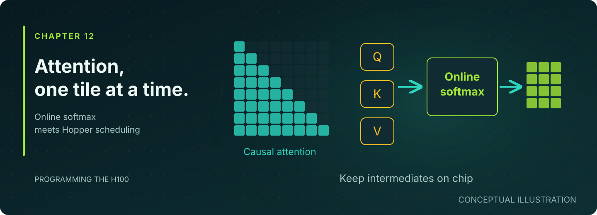
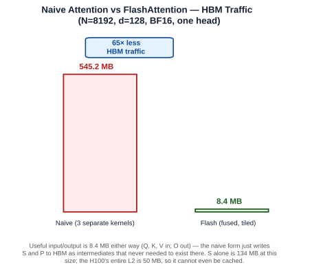
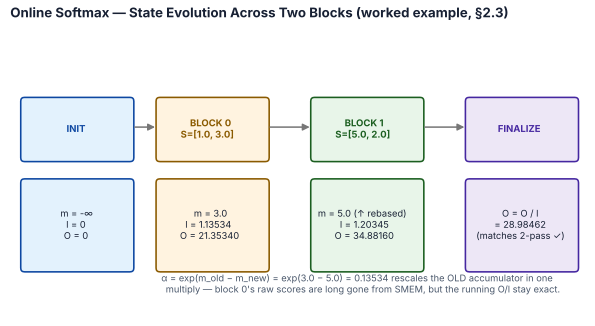
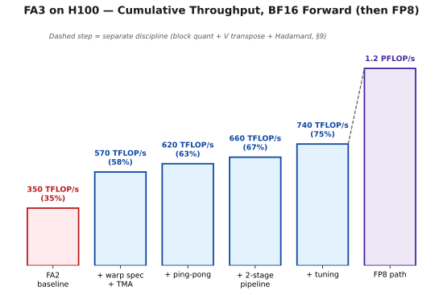
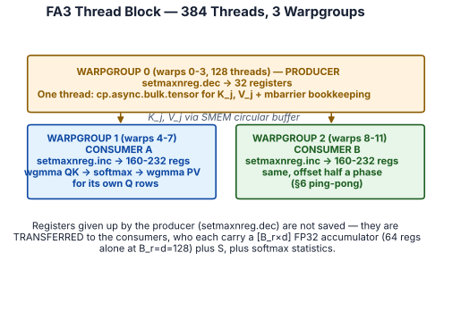
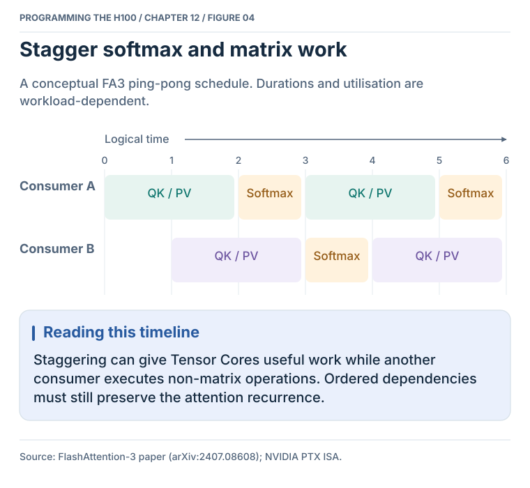
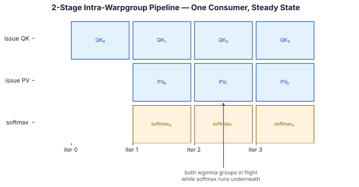
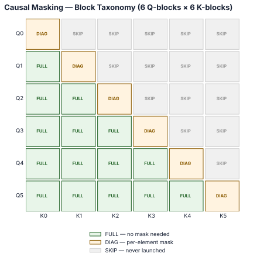

# FlashAttention-3 on the H100

## Chapter 12 Companion Guide — Every Primitive in This Book, Working at Once

[](images/chapter-openers/12-attention.svg)


> **Validation — November 17, 2026.** 12 online-softmax numerical reference cases passed on CUDA; the FA3 scheduling listings remain explicitly labeled skeletons.
> **Follow-up:** the [final two-H100 audit](final-audit.md) records a fresh run of the complete programs. The original dated transcripts below remain available for provenance.
> **Execution system:** 1× H100 PCIe, 114 SMs, 80 GB class; Ubuntu 24.04.5 LTS; driver 580.105.08; CUDA Toolkit 12.8.93; `sm_90a`, C++17, `-O2`.
> [Full system information](validation/2026-11-17/system-information.txt) · [CUDA result manifest](validation/2026-11-17/results.json). Each tested source and captured output is linked beside its example. Diagrams open as original SVGs for zooming.


> **Execution coverage — November 17, 2026.** The executable online-softmax
> numerical reference was run on an H100 PCIe and passed all 12 cases against
> PyTorch's math SDPA backend; its command and captured output appear in §10.
> The CUDA listings labeled **REFERENCE** are incomplete kernel skeletons with
> placeholder helpers. Those listings were not compiled or executed as FA3
> kernels, and the paper's performance numbers were not reproduced by this run.
> **Kernel target:** Hopper `sm_90a`; the skeletons require a complete
> implementation and launch harness before they can be built.
> **Canonical source:** Shah, Bikshandi, Zhang, Thakkar, Ramani, Dao —
> *FlashAttention-3: Fast and Accurate Attention with Asynchrony and
> Low-precision*, NeurIPS 2024 ([arXiv:2407.08608](https://arxiv.org/abs/2407.08608)).


<!-- learning:start -->
!!! tip "Your goal in this chapter"

    Maintain the online-softmax invariants, distinguish algorithm validation from a complete FA3 implementation, and test masks and partial tiles.

    Read [Chapters 3–7](03-asynchronicity-mbarrier.md) for the primitives and [Chapter 9](09-kernel-design-part-2.md) for pipeline ownership. The executable recurrence reference is separate from the kernel skeleton.
<!-- learning:end -->

**What this covers:** Why attention is memory-bound in its naive form and how
tiling fixes it; the online softmax recurrence that makes tiling possible, worked
by hand; what each generation of FlashAttention fixed; and then the three Hopper
techniques associated with the FlashAttention-3 paper’s reported increase from about 35% to 75% utilisation —
producer/consumer warp specialization, ping-pong scheduling across two
warpgroups, and 2-stage pipelining inside a single warpgroup. Then causal masking
and its load-imbalance problem, and the FP8 path: block quantization, the K-major
layout constraint that forces an in-kernel transpose of V, and the Hadamard
"incoherent processing" trick that recovers accuracy.

**How to read this chapter.** Everything up to now has been about primitives in
isolation — a descriptor here, a barrier there, one `wgmma` issued correctly.
This chapter combines those mechanisms in an annotated attention-kernel design. The code skeleton explains the schedule; the separately executed numerical reference verifies the online-softmax recurrence. It is not a complete production FA3 implementation.

It splits in three. Sections 1–3 are algorithmic and hardware-independent —
what attention is, why the naive form wastes memory bandwidth, and the online
softmax recurrence that lets you tile it. Sections 4–8 are the Hopper kernel:
three techniques and the throughput reported by the cited paper. These are published author results, not measurements of this chapter’s skeleton.
Sections 9–10 cover FP8, which is a separate discipline layered on top.

If you have read Chapters 8 and 9, Sections 5–7 will feel familiar — they are
warp specialization and the ping-pong pipeline you already know, applied to a
problem with an awkward extra step in the middle. That awkward step, softmax, is
the whole story of this chapter.

---

## ★ BEFORE YOU START — What You Need First

### Prerequisites

This chapter assumes more of the book than any other. It does not re-explain the
primitives it uses.

```
Prerequisites Checklist
══════════════════════════════════════════════════════════════════════

  From Chapter 3 (mbarrier):
    ✓ mbarrier init / arrive / expect_tx / try_wait
    ✓ Phase bits and barrier reuse in a loop
    ✓ The two-barrier handshake (data ready + buffer free)

  From Chapters 4-5 (TMA):
    ✓ cuTensorMap descriptors and the dimension-ordering rule
    ✓ cp.async.bulk.tensor with mbarrier completion
    ✓ Swizzling (128B mode) and why it exists

  From Chapters 6-7 (WGMMA):
    ✓ wgmma.mma_async, warp groups, commit/wait groups
    ✓ The accumulator register layout across 128 threads
    ✓ ldmatrix / stmatrix
    ✓ FP8 formats, packed types, cvt.satfinite

  From Chapters 8-9 (kernel design):
    ✓ Producer/consumer warp specialization
    ✓ setmaxnreg
    ✓ Circular buffering with N stages
    ✓ The ping-pong pipeline architecture
    ✓ Named barriers

  New here (no prior knowledge needed):
    ★ The attention operation and its arithmetic intensity
    ★ Online softmax — the running-max recurrence
    ★ Interleaving a non-tensor-core operation into a tensor-core pipeline
    ★ Causal masking and triangular load imbalance
    ★ Block quantization and incoherent processing
```

### Hardware

The illustrated TMA/WGMMA/`setmaxnreg` kernel path targets Hopper (`sm_90a`). Other architectures need a kernel path matched to their supported instructions; changing only the target flag does not make Hopper WGMMA portable to Blackwell. Attention and online softmax are not Hopper-only algorithms: the numerical recurrence reference is separate from these architecture-specific kernel mechanisms.

### Reading the Real Implementation

The production code lives in the
[`flash-attention`](https://github.com/Dao-AILab/flash-attention) repository
under `hopper/`. It is written in CUTLASS/CuTe rather than raw PTX, which makes
it dense on first contact but much shorter than the equivalent hand-written
kernel.

```
Mapping This Chapter to the Real Source
══════════════════════════════════════════════════════════════════════

  This chapter's §      flash-attention/hopper/
  ────────────────────────────────────────────────────────────────────
  §5  warp specialization   flash_fwd_kernel_sm90.h — the WarpScheduler split
  §6  ping-pong             mainloop_fwd_sm90_tma_gmma_ws.hpp
  §7  2-stage pipeline      the same file — see the "PV" / "QK" ordering
  §9  FP8                   flash_fwd_kernel_sm90.h with Element = cutlass::float_e4m3_t
  §9.2 V transpose          the Transpose_V path in the pinned SM90 mainloop

  Read this chapter first for the ideas, then that code for the details.
  The CuTe layout algebra is a language of its own; do not expect to
  read it cold.
```

Source-reading pin: [FlashAttention SM90 mainloop at cc7b69d4](https://github.com/Dao-AILab/flash-attention/blob/cc7b69d4b67145f3822bd75344e3877eccd3c34e/hopper/mainloop_fwd_sm90_tma_gmma_ws.hpp). This pin is for inspecting implementation names and protocols, not a new execution claim.


---

## Table of Contents

1. [Why Attention Is Hard on a GPU](#1-why-attention-is-hard-on-a-gpu)
2. [Online Softmax](#2-online-softmax)
3. [The FlashAttention Family](#3-the-flashattention-family)
4. [The FA3 Kernel at a Glance](#4-the-fa3-kernel-at-a-glance)
5. [Technique 1 — Producer/Consumer Warp Specialization](#5-technique-1-producerconsumer-warp-specialization)
6. [Technique 2 — Ping-Pong Scheduling](#6-technique-2-ping-pong-scheduling)
7. [Technique 3 — Intra-Warpgroup 2-Stage Pipelining](#7-technique-3-intra-warpgroup-2-stage-pipelining)
8. [Causal Masking and Load Imbalance](#8-causal-masking-and-load-imbalance)
9. [FP8 FlashAttention](#9-fp8-flashattention)
10. [Putting It All Together](#10-putting-it-all-together)
11. [Measured Results](#11--measured-results)
12. [Quick Reference](#12--quick-reference)

---

## 1 — Why Attention Is Hard on a GPU

Attention looks, on paper, like two matrix multiplies with a softmax in the
middle. Two matrix multiplies is exactly what this hardware is built for. So why
did it take three papers and four years to make it fast?

The answer is the thing in the middle. Section 1.1 states the operation, §1.2
shows what the naive implementation costs in memory traffic, and §1.3 puts a
number on it with the roofline model from Chapter 8.

### 1.1 The Attention Operation

Given three matrices — queries `Q`, keys `K`, values `V` — attention computes:

```
Attention — The Operation
══════════════════════════════════════════════════════════════════════

  S = Q K^T / sqrt(d)        scores       [N × N]
  P = softmax(S)             probabilities [N × N]   (row-wise)
  O = P V                    output        [N × d]

  Shapes for one head:
    Q:  [N × d]      N = sequence length (512 … 128k)
    K:  [N × d]      d = head dimension  (64, 128, or 256)
    V:  [N × d]
    O:  [N × d]

  A real model runs this for every head of every layer:
    Llama-3-70B: 64 heads × 80 layers = 5,120 attention calls
    per forward pass, per sequence.

  FLOP count (forward, one head):
    QK^T :  2 N² d
    PV   :  2 N² d
    ─────────────────
    total:  4 N² d        (softmax is O(N²) but not FLOP-dominant)
```

The quadratic term is the problem and also the point: every token attends to
every other token, so the score matrix `S` is `N × N`.

### 1.2 The Materialization Problem

Write that down naively — three separate kernels, or three separate library
calls — and you get the following.

```
Naive Attention — Where the Bytes Go
══════════════════════════════════════════════════════════════════════

  N = 8192, d = 128, BF16 (2 bytes/element), one head

  Step 1: S = Q K^T
    read  Q:  8192 × 128 × 2  =    2.1 MB
    read  K:  8192 × 128 × 2  =    2.1 MB
    WRITE S:  8192 × 8192 × 2 =  134.2 MB   ◄── to HBM
                                 ─────────
                                  138.4 MB

  Step 2: P = softmax(S)
    read  S:  134.2 MB
    WRITE P:  134.2 MB                       ◄── to HBM
              ─────────
              268.4 MB

  Step 3: O = P V
    read  P:  134.2 MB
    read  V:    2.1 MB
    WRITE O:    2.1 MB
              ─────────
              138.4 MB

  ══════════════════════════════════════════════════════════════════
  TOTAL HBM TRAFFIC:  545.2 MB
  USEFUL INPUT/OUTPUT: 8.4 MB  (Q, K, V in; O out)

  Ratio: 65× more traffic than the problem actually requires.
  ══════════════════════════════════════════════════════════════════

  And the capacity problem is worse than the bandwidth problem:
    S alone is 134 MB. The H100's entire L2 is 50 MB.
    The full S matrix does not fit in L2. Individual tiles can still hit;
    actual HBM traffic depends on the access schedule and cache behaviour.

  Scaling: S grows as N². At N = 32k it is 2.1 GB per head.
```

[](images/ch12/01-materialization-traffic.svg)

FlashAttention avoids materialising full `S` and `P` matrices in HBM. Their tiles are consumed on chip while online softmax preserves the statistics needed for the final output. The 8.39 MB size of Q, K, V and O is an ideal useful-I/O lower bound for this example, not a guarantee that every tiled kernel reads each input from HBM exactly once.

### 1.3 Arithmetic Intensity — Why Tiling Wins

Arithmetic intensity must specify **which traffic is being counted**. Whole-problem useful bytes, CTA-requested operand bytes and measured HBM bytes can differ substantially. Chapter 8’s roofline gives an upper bound for a stated traffic model; it does not identify every kernel’s actual bottleneck.

```text
Idealised whole-problem model — one head, N=8192, d=128, BF16

  Leading matrix FLOPs: 4 N² d = 34.36 GFLOP (softmax work excluded).
  Q, K, V and O:        4 N d × 2 bytes = 8 MiB = 8.39 MB.
  Full S and P write/read traffic:       512 MiB in the naive model.

  Naive model: 520 MiB total; arithmetic intensity ≈ 63 FLOP/byte.
  Useful-I/O-only lower bound: 8 MiB; intensity = 4096 FLOP/byte.

  H100 SXM BF16 product-peak ridge: 989 / 3.35 ≈ 295 FLOP/byte.
  The lower modeled roof changes across those two byte assumptions.
```

A tile-level calculation makes the missing traffic explicit. Suppose one CTA processes `B_M=128` query rows, walks key/value tiles of `B_N=128`, and uses `d=128`. In the following noncausal model it loads its Q tile once, writes O once, and visits all 64 K/V tiles:

```text
Per query-tile CTA, counting requested operand bytes:
  Q + O: 2 × 128 × 128 × 2                 = 65,536 bytes.
  K + V: 64 × 2 × 128 × 128 × 2            = 4,194,304 bytes.
  Total:                                   = 4,259,840 bytes.
  Matrix FLOPs: 4 × 128 × 8192 × 128        = 536,870,912.
  CTA-request intensity:                     ≈ 126 FLOP/byte.
```

Other query-tile CTAs revisit the same K/V tensors. L2 can serve some of those repeated requests, so this requested-byte count is not automatically the HBM count. Causal masking, stage depth, head layout, cache competition and the implementation change the result. This model also excludes softmax state traffic and additional implementation overhead.

The practical gain is **avoiding quadratic intermediate materialisation while scheduling the remaining movement and computation effectively**. FlashAttention-2 and -3 still care about data movement, memory reuse, occupancy, instruction issue and synchronisation. Their bottlenecks depend on workload and hardware. The utilisation and throughput figures later in this chapter are attributed to the [FlashAttention-3 paper](https://arxiv.org/abs/2407.08608); they were not reproduced by the book’s numerical-reference test.

---

## 2 — Online Softmax

There is an obstacle to the plan in §1.2, and it is not obvious until you try.

Softmax needs a row maximum and a row sum. Both are reductions over the **entire
row** of the score matrix. But tiling means processing one column-block of that
row at a time — so when you handle the first block, you do not yet know the row
maximum, and you cannot compute the softmax.

Online softmax is the recurrence that dissolves this. It is a small piece of
numerical trickery, it is exact rather than approximate, and it is the reason the
entire FlashAttention family exists.

### 2.1 Softmax and Why It Resists Tiling

```
Softmax — The Standard Numerically-Stable Form
══════════════════════════════════════════════════════════════════════

  For a row vector x of length N:

    m     = max(x)                    ◄── pass 1 over the whole row
    p_i   = exp(x_i - m)              ◄── pass 2
    l     = sum(p_i)                  ◄── pass 2
    out_i = p_i / l                   ◄── pass 3

  Why subtract m?
    exp() overflows FP32 above ~88. Attention scores routinely
    exceed that. Subtracting the max makes the largest exponent
    exactly exp(0) = 1, so nothing overflows and the result is
    mathematically identical:
        exp(x_i - m) / Σ exp(x_j - m)  ==  exp(x_i) / Σ exp(x_j)

  The problem for tiling:
    m depends on ALL of x. So does l.
    A tiled loop sees x in chunks and cannot compute either
    until it has seen the last chunk.

    Naive fix: two passes over K/V. That doubles the memory
    traffic you just worked so hard to eliminate.
```

### 2.2 The Running Maximum and the Rescaling Trick

The insight: you can compute softmax with a *running* maximum, provided you go
back and correct what you have already accumulated whenever the maximum changes.

And correcting is cheap — because `exp` turns a change in the max into a
multiplicative factor.

```
Online Softmax — The Recurrence
══════════════════════════════════════════════════════════════════════

  State carried between blocks, per row:
    m   running maximum       (init: -inf)
    l   running sum of exp    (init: 0)
    O   running output accum  (init: 0)     [d-dimensional]

  For each new score block S_j:

    1. m_new = max(m_old, rowmax(S_j))

    2. α = exp(m_old - m_new)         ◄── the correction factor
                                          α ≤ 1 always
    3. P_j = exp(S_j - m_new)         ◄── this block's probabilities

    4. l_new = α · l_old + rowsum(P_j)

    5. O_new = α · O_old + P_j V_j    ◄── rescale, then accumulate

  At the very end, once:
    O = O / l

  ══════════════════════════════════════════════════════════════════
  WHY IT WORKS

  Everything accumulated so far was computed relative to m_old.
  The new maximum is m_new. Every old term is off by exactly

      exp(x - m_old) / exp(x - m_new) = exp(m_new - m_old)

  so multiplying by α = exp(m_old - m_new) converts every
  previously-accumulated term to the new reference — in one
  multiply, without revisiting any of them.

  This is EXACT. Not an approximation, not a bound. The result is
  bit-comparable to two-pass softmax up to floating-point ordering.
  ══════════════════════════════════════════════════════════════════

  The cost:
    ├── One extra multiply per element of O, per block  (step 5)
    ├── Two extra multiplies per row, per block          (steps 2, 4)
    └── That is all. No extra memory traffic whatsoever.
```

### 2.3 Worked Example — Online Softmax by Hand

Do this once by hand and it will never be mysterious again.

```
Worked Example — One Row, Two Blocks
══════════════════════════════════════════════════════════════════════

  Row of scores (N = 4), processed as two blocks of 2:
    Block 0:  S = [1.0, 3.0]     V rows: v0 = 10, v1 = 20
    Block 1:  S = [5.0, 2.0]     V rows: v2 = 30, v3 = 40

  (V is 1-dimensional here so the arithmetic stays readable.)

  ─── Reference answer, two-pass ──────────────────────────────────
    m = max(1,3,5,2) = 5
    p = [exp(-4), exp(-2), exp(0), exp(-3)]
      = [0.01832, 0.13534, 1.00000, 0.04979]
    l = 1.203438
    softmax = [0.015219, 0.112457, 0.830953, 0.041371]
    O = 0.015219(10) + 0.112457(20) + 0.830953(30) + 0.041371(40)
      = 0.15223 + 2.24918 + 24.92829 + 1.65492
      = 29.0 (to 3 s.f.  → 28.98475)

  ─── Online, block by block ──────────────────────────────────────

  INIT:  m = -inf,  l = 0,  O = 0

  ── BLOCK 0:  S = [1.0, 3.0] ────────────────────────────────
    rowmax(S_0)  = 3.0
    m_new        = max(-inf, 3.0) = 3.0
    α            = exp(-inf - 3.0) = 0            ◄── first block
    P_0          = [exp(1-3), exp(3-3)]
                 = [exp(-2), exp(0)] = [0.13534, 1.00000]
    l            = 0·0 + (0.13534 + 1.00000) = 1.13534
    O            = 0·0 + (0.13534×10 + 1.00000×20)
                 = 1.35340 + 20.00000 = 21.35340

    State: m = 3.0,  l = 1.13534,  O = 21.35340

  ── BLOCK 1:  S = [5.0, 2.0] ────────────────────────────────
    rowmax(S_1)  = 5.0
    m_new        = max(3.0, 5.0) = 5.0            ◄── max INCREASED
    α            = exp(3.0 - 5.0) = exp(-2) = 0.13534
    P_1          = [exp(5-5), exp(2-5)]
                 = [exp(0), exp(-3)] = [1.00000, 0.04979]
    l            = 0.13534 × 1.13534 + (1.00000 + 0.04979)
                 = 0.15366 + 1.04979
                 = 1.203438                        ◄── matches reference l ✓
    O            = 0.13534 × 21.35340 + (1.00000×30 + 0.04979×40)
                 = 2.88986 + (30.00000 + 1.99160)
                 = 2.88986 + 31.99160
                 = 34.88134

  ── FINALIZE ────────────────────────────────────────────────
    O = 34.88134 / 1.203438 = 28.98475             ◄── matches ✓

  ══════════════════════════════════════════════════════════════════
  Note what happened in block 1. The old accumulator, 21.35340,
  had been built assuming a max of 3.0. One multiply by α = 0.13534
  retroactively rebased all of it to a max of 5.0 — without
  touching block 0's data, which by then was long gone from
  shared memory.

  That single multiply is why attention can be tiled.
  ══════════════════════════════════════════════════════════════════
```

[](images/ch12/02-online-softmax-timeline.svg)

**The one thing to notice for later:** step 5 rescales `O`, which is the
accumulator living in tensor core registers. That means every time the row max
moves, the kernel must reach into the WGMMA accumulator and multiply it. Chapter
7 §5 warned that touching accumulator registers has fence implications — this is
where that bites.

---

## 3 — The FlashAttention Family

Three papers, three distinct problems solved. Knowing which is which tells you
what FA3 is actually contributing.

### 3.1 What Each Generation Fixed

```
FlashAttention 1 → 2 → 3
══════════════════════════════════════════════════════════════════════

  FlashAttention-1 (2022)          Target: A100
  ────────────────────────────────────────────────────────────────────
  Problem:  attention materialises an N×N matrix in HBM
  Fix:      tile it; keep S in SMEM; online softmax (§2)
  Result:   avoids the materialized score matrix. The 8.39 MB useful
            payload is an ideal lower bound; K/V rereads remain, and
            the actual tiled kernel is not thereby proven compute-bound.
  Left on the table: poor work partitioning, lots of non-matmul work

  FlashAttention-2 (2023)          Target: A100
  ────────────────────────────────────────────────────────────────────
  Problem:  too many non-matmul FLOPs; bad parallelism over
            sequence length; work split across warps causing
            SMEM round-trips
  Fix:      rescale O once at the end rather than every block where
            possible; parallelise over sequence-length blocks as
            well as heads/batch; split Q across warps while sharing K/V
            (FA1 split-K → FA2 split-Q)
  Result:   ~2× over FA1; ~70% of A100 peak
  Left on the table: EVERYTHING Hopper-specific

  FlashAttention-3 (2024)          Target: H100
  ────────────────────────────────────────────────────────────────────
  Problem:  FA2 on H100 hits ~35% of peak. The kernel is
            synchronous in a machine designed to be asynchronous.
  Fix:      (1) producer/consumer warp specialization with TMA
            (2) ping-pong scheduling across two warpgroups
            (3) 2-stage pipelining within a warpgroup
            (4) FP8 with block quantization + incoherent processing
  Result:   740 TFLOP/s FP16 (75% of peak), ~1.2 PFLOP/s FP8
```

### 3.2 Why FA2 Left 65% of the H100 Unused

This is the diagnosis that motivates the whole chapter, and it is worth stating
in the vocabulary of Chapters 3 through 9.

```
FA2 on H100 — The Diagnosis
══════════════════════════════════════════════════════════════════════

  FA2's inner loop, in H100 terms:

    for each K/V block:
        load K_j, V_j into SMEM      ◄── asynchronous copy; wait before use
        __syncthreads()              ◄── ALL warps wait
        S = Q K_j^T                  ◄── mma.sync (Ampere-style)
        softmax bookkeeping          ◄── SFU work, tensor cores IDLE
        O += P V_j                   ◄── mma.sync
        __syncthreads()

  Four potential costs motivate the Hopper-specific design:

  1. THE LOAD IS NOT FREE
     cp.async still burns SM instruction issue on address math.
     Chapter 5 §2: Hopper's cp.async.bulk offloads this entirely.

  2. EVERY WARP WAITS FOR EVERY WARP
     __syncthreads() is a whole-block rendezvous. Warps that
     could be computing are parked. Chapter 3 §16: named barriers
     let subsets synchronise independently.

  3. TENSOR CORES IDLE DURING SOFTMAX
     This is the big one. See below.

  4. mma.sync IS BLOCKING
     Chapter 6: wgmma.mma_async returns immediately. mma.sync
     does not. There is nothing to overlap with.

  ══════════════════════════════════════════════════════════════════
  THE SOFTMAX GAP — the number that explains FA3

  H100 SXM5 throughput:
    BF16 matmul (tensor cores):    989 TFLOP/s
    exp() (SFUs, Chapter 1 §12.4):   3.9 TFLOP/s
                                   ─────────────
    Ratio:                           ~256×

  Attention's FLOP mix is roughly:
    matmul:  4 N² d          for N=8192, d=128 → 34.4 GFLOP
    exp:     N²              →  67.1 MFLOP  (0.2% of the FLOPs)

  0.2% of the FLOPs. But at 256× lower throughput:

    matmul time:  34.4e9 / 989e12   =  34.8 µs
    exp    time:  67.1e6 / 3.9e12   =  17.2 µs
                                       ────────
    If SERIALISED:                     52.0 µs
    If OVERLAPPED:                     34.8 µs

    Serialising softmax costs 33% of your runtime for 0.2% of
    your work.
  ══════════════════════════════════════════════════════════════════

  That calculation is the entire motivation for §6 and §7.
  Both techniques exist to get the exp() off the critical path.
```

---

## 4 — The FA3 Kernel at a Glance

Before the three techniques arrive one at a time, here is the shape of the thing
they are being applied to.

### 4.1 The Three Techniques and What Each Buys

```
FA3 — Cumulative Throughput (FP16 forward, H100 SXM5)
══════════════════════════════════════════════════════════════════════

  Published examples use different comparison scopes:

  Headline: up to 740 TFLOP/s FP16; close to 1.2 PFLOP/s FP8.
  Ping-pong example (§3.1): 570 → 620–640 TFLOP/s,
    FP16 forward, head dimension 128, sequence length 8192.
  Table 2 ablation (fixed batch=4, sequence=8448, heads=16, d=128):
    Full FA3                                      661 TFLOP/s
    No GEMM-softmax pipelining; warp-specialised    582 TFLOP/s
    GEMM-softmax pipelining; no warp specialisation 570 TFLOP/s

  These are not a cumulative ladder with each row adding one feature.
  The chapter skeleton has no measured throughput.
```

[](images/ch12/07-throughput-ladder.svg)

Source for the examples above: [FlashAttention-3 paper, §3.1 and Table 2](https://tridao.me/publications/flash3/flash3.pdf). The table ablates overlapping GEMM/softmax and warp specialisation; it does not isolate every implementation detail independently.

### 4.2 Tile Shapes and the Two GEMMs

```
The Two GEMMs Inside Attention
══════════════════════════════════════════════════════════════════════

  Per Q-block, looping over K/V blocks:

  GEMM0 ("QK"):   S_j = Q_i · K_j^T
      Q_i : [B_r × d]     lives in registers or SMEM, reused
                          across the entire inner loop
      K_j : [B_c × d]     streamed in by TMA
      S_j : [B_r × B_c]   accumulator, FP32

  ── softmax on S_j (§2) → P_j, and rescale O_i ──

  GEMM1 ("PV"):   O_i += P_j · V_j
      P_j : [B_r × B_c]   just computed, in registers
      V_j : [B_c × d]     streamed in by TMA
      O_i : [B_r × d]     accumulator, FP32, lives across the
                          whole inner loop

  ══════════════════════════════════════════════════════════════════
  THE STRUCTURAL DIFFICULTY

  GEMM1's A-operand is GEMM0's output, transformed by softmax.

  That is a genuine serial dependency inside every iteration —
  you cannot start PV for block j until QK for block j has
  finished AND its softmax has been applied.

  Compare a plain GEMM (Chapter 9): its inner loop is a pure
  chain of independent wgmma calls with nothing in between.
  Attention has a 256×-slower operation wedged in the middle
  of every iteration.

  Techniques 2 and 3 are two different answers to the same
  question: what else can the tensor cores be doing while
  that exp() runs?
  ══════════════════════════════════════════════════════════════════

  Typical tile shapes (BF16, d = 128, H100):

    B_r (Q rows per block)    64 or 128
    B_c (K/V rows per block)  64 … 176
    d                         64, 128, 256

    SMEM budget, B_r=128, B_c=128, d=128, BF16, 2 stages:
      Q tile:  128 × 128 × 2                 =  32 KB  (resident)
      K tile:  128 × 128 × 2 × 2 stages      =  64 KB
      V tile:  128 × 128 × 2 × 2 stages      =  64 KB
      ────────────────────────────────────────────────
                                               160 KB
      Against Chapter 1's 228 KB limit — comfortable, and the
      headroom is what lets you raise the stage count.
```

---

## 5 — Technique 1 — Producer/Consumer Warp Specialization

The first and largest win, and if you have read Chapter 8 §4 there is nothing
conceptually new here — which is exactly the point. Most of FA3's advantage over
FA2 comes from applying textbook Hopper kernel design to a kernel that had none.

### 5.1 The Warpgroup Split

```
FA3 Block Layout — Who Does What
══════════════════════════════════════════════════════════════════════

  One thread block = 384 threads = 12 warps = 3 warpgroups

  ┌────────────────────────────────────────────────────────────────┐
  │  WARPGROUP 0  (warps 0-3, 128 threads)   PRODUCER              │
  │  ────────────────────────────────────────────────────────────  │
  │  Only ONE thread is really busy. It:                           │
  │    • issues cp.async.bulk.tensor for K_j and V_j               │
  │    • does mbarrier.arrive.expect_tx for the byte count          │
  │    • waits on the "buffer free" barrier before reusing a slot  │
  │  Register budget: setmaxnreg.dec  →  24 registers              │
  ├────────────────────────────────────────────────────────────────┤
  │  WARPGROUP 1  (warps 4-7)                CONSUMER A            │
  │  WARPGROUP 2  (warps 8-11)               CONSUMER B            │
  │  ────────────────────────────────────────────────────────────  │
  │  Each independently processes its own set of Q rows:           │
  │    • wgmma QK^T                                                │
  │    • online softmax on the result                              │
  │    • wgmma PV, accumulating into O                             │
  │  Register budget: setmaxnreg.inc  →  240 registers         │
  └────────────────────────────────────────────────────────────────┘

  Why two consumers rather than one?
    §6. Two consumers is what makes ping-pong possible.
    With one consumer there is nobody to run GEMMs while it
    does softmax.

  Why the register asymmetry?
    Chapter 8 §5. The producer holds a descriptor and a loop
    counter. The consumer holds a [B_r × d] FP32 accumulator —
    for B_r=128, d=128 that is 64 registers of O alone, plus
    S, plus P, plus the softmax statistics. Every register the
    producer gives up is one the consumer can use to avoid
    spilling.
```

[](images/ch12/03-warpgroup-roles.svg)

### 5.2 The Producer Loop

```cuda
// ─────────────────────────────────────────────────────────────────
// REFERENCE — illustrates structure; not compiled or benchmarked.
// Producer warpgroup: fetch K_j and V_j, forever, into a circular
// buffer of NUM_STAGES slots. See Chapter 3 §12 for the barrier
// reuse pattern and Chapter 5 §7 for the completion mechanism.
// ─────────────────────────────────────────────────────────────────

__device__ void producer_loop(
    const __grid_constant__ CUtensorMap tma_k,
    const __grid_constant__ CUtensorMap tma_v,
    SharedStorage&  smem,
    int             k_block_begin,
    int             k_block_end,
    int             q_block_idx)
{
    // Give registers back to the consumers (Chapter 8 §5).
    asm volatile("setmaxnreg.dec.sync.aligned.u32 %0;\n" :: "n"(24));

    const int lane = threadIdx.x % 32;
    const int warp = (threadIdx.x / 32) % 4;

    // One warp, one thread issues everything. The rest exit.
    if (warp != 0 || lane != 0) return;

    // Bytes the TMA will deposit per stage: one K tile + one V tile.
    constexpr uint32_t kBytesPerStage =
        (kBlockN * kHeadDim + kBlockN * kHeadDim) * sizeof(Element);

    int  stage = 0;
    uint32_t phase = 0;          // Chapter 3 §10.1 — the reuse bit

    for (int j = k_block_begin; j < k_block_end; ++j) {

        // 1. Wait until the consumers have finished with this slot.
        //    This is the WAR half of the two-barrier handshake
        //    (Chapter 9 §9): "buffer free" must be signalled before
        //    we are allowed to overwrite it.
        mbarrier_wait(&smem.buffer_free[stage], phase);

        // 2. Declare how many bytes are about to arrive, and arrive
        //    ourselves. Chapter 3 §9.2 — expect_tx does both jobs.
        mbarrier_arrive_expect_tx(&smem.data_ready[stage],
                                  kBytesPerStage);

        // 3. Fire the two copies. Both return immediately; the TMA
        //    will decrement data_ready[stage] as bytes land.
        tma_load_2d(tma_k, smem.k[stage], &smem.data_ready[stage],
                    /*coord=*/{0, j * kBlockN});
        tma_load_2d(tma_v, smem.v[stage], &smem.data_ready[stage],
                    /*coord=*/{0, j * kBlockN});

        // 4. Advance. The phase bit flips each time we wrap.
        if (++stage == kNumStages) { stage = 0; phase ^= 1; }
    }
}
```

Three things to notice, all of them Chapter 3 and 5 material:

- **One thread issues the whole tile.** That is the TMA's entire reason for
  existing (Chapter 5 §2). The other 127 threads of the producer warpgroup return
  immediately and cost nothing.
- **`expect_tx` before the copy, never after.** Chapter 3 §9.2. Issue the copy
  first and the TMA may complete before the barrier knows how many bytes to
  expect, which hangs the kernel.
- **The `buffer_free` wait is not optional.** Without it you have the WAR hazard
  from Chapter 3 §6.2: the producer overwrites a tile a consumer is still
  reading.

### 5.3 The Consumer Skeleton

```cuda
// ─────────────────────────────────────────────────────────────────
// REFERENCE — illustrates structure; not compiled or benchmarked.
// Consumer warpgroup. This version is the SIMPLE one: GEMM, then
// softmax, then GEMM, strictly in order. §6 and §7 rearrange it.
// ─────────────────────────────────────────────────────────────────

__device__ void consumer_loop_naive(
    SharedStorage& smem,
    float4         (&O)[kOAccumRegs],   // [B_r × d] accumulator
    float          (&m)[kRowsPerThread], // running max   (§2)
    float          (&l)[kRowsPerThread], // running sum   (§2)
    int            k_block_begin,
    int            k_block_end)
{
    asm volatile("setmaxnreg.inc.sync.aligned.u32 %0;\n" :: "n"(240));

    int  stage = 0;
    uint32_t phase = 0;

    for (int j = k_block_begin; j < k_block_end; ++j) {

        // Wait for K_j and V_j to have landed.
        mbarrier_wait(&smem.data_ready[stage], phase);

        // ── GEMM0: S = Q · K_j^T ──────────────────────────────
        float S[kSAccumRegs];
        wgmma_fence();                       // Chapter 6 §4
        wgmma_qk(S, smem.q, smem.k[stage]);  // wgmma.mma_async
        wgmma_commit_group();
        wgmma_wait_group<0>();               // ◄── FULL STALL

        // ── SOFTMAX (§2) ──────────────────────────────────────
        //     Tensor cores are IDLE for this entire block.
        float alpha[kRowsPerThread];
        online_softmax_update(S, m, l, alpha);   // exp() on SFUs
        rescale_accumulator(O, alpha);           // O *= alpha

        // ── GEMM1: O += P · V_j ───────────────────────────────
        wgmma_fence();
        wgmma_pv(O, S /* now P */, smem.v[stage]);
        wgmma_commit_group();
        wgmma_wait_group<0>();               // ◄── FULL STALL

        // Release the slot back to the producer.
        mbarrier_arrive(&smem.buffer_free[stage]);

        if (++stage == kNumStages) { stage = 0; phase ^= 1; }
    }
}
```

The skeleton shows how operand loading can overlap matrix work; it does not establish a throughput number or perfect overlap. Its `wgmma_wait_group<0>()` calls expose a serial softmax interval between matrix operations. Other overheads also contribute, so the gap to peak cannot all be assigned to softmax.

---

## 6 — Technique 2 — Ping-Pong Scheduling

### 6.1 The Idea

If one warpgroup must idle its tensor cores during softmax, give the tensor cores
a *different* warpgroup to serve.

```
Ping-Pong — Staggering Two Consumers
══════════════════════════════════════════════════════════════════════

  WITHOUT ping-pong (both warpgroups in lockstep):

  time ──────────────────────────────────────────────────────────►
  WG1   [GEMM0][softmax][GEMM1] [GEMM0][softmax][GEMM1]
  WG2   [GEMM0][softmax][GEMM1] [GEMM0][softmax][GEMM1]
        ▲▲▲▲▲▲        ▲▲▲▲▲▲▲
        both compute   BOTH doing softmax — tensor cores idle

  Tensor core utilisation: not quantified by this schematic
  (both warpgroups leave the same hole at the same time)


  WITH ping-pong (WG2 offset by half a phase):

  time ──────────────────────────────────────────────────────────►
  WG1   [GEMM0][softmax][GEMM1][GEMM0][softmax][GEMM1]
  WG2          [GEMM0 ][softmax][GEMM1][GEMM0 ][softmax]
               ▲                ▲
               WG2 computes     WG1 computes
               while WG1        while WG2
               does softmax     does softmax

  Tensor core utilisation: not quantified by this schematic
  The holes interleave instead of coinciding.

  ══════════════════════════════════════════════════════════════════
  This is exactly the ping-pong architecture from Chapter 9 §14.
  The only difference is what fills the gap: in a plain GEMM it
  is the epilogue, here it is softmax.
  ══════════════════════════════════════════════════════════════════
```

[](images/ch12/04-pingpong-timeline.svg)

### 6.2 Forcing the Stagger with Named Barriers

The hardware will not stagger the warpgroups for you. Left alone, both consumers
start at the same instant and stay in lockstep forever. You have to impose the
offset, and named barriers (Chapter 3 §16) are how.

```cuda
// ─────────────────────────────────────────────────────────────────
// REFERENCE — illustrates structure; not compiled or benchmarked.
// Two named barriers, used as a baton passed back and forth so that
// WG1's GEMMs are always scheduled ahead of WG2's.
// ─────────────────────────────────────────────────────────────────

// Named barrier IDs. 0 is reserved by __syncthreads().
constexpr int kBarrierWG1 = 1;
constexpr int kBarrierWG2 = 2;

// Both consumer warpgroups participate: 2 × 128 threads.
constexpr int kConsumerThreads = 256;

__device__ inline void named_barrier_sync(int id, int count) {
    asm volatile("bar.sync %0, %1;" :: "r"(id), "r"(count) : "memory");
}

__device__ inline void named_barrier_arrive(int id, int count) {
    asm volatile("bar.arrive %0, %1;" :: "r"(id), "r"(count) : "memory");
}

__device__ void consumer_loop_pingpong(/* ... */ int wg_id)
{
    // Seed WG0's own turn once, with one arrival per WG1 thread.
    if (wg_id == 1)
        named_barrier_arrive(kBarrierWG1, kConsumerThreads);

    for (int j = k_block_begin; j < k_block_end; ++j) {
        // Both groups contribute once to each generation. Wait BEFORE GEMM.
        named_barrier_sync(wg_id == 0 ? kBarrierWG1 : kBarrierWG2,
                           kConsumerThreads);
        wgmma_fence();
        wgmma_qk(S, smem.q, smem.k[stage]);
        wgmma_pv(O, P_prev, smem.v[stage_prev]);
        wgmma_commit_group();
        named_barrier_arrive(wg_id == 0 ? kBarrierWG2 : kBarrierWG1,
                            kConsumerThreads);
        wgmma_wait_group<0>();
        online_softmax_update(S, m, l, alpha);
        rescale_accumulator(O, alpha);
        if (++stage == kNumStages) { stage = 0; phase ^= 1; }
    }
}
```

```
Why bar.arrive and not bar.sync for the handoff
══════════════════════════════════════════════════════════════════════

  bar.sync  = arrive AND wait      (blocking)
  bar.arrive = arrive, keep going  (non-blocking)

  The handoff must be non-blocking. The whole point is that
  after releasing the other warpgroup, WE continue immediately
  into softmax. Using bar.sync there would park us until the
  other warpgroup caught up — reinstating exactly the lockstep
  we are trying to break.

  This is the same arrive/wait split as Chapter 3 §14.2's
  barrier.cluster, for the same reason: the gap between
  "I'm done" and "everyone's done" is where the useful work goes.
```

### 6.3 Worked Example — Where the Cycles Go

```
Ping-Pong — Cycle Accounting for One Iteration
══════════════════════════════════════════════════════════════════════

  Assumptions (B_r = 128, B_c = 128, d = 128, BF16):

    GEMM0 (QK^T):   2 × 128 × 128 × 128    = 4.19 MFLOP
    GEMM1 (PV):     2 × 128 × 128 × 128    = 4.19 MFLOP
    exp():          128 × 128              = 16,384 ops

  Per-SM rates (Chapter 1 §19 — derived bottom-up from the full-GPU
  spec, 989.4 TFLOP/s ÷ 132 SMs ÷ 1.83 GHz Tensor Core clock, not an assumed issue rate):
    tensor BF16:   4,096 FLOP/cycle/SM
    SFU:             16 ops/cycle/SM

  (Correction: an earlier draft of this table used 1024 FLOP/cycle/SM,
  which contradicts the very figure this chapter cites it from — Chapter
  1 §19's own number is 4,096. Using 1024 would imply a full-chip peak
  of only ~247 TFLOP/s at the 1.83 GHz Tensor Core clock, nowhere near the H100's real 989.4 TFLOP/s. The
  cycle counts below are recomputed with the correct rate.)

  Cycle costs:
    GEMM0:   4.19e6 / 4096   ≈  1,024 cycles
    GEMM1:   4.19e6 / 4096   ≈  1,024 cycles
    exp:    16,384 / 16     =  1,024 cycles
    (plus ~512 cycles of row reductions, rescaling, bookkeeping)

  ─── SERIAL (one warpgroup, §5.3) ────────────────────────────────
    1024  +  1536  +  1024  =  3,584 cycles per iteration
    Tensor cores busy: 2,048 / 3,584 ≈ 57%
    This toy schedule does not predict whole-kernel utilization or the
    measured FA2 baseline: it omits instruction issue, loads, tails and
    dependencies between stages.

  ─── PING-PONG (two warpgroups, offset) ──────────────────────────
    One warpgroup's full per-iteration GEMM work (QK + PV) is
    1,024 + 1,024 = 2,048 cycles — MORE than the other warpgroup's
    1,536-cycle softmax, so in this idealized model the softmax
    fits entirely underneath it with 512 cycles of slack:
      WG1 softmax (1,536 cycles) runs UNDER WG2's QK+PV (2,048 cycles).
      WG2 softmax runs under WG1's QK+PV.

    Steady-state cost per iteration per warpgroup:
      max(2,048 tensor cycles, 1,536 softmax) = 2,048 — i.e., in this
      idealized accounting the tensor cores are never the ones waiting.

    Published §3.1 example: 570 → 620–640 TFLOP/s (FP16)

  ══════════════════════════════════════════════════════════════════
  Note the gap between the model (tensor cores idealized as never
  waiting) and a published whole-kernel result. Other costs include register
  pressure that two big accumulators create, plus epilogue, plus the
  tail, plus everything this toy cycle count leaves out (instruction
  issue overhead, imperfect overlap at the loop's prologue/epilogue).
  Models like this one tell you the DIRECTION, never the magnitude —
  which is precisely why Chapter 13 exists.
  ══════════════════════════════════════════════════════════════════
```

---

## 7 — Technique 3 — Intra-Warpgroup 2-Stage Pipelining

Ping-pong hides one warpgroup's softmax behind another's GEMMs. This technique
goes further: hide a warpgroup's softmax behind *its own* GEMMs.

### 7.1 Overlapping Softmax j with GEMM j+1

The trick is a software pipeline of depth two, of exactly the kind Chapter 8 §7
describes — except that the stages are "softmax of iteration j" and "GEMMs of
iteration j+1".

```
2-Stage Intra-Warpgroup Pipeline
══════════════════════════════════════════════════════════════════════

  NAIVE ORDER (§5.3):

    iteration j:   QK_j  →  wait  →  softmax_j  →  PV_j  →  wait
                            ▲▲▲▲                            ▲▲▲▲
                            stall                           stall

  PIPELINED ORDER (one consumer):
    Prologue: issue QK_0, commit, wait, softmax_0.
    Iteration j>0: issue QK_j, then PV_(j-1), in separate groups.
    wait_group<1> makes QK_j available; softmax_j may overlap PV_(j-1).
    wait_group<0> completes PV_(j-1) before rescaling O or releasing V.
    Drain: issue the final PV_(n-1), commit, wait, then normalize/store.

    j    QK issued    PV issued    Softmax after QK wait
    0    QK_0         —            softmax_0
    1    QK_1         PV_0         softmax_1 (may overlap PV_0)
    2    QK_2         PV_1         softmax_2 (may overlap PV_1)
    drain —           PV_(n-1)     —

    Only the older QK group must be complete at the partial wait.
    The second wait is essential: O and V remain owned by pending PV.
```

[](images/ch12/05-twostage-pipeline-timeline.svg)

```cuda
// ─────────────────────────────────────────────────────────────────
// REFERENCE — illustrates structure; not compiled or benchmarked.
// Protocol sketch for n_blocks > 0. QK_j completes before softmax_j;
// PV_(j-1) may overlap softmax_j, but must finish before O is rescaled.
// ─────────────────────────────────────────────────────────────────

// ── PROLOGUE: prime the pipeline with QK for block 0 ────────────
mbarrier_wait(&smem.data_ready[0], phase);
wgmma_fence();
wgmma_qk(S_cur, smem.q, smem.k[0]);
wgmma_commit_group();
wgmma_wait_group<0>();
online_softmax_update(S_cur, m, l, alpha);   // → P_cur
rescale_accumulator(O, alpha);

// ── STEADY STATE ────────────────────────────────────────────────
for (int j = 1; j < n_blocks; ++j) {

    mbarrier_wait(&smem.data_ready[stage], phase);

    wgmma_fence();

    // Current QK_j: its scores are needed by softmax_j below.
    wgmma_qk(S_next, smem.q, smem.k[stage]);
    wgmma_commit_group();

    //  THIS iteration's PV, consuming P_cur computed last pass.
    wgmma_pv(O, P_cur, smem.v[stage_prev]);
    wgmma_commit_group();

    // QK_j is the older group. Retire it before reading S_next.
    // PV_(j-1) may still be outstanding while softmax_j runs.
    wgmma_wait_group<1>();
    online_softmax_update(S_next, m, l, alpha);
    // O and the previous V stage are still owned by PV_(j-1).
    wgmma_wait_group<0>();
    rescale_accumulator(O, alpha);
    swap(S_cur, S_next);
    P_cur = S_cur;

    mbarrier_arrive(&smem.buffer_free[stage_prev]);
    stage_prev = stage;
    if (++stage == kNumStages) { stage = 0; phase ^= 1; }
}
// ── DRAIN: the final probabilities still need their PV update. ──
wgmma_fence();
wgmma_pv(O, P_cur, smem.v[stage_prev]);
wgmma_commit_group();
wgmma_wait_group<0>();
mbarrier_arrive(&smem.buffer_free[stage_prev]);
// Normalize O by the final softmax denominator after completion.
```

The `wgmma_wait_group<1>()` is the crux. Chapter 7 §3 made the point that the
argument is how many groups may remain *outstanding* — so `<1>` waits for the
older group (the QK whose scores we are about to use) while deliberately leaving
the newer one running. An immediate `<0>` before softmax would remove this overlap; the later `<0>` before O rescaling and V release is mandatory.

### 7.2 The Register Cost

Nothing is free, and this one is paid for in the scarcest resource on the chip.

```
2-Stage Pipelining — The Register Bill
══════════════════════════════════════════════════════════════════════

  For a 128-row CTA split across two consumer WGs, each owns B_r=64 rows; with B_c=d=128, per consumer thread:
    O accumulator  [B_r × d] / 128 threads, FP32   =  64 regs
    S accumulator  [B_r × B_c] / 128 threads, FP32 =  64 regs
    m, l, alpha    row statistics                   ≈   6 regs
    addresses, descriptors, loop state              ≈  16 regs
                                                     ────────
                                                      150 regs

  With the pipeline you need TWO score buffers live at once
  (S_cur being consumed, S_next being produced):
                                                      +64 regs
                                                     ────────
                                                      214 regs

  Against the 255-per-thread hardware ceiling (Chapter 1 §14),
  that is tight — and it is exactly why the producer warpgroup
  may release registers according to the selected policy (FA3 commonly uses 24 producer / 240 consumer registers). Those registers are not being
  saved, they are being TRANSFERRED.

  When it does not fit:
    ├── Reduce B_c (fewer score columns → smaller S)
    ├── Keep S in FP32 but P in BF16 (halves the second buffer)
    └── Fall back to §6 alone — ping-pong without the intra-WG
        pipeline still gets you 620 TFLOP/s

  Chapter 13 §7 shows how to tell spilling from a profile:
    watch for local memory traffic in Memory Workload Analysis,
    and "Stall Long Scoreboard" on instructions that should
    only be touching registers.
```

---

## 8 — Causal Masking and Load Imbalance

Everything so far assumed every query attends to every key. Language models do
not work that way: token *i* may only attend to tokens ≤ *i*. That single
constraint halves the FLOPs and creates a scheduling problem considerably nastier
than the one it solves.

### 8.1 Three Kinds of Block

```
Causal Masking — The Block Taxonomy
══════════════════════════════════════════════════════════════════════

  Q blocks (rows) × K blocks (columns), causal mask:

            K0    K1    K2    K3    K4    K5
         ┌─────┬─────┬─────┬─────┬─────┬─────┐
     Q0  │ DIAG│ SKIP│ SKIP│ SKIP│ SKIP│ SKIP│
         ├─────┼─────┼─────┼─────┼─────┼─────┤
     Q1  │ FULL│ DIAG│ SKIP│ SKIP│ SKIP│ SKIP│
         ├─────┼─────┼─────┼─────┼─────┼─────┤
     Q2  │ FULL│ FULL│ DIAG│ SKIP│ SKIP│ SKIP│
         ├─────┼─────┼─────┼─────┼─────┼─────┤
     Q3  │ FULL│ FULL│ FULL│ DIAG│ SKIP│ SKIP│
         ├─────┼─────┼─────┼─────┼─────┼─────┤
     Q4  │ FULL│ FULL│ FULL│ FULL│ DIAG│ SKIP│
         ├─────┼─────┼─────┼─────┼─────┼─────┤
     Q5  │ FULL│ FULL│ FULL│ FULL│ FULL│ DIAG│
         └─────┴─────┴─────┴─────┴─────┴─────┘

  SKIP  — entirely above the diagonal. Do not launch. Do not
          fetch K or V. Free.

  FULL  — entirely below. No masking needed at all; run the
          plain kernel from §7 with no mask instructions.

  DIAG  — straddles the diagonal. Needs a per-element mask:
          set S[r][c] = -inf where (q_base+r) < (k_base+c).
          Costs a comparison and a select per element.

  ══════════════════════════════════════════════════════════════════
  THE OPTIMISATION THAT MATTERS

  Compile TWO versions of the inner loop and branch once, not
  per element:

    for j in 0 .. diag_block-1:   inner_loop_no_mask()   ◄── FULL
    for j == diag_block:          inner_loop_masked()    ◄── DIAG
    (j > diag_block: never executed)                     ◄── SKIP

  A mask check inside the FULL blocks would cost a predicate
  in every FULL tile. Here 15 of the 21 visited tiles are FULL
  (71.4% by tile count); six need masking. Specialization removes
  those redundant checks. The proportions depend on the grid.
  ══════════════════════════════════════════════════════════════════
```

[](images/ch12/06-causal-masking-grid.svg)

### 8.2 Balancing the Triangle

```
The Load Imbalance
══════════════════════════════════════════════════════════════════════

  Work per Q block, with 6 K blocks:

    Q0:  1 block   ██
    Q1:  2 blocks  ████
    Q2:  3 blocks  ██████
    Q3:  4 blocks  ████████
    Q4:  5 blocks  ██████████
    Q5:  6 blocks  ████████████

  Ratio between lightest and heaviest: 6×.
  For a 128-block sequence: 128×.

  Naive mapping (one Q block per thread block) on 132 SMs:
    The SM that drew Q0 finishes almost immediately and then
    sits idle for the entire remaining runtime of the kernel.
    Causal tile skipping saves arithmetic; the remaining triangular work can create scheduling imbalance
    while doing half the work.

  ─── FIX 1: Pair the blocks ──────────────────────────────────────
    Assign Q_i and Q_{n-1-i} to the same thread block.
      Q0 + Q5:  1 + 6 = 7 units
      Q1 + Q4:  2 + 5 = 7 units
      Q2 + Q3:  3 + 4 = 7 units
    Perfectly balanced, and it costs one line of index arithmetic.

  ─── FIX 2: Persistent kernel + dynamic work queue ───────────────
    Chapter 9 §17. Launch exactly 132 blocks — one per SM — and
    have each pull the next (Q block, K range) pair from an
    atomic counter until the queue drains. Handles ragged batches
    and variable sequence lengths, which FIX 1 does not.

  ─── FIX 3: Stream-K style splitting ─────────────────────────────
    Chapter 10. Split the K-loop itself across thread blocks and
    combine partial (O, m, l) triples afterwards. Most useful
    when the number of Q blocks is smaller than the SM count —
    e.g. single-sequence decoding, where there may be only one
    Q block in the entire launch.

  ══════════════════════════════════════════════════════════════════
  Note that combining partials in FIX 3 is not a plain sum. Two
  partial results carry different running maxima, so merging them
  needs the same rescaling as §2:

    m = max(m_A, m_B)
    O = exp(m_A - m)·O_A + exp(m_B - m)·O_B
    l = exp(m_A - m)·l_A + exp(m_B - m)·l_B

  The online softmax recurrence is associative. That is what
  makes split-K attention possible at all.
  ══════════════════════════════════════════════════════════════════
```

---

## 9 — FP8 FlashAttention

FP8 doubles tensor core throughput, which on paper takes attention from 740
TFLOP/s to something near 1.5 PFLOP/s. In practice FA3 reaches about 1.2 PFLOP/s,
and getting there requires solving three problems that have nothing to do with
speed: accuracy, layout, and outliers.

Chapter 7 §9 made the case that FP8 is a discipline rather than a data type. This
section is what that discipline looks like in a real kernel.

### 9.1 Block Quantization

```
Quantization Granularity
══════════════════════════════════════════════════════════════════════

  FP8 E4M3 maxes out at 448 (Chapter 7 §10). Attention scores and
  activations do not politely stay under 448, so everything must be
  scaled before conversion and unscaled afterwards.

  The question is: one scale factor for what?

  ─── PER-TENSOR (the naive choice) ───────────────────────────────
    One scalar for the whole of Q. One for K. One for V.
      scale_Q = 448 / max(|Q|)

    Cheap. One value to compute, one to store, one multiply.
    And badly behaved: a single outlier anywhere in a
    [8192 × 128] tensor drags the scale down, and every one of
    the other million values loses precision to accommodate it.

  ─── PER-BLOCK (what FA3 does) ───────────────────────────────────
    One scalar per tile — B_r × d for Q, B_c × d for K and V.

      Q: [8192 × 128] with B_r = 128  →  64 scale factors
      K: [8192 × 128] with B_c = 128  →  64 scale factors

    An outlier now only degrades the 128 rows it shares a block
    with, instead of all 8192. Storage overhead: 64 floats
    against 1 MB of data — call it nothing.

    Better still, the tile is exactly the granularity the TMA
    already fetches, so the scale for a tile is a single scalar
    the consumer loads once per iteration.

  ══════════════════════════════════════════════════════════════════
  FUSING THE QUANTIZATION

  The conversion is not a separate kernel. It rides along with
  whatever memory-bound operation immediately precedes attention
  — in a transformer that is usually rotary position embedding.

  RoPE is memory-bound (Chapter 8 §3): it reads Q and K, does a
  handful of FLOPs per element, and writes them back. It is
  waiting on HBM the entire time. Folding a multiply and a
  cvt.satfinite into it costs literally zero additional time.

    read Q → apply RoPE → × scale → cvt.rn.satfinite.e4m3x2.f32 → write

  Chapter 7 §12 has the conversion instruction itself.
  ══════════════════════════════════════════════════════════════════
```

### 9.2 The Layout Problem — Why V Must Be Transposed

This is the FP8 complication that surprises people, and it comes straight out of
Chapter 7 §13.2.

```
The K-Major Constraint
══════════════════════════════════════════════════════════════════════

  Chapter 7 §13.2: FP8 wgmma requires both operands K-MAJOR —
  contiguous along the reduction dimension. BF16 wgmma is
  relaxed about this. FP8 is not.

  Now look at attention's two GEMMs and ask what "K" (the
  reduction dimension) is in each:

    GEMM0:  S = Q · K^T
            reduction is over d (head dim)
            Q is [B_r × d], contiguous in d          ✓ K-major
            K is [B_c × d], contiguous in d          ✓ K-major
            → no problem

    GEMM1:  O = P · V
            reduction is over B_c (the key positions!)
            P is [B_r × B_c], contiguous in B_c      ✓ K-major
            V is [B_c × d],   contiguous in d        ✗ WRONG
            → V must be contiguous in B_c, i.e. TRANSPOSED

  ══════════════════════════════════════════════════════════════════
  So V arrives from HBM in the layout the model stores it in,
  and GEMM1 needs it the other way round. Three options:

  1. Transpose V in HBM before the kernel.
     Costs a full read+write of V — 2× the traffic on a tensor
     you were reading exactly once. Defeats the purpose.

  2. Have the TMA transpose it.
     It cannot. TMA rearranges within a tile (swizzling,
     interleaving — Chapter 4 §10, §11) but does not transpose.

  3. Transpose in SMEM, in-kernel, while other work proceeds.
     ← what FA3 does. See §9.3.
  ══════════════════════════════════════════════════════════════════
```

### 9.3 In-Kernel Transpose with LDSM and STSM

```
SMEM Transpose via ldmatrix / stmatrix
══════════════════════════════════════════════════════════════════════

  The tools are already familiar from Chapter 6 §9 and Chapter 7 §6:

    ldmatrix (LDSM)  SMEM → registers, 8×8 tiles, hardware
                     scatters elements to the right threads
    stmatrix (STSM)  registers → SMEM, the exact inverse

  Both move 128 bytes per warp per instruction and are
  bank-conflict-free by construction.

  The transpose:

    ┌──────────┐   ldmatrix.trans   ┌──────────┐   stmatrix   ┌──────────┐
    │  V tile  │ ─────────────────► │ registers│ ───────────► │ V^T tile │
    │  in SMEM │   (.trans flag     │ (per-    │              │  in SMEM │
    │ [B_c × d]│    transposes the  │  thread) │              │ [d × B_c]│
    └──────────┘    8×8 sub-tiles)  └──────────┘              └──────────┘

  ldmatrix has a .trans qualifier that transposes each 8×8 tile
  as it loads. Composing that with the right addressing pattern
  transposes the whole tile.

  FP8 requires a layout-correct byte transpose: the Hopper LDSM/STSM
  operations move 16-bit units, so follow the pinned Transpose_V path
  rather than treating it as a native 8-bit transpose.

  Separately, the P-register fragment can need a byte permutation when
  converting the QK accumulator layout to the next GEMM's A layout.
  Do not attribute that prmt operation to the V transpose or infer an
  instruction count for one transformation from the other.

  The following few-hundred-cycle figure is illustrative, not measured.
  Against the model's 2,048 BF16 tensor cycles (about 1,024 in FP8),
  a few hundred cycles is roughly 10–30% of the FP8 interval, not under 5%.
  These are arithmetic estimates; actual overlap must be measured. The transpose of
  V_{j+1} happens during the GEMMs of iteration j, using the
  same pipelining logic as §7.

  This is warp specialization again: FA3's FP8 path dedicates
  additional warps to transposing while the consumers compute.
  ══════════════════════════════════════════════════════════════════
```

### 9.4 Incoherent Processing — The Hadamard Trick

The accuracy problem, and the most elegant idea in the paper.

```
Incoherent Processing
══════════════════════════════════════════════════════════════════════

  THE PROBLEM

  Transformer activations have outliers — a few dimensions whose
  magnitudes are 10-100× the rest. This is well documented and
  appears to be intrinsic to how these models train.

  Quantization hates outliers, because the scale must accommodate
  the largest value:

    values:  [0.1, 0.2, 0.15, 0.3, 45.0]     ◄── one outlier
    scale:   448 / 45.0 = 9.96
    scaled:  [1.0, 2.0, 1.5, 3.0, 448.0]
    to E4M3: [1.0, 2.0, 1.5, 3.0, 448.0]

    E4M3 near 1.0 has 3 mantissa bits (spacing 0.125 near 1.0, roughly one decimal digit), so the
    small values survive — but only just. Push the outlier to
    450× and they quantize to a handful of distinct levels.

  ─────────────────────────────────────────────────────────────────
  THE TRICK

  Pick a random orthogonal matrix M. Because M is orthogonal,
  M·Mᵀ = I, and therefore:

      (Q M)(K M)ᵀ  =  Q M Mᵀ Kᵀ  =  Q Kᵀ

  The scores are UNCHANGED. But each entry of QM is a random
  weighted sum of many entries of Q — so an outlier gets smeared
  across the whole row instead of sitting in one place.

    before:  [1, 1, 1, 9], max/mean(abs) = 9/3 = 3
    H4/2:    [6, -4, -4, 4], max/mean(abs) = 6/4.5 = 4/3
    Both squared norms = 84. This is a normalized length-4 Hadamard
    transform, so it preserves dot products when applied to BOTH operands.

  Same dot products. Far friendlier distribution.

  ─────────────────────────────────────────────────────────────────
  WHY IT IS CHEAP

  M is not a general matrix — it is a random Hadamard transform:
  a Hadamard matrix with random ±1 signs on the diagonal.

    Hadamard transform cost:  O(d log d), not O(d²)
    For d = 128:  128 × 7 = 896 ops vs 16,384 for a dense matmul
    And it is all adds and subtracts — no multiplies at all.

  Like the quantization in §9.1, it fuses into the preceding
  memory-bound operation and costs nothing measurable.

  ─────────────────────────────────────────────────────────────────
  RESULT (from the paper)

    FP8 attention, per-tensor quantization:      baseline RMSE
    FP8 attention, block quant + incoherent:     2.6× lower error

  2.6× is the difference between FP8 attention being a research
  curiosity and being deployable.
  ══════════════════════════════════════════════════════════════════
```

---

## 10 — Putting It All Together

**Executable numerical reference.** The skeleton below omits the CuTe layouts, TMA wrappers, register fragments, launch code, and error handling required for a production kernel. It is not a compilable FA3 implementation. The repository's `tools/validate_attention.py` checks the online-softmax recurrence on CUDA against PyTorch's math SDPA backend using nonuniform inputs, causal and noncausal masks, two head dimensions, and sequence lengths that leave partial tiles. This checks the algorithm; it does not validate this skeleton's synchronization or reproduce the paper's FA3 throughput. Run `python3 tools/validate_attention.py` from the repository root. The run below used Python 3.12.3, PyTorch 2.7.0 and CUDA runtime 12.8.

Save [validate_attention.py](validation/2026-11-17/validate_attention.py), then run:

```bash
python3 validate_attention.py
```

Captured execution output (November 17, 2026 UTC):

```text
Execution UTC: 2026-11-17T21:32:13.471298+00:00
GPU: NVIDIA H100 PCIe
PyTorch: 2.7.0 CUDA runtime: 12.8
Reference algorithm only: no FA3 kernel or throughput claim.
N=17 d=32 causal=False: PASS max_abs_error=0.000000417
N=17 d=32 causal=True: PASS max_abs_error=0.000000417
N=17 d=64 causal=False: PASS max_abs_error=0.000000358
N=17 d=64 causal=True: PASS max_abs_error=0.000000298
N=33 d=32 causal=False: PASS max_abs_error=0.000000417
N=33 d=32 causal=True: PASS max_abs_error=0.000000548
N=33 d=64 causal=False: PASS max_abs_error=0.000000358
N=33 d=64 causal=True: PASS max_abs_error=0.000000358
N=65 d=32 causal=False: PASS max_abs_error=0.000000298
N=65 d=32 causal=True: PASS max_abs_error=0.000000298
N=65 d=64 causal=False: PASS max_abs_error=0.000000387
N=65 d=64 causal=True: PASS max_abs_error=0.000000358
PASS: 12 cases, including causal masks and partial final tiles.
```

[Full execution log](validation/2026-11-17/attention-reference.log).


The complete forward kernel, in skeleton. Every piece below has appeared
somewhere in Chapters 3–9; what is new is only the arrangement.

```cuda
// ─────────────────────────────────────────────────────────────────
// REFERENCE IMPLEMENTATION — structure only.
// Not compiled, not benchmarked, not numerically validated.
// Read alongside flash-attention/hopper/flash_fwd_kernel_sm90.h.
// ─────────────────────────────────────────────────────────────────

template <int kBlockM,     // B_r — Q rows per block
          int kBlockN,     // B_c — K/V rows per block
          int kHeadDim,    // d
          int kNumStages,  // circular buffer depth (Chapter 8 §8)
          bool kIsCausal>
__global__ __launch_bounds__(384, 1)
void flash_fwd_kernel(
    const __grid_constant__ CUtensorMap tma_q,
    const __grid_constant__ CUtensorMap tma_k,
    const __grid_constant__ CUtensorMap tma_v,
    FlashParams params)
{
    extern __shared__ char smem_raw[];
    auto& smem = *reinterpret_cast<SharedStorage*>(smem_raw);
    //  SharedStorage layout — Chapter 5 §12 for the alignment rules:
    //    alignas(1024) Element q[kBlockM][kHeadDim];
    //    alignas(1024) Element k[kNumStages][kBlockN][kHeadDim];
    //    alignas(1024) Element v[kNumStages][kBlockN][kHeadDim];
    //    alignas(8)   uint64_t data_ready[kNumStages];
    //    alignas(8)   uint64_t buffer_free[kNumStages];

    const int warpgroup = threadIdx.x / 128;   // 0 = producer, 1-2 = consumers
    const int q_block   = blockIdx.x;
    const int head      = blockIdx.y;

    // ── Barrier init: exactly one thread, then a block-wide sync ──
    if (threadIdx.x == 0) {
        for (int s = 0; s < kNumStages; ++s) {
            mbarrier_init(&smem.data_ready[s],  1);    // TMA signals
            mbarrier_init(&smem.buffer_free[s], 256);  // 2 consumer WGs
        }
        mbarrier_init(&smem.q_ready, 1);
        // Prime buffer_free so the producer may fill every slot once.
        for (int s = 0; s < kNumStages; ++s)
            mbarrier_arrive_n(&smem.buffer_free[s], 256);
    }
    __syncthreads();

    // ── Causal bounds (§8.1): compute the K range, skip the rest ──
    int k_begin = 0;
    int k_end   = params.n_kv_blocks;
    if constexpr (kIsCausal) {
        k_end = min(k_end, ((q_block + 1) * kBlockM + kBlockN - 1) / kBlockN);
    }

    // ── Q is loaded once and stays resident for the whole loop ────
    if (threadIdx.x == 0) {
        mbarrier_arrive_expect_tx(&smem.q_ready, kBlockM * kHeadDim * sizeof(Element));
        tma_load_2d(tma_q, smem.q, &smem.q_ready, {0, q_block * kBlockM});
    }

    // ── Role dispatch ─────────────────────────────────────────────
    if (warpgroup == 0) {
        producer_loop(tma_k, tma_v, smem, k_begin, k_end, q_block);   // §5.2
    } else {
        mbarrier_wait(&smem.q_ready, 0);

        float O[kOAccumRegs];                 // [B_r × d], FP32
        float m[kRowsPerThread];              // running max  (§2)
        float l[kRowsPerThread];              // running sum  (§2)
        init_accumulators(O, m, l);

        consumer_loop_pingpong_pipelined(     // §6 + §7 combined
            smem, O, m, l, k_begin, k_end,
            /*wg_id=*/warpgroup - 1,
            /*causal=*/kIsCausal);

        // ── Epilogue ──────────────────────────────────────────────
        //  1. Finalize: O /= l                     (§2.2 final normalization)
        //  2. Convert FP32 accumulator → BF16      (Chapter 7 §8 —
        //     stmatrix has no 32-bit form)
        //  3. stmatrix into SMEM                   (Chapter 7 §6)
        //  4. TMA store SMEM → HBM                 (Chapter 5 §10.2)
        //  5. Optionally write logsumexp = m + log(l) for the
        //     backward pass
        finalize_and_store(O, m, l, smem, params, q_block, head);
    }
}
```

```
Launch Configuration
══════════════════════════════════════════════════════════════════════

  dim3 block(384);                     // 3 warpgroups (§5.1)
  dim3 grid(n_q_blocks, n_heads, batch);

  Dynamic SMEM (Chapter 5 §12):
    kBlockM=128, kBlockN=128, kHeadDim=128, kNumStages=2, BF16

      Q:            128 × 128 × 2                    =  32 KB
      K:      2 ×   128 × 128 × 2                    =  64 KB
      V:      2 ×   128 × 128 × 2                    =  64 KB
      barriers:     ~2 × 2 × 8 B                     ≈   0 KB
                                                      ───────
                                                       160 KB

    Requires opting in beyond the 48 KB static limit:

      cudaFuncSetAttribute(flash_fwd_kernel<...>,
          cudaFuncAttributeMaxDynamicSharedMemorySize, 160 * 1024);

  Occupancy: 1 block/SM. That is intentional, not a failure —
  Chapter 8 §6. One block of 384 threads with big accumulators
  and a deep pipeline beats two blocks fighting over registers.
```

---

## 11 — Measured Results

These are **published H100 SXM results**, not measurements from this book's single H100 PCIe validation run. The paper reports up to 740 TFLOP/s for FP16 and close to 1.2 PFLOP/s for FP8. Although BF16 and FP16 share Hopper's nominal Tensor Core throughput class, that does not turn an FP16 benchmark into a measured BF16 result. The tables below identify the paper's FP16 headline correctly. See the [FlashAttention-3 paper](https://tridao.me/publications/flash3/flash3.pdf) and the [authors' summary](https://pytorch.org/blog/flashattention-3/).
```
FA3 vs FA2 — Forward Pass, FP16
══════════════════════════════════════════════════════════════════════

  Headline FP16 forward: up to 740 TFLOP/s (about 75% of nominal peak).
  Controlled ablation and ping-pong example: see §4.1; their shapes differ.

  Speedup over FA2:   1.5 – 2.0×  (forward)
                      1.5 – 1.75× (backward)

  FP8 forward:        ~1.2 PFLOP/s
  FP8 accuracy:       2.6× lower error than per-tensor
                      quantization, with block quant +
                      incoherent processing (§9.4)

  Behaviour across shapes:
    ├── Results depend on head dimension, sequence length and mask
    ├── Sequence 512 → 16k; longer sequences amortise the
    │   prologue better and land nearer the top of the range
    └── Short sequences are dominated by launch and epilogue
        overhead — the techniques here need a long inner loop
        to pay off
```

```
Possible Costs Below the Compute Roof
══════════════════════════════════════════════════════════════════════

  75% of peak is excellent. It is not 100%, and it is worth
  testing possible costs — these are diagnostic categories, not
  a measured attribution of the headline result’s missing 25%.

  ├── Softmax that ping-pong and pipelining cannot hide.
  │   The overlap is good, not perfect; row reductions have
  │   serial dependencies that resist scheduling.
  │
  ├── Prologue and epilogue. The first iteration has nothing
  │   to overlap with; the last has nothing to overlap into.
  │   For 32 K-blocks that is ~6% of iterations running
  │   un-pipelined.
  │
  ├── Register pressure. A 384-thread block averaging 214 registers
  │   would require 82,176 registers, beyond the 65,536-register SM.
  │   Warp-specific budgets and compiler allocation must be checked;
  │   do not infer residency from a consumer-only register count.
  │
  ├── The causal tail (§8). Even with paired scheduling, the
  │   diagonal blocks do masked work at a lower rate.
  │
  └── Memory traffic. Measure HBM and on-chip operand traffic
      for the actual tile/reuse pattern; head dimension alone
      does not determine arithmetic intensity or the bottleneck.
```

---

## 12 — Quick Reference

### The Online Softmax Recurrence

```
State per row:  m (max, init -inf),  l (sum, init 0),  O (accum, init 0)

Per block S_j:
    m_new = max(m_old, rowmax(S_j))
    α     = exp(m_old - m_new)
    P_j   = exp(S_j - m_new)
    l_new = α·l_old + rowsum(P_j)
    O_new = α·O_old + P_j·V_j

Finalize once:  O = O / l
For backward:   save logsumexp = m + log(l)

Merging two partials (split-K, §8.2):
    m = max(m_A, m_B)
    O = exp(m_A-m)·O_A + exp(m_B-m)·O_B
    l = exp(m_A-m)·l_A + exp(m_B-m)·l_B
```

### The Three Techniques

```
Technique                  Mechanism                 Evidence scope
──────────────────────────────────────────────────────────────────
Warp specialization        Producer WG runs TMA;            Table 2 ablation
  (§5)                     consumer WGs run wgmma;
                           setmaxnreg moves registers

Ping-pong                  Two consumer WGs offset by       §3.1 example
  (§6)                     half a phase via named
                           barriers; softmax of one
                           hides under GEMMs of other

2-stage intra-WG           Issue QK_{j+1} and PV_j,         Table 2 ablation
  (§7)                     then softmax_j underneath
                           both; wait_group<1> not <0>

FP8 (§9)                   Block quant + V transpose        Separate FP8 path
                           + Hadamard incoherent proc.
```

### Warpgroup Roles

```
WG   Warps   Role       setmaxnreg   Responsibility
──────────────────────────────────────────────────────────────────
0    0-3     Producer   dec →  24    TMA loads of K_j, V_j;
                                     expect_tx; buffer_free waits
1    4-7     Consumer   inc → 240   QK, softmax, PV for its Q rows
2    8-11    Consumer   inc → 240   same, offset half a phase
```

### Causal Block Types

```
Type   Condition                       Action
──────────────────────────────────────────────────────────────────
SKIP   k_block > q_block               Never launched; K/V not fetched
FULL   k_block < q_block               Unmasked inner loop (no
                                       predicates at all)
DIAG   k_block == q_block              Masked inner loop; S = -inf
                                       where (q_base+r) < (k_base+c)

Balance with: paired Q blocks (i, n-1-i), or a persistent
kernel with a work queue (Chapter 9 §17), or Stream-K
splitting of the K loop (Chapter 10).
```

### FP8 Checklist

```
□ Block quantization, not per-tensor — one scale per tile (§9.1)
□ Fuse the quantize into RoPE or whatever precedes attention
□ E4M3 forward (range 448); E5M2 only if gradients (Chapter 7 §10)
□ V transposed in SMEM before GEMM1 — K-major is mandatory (§9.2)
□ Match V shared transpose and the separate P-register permutation (§9.3)
□ Hadamard incoherent processing on Q and K (§9.4)
□ K-slice the accumulation — Chapter 7 §14, the FP22 issue
□ Descale the output by (scale_Q · scale_K · scale_V)
```

### Common Mistakes

```
Mistake                          Consequence             Safer reasoning
--------------------------------------------------------------------------
Draining every WGMMA group        Can reduce overlap      Keep groups pending only
at each loop iteration                                    while operand lifetime
                                                          and accumulator hazards
                                                          permit; drain at the end

Changing an accumulator while    Race with pending       Wait for its WGMMA writers;
WGMMA may still write it         asynchronous work       apply the required fence
                                                          before later WGMMA use

Reusing a buffer without its     Overwrite before        Wait for the matching
last reader's completion         consumption finishes    generation's reuse signal

Expecting transfer bytes after   Completion can race     Follow the instruction's
issuing the TMA operation         barrier accounting      expected-byte protocol

Unnecessary masking on a         Possible extra work     Specialize proven full
proven full tile                                          tiles; retain edge checks

One coarse FP8 scale despite     Possible excess         Check range/error against
outlier values                   quantization error      an independent reference

A V layout incompatible with     Incorrect instruction   Match the precise operand
the chosen matrix instruction    operands                format and descriptor

Using one indistinguishable      Missing readiness or    Track direction, stage
barrier for different lifetimes  reuse dependencies      and phase explicitly
```

<!-- practice:start -->
**Pause and explain it.** These are worked reasoning exercises, not additional hardware execution claims. Attempt each question before opening its answer.

**Self-check 12.1.** The old running maximum is 2, old normalizer is 3 and old numerator is 6. A block with maximum 3 has normalizer 2 and numerator 5. How do you combine them?

??? success "Worked answer — 12.1"

    Rescale the old state by a=exp(2−3). The new normalizer is 3a+2 and numerator is 6a+5; the result is (6a+5)/(3a+2). Rescaling only the normalizer or only the numerator changes the answer. The exact expression is more useful than rounding intermediate values.

**Self-check 12.2.** Does agreement of the Python recurrence with SDPA prove that a handwritten FA3 CUDA skeleton is correct?

??? success "Worked answer — 12.2"

    No. It checks the recurrence for the tested shapes and masks. The skeleton still needs valid layouts, complete wrappers, an epilogue, launch code and correct synchronization. Unequal query/key lengths and fully masked rows also need explicit API contracts and additional tests before claiming support.

<!-- practice:end -->


---

> **Next — Chapter 13: Profiling with Nsight Compute**
>
> This chapter reasoned about performance: cycle counts, arithmetic intensity,
> where the overlap should be. Chapter 13 is about measuring whether any of it is
> true. Its roofline view is Chapter 8 §1 rendered from real counters, its warp
> state breakdown tells you which of the stalls described here is actually
> costing you cycles, and its memory chart maps directly onto Chapter 1's
> hierarchy.

## Continue from the design to CUTLASS attention

[Chapter 30](30-cutlass-attention-foundations.md) derives a complete small attention problem from Q/K/V coordinates through online-softmax state. [Chapter 31](31-cutlass-hopper-fmha.md) connects that derivation to the pinned CUTLASS Hopper FMHA implementation, its build and runtime arguments, reference checks and measurement boundaries. A fused-attention implementation is not automatically the FlashAttention-3 paper's exact kernel or performance result.

**FP8 layout transformations.** V may need a shared-memory transpose using LDSM/STSM to satisfy the operand-major contract. Separately, converting the QK FP32 accumulator fragment to the probability A-register fragment can require a byte permutation. These are different transformations; neither cost is established by merely naming `prmt`. The 64-register O and S budgets above assume 64 rows per consumer warpgroup, not all 128 CTA rows per warpgroup. A full 128×128 FP32 fragment per 128 threads alone costs 128 registers, so two such live fragments plus temporaries cannot fit 255. Reference `setmaxnreg.inc` values must be at least the launch allocation; the producer/consumer policy and launch bounds must be proved together, not chosen independently.

The causal FULL/DIAG/SKIP grid assumes aligned equal row/key tile extents. When B_r and B_c differ, classify tiles by their element bounds; more than one key tile can intersect a query tile’s diagonal band. Worked softmax decimals are rounded for display.
