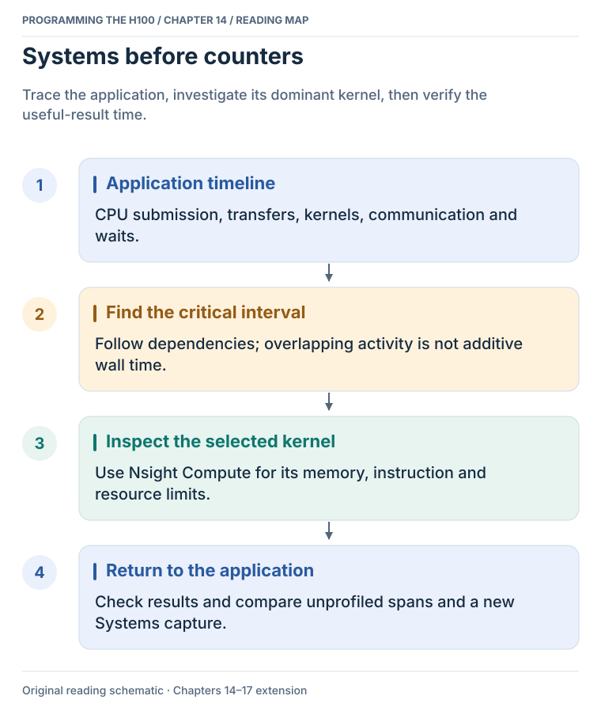

# 14. Nsight Systems — Find the Application Bottleneck

[](images/ch14/overview.svg)

!!! tip "Your goal"

    Explain a slow iteration using a timeline before collecting detailed counters for one kernel. Read [Chapter 13](13-nsight-compute.md) for kernel-level analysis and [Chapter 11](11-multi-gpu-nccl.md) for communication dependencies.

## 1 — Two profilers, two questions

A kernel can get faster while the application barely changes. Suppose a 10 ms iteration spends 6 ms waiting for input, 3 ms computing and 1 ms exchanging results, with no overlap. Halving compute gives 8.5 ms, about 1.18× overall speedup. It does not give 2×. The first task is to identify the critical path, including work that prevents the next useful operation from starting.

**Nsight Systems** supplies a time-correlated view of CPU API calls, CUDA execution, memory operations and supported communication traces. **Nsight Compute** examines a selected kernel’s execution and hardware counters. The practical loop is Systems → Compute → Systems: identify the important interval, investigate its kernel, then confirm that the application improves. Timing collected with either profiler can be perturbed; retain an unprofiled baseline too.

| Question | Start with | Evidence to inspect |
| --- | --- | --- |
| Why is the GPU idle between kernels? | Systems | CPU submission, waits, allocations and input readiness |
| Do copies overlap compute? | Systems | Concurrent intervals on the relevant streams and engines |
| Is communication on the critical path? | Systems | Rank/device timelines and the consumer dependency |
| Why does this GEMM underperform? | Compute | Roofline assumptions, memory behavior, occupancy and instruction metrics |
| Did a faster kernel shorten the iteration? | Systems and an unprofiled timer | Same workload, useful-result boundary and warmup policy |

A long CUDA API call is CPU-side elapsed time, not automatically the GPU duration of the operation named by that call. A short launch can enqueue a long kernel. A synchronization call can inherit earlier work’s latency. Follow correlation links and stream order before assigning blame. NVIDIA documents these trace categories in the [Systems User Guide](https://docs.nvidia.com/nsight-systems/UserGuide/).

## 2 — Install and identify the actual tools

Follow [Getting Started](getting-started.md) first. The CUDA toolkit and each profiler have their own versions. A cloud image may supply `nsys` outside the toolkit’s `bin` directory. Check the selected executable rather than assuming one version from `nvcc`.

```bash
command -v nsys
nsys --version
nsys profile --help
nsys stats --help
```

For the NVIDIA Ubuntu CUDA 12.8 repository configured in Getting Started, the matching optional tool package is:

```bash
sudo apt-get install -y cuda-nsight-systems-12-8
nsys --version
```

The Ubuntu 22.04/24.04 package metadata selects `nsight-systems-2024.6.2` for this toolkit family. This is a toolkit-matched version, not a claim that it is the latest Systems release. If `nsys` is not on `PATH`, inspect `dpkg -L nsight-systems-2024.6.2` for its executable and use that full path or add its directory to `PATH`. Preserve a provider-installed, working tool rather than replacing it unnecessarily.

Alternatively, use NVIDIA’s [Nsight Systems downloads](https://developer.nvidia.com/nsight-systems/get-started) for the supported Linux CLI. Keep the report reader at the capture version or a compatible newer version. CPU sampling, scheduling traces and GPU metric sampling have different platform/permission requirements. Start with CUDA tracing and no CPU sampling; add a collection feature only when it answers a question. Do not change system-wide security settings just to make an optional sampling feature work.

## 3 — A complete overlap exercise

Download [nsys_overlap.cu](examples/advanced/nsys_overlap.cu). It uses pinned host arrays and either one stream or two nonblocking streams. Each stream owns its device buffers. Operations on a slot stay ordered as H2D → transform → D2H; a later chunk cannot overwrite that slot before its earlier D2H has finished. Different slots may overlap if the hardware and resource demands permit it.

The program warms the actual kernel, places the measured work between `cudaProfilerStart()` and `cudaProfilerStop()`, and checks all 4,194,304 output elements. Its start event precedes both worker streams; its stop event follows both completion events. This measures the device work span, not startup or the entire process. Allocation and final CPU reference checking remain outside that interval.

```bash
mkdir -p build/advanced
nvcc -std=c++17 -O2 -lineinfo -arch=sm_90a \
  docs/examples/advanced/nsys_overlap.cu \
  -o build/advanced/nsys_overlap
./build/advanced/nsys_overlap serial
./build/advanced/nsys_overlap overlap
```

**Expected checks, not a captured transcript:** both modes must print `OVERLAP PASS`, `checked=4194304` and `errors=0`. The elapsed values must come from the machine being tested. Two streams do not promise a speedup: copy engines, transfer directions, link bandwidth, memory contention, chunk size and CPU enqueue rate all matter. These new exercises have a [separate validation plan](examples/advanced/README.md); the original 27-program records do not cover them.

## 4 — Capture a small, interpretable region

Use a fresh output directory; `mktemp` creates a unique directory for this capture. The capture flags are the CUDA Profiler API capture mode documented by NVIDIA, not a request to trace all machine activity.

```bash
mkdir -p reports
report_dir=$(mktemp -d "reports/nsys-$(date -u +%Y%m%dT%H%M%SZ)-XXXXXX")
for mode in serial overlap; do
  nsys profile --trace=cuda,nvtx,osrt \
    --sample=none --cpuctxsw=none \
    --capture-range=cudaProfilerApi --capture-range-end=stop \
    --output="$report_dir/$mode" \
    ./build/advanced/nsys_overlap "$mode"
done
nsys stats --help-reports
```

This exercise has CUDA capture markers but no NVTX ranges, so an empty NVTX track is expected. The `nvtx` trace selection becomes useful when the application is annotated. Depending on the installed release, available traces and report names differ; the local help is authoritative. Common summary reports are:

```bash
nsys stats --report cuda_api_sum,cuda_gpu_kern_sum,cuda_gpu_mem_time_sum \
  "$report_dir/overlap.nsys-rep"
```

Consult the [post-collection analysis guide](https://docs.nvidia.com/nsight-systems/AnalysisGuide/) and select names listed by your installation. A report file existing is not sufficient: inspect collection diagnostics and confirm that it contains the intended CUDA kernels, copies and captured interval. An empty or truncated report is not evidence of overlap. A summary aggregates intervals; it cannot by itself establish overlap or an application’s critical path. Copy the `.nsys-rep` files to a workstation and open them in the Systems GUI for the timeline. The GPU host does not need a graphical desktop.

## 5 — Read the timeline in dependency order

1. Find the captured region and identify the correct process and CUDA device.
2. Expand the CPU CUDA API row and each worker stream. Check that the stream handles differ in overlap mode.
3. Follow one chunk through its H2D, `transform` kernel and D2H. These must remain ordered within its stream.
4. Look across streams for actual intersecting intervals. Two queued operations are not proof of concurrent execution.
5. Inspect the end: does the program wait for both streams before validation? Does a late transfer determine the useful-result boundary?
6. Compare with serial mode and the unprofiled run. Keep payload size, repetition count, device, clocks and software stack fixed.

Do not add all GPU activity durations and call the sum wall time. If a 2 ms kernel overlaps a 2 ms transfer, their activity sum is 4 ms but their joint span may approach 2 ms. Conversely, unused gaps and launch overhead may make the span longer. The exercise reports a span precisely to avoid conflating these quantities.

## 6 — Name application phases with NVTX

NVTX labels express application meaning: `input`, `forward`, `gradient-ready`, `all-reduce`, `optimizer`. They do not synchronize CUDA work. A CPU range around an asynchronous launch measures submission until the CPU leaves that range; it is not automatically a range of completed GPU work. Systems can correlate/projection-map related GPU activity, subject to the selected report and version.

With NVIDIA’s header-only [NVTX 3 library](https://github.com/NVIDIA/NVTX) available on the include path, a small annotation looks like this:

```cpp
#include <nvtx3/nvToolsExt.h>

void submit_step() {
    nvtxRangePushA("training-step");
    // Enqueue the real work here. This range alone does not wait for it.
    nvtxRangePop();
}
```

Keep names bounded and stable. Do not create a unique string per element, tensor coordinate or request token unless that cardinality is necessary for the investigation. NVTX is optional for the complete overlap exercise; its compile command deliberately has no NVTX dependency.

## 7 — Multi-GPU and distributed captures

Start by recording which process owns which GPU and which rank belongs to which host. Capture a bounded steady-state interval. Include communication API tracing only when supported by the installed Systems build and the MPI/NCCL implementation; `nsys profile --help` lists available trace domains.

For process-per-GPU launchers, avoid several profiler instances writing the same report. Either profile a supported process tree once, or arrange one capture per rank using the launcher’s **documented** rank and local-rank variables. Give each output a hostname, rank and run identifier. Do not assume Open MPI’s environment names exist under another launcher.

A long NCCL kernel may be doing communication, waiting for peers or both. A rank arriving late can make another rank look slow. A network bottleneck requires transport and topology evidence; one long CUDA interval does not prove it. Cross-host clock alignment and correlation require supported collection/analysis procedures, not a manual comparison of unsynchronized wall clocks.

## 8 — From a Systems finding to Compute and back

Suppose Systems shows that the same GEMM dominates every iteration. Run the application separately under Compute, selecting the kernel name observed in the trace and an appropriate launch filter. Do not stack both profilers around one process by default: collection/replay can change behavior and tools can contend for instrumentation.

After changing the GEMM, repeat the correctness check, unprofiled application measurement and Systems capture. Perhaps the epilogue is faster but the next host-side preprocessing phase now determines the iteration. That is a new bottleneck, not a contradiction. [Chapters 16–17](16-cutlass-gemm.md) apply this loop to CUTLASS.

??? question "Self-check: CPU range or completed GPU work?"

    A 20 μs NVTX range enqueues a 2 ms kernel. Does the range prove the GPU work took 20 μs?

    **Answer:** No. Follow the correlated CUDA execution. A CPU submission range does not wait for asynchronous work merely because it ends.

??? question "Self-check: should two streams always win?"

    The two-stream trace overlaps copies and kernels, but its total span is unchanged. Is the implementation necessarily wrong?

    **Answer:** No. The overlapped operations may compete for the same bandwidth or one transfer direction may remain the critical path. Verify correctness first, then compare useful-result spans and resource demands.
