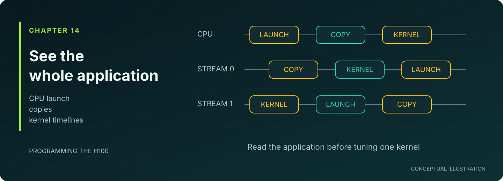

# 14. Nsight Systems — Find the Application Bottleneck
## Lesson 14 Companion Guide — From Kernel Counters to the Application Timeline

[](images/chapter-openers/14-workshop.svg)


!!! tip "Your goal in this chapter"

    Explain a slow iteration using a timeline before collecting detailed counters for one kernel. Read [Chapter 13](13-nsight-compute.md) for kernel-level analysis and [Chapter 11](11-multi-gpu-nccl.md) for communication dependencies.

## 1 — Two profilers, two questions

[](images/ch14/overview.svg)

A kernel can get faster while the application barely changes. Suppose a 10 ms iteration spends 6 ms waiting for input, 3 ms computing and 1 ms exchanging results, with no overlap. Halving compute gives 8.5 ms, about 1.18× overall speedup. It does not give 2×. The first task is to identify the critical path, including work that prevents the next useful operation from starting.

**Nsight Systems** supplies a time-correlated view of CPU API calls, CUDA execution, memory operations and supported communication traces. **Nsight Compute** examines a selected kernel’s execution and hardware counters. The practical loop is Systems → Compute → Systems: identify the important interval, investigate its kernel, then confirm that the application improves. Timing collected with either profiler can be perturbed; retain an unprofiled baseline too.

| Question | Start with | Evidence to inspect |
| --- | --- | --- |
| Why is the GPU idle between kernels? | Systems | CPU submission, waits, allocations and input readiness |
| Do copies overlap compute? | Systems | Concurrent intervals on the relevant streams and engines |
| Is communication on the critical path? | Systems | Rank/device timelines and the consumer dependency |
| Why does this GEMM underperform? | Compute | Roofline assumptions, memory behavior, occupancy and instruction metrics |
| Did a faster kernel shorten the iteration? | Systems and an unprofiled timer | Same workload, useful-result boundary and warmup policy |

A long CUDA API call is CPU-side elapsed time, not automatically the GPU duration of the operation named by that call. A short launch can enqueue a long kernel. A synchronization call can inherit earlier work’s latency. Follow correlation links and stream order before assigning blame. NVIDIA documents these trace categories in the [Systems User Guide](https://docs.nvidia.com/nsight-systems/UserGuide/).

## 2 — Install and identify the actual tools

Follow [Getting Started](getting-started.md) first. The CUDA toolkit and each profiler have their own versions. A cloud image may supply `nsys` outside the toolkit’s `bin` directory. Check the selected executable rather than assuming one version from `nvcc`.

```bash
command -v nsys
nsys --version
nsys profile --help
nsys stats --help
```

For the NVIDIA Ubuntu CUDA 12.8 repository configured in Getting Started, the matching optional tool package is:

```bash
sudo apt-get install -y cuda-nsight-systems-12-8
nsys --version
```

The Ubuntu 22.04/24.04 package metadata selects `nsight-systems-2024.6.2` for this toolkit family. This is a toolkit-matched version, not a claim that it is the latest Systems release. If `nsys` is not on `PATH`, inspect `dpkg -L nsight-systems-2024.6.2` for its executable and use that full path or add its directory to `PATH`. Preserve a provider-installed, working tool rather than replacing it unnecessarily.

Alternatively, use NVIDIA’s [Nsight Systems downloads](https://developer.nvidia.com/nsight-systems/get-started) for the supported Linux CLI. Keep the report reader at the capture version or a compatible newer version. CPU sampling, scheduling traces and GPU metric sampling have different platform/permission requirements. Start with CUDA tracing and no CPU sampling; add a collection feature only when it answers a question. Do not change system-wide security settings just to make an optional sampling feature work.

### Capture agent versus report analysis components

Some distribution/provider packages split the target capture CLI from the matching host analysis tools. A working `nsys --version` and a `.qdstrm` file do not prove that `.nsys-rep` conversion is available. The current H100 session exposed this distinction: the target CLI captured data, but its split directory layout did not locate the matching importer automatically.

Install the matching **full Nsight Systems analysis package** through the provider/NVIDIA package source, not just a target-only agent. Locate `QdstrmImporter` from that installed package and verify its version matches the capture tool. When needed, use the documented conversion explicitly:

```bash
QdstrmImporter --version
QdstrmImporter --input-file trace.qdstrm --output-file trace.nsys-rep
nsys stats --report cuda_gpu_kern_sum trace.nsys-rep
```

On the recorded provider image, the matching importer was installed at `/usr/lib/nsight-systems/host-linux-x64/QdstrmImporter`. The following provider-specific setup made it discoverable to the collector without changing a system symlink:

```bash
/usr/lib/nsight-systems/host-linux-x64/QdstrmImporter --version
export PATH="/usr/lib/nsight-systems/host-linux-x64:$PATH"
command -v QdstrmImporter
```

Use the paths reported by your installed package when its layout differs. Use the actual captured filenames and installed tool path. The validation collector records this fallback as a separate dated stage, preserves the original capture diagnostic and requires a real `transform` kernel summary before accepting the report. It does not fix the problem by modifying system directories or declaring an empty report successful. A headless GPU instance can perform this import; it needs the analysis components even though no GUI session is required.

## 3 — A complete overlap exercise

Download [nsys_overlap.cu](examples/advanced/nsys_overlap.cu). It uses pinned host arrays and either one stream or two nonblocking streams. Each stream owns its device buffers. Operations on a slot stay ordered as H2D → transform → D2H; a later chunk cannot overwrite that slot before its earlier D2H has finished. Different slots may overlap if the hardware and resource demands permit it.

The program warms the actual kernel, places the measured work between `cudaProfilerStart()` and `cudaProfilerStop()`, and checks all 4,194,304 output elements. Its start event precedes both worker streams; its stop event follows both completion events. This measures the device work span, not startup or the entire process. Allocation and final CPU reference checking remain outside that interval.

```bash
mkdir -p build/advanced
nvcc -std=c++17 -O2 -lineinfo -arch=sm_90a \
  docs/examples/advanced/nsys_overlap.cu \
  -o build/advanced/nsys_overlap
./build/advanced/nsys_overlap serial
./build/advanced/nsys_overlap overlap
```

**Checks enforced by the executable:** both modes must print `OVERLAP PASS`, `checked=4194304` and `errors=0`. The elapsed values must come from the machine being tested. Two streams do not promise a speedup: copy engines, transfer directions, link bandwidth, memory contention, chunk size and CPU enqueue rate all matter. The [actual workshop execution record](cutlass-workshop-validation.md) and the captured block below retain the observed values and source revision; the original 27-program records remain separate.

### Walk through two chunks before reading the full trace

A **chunk** is one contiguous piece of the input. A **slot** is a reusable set of device buffers and one stream; it is not another GPU. The complete downloadable source uses these expressions inside its initialized loop context; this excerpt is not a standalone program:

```cpp
constexpr int chunk = 1 << 18, chunks = 16, repetitions = 8;
int s = c % slots;
// In stream s: copy chunk c in, transform it, copy its result out.
```

Work through their consequences in order:

1. **Count one chunk.** `1 << 18` is 262,144 floats. At four bytes per float, one H2D copy transfers 1,048,576 bytes, or 1 MiB. Its matching D2H copy transfers another 1 MiB.
2. **Choose a slot.** In overlap mode, `slots=2`. Chunk 0 uses `0 % 2 = 0`; chunk 1 uses `1 % 2 = 1`; chunk 2 returns to slot 0. The slot chooses the stream and the pair of device buffers.
3. **Follow one value.** For global input index 5, the source initializes `input[5]=5 % 1009=5`. The kernel computes `2×5+1=11`. That result must return to `output[5]`, regardless of which slot processed it.
4. **Follow one dependency.** Chunk 0's H2D, kernel and D2H are enqueued on stream 0. They execute in that order. Chunk 2's H2D is later in the same stream, so it cannot overwrite slot 0 while chunk 0 still needs it.
5. **Look across streams.** Chunk 1 uses separate buffers on stream 1. It may overlap chunk 0. The word *may* matters: independent work is eligible for concurrency, but a timeline must show whether the hardware actually overlapped it.
6. **Count the captured work.** Sixteen chunks repeated eight times give `16×8=128` kernel launches, 128 H2D copies and 128 D2H copies. The transfer payload totals `256×1 MiB=256 MiB`. The same 4,194,304 output positions are overwritten on each repetition; the final CPU check visits those positions once.
7. **Find the true finish.** Each worker records a `done` event after its last D2H. The timing stream waits for both events before recording `stop`. Therefore the interval includes the slower worker's finish, rather than ending when the CPU merely submits the last kernel.

### Put host coordinates beside the reused device storage

The ranges below count **FP32 elements**, not bytes or stored values. Each device slot has only one chunk's capacity even though successive chunks come from different host ranges:

```text
HOST INPUT / matching HOST OUTPUT indices
chunk 0:       0 .. 262143  → slot 0, stream 0
chunk 1:  262144 .. 524287  → slot 1, stream 1
chunk 2:  524288 .. 786431  → slot 0, stream 0 AGAIN

DEVICE STORAGE (separate input/output buffers per slot)
slot 0: input[0..262143]  → transform → output[0..262143]
         chunk 0 uses it first; chunk 2 reuses it later
slot 1: input[0..262143]  → transform → output[0..262143]
         chunk 1 uses this DIFFERENT pair of buffers
```

1. Chunk 2 begins at host element `2×262144=524288`, or byte offset 2,097,152 in the FP32 host input. Its device-local first element is still index zero in slot 0.
2. The actual input rule gives `input[524288]=524288%1009=617`. Slot 0's transform therefore produces `2×617+1=1235` at device-local output index zero.
3. The D2H destination is host `output[524288]`, not host `output[0]`. Reusing a device buffer must not reuse the wrong host destination coordinate.

The first three chunks' **dependency order** is shown below. This is a schematic prefix of the complete repeated workload, not a measured duration or a claim that similarly positioned boxes execute simultaneously:

```text
stream 0 / slot 0:
  H2D chunk 0 → kernel 0 → D2H 0 → H2D chunk 2 → ... → done[0]
                               ^ slot 0 is reusable only here

stream 1 / slot 1:
  H2D chunk 1 → kernel 1 → D2H 1 → H2D chunk 3 → ... → done[1]

timing stream:
  start → workers wait on start → wait done[0] AND done[1] → stop
```

Each `done` marker follows **all** submitted work on its stream, including later chunks and repetitions omitted by `...`. Within one stream, H2D → kernel → D2H order protects the slot. Across streams, independent buffers permit overlap; the captured timeline establishes whether it occurred. The start/join arrows make the timer include both worker paths.

**Pause and check.** Serial mode has one slot, so `c % 1` is always zero. Predict what changes in the picture before opening its report. Every chunk is now ordered in a single row; the workload and expected output values stay the same.

## 4 — Capture a small, interpretable region

Use a fresh output directory; `mktemp` creates a unique directory for this capture. The capture flags are the CUDA Profiler API capture mode documented by NVIDIA, not a request to trace all machine activity.

```bash
mkdir -p reports
report_dir=$(mktemp -d "reports/nsys-$(date -u +%Y%m%dT%H%M%SZ)-XXXXXX")
for mode in serial overlap; do
  nsys profile --trace=cuda,nvtx,osrt \
    --sample=none --cpuctxsw=none \
    --capture-range=cudaProfilerApi --capture-range-end=stop \
    --output="$report_dir/$mode" \
    ./build/advanced/nsys_overlap "$mode"
done
nsys stats --help-reports
```

This exercise has CUDA capture markers but no NVTX ranges, so an empty NVTX track is expected. The `nvtx` trace selection becomes useful when the application is annotated. Depending on the installed release, available traces and report names differ; the local help is authoritative. Common summary reports are:

```bash
nsys stats --report cuda_api_sum,cuda_gpu_kern_sum,cuda_gpu_mem_time_sum \
  "$report_dir/overlap.nsys-rep"
```

Consult the [post-collection analysis guide](https://docs.nvidia.com/nsight-systems/AnalysisGuide/) and select names listed by your installation. A report file existing is not sufficient: inspect collection diagnostics and confirm that it contains the intended CUDA kernels, copies and captured interval. An empty or truncated report is not evidence of overlap. A summary aggregates intervals; it cannot by itself establish overlap or an application’s critical path. Copy the `.nsys-rep` files to a workstation and open them in the Systems GUI for the timeline. The GPU host does not need a graphical desktop.

## 5 — Read the timeline in dependency order

1. Find the captured region and identify the correct process and CUDA device.
2. Expand the CPU CUDA API row and each worker stream. Check that the stream handles differ in overlap mode.
3. Follow one chunk through its H2D, `transform` kernel and D2H. These must remain ordered within its stream.
4. Look across streams for actual intersecting intervals. Two queued operations are not proof of concurrent execution.
5. Inspect the end: does the program wait for both streams before validation? Does a late transfer determine the useful-result boundary?
6. Compare with serial mode and the unprofiled run. Keep payload size, repetition count, device, clocks and software stack fixed.

Do not add all GPU activity durations and call the sum wall time. If a 2 ms kernel overlaps a 2 ms transfer, their activity sum is 4 ms but their joint span may approach 2 ms. Conversely, unused gaps and launch overhead may make the span longer. The exercise reports a span precisely to avoid conflating these quantities.

### Compare the prediction with the captured intervals

The CPU analysis of the recorded Nsight Systems exports on **18 November 2026, 14:28:20 UTC** found the following. These are counts from the captured trace, not invented durations:

| Check | Serial capture | Two-stream capture |
| --- | ---: | ---: |
| Kernel instances | 128 | 128 |
| Copy instances | 256 | 256 |
| Logical copy payload | 256 MiB | 256 MiB |
| Worker streams | 1 | 2 |
| Kernel intervals intersecting a copy in another stream | 0 | 97 |

1. First compare the counts with `16 chunks × 8 repetitions`: the intended workload is present in both captures.
2. Next identify the actual worker streams. Two different stream IDs establish separate queues; they do not yet establish concurrency.
3. For each kernel interval `[start,end)`, search copies on a different stream. Positive overlap requires `max(kernel_start,copy_start) < min(kernel_end,copy_end)`.
4. Count a kernel once if **any** such copy intersects it. The 97 count is not a duration or percentage speedup, and overlapping pair durations must not be added together as wall time.
5. Conclude only what this proves: cross-stream copy/compute overlap occurred in this recorded capture. Use the separate unprofiled timings below to discuss the measured application span.

The [analysis source](validation/2026-11-18-h100-workshop/timeline-analysis/analyze_workshop_timeline.py) and [dated results with input SHA-256 hashes](validation/2026-11-18-h100-workshop/timeline-analysis/results.json) make the calculation inspectable. The original SQLite exports remain in the full capture archive; the public `.nsys-rep` files can also be exported with the matching analysis tools. The analysis is a host-side reading of existing evidence, not another GPU execution.

### A speedup is a ratio, not an overlap count

The unprofiled captured pair at the end of this chapter reports 7.553 ms for serial mode and 4.426 ms for two-stream mode. Work the interpretation separately from the trace analysis:

1. Divide equal-work spans: `7.553 / 4.426 ≈ 1.71`. This pair shows approximately 1.71× speedup for that recorded workload.
2. Compute elapsed-time reduction using the serial denominator: `(7.553−4.426)/7.553 ≈ 41.4%`. A 1.71× speedup does not mean a 71% time reduction.
3. Keep the 97 overlapping-kernel count separate. It establishes that overlap occurred in the profiled capture; it is neither 97% utilization nor a speedup estimate.
4. Repeat unprofiled measurements before generalizing. One pair supplies no stable latency distribution, and the profiled capture is a different execution from that pair.

The payload, repetition count and correctness checks must match in both modes. A change that skips transfers or checks fewer outputs is a changed workload, even if its reported time is lower.

## 6 — Name application phases with NVTX

NVTX labels express application meaning: `input`, `forward`, `gradient-ready`, `all-reduce`, `optimizer`. They do not synchronize CUDA work. A CPU range around an asynchronous launch measures submission until the CPU leaves that range; it is not automatically a range of completed GPU work. Systems can correlate/projection-map related GPU activity, subject to the selected report and version.

With NVIDIA’s header-only [NVTX 3 library](https://github.com/NVIDIA/NVTX) available on the include path, a small annotation looks like this:

```cpp
#include <nvtx3/nvToolsExt.h>

void submit_step() {
    nvtxRangePushA("training-step");
    // Enqueue the real work here. This range alone does not wait for it.
    nvtxRangePop();
}
```

Keep names bounded and stable. Do not create a unique string per element, tensor coordinate or request token unless that cardinality is necessary for the investigation. NVTX is optional for the complete overlap exercise; its compile command deliberately has no NVTX dependency.

## 7 — Multi-GPU and distributed captures

Start by recording which process owns which GPU and which rank belongs to which host. Capture a bounded steady-state interval. Include communication API tracing only when supported by the installed Systems build and the MPI/NCCL implementation; `nsys profile --help` lists available trace domains.

For process-per-GPU launchers, avoid several profiler instances writing the same report. Either profile a supported process tree once, or arrange one capture per rank using the launcher’s **documented** rank and local-rank variables. Give each output a hostname, rank and run identifier. Do not assume Open MPI’s environment names exist under another launcher.

A long NCCL kernel may be doing communication, waiting for peers or both. A rank arriving late can make another rank look slow. A network bottleneck requires transport and topology evidence; one long CUDA interval does not prove it. Cross-host clock alignment and correlation require supported collection/analysis procedures, not a manual comparison of unsynchronized wall clocks.

## 8 — From a Systems finding to Compute and back

Suppose Systems shows that the same GEMM dominates every iteration. Run the application separately under Compute, selecting the kernel name observed in the trace and an appropriate launch filter. Do not stack both profilers around one process by default: collection/replay can change behavior and tools can contend for instrumentation.

After changing the GEMM, repeat the correctness check, unprofiled application measurement and Systems capture. Perhaps the epilogue is faster but the next host-side preprocessing phase now determines the iteration. That is a new bottleneck, not a contradiction. [Chapters 23–24](24-cutlass-gemm.md) apply this loop to CUTLASS.

??? question "Self-check: CPU range or completed GPU work?"

    A 20 μs NVTX range enqueues a 2 ms kernel. Does the range prove the GPU work took 20 μs?

    **Answer:** No. Follow the correlated CUDA execution. A CPU submission range does not wait for asynchronous work merely because it ends.

??? question "Self-check: should two streams always win?"

    The two-stream trace overlaps copies and kernels, but its total span is unchanged. Is the implementation necessarily wrong?

    **Answer:** No. The overlapped operations may compete for the same bandwidth or one transfer direction may remain the critical path. Verify correctness first, then compare useful-result spans and resource demands.

<!-- workshop:start:nsys_overlap -->
## Complete source and captured execution

**Executed on November 18, 2026 (UTC).** Scope: **CUDA workload with its stated numerical checks**.

Tested source SHA-256: `c47d8ed9b3db321f7caa7b3224bcbf4d64918986414f597462196bae2f6a0a6e`. [Exact source](validation/2026-11-18-h100-workshop/nsys_overlap.cu) · [System information](validation/2026-11-18-h100-workshop/system.json) · [Workshop results](cutlass-workshop-validation.md).

The listing below matches the tested source. Its presentation is formatted at build time; downloads retain the captured bytes.

```cuda
// Compare one stream with two nonblocking streams; validate every output.
#include <cuda_runtime.h>
#include <cuda_profiler_api.h>
#include <cstdio>
#include <cstring>
#include <stdexcept>
void check(cudaError_t s) {
    if (s != cudaSuccess) throw std::runtime_error(cudaGetErrorString(s));
}
__global__ void transform(const float* in, float* out, int n) {
    int i = int(blockIdx.x * blockDim.x + threadIdx.x);
    if (i < n) out[i] = 2.0f * in[i] + 1.0f;
}
int main(int argc, char** argv) {
    if (argc != 2 || (std::strcmp(argv[1], "serial") && std::strcmp(argv[1], "overlap"))) {
        std::fprintf(stderr, "Usage: nsys_overlap serial|overlap\n"); return 2;
    }
    try {
        constexpr int chunk = 1 << 18, chunks = 16, repetitions = 8;
        const int slots = std::strcmp(argv[1], "serial") == 0 ? 1 : 2;
        const size_t count = size_t(chunk) * chunks, bytes = size_t(chunk) * sizeof(float);
        float *input = nullptr, *output = nullptr, *di[2]{}, *dout[2]{};
        cudaStream_t streams[2]{};
        cudaEvent_t start{}, stop{}, done[2]{};
        check(cudaMallocHost(reinterpret_cast<void**>(&input), count * sizeof(float)));
        check(cudaMallocHost(reinterpret_cast<void**>(&output), count * sizeof(float)));
        for (size_t i = 0; i < count; ++i) input[i] = float(i % 1009);
        for (int s = 0; s < slots; ++s) {
            check(cudaStreamCreateWithFlags(&streams[s], cudaStreamNonBlocking));
            check(cudaEventCreateWithFlags(&done[s], cudaEventDisableTiming));
            check(cudaMalloc(reinterpret_cast<void**>(&di[s]), bytes));
            check(cudaMalloc(reinterpret_cast<void**>(&dout[s]), bytes));
        }
        // Warm the actual kernel before the captured, timed region.
        check(cudaMemcpy(di[0], input, bytes, cudaMemcpyHostToDevice));
        transform<<<(chunk + 255) / 256, 256, 0, streams[0]>>>(di[0], dout[0], chunk);
        check(cudaGetLastError()); check(cudaStreamSynchronize(streams[0]));
        check(cudaEventCreate(&start)); check(cudaEventCreate(&stop));
        check(cudaProfilerStart());
        check(cudaEventRecord(start));
        for (int s = 0; s < slots; ++s) check(cudaStreamWaitEvent(streams[s], start));
        for (int rep = 0; rep < repetitions; ++rep)
            for (int c = 0; c < chunks; ++c) {
                int s = c % slots;
                check(cudaMemcpyAsync(di[s], input + size_t(c) * chunk, bytes, cudaMemcpyHostToDevice, streams[s]));
                transform<<<(chunk + 255) / 256, 256, 0, streams[s]>>>(di[s], dout[s], chunk);
                check(cudaGetLastError());
                check(cudaMemcpyAsync(output + size_t(c) * chunk, dout[s], bytes, cudaMemcpyDeviceToHost, streams[s]));
            }
        for (int s = 0; s < slots; ++s) {
            check(cudaEventRecord(done[s], streams[s]));
            check(cudaStreamWaitEvent(nullptr, done[s]));
        }
        check(cudaEventRecord(stop)); check(cudaEventSynchronize(stop));
        check(cudaProfilerStop());
        float milliseconds = 0;
        check(cudaEventElapsedTime(&milliseconds, start, stop));
        size_t errors = 0;
        for (size_t i = 0; i < count; ++i) errors += output[i] != 2.0f * input[i] + 1.0f;
        std::printf("%s: mode=%s slots=%d checked=%zu errors=%zu device_span_ms=%.3f\n",
                    errors ? "OVERLAP FAIL" : "OVERLAP PASS", argv[1], slots, count, errors, milliseconds);
        for (int s = 0; s < slots; ++s) {
            check(cudaFree(di[s])); check(cudaFree(dout[s]));
            check(cudaEventDestroy(done[s])); check(cudaStreamDestroy(streams[s]));
        }
        check(cudaEventDestroy(start)); check(cudaEventDestroy(stop));
        check(cudaFreeHost(input)); check(cudaFreeHost(output));
        return errors ? 1 : 0;
    } catch (const std::exception& e) {
        std::fprintf(stderr, "OVERLAP ERROR: %s\n", e.what()); return 1;
    }
}
```

CUDA compilation UTC: `2026-11-18T14:11:16.579477+00:00`. Exit: `0`. [Compile log](validation/2026-11-18-h100-workshop/nsys_overlap-compile.log).

Commands use scratch-directory filenames; raw logs retain exact paths. The collector’s CUTLASS include flags are configuration for that capture; the minimal standalone overlap/SIMT commands do not require those headers.

```bash
nvcc -std=c++17 -O2 -lineinfo -arch=sm_90a --expt-relaxed-constexpr -I "$CUTLASS_ROOT/include" -I "$CUTLASS_ROOT/tools/util/include" nsys_overlap.cu -o ./example
```

Executed UTC: `2026-11-18T14:11:19.004299+00:00`. Exit: `0`. [Run log](validation/2026-11-18-h100-workshop/nsys_overlap-serial-run.log).

```bash
./example serial
```

**Actual captured output**

```text
OVERLAP PASS: mode=serial slots=1 checked=4194304 errors=0 device_span_ms=7.553
```

Executed UTC: `2026-11-18T14:11:19.521997+00:00`. Exit: `0`. [Run log](validation/2026-11-18-h100-workshop/nsys_overlap-overlap-run.log).

```bash
./example overlap
```

**Actual captured output**

```text
OVERLAP PASS: mode=overlap slots=2 checked=4194304 errors=0 device_span_ms=4.426
```

<!-- workshop:end:nsys_overlap -->

<!-- companion-summary:start -->
## Summary

- Nsight Systems explains CPU submission, transfers, kernel launches and communication on a shared timeline; Nsight Compute explains the selected kernel in detail.

- An overlap experiment must join all participating streams before timing completion and compare the same checked useful work in both modes.

- Retain the actual timeline, timing scope and numerical result together; a visually busy GPU is not by itself evidence of a faster application.
<!-- companion-summary:end -->
