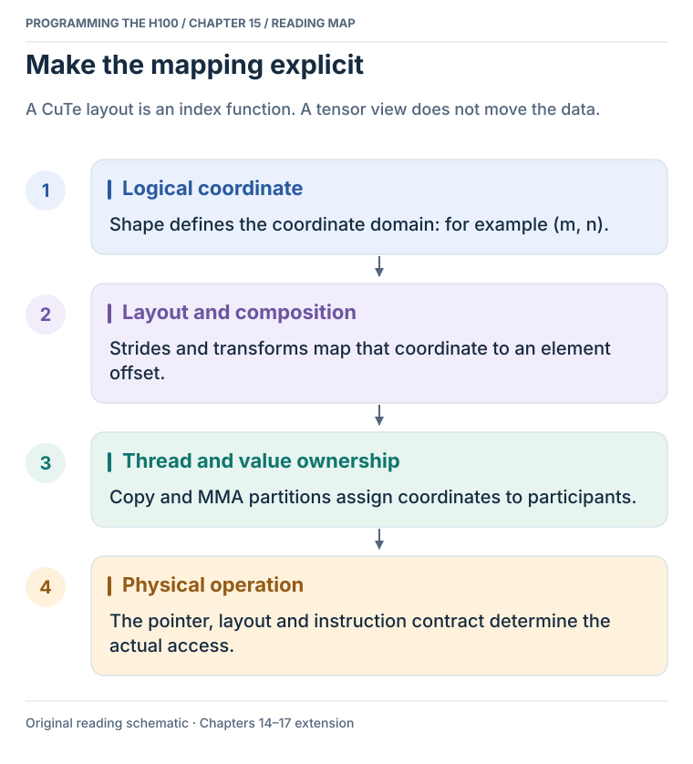

# 15. CuTe — Layout Algebra You Can Check by Hand

[](images/ch15/overview.svg)

!!! tip "Your goal"

    Read a CuTe layout as an address function, distinguish a view from a transfer, and explain how a thread/value partition reaches an instruction operand. Review [shared-memory layout](04-cutensormap-tma-swizzling.md) and [WGMMA fragments](06-wgmma-part-1.md) first.

## 1 — The missing bridge to library kernels

A hand-written kernel often hides its layout in arithmetic: `m * leading_dimension + n`, a swizzle XOR, or a lane-dependent register index. CuTe makes such mappings explicit types and objects. That lets CUTLASS describe global tiles, shared-memory stages, copy ownership and MMA fragments using related operations instead of unrelated indexing formulas.

This chapter covers the **C++ CuTe API** distributed with CUTLASS **v4.3.6**, pinned in [Chapter 16](16-cutlass-gemm.md). CuTe’s Python DSL is a separate programming interface; do not mix its examples, imports or JIT rules with these C++ headers. Newer releases can add schedules and change builders, so this is a reproducible reading baseline rather than a claim that v4.3.6 is the latest release.

The primary references are the pinned [layout tutorial](https://github.com/NVIDIA/cutlass/blob/v4.3.6/media/docs/cpp/cute/01_layout.md), [layout algebra](https://github.com/NVIDIA/cutlass/blob/v4.3.6/media/docs/cpp/cute/02_layout_algebra.md), and [tensor tutorial](https://github.com/NVIDIA/cutlass/blob/v4.3.6/media/docs/cpp/cute/03_tensor.md).

## 2 — Shape says which coordinates; stride says where

For a two-mode layout with shape `(3,4)` and stride `(4,1)`, the address offset is

`offset(m,n) = 4m + n`, for `0 ≤ m < 3`, `0 ≤ n < 4`.

| Coordinate row | n=0 | n=1 | n=2 | n=3 |
| --- | ---: | ---: | ---: | ---: |
| m=0 | 0 | 1 | 2 | 3 |
| m=1 | 4 | 5 | 6 | 7 |
| m=2 | 8 | 9 | 10 | 11 |

The explicit construction is:

```cpp
auto row_major = cute::make_layout(
    cute::make_shape(cute::Int<3>{}, cute::Int<4>{}),
    cute::make_stride(cute::Int<4>{}, cute::Int<1>{}));
auto offset = row_major(cute::make_coord(2, 3)); // 11
```

Offsets are in the layout’s indexing units—normally elements when paired with a typed pointer—not automatically bytes. Multiply by `sizeof(Element)` when comparing with a byte-addressed PTX descriptor. `make_layout(shape)` defaults to a left-major compact layout; it is not a request for the row-major convention used above. Always print or enumerate a new layout before relying on a familiar name.

`Int<4>{}` carries the value in its type; `int k = 4` carries a runtime value. Both can participate in a layout. Static information lets template code prove constraints and specialize indexing, but it also increases the variety of instantiated types. Make dimensions static because an instruction or algorithm needs that fact, not simply because static syntax looks faster.

## 3 — Size and storage span are different

Now retain shape `(3,4)` but use stride `(8,1)`. The three rows start at offsets 0, 8 and 16. There are 12 logical coordinates, yet the largest referenced offset is 19. For this positive-stride example, the storage span through the last referenced element is 20.

- `size(layout)` describes the number of logical elements: 12.
- `cosize(layout)` describes the codomain span used for storage sizing in this example: 20.
- An external allocation may be larger still, for example to reserve a full padded row or several aligned stages.

A broadcast layout can map several coordinates to one offset. That may be useful for reads; it does not give independent destinations for parallel writes. The coordinate domain, image, storage bounds and ownership are separate properties. Do not generalize the simple positive-stride span arithmetic to arbitrary composed/swizzled layouts without checking the corresponding contract.

## 4 — Hierarchy is part of the meaning

A layout may have nested shapes such as `((2,2),4)`. The first mode retains a factorization: two subcoordinates describe its four positions. This is useful when those factors correspond to lanes, values per lane, subtiles or an instruction atom. Flattening the shape can hide exactly the structure that a copy or MMA partition expects.

`coalesce` simplifies compatible layout factors while preserving the mapping it represents. It does not move the tensor, erase data padding by copying, or preserve every original hierarchy boundary. When a later operation expects a particular mode structure, use the algebra’s mode/profile-aware forms and inspect the resulting shape.

## 5 — Composition is function composition

If layout `A` maps an index to a storage offset and layout `B` maps a new coordinate to an index accepted by `A`, their composition maps `x` to `A(B(x))`. Order matters. This is a view transformation: no loads or stores occur merely because a composed layout was constructed.

A simple scalar example makes the direction visible. Let `A(i)=2i` and `B(j)=j+1` over a valid domain. Then `A(B(j))=2j+2`, while `B(A(j))=2j+1`. Real CuTe layouts must satisfy the algebra’s compatibility rules; this arithmetic analogy does not make every arbitrary affine function a valid `Layout` constructor.

When debugging composition, enumerate the small domain on paper and compare three quantities: the input coordinate, its intermediate index, and its final offset. Then test the actual CuTe object. A type that compiles is not proof that the chosen mapping matches your matrix convention.

## 6 — Divide a layout into tiles

A contiguous 12-element layout can be logically divided into tiles of four. The new coordinates are `(within_tile, tile_number)`, with offsets `within_tile + 4 * tile_number`.

| Tile | Four offsets |
| --- | --- |
| 0 | 0, 1, 2, 3 |
| 1 | 4, 5, 6, 7 |
| 2 | 8, 9, 10, 11 |

```cpp
auto contiguous = cute::make_layout(cute::Int<12>{});
auto tiled = cute::logical_divide(contiguous, cute::Int<4>{});
auto offset = tiled(cute::make_coord(2, 1)); // 6
```

`logical_divide`, `zipped_divide` and their multidimensional relatives organize tile and remainder modes differently. Learn the returned shape, not just the function name. A layout view does not allocate a shared-memory stage, issue TMA, or predicate out-of-bounds coordinates. A kernel still needs those operations and their synchronization protocol.

## 7 — Tensors, slices and thread/value partitions

A CuTe tensor combines a data engine with a layout. A pointer-backed view over global memory differs from an owning register tensor even when their logical shapes match. Slicing chooses coordinates/modes; `local_tile` selects a tile; a tiled copy or tiled MMA assigns parts of a tensor to participating threads.

The useful debugging chain is:

**matrix coordinates → tile coordinates → thread/value coordinates → element offset → byte address**.

For a load, ask whether every needed element is covered. For a store, also ask whether two threads can target the same address. For MMA, ask whether the fragment matches the exact atom and operand convention. The register layouts from Chapters 6–7 are not replaced by a generic “row-major register array” merely because CuTe performs the partitioning.

When reading a `TiledCopy` or `TiledMma`, locate its atom, thread layout and value layout. Then inspect the per-thread slice and its partition functions. A partition describes ownership; the actual copy/MMA call performs work. NVIDIA’s [copy/MMA atom tutorial](https://github.com/NVIDIA/cutlass/blob/v4.3.6/media/docs/cpp/cute/0t_mma_atom.md) connects these layers.

## 8 — Swizzles are layout transforms, not faster copies

A shared-memory swizzle changes the mapping between logical coordinates and shared addresses. It can improve bank behavior for a particular access pattern. It must also agree with the TMA and WGMMA layout descriptions. A swizzle applied only to the producer or only to the consumer scrambles the computation.

Check the base alignment, pattern start, tile shape and descriptor fields from [Chapters 4 and 6](04-cutensormap-tma-swizzling.md). A swizzled allocation needs the correct storage span and alignment; `size` alone is not a universal shared-memory allocation recipe. Start with a supported CUTLASS builder layout before inventing a custom composition.

## 9 — Run the coordinate oracle

The complete [cute_layouts.cu](examples/advanced/cute_layouts.cu) enumerates both matrix mappings and the divided one-dimensional layout. It launches no GPU kernel. We compile it with the pinned CUDA/CUTLASS toolchain so that its C++ header dependencies match the later GEMM.

```bash
nvcc -std=c++17 -O2 --expt-relaxed-constexpr \
  -I "$CUTLASS_ROOT/include" \
  docs/examples/advanced/cute_layouts.cu -o build/advanced/cute_layouts
./build/advanced/cute_layouts
```

Create `build/advanced` and set `CUTLASS_ROOT` as in Chapter 16 first. Expected checks are the row-major coordinate table above, `size(padded)=12`, `cosize(padded)=20`, and `LAYOUT PASS` with zero errors. These are specifications to verify, not a captured run transcript. The separate [advanced collector](examples/advanced/README.md) will retain real output at the next hardware session.

??? question "Self-check: does a new layout transpose the allocation?"

    You change a pointer-backed tensor view’s strides. Have you transposed the bytes?

    **Answer:** No. You changed which bytes each logical coordinate names. A physical transpose requires reads and writes into the intended destination layout, with valid ownership and synchronization.

??? question "Self-check: how many elements do you allocate?"

    Shape `(3,4)`, stride `(8,1)`: is a 12-element buffer enough?

    **Answer:** No. Offset 19 is referenced, so this example needs a span of at least 20 elements. Additional padding/alignment may require a larger allocation.
