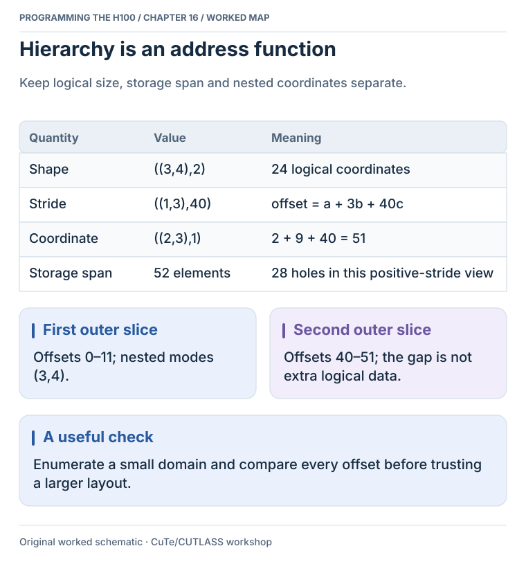

# 16. CuTe Layout Algebra — Hierarchy, Composition and Tiling

[](images/ch16/overview.svg)

[Chapter 15](15-cute-layouts.md) introduced layouts as address functions. This chapter develops the algebra behind those functions. The goal is not to memorize template spellings: it is to predict a small layout's offsets, explain which structure an operation preserves and catch a mapping error before it reaches a GPU instruction.

The APIs here are **CuTe C++ from CUTLASS v4.3.6**, not CuTe Python DSL or Triton. The authoritative references are the pinned [layout](https://github.com/NVIDIA/cutlass/blob/v4.3.6/media/docs/cpp/cute/01_layout.md) and [layout-algebra](https://github.com/NVIDIA/cutlass/blob/v4.3.6/media/docs/cpp/cute/02_layout_algebra.md) tutorials. Code fragments assume `#include <cute/tensor.hpp>` and `using namespace cute;`. They explain mappings; the complete oracle linked below collects the checks into a program.

## 1 — Coordinates and physical offsets are different integers

Consider shape `(3,4)` with strides `(4,1)`. Logical coordinate `(m,n)` maps to physical element offset `4m+n`. CuTe also accepts a scalar logical coordinate: its coordinate decomposition is first-mode-fastest. Thus scalar `i` decomposes as `m=i%3`, `n=i/3` over the 12-element domain.

| Scalar logical i | Coordinate `(m,n)` | Physical row-major offset |
| ---: | --- | ---: |
| 0 | `(0,0)` | 0 |
| 1 | `(1,0)` | 4 |
| 2 | `(2,0)` | 8 |
| 3 | `(0,1)` | 1 |
| 4 | `(1,1)` | 5 |
| 5 | `(2,1)` | 9 |

Consequently, `i=m+3n` is a logical enumeration index; it is not the row-major physical address `4m+n`. Confusing these two meanings makes a flattened ownership map look correct while selecting the wrong memory. A printed tuple's coordinate order does not imply a particular major order in storage; its strides do.

```cpp
auto row = make_layout(
    make_shape(Int<3>{}, Int<4>{}),
    make_stride(Int<4>{}, Int<1>{}));
auto a = row(make_coord(1, 2));  // physical offset 6
auto b = row(7);                // same coordinate: (1,2)
```

Both calls describe the same element because 7 decomposes as `(1,2)`. Neither performs a load. Offsets remain in indexing units; for an FP16 pointer, offset 6 corresponds to 12 bytes.

## 2 — A hierarchy carries useful meaning

Now use nested shape `((3,4),2)` and nested strides `((1,3),40)`. Write its coordinate as `((a,b),c)`. The mapping is `a+3b+40c`, with `a<3`, `b<4`, `c<2`. The nested first mode might represent factors within a tile; the final mode might represent separated storage regions. That interpretation belongs to the algorithm, while the layout specifies the arithmetic.

```cpp
auto nested = make_layout(
    make_shape(make_shape(Int<3>{}, Int<4>{}), Int<2>{}),
    make_stride(make_stride(Int<1>{}, Int<3>{}), Int<40>{}));
auto offset = nested(make_coord(make_coord(2, 3), 1));
```

The result is `2+9+40=51`. Enumerating the domain gives:

| c | b=0 | b=1 | b=2 | b=3 |
| ---: | --- | --- | --- | --- |
| 0 | 0,1,2 | 3,4,5 | 6,7,8 | 9,10,11 |
| 1 | 40,41,42 | 43,44,45 | 46,47,48 | 49,50,51 |

There are 24 coordinates and 24 distinct referenced elements. For this positive-stride layout, `cosize` is 52: storage through the largest referenced element includes 28 holes at offsets 12 through 39. `size` is therefore 24, not 52. If several such objects share an allocation, their placement and alignment can require still more space.

Do not allocate only 24 elements and assume that a 24-coordinate view must fit. Conversely, holes need not be read or initialized merely because they lie inside the storage span. Copy and initialization loops should follow the actual ownership contract.

## 3 — Coalescing simplifies representation, not storage

`coalesce` combines compatible factors and removes static size-one factors while preserving the represented scalar-index-to-offset function. In the nested example, the contiguous factors `(3,4):(1,3)` can combine into `12:1`; the gap before the second region prevents combining everything into a single compact contiguous mode.

The word *coalesce* here is an algebra operation. It is not a global-memory transaction, a copy or a promise of faster access. A row-major `(3,4):(4,1)` layout also does not become “physical offset equals scalar i” just because `coalesce(row)` is called.

When verifying a coalesced result, enumerate the original scalar logical indices and compare offsets. Do not compare `coalesced(4m+n)` with `row(m,n)` unless that is genuinely the intended coordinate conversion. For this row example, the matching scalar logical index is `m+3n`.

Static `Int<N>` values can let CuTe prove simplifications at compile time. Runtime dimensions may retain additional modes in the type even when a particular runtime value is one. Equivalent address functions need not have identical printed tuple structure. If a later operation depends on mode boundaries, inspect those boundaries rather than merely the total element count.

## 4 — Composition applies the inner mapping first

`composition(A,B)` represents the offset function `A(B(x))`, subject to CuTe's layout compatibility rules. Choose a simple case that can be checked exhaustively:

```cpp
auto twice = make_layout(Int<16>{}, Int<2>{});
auto every_third = make_layout(Int<4>{}, Int<3>{});
auto composed = composition(twice, every_third);
```

For `x=0,1,2,3`, B selects intermediate indices `0,3,6,9`; A maps them to `0,6,12,18`. All intermediate indices fit A's 16-element domain. The resulting offset function is `6x` on this four-element domain.

Composition is not arbitrary pointer arithmetic disguised as a template. Check the inner image, outer domain, resulting hierarchy and divisibility constraints. Reversing the argument order need not even define the same valid domain. Neither composing a tensor layout nor creating an intermediate layout moves existing values into the composed order.

## 5 — Complement describes the missing repetition pattern

For a compact `4:1` tile, complementing toward a 24-element target yields a six-position repetition layout `6:4`. A coordinate pair `(within,tile)` then addresses `within+4tile`. The original tile and its complement account for the complete contiguous target together.

For a strided `4:2` pattern, holes must be filled as well as the pattern repeated. The complement is not simply “total size divided by tile size with a larger stride.” This distinction matters when constructing thread/value maps from a noncompact atom.

CuTe exposes `complement(layout,cotarget)`; use a small supported layout, enumerate both components and prove uniqueness before applying the result to writable storage. A broadcast or overlapping mapping does not acquire a bijective inverse merely because its logical size matches another layout. Inversion, where supported, must be interpreted against the mapping's image and the exact inverse contract; it is not a general recovery operation for arbitrary aliasing.

## 6 — Division reorganizes tile and remainder coordinates

For contiguous length 12 and tile length four:

```cpp
auto line = make_layout(Int<12>{});
auto divided = logical_divide(line, Int<4>{});
auto offset = divided(make_coord(2, 1));  // 6
```

The first coordinate selects an element inside a tile; the second selects its repetition. Tiles reference `0..3`, `4..7` and `8..11`. With several original modes, `logical_divide` retains the per-mode tile/remainder relationship; `zipped_divide` groups tile modes together and remainder modes together. `tiled_divide` and `flat_divide` provide other groupings. These are distinct result shapes, not interchangeable names for the same tuple interface.

Products construct repeated layouts rather than merely partitioning an existing one. Both division and product depend on complement/composition rules. Learn their small-domain behavior first; a reshaped type can still describe an unexpected order.

## 7 — Check the algebra before using it

The complete [CuTe algebra oracle](examples/advanced/cute_algebra.cu) checks all 24 nested coordinates, the row-layout/coalesced scalar relationship and the four composition coordinates. The [CPU workbook](examples/advanced/indexing_workbook.py) independently checks the elementary arithmetic without executing CuTe or CUDA kernels:

```bash
python3 docs/examples/advanced/indexing_workbook.py
```

The Python result establishes only its arithmetic assertions. Use the advanced examples' documented pinned build route to compile the C++ oracle, and record that separate result; the worked tables above are derived examples, not a claim of a completed new GPU run.

**Exercise.** Change the nested region stride from 40 to 24. What are size, span and holes?

**Worked answer.** Size remains 24. The regions become `0..11` and `24..35`, so the span is 36 and there are 12 holes. Changing stride changes storage placement, not the coordinate count. Next, [attach an engine and create tensor views](17-cute-tensors-tiling.md); only then does the layout describe how an actual object will be accessed.

<!-- workshop:start:cute_algebra -->
## Complete source and captured execution

**Executed on November 18, 2026 (UTC).** Scope: **CPU execution of real CuTe coordinate/trait checks**.

Tested source SHA-256: `057517089668e8cddcb6623e5db38c4b37974dfb6548412b212417c433fab3ec`. [Exact source](validation/2026-11-18-h100-workshop/cute_algebra.cu) · [System information](validation/2026-11-18-h100-workshop/system.json) · [Workshop results](cutlass-workshop-validation.md).

The listing below matches the tested source. Its presentation is formatted at build time; downloads retain the captured bytes.

```cuda
// Host-only checks of real CuTe layout algebra, compiled using CUDA headers.
#include <cute/tensor.hpp>
#include <cstdio>
using namespace cute;
int main() {
    auto nested = make_layout(make_shape(make_shape(Int<3>{}, Int<4>{}), Int<2>{}),
                              make_stride(make_stride(Int<1>{}, Int<3>{}), Int<40>{}));
    int errors = 0;
    for (int c = 0; c < 2; ++c)
        for (int b = 0; b < 4; ++b)
            for (int a = 0; a < 3; ++a)
                errors += int(nested(make_coord(make_coord(a,b),c))) != a + 3*b + 40*c;
    errors += int(size(nested)) != 24 || int(cosize(nested)) != 52;
    auto row = make_layout(make_shape(Int<3>{},Int<4>{}),make_stride(Int<4>{},Int<1>{}));
    auto flat = coalesce(row);
    for (int m=0;m<3;++m)
        for (int n=0;n<4;++n) {
            // CuTe's scalar logical-coordinate enumeration is first-mode-fastest.
            int logical = m + 3*n;
            errors += int(row(make_coord(m,n))) != int(flat(logical));
        }
    auto twice = make_layout(Int<16>{},Int<2>{});
    auto every_third = make_layout(Int<4>{},Int<3>{});
    auto composed = composition(twice,every_third);
    for (int i=0;i<4;++i) errors += int(composed(i)) != 6*i;
    std::printf("nested_size=%d nested_span=%d nested((2,3),1)=%d\n",
                int(size(nested)),int(cosize(nested)),int(nested(make_coord(make_coord(2,3),1))));
    std::printf("%s: 24 nested coordinates, 12 coalesced coordinates, 4 composition coordinates; errors=%d\n",
                errors ? "ALGEBRA FAIL" : "ALGEBRA PASS", errors);
    return errors ? 1 : 0;
}
```

CUDA compilation UTC: `2026-11-18T14:09:25.352747+00:00`. Exit: `0`. [Compile log](validation/2026-11-18-h100-workshop/cute_algebra-compile.log).

Commands use scratch-directory filenames; raw logs retain exact paths. The collector’s CUTLASS include flags are configuration for that capture; the minimal standalone overlap/SIMT commands do not require those headers.

```bash
nvcc -std=c++17 -O2 -lineinfo -arch=sm_90a --expt-relaxed-constexpr -I "$CUTLASS_ROOT/include" -I "$CUTLASS_ROOT/tools/util/include" cute_algebra.cu -o ./example
```

Executed UTC: `2026-11-18T14:09:36.965003+00:00`. Exit: `0`. [Run log](validation/2026-11-18-h100-workshop/cute_algebra-run.log).

```bash
./example
```

**Actual captured output**

```text
nested_size=24 nested_span=52 nested((2,3),1)=51
ALGEBRA PASS: 24 nested coordinates, 12 coalesced coordinates, 4 composition coordinates; errors=0
```

<!-- workshop:end:cute_algebra -->
