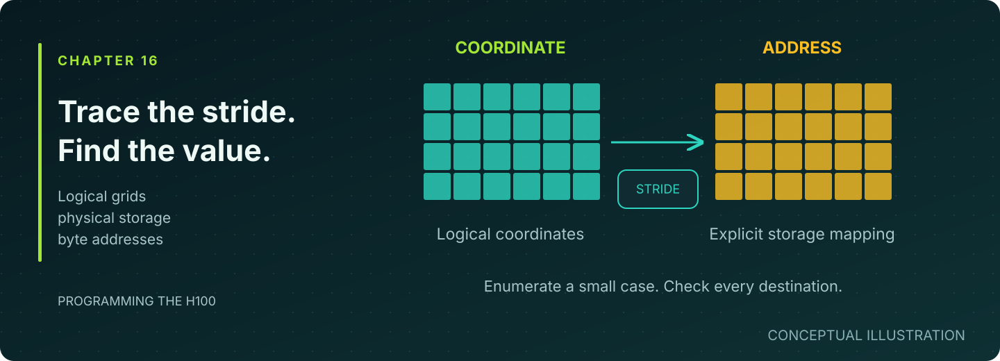
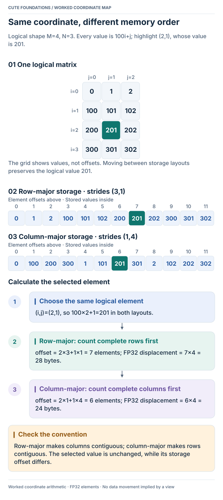
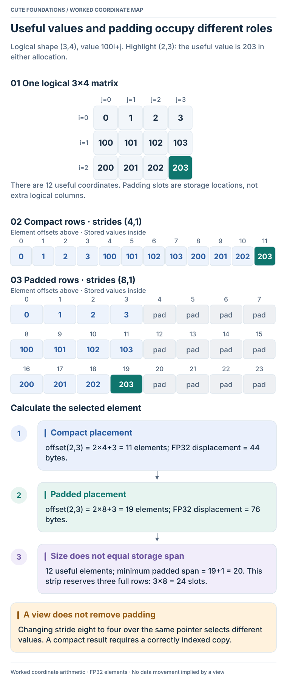
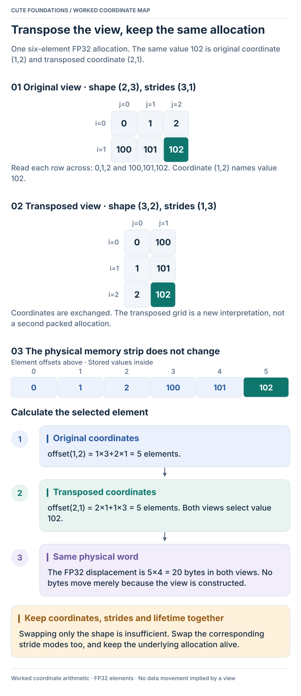

# 16. Strides — From Coordinates to Addresses

!!! note "What the small Python check establishes"
    The reference is an integer-address teaching model. Its transpose equality
    and alignment assertions are algebraic sanity checks, not independent
    tests of CuTe, device pointer alignment or GPU transactions. Several output
    labels are fixed text. The recorded run establishes that the script ran;
    it does not establish a GPU memory-access experiment.

## Lesson 16 Companion Guide — Read Every Dimension, Unit and Storage Gap

[](images/chapter-openers/16-workshop.svg)

!!! tip "Your goal in this chapter"

    Derive the physical address of a matrix element before applying layout algebra. Start with [CuTe foundations](15-cute-layouts.md). You will work through compact and padded matrices, transpose views, independent batches and broadcast aliases, then carry the same contracts into [hierarchical layout algebra](17-cute-layout-algebra.md).

## 1 — Name the symbols and the units

A **shape** says which coordinates exist. A **stride** says how much the offset changes when one coordinate increases by one. A base pointer says where the view starts. None of these alone describes the complete allocation.

For a matrix with M rows and N columns, use logical coordinates `(m,n)`, where `0<=m<M` and `0<=n<N`. Let `s_m` be the row-mode stride and `s_n` the column-mode stride. Our first examples count **elements**, so

`element_offset(m,n) = m*s_m + n*s_n`.

If each element occupies E bytes, its byte address is `base_address + E*element_offset`. For FP32, E=4. A pointer expression `p[offset]` already scales by `sizeof(*p)`; multiplying an element offset by E before using that expression would scale twice.

| Symbol | Meaning | Unit |
| --- | --- | --- |
| M, N | Logical row/column extents | Elements along each mode |
| m, n | Logical coordinates | Element indices |
| s_m, s_n | Offset increment per coordinate step | Elements in these examples |
| E | Storage per element | Bytes per element |
| p | Pointer to the view origin | Typed pointer |

The coordinate order is a choice of interface, not a universal physical order. This chapter writes `(M,N)` for a mathematical matrix. Later CUTLASS GEMM uses logical B modes `(N,K,L)` even though the mathematical B matrix is K×N. Always state the modes before reading a stride tuple.

## 2 — A tiny row-major matrix

Let M=2, N=3 and store six FP32 numbers contiguously. Row-major storage makes adjacent columns adjacent in memory: `s_n=1`. Moving to the next row skips N elements: `s_m=3`.

| Coordinate | (0,0) | (0,1) | (0,2) | (1,0) | (1,1) | (1,2) |
| --- | ---: | ---: | ---: | ---: | ---: | ---: |
| Element offset | 0 | 1 | 2 | 3 | 4 | 5 |
| Byte offset | 0 | 4 | 8 | 12 | 16 | 20 |

1. Choose `(m,n)=(1,2)`.
2. Substitute `1*3 + 2*1 = 5` elements.
3. Convert once: `5*4=20` bytes.
4. Check the allocation: element five is the sixth and last element, so its four bytes occupy byte offsets 20 through 23.

For logical values `[[a,b,c],[d,e,f]]`, read the matrix and the physical strip together:

```text
Logical matrix                 Row-major physical elements
       n=0 n=1 n=2             offset:  0  1  2  3  4  5
m=0     a   b   c              value:   a  b  c  d  e  f
m=1     d   e   f                       └row 0┘ └row 1┘
```

In pinned CUTLASS v4.3.6 C++ CuTe, express the same map explicitly. The include belongs at file scope; the declarations belong inside a surrounding function. Later C++ snippets assume this header and use separate example scopes, not one block to concatenate:

```cpp
#include <cute/tensor.hpp>
// Inside a function; separate snippets use separate scopes.
using namespace cute;
auto row = make_layout(make_shape(Int<2>{}, Int<3>{}),
                       make_stride(Int<3>{}, Int<1>{}));
auto offset = row(make_coord(1, 2));  // 5, in element units by our convention
```

`Int<3>` encodes a compile-time constant. Ordinary integer arguments can instead supply runtime extents/strides. Making the layout object does not allocate memory, copy elements or choose which GPU thread accesses them. The pinned [layout tutorial](https://github.com/NVIDIA/cutlass/blob/v4.3.6/media/docs/cpp/cute/01_layout.md) defines this coordinate-to-offset abstraction.

## 3 — The same shape can be column-major

Keep shape `(2,3)`, but make adjacent rows contiguous: strides `(1,2)`.

| Row | Column 0 | Column 1 | Column 2 |
| --- | ---: | ---: | ---: |
| m=0: element offsets | 0 | 2 | 4 |
| m=1: element offsets | 1 | 3 | 5 |

```cpp
using namespace cute;
auto column = make_layout(make_shape(Int<2>{}, Int<3>{}),
                          make_stride(Int<1>{}, Int<2>{}));
// column(make_coord(1, 2)) == 5
// column(make_coord(0, 1)) == 2
```

```text
Same logical matrix            Column-major physical elements
       n=0 n=1 n=2             offset:  0  1  2  3  4  5
m=0     a   b   c              value:   a  d  b  e  c  f
m=1     d   e   f                       col0 col1 col2
```

Both layouts use six contiguous elements, but they disagree about most coordinates. Checking only the first and last elements fails to distinguish them: both map `(0,0)` to zero and `(1,2)` to five. Check an interior coordinate such as `(0,1)` too.

A CuTe default compact layout need not be the row-major convention a C programmer expects. When learning, write both the shape and stride explicitly. The word “contiguous” also needs an axis: contiguous rows and contiguous columns describe different coordinate maps.

### A larger matrix: keep values and offsets separate

In this second example M=4 and N=3. The grid contains **values** `100*m+n`; the small labels above the physical strips are **element offsets**. Follow highlighted value 201 from coordinate `(2,1)` into both storage orders. Row-major selects offset seven; column-major selects offset six. The same logical value is preserved when the arrays are populated according to their respective layouts.

[](images/worked/row-vs-column.svg)

## 4 — Leading dimension means physical row spacing here

Suppose each row reserves five elements while only three are logical data. Use shape `(2,3)`, stride `(5,1)`. The row-leading dimension `ld=5` is measured in elements.

```text
Allocation offsets:   0  1  2  3  4 | 5  6  7  8  9
Logical coordinates: row 0     pad   | row 1     pad
Logical offsets:      0  1  2       | 5  6  7
```

1. `(1,2)` maps to `1*5+2=7`, or byte offset 28 for FP32.
2. Only six coordinates are logical values; row zero's padding offsets 3 and 4 are not extra columns. If two complete physical rows are reserved, offsets 8 and 9 are the final row's padding.
3. The largest logical offset is seven, so eight elements suffice to cover this view from its origin.
4. An allocator may reserve ten elements to keep the final row's padding and a full rectangular storage extent. The view does not require that its logical data fill that allocation.

```cpp
using namespace cute;
int ld = 5;
auto padded = make_layout(make_shape(2, 3), make_stride(ld, 1));
// padded(make_coord(1, 2)) == 7
```

Do not replace `ld` with N merely because the matrix has N columns. Conversely, the term leading dimension is API-specific: a column-major API commonly uses it for spacing between columns. Translate its documented coordinate formula instead of assuming every parameter named `ld` is a row stride.

### See the holes in a three-row example

This separate `(3,4)` FP32 example uses an eight-element padded row stride. Highlighted value 203 lives at `(2,3)`: offset 19 in padded storage and offset 11 in a separately populated compact allocation. Gray cells are padding, not logical columns. Read the logical grid first, then the compact strip, then each padded row; the numbered boxes show the same arithmetic as the memory picture.

[](images/worked/padding-and-storage.svg)

## 5 — Transpose a view before deciding to move data

The padded matrix above has shape `(2,3)` and strides `(5,1)`. Its transpose **view** has shape `(3,2)` and strides `(1,5)`:

`T(n,m) = A(m,n)` because `n*1 + m*5 = m*5 + n`.

| Transpose row n | Column m=0 | Column m=1 |
| --- | ---: | ---: |
| 0 | 0 | 5 |
| 1 | 1 | 6 |
| 2 | 2 | 7 |

```cpp
using namespace cute;
auto transposed = make_layout(make_shape(3, 2), make_stride(1, 5));
// transposed(make_coord(2, 1)) == padded(make_coord(1, 2)) == 7
```

When applied to the same valid allocation base, these layouts describe the same underlying elements with swapped coordinate names. Layout objects alone contain an offset map, not a pointer to that allocation. No physical transpose occurred. To create a new **compact row-major** 3×2 allocation, use destination strides `(2,1)` and copy each logical `A(m,n)` to destination `(n,m)`. That copy changes storage; the view alone does not. Whether a library can consume the view directly depends on its layout, alignment and operation requirements.

### Follow one value through the transpose view

Use a separate **compact** 2×3 allocation with strides `(3,1)` for this figure; it is not the padded `(5,1)` allocation above. Value 102 is original coordinate `(1,2)` and transposed coordinate `(2,1)`. Both select physical offset five. Notice that the memory strip appears only once: the transpose view changes coordinates and strides, while a physical transpose into compact row-major storage needs a separate copy.

[](images/worked/transpose-view.svg)

## 6 — Add a batch mode without merging the batches

Use two independently padded 2×3 matrices, reserving ten elements per batch. Choose coordinate order `(l,m,n)`, shape `(2,2,3)` and strides `(10,5,1)`:

`offset(l,m,n) = 10*l + 5*m + n`.

1. Batch zero's data offsets are `0,1,2,5,6,7`.
2. Batch one's are `10,11,12,15,16,17`.
3. `(l,m,n)=(1,1,2)` maps to `10+5+2=17`.
4. The logical count is twelve. The origin-to-last-element span is eighteen elements. A two-batch full-storage allocation may reserve twenty.

```cpp
using namespace cute;
auto batches = make_layout(make_shape(2, 2, 3), make_stride(10, 5, 1));
// batches(make_coord(1, 1, 2)) == 17
```

```text
batch 0 origin                                     batch 1 origin
      ↓                                                  ↓
      a b c · · d e f · · | g h i · · j k l · ·
      0 1 2 3 4 5 6 7 8 9  10 ...             17
      └──── ten reserved elements ────┘
```

Here `·` means padding, not an implicit zero-valued matrix element.

A batch stride is not automatically M*N. Here that compact value would be six, causing the second batch's origin to overlap the first batch's final logical elements. For independent writable matrices, prove that their actual address sets are disjoint. A larger allocation does not repair overlapping stride arithmetic.

## 7 — Broadcast reads and aliased writes

Shape `(2,3)` with strides `(0,1)` repeats one three-element row:

```text
row 0 → 0 1 2
row 1 → 0 1 2
```

This is useful for reading a per-column bias: `bias[n]` does not depend on m. Six logical coordinates refer to only three distinct elements. Independent output writes through this map would alias. Two threads storing different row results to the same location can race; even identical expected values do not make unsynchronized concurrent writes a general safe output policy.

Zero strides are not the only cause. Shape `(2,3)` with positive strides `(1,1)` maps rows to `0,1,2` and `1,2,3`. It overlaps too. Therefore “all strides are positive” does not prove injectivity. Enumerate tiny layouts, then establish a structural ownership argument for the actual larger layout.

## 8 — Logical size, span and allocation are different

For a layout, `size(layout)` is the logical coordinate count. CuTe's `cosize` describes its codomain size according to the layout API. For the simple nonnegative affine, nonempty maps in this chapter, the origin-to-last-offset span is

`1 + sum_i ((extent_i-1)*stride_i)`.

This counts holes and includes any aliased coordinates only through their reached offsets. The padded `(2,3):(5,1)` map has size six and span eight. The broadcast `(2,3):(0,1)` map has size six and span three. Neither number alone proves uniqueness or says how many elements the allocator reserved.

The formula above is **not** a general allocation rule for negative strides, arbitrary composed/swizzled layouts, packed sub-byte elements or empty extents. A negative stride may reach before the view origin; both minimum and maximum reachable byte addresses and the adjusted base must fit a valid allocation. This introductory oracle rejects negative strides and zero extents rather than pretending to validate them. For advanced layouts, inspect their actual documented map and supported domain before treating `cosize` as storage capacity.

A subview can begin inside an allocation. Then an eight-element span is safe only if eight elements remain from that adjusted origin. Knowing the original allocation's total capacity is insufficient. Address bounds, unique write ownership and API alignment are separate checks.

## 9 — Bytes, CUDA pitch and TMA descriptors

CuTe's layout arithmetic has no automatic knowledge that your integers mean elements. The examples above attach that meaning consistently. Other APIs use other units:

| Interface in this discussion | Stride unit |
| --- | --- |
| Typed `float*` indexing / these CuTe views | Float elements |
| `cudaMallocPitch` returned pitch | Bytes |
| `cudaMemcpy2D` source/destination pitches and width | Bytes |
| `cuTensorMapEncodeTiled` global byte strides | Bytes, with descriptor-specific constraints |

Packed sub-byte data needs one more explicit conversion. For a low-nibble-first four-bit payload, logical code index i uses `byte_index=i//2` and nibble selector `i%2`:

```text
Logical code:      q0       q1       q2       q3
Physical byte:     [ q1 | q0 ]       [ q3 | q2 ]
Byte index:             0                 1
Bit positions:       7..4 3..0         7..4 3..0
```

Logical index three therefore selects byte one, high nibble. Do not treat a four-bit code count as a byte count, or assume ordinary `float*` indexing describes this packing. A library's sub-byte iterator can encode that distinction; this chapter's affine oracle does not. The precision chapter develops a complete nibble decoder with an explicit convention.

If `cudaMallocPitch` gives a 128-byte pitch for FP32 rows, a matching element row stride is `128/4=32`, after checking divisibility. Use byte-pointer arithmetic when remaining in byte units. Do not put 128 into a float-element stride unless the intended spacing really is 512 bytes.

For `cudaMemcpy2D`, copying N FP32 values per row requires width `N*sizeof(float)` and height M; width is not the pitch. A TMA descriptor also has dimension order, element datatype, alignment, stride and swizzle restrictions. Converting units correctly is necessary, but it does not establish descriptor legality. Follow the [CUDA Runtime memory API](https://docs.nvidia.com/cuda/cuda-runtime-api/group__CUDART__MEMORY.html) and [Driver tensor-map API](https://docs.nvidia.com/cuda/cuda-driver-api/group__CUDA__TENSOR__MEMORY.html) rather than transferring a generic affine tuple unchanged.

## 10 — Alignment must survive the offset

Suppose a float pointer's base address is `0x1000`, aligned to sixteen bytes. Coordinate offset one addresses `0x1004`, not sixteen-byte aligned. A vector access requiring sixteen-byte alignment needs an appropriately aligned **effective address**, enough valid adjacent storage and a supported instruction/type.

For row stride five FP32 elements, row starts are twenty bytes apart. Row one begins at `0x1014`; its alignment is four modulo sixteen. Padding to eight elements gives 32-byte row spacing and preserves sixteen-byte alignment at each row origin, provided the base is aligned. An arbitrary column subview can still destroy it.

Alignment arguments in CUTLASS count elements, while the required byte boundary depends on element size and selected path. Four FP32 or eight FP16 elements both correspond to sixteen bytes. They do not promise that all tail columns contain a full vector, nor that any stride is accepted. Check the kernel's `can_implement` result and the actual effective addresses.

## 11 — A valid address map still needs edge predicates

Take a 2×3 matrix and a 2×2 tile beginning at `(m0,n0)=(0,2)`. Its candidate coordinates are `(0,2),(0,3),(1,2),(1,3)`. Only the two coordinates with n=2 are logical elements.

A padded row might contain allocated storage for n=3, but accessing padding is not automatically part of the operation. A load tail should follow its specified zero-fill or skip policy; a store must preserve unrelated padding. Predicates test logical coordinates against shape, not just whether an address lies inside a broad allocation.

Likewise, a vector starting at valid column two cannot read four logical values when only one remains. Select a supported predicated copy path or an appropriate scalar tail. When loads are cooperative, out-of-range output threads may still own valid operand loads and participate in barriers; do not return early based only on the output predicate.

## 12 — Run the address oracle and solve three exercises

From the repository root:

```bash
python3 docs/examples/advanced/stride_walkthrough.py
```

The [complete Python source](examples/advanced/stride_walkthrough.py) enumerates integer maps, alias examples and a tail predicate; its transpose/alignment equalities are algebraic sanity checks rather than independent execution tests. It is CPU-only and does not compile CuTe or launch a GPU kernel. Its restrictions are intentional: positive extents, nonnegative integer strides and ordinary element storage. Run it without Python's `-O` option: its correctness checks use assertions, which optimized mode disables. The C++ excerpts above use the pinned CuTe API; this Python run evaluates its own integer model rather than the C++ compiler interface.

**Actual local execution:** November 18, 2026, `14:52:18 UTC`, Python 3.14.5 on macOS 26.6, arm64. The retained source SHA-256 is `57d0ddb0d04fef6c1c3c34f3d5ce9c5de46671dc1279db078af61af6928e2cae`. Compilation by `py_compile` and execution both exited zero. [System information](validation/2026-11-18-strides/system.json) · [Exact commands and UTC timestamps](validation/2026-11-18-strides/commands.json) · [Raw output](validation/2026-11-18-strides/run.log) · [Integrity inventory](validation/2026-11-18-strides/integrity.json). This is separate from the H100 workshop's frozen GPU captures.

```text
ROW-MAJOR (2,3):(3,1): 0 1 2 / 3 4 5
COLUMN-MAJOR (2,3):(1,2): 0 2 4 / 1 3 5
PADDED (2,3):(5,1): offsets=0,1,2,5,6,7 span=8
BATCHED (2,2,3):(10,5,1): logical=12 distinct=12 span=18
BROADCAST (2,3):(0,1): logical=6 distinct=3; independent writes alias
OVERLAP (2,3):(1,1): logical=6 distinct=4; positive strides can alias
STRIDE WALKTHROUGH PASS: affine maps, transpose, batches, aliases, alignment, tails
Scope: CPU Python integer-address model; no CuTe compilation or GPU execution
```

??? question "Exercise 1: padded byte address"

    An FP16 matrix has shape `(3,5)`, row stride eight elements and base byte address 4096. Where is `(2,4)`?

    **Answer:** Element offset `2*8+4=20`; byte offset `20*2=40`; address `4096+40=4136`. Logical size is fifteen; the nonnegative affine span is `1+2*8+4=21` elements. Reserving three complete padded rows instead uses 24 elements.

??? question "Exercise 2: transpose without a copy"

    The previous map is `(3,5):(8,1)`. Give the transpose shape/strides and verify one coordinate.

    **Answer:** `(5,3):(1,8)`. Transpose coordinate `(4,2)` reaches `4+2*8=20`, the same original `(2,4)` element. A compact row-major transpose would instead have strides `(3,1)` and requires moving values to a new storage map.

??? question "Exercise 3: find the hidden batch overlap"

    Two writable `(2,3):(5,1)` matrices use batch stride six. Which elements collide?

    **Answer:** Batch zero reaches `{0,1,2,5,6,7}`; batch one reaches `{6,7,8,11,12,13}`. Offsets six and seven collide. Batch stride ten reserves two complete padded rows and avoids this overlap; a batch stride of eight also avoids overlap between the logical values of this exact view, but packs batches immediately after the last referenced element and does not reserve both rows' complete trailing padding. It therefore has a different padding/alignment contract; the matrix itself remains row-strided, not compact row-major.

## Summary

- Write the shape, coordinate order, stride units and view origin before deriving an address. Multiply by element size exactly once.
- Row-major, column-major, padded, transposed and batched layouts are distinct maps. A view does not move data; logical size does not equal allocation capacity.
- Broadcast and overlapping strides can alias writes. Prove both bounds and unique ownership, then validate effective-address alignment and tail predicates.
- Next, [hierarchical layout algebra](17-cute-layout-algebra.md) transforms these maps. Keep the coordinate-to-offset proof as your independent check when the notation becomes nested.

Continue with [Chapter 17: Hierarchical Layout Algebra](17-cute-layout-algebra.md).
