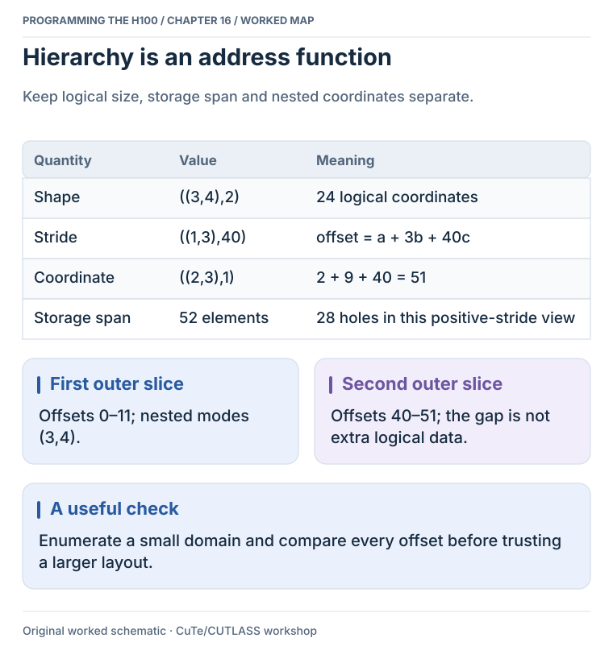

# 16. CUTLASS — Build a Hopper GEMM You Can Verify

[](images/ch16/overview.svg)

!!! tip "Your goal"

    Construct a reproducible CUTLASS GEMM, explain every operand’s physical layout, and check every output against an independent CPU reference. Read [CuTe layouts](15-cute-layouts.md), [WGMMA](06-wgmma-part-1.md) and [epilogues](07-wgmma-part-2.md) first.

## 1 — From a library name to a specific kernel

CUTLASS is a collection of building blocks, kernels, utilities and examples; it is not a single GEMM algorithm. A device adapter accepts arguments and workspace, a kernel schedules tiles, a collective mainloop coordinates copies and MMA, and an epilogue transforms accumulators into output. CuTe supplies much of the layout and instruction-partition vocabulary underneath those layers.

This chapter uses **CUTLASS v4.3.6**, commit `1afc6d355b8cb992398f17beb4425702f1d57ddd`, with the book’s CUDA 12.8 baseline. The C++ API is still commonly called the **CUTLASS 3.x GEMM API** even though the repository release is 4.x. Python operator APIs and the CuTe DSL have separate entry points. We use the pinned [example 49](https://github.com/NVIDIA/cutlass/blob/v4.3.6/examples/49_hopper_gemm_with_collective_builder/49_collective_builder.cu) and [GEMM API documentation](https://github.com/NVIDIA/cutlass/blob/v4.3.6/media/docs/cpp/gemm_api_3x.md) as references.

The new exercises in Chapters 14–17 are additions to the original 27-program suite. Their actual compilation, execution and profiler records will be captured in the next Hopper session using the collector below. Expected checks here are not sample outputs from an execution that has already happened.

## 2 — Pin the source and keep the build narrow

Complete [Getting Started](getting-started.md), including a working driver, CUDA 12.8 and a compatible host compiler. Start in the book repository’s root directory. The helper clones a fresh destination or checks an existing one; it refuses the wrong commit or modified tracked CUTLASS files.

```bash
export CUTLASS_ROOT="$HOME/cutlass-v4.3.6"
bash tools/fetch_cutlass.sh "$CUTLASS_ROOT"
git -C "$CUTLASS_ROOT" rev-parse HEAD
mkdir -p build/advanced
nvcc --version
g++ --version
nvidia-smi
```

The expected commit is the hash above. The original headers are used directly: the book’s GEMM needs no global CUTLASS installation, Python package or prebuilt CUTLASS shared library. Its adapter uses header-only templates and CUDA runtime support. The direct command includes both the public headers and `tools/util/include`, because the small harness uses the repository’s device-allocation and packed-stride utilities.

```bash
nvcc -std=c++17 -O2 -lineinfo -arch=sm_90a \
  --expt-relaxed-constexpr \
  -I "$CUTLASS_ROOT/include" \
  -I "$CUTLASS_ROOT/tools/util/include" \
  docs/examples/advanced/cutlass_gemm.cu \
  -o build/advanced/cutlass_gemm
./build/advanced/cutlass_gemm
```

`Sm90` in a template is not a compiler flag. The architecture-accelerated Hopper instructions still need `sm_90a`; that binary is not a portability promise for A100 or B200. The harness checks that device 0 is compute capability 9.0 and returns a nonzero prerequisite failure otherwise.

## 3 — Define the operation before the types

Our operation is batched `D = alpha * A * B + beta * C`.

| Object | Mathematical shape per batch | Physical storage | Element type |
| --- | --- | --- | --- |
| A | M × K | Row-major | FP16 |
| B | K × N | Row-major | FP16 |
| C | M × N | Row-major | FP32 |
| D | M × N | Row-major | FP32 |
| Accumulator | Output tile | Instruction-defined registers | FP32 |

The initial tile is `128 × 128 × 64`; the cluster is `1 × 1 × 1`. Tile shape is a scheduling choice, not the full problem shape. Small, rectangular and partial-tile problems can behave very differently from a large square GEMM.

The builder alignment arguments count **elements**, not bytes. Eight FP16 elements or four FP32 elements describe a 16-byte alignment contract. Base addresses, leading dimensions and batch strides must satisfy the selected path’s constraints. An aligned base pointer does not repair an incompatible row stride.

## 4 — Build the epilogue before choosing stage capacity

An epilogue can reserve shared storage too. Build it first, then account for its `SharedStorage` size when selecting the mainloop’s stage count:

```cpp
using StagePolicy = cutlass::gemm::collective::StageCountAutoCarveout<
    static_cast<int>(sizeof(Epilogue::SharedStorage))>;
```

The complete [cutlass_gemm.cu](examples/advanced/cutlass_gemm.cu) supplies matching `KernelScheduleAuto` and `EpilogueScheduleAuto` tags. In pinned v4.3.6, the automatic epilogue selects `NoSmemWarpSpecialized`; the carveout pattern also accounts for epilogues that do use shared storage when choosing an explicit compatible schedule. `Auto` is a builder heuristic for this release and configuration; it does not benchmark every kernel on the user’s machine. If you later request a specific schedule, select an explicitly compatible **pair**, as [Chapter 17](17-cutlass-pipelines.md) explains.

The type assembly is:

```text
Element types + layout tags + alignments + tile/cluster shapes
                       |
                CollectiveEpilogue
                       |
        CollectiveMainloop with epilogue carveout
                       |
                 GemmUniversal kernel
                       |
                GemmUniversalAdapter
```

A builder error can be a failed contract, not a missing include. Reduce it to the first failed static assertion and inspect architecture, layout, alignment, tile and schedule compatibility. Repeatedly changing template tags until compilation succeeds is not a correctness method.

## 5 — Do not transpose B by accident

CUTLASS’s CuTe logical B coordinates are `(N,K,L)` even though the mathematical matrix in `A * B` is `K × N`. The kernel’s `StrideB` encodes how that logical view names the physical B allocation. The helper must receive the corresponding logical shape:

```cpp
auto stride_B = cutlass::make_cute_packed_stride(
    Kernel::StrideB{}, cute::make_shape(N, K, L));
```

In this harness the independent CPU reference reads row-major B with `B[(l * K + k) * N + n]`. That is deliberate: the oracle follows the mathematical matrix and its physical row-major storage instead of duplicating the library’s CuTe indexing code. A reference that repeats the same wrong layout transform can agree with the kernel while both compute the wrong problem.

Similarly, use `StrideA` with `(M,K,L)` and output strides with `(M,N,L)`. Check leading dimensions and batch offsets in **elements** before converting any quantity to bytes.

## 6 — The host-side launch lifecycle

A successful `can_implement` checks supported arguments; it does not run the kernel. The harness follows all of these steps and propagates failures:

1. Initialize distinct, nonuniform A, B and C values.
2. Allocate/copy the inputs, initialize D to NaN sentinels, and construct shape/stride arguments. An unwritten output must fail even if its expected value is zero.
3. Call `can_implement` and reject unsupported arguments.
4. Obtain `get_workspace_size`, allocate the workspace and call `initialize`.
5. Call `run`, then check CUDA completion with `cudaDeviceSynchronize`.
6. Copy D back and compare every output, including every batch.

The source includes the full code rather than relying on a library demo’s process exit status. In pinned upstream example 49, unsupported prerequisites and some printed failed cases can still be followed by process exit zero. If you run that example, read every result label and reject any failed/skipped configuration; an exit-only wrapper is insufficient.

## 7 — Why these reference cases are diagnostic

The three cases are `(M,N,K,L) = (128,128,64,1)`, `(256,128,128,2)` and `(136,264,72,1)`. The last has partial CTA tiles while retaining the selected alignment requirements. The scalar cases include nonzero beta, so reading C is checked instead of silently testing only `A * B`.

Inputs are bounded, small binary-rational values. Products and the short reductions fit exactly in FP32 for these cases; the reference accumulates in double and converts the final expression to float. Exact equality is therefore intentional **for these inputs and operations**. It is not a general FP16 GEMM tolerance policy. Random large-magnitude inputs, long reductions or reduced-precision modes need explicitly justified absolute/relative tolerances and finite-value checks.

Expected checks are three `GEMM CASE PASS` lines followed by `GEMM PASS: 3 full CPU-reference cases`, with every error count zero. No timing or TFLOP/s claim follows from this small correctness harness. Its CPU reference would also be inappropriate for timing a large production GEMM.

The tests cover selected dimensions, batching, C participation and partial tiles. They do not establish every supported datatype, leading dimension, split-K mode or fusion. Add a separate test before extending one of those contracts.

## 8 — Collect real evidence on the next instance

The collector first verifies the exact CUTLASS commit and records the system, compiler and GPU topology. It compiles the layout, GEMM and overlap programs, requires their explicit pass markers and saves each current source copy/hash with commands, UTC times and logs. An output directory must be fresh.

```bash
python3 tools/run_advanced_validation.py \
  --cutlass "$CUTLASS_ROOT" \
  --output "$HOME/h100-advanced-$(date -u +%Y%m%dT%H%M%SZ)" \
  --execute --profiles
```

For a plan-only run, omit **both** `--execute` and `--profiles`; no compiler, GPU or profiler is launched. `--profiles` is accepted only with `--execute`, additionally requires Nsight Systems and saves both serial/overlap reports; profiler capture is separate from numerical correctness. Preserve the complete directory before shutting down the instance. Hardware-backed transcripts can then be published with their actual date and software stack.

For an additional memory-safety check, run the compiled GEMM under the toolkit’s `compute-sanitizer --tool memcheck --error-exitcode 1`. A zero-error report supplements the numerical oracle; it does not prove every possible pipeline schedule is race-free.

??? question "Self-check: a 16-byte alignment parameter?"

    For FP16 inputs, should the builder’s element alignment be 16?

    **Answer:** A 16-byte contract corresponds to 8 FP16 elements. The element count, actual pointer alignment and stride constraints must agree.

??? question "Self-check: does successful initialization establish correctness?"

    `can_implement`, `initialize` and `run` return success. Can you report a verified GEMM?

    **Answer:** Not yet. Check asynchronous CUDA completion and the actual output against the defined reference. The collector requires both.
