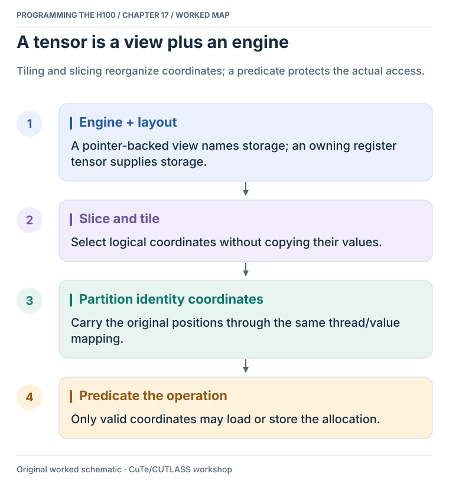
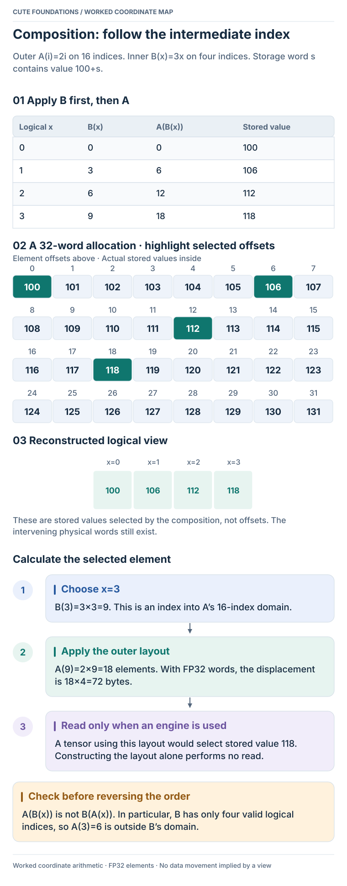

# 17. CuTe Layout Algebra — Hierarchy, Composition and Tiling
## Lesson 17 Companion Guide — Derive Hierarchical Layouts Before Composing Them

[](images/chapter-openers/17-workshop.svg)


!!! tip "Your goal in this chapter"

    Enumerate nested and scalar coordinates, distinguish useful size from storage span, and predict composition and tiling on small domains. Complete [CuTe foundations](15-cute-layouts.md) and [the strides walkthrough](16-cute-strides.md) first.

[Chapter 15](15-cute-layouts.md) introduced layouts as address functions. This chapter develops the algebra behind those functions. The goal is not to memorize template spellings: it is to predict a small layout's offsets, explain which structure an operation preserves and catch a mapping error before it reaches a GPU instruction.

The APIs here are **CuTe C++ from CUTLASS v4.3.6**, not CuTe Python DSL or Triton. The authoritative references are the pinned [layout](https://github.com/NVIDIA/cutlass/blob/v4.3.6/media/docs/cpp/cute/01_layout.md) and [layout-algebra](https://github.com/NVIDIA/cutlass/blob/v4.3.6/media/docs/cpp/cute/02_layout_algebra.md) tutorials. Code fragments assume `#include <cute/tensor.hpp>` and `using namespace cute;`. They explain mappings; the complete oracle linked below collects the checks into a program.

## 1 — Coordinates and physical offsets are different integers

[](images/ch17/overview.svg)

Consider shape `(3,4)` with strides `(4,1)`. Logical coordinate `(m,n)` maps to physical element offset `4m+n`. CuTe also accepts a scalar logical coordinate: its coordinate decomposition is first-mode-fastest. Thus scalar `i` decomposes as `m=i%3`, `n=i/3` over the 12-element domain.

| Scalar logical i | Coordinate `(m,n)` | Physical row-major offset |
| ---: | --- | ---: |
| 0 | `(0,0)` | 0 |
| 1 | `(1,0)` | 4 |
| 2 | `(2,0)` | 8 |
| 3 | `(0,1)` | 1 |
| 4 | `(1,1)` | 5 |
| 5 | `(2,1)` | 9 |

Consequently, `i=m+3n` is a logical enumeration index; it is not the row-major physical address `4m+n`. Confusing these two meanings makes a flattened ownership map look correct while selecting the wrong memory. A printed tuple's coordinate order does not imply a particular major order in storage; its strides do.

```cpp
auto row = make_layout(
    make_shape(Int<3>{}, Int<4>{}),
    make_stride(Int<4>{}, Int<1>{}));
auto a = row(make_coord(1, 2));  // physical offset 6
auto b = row(7);                // same coordinate: (1,2)
```

Both calls describe the same element because 7 decomposes as `(1,2)`. Neither performs a load. Offsets remain in indexing units; for an FP16 pointer, offset 6 corresponds to 12 bytes.

## 2 — A hierarchy carries useful meaning

Now use nested shape `((3,4),2)` and nested strides `((1,3),40)`. Write its coordinate as `((a,b),c)`. The mapping is `a+3b+40c`, with `a<3`, `b<4`, `c<2`. The nested first mode might represent factors within a tile; the final mode might represent separated storage regions. That interpretation belongs to the algorithm, while the layout specifies the arithmetic.

```cpp
auto nested = make_layout(
    make_shape(make_shape(Int<3>{}, Int<4>{}), Int<2>{}),
    make_stride(make_stride(Int<1>{}, Int<3>{}), Int<40>{}));
auto offset = nested(make_coord(make_coord(2, 3), 1));
```

The result is `2+9+40=51`. Enumerating the domain gives:

| c | b=0 | b=1 | b=2 | b=3 |
| ---: | --- | --- | --- | --- |
| 0 | 0,1,2 | 3,4,5 | 6,7,8 | 9,10,11 |
| 1 | 40,41,42 | 43,44,45 | 46,47,48 | 49,50,51 |

There are 24 coordinates and 24 distinct referenced elements. For this positive-stride layout, `cosize` is 52: storage through the largest referenced element includes 28 holes at offsets 12 through 39. `size` is therefore 24, not 52. If several such objects share an allocation, their placement and alignment can require still more space.

Do not allocate only 24 elements and assume that a 24-coordinate view must fit. Conversely, holes need not be read or initialized merely because they lie inside the storage span. Copy and initialization loops should follow the actual ownership contract.

### Decode a nested scalar index before applying strides

The nested `((3,4),2)` layout has 12 positions in its first outer mode. For scalar logical index 20:

1. Split outer modes first: inner index `20%12=8`, outer coordinate `c=20/12=1`.
2. Split the inner index by its first-mode-fast sizes: `a=8%3=2`, `b=8/3=2`.
3. Rebuild the nested coordinate `((2,2),1)`.
4. Apply strides: `2×1+2×3+1×40=48` elements.

The real API calls `nested(20)` and `nested(make_coord(make_coord(2,2),1))` describe the same mapping. **Check:** the logical reconstruction is `a+3*b+12*c=2+6+12=20`, while the physical offset is 48. The two numbers answer different questions.

**Guided exercise.** Decode scalar index 17 without using a physical stride.

**Worked answer:** `17%12=5`, `c=1`, then `a=5%3=2`, `b=5/3=1`. Coordinate `((2,1),1)` maps physically to `2+3+40=45`. Using 40 to decompose the logical index would mix storage placement with domain enumeration.

## 3 — Coalescing simplifies representation, not storage

`coalesce` combines compatible factors and removes static size-one factors while preserving the represented scalar-index-to-offset function. In the nested example, the contiguous factors `(3,4):(1,3)` can combine into `12:1`; the gap before the second region prevents combining everything into a single compact contiguous mode.

### Work through the actual coalesce call

Use the `nested` object from §2, rather than replacing its structure with an assumed compact array:

```cpp
auto simplified = cute::coalesce(nested);
cute::print(simplified);
```

1. Its inner coordinates `(a,b)` map to `a+3b`. Because `a` has size three and stride one, the next factor's stride three continues exactly after it.
2. Combine those two factors into a size-12 mode of stride one. This mode still enumerates offsets 0 through 11.
3. The outer size-two mode has stride 40, not 12, so the 28-element gap remains.
4. The resulting layout is `(12,2):(1,40)`. At scalar logical index 14, first-mode-fast decomposition gives `(2,1)`, hence offset `2+40=42`.

The pinned CuTe CPU probe printed:

```text
coalesced=(_12,_2):(_1,_40)
```

Underscores identify static values in this diagnostic representation. The probe compared all 24 scalar offsets before and after coalescing, not just this printed type. **Check:** `nested(14)` and `simplified(14)` must both be 42. **Pitfall:** interpreting the result as compact `24:1` would change index 14 to offset 14, thereby selecting a different location.

The word *coalesce* here is an algebra operation. It is not a global-memory transaction, a copy or a promise of faster access. A row-major `(3,4):(4,1)` layout also does not become “physical offset equals scalar i” just because `coalesce(row)` is called.

When verifying a coalesced result, enumerate the original scalar logical indices and compare offsets. Do not compare `coalesced(4m+n)` with `row(m,n)` unless that is genuinely the intended coordinate conversion. For this row example, the matching scalar logical index is `m+3n`.

Static `Int<N>` values can let CuTe prove simplifications at compile time. Runtime dimensions may retain additional modes in the type even when a particular runtime value is one. Equivalent address functions need not have identical printed tuple structure. If a later operation depends on mode boundaries, inspect those boundaries rather than merely the total element count.

## 4 — Composition applies the inner mapping first

`composition(A,B)` represents the offset function `A(B(x))`, subject to CuTe's layout compatibility rules. Choose a simple case that can be checked exhaustively:

```cpp
auto twice = make_layout(Int<16>{}, Int<2>{});
auto every_third = make_layout(Int<4>{}, Int<3>{});
auto composed = composition(twice, every_third);
```

For `x=0,1,2,3`, B selects intermediate indices `0,3,6,9`; A maps them to `0,6,12,18`. All intermediate indices fit A's 16-element domain. The resulting offset function is `6x` on this four-element domain.

### Trace composition as a complete address selection

[](images/worked/composition-index-to-value.svg)

Here A and B are **layout functions**, not GEMM operands. Give physical word s the value `100+s` so offsets and values cannot be confused:

1. Select logical input `x=2` from B's four-element domain.
2. Apply the inner layout: `every_third(2)=6`. This is an intermediate **logical index into A**.
3. Apply the outer layout: `twice(6)=12`. This is the resulting **physical element offset**.
4. A tensor using the composition would read value `100+12=112`. Constructing `composed` alone reads nothing.
5. Repeat for all inputs: offsets are `0,6,12,18`; selected values are `100,106,112,118`.

**Check:** compare `composed(x)` with `twice(every_third(x))` for each valid x. A correct printed output shape alone cannot establish that the intermediate indices fit the outer domain.

**Guided exercise.** Why is blindly reversing these particular operands invalid at x=3?

**Worked answer:** `twice(3)=6`, but `every_third` has only valid input indices 0 through 3. The fact that both functions individually return integers does not make this reverse-domain composition a valid use of the chosen layouts.

Composition is not arbitrary pointer arithmetic disguised as a template. Check the inner image, outer domain, resulting hierarchy and divisibility constraints. Reversing the argument order need not even define the same valid domain. Neither composing a tensor layout nor creating an intermediate layout moves existing values into the composed order.

## 5 — Complement describes the missing repetition pattern

Complement supplies offsets that fill the repetition pattern missing from a layout. Treat its target as a codomain bound for the supported layout, not a request to allocate memory. We will construct two real complements, enumerate their offsets and check the combined coverage.

The CPU-only probe was compiled and executed on **18 November 2026 (UTC)** against the pinned CUTLASS revision. Download its [complete source](validation/2026-11-18-h100-workshop/layout-probe/probe.cu), [commands and timestamps](validation/2026-11-18-h100-workshop/layout-probe/results.json), and [captured output](validation/2026-11-18-h100-workshop/layout-probe/run.log). This checks layout algebra; it launches no GPU kernel.

### Compact tile: supply six repetitions

```cpp
auto compact = cute::make_layout(cute::Int<4>{}, cute::Int<1>{});
auto compact_rest = cute::complement(compact, cute::Int<24>{});
cute::print(compact_rest);
```

1. `compact(i)` addresses `0,1,2,3` for `i=0..3`.
2. A new nonoverlapping copy can start at offset four; subsequent copies start four elements apart.
3. Covering offsets `0..23` requires six such starts: `0,4,8,12,16,20`.
4. Therefore `compact_rest` is `6:4`, and a pair `(i,r)` addresses `compact(i)+compact_rest(r)=i+4r`.

For example, `(i,r)=(2,4)` selects `2+16=18`. The full last tile is `20,21,22,23`. The pinned CPU probe printed the actual layout and its scalar-index enumeration:

```text
compact_rest=_6:_4
0 4 8 12 16 20
```

The physical-offset picture is deliberately different from a data-value matrix. Every number below is an **element offset**, not a stored value:

```text
COMPACT TILE: 4:1                 COMPLEMENT: 6:4
inside offsets  [0 1 2 3]         starts  [0 4 8 12 16 20]
                       add the selected start
                                  |
                                  v
repetition 0, start  0  ->  [ 0  1  2  3]
repetition 1, start  4  ->  [ 4  5  6  7]
repetition 2, start  8  ->  [ 8  9 10 11]
repetition 3, start 12  ->  [12 13 14 15]
repetition 4, start 16  ->  [16 17 18 19]
repetition 5, start 20  ->  [20 21 22 23]

Choose inside=2, repetition=4: 2 + 16 = offset 18.
```

**Read the figure:** select a repetition row, add its start to the same four tile offsets, then inspect the complete covered range. The real [`complement` API call above](#compact-tile-supply-six-repetitions) supplies those starts; it does not read the values stored at them.

**Check:** four tile positions times six repetitions gives 24 unique covered offsets. **Pitfall:** adding the complement's logical index r directly instead of its mapped offset `4r` would overlap neighboring tiles.

### Strided tile: fill holes before repeating

Now the tile is `4:2`, selecting four even offsets:

```cpp
auto even = cute::make_layout(cute::Int<4>{}, cute::Int<2>{});
auto even_rest = cute::complement(even, cute::Int<16>{});
cute::print(even_rest);
```

1. `even(i)` selects `0,2,4,6`, leaving odd offsets inside the first eight-element region.
2. A complement component with offsets `0,1` fills those even and odd positions without changing the tile's own stride.
3. Repeat the complete eight-element region at offsets zero and eight.
4. CuTe combines those choices as `(2,2):(1,8)`. Its scalar enumeration is `0,1,8,9`.

| Complement offset | Four offsets after adding the `4:2` tile |
| ---: | --- |
| 0 | 0, 2, 4, 6 |
| 1 | 1, 3, 5, 7 |
| 8 | 8, 10, 12, 14 |
| 9 | 9, 11, 13, 15 |

Here is the hole-filling step before and after the complement offsets are added. Dots mean **not covered by this one placement**, not zero-valued data:

```text
STRIDED TILE 4:2, PLACED AT START 0
physical offset:   0  1  2  3  4  5  6  7
one placement:     T  .  T  .  T  .  T  .

Add each complement offset to [0 2 4 6]:
  +0  -> [ 0  2  4  6]      even positions in the first region
  +1  -> [ 1  3  5  7]      its missing odd positions
  +8  -> [ 8 10 12 14]      even positions in the second region
  +9  -> [ 9 11 13 15]      its missing odd positions

Combined physical coverage:
  [0 1 2 3 4 5 6 7] [8 9 10 11 12 13 14 15]
                  every element offset appears once
```

**Read the figure:** the tile supplies spacing two; the complement supplies both a one-element hole fill and an eight-element region shift. Compare these four rows with the actual [`complement(even, Int<16>{})` construction](#strided-tile-fill-holes-before-repeating), not with a guessed compact stride.

The actual pinned CPU output was:

```text
even_rest=(_2,_2):(_1,_8)
0 1 8 9
COMPLEMENT PASS: 16 unique offsets from strided tile plus complement
```

The separate probe compiled and executed on November 18, 2026 UTC, using pinned v4.3.6; it launched no GPU kernel. Its counter array checked that all 16 combined offsets appeared exactly once. The printed order is the complement's logical enumeration, not sorted physical order of the complete tensor.

**Pitfall:** “target size divided by tile size” alone predicts four repetition positions but not their required strides. Using `4:8` would leave holes and escape the target. Complement is not arbitrary set subtraction, and an overlapping/broadcast mapping does not gain a bijective inverse merely because its logical size matches a target. Check the layout's image and the API's actual compatibility rules.

## 6 — Division reorganizes tile and remainder coordinates

For contiguous length 12 and tile length four:

```cpp
auto line = make_layout(Int<12>{});
auto divided = logical_divide(line, Int<4>{});
auto offset = divided(make_coord(2, 1));  // 6
```

The first coordinate selects an element inside a tile; the second selects its repetition. Tiles reference `0..3`, `4..7` and `8..11`. With several original modes, `logical_divide` retains the per-mode tile/remainder relationship; `zipped_divide` groups tile modes together and remainder modes together. `tiled_divide` and `flat_divide` provide other groupings. These are distinct result shapes, not interchangeable names for the same tuple interface.

### Keep hierarchical division modes visible

For shape `(8,24)` and per-mode tiles `(4,8)`, the two per-mode divisions are `(4,2)` and `(8,3)`. Thus a logical divided coordinate retains the relationship `((within_m,tile_m),(within_n,tile_n))`. A zipped division regroups it as `((within_m,within_n),(tile_m,tile_n))`.

```cpp
auto matrix_layout = cute::make_layout(
    cute::make_shape(cute::Int<8>{}, cute::Int<24>{}),
    cute::make_stride(cute::Int<24>{}, cute::Int<1>{}));
auto zipped = cute::zipped_divide(
    matrix_layout, cute::make_tile(cute::Int<4>{}, cute::Int<8>{}));
auto offset = zipped(cute::make_coord(
    cute::make_coord(1, 2), cute::make_coord(1, 2)));
```

1. The first pair `(1,2)` selects within-tile row one and column two.
2. The second pair `(1,2)` selects tile row one and tile column two.
3. Recover global row `1+4×1=5` and global column `2+8×2=18`.
4. Apply the original row-major stride: `5×24+18=138` elements.

**Expected result:** offset 138. **Pitfall:** the numerically identical pairs make this one coordinate easy to read but cannot alone detect swapped tile/within roles; exercise a different pair too.

**Guided exercise.** Within coordinate `(3,6)`, tile coordinate `(0,1)`: what is the result?

**Worked answer:** global `(3,14)`, offset `3×24+14=86`. The zipped coordinate is `make_coord(make_coord(3,6),make_coord(0,1))`; do not pass a logical-divide grouping to an interface expecting zipped modes.

### Build a product and calculate its coordinate map

```cpp
auto atom = cute::make_layout(cute::Int<4>{}, cute::Int<1>{});
auto repetitions = cute::make_layout(cute::Int<3>{}, cute::Int<1>{});
auto repeated = cute::logical_product(atom, repetitions);
cute::print(repeated);
```

1. `atom` supplies offsets 0 through 3 inside one four-element tile.
2. The repetition layout selects three logical copies. The product scales their placement so each starts after a complete atom, yielding starts 0, 4 and 8.
3. The product therefore has shape `(4,3)` and stride `(1,4)`.
4. `repeated(make_coord(2,1))` is `2+4=6`; `repeated(make_coord(3,2))` is `3+8=11`.

The pinned probe printed `product=(_4,_3):(_1,_4)` and checked all 12 coordinate pairs against `within+4*tile`. **Check:** the combined image is precisely `0..11`, once each. **Pitfall:** directly adding `atom(i)+repetitions(j)` without product scaling gives `i+j`, creating aliases rather than three separate tiles. More complicated strided products follow the algebra's complement/composition rules, not this compact shortcut.

Products construct repeated layouts rather than merely partitioning an existing one. Both division and product depend on complement/composition rules. Learn their small-domain behavior first; a reshaped type can still describe an unexpected order.

## 7 — Check the algebra before using it

The complete [CuTe algebra oracle](examples/advanced/cute_algebra.cu) checks all 24 nested coordinates, the row-layout/coalesced scalar relationship and the four composition coordinates. The [CPU workbook](examples/advanced/indexing_workbook.py) independently checks the elementary arithmetic without executing CuTe or CUDA kernels:

```bash
python3 docs/examples/advanced/indexing_workbook.py
```

The Python result establishes only its arithmetic assertions. Use the advanced examples' documented pinned build route to compile the C++ oracle, and record that separate result; the worked tables above are derived examples, not a claim of a completed new GPU run.

**Exercise.** Change the nested region stride from 40 to 24. What are size, span and holes?

**Worked answer.** Size remains 24. The regions become `0..11` and `24..35`, so the span is 36 and there are 12 holes. Changing stride changes storage placement, not the coordinate count. Next, [attach an engine and create tensor views](18-cute-tensors-tiling.md); only then does the layout describe how an actual object will be accessed.

<!-- workshop:start:cute_algebra -->
## Complete source and captured execution

**Executed on November 18, 2026 (UTC).** Scope: **CPU execution of real CuTe coordinate/trait checks**.

Tested source SHA-256: `057517089668e8cddcb6623e5db38c4b37974dfb6548412b212417c433fab3ec`. [Exact source](validation/2026-11-18-h100-workshop/cute_algebra.cu) · [System information](validation/2026-11-18-h100-workshop/system.json) · [Workshop results](cutlass-workshop-validation.md).

The listing below matches the tested source. Its presentation is formatted at build time; downloads retain the captured bytes.

```cuda
// Host-only checks of real CuTe layout algebra, compiled using CUDA headers.
#include <cute/tensor.hpp>
#include <cstdio>
using namespace cute;
int main() {
    auto nested = make_layout(make_shape(make_shape(Int<3>{}, Int<4>{}), Int<2>{}),
                              make_stride(make_stride(Int<1>{}, Int<3>{}), Int<40>{}));
    int errors = 0;
    for (int c = 0; c < 2; ++c)
        for (int b = 0; b < 4; ++b)
            for (int a = 0; a < 3; ++a)
                errors += int(nested(make_coord(make_coord(a,b),c))) != a + 3*b + 40*c;
    errors += int(size(nested)) != 24 || int(cosize(nested)) != 52;
    auto row = make_layout(make_shape(Int<3>{},Int<4>{}),make_stride(Int<4>{},Int<1>{}));
    auto flat = coalesce(row);
    for (int m=0;m<3;++m)
        for (int n=0;n<4;++n) {
            // CuTe's scalar logical-coordinate enumeration is first-mode-fastest.
            int logical = m + 3*n;
            errors += int(row(make_coord(m,n))) != int(flat(logical));
        }
    auto twice = make_layout(Int<16>{},Int<2>{});
    auto every_third = make_layout(Int<4>{},Int<3>{});
    auto composed = composition(twice,every_third);
    for (int i=0;i<4;++i) errors += int(composed(i)) != 6*i;
    std::printf("nested_size=%d nested_span=%d nested((2,3),1)=%d\n",
                int(size(nested)),int(cosize(nested)),int(nested(make_coord(make_coord(2,3),1))));
    std::printf("%s: 24 nested coordinates, 12 coalesced coordinates, 4 composition coordinates; errors=%d\n",
                errors ? "ALGEBRA FAIL" : "ALGEBRA PASS", errors);
    return errors ? 1 : 0;
}
```

CUDA compilation UTC: `2026-11-18T14:09:25.352747+00:00`. Exit: `0`. [Compile log](validation/2026-11-18-h100-workshop/cute_algebra-compile.log).

Commands use scratch-directory filenames; raw logs retain exact paths. The collector’s CUTLASS include flags are configuration for that capture; the minimal standalone overlap/SIMT commands do not require those headers.

```bash
nvcc -std=c++17 -O2 -lineinfo -arch=sm_90a --expt-relaxed-constexpr -I "$CUTLASS_ROOT/include" -I "$CUTLASS_ROOT/tools/util/include" cute_algebra.cu -o ./example
```

Executed UTC: `2026-11-18T14:09:36.965003+00:00`. Exit: `0`. [Run log](validation/2026-11-18-h100-workshop/cute_algebra-run.log).

```bash
./example
```

**Actual captured output**

```text
nested_size=24 nested_span=52 nested((2,3),1)=51
ALGEBRA PASS: 24 nested coordinates, 12 coalesced coordinates, 4 composition coordinates; errors=0
```

<!-- workshop:end:cute_algebra -->

<!-- companion-summary:start -->
## Summary

- Hierarchical shape and stride retain meaningful coordinate factors; first-mode-fastest scalar enumeration is distinct from a row-major physical offset.

- Coalescing preserves the represented mapping rather than repacking storage. Composition applies the inner map first, while complement and division obey specific domain and hierarchy contracts.

- Prove offsets, bounds and uniqueness on a small domain, then [attach a tensor engine and create slices](18-cute-tensors-tiling.md).
<!-- companion-summary:end -->
