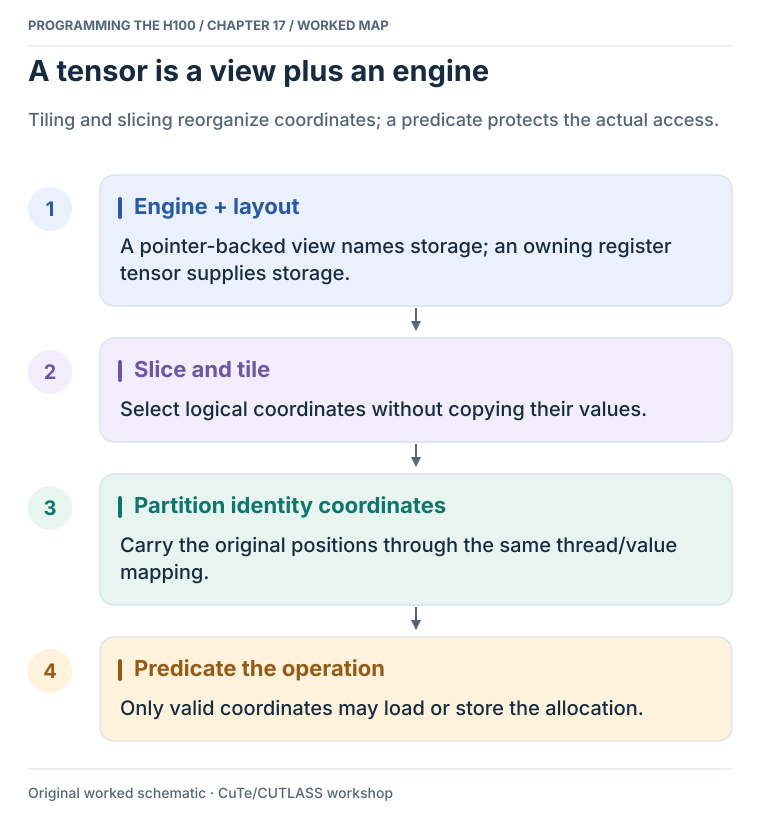

# 17. CuTe Tensors — Views, Slicing, Tiling and Predication

[](images/ch17/overview.svg)

A layout describes an indexing function. A tensor adds a data engine: a pointer-like object or owned storage on which that function operates. This distinction connects [layout algebra](16-cute-layout-algebra.md) to a real kernel without turning every shape transformation into an imaginary memory transfer.

The examples use the pinned **CUTLASS v4.3.6 CuTe C++ API** and assume `#include <cute/tensor.hpp>` and `using namespace cute;`. Consult the official [tensor tutorial](https://github.com/NVIDIA/cutlass/blob/v4.3.6/media/docs/cpp/cute/03_tensor.md) and [predication tutorial](https://github.com/NVIDIA/cutlass/blob/v4.3.6/media/docs/cpp/cute/0y_predication.md) for their full contracts. The snippets below are explanatory fragments inside the appropriate host/device context, not standalone kernels or captured execution output.

## 1 — Start with the engine and its lifetime

A nonowning tensor combines an existing pointer with a layout:

```cpp
auto matrix = make_tensor(
    make_gmem_ptr(ptr),
    make_layout(make_shape(M, N), make_stride(ld, Int<1>{})));
```

Here `ptr` is an appropriately typed pointer to an existing GPU allocation, `M` and `N` are logical extents, and `ld` is the row stride in elements. `make_gmem_ptr` tags the memory space for CuTe's dispatch machinery. It does not allocate device memory, copy host data or make an invalid pointer accessible to the GPU. The allocation must outlive every operation that uses the view.

A shared-memory view similarly wraps actual shared storage with `make_smem_ptr`. Its layout, allocation span and alignment must satisfy the instruction that consumes it. A global tensor and a shared tensor can have matching logical shapes while referencing entirely different storage.

An owning register tensor has a different construction:

```cpp
auto fragment = make_tensor<float>(
    make_shape(Int<4>{}, Int<2>{}));
```

This declares owned storage with a static shape; it is not an alias of `matrix`. On device, register placement is the intention, while actual register use or spilling is determined by compilation and resource constraints. Do not use a large owning tensor as an implicit dynamic allocator. Construction also does not promise that every scalar has the numerical initialization your algorithm requires.

## 2 — Slicing selects coordinates; it does not copy values

Consider a compact row-major tensor of shape `(3,4)` with base pointer P. A fixed coordinate is selected; an underscore keeps that mode:

```cpp
auto row_one = matrix(1, _);
auto column_two = matrix(_, 2);
```

For this particular three-row, four-column example:

| View | Base element offset from P | Remaining shape | Remaining stride |
| --- | ---: | --- | --- |
| Original matrix | 0 | `(3,4)` | `(4,1)` |
| `matrix(1,_)` | 4 | `4` | `1` |
| `matrix(_,2)` | 2 | `3` | `4` |

Reading `column_two(1)` selects original coordinate `(1,2)` at offset 6. The column view is strided, not newly packed. Writing through a nonconst slice modifies the underlying allocation; two slices may alias.

Nested coordinates need nested slicing decisions. Retaining an entire hierarchical mode with `_` differs structurally from retaining its leaves with `make_coord(_,_)`. Even if both views enumerate the same elements, their ranks and mode profiles can differ. This matters when a later copy or MMA partition expects a specific hierarchy.

A useful debugging practice is to write each slice's retained modes, pointer offset and strides before checking values. That makes it harder to mistake a storage transformation for a view transformation.

## 3 — Tiling groups a region and its repetitions

Take a tensor of shape `(8,24)` and divide it into `(4,8)` tiles. There are two tile positions along the first mode and three along the second:

```cpp
auto tiled = zipped_divide(
    matrix, make_tile(Int<4>{}, Int<8>{}));
auto tile = local_tile(
    matrix,
    make_tile(Int<4>{}, Int<8>{}),
    make_coord(1, 2));
```

Here `matrix` refers to this `(8,24)` example, not the earlier `(3,4)` object. The zipped view groups its modes as `((TileM,TileN),(RestM,RestN))`, giving `((4,8),(2,3))`. `local_tile` selects a repetition and retains the tile coordinates. For compact row-major storage, tile `(1,2)` begins at `(4,16)`, element offset `4×24+16=112`.

| Local coordinate | Global coordinate | Element offset |
| --- | --- | ---: |
| `(0,0)` | `(4,16)` | 112 |
| `(1,2)` | `(5,18)` | 138 |
| `(3,7)` | `(7,23)` | 191 |

The row stride inside that view is still 24. A four-by-eight view does not imply compact stride eight. To obtain an eight-stride shared tile, issue a correctly indexed copy into actual shared storage using a separate destination layout.

## 4 — Partitioning assigns agents, not execution

After selecting a CTA tile, an algorithm must decide which participating thread handles each value. `local_partition` is a layout-sensitive partitioning facility; a `TiledCopy` or `TiledMma` introduces an instruction-aware thread/value map. These are ownership descriptions. The corresponding copy or compute call performs the work.

For a simple ownership exercise, let 128 threads cover a `(4,32)` tile with local coordinate `(tid/32,tid%32)`. Every coordinate has exactly one owner. Changing the destination layout can preserve logical ownership while changing physical addresses and bank behavior. Changing the thread/value map can change ownership itself.

Check three properties separately: required coordinates are covered, each writable output has the intended unique owner, and each assigned memory instruction respects alignment/bounds. A view may be valid as a read-only broadcast but invalid for independent writes. It may also be mathematically valid while incompatible with an instruction atom's operand layout.

The next chapters make these maps explicit; do not assume a thread owns a compact rectangular array merely because its register tensor has two printed modes.

## 5 — Rounded tiles are not automatic bounds checks

Now use logical shape `(37,70)` with the same `(4,32)` ownership tile. Ceiling division requires `10×3=30` CTAs. Their rectangular coverage is 40 rows by 96 columns, larger than the valid tensor. The final CTA begins at `(36,64)` and has only one valid row and six valid columns.

Partitioning the data tensor into these tiles does not universally predicate the resulting loads/stores. A pointer to a tile can be representable even when some tile coordinates lie outside the allocation. Never dereference an element and then test whether it was valid.

Build a parallel identity tensor whose *values are coordinates*:

```cpp
auto coordinates = make_identity_tensor(make_shape(M, N));
auto coordinate_tile = local_tile(
    coordinates,
    make_tile(Int<4>{}, Int<32>{}),
    make_coord(tile_m, tile_n));
```

Apply the same tiling and thread/value partition to data and coordinates. For each assigned coordinate `coord`, validity is `get<0>(coord)<M && get<1>(coord)<N`, assuming nonnegative generated indices. Identity tensors carry coordinate information; they do not wrap, clamp or authorize an out-of-range memory access. If a transformation rounds or extends a domain, keep the original logical extents for the predicate.

For a reduction load, the invalid element often needs the additive neutral value zero. For a store, suppress invalid writes. A vector instruction needs a legal predicate/alignment contract for its entire accessed width; a predicate derived for one scalar is not automatically sufficient for a vector that crosses the boundary.

## 6 — Check every coordinate, including the tail

The [CPU workbook](examples/advanced/indexing_workbook.py) enumerates the 128-thread `(4,32)` assignment over `(37,70)` and checks exact ownership. There are `37×70=2590` valid coordinates, covered once each. The launched tile envelope has `30×128=3840` assignments, so 1250 assignments must be excluded. These are derived counts and CPU-model assertions, not a numerical GPU-copy result.

**Exercise.** For the final tile `(9,2)`, which thread IDs may store a value?

**Worked answer.** Its origin is `(36,64)`. Only local row zero is valid, and only local columns zero through five are valid. With `(tid/32,tid%32)`, thread IDs 0 through 5 may store; the other 122 must not. For example, thread 32 targets global row 37, already outside the logical domain.

**Exercise.** Can a full-tile shared-memory initialization replace the global predicate?

**Worked answer.** No. It can initialize safe shared storage, but it cannot make an invalid global load legal. Predicate the global access first and arrange the intended shared/register value for invalid inputs. Retain uniform participation in any required block/warp synchronization even when an individual thread has no valid payload. Continue with [CTA offsets and the K loop](18-cta-indexing.md) to connect those coordinates to GEMM addresses.
