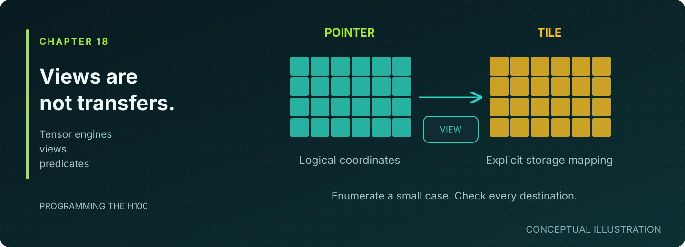
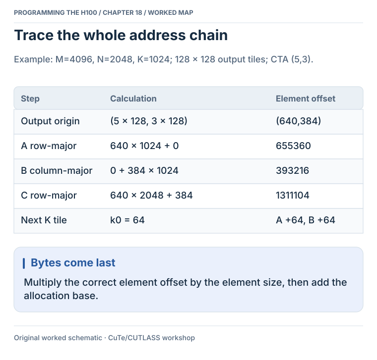
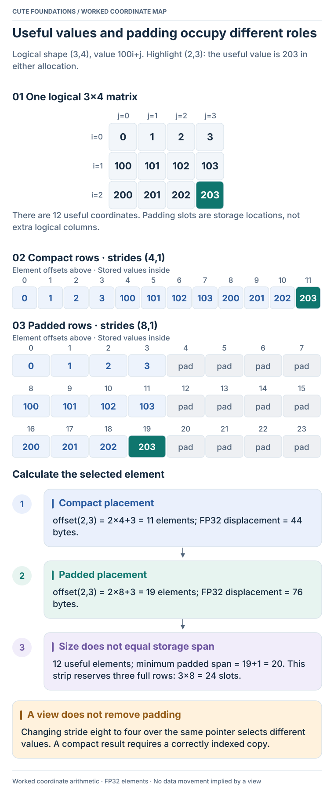
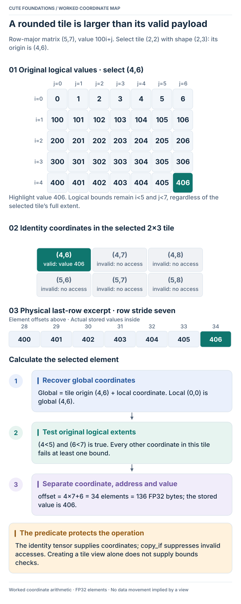

# 18. CuTe Tensors — Views, Slicing, Tiling and Predication
## Lesson 18 Companion Guide — Connect Tensor Engines, Tile Views and Safe Access

[](images/chapter-openers/18-workshop.svg)


!!! tip "Your goal in this chapter"

    Explain which storage a tensor owns or references, derive slices and tile origins, and predicate the original logical domain after partitioning. Read [layout algebra](17-cute-layout-algebra.md) first.

A layout describes an indexing function. A tensor adds a data engine: a pointer-like object or owned storage on which that function operates. This distinction connects [layout algebra](17-cute-layout-algebra.md) to a real kernel without turning every shape transformation into an imaginary memory transfer.

The examples use the pinned **CUTLASS v4.3.6 CuTe C++ API** and assume `#include <cute/tensor.hpp>` and `using namespace cute;`. Consult the official [tensor tutorial](https://github.com/NVIDIA/cutlass/blob/v4.3.6/media/docs/cpp/cute/03_tensor.md) and [predication tutorial](https://github.com/NVIDIA/cutlass/blob/v4.3.6/media/docs/cpp/cute/0y_predication.md) for their full contracts. The snippets below are explanatory fragments inside the appropriate host/device context, not standalone kernels or captured execution output.

## 1 — Start with the engine and its lifetime

[](images/ch18/overview.svg)

A nonowning tensor combines an existing pointer with a layout:

```cpp
auto matrix = make_tensor(
    make_gmem_ptr(ptr),
    make_layout(make_shape(M, N), make_stride(ld, Int<1>{})));
```

Here `ptr` is an appropriately typed pointer to an existing GPU allocation, `M` and `N` are logical extents, and `ld` is the row stride in elements. `make_gmem_ptr` tags the memory space for CuTe's dispatch machinery. It does not allocate device memory, copy host data or make an invalid pointer accessible to the GPU. The allocation must outlive every operation that uses the view.

A host function may construct a global-memory tensor view and pass it to a kernel, as the copy lab does. That does not make ordinary `cudaMalloc` device memory readable by CPU element access. Evaluate device loads/stores in the appropriate kernel context, or explicitly copy results to accessible host memory for inspection. Unified addressing identifies addresses; it does not by itself grant every processor access to every allocation.

Preserve the allocation's element type and access permissions as well as its lifetime. A `float const*` source and a writable `float*` destination express different permissions; a view must not discard constness or be used to bypass an allocation's ownership. Reinterpreting a pointer changes indexing units and alignment obligations—it is not a numerical conversion. If an earlier producer runs asynchronously, establish its completion dependency before a consumer uses the view; merely retaining the pointer is insufficient.

A shared-memory view similarly wraps actual shared storage with `make_smem_ptr`. Its layout, allocation span and alignment must satisfy the instruction that consumes it. A global tensor and a shared tensor can have matching logical shapes while referencing entirely different storage.

An owning register tensor has a different construction:

```cpp
auto fragment = make_tensor<float>(
    make_shape(Int<4>{}, Int<2>{}));
```

This declares owned storage with a static shape; it is not an alias of `matrix`. On device, register placement is the intention, while actual register use or spilling is determined by compilation and resource constraints. Do not use a large owning tensor as an implicit dynamic allocator. Construction also does not promise that every scalar has the numerical initialization your algorithm requires.

## 2 — Slicing selects coordinates; it does not copy values

For this separate example, construct `matrix` with `M=3`, `N=4` and `ld=4` using the preceding `make_tensor` pattern, and call its allocation base P. A fixed coordinate is selected; an underscore keeps that mode:

```cpp
auto row_one = matrix(1, _);
auto column_two = matrix(_, 2);
```

For this particular three-row, four-column example:

| View | Base element offset from P | Remaining shape | Remaining stride |
| --- | ---: | --- | --- |
| Original matrix | 0 | `(3,4)` | `(4,1)` |
| `matrix(1,_)` | 4 | `4` | `1` |
| `matrix(_,2)` | 2 | `3` | `4` |

Reading `column_two(1)` selects original coordinate `(1,2)` at offset 6. The column view is strided, not newly packed. Writing through a nonconst slice modifies the underlying allocation; two slices may alias.

Nested coordinates need nested slicing decisions. Retaining an entire hierarchical mode with `_` differs structurally from retaining its leaves with `make_coord(_,_)`. Even if both views enumerate the same elements, their ranks and mode profiles can differ. This matters when a later copy or MMA partition expects a specific hierarchy.

A useful debugging practice is to write each slice's retained modes, pointer offset and strides before checking values. That makes it harder to mistake a storage transformation for a view transformation.

### Walk through a padded FP32 view without moving its data

Use a separate concrete case: three rows, four logical columns, eight allocated FP32 words per row. Assume the existing allocation has logical value `100*m+n` at `(m,n)` and padding value −1. The pointer `ptr` refers to that allocation; this is a kernel-context reading sketch, not an allocation or launch:

```cpp
auto padded = cute::make_tensor(
    cute::make_gmem_ptr(ptr),
    cute::make_layout(cute::make_shape(3, 4),
                      cute::make_stride(8, cute::Int<1>{})));
auto selected_row = padded(1, cute::_);
auto selected_column = padded(cute::_, 2);
```

1. `padded` names offsets `0..3`, `8..11` and `16..19`. It does not read or initialize those words merely by construction.
2. Fixing the row at one advances the view's base by eight words. `selected_row(2)` adds two more, reaching offset ten and logical value 102.
3. Fixing the column at two advances its base by two words and retains a row stride of eight. `selected_column(1)` also reaches `2+8=10`, so the two slices alias at this element.
4. With FP32 words, offset ten is a 40-byte displacement. Element offsets do not turn into byte offsets until the element type is included.
5. A store through either nonconst slice changes the same original word. A new slice is not an independent copy and must not outlive the allocation.

**Expected result:** the selected row contains `100,101,102,103`; the selected column contains `2,102,202`. **Check:** the shared intersection must be 102. **Pitfall:** treating the column as contiguous would read original offsets `2,3,4`, including padding, instead of `2,10,18`.

Now suppose a consumer needs a compact 3×4 destination. Give that destination stride `(4,1)` and issue a predicated copy from the padded source using shared logical coordinates. Logical `(2,3)` then reads source offset `2×8+3=19` and writes destination offset `2×4+3=11`, preserving value 203. Merely replacing the source view's stride eight with four would instead read offset 11, value 103. This is the concrete difference between **selecting a new view** and **moving the intended values**.

The same distinction is visible here. These strips describe **separately populated compact and padded allocations**, whereas two slices of one tensor share storage. Trace value 203 from its logical grid to each physical offset before returning to the slice calculation above.

[](images/worked/padding-and-storage.svg)

## 3 — Tiling groups a region and its repetitions

Take a tensor of shape `(8,24)` and divide it into `(4,8)` tiles. There are two tile positions along the first mode and three along the second:

```cpp
auto tiled = zipped_divide(
    matrix, make_tile(Int<4>{}, Int<8>{}));
auto tile = local_tile(
    matrix,
    make_tile(Int<4>{}, Int<8>{}),
    make_coord(1, 2));
```

Here `matrix` refers to this `(8,24)` example, not the earlier `(3,4)` object. The zipped view groups its modes as `((TileM,TileN),(RestM,RestN))`, giving `((4,8),(2,3))`. `local_tile` selects a repetition and retains the tile coordinates. For compact row-major storage, tile `(1,2)` begins at `(4,16)`, element offset `4×24+16=112`.

| Local coordinate | Global coordinate | Element offset |
| --- | --- | ---: |
| `(0,0)` | `(4,16)` | 112 |
| `(1,2)` | `(5,18)` | 138 |
| `(3,7)` | `(7,23)` | 191 |

The row stride inside that view is still 24. A four-by-eight view does not imply compact stride eight. To obtain an eight-stride shared tile, issue a correctly indexed copy into actual shared storage using a separate destination layout.

### Reconstruct the selected tile one coordinate at a time

For the `(8,24)` matrix, use the existing `local_tile(..., (4,8), (1,2))` call:

1. Tile row one contributes global row origin `1×4=4`.
2. Tile column two contributes global column origin `2×8=16`.
3. Within-tile `(1,2)` therefore selects global `(5,18)`.
4. In the compact source, its element offset is `5×24+18=138`. Equivalently, start from tile base 112, add one original row stride 24, then add two: `112+24+2=138`.
5. If a separate compact shared tile stores the copied values with row stride eight, its local destination offset is `1×8+2=10`, not 138. The source and destination address maps differ while the logical element is the same.

**Check:** the tile's far corner `(3,7)` reaches global `(7,23)`, offset 191, the last element of the 192-element source. **Pitfall:** using the tile's width eight as the source's global row stride selects a different input.

**Guided exercise.** Where does local `(2,5)` come from, and where would it land in a compact shared destination?

**Worked answer:** source global `(6,21)`, offset `6×24+21=165`; destination local offset `2×8+5=21`. This is a mapping specification, not a claim that the copy has occurred.

## 4 — Partitioning assigns agents, not execution

After selecting a CTA tile, an algorithm must decide which participating thread handles each value. `local_partition` is a layout-sensitive partitioning facility; a `TiledCopy` or `TiledMMA` introduces an instruction-aware thread/value map. These are ownership descriptions. The corresponding copy or compute call performs the work.

For a simple ownership exercise, let 128 threads cover a `(4,32)` tile with local coordinate `(tid/32,tid%32)`. Every coordinate has exactly one owner. Changing the destination layout can preserve logical ownership while changing physical addresses and bank behavior. Changing the thread/value map can change ownership itself.

Check three properties separately: required coordinates are covered, each writable output has the intended unique owner, and each assigned memory instruction respects alignment/bounds. A view may be valid as a read-only broadcast but invalid for independent writes. It may also be mathematically valid while incompatible with an instruction atom's operand layout.

The next chapters make these maps explicit; do not assume a thread owns a compact rectangular array merely because its register tensor has two printed modes.

### Derive a thread partition with the simplest API

The actual tiled-copy lab uses an instruction-aware `TiledCopy`. Before reading that atom, an explanatory kernel can partition the same scalar tile with a plain thread layout:

```cpp
auto threads = cute::make_layout(
    cute::make_shape(cute::Int<4>{}, cute::Int<32>{}),
    cute::make_stride(cute::Int<32>{}, cute::Int<1>{}));
// tile_view is an existing (4,32) tensor inside a matching kernel.
auto mine = cute::local_partition(tile_view, threads, threadIdx.x);
```

1. Thread index 37 decomposes into local row `37/32=1` and column `37%32=5`.
2. A compact row-major source tile maps that coordinate to offset `1×32+5=37` within the tile.
3. A padded destination with row stride 40 maps the same logical coordinate to offset `1×40+5=45`.
4. The two views agree on the copied logical value but use different storage offsets. Creating `mine` issues no copy.

**Check:** all 128 thread coordinates cover the 4×32 domain once. **Guided exercise:** thread 95 owns which coordinate and destination offset in the stride-40 destination?

**Worked answer:** `(2,31)`, destination offset `2×40+31=111`. Thread ID is not itself the destination address when the physical layout changes.

## 5 — Rounded tiles are not automatic bounds checks

Now use logical shape `(37,70)` with the same `(4,32)` ownership tile. Ceiling division requires `10×3=30` CTAs. Their rectangular coverage is 40 rows by 96 columns, larger than the valid tensor. The final CTA begins at `(36,64)` and has only one valid row and six valid columns.

Partitioning the data tensor into these tiles does not universally predicate the resulting loads/stores. A pointer to a tile can be representable even when some tile coordinates lie outside the allocation. Never dereference an element and then test whether it was valid.

Build a parallel identity tensor whose *values are coordinates*:

```cpp
auto coordinates = make_identity_tensor(make_shape(M, N));
auto coordinate_tile = local_tile(
    coordinates,
    make_tile(Int<4>{}, Int<32>{}),
    make_coord(tile_m, tile_n));
```

Apply the same tiling and thread/value partition to data and coordinates. For each assigned coordinate `coord`, validity is `get<0>(coord)<M && get<1>(coord)<N`, assuming nonnegative generated indices. Identity tensors carry coordinate information; they do not wrap, clamp or authorize an out-of-range memory access. If a transformation rounds or extends a domain, keep the original logical extents for the predicate.

For a reduction load, the invalid element often needs the additive neutral value zero. For a store, suppress invalid writes. A vector instruction needs a legal predicate/alignment contract for its entire accessed width; a predicate derived for one scalar is not automatically sufficient for a vector that crosses the boundary.

### A smaller tail you can see completely

[](images/worked/tile-identity-and-predicate.svg)

Use a second example small enough to draw completely: M=5, N=7, a `(2,3)` tile and tile coordinate `(2,2)`. Assume a row-major source whose value at `(i,j)` is `100*i+j`.

```cpp
auto identity = cute::make_identity_tensor(cute::make_shape(5, 7));
auto tail = cute::local_tile(identity,
    cute::make_tile(cute::Int<2>{}, cute::Int<3>{}),
    cute::make_coord(2, 2));
auto logical_coordinate = tail(cute::make_coord(0, 0));
```

1. The origin is `(2×2,2×3)=(4,6)`.
2. The six identity values are `(4,6),(4,7),(4,8),(5,6),(5,7),(5,8)`. These values are **coordinates**, not source matrix values.
3. Test the original shape: only `(4,6)` satisfies row below five and column below seven.
4. Its source offset is `4×7+6=34` elements, or 136 FP32 bytes. Dereferencing the correctly backed source at that valid coordinate would yield 406.
5. Suppress every other global access. If a consumer needs zeros for invalid reduction positions, explicitly arrange them in legal local storage; identity construction alone fills no payload.

**Check:** one valid position plus five invalid positions accounts for the complete 2×3 view. **Guided exercise:** what does local `(1,0)` name, and may it load the matrix?

**Worked answer:** identity value `(5,6)`. It fails `5<5`, so the source access must be suppressed even though column six is valid. This is exactly the coordinate reasoning used by the larger 37×70 copy lab.

## 6 — Check every coordinate, including the tail

The [CPU workbook](examples/advanced/indexing_workbook.py) enumerates the 128-thread `(4,32)` assignment over `(37,70)` and checks exact ownership. There are `37×70=2590` valid coordinates, covered once each. The launched tile envelope has `30×128=3840` assignments, so 1250 assignments must be excluded. These are derived counts and CPU-model assertions, not a numerical GPU-copy result.

**Exercise.** For the final tile `(9,2)`, which thread IDs may store a value?

**Worked answer.** Its origin is `(36,64)`. Only local row zero is valid, and only local columns zero through five are valid. With `(tid/32,tid%32)`, thread IDs 0 through 5 may store; the other 122 must not. For example, thread 32 targets global row 37, already outside the logical domain.

**Exercise.** Can a full-tile shared-memory initialization replace the global predicate?

**Worked answer.** No. It can initialize safe shared storage, but it cannot make an invalid global load legal. Predicate the global access first and arrange the intended shared/register value for invalid inputs. Retain uniform participation in any required block/warp synchronization even when an individual thread has no valid payload. Continue with [CTA offsets and the K loop](19-cta-indexing.md) to connect those coordinates to GEMM addresses.

<!-- companion-summary:start -->
## Summary

- A tensor combines an engine with a layout. Pointer tags and slices describe storage access without allocating, copying or extending the allocation lifetime.

- Tile dimensions do not replace global strides. Partitioning assigns work, while an actual operation performs the transfer or computation.

- Partition an identity-coordinate tensor alongside the data and use the original extents for bounds checks; continue with [CTA and K-loop indexing](19-cta-indexing.md).
<!-- companion-summary:end -->
