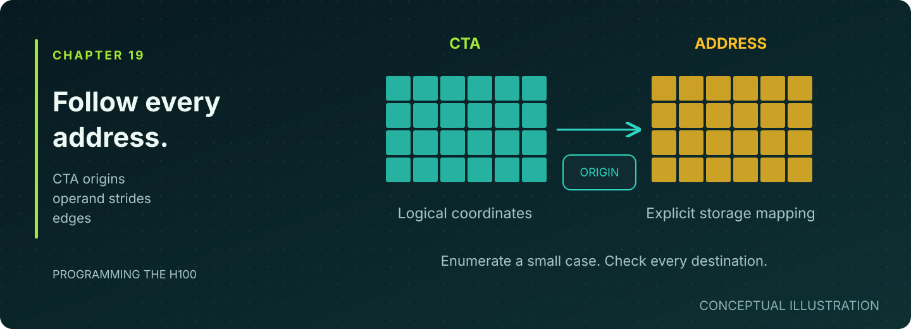
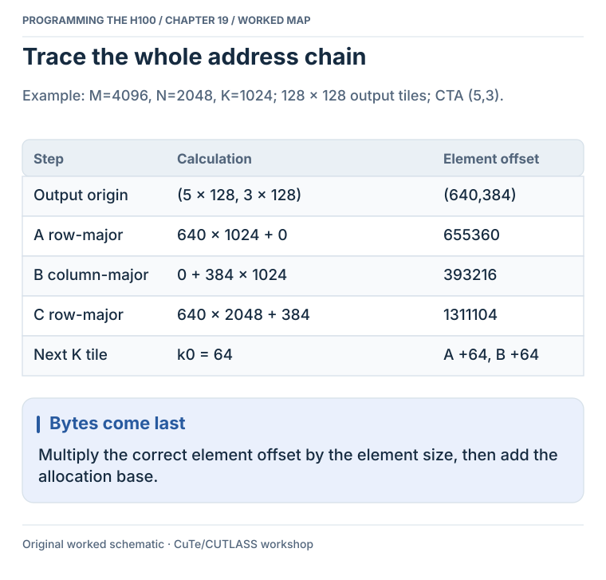
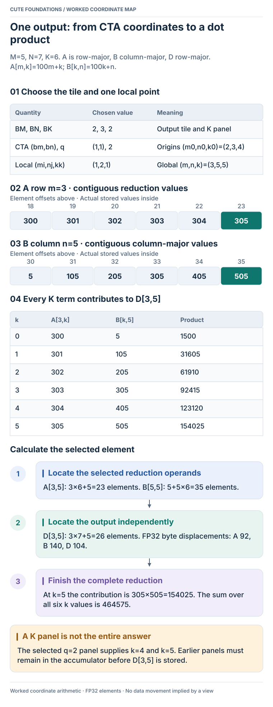

# 19. CTA Indexing — Rectangular GEMM Offsets and the K Loop

!!! note "Workbook scope"
    The Python workbook's printed labels and constant equalities are not an
    independent oracle for every local-coordinate, batch and dot-product
    calculation on this page. Work those coordinates through the displayed
    formulas and check storage bounds separately. A grid of 32×16 contains
    512 CTAs; the individual coordinate (5,3) is one CTA, not 512.

## Lesson 19 Companion Guide — Trace Every GEMM Operand from CTA to Byte Address

[](images/chapter-openers/19-workshop.svg)


!!! tip "Your goal in this chapter"

    Compute rectangular CTA, reduction and batch origins using each operand’s actual strides, then handle boundary tiles and wide address arithmetic. Read [tensor tiling and predication](18-cute-tensors-tiling.md) first.

A GEMM kernel can have legal instructions, valid memory accesses and completely wrong results because one tile origin uses the wrong leading dimension. This chapter makes that arithmetic explicit before copy and MMA machinery hide it behind types. Work from the operation contract to coordinates, then to element offsets, then to byte addresses.

[Chapter 18](18-cute-tensors-tiling.md) explained tensor views and predication. Here the mathematical operation is `D[M,N]=A[M,K]B[K,N]`, without an alpha/beta epilogue for now. The examples use **row-major A, column-major B and row-major D**. Those are deliberately explicit choices, not universal CUTLASS defaults. The pinned primary references are CuTe's [tensor](https://github.com/NVIDIA/cutlass/blob/v4.3.6/media/docs/cpp/cute/03_tensor.md) and [GEMM](https://github.com/NVIDIA/cutlass/blob/v4.3.6/media/docs/cpp/cute/0x_gemm_tutorial.md) tutorials.

## 1 — Write the physical contract first

[](images/ch19/overview.svg)

For compact storage, the element-address functions are:

| Operand | Mathematical coordinate | Leading dimension | Element offset |
| --- | --- | --- | --- |
| A | `(m,k)` | `lda=K` | `m×lda+k` |
| B | `(k,n)` | `ldb=K` | `k+n×ldb` |
| D | `(m,n)` | `ldd=N` | `m×ldd+n` |

In CuTe GEMM conventions, B is often represented logically as `(N,K)`. That rearranges the names of its coordinates, not its physical allocation. For this column-major mathematical B, a logical CuTe `(n,k)` view has strides `(K,1)`.

```cpp
auto gA = make_tensor(
    make_gmem_ptr(A),
    make_layout(make_shape(M, K), make_stride(lda, Int<1>{})));
auto gB = make_tensor(
    make_gmem_ptr(B),
    make_layout(make_shape(N, K), make_stride(ldb, Int<1>{})));
auto gD = make_tensor(
    make_gmem_ptr(D),
    make_layout(make_shape(M, N), make_stride(ldd, Int<1>{})));
```

These explanatory fragments assume CuTe C++ headers, `using namespace cute;`, correctly typed device pointers and compatible nonnegative extents/strides. They do not allocate or launch anything. Notice that A and the logical B view can have the same stride pattern while representing different mathematical axes.

This chapter intentionally uses column-major mathematical B to make its contiguous K direction visible. The complete SIMT lab in [Chapter 23](23-gemm-construction.md) uses row-major B instead. Carry the physical-layout table with the problem when moving between them: do not reuse this chapter's B increment just because M, N and K have the same names.

If mathematical B is instead row-major `(K,N)`, its logical CuTe `(n,k)` strides become `(1,N)` for compact storage. Reusing `(K,1)` would select the wrong values even when the allocation is large enough to avoid an illegal access. Changing a tag without arranging the matching physical data is not a transpose implementation.

## 2 — Define the grid convention rather than guessing it

Let each CTA compute an output tile `(BM,BN)` and advance through reduction panels of depth BK. Choose the convention `blockIdx.x → M tile` and `blockIdx.y → N tile`. Other kernels may reverse these axes or use a scheduler; the formulas must match the actual launch convention.

For tile indices `(bm,bn)`:

`m0=bm×BM`, `n0=bn×BN`.

For K iteration `q`, the reduction origin is `k0=q×BK`. A local coordinate `(mi,nj,kk)` then refers to global `(m0+mi,n0+nj,k0+kk)`. The CTA's output origin does not advance during this K loop. It accumulates contributions into the same output tile.

Use a rectangular problem when checking the convention. Square matrices can hide an accidental interchange of M and N, just as all-ones inputs can hide an output permutation. Inspect actual operand values as well as pointer ranges.

### The launch convention is part of the interface

For the current example, `blockIdx.x` selects M and `blockIdx.y` selects N. A direct illustrative launch grid is therefore:

```cpp
dim3 grid((M + BM - 1) / BM, (N + BN - 1) / BN);
```

1. With M=4096 and BM=128, x has 32 CTA positions.
2. With N=2048 and BN=128, y has 16 CTA positions.
3. Grid coordinate `(5,3)` means M tile five, N tile three, totaling 512 independent output-tile positions.
4. A different implementation may map x to N instead; it must change the kernel's interpretation consistently. This small formula assumes the bounded positive sizes here; §5 discusses overflow-conscious ceiling division.

**Guided exercise.** Under this chapter's convention, what does block coordinate `(3,5)` mean?

**Worked answer:** output origin `(3×128,5×128)=(384,640)`, not `(640,384)`. Both are valid positions in this rectangular problem, so a bounds checker alone cannot diagnose the swap.

## 3 — A complete numeric origin calculation

Set `M=4096`, `N=2048`, `K=1024`, `BM=BN=128`, `BK=64`. For CTA `(bm,bn)=(5,3)`, the output origin is `(640,384)`. At K iteration zero, the panel origins are:

| Object | Calculation | Element offset | FP16 byte offset |
| --- | --- | ---: | ---: |
| A panel | `640×1024+0` | 655360 | 1310720 |
| B panel | `0+384×1024` | 393216 | 786432 |
| D tile | `640×2048+384` | 1311104 | 2622208 |

These are derived offsets from the corresponding allocation bases, not absolute virtual addresses. For FP32 elements their byte offsets would be twice the FP16 byte values. A descriptor expressed in bytes must not receive an element offset without conversion.

The compact row stride of A remains 1024 elements inside its 128-by-64 panel. The logical N stride of B remains 1024. D's row stride remains 2048 inside its 128-by-128 tile. Tile extents are not replacements for global leading dimensions.

A coordinate-level spot check catches more mistakes than checking origins alone:

| Local `(mi,nj,kk)` | A offset | B offset | D offset |
| --- | ---: | ---: | ---: |
| `(0,0,0)` | 655360 | 393216 | 1311104 |
| `(5,7,9)` | 660489 | 400393 | 1321351 |
| `(127,127,63)` | 785471 | 523327 | 1571327 |

For the middle row, A adds `5×1024+9`, B adds `7×1024+9`, and D adds `5×2048+7`. This is also why a scalar “tile offset” cannot stand in for every operand's pointer arithmetic.

## 4 — K advances depend on the physical stride

There are `1024/64=16` K iterations in this aligned example. Moving from iteration zero to one sets `k0=64`. A's panel base becomes 655424 and B's becomes 393280: both advance by 64 elements because the reduction coordinate is contiguous in both chosen input layouts. D's base remains 1311104.

That equality is a consequence of these layouts, not a general GEMM rule. For row-major mathematical B, advancing K by 64 would move its base by `64×N=131072` elements. An implementation that increments both operands by BK regardless of their strides can read legal but wrong addresses.

CuTe can express the selected panels directly:

```cpp
auto a_panel = local_tile(
    gA,
    make_tile(Int<128>{}, Int<64>{}),
    make_coord(bm, q));
auto b_panel = local_tile(
    gB,
    make_tile(Int<128>{}, Int<64>{}),
    make_coord(bn, q));
```

A is logically `(M,K)` and B `(N,K)`, so their first tile coordinates differ. These calls select views. The producer still needs to transfer data, establish readiness and protect stage reuse before any asynchronous consumer relies on it. A selected K panel is not itself a completed TMA transaction.

### Carry a local coordinate through the API-selected panel

The `local_tile` calls above use A as `(M,K)` and column-major mathematical B as logical `(N,K)`. Keep the same CTA `(bm,bn)=(5,3)`, set K iteration `q=1`, and select local `(mi,nj,kk)=(5,7,9)`:

1. Recover the CTA origins: `m0=5×128=640`, `n0=3×128=384`.
2. Recover the K origin: `k0=1×64=64`. The two selected input panel origins are therefore `(640,64)` and mathematical B `(64,384)`.
3. Add local coordinates: global `m=640+5=645`, `n=384+7=391`, `k=64+9=73`.
4. A is row-major with `lda=1024`, so `A[645,73]` uses offset `645×1024+73=660553` elements.
5. B is column-major with `ldb=1024`, so mathematical `B[73,391]` uses `73+391×1024=400457` elements. The CuTe logical B view calls that coordinate `(391,73)`; its physical address is the same.
6. D is row-major with `ldd=2048`, so the owned output `D[645,391]` uses `645×2048+391=1321351` elements. Its coordinate stays fixed while K changes.
7. For FP16 allocations, the byte displacements are 1,321,106 for A, 800,914 for B and 2,642,702 for D. If D is FP32 instead, only its byte displacement doubles; its element offset stays 1,321,351.

The same calculation can be read as one address chain. The integers change meaning at each boundary, so each line names its units:

```text
CTA coordinates (bm,bn)=(5,3), K-iteration q=1
                 | BM=128, BN=128, BK=64
                 v
Tile origins:   m0=640, n0=384, k0=64       [coordinates]
                 | add local (mi,nj,kk)=(5,7,9)
                 v
Global point:   m=645, n=391, k=73         [coordinates]
                 | apply each operand's physical strides
                 v
A row-major:    645*1024 + 73 = 660553     [elements]
B column-major: 73 + 391*1024 = 400457     [elements]
D row-major:    645*2048 + 391 = 1321351   [elements]
                 | multiply by 2 only for FP16 storage
                 v
A: 1,321,106     B: 800,914     D: 2,642,702 [bytes]
                 | add the corresponding allocation base
                 v
Physical address for this operand access
```

**Read the figure:** follow coordinates down to element offsets, then bytes, then an allocation-relative address. The [`local_tile` calls above](#4-k-advances-depend-on-the-physical-stride) select A's `(M,K)` panel and B's `(N,K)` panel; they do not erase the different physical stride formulas. D's address is an output address, not an extra input read on each reduction step.

**Expected result:** the operands at reduction coordinate 73 contribute to the same D element as the other K iterations. **Check:** compute these offsets directly from the global coordinates, independently of the tile's base-plus-local formula; both routes must agree. **Pitfall:** using `128` as `lda` because the CTA has 128 rows selects a different allocation position. A tile extent is not a global storage stride.

### Connect the selected panel to an actual scalar result

[](images/worked/cta-operands-to-result.svg)

Use a separate tiny case: M=5, N=7, K=6; BM=2, BN=3, BK=2; row-major A, column-major B and row-major D. Populate `A[m,k]=100*m+k` and `B[k,n]=100*k+n`. These coordinate-derived **values** are deliberately distinct from storage offsets.

1. CTA `(1,1)` starts at `(m0,n0)=(2,3)`. K iteration two starts at `k0=4`.
2. Local `(mi,nj,kk)=(1,2,1)` selects global `(m,n,k)=(3,5,5)`.
3. A's offset is `3×6+5=23`; its value is 305. B's offset is `5+5×6=35`; its value is 505.
4. This one term contributes `305×505=154025` to output coordinate `(3,5)`.
5. The complete dot uses A row `[300,301,302,303,304,305]` and B column `[5,105,205,305,405,505]`. Its products are `1500,31605,61910,92415,123120,154025`, whose sum is 464575.
6. D's row-major offset is `3×7+5=26`. With FP32 storage, A/B/D byte displacements for the selected point are 92,140,104 respectively. No alpha/beta epilogue is included in this example.

**Check:** the selected K panel contributes the last two products, not the entire answer. Earlier panel sums must remain in the accumulator. **Guided exercise:** what is the contribution from K panel zero, and does its D offset differ?

**Worked answer:** panel zero covers k=0 and k=1, contributing `1500+31605=33105`; D remains offset 26. Changing K changes input coordinates and partial sums, not the owned output coordinate.

## 5 — Ceiling division preserves the tail

For a separate M extent of 3100 with BM=64, floor division gives 48 and loses the final rows. Ceiling division gives 49. Tile 48 begins at row 3072 and has `3100−3072=28` valid rows; the other 36 local rows must not access global data.

### Work the final row tile by hand

1. Divide `3100=48×64+28`: there are 48 complete tiles and a nonempty remainder.
2. Launch 49 tile rows, with final tile index 48.
3. Its origin is `48×64=3072`. Local row 27 maps to global `3072+27=3099`, the last valid row.
4. Local row 28 maps to 3100, which fails `row<M`; rows 28 through 63 must not access a global A row or D row.
5. Preserve the cooperative protocol. A thread assigned to an invalid output can still own a shared-input load or participate in a block barrier; predicate its accesses rather than returning before required collective synchronization.

**Expected result:** 28 valid rows in the final tile, 36 invalid local rows, and no lost useful output. **Check:** `48×64+28=3100` reconstructs the original extent. **Pitfall:** a memory checker may remain quiet if a mistaken valid-row assumption writes into allocated padding. Verify logical output bounds and untouched padding as separate checks.

For nonnegative extents and positive tile sizes, an overflow-conscious ceiling-division form is `M/BM + (M%BM != 0)`. The familiar `(M+BM−1)/BM` is fine only when the addition cannot overflow. Apply the same reasoning independently to N and K.

Zero extents also need an explicit host-side policy: do not launch a zero-sized grid and assume that every runtime/library treats it as a no-op. Check supported dimensions before launch. A ragged K panel requires both a valid input predicate and the correct neutral contribution for invalid reduction positions.

An identity-coordinate tensor partitioned in the same way as an operand can carry the original coordinates into the thread fragment. Compare those coordinates against the *original* logical shape. The rounded tile envelope is not the valid problem domain, and creating a CuTe view does not universally install memory predicates automatically.

## 6 — Promote before multiplying and check the byte contract

A large tensor can overflow 32-bit intermediate arithmetic even when a pointer type is 64-bit. Casting only the final product is too late. A conventional implementation first widens tile indices and dimensions. This kernel-context excerpt additionally requires `<cstdint>` and the previously defined dimensions/strides:

```cpp
std::int64_t m0 = std::int64_t(blockIdx.x) * BM;
std::int64_t n0 = std::int64_t(blockIdx.y) * BN;
std::int64_t k0 = std::int64_t(q) * BK;
std::int64_t a_offset = m0 * lda + k0;
std::int64_t b_offset = n0 * ldb + k0;
```

Validate nonnegative extents, supported stride ranges and allocation bounds before interpreting those offsets. Compute allocation sizes and byte offsets in a suitably wide type with overflow checks; wider integers do not make arbitrarily large products safe. Check runtime launch-grid limits separately. A byte-oriented descriptor additionally imposes alignment, stride and representation constraints that a valid scalar element address does not establish.

### Include the batch before the tile offset

For batch index l, add each operand's own batch stride: `l*sA + m0*lda + k0`, `l*sB + n0*ldb + k0`, and `l*sD + m0*ldd + n0`. For compact independent batches in this example, the strides are `sA=M*K=4194304`, `sB=K*N=2097152` and `sD=M*N=8388608` elements. At l=2 and K iteration zero, the selected CTA bases become 9043968, 4587520 and 18088320 respectively. These assume at least three allocated batches. Padded or broadcast operands need their actual declared batch strides; a stride of zero intentionally reuses one input and must not be adopted accidentally for independently stored outputs.

### Calculate one batch address before converting to bytes

The batch formula is easiest to inspect with the existing large aligned example. Use batch l=2 and CTA `(5,3)`, with k0=0:

1. A's independent batch stride is `M*K=4194304` elements. Add two batches and the row-major tile origin: `2×4194304+655360=9043968`.
2. B's batch stride is `K*N=2097152`. Add `2×2097152+393216=4587520`.
3. D's batch stride is `M*N=8388608`. Add `2×8388608+1311104=18088320`.
4. Only now multiply each total by its own element size. For FP16 A/B and FP32 D, byte displacements are 18,087,936; 9,175,040; and 72,353,280.

**Check:** all three allocations must contain at least three batches; a valid per-batch coordinate cannot justify escaping the allocation. **Guided exercise:** if B intentionally broadcasts one physical matrix across batches, which term changes?

**Worked answer:** B's batch stride becomes zero by contract, so its tile offset remains 393216 in every batch. A and D retain their own independent batch strides. Accidentally using zero for independently written output batches aliases destinations and changes correctness.

## 7 — Exercise and independent checks

The [CPU indexing workbook](examples/advanced/indexing_workbook.py) checks the numeric origins, K increments and 3100-row boundary above. It launches no CUDA kernel. Its arithmetic result must remain distinct from compiling a CuTe program or validating an actual GPU transfer.

**Exercise.** Keep the aligned problem and CTA `(5,3)`, but start at K iteration two. What are A and B panel bases? What changes in D?

**Worked answer.** `k0=128`. A begins at `655360+128=655488`; B begins at `393216+128=393344`. D is unchanged at 1311104. The panel values contribute to the same accumulators as iterations zero and one.

**Exercise.** What would detect a swapped B-axis convention most reliably?

**Worked answer.** A rectangular, nonuniform reference with explicit physical strides, a few inspected B addresses and comparison of every output. Passing a memory checker alone is insufficient because the mistaken addresses may still lie inside the allocation. Carry this coordinate contract into the next chapter's tiled-copy ownership map.

<!-- workshop:start:indexing_workbook -->
## Complete source and captured execution

**Executed on November 18, 2026 (UTC).** Scope: **CPU-only Python arithmetic/format reference**.

Tested source SHA-256: `600d93b6e87f75e8758fd1ac62785130d643fce63dc1a054a056b949a216c1f0`. [Exact source](validation/2026-11-18-h100-workshop/indexing_workbook.py) · [System information](validation/2026-11-18-h100-workshop/system.json) · [Workshop results](cutlass-workshop-validation.md).

The listing below matches the tested source. Its presentation is formatted at build time; downloads retain the captured bytes.

```python
#!/usr/bin/env python3
"""CPU arithmetic/ownership oracles. No CUDA, CuTe kernel or profiler is executed."""
from collections import Counter
import math


def check(condition, message):
    if not condition: raise AssertionError(message)


def layouts():
    row = [[m*4+n for n in range(4)] for m in range(3)]
    column = [[m+n*3 for n in range(4)] for m in range(3)]
    check(row[2][3] == column[2][3] == 11, 'last element')
    check(row[1][2] == 6 and column[1][2] == 7, 'major convention')
    offsets = [a+3*b+40*c for c in range(2) for b in range(4) for a in range(3)]
    check(len(set(offsets)) == 24 and max(offsets)+1 == 52, 'hierarchy span')
    check(2+3*3+40 == 51, 'hierarchical coordinate')
    padded = [m*8+n for m in range(3) for n in range(4)]
    check(len(padded) == 12 and max(padded)+1 == 20, 'padded span')
    print('LAYOUTS PASS: row(1,2)=6 column(1,2)=7; nested size=24 span=52 holes=28')


def cta_offsets():
    M,N,K,BM,BN,BK,bm,bn = 4096,2048,1024,128,128,64,5,3
    m0,n0 = bm*BM,bn*BN
    a,b,c = m0*K,n0*K,m0*N+n0  # Row A, column B, row C.
    check((m0,n0,a,b,c) == (640,384,655360,393216,1311104),'CTA base')
    check(a+BK == 655424 and b+BK == 393280,'K origin')
    M,BM=3100,64
    blocks=(M+BM-1)//BM;last=(blocks-1)*BM
    check((blocks,last,M-last)==(49,3072,28),'ceil boundary')
    print('CTA PASS: origin=(640,384) A=655360 B=393216 C=1311104; boundary grid=49 valid_rows=28')


def tiled_ownership():
    M,N,TM,TN = 37,70,4,32
    seen=Counter(); invalid=0
    for bm in range((M+TM-1)//TM):
        for bn in range((N+TN-1)//TN):
            for tid in range(128):
                rm,rn=tid//32,tid%32
                m,n=bm*TM+rm,bn*TN+rn
                if m<M and n<N:seen[m,n]+=1
                else:invalid+=1
    check(len(seen)==M*N and set(seen.values())=={1},'copy coverage')
    check(invalid==10*3*128-M*N,'predicated tail')
    print(f'COPY OWNERSHIP PASS: {len(seen)} valid coordinates owned once; {invalid} invalid lanes predicated')


def fragments():
    seen=Counter()
    for lane in range(32):
        group,thread=lane//4,lane%4
        for reg in range(4):
            row=group+8*(reg//2);col=2*thread+reg%2
            seen[row,col]+=1
    check(len(seen)==16*8 and set(seen.values())=={1},'m16n8 FP32 ownership')
    lane=10;g,t=lane//4,lane%4
    coords=[(g+8*(r//2),2*t+r%2) for r in range(4)]
    check(coords==[(2,4),(2,5),(10,4),(10,5)],'lane 10')
    print('FRAGMENTS PASS: 32 lanes x 4 FP32 values cover 16x8 exactly once; lane10='+str(coords))


def swizzles():
    normal=[i*32+j for i in range(32) for j in range(32)]
    row_xor=[(i^(j>>2))*32+j for i in range(32) for j in range(32)]
    col_xor=[i*32+(j^i) for i in range(32) for j in range(32)]
    check(len(set(row_xor))==len(set(col_xor))==1024,'swizzle bijection')
    fixed_col=7
    banks=lambda f:{f(i,fixed_col)%32 for i in range(32)}
    check(len(banks(lambda i,j:i*32+j))==1,'unswizzled column')
    check(len(banks(lambda i,j:(i^(j>>2))*32+j))==1,'wrong XOR benefit')
    check(len(banks(lambda i,j:i*32+(j^i)))==32,'word XOR benefit')
    check(normal!=row_xor and normal!=col_xor,'nontrivial permutation')
    print('SWIZZLE PASS: 32-bit fixed-column distinct banks: plain=1 row-XOR=1 column-XOR=32')


def pipeline():
    for stages in (1,2,3):
        for tiles in (0,1,2,3,7):
            state=['empty']*stages;generation=[0]*stages
            for tile in range(tiles):
                index=tile%stages;expected=tile//stages
                check(state[index]=='empty' and generation[index]==expected,'acquire generation')
                state[index]='writing';state[index]='full';state[index]='reading'
                # This model releases only after every modeled reader completes.
                state[index]='empty';generation[index]+=1
            check(set(state)=={'empty'},'pipeline drain')
    print('PIPELINE MODEL PASS: 15 depth/tile combinations; acquire, ready, read, release and generation checks')


def numerics():
    A=[[1,-2,3],[4,0,-1]];B=[[2,1],[3,-2],[1,4]];C=[[2,-4],[6,8]]
    product=[[sum(A[m][k]*B[k][n] for k in range(3)) for n in range(2)] for m in range(2)]
    D=[[0.5*product[m][n]+0.25*C[m][n] for n in range(2)] for m in range(2)]
    check(product==[[-1,17],[7,0]] and D==[[0,7.5],[5,2]],'GEMM reference')
    ops=2*2048*2048*4096;rate=ops/(85e-6)/1e12
    check(math.isclose(rate,404.23221609411764),'operation count')
    print(f'NUMERICS PASS: AB={product} D={D}; 34.359738368 GFLOP / 85 us = {rate:.3f} TFLOP/s (arithmetic example)')

if __name__=='__main__':
    for fn in (layouts,cta_offsets,tiled_ownership,fragments,swizzles,pipeline,numerics):fn()
    print('WORKBOOK PASS: 7 CPU-only reference groups; no GPU execution or performance measurement')
```

Python byte-compilation UTC: `2026-11-18T14:11:19.940849+00:00`. Exit: `0`. [Compile log](validation/2026-11-18-h100-workshop/indexing_workbook-compile.log).

Commands use scratch-directory filenames; raw logs retain exact paths. The collector’s CUTLASS include flags are configuration for that capture; the minimal standalone overlap/SIMT commands do not require those headers.

```bash
python3 -m py_compile indexing_workbook.py
```

Executed UTC: `2026-11-18T14:11:20.056089+00:00`. Exit: `0`. [Run log](validation/2026-11-18-h100-workshop/indexing_workbook-run.log).

```bash
python3 indexing_workbook.py
```

**Actual captured output**

```text
LAYOUTS PASS: row(1,2)=6 column(1,2)=7; nested size=24 span=52 holes=28
CTA PASS: origin=(640,384) A=655360 B=393216 C=1311104; boundary grid=49 valid_rows=28
COPY OWNERSHIP PASS: 2590 valid coordinates owned once; 1250 invalid lanes predicated
FRAGMENTS PASS: 32 lanes x 4 FP32 values cover 16x8 exactly once; lane10=[(2, 4), (2, 5), (10, 4), (10, 5)]
SWIZZLE PASS: 32-bit fixed-column distinct banks: plain=1 row-XOR=1 column-XOR=32
PIPELINE MODEL PASS: 15 depth/tile combinations; acquire, ready, read, release and generation checks
NUMERICS PASS: AB=[[-1, 17], [7, 0]] D=[[0.0, 7.5], [5.0, 2.0]]; 34.359738368 GFLOP / 85 us = 404.232 TFLOP/s (arithmetic example)
WORKBOOK PASS: 7 CPU-only reference groups; no GPU execution or performance measurement
```

<!-- workshop:end:indexing_workbook -->

<!-- companion-summary:start -->
## Summary

- Define mathematical axes, physical storage and grid conventions before deriving A, B and D addresses. The logical CuTe B view does not transpose its allocation.

- K increments and batch offsets follow operand strides; tile sizes alone cannot determine global pointer increments.

- Use ceiling division, original-domain predicates and sufficiently wide checked arithmetic, then carry the address contract into [tiled-copy ownership](20-tiled-copy.md).
<!-- companion-summary:end -->

Here D denotes the output tensor. The companion workbook’s C label denotes that same output role; it is not an extra input tensor in this indexing exercise.
