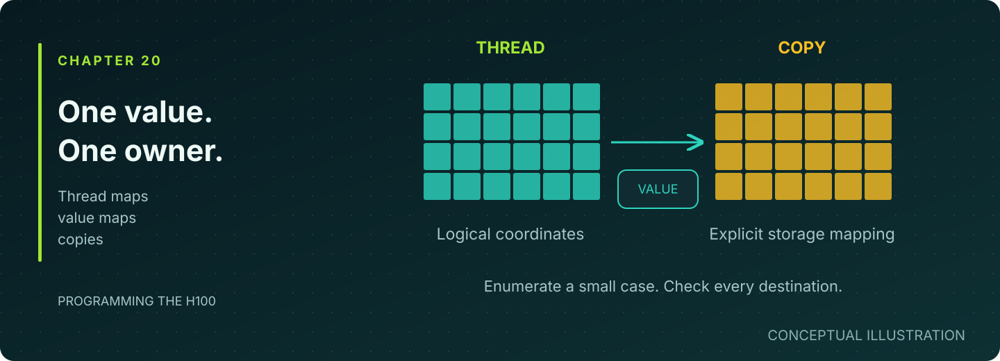
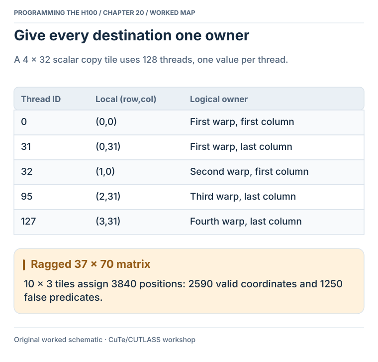
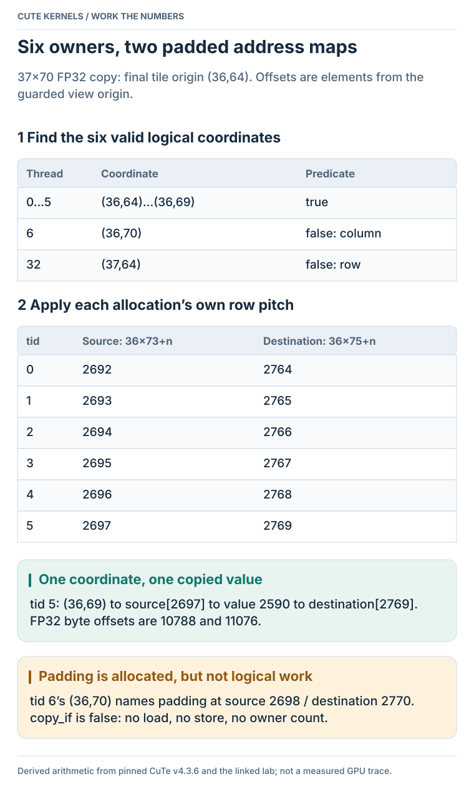

# 20. Thread/Value Ownership and a Real CuTe Tiled Copy
## Lesson 20 Companion Guide — Prove Thread Ownership Before Issuing a Copy

[](images/chapter-openers/20-workshop.svg)


!!! tip "Your goal in this chapter"

    Derive which thread copies each element, distinguish partitioning from execution, and prove that every valid destination has exactly one writer. Read [tensor views](18-cute-tensors-tiling.md) and [CTA indexing](19-cta-indexing.md) first.

## 1 — Four independent mappings

[](images/ch20/overview.svg)

A copy kernel combines several mappings that are easy to confuse:

1. The grid selects a logical tile.
2. A thread/value layout assigns positions in that tile to CUDA threads and per-thread value slots.
3. A source layout maps those positions to source addresses.
4. A destination layout maps the same logical positions to destination addresses.

The source and destination can have different leading dimensions. They must agree on which logical value is being copied. Merely giving them the same allocation size does not establish that agreement.

The lab's source and destination have the **same logical shape `(M,N)`**, independent nonoverlapping allocations and sufficient storage for their own pitches and guards. Its single source-derived coordinate predicate protects both accesses only under that matching-domain contract. If a destination has a smaller logical extent, checking only the source shape is insufficient: define the intended copy region and validate both sides before issuing the operation. An allocated padding slot is not an extra logical destination.

**Boundary check:** if you change the source to shape `(37,70)` and the destination to `(37,69)`, coordinate `(36,69)` passes the source tests `36<37 && 69<70` but fails the destination test `69<69`. Even if that address lands in allocated destination padding, it is not a valid logical store. The current lab avoids this mismatch by using the same extents on both sides.

This parallel copy is not `memmove`. Partially overlapping source and destination views can let one thread overwrite data another has not read, even if every destination has one writer. The tested separate-buffer case avoids that dependency; any overlapping-copy operation needs its own supported algorithm and ordering proof.

CuTe's `TiledCopy` packages an instruction-level copy atom with a thread/value tiling. `partition_S` and `partition_D` produce the per-thread views that the copy consumes. Constructing those views does not issue a memory instruction. The pinned [predicated-copy tutorial](https://github.com/NVIDIA/cutlass/blob/v4.3.6/examples/cute/tutorial/tiled_copy_if.cu) demonstrates the API; [copy.hpp](https://github.com/NVIDIA/cutlass/blob/v4.3.6/include/cute/algorithm/copy.hpp) supplies the dispatch rules.

## 2 — Derive a 128-thread tile

Take a logical tile of four rows and 32 columns. Give each thread one element:

`local_row = thread_id / 32`, `local_column = thread_id % 32`.

| Thread | Local coordinate | Flat offset in a compact row-major tile |
| --- | --- | ---: |
| 0 | (0,0) | 0 |
| 31 | (0,31) | 31 |
| 32 | (1,0) | 32 |
| 95 | (2,31) | 95 |
| 127 | (3,31) | 127 |

The thread layout is shape `(4,32)`, stride `(32,1)`; the value layout is `(1,1)`. Every coordinate is assigned once because Euclidean division by 32 uniquely reconstructs the thread ID. Four warps cover four rows. With FP32 elements, adjacent lanes in a warp request adjacent four-byte words.

```cpp
auto thread_layout = cute::make_layout(
    cute::make_shape(cute::Int<4>{}, cute::Int<32>{}),
    cute::make_stride(cute::Int<32>{}, cute::Int<1>{}));
auto value_layout = cute::make_layout(
    cute::make_shape(cute::Int<1>{}, cute::Int<1>{}));
auto tiled_copy = cute::make_tiled_copy(
    cute::Copy_Atom<cute::UniversalCopy<float>, float>{},
    thread_layout, value_layout);
```

This is a scalar-copy example. A CuTe type named `TiledCopy` does not automatically imply vector instructions, asynchronous copying or Tensor Core execution.

## 3 — From a thread ID to a partition

The pinned interface lets the kernel obtain a thread slice and use it to partition both operands:

```cpp
auto thread_copy = tiled_copy.get_thread_slice(threadIdx.x);
auto source_partition = thread_copy.partition_S(source_tile);
auto destination_partition = thread_copy.partition_D(destination_tile);
```

These are explanatory statements inside a kernel with already constructed tensor views; they are not a complete launch harness. The complete [cute_copy.cu](examples/advanced/cute_copy.cu) supplies the allocations, grid, predicates and validation.

A partition’s modes can include an instruction value mode and repetitions of the tile in each logical dimension. Do not assume that `partition.size()` implies a row-major contiguous fragment. Inspect its shape and coordinate mapping. If a thread owns several values, enumerate `(thread,value)` pairs and check their destination coordinates as a set.

For a tile of 128 elements, a plausible-looking assignment of four values to each of 128 threads would over-assign the tile unless it intentionally represents replicated reads. Replication may be valid for a source; it is not a license for overlapping independent stores.

## 4 — Predicate coordinates, not guessed addresses

Now copy a matrix of 37 rows and 70 columns with four-by-32 tiles. The grid has `ceil(37/4)=10` tile rows and `ceil(70/32)=3` tile columns. There are 3,840 potential thread positions, but only 2,590 valid matrix coordinates. The remaining 1,250 positions need false predicates.

CuTe’s identity tensor stores logical coordinates as its values. Tile and partition that coordinate tensor in the same way as the source. A predicate can then test `row < M && column < N` for each owned element. This is more reliable than deriving a second, unrelated indexing formula after the layout has become hierarchical.

A rounded tensor tile is a view of a larger coordinate domain; it does not make the allocation larger or automatically mask every operation. The copy must actually use the predicate. A conditional store after an unconditional out-of-bounds load is still invalid.

### Construct the predicate and follow one tail thread

Inside a kernel with the full `source` and `destination` tensors and the scalar `tiled_copy` above, the executed lab uses this construction:

```cpp
auto logical_shape = cute::shape(source);
auto coordinates = cute::make_identity_tensor(logical_shape);
auto predicates = cute::lazy::transform(coordinates, [&](auto coordinate) {
    return cute::elem_less(coordinate, logical_shape);
});
auto tile_shape = cute::make_shape(cute::Int<4>{}, cute::Int<32>{});
auto tile_coordinate = cute::make_coord(blockIdx.x, blockIdx.y);
auto source_tile = cute::local_tile(source, tile_shape, tile_coordinate);
auto destination_tile = cute::local_tile(destination, tile_shape, tile_coordinate);
auto predicate_tile = cute::local_tile(predicates, tile_shape, tile_coordinate);
auto thread_copy = tiled_copy.get_thread_slice(threadIdx.x);
auto thread_source = thread_copy.partition_S(source_tile);
auto thread_destination = thread_copy.partition_D(destination_tile);
auto thread_predicate = thread_copy.partition_S(predicate_tile);
cute::copy_if(tiled_copy, thread_predicate, thread_source, thread_destination);
```

The lambda is a lazy coordinate-to-Boolean mapping, not a separately allocated Boolean matrix. `elem_less` tests the corresponding row and column against their original extents. Trace the final tile `(blockIdx.x,blockIdx.y)=(9,2)`:

1. Its origin is `(9×4,2×32)=(36,64)`.
2. Thread 5 has local coordinate `(0,5)`, so it names global `(36,69)`; `36<37` and `69<70` are both true.
3. Thread 6 names `(36,70)`; the column test is false, so it performs no source load or destination store through this predicated copy.
4. Thread 32 names `(37,64)`; the row test is false even though the column is valid.
5. Exactly threads 0 through 5 may copy. The same logical predicate remains valid when source and destination have different row strides, because it tests coordinates rather than a guessed physical offset.

The final tile's ownership mask makes the partial work visible. V means a **valid logical destination**; X means no copy. This is a coordinate/thread map, not a matrix of stored numeric values:

```text
Final CTA tile (9,2): origin (row,column)=(36,64)
Local columns:   0  1  2  3  4  5 | 6 ... 31
Global columns:64 65 66 67 68 69 |70 ... 95

local row  global row   validity across that row      thread IDs
    0          36       [V  V  V  V  V  V | X ... X]     0 ... 31
    1          37       [X  X  X  X  X  X | X ... X]    32 ... 63
    2          38       [X  X  X  X  X  X | X ... X]    64 ... 95
    3          39       [X  X  X  X  X  X | X ... X]    96 ...127

Only six owners copy:
  tid 0 -> (36,64)       tid 3 -> (36,67)
  tid 1 -> (36,65)       tid 4 -> (36,68)
  tid 2 -> (36,66)       tid 5 -> (36,69)
```

**Read the figure:** first discard invalid global rows, then discard columns at or beyond 70. Finally use `tid=32*local_row+local_column` to recover the six valid owners. The actual [`copy_if` chain above](#construct-the-predicate-and-follow-one-tail-thread) applies this mask to the operation itself. Even an allocated padding slot outside the logical 37×70 matrix remains an X.

**Expected result:** six valid copied values in this final tile, zero writes to its other 122 logical positions, and no change to destination padding. The lab's ownership counters and complete nonuniform output comparison check this behavior on the actual kernel. **Pitfall:** applying the predicate only to `partition_D` after an unconditional source read cannot protect an out-of-bounds load.

For vectorized instructions, the validity and alignment contract applies to the instruction’s whole accessed segment. Per-element predicates do not make an arbitrary partially valid 16-byte access safe. Handle tails with a supported predicated atom, a separate scalar path, or an explicitly padded allocation whose semantics permit the access.

### Walk from the logical owner to two different physical addresses

[](images/worked/kernel-copy-tail.svg)

The figure's numbers come from the executed lab's row-pitch and initialization formulas. A **pitch** here counts FP32 elements, while `threadIdx.x` is an integer thread identifier. Define source pitch `ps=N+3=73` and destination pitch `pd=N+5=75`. The base pointers in the tensor views already skip the sixteen-element leading guards.

1. **Choose an owner.** Thread 5 in tile `(9,2)` owns `(row,column)=(36,69)`. The thread/value assignment determines this coordinate before either storage layout is consulted.
2. **Check the coordinate.** `36<37` and `69<70`, so the lazy predicate is true. The same Boolean governs the source load and destination store in `copy_if`.
3. **Apply the source map.** Element offset is `36*73+69=2697`. In the actual source initializer, value is `row*N+column+1=36*70+69+1=2590`. Notice the initializer uses logical width 70 for the value pattern but physical pitch 73 for its storage address.
4. **Apply the destination map.** The same coordinate maps to `36*75+69=2769`. Copy the number 2590 there. Reusing source offset 2697 as the destination offset would place a correct value at the wrong location.
5. **Update the logical ownership count.** The lab counts writers at compact logical index `36*70+69=2589`, not at padded destination offset 2769. That counter must become one. Its purpose is to count ownership, not mimic the data allocation's padding.
6. **Check a false neighbor.** Thread 6 owns column 70. Source offset 2698 and destination offset 2770 happen to be allocated padding, but the logical predicate is false. Neither data operation nor ownership increment should occur.

The byte offsets for the valid copy are `4*2697=10788` and `4*2769=11076`, relative to the guarded tensor origins. Add another `16*4=64` bytes only when comparing against the raw allocation base. Writing down the origin prevents a guard offset from being counted twice.

**Expected check:** the final tile copies six values and contributes six ownership increments. The whole matrix contributes `37*70=2590`. The rounded grid has thirty tiles, each with 128 potential owners, so `3840-2590=1250` positions must not copy. Both the global total and the final-tile local total should agree with the coordinate model.

??? question "Exercise: thread 4, then a different destination pitch"

    Find thread 4's source offset, destination offset and copied value in this tile. If destination pitch becomes 80, does ownership change?

    **Answer:** Coordinate `(36,68)` gives source `36*73+68=2696`, destination `36*75+68=2768` and value `36*70+68+1=2589`. With pitch 80, destination offset becomes 2948; the coordinate, source offset, predicate and logical owner counter remain unchanged. A modified executable still needs its own allocation checks and rerun.

## 5 — Prove both values and ownership

The executable does more than compare a checksum. It initializes distinct logical values, launches the copy and validates every output. An instrumented owner count records the number of writers for each valid destination; it must be exactly one. Guards and row padding remain unchanged, and the source allocation is checked after the operation.

Those checks answer different questions:

| Check | What it can catch |
| --- | --- |
| Full output equality | Missing, incorrect or permuted values for the chosen inputs |
| Owner count equals one | Missing or duplicate destination ownership |
| NaN/sentinel initialization | Destinations that were never written |
| Padding and outer guards | Stores beyond the intended logical region |
| Source unchanged | Accidental writes through a source view |
| Memory sanitizer | Invalid accesses that a guard-only test may miss |

The ownership instrumentation itself perturbs performance. This is a correctness exercise, not a bandwidth benchmark. A separate, equivalently mapped uninstrumented kernel is needed for a meaningful transfer measurement.

## 6 — Coalescing and vectorization are different

A warp of 32 FP32 lanes accessing adjacent words spans 128 bytes. For a suitably aligned access, that spans four 32-byte sectors at the relevant global-memory request level. Misalignment or sparse lane participation changes the sectors touched. A warp does not get a universal “one transaction” guarantee from using contiguous values; requests, sectors, cache lines and DRAM transactions are different accounting levels.

Vectorization increases each thread’s accessed width. It requires compatible alignment, stride, extent and ownership. For example, four FP32 values per thread can support a 16-byte operation when the chosen copy atom and addresses meet its contract. But it also changes the tile’s thread/value mapping; simply replacing `float` with a wider type can silently reinterpret rather than copy the intended data.

Predict the addresses first, inspect generated code second, then measure. Count useful bytes, not padding or repeated loads, when reporting effective bandwidth.

## 7 — Copying to shared memory introduces a lifetime

The same partitioning concepts apply to global-to-shared transfers, but ordering becomes part of correctness. A synchronous cooperative load needs the appropriate block rendezvous before other threads consume the tile. An asynchronous path needs its documented completion protocol. Shared memory cannot be overwritten until every reader, including asynchronous MMA readers, is finished.

A copy partition does not provide that lifetime automatically. [Chapter 22](22-shared-layouts.md) explains the shared layout; [Chapter 25](25-cutlass-pipelines.md) explains the stage protocol. Keep the address proof and the ownership proof separate enough that you can debug either one.

## 8 — Run and interpret the lab

Use the [workshop collector](examples/advanced/README.md) to compile and run the source with the pinned toolchain. Its cases include an aligned shape, the 37×70 ragged shape and a single-element shape. Accept `COPY PASS` only when all cases ran, every output and ownership check passed, and CUDA completion succeeded.

The CPU [indexing workbook](examples/advanced/indexing_workbook.py) independently enumerates the 37×70 ownership model. It is useful before device execution, but it does not test the GPU kernel, compiler lowering or memory system.

??? question "Can duplicate writers pass a value-only check?"

    Two threads store the same correct constant to each destination. Every value compares equal. Is ownership established?

    **Answer:** No. Identical values can hide duplicate ownership, and unsynchronized writes can still violate the program’s rules. Use explicit ownership enumeration or an instrumented count in addition to value checks.

??? question "Does changing the leading dimension change the logical shape?"

    A 37×70 matrix has 75 allocated elements per row. How many logical values must be copied?

    **Answer:** Still 2,590. The extra five positions per row are storage padding, not additional columns in the mathematical matrix.

<!-- workshop:start:cute_copy -->
## Complete source and captured execution

**Executed on November 18, 2026 (UTC).** Scope: **CUDA workload with its stated numerical checks**.

Tested source SHA-256: `80653d5417224c96a362cb0784830d9c5262aaa70c10a4a161465b153b0adf4d`. [Exact source](validation/2026-11-18-h100-workshop/cute_copy.cu) · [System information](validation/2026-11-18-h100-workshop/system.json) · [Workshop results](cutlass-workshop-validation.md).

The listing below matches the tested source. Its presentation is formatted at build time; downloads retain the captured bytes.

```cuda
/***************************************************************************************************
 * Copyright (c) 2023 - 2026 NVIDIA CORPORATION & AFFILIATES. All rights reserved.
 * SPDX-License-Identifier: BSD-3-Clause
 *
 * Redistribution and use in source and binary forms, with or without
 * modification, are permitted provided that the following conditions are met:
 *
 * 1. Redistributions of source code must retain the above copyright notice, this
 * list of conditions and the following disclaimer.
 *
 * 2. Redistributions in binary form must reproduce the above copyright notice,
 * this list of conditions and the following disclaimer in the documentation
 * and/or other materials provided with the distribution.
 *
 * 3. Neither the name of the copyright holder nor the names of its
 * contributors may be used to endorse or promote products derived from
 * this software without specific prior written permission.
 *
 * THIS SOFTWARE IS PROVIDED BY THE COPYRIGHT HOLDERS AND CONTRIBUTORS "AS IS"
 * AND ANY EXPRESS OR IMPLIED WARRANTIES, INCLUDING, BUT NOT LIMITED TO, THE
 * IMPLIED WARRANTIES OF MERCHANTABILITY AND FITNESS FOR A PARTICULAR PURPOSE ARE
 * DISCLAIMED. IN NO EVENT SHALL THE COPYRIGHT HOLDER OR CONTRIBUTORS BE LIABLE
 * FOR ANY DIRECT, INDIRECT, INCIDENTAL, SPECIAL, EXEMPLARY, OR CONSEQUENTIAL
 * DAMAGES (INCLUDING, BUT NOT LIMITED TO, PROCUREMENT OF SUBSTITUTE GOODS OR
 * SERVICES; LOSS OF USE, DATA, OR PROFITS; OR BUSINESS INTERRUPTION) HOWEVER
 * CAUSED AND ON ANY THEORY OF LIABILITY, WHETHER IN CONTRACT, STRICT LIABILITY,
 * OR TORT (INCLUDING NEGLIGENCE OR OTHERWISE) ARISING IN ANY WAY OUT OF THE USE
 * OF THIS SOFTWARE, EVEN IF ADVISED OF THE POSSIBILITY OF SUCH DAMAGE.
 *
 **************************************************************************************************/

// Adapted predicate/TiledCopy construction from CUTLASS v4.3.6
// examples/cute/tutorial/tiled_copy_if.cu. This teaching lab uses scalar
// float copies and instrumented ownership counts, not vectorization or MMA.
#include <cute/tensor.hpp>
#include <cuda_runtime.h>
#include <cmath>
#include <cstdio>
#include <limits>
#include <stdexcept>
#include <vector>

using namespace cute;

static void cuda_check(cudaError_t result, char const* call) {
    if (result != cudaSuccess) {
        std::fprintf(stderr, "%s: %s\n", call, cudaGetErrorString(result));
        throw std::runtime_error("CUDA operation failed");
    }
}
#define CUDA_CHECK(call) cuda_check((call), #call)

template<class Source, class Destination, class TiledCopy>
__global__ void copy_tile(Source source, Destination destination,
                          TiledCopy tiled_copy, int* writers, int columns) {
    auto logical_shape = shape(source);
    auto coordinates = make_identity_tensor(logical_shape);
    auto predicates = cute::lazy::transform(coordinates, [&](auto coordinate) {
        return elem_less(coordinate, logical_shape);
    });
    auto tile_shape = make_shape(Int<4>{}, Int<32>{});
    auto tile_coordinate = make_coord(blockIdx.x, blockIdx.y);
    auto source_tile = local_tile(source, tile_shape, tile_coordinate);
    auto destination_tile = local_tile(destination, tile_shape, tile_coordinate);
    auto predicate_tile = local_tile(predicates, tile_shape, tile_coordinate);
    auto coordinate_tile = local_tile(coordinates, tile_shape, tile_coordinate);
    auto thread_copy = tiled_copy.get_thread_slice(threadIdx.x);
    auto thread_source = thread_copy.partition_S(source_tile);
    auto thread_destination = thread_copy.partition_D(destination_tile);
    auto thread_predicate = thread_copy.partition_S(predicate_tile);
    auto thread_coordinate = thread_copy.partition_S(coordinate_tile);
    copy_if(tiled_copy, thread_predicate, thread_source, thread_destination);
    // Instrumentation proves each valid destination has exactly one owner.
    // The same predicate protects both the copy and the ownership counter.
    for (int i = 0; i < size(thread_predicate); ++i) {
        if (thread_predicate(i)) {
            auto coordinate = thread_coordinate(i);
            atomicAdd(writers + int(get<0>(coordinate)) * columns +
                                  int(get<1>(coordinate)), 1);
        }
    }
}

static int run_case(int rows, int columns) {
    constexpr int guard = 16;
    constexpr float source_canary = -77777.0f, destination_canary = -54321.0f;
    int source_pitch = columns + 3, destination_pitch = columns + 5;
    std::vector<float> source(guard + rows * source_pitch + guard, source_canary);
    std::vector<float> destination(guard + rows * destination_pitch + guard,
                                   destination_canary);
    auto expected = destination;
    for (int row = 0; row < rows; ++row) {
        for (int column = 0; column < columns; ++column) {
            float value = float(row * columns + column + 1);
            source[guard + row * source_pitch + column] = value;
            destination[guard + row * destination_pitch + column] =
                std::numeric_limits<float>::quiet_NaN();
            expected[guard + row * destination_pitch + column] = value;
        }
    }
    float *device_source = nullptr, *device_destination = nullptr;
    int* device_writers = nullptr;
    CUDA_CHECK(cudaMalloc(&device_source, source.size() * sizeof(float)));
    CUDA_CHECK(cudaMalloc(&device_destination, destination.size() * sizeof(float)));
    CUDA_CHECK(cudaMalloc(&device_writers, rows * columns * sizeof(int)));
    CUDA_CHECK(cudaMemcpy(device_source, source.data(), source.size() * sizeof(float),
                          cudaMemcpyHostToDevice));
    CUDA_CHECK(cudaMemcpy(device_destination, destination.data(),
                          destination.size() * sizeof(float), cudaMemcpyHostToDevice));
    CUDA_CHECK(cudaMemset(device_writers, 0, rows * columns * sizeof(int)));
    auto tensor_shape = make_shape(rows, columns);
    auto source_tensor = make_tensor(make_gmem_ptr(device_source + guard),
        make_layout(tensor_shape, make_stride(source_pitch, Int<1>{})));
    auto destination_tensor = make_tensor(make_gmem_ptr(device_destination + guard),
        make_layout(tensor_shape, make_stride(destination_pitch, Int<1>{})));
    auto threads = make_layout(make_shape(Int<4>{}, Int<32>{}),
                               make_stride(Int<32>{}, Int<1>{}));
    auto values = make_layout(make_shape(Int<1>{}, Int<1>{}));
    auto tiled_copy = make_tiled_copy(Copy_Atom<UniversalCopy<float>, float>{},
                                     threads, values);
    dim3 grid((rows + 3) / 4, (columns + 31) / 32);
    copy_tile<<<grid, 128>>>(source_tensor, destination_tensor, tiled_copy,
                            device_writers, columns);
    CUDA_CHECK(cudaGetLastError());
    CUDA_CHECK(cudaDeviceSynchronize());
    CUDA_CHECK(cudaMemcpy(destination.data(), device_destination,
                          destination.size() * sizeof(float), cudaMemcpyDeviceToHost));
    std::vector<float> source_after(source.size());
    std::vector<int> writers(rows * columns);
    CUDA_CHECK(cudaMemcpy(source_after.data(), device_source,
                          source.size() * sizeof(float), cudaMemcpyDeviceToHost));
    CUDA_CHECK(cudaMemcpy(writers.data(), device_writers,
                          writers.size() * sizeof(int), cudaMemcpyDeviceToHost));
    CUDA_CHECK(cudaFree(device_writers));
    CUDA_CHECK(cudaFree(device_destination));
    CUDA_CHECK(cudaFree(device_source));
    int errors = 0;
    for (size_t i = 0; i < expected.size(); ++i)
        if (destination[i] != expected[i]) ++errors;
    for (size_t i = 0; i < source.size(); ++i)
        if (source_after[i] != source[i]) ++errors;
    for (int count : writers) if (count != 1) ++errors;
    std::printf("copy M=%d N=%d: %d unique values, padding/canaries/source checked, errors=%d\n",
                rows, columns, rows * columns, errors);
    return errors;
}

int main() {
    try {
        int count = 0;
        CUDA_CHECK(cudaGetDeviceCount(&count));
        if (!count) { std::printf("BLOCKED: requires one CUDA GPU\n"); return 2; }
        CUDA_CHECK(cudaSetDevice(0));
        int errors = run_case(8, 64);
        errors += run_case(37, 70);
        errors += run_case(1, 1);
        std::printf("COPY %s: 3 cases, errors=%d\n", errors ? "FAIL" : "PASS", errors);
        return errors ? 1 : 0;
    } catch (std::exception const& error) {
        std::fprintf(stderr, "COPY FAIL: %s\n", error.what());
        return 1;
    }
}
```

CUDA compilation UTC: `2026-11-18T14:09:43.473198+00:00`. Exit: `0`. [Compile log](validation/2026-11-18-h100-workshop/cute_copy-compile.log).

Commands use scratch-directory filenames; raw logs retain exact paths. The collector’s CUTLASS include flags are configuration for that capture; the minimal standalone overlap/SIMT commands do not require those headers.

```bash
nvcc -std=c++17 -O2 -lineinfo -arch=sm_90a --expt-relaxed-constexpr -I "$CUTLASS_ROOT/include" -I "$CUTLASS_ROOT/tools/util/include" cute_copy.cu -o ./example
```

Executed UTC: `2026-11-18T14:09:59.102270+00:00`. Exit: `0`. [Run log](validation/2026-11-18-h100-workshop/cute_copy-run.log).

```bash
./example
```

**Actual captured output**

```text
copy M=8 N=64: 512 unique values, padding/canaries/source checked, errors=0
copy M=37 N=70: 2590 unique values, padding/canaries/source checked, errors=0
copy M=1 N=1: 1 unique values, padding/canaries/source checked, errors=0
COPY PASS: 3 cases, errors=0
```

<!-- workshop:end:cute_copy -->

## Additional memory-safety record

The exact tested revision also passed [Compute Sanitizer memcheck](validation/2026-11-18-h100-workshop/supplemental-captures/gpu-checks/20261118T141445Z/memcheck-cute_copy.log) with zero errors and its numerical checks intact. [The dated supplemental manifest](validation/2026-11-18-h100-workshop/supplemental-captures/gpu-checks/20261118T141445Z/commands.json) retains commands, source hashes and actual UTC stage times. This does not prove every untested schedule.

<!-- companion-summary:start -->
## Summary

- A tiled copy combines a grid tile, thread/value ownership and separate source/destination layouts; constructing partitions issues no memory transfer.

- Check complete nonuniform values, unique destination ownership, untouched padding/guards and CUDA completion. Predicate tails before any invalid access.

- Coalescing and vectorization have different alignment and transaction requirements. Apply the same ownership discipline to [MMA fragments](21-mma-atoms.md).
<!-- companion-summary:end -->
