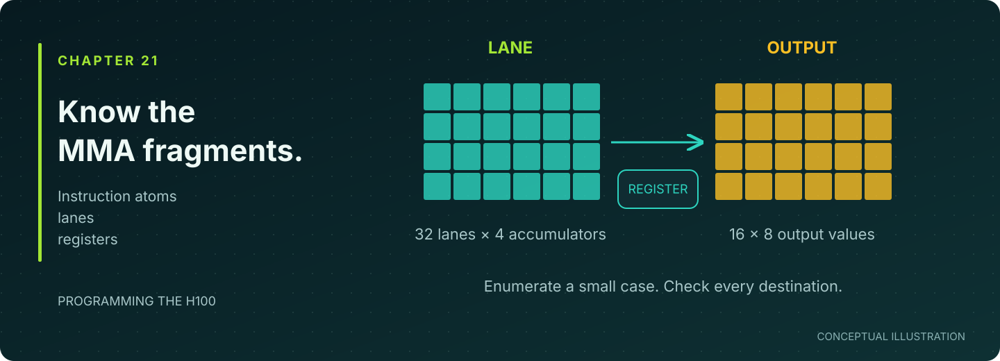
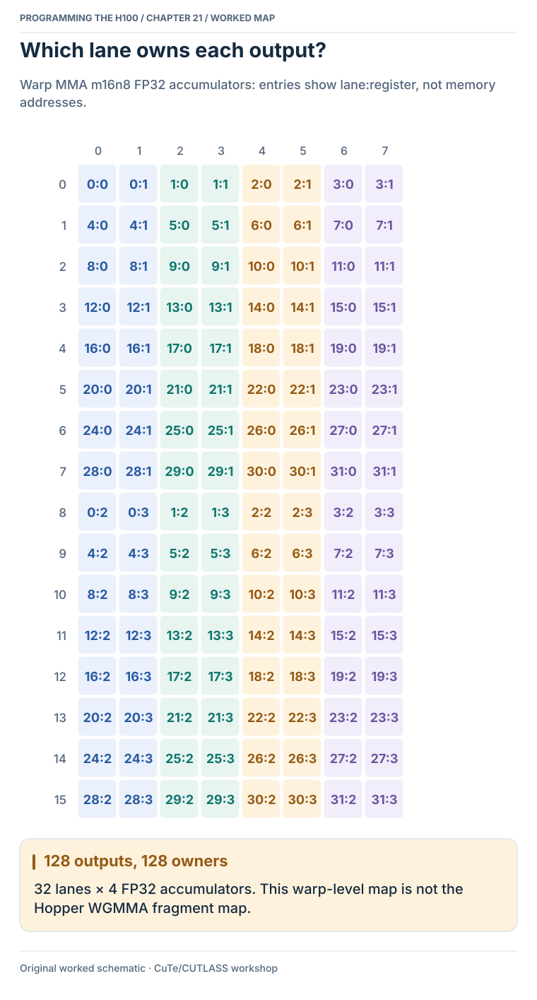
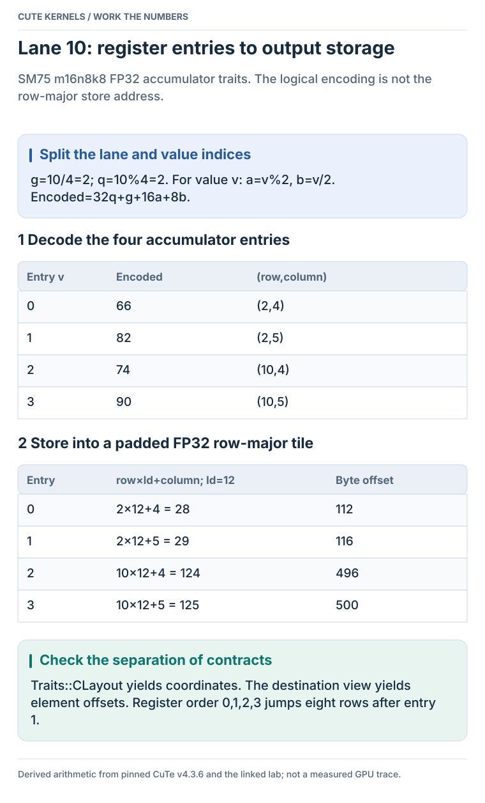

# 21. MMA Atoms — Prove Who Owns Every Result

## Chapter 21 Companion Guide — Decode the Instruction’s Real Fragment Contract

[](images/chapter-openers/21-workshop.svg)


!!! tip "Your goal in this chapter"

    Derive a real instruction's thread/value mapping, prove complete output coverage, and distinguish a warp MMA from Hopper WGMMA. Read [thread/value copy ownership](20-tiled-copy.md) first; revisit [WGMMA](06-wgmma-part-1.md) for the asynchronous instruction contract.

## 1 — An atom is more than a tile shape

[](images/ch21/overview.svg)

A statement such as “this instruction computes a 16 × 8 result” omits three essential questions: which threads participate, which values each thread supplies, and where each output register belongs. CuTe connects the instruction wrapper to those answers through `MMA_Traits`. An `MMA_Atom` combines the operation and its traits; a `TiledMMA` repeats and arranges atoms into a larger computation.

The pinned [MMA atom tutorial](https://github.com/NVIDIA/cutlass/blob/v4.3.6/media/docs/cpp/cute/0t_mma_atom.md) separates these layers. The operation's architecture prefix names its first supported architecture, not a declaration that every later instruction has the same layout. Register counts, precision and participation belong to the **exact operation**.

We will decode `SM75_16x8x8_F32F16F16F32_TN`. This is a synchronous, warp-level FP16 multiply with FP32 accumulation, useful for learning fragment ownership. It is not Hopper's asynchronous warpgroup MMA. Reading its traits on the CPU does not execute an MMA instruction or validate a GPU kernel.

## 2 — Count logical values and physical registers

The operation computes `D = A × B + C`, with A shaped 16 × 8, mathematical B shaped 8 × 8, and C/D shaped 16 × 8. Its [instruction wrapper](https://github.com/NVIDIA/cutlass/blob/v4.3.6/include/cute/arch/mma_sm75.hpp) declares:

| Operand | Logical values per participating lane | Physical register arguments per lane |
| --- | ---: | --- |
| A | 4 FP16 values | Two packed 32-bit registers |
| B | 2 FP16 values | One packed 32-bit register |
| C | 4 FP32 values | Four FP32 registers |
| D | 4 FP32 values | Four FP32 registers |

The accumulator accounting closes exactly: `32 lanes × 4 outputs = 128 = 16 × 8`. There is no need to invent duplicated outputs to explain a fictitious eight-value fragment. A four-value fragment is also not necessarily a contiguous 2 × 2 rectangle: its coordinates come from the traits, not from drawing a convenient box.

Do not add C and D's interface counts to predict final compiler register allocation. They name input/output operands of the operation; accumulator storage may be reused. Inspect the compiled kernel's resource report for its actual allocation.

## 3 — Read the actual CLayout

The pinned [SM75 traits](https://github.com/NVIDIA/cutlass/blob/v4.3.6/include/cute/atom/mma_traits_sm75.hpp) encode the C mapping with a nested thread mode `(4,8)` and value mode `(2,2)`. For lane `t` and value index `v`, define:

`g = t / 4`, `q = t % 4`, `a = v % 2`, `b = v / 2`.

The layout's encoded offset is `32q + g + 16a + 8b`. It indexes an M × N logical matrix using the atom's first-mode-fast convention. Decode it as:

`row = encoded % 16 = g + 8b`

`column = encoded / 16 = 2q + a`.

| Lane | v=0 | v=1 | v=2 | v=3 |
| ---: | --- | --- | --- | --- |
| 0 | (0,0) | (0,1) | (8,0) | (8,1) |
| 1 | (0,2) | (0,3) | (8,2) | (8,3) |
| 5 | (1,2) | (1,3) | (9,2) | (9,3) |
| 10 | (2,4) | (2,5) | (10,4) | (10,5) |
| 31 | (7,6) | (7,7) | (15,6) | (15,7) |

Thus lane 10 owns two column pairs separated by eight rows. Treating those four outputs as four consecutive rows produces an incorrect epilogue even if every arithmetic instruction itself is valid.

This short CPU-side inspection uses the real pinned type:

```cpp
using Operation = cute::SM75_16x8x8_F32F16F16F32_TN;
using Traits = cute::MMA_Traits<Operation>;
typename Traits::CLayout mapping;
int lane = 10;
for (int value = 0; value < 4; ++value) {
    int encoded = mapping(cute::make_coord(lane, value));
    int row = encoded % 16;
    int column = encoded / 16;
    // Compare these coordinates with an independently derived table.
}
```

### Calculate lane 10 before trusting the printed map

1. Split the lane into `g=10/4=2` and `q=10%4=2`.
2. For value index 0, `a=0,b=0`. The trait offset is `32×2+2=66`; decode `66%16=2` and `66/16=4`, yielding output `(2,4)`.
3. For value index 1, add `16a=16`, obtaining 82. It decodes to `(2,5)`.
4. For value index 2, add `8b=8` instead, obtaining 74. It decodes to `(10,4)`.
5. For value index 3, both additions apply: offset 90 decodes to `(10,5)`.

Plot the four results before imagining a rectangular per-thread fragment. The labels `r0` through `r3` are **lane 10's accumulator entries**, not stored data values or byte offsets:

```text
Logical C/D tile: 16 rows, 8 columns

                 columns n
                  0  1  2  3  4  5  6  7
row m=2          [ .  .  .  . r0 r1  .  . ]
                    ... intervening rows ...
row m=10         [ .  .  .  . r2 r3  .  . ]

Lane 10: g=2, q=2
  value 0 -> encoded 66 -> row 2,  column 4
  value 1 -> encoded 82 -> row 2,  column 5
  value 2 -> encoded 74 -> row 10, column 4
  value 3 -> encoded 90 -> row 10, column 5

encoded = row + 16*column   [atom's logical encoding]
row-major global offset = row*leading_dimension + column
                           [a separate storage mapping]
```

**Read the figure:** register-entry order jumps from row two to row ten; dots denote outputs belonging to other lanes, not zeros. Decode the trait's logical encoding first, then map `(row,column)` to the destination tensor. The [real `Traits::CLayout` inspection](#3-read-the-actual-clayout) is the API check behind this picture. Writing a contiguous 2×2 or 4×1 rectangle from these four entries would store the wrong coordinates.

**Expected coordinates:** `(2,4), (2,5), (10,4), (10,5)`. The integer quotients use the atom's first-mode-fast logical encoding; they are not byte addresses in a row-major output allocation. **Check:** compare each result with the independently derived table, then enumerate all lanes for complete coverage. **Pitfall:** treating offsets 66, 82, 74 and 90 as row-major global offsets would use the correct numbers in the wrong coordinate convention.

The type definitions require the matching atom-traits header; the complete program linked below supplies it.

### Finish the address chain: a trait offset is not a store offset

[](images/worked/kernel-mma-lane10.svg)

The trait names logical ownership; an output tensor separately names storage. To make the second step concrete, choose an illustrative row-major FP32 destination with sixteen rows, eight valid columns and leading dimension `ld=12` elements. Each row therefore has four padding elements. This destination is a manual storage example, not an additional GPU kernel in the host fragment oracle.

1. Start with lane 10, value entry `v=2`. The real `Traits::CLayout` gives encoded offset 74.
2. Decode using the trait's first-mode-fast convention: `row=74%16=10`, `column=74/16=4`.
3. Apply the destination formula, not the trait encoding: `row*ld+column=10*12+4=124` FP32 elements.
4. Convert to bytes once: `124*4=496` bytes from the destination view origin.
5. Repeat for entries zero, one and three: element offsets 28, 29 and 125; byte offsets 112, 116 and 500.

An illustrative tensor expression for that second map is:

```cpp
// Excerpt with a valid float* output allocation already supplied.
auto output_view = cute::make_tensor(
    cute::make_gmem_ptr(output),
    cute::make_layout(cute::make_shape(16, 8), cute::make_stride(12, 1)));
// Coordinate-to-storage example only, not a complete MMA epilogue:
// output_view(cute::make_coord(10, 4)) names output[124].
```

The complete host oracle deliberately stops at coordinates: it never executes MMA or writes a GPU output. The expression above shows how a separate destination layout would interpret those coordinates. A real tiled MMA epilogue must use the selected instruction's partition/retile interface and collective participation requirements rather than treating this scalar illustration as a replacement implementation.

**Pitfall:** an epilogue that stores at `output[74]` confuses encoded logical position with physical storage. An epilogue that writes four consecutive elements beginning at 28 also fails: the third entry belongs to row ten. Nonuniform numerical values are needed to reveal both mistakes; four identical register values can conceal a permutation.

??? question "Exercise: move the origin, preserve the mapping"

    The same destination tile begins at global row 32, column 16 in a row-major matrix with leading dimension 80. Where does lane 10 entry 2 store?

    **Answer:** Local `(10,4)` becomes global `(42,20)`. Element offset from the matrix origin is `42*80+20=3380`; byte offset is 13520. Equivalently, tile origin offset `32*80+16=2576` plus local `10*80+4=804` gives 3380. The local instruction coordinate did not change when the destination origin moved.

## 4 — Coverage is a proof obligation

Create a 16 × 8 array of zero counters. Enumerate every `(lane,value)` pair, reject out-of-range coordinates, and increment its destination counter. Every counter must finish at **one**. Zero means a missing element; two means overlapping ownership. Keeping only the first owner hides precisely the defect the test should detect.

Also compare the trait mapping with the independently derived formula. A bijection can still be the wrong permutation. Finally, remember what this proves: the documented atom layout was decoded consistently. It does not prove that a custom kernel loaded the right operands or stored the accumulator with the same mapping.

## 5 — A and B have separate contracts

For this exact FP16 operation, A's four logical values have the same coordinate formula as C, but its second coordinate is **K**, not N. For B, CuTe names the logical modes `(N,K)`, while mathematical matrix notation writes `B[k,n]`:

`A[g + 8b, 2q + a]`, for four values;

`B[2q + v, g]`, for two values, with B written here in mathematical `(K,N)` order.

For lane 7, `g=1` and `q=3`: A supplies `(1,6)`, `(1,7)`, `(9,6)`, `(9,7)`; B supplies `(6,1)` and `(7,1)`. Four packed A values do not imply four packed B values. Nor do these logical coordinates prescribe how an `ldmatrix` invocation obtains them: its address/packing contract is another layer that must agree.

## 6 — Grow an atom into a tiled computation

The pinned API permits constructing a default tiled atom:

```cpp
auto tiled_mma = cute::make_tiled_mma(
    cute::SM75_16x8x8_F32F16F16F32_TN{});
// In a matching device collective, with sA, sB and gC defined:
// auto thread_mma = tiled_mma.get_slice(threadIdx.x);
// auto thread_A = thread_mma.partition_A(sA);
// auto thread_B = thread_mma.partition_B(sB);
// auto thread_C = thread_mma.partition_C(gC);
// auto accumulator = thread_mma.make_fragment_C(thread_C);
```

This is an API reading sketch, not a complete kernel. The tensor shapes, memory spaces, participating thread count, data movement and completion protocol must be supplied. `partition_C` returns a view; `make_fragment_C` constructs accumulator storage; neither computes a product merely by existing. See [mma_atom.hpp](https://github.com/NVIDIA/cutlass/blob/v4.3.6/include/cute/atom/mma_atom.hpp) and the pinned [CuTe GEMM tutorial](https://github.com/NVIDIA/cutlass/blob/v4.3.6/examples/cute/tutorial/sgemm_2.cu).

### Tails do not permit partial instruction participation

The synchronous warp MMA is a collective instruction with an aligned participation contract. All required lanes must execute the same instruction form with the required convergence. A lane whose eventual output lies beyond M or N must not simply skip the MMA while the remaining lanes execute it. Instead, a supported tail path arranges legal input fragments—often by zero-filling invalid logical inputs—and predicates final output stores while preserving the instruction's collective participation. The chosen library kernel supplies its own supported tail machinery.

**Check:** separate three questions: whether each source access is legal, whether every required lane participates, and whether every valid result is stored to its intended coordinate. Passing one does not imply the other two. The host fragment oracle checks the coordinate map only; it does not exercise convergence or the device instruction's runtime behavior. Follow the pinned [PTX warp-MMA contract](https://docs.nvidia.com/cuda/archive/12.8.0/parallel-thread-execution/index.html#warp-level-matrix-instructions-mma).

Count K repetitions too. A 64 × 32 warp result has 16 spatial 16 × 8 atoms. Covering a K-depth of 64 with k8 needs eight reduction steps: **128 warp MMA instructions**, not sixteen. That accounts for `2 × 64 × 32 × 64 = 262,144` floating-point operations under the conventional FMA-equals-two convention. It predicts work, not instruction latency.

## 7 — Cross the boundary to Hopper carefully

Hopper WGMMA uses a 128-thread collective, different shapes, shared-memory descriptors and asynchronous completion. The warp formulas above cannot be copied into its epilogue. Use the selected `mma_traits_sm90_gmma` specialization, then trace TMA arrival, WGMMA register ordering, committed-group completion and source-buffer reuse separately. A thread/value layout is not a substitute for any of those waits.

The full [host fragment oracle](examples/advanced/cute_fragments.cu) checks A, B and C coordinates against the pinned traits and verifies bijective coverage. With the source pin and workspace prepared in [Chapter 15](15-cute-layouts.md#before-the-algebra-a-reproducible-workspace):

```bash
mkdir -p build/advanced
nvcc -std=c++17 -O2 --expt-relaxed-constexpr \
  -I "$CUTLASS_ROOT/include" \
  docs/examples/advanced/cute_fragments.cu -o build/advanced/cute_fragments
./build/advanced/cute_fragments
```

**Expected check:** `FRAGMENT PASS` with 128 C, 128 A and 64 B ownership pairs and zero errors. The actual compilation and host execution are captured in the dated block below, separately from the original book programs. This program launches no GPU kernel.

## 8 — Exercises with worked answers

??? question "Lane 18: locate its four results"

    Compute `g=18/4=4` and `q=18%4=2`. The outputs are `(4,4)`, `(4,5)`, `(12,4)` and `(12,5)`. A bounding rectangle would include unowned intervening rows, so store exactly the four mapped coordinates.

??? question "A correct count but the wrong mapping"

    An epilogue writes every output exactly once, but swaps the first and second column of every pair. Can an ownership test catch it?

    Bijection alone cannot: coverage still equals one everywhere. The independent coordinate comparison catches the permutation, and a full numerical test with nonuniform inputs checks that the actual computation and stores use the intended mapping. Uniform all-one inputs can hide it.

<!-- workshop:start:cute_fragments -->
## Complete source and captured execution

**Executed on November 18, 2026 (UTC).** Scope: **CPU execution of real CuTe coordinate/trait checks**.

Tested source SHA-256: `fae8d94ea8f09f4eaf81c4d72bd231b27a51779d64bec93ece4d57278876ecb0`. [Exact source](validation/2026-11-18-h100-workshop/cute_fragments.cu) · [System information](validation/2026-11-18-h100-workshop/system.json) · [Workshop results](cutlass-workshop-validation.md).

The listing below matches the tested source. Its presentation is formatted at build time; downloads retain the captured bytes.

```cuda
// Host-only ownership checks against CUTLASS v4.3.6 MMA traits.
// This program never calls an MMA instruction and launches no GPU kernel.
#include <cute/atom/mma_traits_sm75.hpp>
#include <array>
#include <cstdio>

int main() {
    using Operation = cute::SM75_16x8x8_F32F16F16F32_TN;
    using Traits = cute::MMA_Traits<Operation>;
    typename Traits::ALayout a_layout;
    typename Traits::BLayout b_layout;
    typename Traits::CLayout c_layout;
    std::array<int, 128> a_coverage{}, c_coverage{};
    std::array<int, 64> b_coverage{};
    int errors = 0;
    for (int lane = 0; lane < 32; ++lane) {
        const int group = lane / 4, within = lane % 4;
        for (int value = 0; value < 4; ++value) {
            const int row = group + 8 * (value / 2);
            const int column = 2 * within + value % 2;
            const int expected = row + 16 * column;
            const int a = a_layout(cute::make_coord(lane, value));
            const int c = c_layout(cute::make_coord(lane, value));
            errors += a != expected;
            errors += c != expected;
            if (a < 0 || a >= int(a_coverage.size())) ++errors;
            else ++a_coverage[a];
            if (c < 0 || c >= int(c_coverage.size())) ++errors;
            else ++c_coverage[c];
            if (lane == 10)
                std::printf("lane=10 value=%d C=(%d,%d) trait_offset=%d\n",
                            value, row, column, c);
        }
        for (int value = 0; value < 2; ++value) {
            // The B trait encodes (N,K), while mathematical B is B[k,n].
            const int n = group, k = 2 * within + value;
            const int expected = n + 8 * k;
            const int b = b_layout(cute::make_coord(lane, value));
            errors += b != expected;
            if (b < 0 || b >= int(b_coverage.size())) ++errors;
            else ++b_coverage[b];
        }
    }
    for (int count : a_coverage) errors += count != 1;
    for (int count : b_coverage) errors += count != 1;
    for (int count : c_coverage) errors += count != 1;
    std::printf("%s: C_pairs=128 A_pairs=128 B_pairs=64 errors=%d\n",
                errors ? "FRAGMENT FAIL" : "FRAGMENT PASS", errors);
    return errors ? 1 : 0;
}
```

CUDA compilation UTC: `2026-11-18T14:09:36.975235+00:00`. Exit: `0`. [Compile log](validation/2026-11-18-h100-workshop/cute_fragments-compile.log).

Commands use scratch-directory filenames; raw logs retain exact paths. The collector’s CUTLASS include flags are configuration for that capture; the minimal standalone overlap/SIMT commands do not require those headers.

```bash
nvcc -std=c++17 -O2 -lineinfo -arch=sm_90a --expt-relaxed-constexpr -I "$CUTLASS_ROOT/include" -I "$CUTLASS_ROOT/tools/util/include" cute_fragments.cu -o ./example
```

Executed UTC: `2026-11-18T14:09:43.466571+00:00`. Exit: `0`. [Run log](validation/2026-11-18-h100-workshop/cute_fragments-run.log).

```bash
./example
```

**Actual captured output**

```text
lane=10 value=0 C=(2,4) trait_offset=66
lane=10 value=1 C=(2,5) trait_offset=82
lane=10 value=2 C=(10,4) trait_offset=74
lane=10 value=3 C=(10,5) trait_offset=90
FRAGMENT PASS: C_pairs=128 A_pairs=128 B_pairs=64 errors=0
```

<!-- workshop:end:cute_fragments -->

<!-- companion-summary:start -->
## Summary

- An MMA atom specifies participating threads, operand packing and result coordinates, not merely an M×N tile size.

- The pinned warp-level atom assigns four FP32 outputs per lane; independent coordinate checks and bijective coverage catch different mapping errors.

- Count both spatial atoms and K repetitions, and keep warp MMA distinct from asynchronous Hopper WGMMA. Next, align producers and consumers through [shared-memory layouts](22-shared-layouts.md).
<!-- companion-summary:end -->
