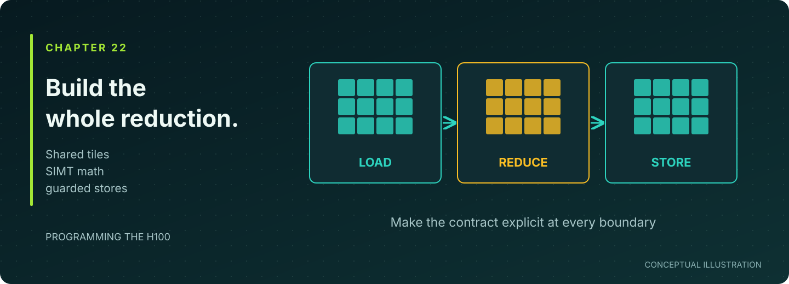
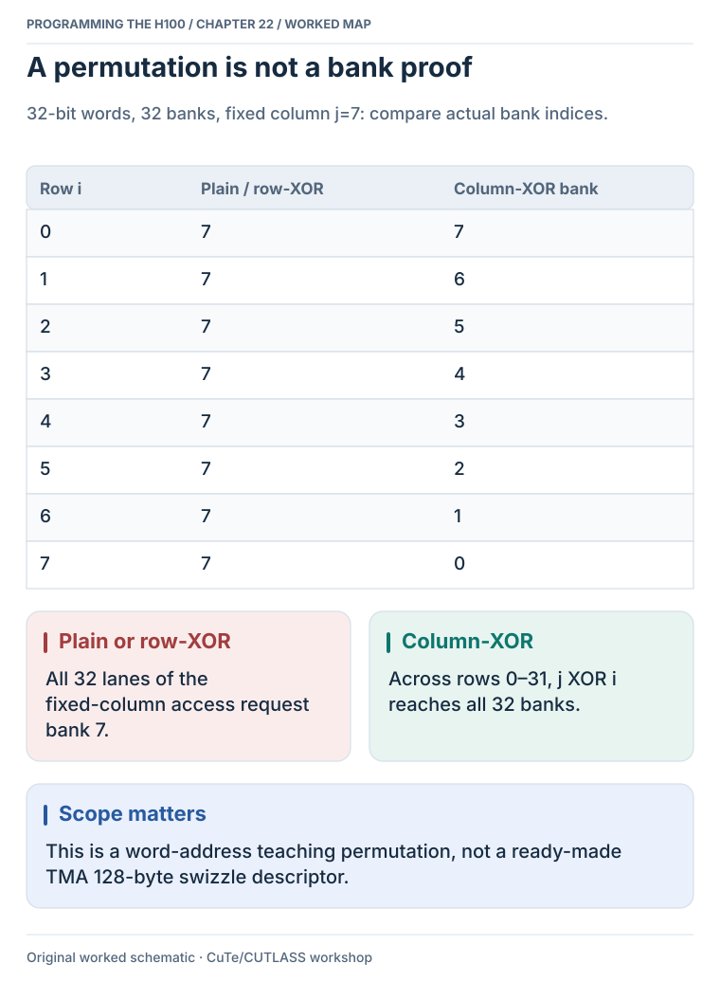

# 22. Shared Layouts — Banks, Swizzles and Descriptor Agreement
## Lesson 22 Companion Guide — Keep Banks, Swizzles and Descriptors in Agreement

[](images/chapter-openers/22-workshop.svg)


!!! tip "Your goal in this chapter"

    Compute bank indices for a specific warp access, prove a swizzle's mapping, and preserve agreement between generic stores, TMA and WGMMA. Read [MMA atoms](21-mma-atoms.md), [TMA descriptors](04-cutensormap-tma-swizzling.md) and the [proxy-ordering rules](03-asynchronicity-mbarrier.md).

## 1 — Three layouts must describe the same tile

[](images/ch22/overview.svg)

A shared tile has a producer, a physical allocation and a consumer. The producer might use ordinary stores, an asynchronous copy atom or TMA. The consumer might use scalar loads, `ldmatrix`, or WGMMA descriptors. All must agree on which physical location represents a logical coordinate.

A successful tensor-copy operation does not establish that an unrelated WGMMA descriptor interprets its output correctly. Conversely, a beautifully bank-distributed layout can still violate an instruction's supported layout or alignment. Establish correctness first, then measure whether changing the physical arrangement improves the actual access pattern.

The pinned [GMMA layout definitions](https://github.com/NVIDIA/cutlass/blob/v4.3.6/include/cute/atom/mma_traits_sm90_gmma.hpp) and [CuTe swizzle implementation](https://github.com/NVIDIA/cutlass/blob/v4.3.6/include/cute/swizzle.hpp) are the source contracts for this chapter. The simple bank examples below are scalar models, not predictions of every matrix instruction's transaction decomposition.

## 2 — Start with an explicit bank model

For aligned, scalar 32-bit shared-memory accesses, use 32 banks of four bytes each:

`word_offset = byte_offset / 4`, `bank = word_offset % 32`.

For a compact row-major 32 × 32 FP32 tile, `word_offset(i,j)=32i+j`. Suppose one warp accesses one element per lane:

| Pattern, lane t | Word offset | Bank | Result in this model |
| --- | --- | --- | --- |
| Row 0: `(0,t)` | t | t | Distinct banks |
| Column 0: `(t,0)` | 32t | 0 | Different words in one bank |
| Broadcast: every lane `(0,0)` | 0 | 0 | Same word; broadcast, not 32 distinct conflicting words |

Different addresses in one bank differ from the same address requested by several readers. Likewise, a vector instruction can split into several transactions; apply the bank analysis to the relevant transactions rather than counting all its bytes as one request. FP16 coordinates require conversion to byte/word addresses because two adjacent halves share a four-byte word. Do not blindly use `element_offset % 32` for every datatype.

A fixed-column access gives a concrete conflict picture. Every numeric address here is a **32-bit word offset**; multiply by four for bytes. The example is not an FP16 bank formula:

```text
One warp, one scalar FP32 read per lane, column j=0

lane  plain word  plain bank  | padded word  padded bank
  0       0           0       |      0            0
  1      32           0       |     33            1
  2      64           0       |     66            2
  3      96           0       |     99            3
  4     128           0       |    132            4
  5     160           0       |    165            5
  6     192           0       |    198            6
  7     224           0       |    231            7
 ...    ...          ...      |     ...          ...
 31     992           0       |   1023           31

plain:  distinct words --all--> bank 0      [conflict]
padded: distinct words -----> banks 0..31   [distributed]
broadcast: every lane reads word 0          [same-word case]
```

**Read the figure:** form each lane's word offset, take modulo 32, then compare bank identities while keeping distinct-word and same-word requests separate. A minimal address-map API for the two layouts is:

```cpp
auto plain = cute::make_layout(
    cute::make_shape(cute::Int<32>{}, cute::Int<32>{}),
    cute::make_stride(cute::Int<32>{}, cute::Int<1>{}));
auto padded = cute::make_layout(
    cute::make_shape(cute::Int<32>{}, cute::Int<32>{}),
    cute::make_stride(cute::Int<33>{}, cute::Int<1>{}));
auto lane7_plain = plain(cute::make_coord(7, 0));   // 224 words
auto lane7_padded = padded(cute::make_coord(7, 0)); // 231 words
```

These layouts calculate addresses only; no shared load occurs when they are constructed. The [pinned CuTe layout contract](https://github.com/NVIDIA/cutlass/blob/v4.3.6/media/docs/cpp/cute/01_layout.md) supplies the shape/stride mapping, while the GPU instruction and bank model determine the memory behavior.

The [CUDA shared-memory guidance](https://docs.nvidia.com/cuda/archive/12.8.0/cuda-c-programming-guide/index.html#shared-memory) describes bank conflicts and broadcasts. The model identifies a possible conflict; profiler evidence determines its performance impact.

## 3 — Padding: a simple improvement with a cost

Keep logical shape `(32,32)` but use FP32 strides `(33,1)`. Column 0's lane-t word offset becomes `33t`; its bank is t. Padding breaks the all-in-one-bank pattern.

Storage sizing changes: the largest referenced offset is `31×33+31=1054`, so this positive-stride layout's minimum span is 1,055 floats. Reserving 32 full padded rows uses 1,056 floats. Both exceed the 1,024 useful values; document which allocation convention you use.

Padding is not a universal replacement for a descriptor-compatible operand layout. It can increase shared-memory consumption and reduce residency. A scalar transpose tile may benefit while a WGMMA operand requires a different supported physical arrangement.

## 4 — XOR swizzling by hand

Consider this **word-offset** mapping for a 32 × 32 FP32 tile:

`swizzled(i,j) = 32i + (j XOR i)`.

For each fixed row, XOR permutes its 32 column positions. Each element still has a unique location, and XORing by i again restores j. The storage span remains 1,024 words.

| Logical coordinate | Linear offset `32i+j` | Swizzled offset | Swizzled bank |
| --- | ---: | ---: | ---: |
| (0,0) | 0 | 0 | 0 |
| (1,0) | 32 | 33 | 1 |
| (2,0) | 64 | 66 | 2 |
| (3,0) | 96 | 99 | 3 |
| (3,5) | 101 | 102 | 6 |

Now a fixed-column warp accesses banks `j XOR t`, all distinct. A fixed-row warp also visits distinct banks. This is a teaching mapping for those accesses; it is not a promise that an arbitrary tensor-core instruction accepts it.

CuTe can express the XOR composition directly:

```cpp
auto linear = cute::make_layout(
    cute::make_shape(cute::Int<32>{}, cute::Int<32>{}),
    cute::make_stride(cute::Int<32>{}, cute::Int<1>{}));
auto swizzled = cute::composition(cute::Swizzle<5, 0, 5>{}, linear);
// Word offsets: swizzled(3,5) == 102; linear(3,5) == 101.
```

`Swizzle<5,0,5>` XORs the five source bits at positions 5–9 into positions 0–4. Its parameters refer to the index presented to the swizzle. Here that index counts FP32 words. Reinterpreting the same parameters as byte offsets changes the physical mapping.

## 5 — A bijection can leave conflicts unchanged

Test a tempting alternative:

`bad_for_this_access(i,j) = 32 × (i XOR (j >> 2)) + j`.

It is a valid permutation over the same 1,024 coordinates, but `offset % 32` is still j. Every lane reading a fixed column still targets the same bank. The swizzle changes rows while leaving the low column bits untouched.

CuTe can represent this mapping too: compose the linear layout above with `Swizzle<3,2,-3>`. The negative shift moves column bits 2–4 left into row bits 5–7. For `(3,20)`, the linear offset is 116 and the transformed offset is 212. Neither representability nor uniqueness proves a bank benefit.

### Make the counterexample an actual CuTe call

Using the `linear` layout from §4:

```cpp
auto bank_unchanged = cute::composition(cute::Swizzle<3, 2, -3>{}, linear);
auto offset = bank_unchanged(cute::make_coord(3, 20)); // 212
```

1. The unswizzled word offset is `3×32+20=116`.
2. Column 20 has `20>>2=5` in the selected three-bit field.
3. XOR that field into the row bits: `3 XOR 5=6`.
4. The resulting word offset is `6×32+20=212`.
5. Both 116 and 212 select bank 20 modulo 32. The addresses changed, but the relevant bank bits did not.

**Expected result:** the mapping remains a permutation, yet a fixed-column warp still sends distinct addresses to one bank. **Check:** enumerate all 32 lane addresses for the actual fixed column; uniqueness of addresses and uniqueness of banks are separate tests. **Pitfall:** labeling every XOR composition “bank-conflict free” without examining which bits changed.

This distinction is a useful review habit: ask **which address bits select the resource you are trying to distribute?** Then enumerate those bits for the actual participating lanes.

## 6 — Use the supported Hopper layout atoms

A production WGMMA operand should begin with the pinned type-aware GMMA layout atoms, rather than an invented XOR formula:

```cpp
using Element = cutlass::half_t;
using Atom = cute::SM90::GMMA::Layout_K_SW128_Atom<Element>;
auto shared_layout = cute::tile_to_shape(
    Atom{}, cute::Shape<cute::_128, cute::_64>{});
```

This is a layout-construction sketch from the pinned definitions, not a complete kernel. It selects a K-major 128-byte-swizzle atom and tiles it to a particular logical operand shape. The other operand and any MN-major choice require their own supported layouts. The header also defines 32-byte, 64-byte and interleaved alternatives. The aliases carry datatype-aware upcasting and shared-pointer semantics; copying internal bit-level parameters into a manually indexed element array is not an equivalent construction.

A swizzle mode and a full matrix descriptor are different things. The descriptor also contains the matrix start and leading/stride offsets. Follow the selected core-matrix layout when deriving those offsets, not the original global matrix's row stride. Match the TMA tensor-map swizzle and the consuming WGMMA interpretation. [Chapter 6](06-wgmma-part-1.md#13-descriptor-fields-lbo-sbo-base-offset-swizzle) gives the field contract.

## 7 — Alignment, stages and lifetime

For the documented WGMMA swizzle patterns, zero-base-offset repeating boundaries are 1,024 bytes for 128-byte swizzling, 512 for 64-byte and 256 for 32-byte. These are pattern boundaries, not interchangeable with a 16-byte descriptor-field granularity. Instruction-specific destination alignment still applies. A pointer can satisfy one alignment requirement and fail another.

For a staged allocation, compute each stage's span, rounding and starting address explicitly. A stage stride that packs useful elements tightly may put the next stage at the wrong pattern offset. A larger allocation fixes neither its mapping nor its producer/consumer interpretation. Use the builder's selected storage organization unless you have independently derived a replacement.

Layout agreement also does not order memory accesses:

| Handoff | Additional obligation |
| --- | --- |
| Generic shared stores → async reader | Applicable proxy publication and participating-thread synchronization |
| TMA load → consumer | Matching transaction count, barrier generation and completion wait |
| WGMMA source → overwritten next tile | Complete the asynchronous readers before releasing the stage |
| Accumulator → epilogue | Wait for the relevant arithmetic groups before ordinary register reads |

The [Hopper PTX contracts](https://docs.nvidia.com/cuda/archive/12.8.0/parallel-thread-execution/index.html#asynchronous-warpgroup-level-matrix-shared-memory-layout) and [pipeline chapter](25-cutlass-pipelines.md) connect these requirements. A bank-conflict fix must preserve every one of them.

## 8 — Exercises and a review checklist

??? question "Is the padded tile only 1,024 floats?"

    Shape `(32,32)` with strides `(33,1)` has 1,024 coordinates, but references offset 1,054. Its minimum span is 1,055 floats. Allocate by the actual layout/storage contract, not the useful element count alone.

??? question "The XOR mapping has no duplicate addresses. Is it faster?"

    Not necessarily. The row-XOR counterexample in §5 is bijective but leaves fixed-column banks unchanged. Even the bank-distributing mapping needs a benchmark because instruction transactions, occupancy, extra address arithmetic and other bottlenecks can dominate.

Before a GPU run, enumerate bounds, uniqueness, bank indices and stage starts. During the run, compare the full nonuniform result and use memory-safety checks. During tuning, record actual shared storage, instruction selection, relevant bank metrics and the application timing distribution. These arithmetic examples are worked models; they are not captured Hopper performance measurements.

<!-- companion-summary:start -->
## Summary

- Derive bank indices from byte addresses and access width. Distinct words in one bank differ from a shared-word broadcast.

- Padding and XOR permutations can improve particular accesses, but a bijection alone proves neither a bank benefit nor instruction compatibility.

- Producer layout, allocation, TMA/WGMMA interpretation, alignment and stage lifetime must agree. Use those obligations in the [complete tiled GEMM](23-gemm-construction.md).
<!-- companion-summary:end -->
