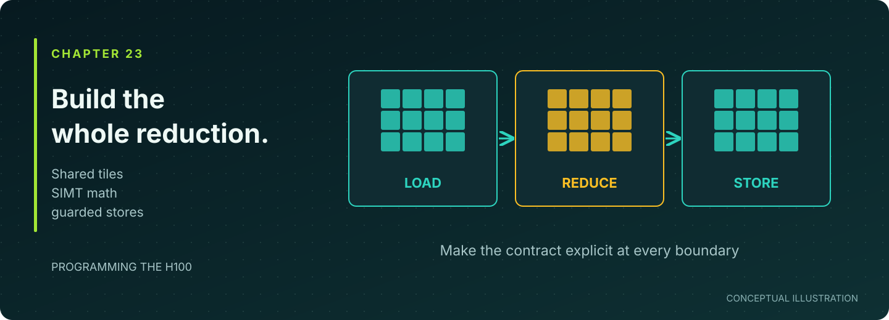
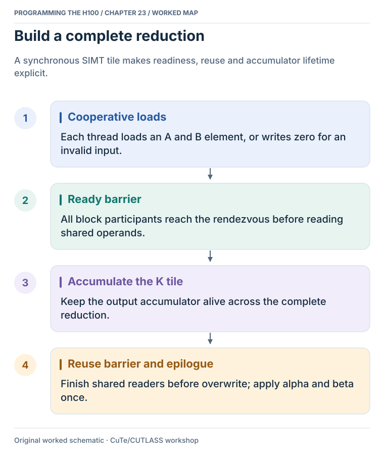

# 23. Build and Validate a Complete Tiled GEMM
## Lesson 23 Companion Guide — Build a Complete Reference-Checked SIMT Baseline

[](images/chapter-openers/23-workshop.svg)


!!! tip "Your goal in this chapter"

    Follow every address and barrier in a complete, bounded GEMM before replacing its scalar arithmetic with a Tensor Core collective. Read [CTA indexing](19-cta-indexing.md), [copy ownership](20-tiled-copy.md) and [shared layouts](22-shared-layouts.md) first.

## 1 — Choose a contract small enough to prove

[](images/ch23/overview.svg)

The lab computes batched `D = 0.5 * A * B + 0.25 * C` using row-major FP32 operands. Each batch has M×K, K×N and M×N mathematical shapes. Physical rows are padded: `lda=K+3`, `ldb=N+5`, `ldc=N+7`. The padding makes a mistaken assumption of compact storage visible.

This is a **SIMT shared-memory baseline**, not a Tensor Core kernel and not a complete CuTe GEMM. It deliberately makes the scalar address arithmetic explicit. The preceding CuTe chapters teach how to represent the same mappings; the next chapter shows how CUTLASS packages a Tensor Core implementation. A reference implementation can be valuable without being fast.

The full [tiled_gemm.cu](examples/advanced/tiled_gemm.cu) includes allocation, initialization, launch checks, an independent CPU oracle, input-preservation checks, padding and guards. Its mathematical reference does not call the GPU implementation’s indexing helpers.

## 2 — Hand-compute the operation first

Consider

```text
A = [ 1 -2  3 ]    B = [ 2  1 ]    C = [ 2 -4 ]
    [ 4  0 -1 ]        [ 3 -2 ]        [ 6  8 ]
                        [ 1  4 ]
```

The product is `AB=[[-1,17],[7,0]]`. Applying the scalars gives `D=[[0,7.5],[5,2]]`. For example, the top-right element is `0.5*(1*1 + (-2)*(-2) + 3*4) + 0.25*(-4) = 7.5`.

This tiny case establishes three conventions before any tiling: B is indexed by reduction coordinate k and output column n; C participates in the epilogue; and beta is applied once after the full reduction. Applying beta to each K tile would add C repeatedly.

## 3 — One block owns a 16×16 output tile

Use 256 threads in a 16×16 block. Thread `(tx,ty)` owns the output coordinate

`m = blockIdx.y*16 + ty`, `n = blockIdx.x*16 + tx`.

For batched input, `blockIdx.z` selects the batch. The grid is `(ceil(N/16), ceil(M/16), L)`. Each thread keeps one FP32 accumulator for the entire K loop. Two shared arrays hold a 16×16 A tile and a 16×16 B tile, for `2*16*16*4 = 2048` bytes of explicit operand storage per block.

This is not a prediction of total register count or occupancy. Address variables, loop state, compiler transformations and launch constraints add resources. Inspect the compiler report and the measured kernel after correctness is established.

## 4 — Cooperative loads use independent predicates

At K origin `k0`, thread `(tx,ty)` loads:

- A coordinate `(m,k0+tx)` into shared A position `(ty,tx)`.
- B coordinate `(k0+ty,n)` into shared B position `(ty,tx)`.

A is valid when `m<M && k0+tx<K`; B is valid when `k0+ty<K && n<N`. These are different predicates. False inputs contribute zero to the reduction, so the thread writes zero into its shared slot instead of leaving data from a previous iteration.

The physical offsets include the selected batch and padded leading dimensions. Use a sufficiently wide type for the products: widening only after `m*lda` has overflowed does not repair the arithmetic. [Chapter 19](19-cta-indexing.md) derives the byte-address chain in detail.

## 5 — Two barriers protect different hazards

After cooperative loads, every block thread reaches a barrier before any thread consumes the shared arrays. That protects read-after-write readiness. The inner loop then accumulates 16 products. A second barrier prevents the next K iteration from overwriting a shared tile that another thread is still reading.

```text
For each K tile:
  all threads load their A/B elements, or write zero for a false predicate
  all threads rendezvous              // shared operands ready
  each thread accumulates 16 products
  all threads rendezvous              // shared operands reusable
```

The second barrier is not redundant just because the first exists. On an output tail, a thread with `m>=M` or `n>=N` still participates in this protocol. It may skip the final output store, but returning before a block-wide barrier would break collective participation.

These are synchronous CUDA shared-memory loads. They do not require inventing a TMA transaction-count barrier. Conversely, replacing the loads with TMA while retaining only these barriers would not implement the required asynchronous completion contract. Mechanism-specific ordering matters.

## 6 — Keep the accumulator alive across the whole reduction

Suppose K=41. Three 16-wide K iterations are needed. The last has nine useful reduction positions and seven zero-filled positions. The accumulator is initialized once before all three iterations, updated by each tile, and consumed once afterward.

An accumulator reset inside the K-tile loop retains only the final tile. A kernel may pass an input where the first two tiles contain zeros, so include nonzero contributions across the whole reduction. Nonuniform binary-rational input values in the lab exercise that condition without requiring an arbitrary tolerance.

For K=0, the loop executes zero times and the epilogue becomes `D=0.25*C`. This case checks that the launch and epilogue do not assume a first operand tile always exists. It does not imply that every Tensor Core library configuration accepts a zero reduction dimension; support is part of each API’s contract.

### Work one ragged output through all three reduction tiles

Take the actual ragged case `M=37,N=29,K=41,L=2`. Let batch `l=1`, block `(blockIdx.x,blockIdx.y)=(1,2)` and thread `(tx,ty)=(12,4)`. These are logical coordinates, not byte addresses. All offsets below are relative to the operand pointers passed to the kernel, after the 16-element leading guards.

1. **Find the output.** `m=2*16+4=36`, `n=1*16+12=28`. Both are valid: this thread owns the last logical output of the second batch.
2. **Find the padded rows.** The source uses `lda=44`, `ldb=34`, `ldc=36`. Thus A's batch stride is `37*44=1628` elements; B's is `41*34=1394`; C/D's is `37*36=1332`. Output `(1,36,28)` is at element offset `1332+36*36+28=2656`, or byte offset `10624` for FP32.
3. **Distinguish loading from consuming.** At `k0=32`, this thread's A load names `(m,k)=(36,44)` and is invalid, so it writes zero to `As[4][12]`. Its B load names `(k,n)=(36,28)` and is valid: offset `1394+36*34+28=2646`. Its own A load being invalid does **not** make its output invalid.
4. **Consume the shared tile collectively.** To compute its output, it reads `As[4][q]` and `Bs[q][12]` for `q=0..15`. The nine positions `q=0..8` represent valid `k=32..40`; `q=9..15` are zero-filled. Other threads supplied many of those inputs. The previous tiles supplied `k=0..31`.
5. **Apply the epilogue once.** After all three tiles, write `D[2656]=0.5*acc+0.25*C[2656]`. A thread at `(tx,ty)=(13,4)` owns `n=29`, so it skips this store but still joins both barriers in every tile.

**Check:** the block contains 256 threads but only `5*13=65` valid output owners, because rows 32–36 and columns 17–29 remain. Every valid owner must see all 41 reduction terms. Using the actual initialization formulas gives `acc=1.125`, `C=0.5` and `D=0.6875` at this coordinate. This hand calculation complements the independently captured executable, which checks every output.

### See the ragged reduction and the final store together

Read left to right in each row, then top to bottom. `k0` is the first reduction coordinate of a shared tile; `q` is its local coordinate, so `k=k0+q`. The displayed partial sums use the **actual source initialization** for output `(batch,m,n)=(1,36,28)`, not arbitrary schematic data.

```text
Output owner: block(x=1,y=2), thread(tx=12,ty=4)
              m=2*16+4=36     n=1*16+12=28

k0     shared q values      global k values     dot contribution
 0     0 .......... 15       0 ........ 15          0.625
16     0 .......... 15      16 ........ 31          0.21875
32     0 .... 8 | 9..15     32 ... 40 | absent       0.28125
                     zero-fill absent inputs          |
                                                     v
acc starts 0 ---> 0.625 ---> 0.84375 ---> 1.125
                                           |
                  alpha=0.5 -------------->* = 0.5625
                  C[2656]=0.5, beta=0.25 --->+  0.125
                                           |
                                           v
                                 D[2656] = 0.6875
```

Offsets 2656 are **FP32 element offsets relative to the guarded kernel view**, not offsets from the raw allocation base. In source, this chapter's `k0` is named `base`, and `q` is named `inner`. The variable `sum` persists across the outer `base` loop, while the inner loop consumes `a_tile[ty][inner] * b_tile[inner][tx]`. The two barriers bracket each shared tile's ready/read/reuse lifetime.

This owner's cooperative A load at `k0=32` uses `k=44` and is zero-filled, yet its output still receives nine real final-tile products loaded by the whole block. The diagram distinguishes **one thread's load ownership** from **the operands it consumes for its output**. Resetting `sum` at each arrow would leave only 0.28125 and produce the wrong final value 0.265625.

## 7 — Store only valid output coordinates

After the reduction, a valid owner reads C and writes D at the padded output offset. Invalid output threads do not access C or D. D’s valid region starts as a NaN sentinel so omitted stores cannot masquerade as correctly computed zeros. Padding and outer guards have separate sentinels and must remain unchanged.

The GPU and CPU implementations use the same mathematical shapes and scalars but different control structure. The CPU loops over each batch/output coordinate and performs a direct full-K reduction in double. Test values are small binary fractions, with short reductions and scalars chosen so the expected result is exactly representable in FP32. Exact equality is justified for these bounded cases; it is not a universal rule for floating-point GEMM.

## 8 — Test a matrix, not just one square

| Case | What it exercises |
| --- | --- |
| M=N=K=16, L=1 | A complete output tile and one K tile |
| M=37, N=29, K=41, L=2 | Partial M/N/K tiles, batch offsets and padded strides |
| M=7, N=9, K=0, L=1 | Empty reduction and nonzero-beta epilogue |

Require all case results, complete output equality, intact padding/guards and successful CUDA completion. Sanitizer memcheck supplements these checks. A successful run does not prove performance, races in a different asynchronous implementation or every possible matrix extent.

The [workshop collector](examples/advanced/README.md) retains exact source, toolchain and output records. Use those records to distinguish this SIMT baseline from the CUTLASS kernel in [Chapter 24](24-cutlass-gemm.md). Comparing both on identical supported cases is a correctness cross-check; benchmarking them requires a separate, consistently timed workload.

### Why the exact-equality test is bounded

The generated A values are integer multiples of `1/8`, B values of `1/4`, and C values of `1/2`. Each product is therefore a multiple of `1/32`; for the largest tested K=41, the sum magnitude is bounded by `41*(4/8)*(3/4)=15.375`. Multiplication by alpha `1/2` and beta `1/4` retains a small binary-rational result. The integer significands remain far below FP32's 24-bit precision, so both the sequential GPU reduction and double CPU oracle represent these particular results exactly.

This argument depends on the bounded initialization, reduction length and scalars. Keeping `D==expected` after replacing them with arbitrary decimal or large-magnitude values would impose a different numerical contract. Choose and justify a tolerance for that new experiment, while preserving finite-value, padding and guard checks.

## 9 — Turn the baseline into a source-reading guide

When reading the official [CuTe GEMM tutorial](https://github.com/NVIDIA/cutlass/blob/v4.3.6/media/docs/cpp/cute/0x_gemm_tutorial.md), locate the equivalents of these explicit components: problem/tile shapes, operand views, cooperative partitions, register accumulators, the reduction loop, readiness/reuse synchronization and epilogue. The implementation can replace arithmetic with layout objects and MMA atoms while retaining the same obligations.

Do not transplant one scalar loop into a Tensor Core fragment and assume its elements are row-major. [Chapter 21](21-mma-atoms.md) explains that ownership. Likewise, replacing the scalar loads with an asynchronous atom adds a pipeline state machine rather than removing the need to reason about lifetime.

??? question "Can output-tail threads return before the K loop?"

    Thread `(15,15)` has an invalid output on a small edge tile. Can it immediately return?

    **Answer:** Not in this cooperative-load design. It owns shared input positions and participates in block-wide barriers. Predicate its memory accesses and final store while preserving collective participation.

??? question "Where does beta belong?"

    There are three K tiles. Should the epilogue add `beta*C` after each tile?

    **Answer:** No. The defined operation adds it once after the complete reduction. Repeating it changes the mathematical result.

<!-- workshop:start:tiled_gemm -->
## Complete source and captured execution

**Executed on November 18, 2026 (UTC).** Scope: **CUDA workload with its stated numerical checks**.

Tested source SHA-256: `2e538ea2ead02582618632d764eb54d3420d87ebda007616ff54f5b499eb3c61`. [Exact source](validation/2026-11-18-h100-workshop/tiled_gemm.cu) · [System information](validation/2026-11-18-h100-workshop/system.json) · [Workshop results](cutlass-workshop-validation.md).

The listing below matches the tested source. Its presentation is formatted at build time; downloads retain the captured bytes.

```cuda
// A deliberately simple SIMT shared-memory GEMM, not Tensor Core or CuTe code.
// D = alpha*A*B + beta*C, row-major padded storage, independent batches.
// Small binary-rational inputs make these bounded reference cases exact in FP32.
#include <cuda_runtime.h>
#include <cmath>
#include <cstdio>
#include <limits>
#include <stdexcept>
#include <vector>

static void cuda_check(cudaError_t result, char const* call) {
    if (result != cudaSuccess) {
        std::fprintf(stderr, "%s: %s\n", call, cudaGetErrorString(result));
        throw std::runtime_error("CUDA operation failed");
    }
}
#define CUDA_CHECK(call) cuda_check((call), #call)

constexpr int tile = 16;
__global__ void tiled_gemm(float const* a, float const* b, float const* c, float* d,
                           int m, int n, int k, int lda, int ldb, int ldc,
                           int stride_a, int stride_b, int stride_c,
                           float alpha, float beta) {
    __shared__ float a_tile[tile][tile];
    __shared__ float b_tile[tile][tile];
    int tx = threadIdx.x, ty = threadIdx.y;
    int row = blockIdx.y * tile + ty;
    int column = blockIdx.x * tile + tx;
    int batch = blockIdx.z;
    float sum = 0.0f;
    for (int base = 0; base < k; base += tile) {
        int a_k = base + tx, b_k = base + ty;
        a_tile[ty][tx] = row < m && a_k < k ?
            a[batch * stride_a + row * lda + a_k] : 0.0f;
        b_tile[ty][tx] = b_k < k && column < n ?
            b[batch * stride_b + b_k * ldb + column] : 0.0f;
        __syncthreads();  // All writers complete before any tile is consumed.
        for (int inner = 0; inner < tile; ++inner)
            sum += a_tile[ty][inner] * b_tile[inner][tx];
        __syncthreads();  // All readers complete before the next tile overwrites.
    }
    if (row < m && column < n) {
        int offset = batch * stride_c + row * ldc + column;
        d[offset] = alpha * sum + beta * c[offset];
    }
}

static int run_case(int m, int n, int k, int batches) {
    constexpr int guard = 16;
    constexpr float canary = -98765.0f;
    constexpr float alpha = 0.5f, beta = 0.25f;
    int lda = k + 3, ldb = n + 5, ldc = n + 7;
    int stride_a = m * lda, stride_b = k * ldb, stride_c = m * ldc;
    std::vector<float> a(guard + batches * stride_a + guard, canary);
    std::vector<float> b(guard + batches * stride_b + guard, canary);
    std::vector<float> c(guard + batches * stride_c + guard, canary);
    std::vector<float> d(c.size(), canary), expected(c.size(), canary);
    for (int batch = 0; batch < batches; ++batch) {
        for (int row = 0; row < m; ++row)
            for (int inner = 0; inner < k; ++inner)
                a[guard + batch * stride_a + row * lda + inner] =
                    float((row * 3 + inner * 5 + batch * 7) % 9 - 4) * 0.125f;
        for (int inner = 0; inner < k; ++inner)
            for (int column = 0; column < n; ++column)
                b[guard + batch * stride_b + inner * ldb + column] =
                    float((inner * 2 + column * 3 + batch * 5) % 7 - 3) * 0.25f;
        for (int row = 0; row < m; ++row)
            for (int column = 0; column < n; ++column) {
                int offset = guard + batch * stride_c + row * ldc + column;
                c[offset] = float((row + column * 2 + batch) % 5 - 2) * 0.5f;
                d[offset] = std::numeric_limits<float>::quiet_NaN();
            }
    }
    // Independent scalar CPU calculation: no shared tiling or GPU fragment map.
    // Products are multiples of 1/32 and bounded short sums remain FP32-exact.
    for (int batch = 0; batch < batches; ++batch)
        for (int row = 0; row < m; ++row)
            for (int column = 0; column < n; ++column) {
                double sum = 0.0;
                for (int inner = 0; inner < k; ++inner)
                    sum += double(a[guard + batch * stride_a + row * lda + inner]) *
                           double(b[guard + batch * stride_b + inner * ldb + column]);
                int offset = guard + batch * stride_c + row * ldc + column;
                expected[offset] = float(double(alpha) * sum + double(beta) * c[offset]);
            }
    float *da = nullptr, *db = nullptr, *dc = nullptr, *dd = nullptr;
    CUDA_CHECK(cudaMalloc(&da, a.size() * sizeof(float)));
    CUDA_CHECK(cudaMalloc(&db, b.size() * sizeof(float)));
    CUDA_CHECK(cudaMalloc(&dc, c.size() * sizeof(float)));
    CUDA_CHECK(cudaMalloc(&dd, d.size() * sizeof(float)));
    CUDA_CHECK(cudaMemcpy(da, a.data(), a.size() * sizeof(float), cudaMemcpyHostToDevice));
    CUDA_CHECK(cudaMemcpy(db, b.data(), b.size() * sizeof(float), cudaMemcpyHostToDevice));
    CUDA_CHECK(cudaMemcpy(dc, c.data(), c.size() * sizeof(float), cudaMemcpyHostToDevice));
    CUDA_CHECK(cudaMemcpy(dd, d.data(), d.size() * sizeof(float), cudaMemcpyHostToDevice));
    dim3 block(tile, tile), grid((n + tile - 1) / tile, (m + tile - 1) / tile, batches);
    tiled_gemm<<<grid, block>>>(da + guard, db + guard, dc + guard, dd + guard,
        m, n, k, lda, ldb, ldc, stride_a, stride_b, stride_c, alpha, beta);
    CUDA_CHECK(cudaGetLastError());
    CUDA_CHECK(cudaDeviceSynchronize());
    CUDA_CHECK(cudaMemcpy(d.data(), dd, d.size() * sizeof(float), cudaMemcpyDeviceToHost));
    std::vector<float> a_after(a.size()), b_after(b.size()), c_after(c.size());
    CUDA_CHECK(cudaMemcpy(a_after.data(), da, a.size() * sizeof(float), cudaMemcpyDeviceToHost));
    CUDA_CHECK(cudaMemcpy(b_after.data(), db, b.size() * sizeof(float), cudaMemcpyDeviceToHost));
    CUDA_CHECK(cudaMemcpy(c_after.data(), dc, c.size() * sizeof(float), cudaMemcpyDeviceToHost));
    CUDA_CHECK(cudaFree(dd));
    CUDA_CHECK(cudaFree(dc));
    CUDA_CHECK(cudaFree(db));
    CUDA_CHECK(cudaFree(da));
    int errors = 0;
    for (size_t i = 0; i < d.size(); ++i)
        if (!std::isfinite(d[i]) || d[i] != expected[i]) {
            if (errors < 4)
                std::fprintf(stderr, "D storage[%zu]=%.9g expected=%.9g\n", i, d[i], expected[i]);
            ++errors;
        }
    for (size_t i = 0; i < a.size(); ++i) if (a_after[i] != a[i]) ++errors;
    for (size_t i = 0; i < b.size(); ++i) if (b_after[i] != b[i]) ++errors;
    for (size_t i = 0; i < c.size(); ++i) if (c_after[i] != c[i]) ++errors;
    std::printf("SIMT GEMM M=%d N=%d K=%d batches=%d: %d exact outputs, padding/canaries/inputs checked, errors=%d\n",
                m, n, k, batches, m * n * batches, errors);
    return errors;
}

int main() {
    try {
        int count = 0;
        CUDA_CHECK(cudaGetDeviceCount(&count));
        if (!count) { std::printf("BLOCKED: requires one CUDA GPU\n"); return 2; }
        CUDA_CHECK(cudaSetDevice(0));
        int errors = run_case(16, 16, 16, 1);
        errors += run_case(37, 29, 41, 2);
        errors += run_case(7, 9, 0, 1);
        std::printf("TILED GEMM %s: 3 cases, errors=%d\n", errors ? "FAIL" : "PASS", errors);
        return errors ? 1 : 0;
    } catch (std::exception const& error) {
        std::fprintf(stderr, "TILED GEMM FAIL: %s\n", error.what());
        return 1;
    }
}
```

CUDA compilation UTC: `2026-11-18T14:09:59.520974+00:00`. Exit: `0`. [Compile log](validation/2026-11-18-h100-workshop/tiled_gemm-compile.log).

Commands use scratch-directory filenames; raw logs retain exact paths. The collector’s CUTLASS include flags are configuration for that capture; the minimal standalone overlap/SIMT commands do not require those headers.

```bash
nvcc -std=c++17 -O2 -lineinfo -arch=sm_90a --expt-relaxed-constexpr -I "$CUTLASS_ROOT/include" -I "$CUTLASS_ROOT/tools/util/include" tiled_gemm.cu -o ./example
```

Executed UTC: `2026-11-18T14:10:02.146468+00:00`. Exit: `0`. [Run log](validation/2026-11-18-h100-workshop/tiled_gemm-run.log).

```bash
./example
```

**Actual captured output**

```text
SIMT GEMM M=16 N=16 K=16 batches=1: 256 exact outputs, padding/canaries/inputs checked, errors=0
SIMT GEMM M=37 N=29 K=41 batches=2: 2146 exact outputs, padding/canaries/inputs checked, errors=0
SIMT GEMM M=7 N=9 K=0 batches=1: 63 exact outputs, padding/canaries/inputs checked, errors=0
TILED GEMM PASS: 3 cases, errors=0
```

<!-- workshop:end:tiled_gemm -->

## Additional memory-safety record

The exact tested revision also passed [Compute Sanitizer memcheck](validation/2026-11-18-h100-workshop/supplemental-captures/gpu-checks/20261118T141445Z/memcheck-tiled_gemm.log) with zero errors and its numerical checks intact. [The dated supplemental manifest](validation/2026-11-18-h100-workshop/supplemental-captures/gpu-checks/20261118T141445Z/commands.json) retains commands, source hashes and actual UTC stage times. This does not prove every untested schedule.

The same revision passed [racecheck](validation/2026-11-18-h100-workshop/supplemental-captures/gpu-checks/20261118T141445Z/racecheck-tiled_gemm.log): zero hazards, zero errors and zero warnings for the captured cases.

<!-- companion-summary:start -->
## Summary

- The SIMT baseline makes batch strides, cooperative loads, padded rows and partial M/N/K tiles explicit before adding Tensor Core abstractions.

- Two block barriers protect input readiness and safe shared-tile reuse; output-tail threads still participate in the cooperative protocol.

- Initialize the accumulator once, apply beta once, and check every result plus padding and guards. Then compare the contract with the [CUTLASS builder implementation](24-cutlass-gemm.md).
<!-- companion-summary:end -->
