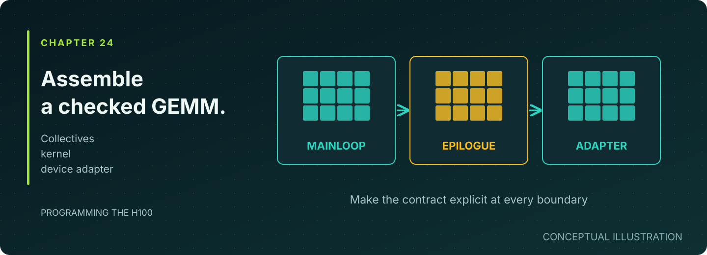
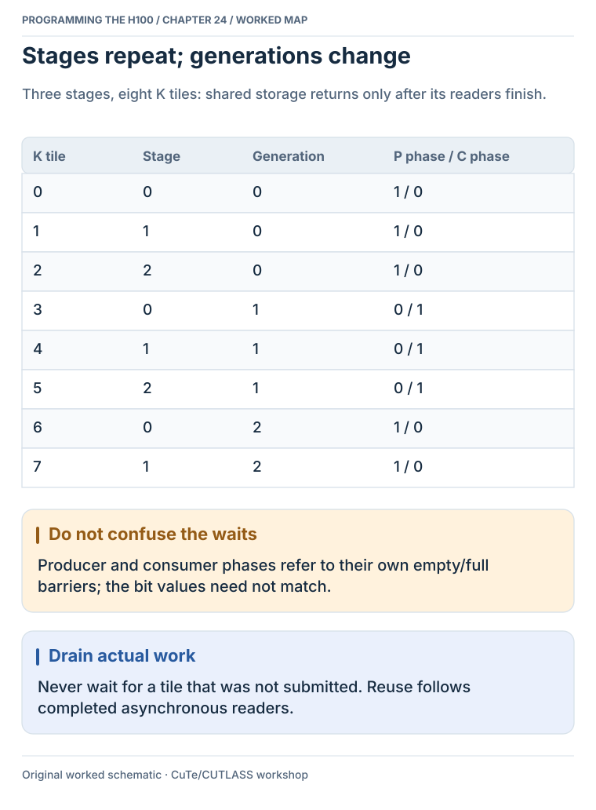
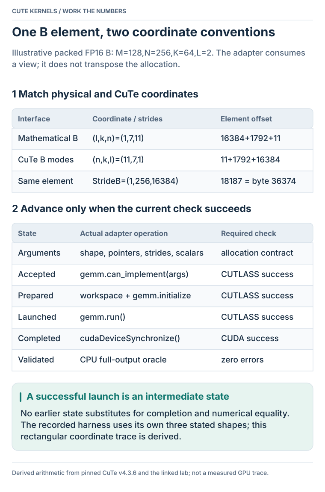

# 24. CUTLASS — Build a Hopper GEMM You Can Verify

!!! note "Correctness build versus performance build"
    The archived H100 build reports ptxas C7510: WGMMA instructions were
    serialized across a function boundary. Its output establishes the stated
    numerical checks, not representative WGMMA overlap or performance.
    For a new benchmark, add `-DNDEBUG` to the complete documented command,
    inspect the new compiler diagnostics and validate the resulting binary
    again. No optimized-build timing is inferred from the old capture.
    Auto schedules depend on toolkit and CUTLASS versions; the recorded
    plain GEMM selected Cooperative with seven stages under CUDA 12.8.
    CUDA 12.0 can resolve Auto differently.

## Lesson 24 Companion Guide — Assemble a Pinned Hopper Kernel and Its Launch Contract

[](images/chapter-openers/24-workshop.svg)


!!! tip "Your goal in this chapter"

    Construct a reproducible CUTLASS GEMM, explain every operand’s physical layout, and check every output against an independent CPU reference. Read the introductory [CuTe sequence](15-cute-layouts.md), the [tiled GEMM baseline](23-gemm-construction.md), [WGMMA](06-wgmma-part-1.md) and [epilogues](09-kernel-design-part-2.md) first.

## 1 — From a library name to a specific kernel

[](images/ch24/overview.svg)

CUTLASS is a collection of building blocks, kernels, utilities and examples; it is not a single GEMM algorithm. A device adapter accepts arguments and workspace, a kernel schedules tiles, a collective mainloop coordinates copies and MMA, and an epilogue transforms accumulators into output. CuTe supplies much of the layout and instruction-partition vocabulary underneath those layers.

This chapter uses **CUTLASS v4.3.6**, commit `1afc6d355b8cb992398f17beb4425702f1d57ddd`, with the book’s CUDA 12.8 baseline. The C++ API is still commonly called the **CUTLASS 3.x GEMM API** even though the repository release is 4.x. Python operator APIs and the CuTe DSL have separate entry points. We use the pinned [example 49](https://github.com/NVIDIA/cutlass/blob/v4.3.6/examples/49_hopper_gemm_with_collective_builder/49_collective_builder.cu) and [GEMM API documentation](https://github.com/NVIDIA/cutlass/blob/v4.3.6/media/docs/cpp/gemm_api_3x.md) as references.

The exercises in Chapters 14–29 extend the original 27-program suite and use a separate validation collector. Keep their compilation, execution and profiler records distinct from the original suite. Expected checks stated in the explanation are specifications; actual execution evidence must identify the corresponding source revision, commands, dates and system.

## 2 — Pin the source and keep the build narrow

Complete [Getting Started](getting-started.md), including a working driver, CUDA 12.8 and a compatible host compiler. Start in the book repository’s root directory. The helper clones a fresh destination or checks an existing one; it refuses the wrong commit or modified tracked CUTLASS files.

```bash
export CUTLASS_ROOT="$HOME/cutlass-v4.3.6"
bash tools/fetch_cutlass.sh "$CUTLASS_ROOT"
git -C "$CUTLASS_ROOT" rev-parse HEAD
mkdir -p build/advanced
nvcc --version
g++ --version
nvidia-smi
```

The expected commit is the hash above. The original headers are used directly: the book’s GEMM needs no global CUTLASS installation, Python package or prebuilt CUTLASS shared library. Its adapter uses header-only templates, the CUDA runtime and the CUDA driver-library link `-lcuda` required by this pinned path. The direct command includes both the public headers and `tools/util/include`, because the small harness uses the repository’s device-allocation and packed-stride utilities.

```bash
nvcc -std=c++17 -O2 -lineinfo -arch=sm_90a \
  --expt-relaxed-constexpr \
  -I "$CUTLASS_ROOT/include" \
  -I "$CUTLASS_ROOT/tools/util/include" \
  docs/examples/advanced/cutlass_gemm.cu \
  -o build/advanced/cutlass_gemm -lcuda
./build/advanced/cutlass_gemm
```

`Sm90` in a template is not a compiler flag. The architecture-accelerated Hopper instructions still need `sm_90a`; that binary is not a portability promise for A100 or B200. The harness checks that device 0 is compute capability 9.0 and returns a nonzero prerequisite failure otherwise.

## 3 — Define the operation before the types

Our operation is batched `D = alpha * A * B + beta * C`.

| Object | Mathematical shape per batch | Physical storage | Element type |
| --- | --- | --- | --- |
| A | M × K | Row-major | FP16 |
| B | K × N | Row-major | FP16 |
| C | M × N | Row-major | FP32 |
| D | M × N | Row-major | FP32 |
| Accumulator | Output tile | Instruction-defined registers | FP32 |

The initial tile is `128 × 128 × 64`; the cluster is `1 × 1 × 1`. Tile shape is a scheduling choice, not the full problem shape. Small, rectangular and partial-tile problems can behave very differently from a large square GEMM.

The builder alignment arguments count **elements**, not bytes. Eight FP16 elements or four FP32 elements describe a 16-byte alignment contract. Base addresses, leading dimensions and batch strides must satisfy the selected path’s constraints. An aligned base pointer does not repair an incompatible row stride.

### Check the nonzero-beta contract on paper

For `A=[[1,-2,3],[4,0,-1]]`, `B=[[2,1],[3,-2],[1,4]]` and `C=[[2,-4],[6,8]]`, the mathematical product is `[[-1,17],[7,0]]`. With alpha=0.5 and beta=0.25, D is `[[0,7.5],[5,2]]`. This small reference establishes B’s reduction/output axes and C’s one-time participation without depending on a template or GPU.

The full harness scales that same contract to aligned, rectangular, batched and partial-tile cases. The initialization patterns differ across operands and batches, and it checks all outputs rather than assuming a constant-valued result proves a layout. At each library boundary, compare mathematical shape, physical strides and the adapter’s logical coordinate convention.

### Map each builder parameter to a design decision

| Parameter group | Baseline choice | What a change must revalidate |
| --- | --- | --- |
| Architecture / operator class | Sm90 / TensorOp | Target flags and instruction availability |
| A/B types and layouts | FP16, row-major | Packing, precision, stride and alignment |
| Accumulator / output | FP32 / FP32 | Error policy and conversion points |
| CTA tile | 128×128×64 | Tail work, reuse and resource use |
| Cluster | 1×1×1 | Collective scheduling and any multicast assumptions |
| Stage policy | Auto with epilogue carveout | Actual shared storage and launch validity |
| Schedule pair | Compatible Auto choices | Mainloop/epilogue interface and performance |

None of these parameters is merely decoration. A supported type combination can still have poor performance for a particular shape; a fast configuration can still implement the wrong layout if the host arguments are wrong.

## 4 — Build the epilogue before choosing stage capacity

An epilogue can reserve shared storage too. Build it first, then account for its `SharedStorage` size when selecting the mainloop’s stage count:

```cpp
using StagePolicy = cutlass::gemm::collective::StageCountAutoCarveout<
    static_cast<int>(sizeof(Epilogue::SharedStorage))>;
```

The complete [cutlass_gemm.cu](examples/advanced/cutlass_gemm.cu) supplies matching `KernelScheduleAuto` and `EpilogueScheduleAuto` tags. For this Sm90 linear-combination baseline in pinned v4.3.6, the automatic epilogue selects `NoSmemWarpSpecialized`; the carveout pattern also accounts for epilogues that do use shared storage when choosing an explicit compatible schedule. `Auto` is a builder heuristic for this release and configuration; it does not benchmark every kernel on the user’s machine. If you later request a specific schedule, select an explicitly compatible **pair**, as [Chapter 25](25-cutlass-pipelines.md) explains.

The type assembly is:

```text
Element types + layout tags + alignments + tile/cluster shapes
                       |
                CollectiveEpilogue
                       |
        CollectiveMainloop with epilogue carveout
                       |
                 GemmUniversal kernel
                       |
                GemmUniversalAdapter
```

A builder error can be a failed contract, not a missing include. Reduce it to the first failed static assertion and inspect architecture, layout, alignment, tile and schedule compatibility. Repeatedly changing template tags until compilation succeeds is not a correctness method.

### Assemble the exact tested aliases in dependency order

The following are excerpts from the complete captured source, not independent translation units. They require its CUTLASS/CuTe headers and belong together at namespace scope. Start by naming the element/layout choices and static scheduling shapes:

```cpp
using namespace cute;
using Half = cutlass::half_t;
using Row = cutlass::layout::RowMajor;
using CtaTileShape = Shape<_128, _128, _64>;
using Cluster = Shape<_1, _1, _1>;
using Epilogue = cutlass::epilogue::collective::CollectiveBuilder<
    cutlass::arch::Sm90, cutlass::arch::OpClassTensorOp,
    CtaTileShape, Cluster, cutlass::epilogue::collective::EpilogueTileAuto,
    float, float, float, Row, 4, float, Row, 4,
    cutlass::epilogue::collective::EpilogueScheduleAuto>::CollectiveOp;
```

Read the epilogue arguments in groups, checking the pinned builder signature rather than counting unnamed `float` tokens from memory:

1. `Sm90, OpClassTensorOp` select the architecture/operator family.
2. `CtaTileShape, Cluster, EpilogueTileAuto` give the CTA/cluster contract and epilogue tiling policy.
3. The first two `float` arguments specify accumulator and epilogue compute elements.
4. `float, Row, 4` specify C's source element, layout and alignment in elements.
5. The next `float, Row, 4` specify D's output element, layout and alignment.
6. `EpilogueScheduleAuto` selects the supported automatic epilogue path for this pinned baseline. This is not the explicit ReLU schedule in the later fusion lab.

Next build the mainloop, then the kernel and host adapter:

```cpp
using Mainloop = cutlass::gemm::collective::CollectiveBuilder<
    cutlass::arch::Sm90, cutlass::arch::OpClassTensorOp,
    Half, Row, 8, Half, Row, 8, float, CtaTileShape, Cluster,
    cutlass::gemm::collective::StageCountAutoCarveout<
        static_cast<int>(sizeof(Epilogue::SharedStorage))>,
    cutlass::gemm::collective::KernelScheduleAuto>::CollectiveOp;
using Kernel = cutlass::gemm::kernel::GemmUniversal<
    Shape<int, int, int, int>, Mainloop, Epilogue>;
using Gemm = cutlass::gemm::device::GemmUniversalAdapter<Kernel>;
```

The two `Half,Row,8` groups describe A and B. Eight half elements correspond to sixteen bytes. The next `float` selects the accumulator, followed by the same CTA/cluster shapes. Stage policy depends on the epilogue's already defined shared storage. `KernelScheduleAuto` completes the mainloop policy. Finally, `GemmUniversal` composes the collectives around a runtime rank-four problem `(M,N,K,L)`; the adapter exposes the host methods used below.

This order explains a common compiler diagnostic: a failure in `Mainloop` can stem from an unsupported A/B layout or schedule, while a failure in `StageCountAutoCarveout` can originate in the epilogue's resource contract. Read the first failed assertion and identify its group before changing unrelated types. The pinned [mainloop builder](https://github.com/NVIDIA/cutlass/blob/v4.3.6/include/cutlass/gemm/collective/collective_builder.hpp) and [epilogue builder](https://github.com/NVIDIA/cutlass/blob/v4.3.6/include/cutlass/epilogue/collective/collective_builder.hpp) define the API signatures.

??? question "Exercise: change output storage, then locate the consequences"

    If D changes from FP32 to FP16 while C remains FP32, which group describes that change? Can the old full-output reference remain unchanged?

    **Answer:** Change the D element/layout/alignment group, not A/B or the accumulator by accident. A sixteen-byte FP16 alignment would count eight elements rather than four, if that path supports it. The selected builder must accept the new combination. The independent reference must now specify the final FP16 conversion/rounding and compare the resulting output representation; the existing FP32 pass does not validate this unexecuted variant.

## 5 — Do not transpose B by accident

CUTLASS’s CuTe logical B coordinates are `(N,K,L)` even though the mathematical matrix in `A * B` is `K × N`. The kernel’s `StrideB` encodes how that logical view names the physical B allocation. The helper must receive the corresponding logical shape:

```cpp
auto stride_B = cutlass::make_cute_packed_stride(
    Kernel::StrideB{}, cute::make_shape(N, K, L));
```

In this harness the independent CPU reference reads row-major B with `B[(l * K + k) * N + n]`. That is deliberate: the oracle follows the mathematical matrix and its physical row-major storage instead of duplicating the library’s CuTe indexing code. A reference that repeats the same wrong layout transform can agree with the kernel while both compute the wrong problem.

Similarly, use `StrideA` with `(M,K,L)` and output strides with `(M,N,L)`. Check leading dimensions and batch offsets in **elements** before converting any quantity to bytes.

### Substitute a rectangular batch into the runtime contract

Use the illustrative aligned problem `M=128,N=256,K=64,L=2`, with packed row-major arrays. Here `M,N,K,L` count matrix rows, columns, reduction positions and independent batches; they are not the CTA tile or cluster shape.

1. **Write the physical offsets first.** `A(l,m,k)=l*8192+m*64+k`, `B(l,k,n)=l*16384+k*256+n`, and `C/D(l,m,n)=l*32768+m*256+n`. These formulas are in elements; multiply by two for A/B bytes and by four for C/D bytes.
2. **Translate to CuTe's operand modes.** A has logical shape `(M,K,L)` and stride `(64,1,8192)`. B has logical shape `(N,K,L)` and stride `(1,256,16384)`. C/D have shape `(M,N,L)` and stride `(256,1,32768)`. B's reordered *logical modes* do not transpose the allocated mathematical matrix.
3. **Check one coordinate independently.** Mathematical `B(l=1,k=7,n=11)` is offset `16384+7*256+11=18187`. Its CuTe coordinate `(n,k,l)=(11,7,1)` gives `11*1+7*256+1*16384=18187`, the same half element and byte offset `36374`.
4. **Construct, then validate.** The complete source obtains these strides with `make_cute_packed_stride`, places them beside their pointers in `Gemm::Arguments`, and sets `args.epilogue.thread.alpha` and `.beta`. `can_implement(args)` checks the library contract before workspace initialization and launch; pointer alignment alone cannot replace it.
5. **Check the result, not the launch alone.** If one independently calculated dot product is `acc=-1` and the corresponding C value is `2`, alpha `0.5` and beta `0.25` require output zero. This scalar example checks the epilogue expression; the executable's nonuniform reference checks every output of its actual cases.

**Pitfall:** constructing B with a packed `(K,N,L)` shape while retaining `Kernel::StrideB` mixes two coordinate conventions. The dimensions can look plausible in a square example. A rectangular example and the explicit offset equality above expose the mistake before performance tuning.

### Read mathematical B and CuTe B as the same storage

Read the two upper paths downward into their shared element. Here `l=1` selects the second independent batch; all offset labels count FP16 **elements**, not bytes. This panel uses the rectangular example just derived, `M=128,N=256,K=64,L=2`.

```text
Mathematical B is K x N          CuTe B modes are (N,K,L)
coordinate (l,k,n)=(1,7,11)      coordinate (n,k,l)=(11,7,1)
         |                                  |
row-major B formula                 stride dot product
l*(K*N) + k*N + n                  n*1 + k*256 + l*16384
         |                                  |
16384 + 1792 + 11                  11 + 1792 + 16384
         +----------------+-----------------+
                          v
                element offset = 18187
                byte offset    = 36374
                          |
                     same B value
```

For the same example, the view maps supplied beside each pointer are:

```text
Object  Logical coordinate  Element strides         Batch elements
 A         (m,k,l)          (64,1,8192)                  8192
 B         (n,k,l)          (1,256,16384)                16384
 C,D       (m,n,l)          (256,1,32768)                32768
```

`make_cute_packed_stride(Kernel::StrideB{}, make_shape(N,K,L))` supplies the B map in the complete code. It does not physically transpose B or change the CPU oracle's `B[(l*K+k)*N+n]`. Its role is to present the existing allocation using the kernel's expected logical axes. Check this equality at an interior coordinate, not only `(0,0,0)`, where many wrong stride maps happen to agree.

The example's shape is illustrative; the captured harness's three cases are listed below. A substituted shape becomes execution evidence only after that changed source has been compiled and checked.

[](images/worked/kernel-builder-contract.svg)

**Read the figure in two passes.** First verify the two B coordinate conventions meet at the same physical element. Then follow the adapter state table downward. `can_implement` accepts the argument contract; `initialize` prepares state/workspace; `run` launches work; CUDA completion and the CPU comparison establish different later facts. A failure must stop that chain rather than being hidden by a final success message.

## 6 — The host-side launch lifecycle

A successful `can_implement` checks supported arguments; it does not run the kernel. The harness follows all of these steps and propagates failures:

1. Initialize distinct, nonuniform A, B and C values.
2. Allocate/copy the inputs, initialize D to NaN sentinels, and construct shape/stride arguments. An unwritten output must fail even if its expected value is zero.
3. Call `can_implement` and reject unsupported arguments.
4. Obtain `get_workspace_size`, allocate the workspace and call `initialize`.
5. Call `run`, then check CUDA completion with `cudaDeviceSynchronize`.
6. Copy D back and compare every output, including every batch.

`can_implement` is a kernel-support check, not a general validator for application-owned memory. A success status does not prove that pointers remain live, allocations cover every stride-derived address, data belongs to the intended CUDA device, or overlapping operands obey the operation's aliasing contract. The harness establishes these conditions through its fixed shapes, separate allocations, selected device and synchronized lifetimes. An application wrapper must check its own memory contract before relying on the adapter's support result.

**Allocation check:** a compact 128×128 FP32 D view needs `128×128=16384` elements, or 65536 bytes. Its last element begins at byte offset `(127×128+127)×4=65532` and occupies four bytes. A 16-byte-aligned pointer with only 4096 bytes remaining cannot back this view. Alignment and allocation coverage are different obligations, regardless of the adapter’s support status.

The source includes the full code rather than relying on a library demo’s process exit status. In pinned upstream example 49, unsupported prerequisites and some printed failed cases can still be followed by process exit zero. If you run that example, read every result label and reject any failed/skipped configuration; an exit-only wrapper is insufficient.

## 7 — Why these reference cases are diagnostic

The three cases are `(M,N,K,L) = (128,128,64,1)`, `(256,128,128,2)` and `(136,264,72,1)`. The last has partial CTA tiles while retaining the selected alignment requirements. The scalar cases include nonzero beta, so reading C is checked instead of silently testing only `A * B`.

Inputs are bounded, small binary-rational values. Products and the short reductions fit exactly in FP32 for these cases; the reference accumulates in double and converts the final expression to float. Exact equality is therefore intentional **for these inputs and operations**. It is not a general FP16 GEMM tolerance policy. Random large-magnitude inputs, long reductions or reduced-precision modes need explicitly justified absolute/relative tolerances and finite-value checks.

Expected checks are three `GEMM CASE PASS` lines followed by `GEMM PASS: 3 full CPU-reference cases`, with every error count zero. No timing or TFLOP/s claim follows from this small correctness harness. Its CPU reference would also be inappropriate for timing a large production GEMM.

The tests cover selected dimensions, batching, C participation and partial tiles. They do not establish every supported datatype, leading dimension, split-K mode or fusion. Add a separate test before extending one of those contracts.

### Extend one contract at a time

The current adapter launches `GemmUniversalMode::kGemm` with a rank-four `(M,N,K,L)` problem and packed independent batches. Do not infer that a different universal mode, arbitrary padded strides, overlapping batches or aliased C/D pointers were tested. The raw SIMT lab deliberately covers padded rows and K=0; those cases do not transfer automatically to this Tensor Core kernel.

Before changing the packed helper to explicit strides, write all four operand offset formulas and allocation extents, check alignment at each row/batch origin, and retain a CPU oracle that uses the physical allocation contract independently. For a zero-sized problem, define whether the application skips the launch or requires a supported library operation; `can_implement` is necessary but does not replace a numerical case or completion check.

## 8 — Collect revision-specific execution evidence

The collector first verifies the exact CUTLASS commit and records the system, compiler and GPU topology. It prepares the CuTe host oracles, GPU copy/GEMM/overlap programs and CPU reference scripts, requires their explicit pass markers and saves each current source copy/hash with commands, UTC times and logs. An output directory must be fresh.

```bash
python3 tools/run_advanced_validation.py \
  --cutlass "$CUTLASS_ROOT" \
  --output "$HOME/h100-advanced-$(date -u +%Y%m%dT%H%M%SZ)" \
  --execute --profiles
```

For a plan-only run, omit **both** `--execute` and `--profiles`; no compiler, GPU or profiler is launched. `--profiles` is accepted only with `--execute`, additionally requires Nsight Systems and saves both serial/overlap reports; profiler capture is separate from numerical correctness. Preserve the complete directory before shutting down the instance. Hardware-backed transcripts can then be published with their actual date and software stack.

For an additional memory-safety check, run the compiled GEMM under the toolkit’s `compute-sanitizer --tool memcheck --error-exitcode 1`. A zero-error report supplements the numerical oracle; it does not prove every possible pipeline schedule is race-free.

??? question "Self-check: a 16-byte alignment parameter?"

    For FP16 inputs, should the builder’s element alignment be 16?

    **Answer:** A 16-byte contract corresponds to 8 FP16 elements. The element count, actual pointer alignment and stride constraints must agree.

??? question "Self-check: does successful initialization establish correctness?"

    `can_implement`, `initialize` and `run` return success. Can you report a verified GEMM?

    **Answer:** Not yet. Check asynchronous CUDA completion and the actual output against the defined reference. The collector requires both.

<!-- workshop:start:cutlass_gemm -->
## Complete source and captured execution

**Executed on November 18, 2026 (UTC).** Scope: **CUDA workload with its stated numerical checks**.

Tested source SHA-256: `c906aff6157e1759ebe1b7287bc75b78eeb5b35d4e7ef0751f5001c29d568de3`. [Exact source](validation/2026-11-18-h100-workshop/cutlass_gemm.cu) · [System information](validation/2026-11-18-h100-workshop/system.json) · [Workshop results](cutlass-workshop-validation.md).

The listing below matches the tested source. Its presentation is formatted at build time; downloads retain the captured bytes.

```cuda
// A pinned CUTLASS v4.3.6 Hopper GEMM with an independent full CPU oracle.
#include <cute/tensor.hpp>
#include <cutlass/cutlass.h>
#include <cutlass/epilogue/collective/collective_builder.hpp>
#include <cutlass/gemm/collective/collective_builder.hpp>
#include <cutlass/gemm/device/gemm_universal_adapter.h>
#include <cutlass/gemm/kernel/gemm_universal.hpp>
#include <cutlass/util/device_memory.h>
#include <cutlass/util/packed_stride.hpp>
#include <cuda_runtime.h>
#include <cmath>
#include <cstdio>
#include <stdexcept>
#include <vector>
using namespace cute;
using Half = cutlass::half_t;
using Row = cutlass::layout::RowMajor;
using CtaTileShape = Shape<_128, _128, _64>;
using Cluster = Shape<_1, _1, _1>;
using Epilogue = cutlass::epilogue::collective::CollectiveBuilder<
    cutlass::arch::Sm90, cutlass::arch::OpClassTensorOp,
    CtaTileShape, Cluster, cutlass::epilogue::collective::EpilogueTileAuto,
    float, float, float, Row, 4, float, Row, 4,
    cutlass::epilogue::collective::EpilogueScheduleAuto>::CollectiveOp;
using Mainloop = cutlass::gemm::collective::CollectiveBuilder<
    cutlass::arch::Sm90, cutlass::arch::OpClassTensorOp,
    Half, Row, 8, Half, Row, 8, float, CtaTileShape, Cluster,
    cutlass::gemm::collective::StageCountAutoCarveout<
        static_cast<int>(sizeof(Epilogue::SharedStorage))>,
    cutlass::gemm::collective::KernelScheduleAuto>::CollectiveOp;
using Kernel = cutlass::gemm::kernel::GemmUniversal<
    Shape<int, int, int, int>, Mainloop, Epilogue>;
using Gemm = cutlass::gemm::device::GemmUniversalAdapter<Kernel>;

void cuda_check(cudaError_t s) {
    if (s != cudaSuccess) throw std::runtime_error(cudaGetErrorString(s));
}
void cutlass_check(cutlass::Status s) {
    if (s != cutlass::Status::kSuccess)
        throw std::runtime_error(cutlassGetStatusString(s));
}

bool test(int M, int N, int K, int L, float alpha, float beta,
          cutlass::KernelHardwareInfo hardware) {
    std::vector<Half> A(size_t(L) * M * K), B(size_t(L) * K * N);
    std::vector<float> C(size_t(L) * M * N), D(C.size());
    for (size_t i = 0; i < A.size(); ++i) A[i] = Half(float(int(i % 13) - 6) / 8);
    for (size_t i = 0; i < B.size(); ++i) B[i] = Half(float(int(i % 17) - 8) / 8);
    for (size_t i = 0; i < C.size(); ++i) C[i] = float(int(i % 19) - 9) / 16;
    cutlass::device_memory::allocation<Half> da(A.size()), db(B.size());
    cutlass::device_memory::allocation<float> dc(C.size()), dd(D.size());
    cuda_check(cudaMemcpy(da.get(), A.data(), A.size() * sizeof(Half), cudaMemcpyHostToDevice));
    cuda_check(cudaMemcpy(db.get(), B.data(), B.size() * sizeof(Half), cudaMemcpyHostToDevice));
    cuda_check(cudaMemcpy(dc.get(), C.data(), C.size() * sizeof(float), cudaMemcpyHostToDevice));
    // IEEE FP32 all-one bits are NaN: an omitted output store cannot pass
    // merely because its reference value happens to be zero.
    cuda_check(cudaMemset(dd.get(), 0xff, D.size() * sizeof(float)));
    auto sa = cutlass::make_cute_packed_stride(Kernel::StrideA{}, make_shape(M, K, L));
    auto sb = cutlass::make_cute_packed_stride(Kernel::StrideB{}, make_shape(N, K, L));
    auto sc = cutlass::make_cute_packed_stride(Kernel::StrideC{}, make_shape(M, N, L));
    auto sd = cutlass::make_cute_packed_stride(Kernel::StrideD{}, make_shape(M, N, L));
    Gemm::Arguments args{cutlass::gemm::GemmUniversalMode::kGemm,
                         {M, N, K, L}, {da.get(), sa, db.get(), sb},
                         {{}, dc.get(), sc, dd.get(), sd}, hardware};
    args.epilogue.thread.alpha = alpha;
    args.epilogue.thread.beta = beta;
    Gemm gemm;
    cutlass_check(gemm.can_implement(args));
    cutlass::device_memory::allocation<unsigned char> workspace(Gemm::get_workspace_size(args));
    cutlass_check(gemm.initialize(args, workspace.get()));
    cutlass_check(gemm.run());
    cuda_check(cudaDeviceSynchronize());
    cuda_check(cudaMemcpy(D.data(), dd.get(), D.size() * sizeof(float), cudaMemcpyDeviceToHost));
    size_t errors = 0;
    for (int l = 0; l < L; ++l)
        for (int m = 0; m < M; ++m)
            for (int n = 0; n < N; ++n) {
                double sum = 0;
                for (int k = 0; k < K; ++k)
                    sum += double(float(A[(size_t(l) * M + m) * K + k])) *
                           double(float(B[(size_t(l) * K + k) * N + n]));
                size_t i = (size_t(l) * M + m) * N + n;
                float expected = float(alpha * sum + beta * C[i]);
                // These bounded binary-rational inputs make the sum exact in FP32.
                errors += !std::isfinite(D[i]) || D[i] != expected;
            }
    std::printf("%s M=%d N=%d K=%d L=%d alpha=%.2f beta=%.2f checked=%zu errors=%zu\n",
                errors ? "GEMM FAIL" : "GEMM CASE PASS", M, N, K, L, alpha, beta, D.size(), errors);
    return errors == 0;
}
int main() {
    try {
        cudaDeviceProp p{};
        cuda_check(cudaSetDevice(0));
        cuda_check(cudaGetDeviceProperties(&p, 0));
        if (p.major != 9 || p.minor != 0) {
            std::fprintf(stderr, "Requires Hopper compute capability 9.0; found %d.%d\n", p.major, p.minor);
            return 2;
        }
        cutlass::KernelHardwareInfo hw{};
        hw.device_id = 0;
        hw.sm_count = p.multiProcessorCount;
        bool ok = test(128, 128, 64, 1, 1, 0, hw);
        ok = test(256, 128, 128, 2, 0.5f, 0.25f, hw) && ok;
        ok = test(136, 264, 72, 1, 0.5f, 0.25f, hw) && ok;
        std::puts(ok ? "GEMM PASS: 3 full CPU-reference cases" : "GEMM FAIL");
        return ok ? 0 : 1;
    } catch (const std::exception& e) {
        std::fprintf(stderr, "GEMM ERROR: %s\n", e.what());
        return 1;
    }
}
```

CUDA compilation UTC: `2026-11-18T14:10:02.615598+00:00`. Exit: `0`. [Compile log](validation/2026-11-18-h100-workshop/cutlass_gemm-compile.log).

Commands use scratch-directory filenames; raw logs retain exact paths. The collector’s CUTLASS include flags are configuration for that capture; the minimal standalone overlap/SIMT commands do not require those headers.

```bash
nvcc -std=c++17 -O2 -lineinfo -arch=sm_90a --expt-relaxed-constexpr -I "$CUTLASS_ROOT/include" -I "$CUTLASS_ROOT/tools/util/include" cutlass_gemm.cu -o ./example -lcuda
```

Executed UTC: `2026-11-18T14:10:34.405978+00:00`. Exit: `0`. [Run log](validation/2026-11-18-h100-workshop/cutlass_gemm-run.log).

```bash
./example
```

**Actual captured output**

```text
GEMM CASE PASS M=128 N=128 K=64 L=1 alpha=1.00 beta=0.00 checked=16384 errors=0
GEMM CASE PASS M=256 N=128 K=128 L=2 alpha=0.50 beta=0.25 checked=65536 errors=0
GEMM CASE PASS M=136 N=264 K=72 L=1 alpha=0.50 beta=0.25 checked=35904 errors=0
GEMM PASS: 3 full CPU-reference cases
```

<!-- workshop:end:cutlass_gemm -->

## Additional memory-safety record

The exact tested revision also passed [Compute Sanitizer memcheck](validation/2026-11-18-h100-workshop/supplemental-captures/gpu-checks/20261118T141445Z/memcheck-cutlass_gemm.log) with zero errors and its numerical checks intact. [The dated supplemental manifest](validation/2026-11-18-h100-workshop/supplemental-captures/gpu-checks/20261118T141445Z/commands.json) retains commands, source hashes and actual UTC stage times. This does not prove every untested schedule.

<!-- companion-summary:start -->
## Summary

- The collective builder assembles a specific mainloop, epilogue, kernel and adapter from explicit types, layouts, alignments and compatible schedules.

- Construct logical B strides deliberately, reserve epilogue storage when choosing stages, and preserve every adapter status and asynchronous completion check.

- Only full-output independent reference checks establish the tested numerical result. Follow the selected kernel into [its pipeline and scheduling protocol](25-cutlass-pipelines.md).
<!-- companion-summary:end -->
