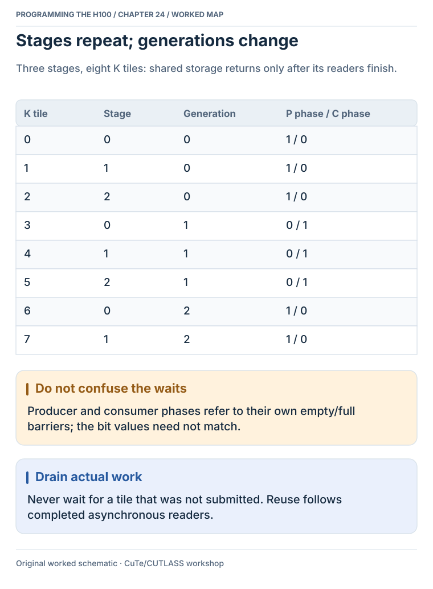

# 24. Read Hopper CUTLASS Pipelines, Fusion and Tuning

[](images/ch24/overview.svg)

!!! tip "Your goal"

    Trace one tile through a real Hopper mainloop, identify the readiness/reuse protocol, and make one controlled tuning change without breaking the numerical contract. Complete the [verified-GEMM exercise](23-cutlass-gemm.md) first.

## 1 — A source-reading route with a purpose

Start from the pinned [collective-builder example 49](https://github.com/NVIDIA/cutlass/blob/v4.3.6/examples/49_hopper_gemm_with_collective_builder/49_collective_builder.cu), then follow the selected dispatch policy to the kernel and collective. Do not begin by reading every template header from top to bottom.

| Layer | What to find | Connection to earlier chapters |
| --- | --- | --- |
| Device adapter | Arguments, workspace, initialization and launch | Host launch/error-checking contract |
| Kernel | Tile scheduling, warp roles and shared storage | Warp specialization and persistent work, Chapters 8–10 |
| Collective mainloop | TMA descriptors, operand stages and tiled MMA | Chapters 3–6 |
| Pipeline | Empty/full generations and participant counts | RAW/WAR ownership, Chapters 3 and 9 |
| Collective epilogue | Accumulator partition, conversion, fusion and stores | Chapters 7 and 9 |

Read one operand tile’s full lifetime before comparing schedule variants. Write down who produces it, which barrier proves arrival, who reads it and which event makes it reusable. The abstraction is useful because those obligations are repeated systematically, not because a template makes them disappear.

## 2 — Build only the upstream examples you need

The book’s harness compiles directly with nvcc. CMake is useful when exploring upstream examples. On the Ubuntu GPU host, install `cmake` and `ninja-build` if absent. Configure only Hopper and disable the library/profiler/tests for this first build:

```bash
sudo apt-get update
sudo apt-get install -y cmake ninja-build
cmake -S "$CUTLASS_ROOT" -B build/cutlass-examples -G Ninja \
  -DCUTLASS_NVCC_ARCHS=90a \
  -DCUTLASS_ENABLE_LIBRARY=OFF \
  -DCUTLASS_ENABLE_PROFILER=OFF \
  -DCUTLASS_ENABLE_TESTS=OFF \
  -DCUTLASS_ENABLE_EXAMPLES=ON
cmake --build build/cutlass-examples --target 49_collective_builder -j 2
./build/cutlass-examples/examples/49_hopper_gemm_with_collective_builder/49_collective_builder \
  --m=512 --n=512 --k=512 --l=2 --alpha=1 --beta=0.5
```

Use the pinned source path and target spelling; the introductory comment in an upstream example can lag its directory name. Start with low parallel build concurrency because template compilation can consume substantial memory. Increase it only after observing memory use. The recorded large-memory host can support more build jobs; that is not a safe default for a small machine.

Example 49 prints seven configuration results in this revision. Check **all seven** and their actual pass/fail labels. Its process exit alone is not an aggregate numerical oracle. This exploratory upstream run is separate from the book collector’s three-case, full-output CPU-reference GEMM.

## 3 — Schedule tags are algorithm choices

The pinned example demonstrates these compatible explicit pairings:

| Mainloop schedule | Epilogue schedule | Reading focus |
| --- | --- | --- |
| `KernelTma` | `NoSmemWarpSpecialized` | TMA without the same warp-specialized pipeline |
| `KernelTmaWarpSpecialized` | `NoSmemWarpSpecialized` | Separate producer/consumer roles |
| `KernelTmaWarpSpecializedPingpong` | `TmaWarpSpecialized` | Persistent ping-pong organization |
| `KernelTmaWarpSpecializedCooperative` | `TmaWarpSpecializedCooperative` | Cooperative organization and compatible epilogue |

The mainloop tags above live in `cutlass::gemm`; epilogue tags in `cutlass::epilogue`. The `Auto` tags used by the builders live in their collective namespaces. Names alone do not describe every supported tile/cluster/datatype combination. Inspect the specialization selected by the pinned builder.

Do not change only one side from Auto to an explicit schedule and assume compatibility. Likewise, do not call every persistent kernel “Stream-K.” Persistent residency, the distribution of output tiles, and splitting reduction work are distinct decisions. Example 49 separately supplies a tile-scheduler type when demonstrating Stream-K.

## 4 — Follow the stage state machine

The implementation in [sm90_pipeline.hpp](https://github.com/NVIDIA/cutlass/blob/v4.3.6/include/cutlass/pipeline/sm90_pipeline.hpp) is the contract to read. `PipelineAsync`, `PipelineTmaAsync` and `PipelineTmaStore` describe different producer/completion mechanisms. They are not interchangeable barrier wrappers.

For the common TMA-load pipeline, the conceptual lifetime is:

| Stage event | Producer obligation | Consumer obligation |
| --- | --- | --- |
| Empty available | Acquire the correct stage/generation | Finish all prior readers before releasing it |
| Transfer submitted | An elected leader sets the expected transaction bytes and issues the intended TMA work | Wait for the matching full generation |
| Full available | Do not overwrite the tile | Use the correct layout and issue MMA |
| Reads finished | Wait for the next acquire before reuse | Release only after asynchronous MMA reads are safe |

In the pinned implementation, `make_producer_start_state<Pipeline>()` starts the producer state at phase 1; a default consumer state starts at phase 0. Copying one initial state into both roles is not a harmless simplification. The stage index wraps and the phase distinguishes generations of the same storage slot.

`num_consumers` counts participating **threads**, not warps. `transaction_bytes` must match the actual TMA-completed byte contract. `is_leader` must elect the intended single producer issuer. Initialization also needs the implementation’s required visibility and cluster synchronization before any participant uses the pipeline.

One subtle point: `PipelineTmaAsync::producer_commit` is effectively a no-op outside its pipeline unit-test path in this revision. Calling it does not manufacture TMA arrival. The asynchronous copy’s completion mechanism signals full readiness. Conversely, `consumer_wait` proves data arrival, not completion of every later asynchronous WGMMA read. Releasing the source too soon recreates the WAR hazard from Chapter 3.

These are reasons to start with a working collective builder. Customizing the raw pipeline requires a new ownership proof and targeted tests, not simply replacing the barrier calls in a tutorial loop.

### Trace prologue, steady state and drain

Consider three reusable stages and eight actual K tiles. Tile number t uses stage `t % 3`, but the same stage belongs to a new generation whenever t advances by three. For the pinned initial state conventions, the producer and consumer phase bits below belong to their respective empty/full waits; they are not two values that must be equal.

| Tile t | Stage | Generation | Producer phase | Consumer phase |
| ---: | ---: | ---: | ---: | ---: |
| 0 | 0 | 0 | 1 | 0 |
| 1 | 1 | 0 | 1 | 0 |
| 2 | 2 | 0 | 1 | 0 |
| 3 | 0 | 1 | 0 | 1 |
| 4 | 1 | 1 | 0 | 1 |
| 5 | 2 | 1 | 0 | 1 |
| 6 | 0 | 2 | 1 | 0 |
| 7 | 1 | 2 | 1 | 0 |

In the prologue, issue only the tiles that exist, up to the permitted in-flight capacity. During steady state, a consumer waits for its next actual tile while producers reuse only released stages. During the drain, consumers finish the remaining tiles and asynchronous readers/stores complete; producers do not fabricate new work merely to fill all stages.

K shorter than pipeline depth is an important test. If there is one K tile and three storage stages, waiting for a full event on all three stages deadlocks because two transfers never existed. K=0 requires the API/kernel’s explicit supported behavior; the scalar baseline handles it, while a selected library path may reject it. Do not inherit that support across implementations.

The CPU indexing workbook checks slot/generation arithmetic and valid state transitions for 15 small depth/tile-count combinations. It does not simulate the GPU memory model or validate concurrent TMA/WGMMA behavior. The actual library kernel and sanitizer records supply separate evidence.

### Locate the actual mechanisms in the source

Starting from the selected mainloop, find its `SharedStorage`, pipeline type, producer start state, consumer state and transaction-byte calculation. Then locate the TMA copy operation, consumer wait, WGMMA group completion and consumer release. Follow tail/drain calls in the **actual selected specialization**, including any cluster barrier and epilogue store pipeline.

Write the dependency edges explicitly: generic producer stores require the appropriate proxy publication; TMA arrival establishes the load’s completion; WGMMA’s register fence is not its completion wait; and a completed shared-to-global source read is different from final destination completion. A synchronization primitive is meaningful only with its participant, memory-space, proxy and generation scope.

## 5 — Count resources before adding stages

More stages can hide more latency but reserve more shared memory and bookkeeping. They can reduce block residency or leave too little shared storage for the epilogue. A larger CTA tile can reuse operands better while increasing register pressure or wasting work on a small problem’s edges.

Record at least the operand types, CTA tile, cluster shape, selected schedule, stage policy and epilogue storage. Compare the compiler’s resource report and Nsight Compute results with the full application timeline. Occupancy alone is not the objective; a lower-occupancy kernel can win through reuse or better overlap, while an oversized tile can lose on tail work.

Change one variable at a time, rerun the full reference checks, then measure several representative shapes. A 4096-square result does not establish a win for a tall-skinny batched problem.

### A concrete shared-memory budget

For an FP16 operand tile of M=128, N=128, K=64, the raw A tile is `128*64*2=16,384` bytes and B is another 16,384 bytes. One operand stage is therefore 32,768 bytes before padding or metadata. Three raw stages use 98,304 bytes; six use 196,608 bytes. Neither number includes every barrier, alignment gap or epilogue allocation in a real kernel.

Against H100’s shared-memory resource limits, an extra stage can remove the possibility of two resident CTAs even before registers or threads become limiting. Conversely, too few stages may expose load latency. Use the actual `sizeof(SharedStorage)`, configured shared-memory limit and compiler report, then measure. The raw arithmetic is a design estimate, not a launch-validity certificate.

## 6 — Epilogue fusion is a computation graph

The Chapter 23 baseline computes `alpha * accumulator + beta * C`. A fused epilogue might add a bias and apply an activation before the final store. That can avoid a separate launch and an intermediate write/read, but it also changes arithmetic, live values, shared storage and the numerical reference.

Pinned example 49 demonstrates both a predefined fusion operation and an epilogue visitor tree (EVT). An EVT describes dataflow: accumulator/source fetches, scalar/vector broadcasts, computations and stores. The nesting determines which values feed which operation; it is not merely a list of operations to perform in any order.

For example, `activation(alpha * acc + beta * C + bias)` is generally different from `alpha * activation(acc) + beta * C + bias`. Also decide where rounding/conversion occurs. FP32 intermediate computation followed by one FP16 conversion need not match several FP16 intermediate conversions. The [fusion operation tags](https://github.com/NVIDIA/cutlass/blob/v4.3.6/include/cutlass/epilogue/fusion/operations.hpp) and [Hopper callback implementations](https://github.com/NVIDIA/cutlass/blob/v4.3.6/include/cutlass/epilogue/fusion/sm90_callbacks_tma_warpspecialized.hpp) expose those contracts.

An implementation exercise is to add a supported bias/activation fusion, update the CPU oracle to the exact operation order and rounding policy, and add beta-zero, beta-nonzero, negative-input and edge-tile cases. It becomes verified only after those new sources and outputs are captured; the baseline’s pass does not transfer automatically.

## 7 — Use a narrow profiler build

The CUTLASS profiler is a separate tool from Nsight Systems and Compute. It instantiates many candidate kernels and measures supported operations. Compiling every kernel, precision, architecture and instantiation level is unnecessary for this chapter.

Start with one actual kernel name from the pinned generator rather than a whole family. Even a single-kernel build compiles common reference-provider support; broad Hopper family filters can generate hundreds of additional build tasks. This candidate has no C source (`void`), so the runtime example uses beta zero. Its tile, cluster and layouts differ from the small correctness harness; it is a separate configuration, not a timing of that harness. Enable cuBLAS explicitly if using it as the verification provider; it is off by default in the pinned build configuration.

```bash
kernel="cutlass3x_sm90_tensorop_gemm_f16_f16_f32_void_f32_256x128x64_1x2x1_0_nnn_align8_warpspecialized_cooperative_epi_tma"
cmake -S "$CUTLASS_ROOT" -B build/cutlass-profiler -G Ninja \
  -DCUTLASS_NVCC_ARCHS=90a \
  -DCUTLASS_ENABLE_LIBRARY=ON \
  -DCUTLASS_ENABLE_PROFILER=ON \
  -DCUTLASS_LIBRARY_OPERATIONS=gemm \
  -DCUTLASS_LIBRARY_KERNELS="$kernel" \
  -DCUTLASS_ENABLE_CUBLAS=ON \
  -DCUTLASS_ENABLE_EXAMPLES=OFF \
  -DCUTLASS_ENABLE_TESTS=OFF
cmake --build build/cutlass-profiler --target cutlass_profiler -j 2
build/cutlass-profiler/tools/profiler/cutlass_profiler --help
build/cutlass-profiler/tools/profiler/cutlass_profiler \
  --mode=enumerate --operation=Gemm
```

Require at least one matching operation before interpreting a benchmark. If none appear, inspect the generator filter, architecture and instantiation policy; an empty result is not a fast kernel. Avoid `all` or maximum instantiation as a first response. After one configuration works, a deliberate family sweep can use `cutlass3x_sm90_tensorop_gemm_f16_f16_f32_void_f32_*`, with build size, memory and disk costs recorded separately.

```bash
mkdir -p reports
build/cutlass-profiler/tools/profiler/cutlass_profiler \
  --operation=Gemm \
  --kernels="$kernel" \
  --m=512 --n=512 --k=512 --alpha=1 --beta=0 \
  --providers=cutlass --verification-enabled=true \
  --verification-providers=cublas \
  --warmup-iterations=5 --profiling-iterations=20 \
  --output=reports/cutlass-hopper
```

Read the [pinned profiler documentation](https://github.com/NVIDIA/cutlass/blob/v4.3.6/media/docs/cpp/profiler.md) and local help. The tool appends an operation-specific CSV suffix; inspect the files actually produced. Check each row’s disposition and provider result. An available cuBLAS library, an enabled verification flag and a process exit of zero do not by themselves establish that a comparison actually ran and passed.

## 8 — Measure the optimization that users receive

For dense GEMM’s conventional work count, report `2MNKL` floating-point operations per invocation and state what the timer includes. Sparse dense-equivalent rates, fused non-GEMM work and integer operation counts need their own conventions. State whether allocations, workspace initialization, transfers, graph setup or CPU reference work are excluded.

Keep a record containing the exact CUTLASS commit, source hash, compiler/flags, driver, device, tile/cluster/schedule, shape/layout/strides, alpha/beta, warmup, repetitions, verification result and timing distribution. Then use [Systems](14-nsight-systems.md) to determine whether the selected kernel matters to the application’s critical path, and [Compute](13-nsight-compute.md) for the kernel’s detailed limiting resources.

Do not put a large CUTLASS profiler sweep under a full Compute metric set. First select one configuration and kernel. Profilers can replay or perturb work; compare like-for-like captures and retain unprofiled timings.

??? question "Self-check: can producer_commit repair missing TMA completion?"

    A custom pipeline calls `producer_commit` but its consumer never becomes ready. Is adding more commits the solution?

    **Answer:** Not for `PipelineTmaAsync`. Inspect the elected issuer, transfer, barrier address, phase and expected byte count. TMA completion supplies the relevant arrival; the method name is not a substitute.

??? question "Self-check: fusion versus a faster GEMM?"

    A fused GEMM is slower than the unfused GEMM alone. Should it be rejected?

    **Answer:** Compare the complete unfused sequence with the fused operation, using the same numerical contract and useful-result boundary. Removing another launch and memory pass may still reduce application time.

## Continue through the advanced track

[Chapter 25](25-epilogue-fusion.md) develops a complete fused ReLU variant and its independent reference. [Chapter 26](26-precision-block-scaling.md) separates format, scale-layout and kernel error. [Chapter 27](27-benchmarking-integration.md) defines a reproducible comparison, and [Chapter 28](28-workbook-capstone.md) closes the sequence with staged labs and worked answers.
