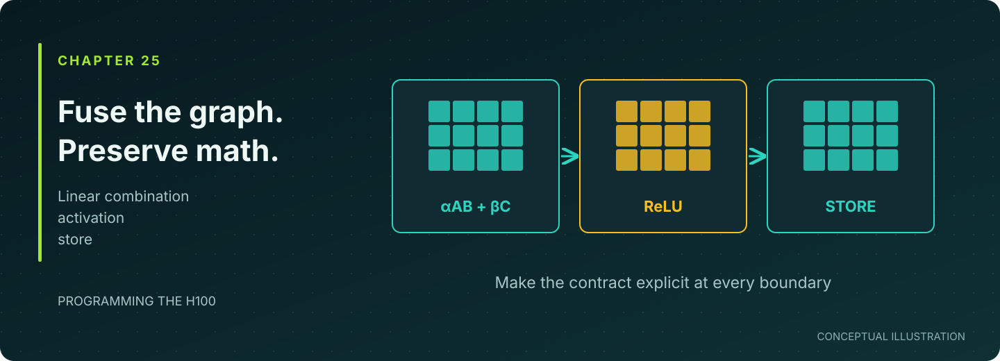
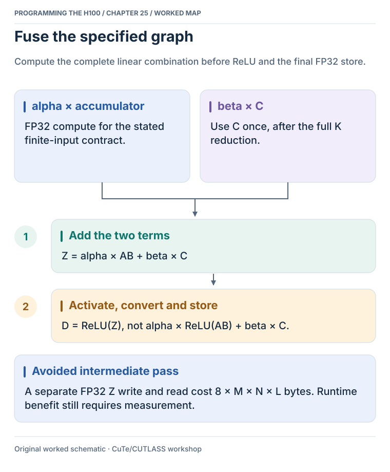

# 25. Read Hopper CUTLASS Pipelines, Fusion and Tuning
## Lesson 25 Companion Guide — Trace Readiness, Reuse and the Cost of More Stages

[](images/chapter-openers/25-workshop.svg)


!!! tip "Your goal in this chapter"

    Trace one tile through a real Hopper mainloop, identify the readiness/reuse protocol, and make one controlled tuning change without breaking the numerical contract. Complete the [verified-GEMM exercise](24-cutlass-gemm.md) first.

## 1 — A source-reading route with a purpose

[](images/ch25/overview.svg)

Start from the pinned [collective-builder example 49](https://github.com/NVIDIA/cutlass/blob/v4.3.6/examples/49_hopper_gemm_with_collective_builder/49_collective_builder.cu), then follow the selected dispatch policy to the kernel and collective. Do not begin by reading every template header from top to bottom.

| Layer | What to find | Connection to earlier chapters |
| --- | --- | --- |
| Device adapter | Arguments, workspace, initialization and launch | Host launch/error-checking contract |
| Kernel | Tile scheduling, warp roles and shared storage | Warp specialization and persistent work, Chapters 8–10 |
| Collective mainloop | TMA descriptors, operand stages and tiled MMA | Chapters 3–6 |
| Pipeline | Empty/full generations and participant counts | RAW/WAR ownership, Chapters 3 and 9 |
| Collective epilogue | Accumulator partition, conversion, fusion and stores | Chapters 7 and 9 |

Read one operand tile’s full lifetime before comparing schedule variants. Write down who produces it, which barrier proves arrival, who reads it and which event makes it reusable. The abstraction is useful because those obligations are repeated systematically, not because a template makes them disappear.

## 2 — Build only the upstream examples you need

The book’s harness compiles directly with nvcc. CMake is useful when exploring upstream examples. On the Ubuntu GPU host, install `cmake` and `ninja-build` if absent. Configure only Hopper and disable the library/profiler/tests for this first build:

```bash
sudo apt-get update
sudo apt-get install -y cmake ninja-build
cmake -S "$CUTLASS_ROOT" -B build/cutlass-examples -G Ninja \
  -DCUTLASS_NVCC_ARCHS=90a \
  -DCUTLASS_ENABLE_LIBRARY=OFF \
  -DCUTLASS_ENABLE_PROFILER=OFF \
  -DCUTLASS_ENABLE_TESTS=OFF \
  -DCUTLASS_ENABLE_EXAMPLES=ON
cmake --build build/cutlass-examples --target 49_collective_builder -j 2
./build/cutlass-examples/examples/49_hopper_gemm_with_collective_builder/49_collective_builder \
  --m=512 --n=512 --k=512 --l=2 --alpha=1 --beta=0.5
```

Use the pinned source path and target spelling; the introductory comment in an upstream example can lag its directory name. Start with low parallel build concurrency because template compilation can consume substantial memory. Increase it only after observing memory use. The recorded large-memory host can support more build jobs; that is not a safe default for a small machine.

Example 49 prints seven configuration results in this revision. Check **all seven** and their actual pass/fail labels. Its process exit alone is not an aggregate numerical oracle. This exploratory upstream run is separate from the book collector’s three-case, full-output CPU-reference GEMM.

## 3 — Schedule tags are algorithm choices

The pinned example demonstrates these compatible explicit pairings:

| Mainloop schedule | Epilogue schedule | Reading focus |
| --- | --- | --- |
| `KernelTma` | `NoSmemWarpSpecialized` | TMA without the same warp-specialized pipeline |
| `KernelTmaWarpSpecialized` | `NoSmemWarpSpecialized` | Separate producer/consumer roles |
| `KernelTmaWarpSpecializedPingpong` | `TmaWarpSpecialized` | Persistent ping-pong organization |
| `KernelTmaWarpSpecializedCooperative` | `TmaWarpSpecializedCooperative` | Cooperative organization and compatible epilogue |

The mainloop tags above live in `cutlass::gemm`; epilogue tags in `cutlass::epilogue`. The `Auto` tags used by the builders live in their collective namespaces. Names alone do not describe every supported tile/cluster/datatype combination. Inspect the specialization selected by the pinned builder.

Do not change only one side from Auto to an explicit schedule and assume compatibility. Likewise, do not call every persistent kernel “Stream-K.” Persistent residency, the distribution of output tiles, and splitting reduction work are distinct decisions. Example 49 separately supplies a tile-scheduler type when demonstrating Stream-K.

## 4 — Follow the stage state machine

The implementation in [sm90_pipeline.hpp](https://github.com/NVIDIA/cutlass/blob/v4.3.6/include/cutlass/pipeline/sm90_pipeline.hpp) is the contract to read. `PipelineAsync`, `PipelineTmaAsync` and `PipelineTmaStore` describe different producer/completion mechanisms. They are not interchangeable barrier wrappers.

For the common TMA-load pipeline, the conceptual lifetime is:

| Stage event | Producer obligation | Consumer obligation |
| --- | --- | --- |
| Empty available | Acquire the correct stage/generation | Finish all prior readers before releasing it |
| Transfer submitted | An elected leader sets the expected transaction bytes and issues the intended TMA work | Wait for the matching full generation |
| Full available | Do not overwrite the tile | Use the correct layout and issue MMA |
| Reads finished | Wait for the next acquire before reuse | Release only after asynchronous MMA reads are safe |

In the pinned implementation, `make_producer_start_state<Pipeline>()` starts the producer state at phase 1; a default consumer state starts at phase 0. Copying one initial state into both roles is not a harmless simplification. The stage index wraps and the phase distinguishes generations of the same storage slot.

`num_consumers` counts participating **threads**, not warps. `transaction_bytes` must match the actual TMA-completed byte contract. `is_leader` must elect the intended single producer issuer. Initialization also needs the implementation’s required visibility and cluster synchronization before any participant uses the pipeline.

One subtle point: `PipelineTmaAsync::producer_commit` is effectively a no-op outside its pipeline unit-test path in this revision. Calling it does not manufacture TMA arrival. The asynchronous copy’s completion mechanism signals full readiness. Conversely, `consumer_wait` proves data arrival, not completion of every later asynchronous WGMMA read. Releasing the source too soon recreates the WAR hazard from Chapter 3.

These are reasons to start with a working collective builder. Customizing the raw pipeline requires a new ownership proof and targeted tests, not simply replacing the barrier calls in a tutorial loop.

### Trace prologue, steady state and drain

Consider three reusable stages and eight actual K tiles. Tile number t uses stage `t % 3`, but the same stage belongs to a new generation whenever t advances by three. For the pinned initial state conventions, the producer and consumer phase bits below belong to their respective empty/full waits; they are not two values that must be equal.

| Tile t | Stage | Generation | Producer phase | Consumer phase |
| ---: | ---: | ---: | ---: | ---: |
| 0 | 0 | 0 | 1 | 0 |
| 1 | 1 | 0 | 1 | 0 |
| 2 | 2 | 0 | 1 | 0 |
| 3 | 0 | 1 | 0 | 1 |
| 4 | 1 | 1 | 0 | 1 |
| 5 | 2 | 1 | 0 | 1 |
| 6 | 0 | 2 | 1 | 0 |
| 7 | 1 | 2 | 1 | 0 |

In the prologue, issue only the tiles that exist, up to the permitted in-flight capacity. During steady state, a consumer waits for its next actual tile while producers reuse only released stages. During the drain, consumers finish the remaining tiles and asynchronous readers/stores complete; producers do not fabricate new work merely to fill all stages.

K shorter than pipeline depth is an important test. If there is one K tile and three storage stages, waiting for a full event on all three stages deadlocks because two transfers never existed. K=0 requires the API/kernel’s explicit supported behavior; the scalar baseline handles it, while a selected library path may reject it. Do not inherit that support across implementations.

The CPU indexing workbook checks slot/generation arithmetic and valid state transitions for 15 small depth/tile-count combinations. It does not simulate the GPU memory model or validate concurrent TMA/WGMMA behavior. The actual library kernel and sanitizer records supply separate evidence.

### Walk one stage reuse without confusing readiness and release

Use the three-stage/eight-tile model above. Let the operand tile be `128*128*64` with FP16 A/B, so each K tile contains `16384+16384=32768` raw operand bytes. The actual collective supplies its own transaction count, padding and participant contract; this arithmetic is a simple model, not a replacement for that implementation.

1. **Acquire slot 0 for tile 0.** The producer state is `(index=0,phase=1)`. `producer_acquire` waits for the slot's empty condition before a producer starts a new transfer into that storage.
2. **Publish the real transfer.** Issue the supported TMA operation using the collective's full barrier and expected transaction bytes. In this pinned pipeline, calling `producer_commit` alone does not complete or substitute for the transfer.
3. **Wait as the consumer.** Consumer state `(0,0)` waits for tile 0's full condition. Arrival permits reads of that generation; it says nothing about whether subsequent asynchronous MMA reads have finished.
4. **Release only after the reads are safe.** The selected mainloop follows its WGMMA completion protocol before releasing slot 0. This is the edge that prevents a producer from overwriting operands still used by an asynchronous instruction.
5. **Wrap to tile 3.** After slots 1 and 2, tile 3 maps to slot `3%3=0`, generation `floor(3/3)=1`. The producer phase is now 0 and the consumer phase 1. An old full signal for tile 0 must not satisfy the wait for tile 3.
6. **Drain exactly the actual work.** Tile 7 maps to slot 1, generation 2. There is no tile 8. Finish pending reader/store obligations and release the actual occupied slots; do not issue or await an imaginary transfer merely to visit every slot once more.

**Check:** slot sequence `0,1,2,0,1,2,0,1` and generation sequence `0,0,0,1,1,1,2,2` must match the earlier table. Halving K until only one tile exists should remove seven transfers, not add waits for unused stages. This is the reasoning behind the workbook's bounded transition checks; actual concurrent ordering remains the GPU implementation's responsibility.

### Draw the generation change at one physical slot

Read this diagram downward. All three rows name **the same shared-memory slot 0**; the tile and generation identify different contents. `P`/`C` label the producer/consumer phase conventions from the earlier table, not two phase values that must be equal.

```text
slot 0, generation 0, tile 0    P=1 / C=0
  acquire empty -> issue TMA -> wait full -> MMA reads -> safe release
       |                                                   |
       +------------ storage cannot be reused ------------+
                                                           |
                 tiles 1 and 2 use slots 1 and 2            |
                                                           v
slot 0, generation 1, tile 3    P=0 / C=1
  acquire empty -> issue TMA -> wait full -> MMA reads -> safe release
                                                           |
                 tiles 4 and 5 use slots 1 and 2            v
slot 0, generation 2, tile 6    P=1 / C=0
  acquire empty -> issue TMA -> wait full -> MMA reads -> safe release
```

A full event answers “have this generation's operand bytes arrived?” A safe release answers “may a producer overwrite this storage?” These are distinct dependency edges. `consumer_wait` cannot prove that asynchronous reads launched afterward have finished. The selected mainloop's WGMMA completion protocol must establish that second fact before release.

For eight K tiles, tile 7 still uses slot 1 of generation 2; slot 2 has no generation-2 tile. Drain the actual operations instead of waiting on a third transfer that never existed. Locate `producer_acquire`, TMA issue, `consumer_wait`, the asynchronous-reader completion and `consumer_release` in the **selected** pinned mainloop; this panel is a lifetime model, not replacement pipeline code.

### Locate the actual mechanisms in the source

Starting from the selected mainloop, find its `SharedStorage`, pipeline type, producer start state, consumer state and transaction-byte calculation. Then locate the TMA copy operation, consumer wait, WGMMA group completion and consumer release. Follow tail/drain calls in the **actual selected specialization**, including any cluster barrier and epilogue store pipeline.

Write the dependency edges explicitly: generic producer stores require the appropriate proxy publication; TMA arrival establishes the load’s completion; WGMMA’s register fence is not its completion wait; and a completed shared-to-global source read is different from final destination completion. A synchronization primitive is meaningful only with its participant, memory-space, proxy and generation scope.

## 5 — Count resources before adding stages

More stages can hide more latency but reserve more shared memory and bookkeeping. They can reduce block residency or leave too little shared storage for the epilogue. A larger CTA tile can reuse operands better while increasing register pressure or wasting work on a small problem’s edges.

Record at least the operand types, CTA tile, cluster shape, selected schedule, stage policy and epilogue storage. Compare the compiler’s resource report and Nsight Compute results with the full application timeline. Occupancy alone is not the objective; a lower-occupancy kernel can win through reuse or better overlap, while an oversized tile can lose on tail work.

Change one variable at a time, rerun the full reference checks, then measure several representative shapes. A 4096-square result does not establish a win for a tall-skinny batched problem.

### A concrete shared-memory budget

For an FP16 operand tile of M=128, N=128, K=64, the raw A tile is `128*64*2=16,384` bytes and B is another 16,384 bytes. One operand stage is therefore 32,768 bytes before padding or metadata. Three raw stages use 98,304 bytes; six use 196,608 bytes. Neither number includes every barrier, alignment gap or epilogue allocation in a real kernel.

Against H100’s shared-memory resource limits, an extra stage can remove the possibility of two resident CTAs even before registers or threads become limiting. Conversely, too few stages may expose load latency. Use the actual `sizeof(SharedStorage)`, configured shared-memory limit and compiler report, then measure. The raw arithmetic is a design estimate, not a launch-validity certificate.

## 6 — Epilogue fusion is a computation graph

The Chapter 24 baseline computes `alpha * accumulator + beta * C`. A fused epilogue might add a bias and apply an activation before the final store. That can avoid a separate launch and an intermediate write/read, but it also changes arithmetic, live values, shared storage and the numerical reference.

Pinned example 49 demonstrates both a predefined fusion operation and an epilogue visitor tree (EVT). An EVT describes dataflow: accumulator/source fetches, scalar/vector broadcasts, computations and stores. The nesting determines which values feed which operation; it is not merely a list of operations to perform in any order.

For example, `activation(alpha * acc + beta * C + bias)` is generally different from `alpha * activation(acc) + beta * C + bias`. Also decide where rounding/conversion occurs. FP32 intermediate computation followed by one FP16 conversion need not match several FP16 intermediate conversions. The [fusion operation tags](https://github.com/NVIDIA/cutlass/blob/v4.3.6/include/cutlass/epilogue/fusion/operations.hpp) and [Hopper callback implementations](https://github.com/NVIDIA/cutlass/blob/v4.3.6/include/cutlass/epilogue/fusion/sm90_callbacks_tma_warpspecialized.hpp) expose those contracts.

An implementation exercise is to add a supported bias/activation fusion, update the CPU oracle to the exact operation order and rounding policy, and add beta-zero, beta-nonzero, negative-input and edge-tile cases. It becomes verified only after those new sources and outputs are captured; the baseline’s pass does not transfer automatically.

## 7 — Use a narrow profiler build

The CUTLASS profiler is a separate tool from Nsight Systems and Compute. It instantiates many candidate kernels and measures supported operations. Compiling every kernel, precision, architecture and instantiation level is unnecessary for this chapter.

Start with one actual kernel name from the pinned generator rather than a whole family. Even a single-kernel build compiles common reference-provider support. The recorded configuration uses FP16 A/B, **FP32 C and D**, beta 0.5, and the cooperative no-shared-memory epilogue schedule. It differs from the small correctness harness; it is a separate configuration, not a timing of that harness.

```bash
kernel="cutlass3x_sm90_tensorop_gemm_f16_f16_f32_f32_f32_256x128x64_1x2x1_0_nnn_align8_warpspecialized_cooperative_epi_nosmem"
cmake -S "$CUTLASS_ROOT" -B build/cutlass-profiler \
  -DCMAKE_BUILD_TYPE=Release \
  -DCUTLASS_NVCC_ARCHS=90a \
  -DCUTLASS_ENABLE_LIBRARY=ON \
  -DCUTLASS_ENABLE_PROFILER=ON \
  -DCUTLASS_LIBRARY_OPERATIONS=gemm \
  -DCUTLASS_LIBRARY_KERNELS="$kernel" \
  -DCUTLASS_ENABLE_CUBLAS=ON \
  -DCUTLASS_ENABLE_EXAMPLES=OFF \
  -DCUTLASS_ENABLE_TESTS=OFF
cmake --build build/cutlass-profiler --target cutlass_profiler -j 2
build/cutlass-profiler/tools/profiler/cutlass_profiler --help
build/cutlass-profiler/tools/profiler/cutlass_profiler \
  --mode=enumerate --operation=Gemm
```

Require exactly the intended matching operation before interpreting a benchmark. If none appears, inspect the generator filter, architecture and instantiation policy; a compatible API combination is not necessarily instantiated by the generator. An empty result is not a fast kernel. Avoid `all` or maximum instantiation as a first response. The captured host used eight build jobs after checking available RAM; two jobs above is a conservative starting point.

```bash
mkdir -p reports
build/cutlass-profiler/tools/profiler/cutlass_profiler \
  --operation=Gemm --kernels="$kernel" \
  --m=512 --n=512 --k=512 --alpha=1 --beta=0.5 \
  --providers=cutlass --verification-enabled=true \
  --verification-required=true --verification-providers=reference_device \
  --warmup-iterations=5 --profiling-iterations=20 \
  --output=reports/cutlass-hopper
```

Read the [pinned profiler documentation](https://github.com/NVIDIA/cutlass/blob/v4.3.6/media/docs/cpp/profiler.md) and local help. The tool appends an operation-specific CSV suffix; inspect the file actually produced. The following is an abbreviated transcription of the **18 November 2026, 14:38:47 UTC** run on the H100 PCIe system described in [the workshop record](cutlass-workshop-validation.md):

```text
Verification: reference_device: Passed
CSV rows: 1
Disposition: passed
Status: success
m=512, n=512, k=512, alpha=1, beta=0.5
Runtime (ms): 0.0566496
```

Download the [exact command and timestamps](validation/2026-11-18-h100-workshop/optional-checks/profiler-checks/20261118T143847Z/commands.json), [raw console log](validation/2026-11-18-h100-workshop/optional-checks/profiler-checks/20261118T143847Z/profiler-run.log) and [one-row CSV](validation/2026-11-18-h100-workshop/optional-checks/profiler-checks/20261118T143847Z/cutlass-hopper.gemm.csv). This is a bounded tool check, not a representative benchmark distribution or a claim of tuned performance. The tool's FLOP convention includes additional work; use the declared count when comparing rates.

**Walk through the acceptance decision.** First confirm the kernel name and input types. Next require one actual CSV row, then `passed/success`, then a provider that explicitly says `Passed`. Only after these checks should you read the runtime. A zero process exit, a verification flag or a CSV header without a row proves none of those steps by itself.

The pinned profiler has a separate cuBLAS reporting limitation: its verification loop can overwrite a cuBLAS disposition with `Not run` when a later reference-provider lookup is unavailable. The captured diagnostics showed actual cuBLASLt calls, but this book does **not** label that provider as passed. The reproducible command above requires the device reference and records its explicit pass. See the pinned [verification loop](https://github.com/NVIDIA/cutlass/blob/v4.3.6/tools/profiler/src/gemm_operation_profiler.cu) when diagnosing provider results.

## 8 — Measure the optimization that users receive

For dense GEMM’s conventional work count, report `2MNKL` floating-point operations per invocation and state what the timer includes. Sparse dense-equivalent rates, fused non-GEMM work and integer operation counts need their own conventions. State whether allocations, workspace initialization, transfers, graph setup or CPU reference work are excluded.

Keep a record containing the exact CUTLASS commit, source hash, compiler/flags, driver, device, tile/cluster/schedule, shape/layout/strides, alpha/beta, warmup, repetitions, verification result and timing distribution. Then use [Systems](14-nsight-systems.md) to determine whether the selected kernel matters to the application’s critical path, and [Compute](13-nsight-compute.md) for the kernel’s detailed limiting resources.

Do not put a large CUTLASS profiler sweep under a full Compute metric set. First select one configuration and kernel. Profilers can replay or perturb work; compare like-for-like captures and retain unprofiled timings.

??? question "Self-check: can producer_commit repair missing TMA completion?"

    A custom pipeline calls `producer_commit` but its consumer never becomes ready. Is adding more commits the solution?

    **Answer:** Not for `PipelineTmaAsync`. Inspect the elected issuer, transfer, barrier address, phase and expected byte count. TMA completion supplies the relevant arrival; the method name is not a substitute.

??? question "Self-check: fusion versus a faster GEMM?"

    A fused GEMM is slower than the unfused GEMM alone. Should it be rejected?

    **Answer:** Compare the complete unfused sequence with the fused operation, using the same numerical contract and useful-result boundary. Removing another launch and memory pass may still reduce application time.

## Continue through the advanced track

[Chapter 26](26-epilogue-fusion.md) develops a complete fused ReLU variant and its independent reference. [Chapter 27](27-precision-block-scaling.md) separates format, scale-layout and kernel error. [Chapter 28](28-benchmarking-integration.md) defines a reproducible comparison, and [Chapter 29](29-workbook-capstone.md) closes the sequence with staged labs and worked answers.

<!-- companion-summary:start -->
## Summary

- Read one selected tile’s complete lifetime: acquire the correct generation, establish transfer completion, consume it, finish asynchronous readers and release storage.

- Pipeline types and schedule pairs have distinct contracts. Prologue, steady state and drain must reflect the tiles that actually exist.

- More stages or larger tiles trade latency hiding against shared storage, registers, residency and tails. Validate each change before measuring [fusion](26-epilogue-fusion.md) or other optimizations.
<!-- companion-summary:end -->
