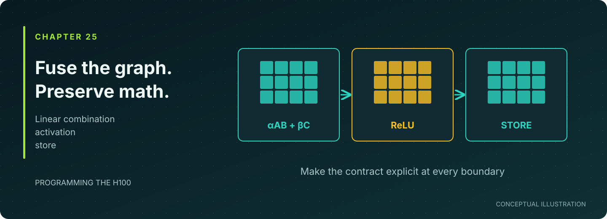
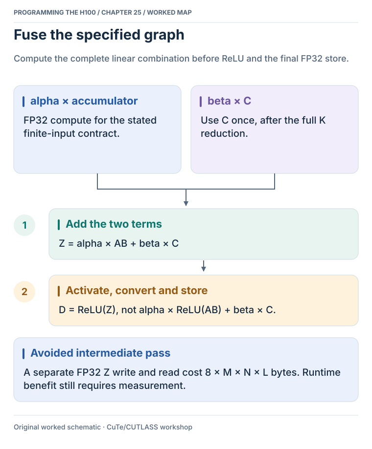

# 25. Epilogue Fusion — Preserve the Operation, Remove a Pass
## Lesson 25 Companion Guide — Preserve Numerical Semantics While Removing a Memory Pass

[](images/chapter-openers/25-workshop.svg)


!!! tip "Your goal in this chapter"

    Translate a mathematical epilogue into a compatible CUTLASS fusion operation, validate its exact semantics and compare complete workloads. Read [the builder](23-cutlass-gemm.md) and [pipeline ownership](24-cutlass-pipelines.md) first.

## 1 — State the graph before writing a tag

[](images/ch25/overview.svg)

The baseline computes `Z = alpha*AB + beta*C`. The executable fusion lab computes `D = ReLU(Z)`, with `ReLU(x)=max(0,x)` for the finite values used by its test. All operands, accumulator and scalar conventions remain explicit: FP16 A/B, FP32 accumulation, FP32 C and output, and scalar alpha/beta applied once.

That ordering matters. For accumulator value −1, alpha −2 and beta zero, `ReLU(alpha*acc)=2`, while `alpha*ReLU(acc)=0`. A compiler fusion is correct only when it implements the operation you requested, not an intuitively similar rearrangement. The reference must also preserve the specified conversion points; rounding before activation can differ from rounding only at the final store.

The supplied tutorial’s broad advice to fuse epilogues becomes useful once the graph, layouts, numerical contract and verification are concrete. This chapter builds on the pinned [fusion operation tags](https://github.com/NVIDIA/cutlass/blob/v4.3.6/include/cutlass/epilogue/fusion/operations.hpp) and [Hopper callback implementations](https://github.com/NVIDIA/cutlass/blob/v4.3.6/include/cutlass/epilogue/fusion/sm90_callbacks_tma_warpspecialized.hpp).

## 2 — Three boundaries of an epilogue

An accumulator fragment is distributed across threads according to the MMA implementation. It is not an ordinary contiguous M×N array in one thread. The epilogue must connect three boundaries:

| Boundary | Obligation |
| --- | --- |
| Fragment to logical output | Every `(m,n,l)` maps to the intended accumulator value |
| Compute expression | Scalars, C, bias/residual and activation use the specified order and precision |
| Logical output to storage | Valid destinations are stored once with correct strides and edge predicates |

An elementwise expression may be simple while its store path is complicated. A TMA epilogue can also have shared-memory staging and an asynchronous store lifecycle. A fused activation tag does not make those costs or ownership obligations disappear.

## 3 — Use a supported predefined fusion first

The complete [cutlass_gemm_relu.cu](examples/advanced/cutlass_gemm_relu.cu) uses the pinned predefined operation:

```cpp
using Fusion = cutlass::epilogue::fusion::LinCombEltAct<
    cutlass::epilogue::thread::ReLu,
    float, float, float>;
```

Here the type parameters select the activation functor, output, compute and C-source element types. The chosen scalar type defaults to the compute type in this release. This is a type-level description; the runtime alpha and beta still come from the kernel arguments.

The example chooses an explicit compatible mainloop/epilogue pair: `KernelTmaWarpSpecializedPingpong` and `TmaWarpSpecialized`. Both are changed deliberately rather than mixing an explicit epilogue with an unconstrained Auto mainloop. The mainloop stage policy reserves the selected epilogue’s shared storage, as in Chapter 23. In this pinned Sm90 implementation, `EpilogueScheduleAuto` has a static assertion restricting its fusion to the supported linear combination; it does not select a ReLU implementation automatically. The explicit supported TMA epilogue is therefore an API requirement for this example, not merely a tuning preference. See the [pinned Sm90 epilogue builder](https://github.com/NVIDIA/cutlass/blob/v4.3.6/include/cutlass/epilogue/collective/builders/sm90_builder.inl).

The original linear GEMM remains a separate source and executable. Its pass does not substitute for the fused variant’s numerical tests. Each has its own source hash, compiler record and actual output.

### Compile the complete fused variant

From the repository root, with the pinned `CUTLASS_ROOT` and `build/advanced` prepared in Chapter 15:

```bash
nvcc -std=c++17 -O2 -lineinfo -arch=sm_90a \
  --expt-relaxed-constexpr \
  -I "$CUTLASS_ROOT/include" -I "$CUTLASS_ROOT/tools/util/include" \
  docs/examples/advanced/cutlass_gemm_relu.cu \
  -o build/advanced/cutlass_gemm_relu -lcuda
./build/advanced/cutlass_gemm_relu
```

The driver link is deliberate. A successful CUDA compile stage does not imply a successful executable link; preserve both diagnostics and the final process status.

## 4 — Follow the runtime arguments

The device adapter takes the same problem shape, operand pointers and strides as before. The epilogue thread arguments carry alpha and beta. The underlying supported fusion supplies the activation during epilogue execution, after forming the requested linear combination.

The host lifecycle is unchanged in principle: check `can_implement`, allocate workspace, initialize, launch, check asynchronous completion, then validate all output values. A new supported fusion does not justify removing those checks. Changing schedules can change shared-memory demand, available stages and launch constraints even when the mathematical shape is identical.

Do not copy the argument aggregate of an unrelated EVT. Some predefined fusion operations expose flat named fields; custom trees can require nested argument structures that mirror their nodes. Inspect the selected operation and callback definitions in the pinned release.

## 5 — Read an epilogue visitor tree as dataflow

A conceptual tree for the lab is:

```text
A,B → MMA accumulator → multiply by alpha ─┐
                                         ├→ add → ReLU → convert/store D
C → multiply by beta ─────────────────────┘
```

Nodes describe fetch, broadcast, computation or storage. Child order and operation type determine the expression. A `multiply_add` node with the wrong child order can compile while implementing a different formula. A cast in a child node can also move rounding earlier in the graph.

Pinned example 49 contains a custom tree implementing the linear combination. Start by matching that tree against its scalar formula and argument structure, then identify how a supported activation is attached. Do not write a new callback merely to reproduce a predefined operation that already matches the contract.

### Evaluate the fusion tree one node at a time

Start with the small matrices from Chapter 23, whose independently computed `AB=[[-1,17],[7,0]]` and `C=[[2,-4],[6,8]]`. Choose the lab's operation `D=ReLU(0.5*AB+0.25*C)`. This is a manual semantic example, not a transcript of the larger executable's initialization.

1. **Fetch the completed accumulator.** At `(m,n)=(0,1)`, the entire K reduction is `acc=17`. Do not apply the epilogue to each partial K tile.
2. **Apply alpha.** The accumulator branch produces `0.5*17=8.5` in the selected FP32 compute type.
3. **Fetch and scale C.** The source branch reads `C[0,1]=-4` and produces `0.25*(-4)=-1`. This is the C operand, not an accumulator register with the same index.
4. **Join the branches.** The linear combination is `Z=8.5+(-1)=7.5`. Apply ReLU **after** this addition, so `D[0,1]=7.5`.
5. **Repeat across the output.** The intermediate Z is `[[0,7.5],[5,2]]`; all entries survive ReLU. To test that activation really occurs, change only the illustrative `C[0,0]` to `-2`: `Z[0,0]=0.5*(-1)+0.25*(-2)=-1`, so the fused output there must be zero. A purely positive test would not distinguish a missing activation.
6. **Connect the API.** `LinCombEltAct<ReLu,float,float,float>` names the activation/output/compute/source contract; `args.epilogue.thread.alpha` and `.beta` provide the runtime scalars. The explicit supported mainloop/epilogue schedules implement the storage and synchronization path around this expression.

**Check:** compare the fused output to the independently evaluated Z followed by activation, not to the unfused output Z itself. The example's binary fractions are exactly representable; a general low-precision output needs an explicit conversion/rounding policy too. If a future bias is added, write its coordinate and insert its addition at the intended node before changing any callback types.

## 6 — Bias and residuals need a coordinate contract

The executable lab adds activation, not bias. A bias extension must define its broadcast axis explicitly. For `D[m,n,l]=activation(Z[m,n,l]+bias[n,l])`, a length-N vector is shared across M rows. A length-M vector represents a different operation.

| Term | Logical indexing | What changes across output rows? |
| --- | --- | --- |
| Per-column bias | `bias[n]` | Nothing for a fixed n |
| Per-row bias | `bias[m]` | The bias value |
| Batched column bias | `bias[l*N+n]` | Batch selection, not row selection |
| Residual matrix | `R[(l*M+m)*ldr+n]` | Both row and column can change |

An implementation can encode a broadcast with a zero stride in the broadcast mode, but the fusion API still needs its supported layout/argument type. A zero-stride source view is useful for replicated reads; using it for independent output writes creates aliases. Add rectangular and multi-batch tests so an accidental row/column swap is visible.

## 7 — Make the reference stronger than a checksum

The lab reuses three aligned, batched and partial-tile problem shapes, with mixed-sign nonuniform values and nonzero beta in two cases. D begins as NaNs; any missing store therefore fails the finite/full-output check even when an expected value happens to be zero.

The CPU reference performs the complete reduction independently, forms alpha/beta/C in the defined order, then applies ReLU. Inputs and scalars are bounded binary fractions, so the chosen reductions are exactly representable in FP32; this justifies exact equality for this test matrix. The reference checks every output rather than only a sum or selected positions.

These finite-input cases do not establish NaN propagation, signed-zero policy, overflow behavior, low-precision output rounding or gradients at zero. If those are part of an application’s contract, test the selected activation/conversion implementation against that contract. Framework defaults are not interchangeable specifications.

## 8 — Count the memory pass you actually remove

For a separate FP32 activation after GEMM, the intermediate Z is written once, read once and the final D is written once. A fused output stores D directly. Ignoring other unchanged traffic, fusion avoids `8*M*N*L` bytes: one four-byte write and one four-byte read per intermediate element.

For `M=N=2048,L=1`, that is 33,554,432 bytes, or 32 MiB. This is a traffic accounting example, not a measured saving in DRAM traffic or elapsed time. C reads, A/B traffic, cache residency, epilogue staging and the changed kernel schedule still matter.

A fused kernel can take longer than the unfused GEMM alone while beating GEMM plus activation. Compare the full operation, including any extra packing/conversion, and check the application’s useful-result boundary in [Nsight Systems](14-nsight-systems.md). A larger epilogue can reduce stages or residency enough to offset an avoided memory pass.

## 9 — A controlled extension exercise

After the existing ReLU variant passes, choose one additional supported operation. Write its scalar formula and explicit types, modify the independent reference, add shape/stride cases that distinguish its broadcast axes, and retain the old result as a regression check. Run the memory sanitizer after any change to the store path or shared-memory staging.

Then measure the complete fused and unfused sequences under the same warmup, allocation and timing policy. Report both the resource change and the latency change. A failed optimization is still useful when the result explains which cost moved onto the critical path.

??? question "Can the original GEMM oracle validate a fused activation?"

    The linear GEMM passes. The activation output looks plausible. Is that enough?

    **Answer:** No. The mathematical output changed. Compare the fused result against an independently computed reduction, linear combination and activation in the specified order.

??? question "Does bias belong to M or N?"

    A 37×29 output uses a 29-element bias. Which coordinate selects it?

    **Answer:** n for a per-column bias, shared across the 37 rows. A per-row bias would require 37 elements and represent a different contract.

<!-- workshop:start:cutlass_gemm_relu -->
## Complete source and captured execution

**Executed on November 18, 2026 (UTC).** Scope: **CUDA workload with its stated numerical checks**.

Tested source SHA-256: `1c30bab9f526932f2749329a71ad50f9002deeddcba4108113ffa497e0482418`. [Exact source](validation/2026-11-18-h100-workshop/cutlass_gemm_relu.cu) · [System information](validation/2026-11-18-h100-workshop/system.json) · [Workshop results](cutlass-workshop-validation.md).

The listing below matches the tested source. Its presentation is formatted at build time; downloads retain the captured bytes.

```cuda
// A complete fused ReLU variant of the pinned Hopper GEMM with a full CPU oracle.
#include <cute/tensor.hpp>
#include <cutlass/cutlass.h>
#include <cutlass/epilogue/collective/collective_builder.hpp>
#include <cutlass/epilogue/fusion/operations.hpp>
#include <cutlass/epilogue/thread/activation.h>
#include <cutlass/gemm/collective/collective_builder.hpp>
#include <cutlass/gemm/device/gemm_universal_adapter.h>
#include <cutlass/gemm/kernel/gemm_universal.hpp>
#include <cutlass/util/device_memory.h>
#include <cutlass/util/packed_stride.hpp>
#include <cuda_runtime.h>
#include <cmath>
#include <cstdio>
#include <stdexcept>
#include <vector>
using namespace cute;
using Half = cutlass::half_t;
using Row = cutlass::layout::RowMajor;
using CtaTileShape = Shape<_128, _128, _64>;
using Cluster = Shape<_1, _1, _1>;
using Fusion = cutlass::epilogue::fusion::LinCombEltAct<
    cutlass::epilogue::thread::ReLu, float, float, float>;
using Epilogue = cutlass::epilogue::collective::CollectiveBuilder<
    cutlass::arch::Sm90, cutlass::arch::OpClassTensorOp,
    CtaTileShape, Cluster, cutlass::epilogue::collective::EpilogueTileAuto,
    float, float, float, Row, 4, float, Row, 4,
    cutlass::epilogue::TmaWarpSpecialized, Fusion>::CollectiveOp;
using Mainloop = cutlass::gemm::collective::CollectiveBuilder<
    cutlass::arch::Sm90, cutlass::arch::OpClassTensorOp,
    Half, Row, 8, Half, Row, 8, float, CtaTileShape, Cluster,
    cutlass::gemm::collective::StageCountAutoCarveout<
        static_cast<int>(sizeof(Epilogue::SharedStorage))>,
    cutlass::gemm::KernelTmaWarpSpecializedPingpong>::CollectiveOp;
using Kernel = cutlass::gemm::kernel::GemmUniversal<
    Shape<int, int, int, int>, Mainloop, Epilogue>;
using Gemm = cutlass::gemm::device::GemmUniversalAdapter<Kernel>;

void cuda_check(cudaError_t s) {
    if (s != cudaSuccess) throw std::runtime_error(cudaGetErrorString(s));
}
void cutlass_check(cutlass::Status s) {
    if (s != cutlass::Status::kSuccess)
        throw std::runtime_error(cutlassGetStatusString(s));
}

bool test(int M, int N, int K, int L, float alpha, float beta,
          cutlass::KernelHardwareInfo hardware) {
    std::vector<Half> A(size_t(L) * M * K), B(size_t(L) * K * N);
    std::vector<float> C(size_t(L) * M * N), D(C.size());
    for (size_t i = 0; i < A.size(); ++i) A[i] = Half(float(int(i % 13) - 6) / 8);
    for (size_t i = 0; i < B.size(); ++i) B[i] = Half(float(int(i % 17) - 8) / 8);
    for (size_t i = 0; i < C.size(); ++i) C[i] = float(int(i % 19) - 9) / 16;
    cutlass::device_memory::allocation<Half> da(A.size()), db(B.size());
    cutlass::device_memory::allocation<float> dc(C.size()), dd(D.size());
    cuda_check(cudaMemcpy(da.get(), A.data(), A.size() * sizeof(Half), cudaMemcpyHostToDevice));
    cuda_check(cudaMemcpy(db.get(), B.data(), B.size() * sizeof(Half), cudaMemcpyHostToDevice));
    cuda_check(cudaMemcpy(dc.get(), C.data(), C.size() * sizeof(float), cudaMemcpyHostToDevice));
    // IEEE FP32 all-one bits are NaN: an omitted output store cannot pass
    // merely because its reference value happens to be zero.
    cuda_check(cudaMemset(dd.get(), 0xff, D.size() * sizeof(float)));
    auto sa = cutlass::make_cute_packed_stride(Kernel::StrideA{}, make_shape(M, K, L));
    auto sb = cutlass::make_cute_packed_stride(Kernel::StrideB{}, make_shape(N, K, L));
    auto sc = cutlass::make_cute_packed_stride(Kernel::StrideC{}, make_shape(M, N, L));
    auto sd = cutlass::make_cute_packed_stride(Kernel::StrideD{}, make_shape(M, N, L));
    Gemm::Arguments args{cutlass::gemm::GemmUniversalMode::kGemm,
                         {M, N, K, L}, {da.get(), sa, db.get(), sb},
                         {{}, dc.get(), sc, dd.get(), sd}, hardware};
    args.epilogue.thread.alpha = alpha;
    args.epilogue.thread.beta = beta;
    Gemm gemm;
    cutlass_check(gemm.can_implement(args));
    cutlass::device_memory::allocation<unsigned char> workspace(Gemm::get_workspace_size(args));
    cutlass_check(gemm.initialize(args, workspace.get()));
    cutlass_check(gemm.run());
    cuda_check(cudaDeviceSynchronize());
    cuda_check(cudaMemcpy(D.data(), dd.get(), D.size() * sizeof(float), cudaMemcpyDeviceToHost));
    size_t errors = 0;
    for (int l = 0; l < L; ++l)
        for (int m = 0; m < M; ++m)
            for (int n = 0; n < N; ++n) {
                double sum = 0;
                for (int k = 0; k < K; ++k)
                    sum += double(float(A[(size_t(l) * M + m) * K + k])) *
                           double(float(B[(size_t(l) * K + k) * N + n]));
                size_t i = (size_t(l) * M + m) * N + n;
                float expected = float(alpha * sum + beta * C[i]);
                expected = expected < 0.0f ? 0.0f : expected;
                // These bounded binary-rational inputs make the sum exact in FP32.
                errors += !std::isfinite(D[i]) || D[i] != expected;
            }
    std::printf("%s M=%d N=%d K=%d L=%d alpha=%.2f beta=%.2f checked=%zu errors=%zu\n",
                errors ? "FUSED GEMM FAIL" : "FUSED GEMM CASE PASS", M, N, K, L, alpha, beta, D.size(), errors);
    return errors == 0;
}
int main() {
    try {
        cudaDeviceProp p{};
        cuda_check(cudaSetDevice(0));
        cuda_check(cudaGetDeviceProperties(&p, 0));
        if (p.major != 9 || p.minor != 0) {
            std::fprintf(stderr, "Requires Hopper compute capability 9.0; found %d.%d\n", p.major, p.minor);
            return 2;
        }
        cutlass::KernelHardwareInfo hw{};
        hw.device_id = 0;
        hw.sm_count = p.multiProcessorCount;
        bool ok = test(128, 128, 64, 1, 1, 0, hw);
        ok = test(256, 128, 128, 2, 0.5f, 0.25f, hw) && ok;
        ok = test(136, 264, 72, 1, 0.5f, 0.25f, hw) && ok;
        std::puts(ok ? "FUSED GEMM PASS: 3 full CPU-reference cases" : "FUSED GEMM FAIL");
        return ok ? 0 : 1;
    } catch (const std::exception& e) {
        std::fprintf(stderr, "FUSED GEMM ERROR: %s\n", e.what());
        return 1;
    }
}
```

CUDA compilation UTC: `2026-11-18T14:10:34.925330+00:00`. Exit: `0`. [Compile log](validation/2026-11-18-h100-workshop/cutlass_gemm_relu-compile.log).

Commands use scratch-directory filenames; raw logs retain exact paths. The collector’s CUTLASS include flags are configuration for that capture; the minimal standalone overlap/SIMT commands do not require those headers.

```bash
nvcc -std=c++17 -O2 -lineinfo -arch=sm_90a --expt-relaxed-constexpr -I "$CUTLASS_ROOT/include" -I "$CUTLASS_ROOT/tools/util/include" cutlass_gemm_relu.cu -o ./example -lcuda
```

Executed UTC: `2026-11-18T14:11:16.060379+00:00`. Exit: `0`. [Run log](validation/2026-11-18-h100-workshop/cutlass_gemm_relu-run.log).

```bash
./example
```

**Actual captured output**

```text
FUSED GEMM CASE PASS M=128 N=128 K=64 L=1 alpha=1.00 beta=0.00 checked=16384 errors=0
FUSED GEMM CASE PASS M=256 N=128 K=128 L=2 alpha=0.50 beta=0.25 checked=65536 errors=0
FUSED GEMM CASE PASS M=136 N=264 K=72 L=1 alpha=0.50 beta=0.25 checked=35904 errors=0
FUSED GEMM PASS: 3 full CPU-reference cases
```

<!-- workshop:end:cutlass_gemm_relu -->

## Additional memory-safety record

The exact tested revision also passed [Compute Sanitizer memcheck](validation/2026-11-18-h100-workshop/supplemental-captures/gpu-checks/20261118T141445Z/memcheck-cutlass_gemm_relu.log) with zero errors and its numerical checks intact. [The dated supplemental manifest](validation/2026-11-18-h100-workshop/supplemental-captures/gpu-checks/20261118T141445Z/commands.json) retains commands, source hashes and actual UTC stage times. This does not prove every untested schedule.

<!-- companion-summary:start -->
## Summary

- Specify the epilogue graph, precision and output coordinates before selecting a predefined fusion or visitor tree.

- Activation order, beta/C participation, broadcast axes and conversion boundaries can change results even when a template compiles.

- Validate the fused variant independently and compare the complete fused and unfused workloads. [Precision and block scaling](26-precision-block-scaling.md) add further representation contracts.
<!-- companion-summary:end -->
