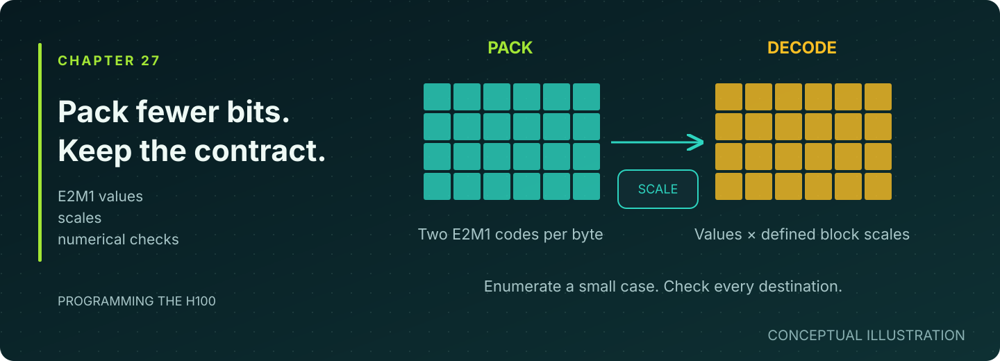
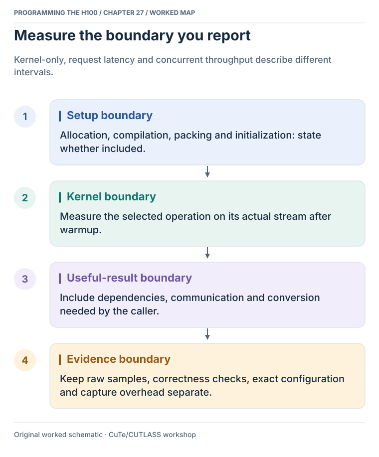
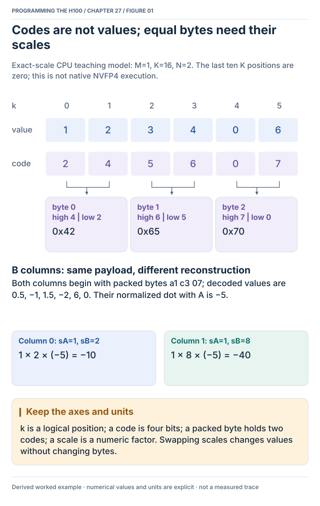

# 27. Precision, Block Scaling and the Hopper–Blackwell Boundary

## Chapter 27 Companion Guide — Separate Stored Codes, Scale Layouts and Executed Arithmetic

[](images/chapter-openers/27-workshop.svg)


!!! tip "Your goal in this chapter"

    Decode E2M1 and packed nibbles, identify the reduction-axis scale contract, and separate representation error from kernel error. Read [GEMM contracts](24-cutlass-gemm.md) and [epilogue precision](26-epilogue-fusion.md) first.

A low-bit GEMM has two independent questions: what numbers do the stored bits represent, and what instructions execute the multiplication? A four-bit allocation answers neither question completely. This chapter separates representation, quantization, scale layout and accumulation so a storage experiment cannot accidentally become a claim about native Tensor Core support.

The executed CUTLASS GEMM labs in this track use FP16 operands and FP32 accumulation. Hopper also supports BF16, but changing these labs to BF16 requires a separate build and numerical validation. The CPU exercise below explores E2M1 representation with exact floating-point block scales. It is a format reference, not an NVFP4 kernel or an implementation of NVIDIA's complete quantization recipe.

### Hopper FP8 before Blackwell FP4

Hopper supports FP8 E4M3 (largest finite magnitude 448; no infinity) and
E5M2 (largest finite magnitude 57344; infinity available). Both are floating
point, not evenly spaced integer codes. INT8 is another supported GEMM input
family; its quantization and accumulation contracts differ.

For per-tensor scaling define `q = quantize(x/s)` and reconstruct `x ≈ s*q`.
If x=[1,2,4,8] and s=2, the values before rounding are [0.5,1,2,4]; multiplying
back by 2 reconstructs this particular example exactly. Real values generally
round. Choose s to manage overflow and underflow; scaling does not add mantissa
bits. Delayed per-tensor scaling uses a previous step's reduced amax, not an
unavailable future maximum.

Hopper also has software/library blockwise-scaled FP8 GEMM. In pinned CUTLASS,
read examples 67 (single GEMM) and 68 (grouped GEMM), and
`KernelTmaWarpSpecializedCooperativeFP8Blockwise`. For each K block t,
accumulate `sA[m,t]*sB[n,t]*dot(qA[m,t],qB[n,t])` in the output's higher-precision
accumulation. With two block dot products 3 and -1, and scale products 2 and
8, the reconstructed sum is 2*3 + 8*(-1) = -2. Applying one final scale to
the unscaled sum 2 is generally wrong because the block scales differ.

The `KernelTmaWarpSpecialized*FP8FastAccum` policies make a distinct precision/
throughput choice. Promoting partial results and fast tensor-core accumulation
are not interchangeable error contracts; compare against a higher-precision
reference on the actual input distribution. These are source-reading and
worked-arithmetic examples, not new GPU execution claims. Blackwell's native
NVFP4 scale/storage contract below is a separate architecture feature.


## 1 — Write the numerical contract before the datatype

[](images/ch27/overview.svg)

Start with logical operands `A[M,K]` and `B[K,N]`, then state which matrix is actually multiplied. If quantization reconstructs `A_hat` and `B_hat`, a low-bit kernel approximates `A_hat @ B_hat`; comparing only against the original `A @ B` mixes quantization error with implementation error.

Use two references. A representation reference decodes the exact stored codes and scales. An arithmetic reference multiplies those decoded values with an explicitly chosen accumulator. Comparing the kernel with this second result diagnoses the kernel. Comparing the second result with the original higher-precision product diagnoses the representation's effect on the workload. A large error in either deserves investigation, but the remedies differ.

Record input format, scale format, scale direction, rounding, finite-value policy, accumulator precision, output conversion and `alpha`/`beta`. “FP4 GEMM” leaves nearly all of these unspecified. A reference must also reproduce whether scaling occurs before multiplication, during block accumulation or in the epilogue: mathematically equivalent rearrangements can round differently.

## 2 — E2M1 is a floating-point codebook

The positive E2M1 magnitudes are:

| Low three bits | Magnitude | Low three bits | Magnitude |
|---|---:|---|---:|
| `000` | 0 | `100` | 2 |
| `001` | 0.5 | `101` | 3 |
| `010` | 1 | `110` | 4 |
| `011` | 1.5 | `111` | 6 |

Bit three supplies the sign, including negative zero. The gaps between values grow with magnitude. Signed two's-complement INT4, whose usual range is −8 through 7, has a different interpretation of the same nibble. Sign-extending an E2M1 nibble as an integer therefore produces the wrong value even when the byte packing is correct.

The exercise defines nearest-representable rounding with ties to an even code least-significant bit and saturation of finite magnitudes above six. It rejects NaN and infinity. That explicit policy is part of this reference; it does not imply every conversion API defaults to identical behavior. [Transformer Engine's precision primer](https://docs.nvidia.com/deeplearning/transformer-engine/examples/fp8_primer.html) explains E2M1 and the distinction between low-precision formats.

## 3 — Scaling changes the represented number

For one illustrative block, reconstruct an element as

`x_hat[i] = scale[block] * q[i]`, where `q[i]` is one of `0, ±0.5, ±1, ±1.5, ±2, ±3, ±4, ±6`.

An exact-scale teaching quantizer can choose `s_b = amax(block) / 6`, then round `x_i / s_b` to that codebook. Dividing by `amax` and rounding to integers instead produces mostly −1, 0 and 1; clamping that result to seven does not recover the missing precision.

For an all-zero block, choose a documented harmless scale, such as one, and emit signed zero codes. Adding an arbitrarily small epsilon is not a robust substitute: `1e-12` becomes zero in FP16, so a zero block can still produce `0 / 0`. Check finite inputs and scale underflow explicitly. A real quantizer must additionally define clipping, very small scales and the precision used to calculate `amax`.

NVIDIA NVFP4 uses E2M1 values, E4M3 block scales shared over 16 elements and a second, per-tensor FP32 scale. Quantizing the scale introduces another rounding step. Our exact-scale example omits that step deliberately; its errors cannot be reported as the errors of the complete NVFP4 recipe. See [Transformer Engine's NVFP4 description](https://docs.nvidia.com/deeplearning/transformer-engine/features/low_precision_training/nvfp4/nvfp4.html).

## 4 — Scale along the reduction axis

For `A[M,K]`, K-block scaling naturally yields logical scales `S_A[M,ceil(K/16)]`. For `B[K,N]`, K-block scaling yields `S_B[ceil(K/16),N]`. Quantizing contiguous groups from each row of a row-major B instead groups along N and changes the representation.

One simple reference transposes B into a logical `B_T[N,K]`, quantizes its rows, and retains that orientation for the packed payload. The consumer must then interpret B as `[N,K]` storage, not silently reuse `[K,N]` indexing. This distinction is why a matrix's mathematical dimensions, storage dimensions and scale dimensions should appear together in every interface.

Use an asymmetric test: give B's first column values near one and its second values eight times larger. The correct scales follow each column's K blocks. A uniform matrix or square shape can conceal a swapped axis, while deliberately different magnitudes reveal it. Also test multiple K blocks with distinct maxima; one scale per entire row can otherwise appear to work.

## 5 — Packed bytes and blocked scales are separate layouts

Two four-bit codes fit in a byte. This exercise places the first logical code in the low nibble and the second in the high nibble. That convention must match the decoder; masking only `byte & 15` duplicates the low value and discards half the operand.

If a row stores K logical values in K/2 bytes, its byte stride is K/2, not K. Derive row and column contributions in consistent units before forming an address. For odd K, specify padding and a logical valid-element count; never let a padding nibble become an extra reduction term. The reference requires an even code count and complete blocks so omissions cannot be hidden by implicit padding.

A blocked or swizzled scale tensor introduces another coordinate map. Flattening a permuted scale tensor does not make ordinary row-major indexing valid. Prove the producer and consumer maps agree for every logical scale coordinate, including padded regions. A hardware-required scale layout is specific to the chosen instruction and library interface, not a universal `to_blocked()` transformation or guaranteed speedup.

### Worked block: encode, pack, reconstruct, multiply

Use M=1, K=16 and N=2. Only the first six positions may be nonzero; positions 6 through 15 are zero. The original operands are:

| K position | 0 | 1 | 2 | 3 | 4 | 5 | 6 through 15 |
| --- | ---: | ---: | ---: | ---: | ---: | ---: | --- |
| A row | 1 | 2 | 3 | 4 | 0 | 6 | All zero |
| B column 0 | 1 | −2 | 3 | −4 | 12 | 0 | All zero |
| B column 1 | 4 | −8 | 12 | −16 | 48 | 0 | All zero |

The purpose is to see a complete representation path by hand, not to simulate Blackwell's scale storage. Use the CPU reference's exact Python-float scales and its low-nibble-first packing convention.

1. **Choose each K-block scale.** A's maximum magnitude is six, so `s_A=6/6=1`. B's column maxima are 12 and 48, so their scales are two and eight. Logical `S_B[block_k,n]` is therefore `[2,8]` for the single K block. The helper stores these as rows of the transposed B view, `[[2],[8]]`.
2. **Normalize and encode A.** Its first six normalized values are `1,2,3,4,0,6`, with E2M1 codes `2,4,5,6,0,7`. For example, code 5 is floating-point value three, not integer five.
3. **Pack A pairs.** Codes `(2,4)` become byte `0x42`; `(5,6)` become `0x65`; `(0,7)` become `0x70`. The remaining ten zeros occupy five zero bytes. Sixteen values require eight bytes.
4. **Normalize and encode B.** Both columns produce the same normalized values `0.5,-1,1.5,-2,6,0`, but have different scales. Their first six codes are `1,A,3,C,7,0` in hexadecimal. The packed bytes begin `A1 C3 07`. Sign extension would incorrectly read code `A` as integer −6; the E2M1 decoder correctly returns −1.
5. **Reconstruct before multiplying.** Column 0 becomes twice its decoded code values, restoring `1,-2,3,-4,12,0`. Column 1 uses scale eight and restores four times column 0. No quantization error arises for these deliberately representable inputs.
6. **Calculate each dot.** The normalized dot is `1×0.5 + 2×(-1) + 3×1.5 + 4×(-2) + 0×6 + 6×0 = -5`. Restoring the scale products gives outputs `1×2×(-5)=-10` and `1×8×(-5)=-40`.

You can reproduce the same steps using the complete reference rather than writing a second decoder. From the repository root:

```python
import math
import sys
sys.path.insert(0, "docs/examples/advanced")
from fp4_reference import quantize_rows, quantize_b_kn, pack

a = [1, 2, 3, 4, 0, 6] + [0] * 10
b0 = [1, -2, 3, -4, 12, 0] + [0] * 10
b1 = [4 * value for value in b0]
qa, sa, a_hat = quantize_rows([a])
qb, sb, b_hat = quantize_b_kn([list(pair) for pair in zip(b0, b1)])
print("A bytes:", pack(qa[0]).hex(" "))
print("B column 0 bytes:", pack(qb[0]).hex(" "))
print("A row scales:", sa)
print("B transpose-row scales:", sb)
print("Reconstructed dot products:", [
    math.fsum(a_hat[0][k] * b_hat[k][n] for k in range(16))
    for n in range(2)
])
```

The CPU calculation produces:

```text
A bytes: 42 65 70 00 00 00 00 00
B column 0 bytes: a1 c3 07 00 00 00 00 00
A row scales: [[1.0]]
B transpose-row scales: [[2.0], [8.0]]
Reconstructed dot products: [-10.0, -40.0]
```

**Check:** the original-input dots also equal −10 and −40, and both B columns share codes while retaining different scales. **Pitfall:** swapping the two scale entries preserves every packed nibble but changes both outputs. With several K blocks, apply each block's own scale product before combining its partial dot; one final scale cannot generally replace all block scales. This worked result remains a CPU E2M1/exact-scale exercise, not evidence of E4M3 scale conversion or native NVFP4 execution.

### Keep codes, packed bytes and reconstructed values on separate rows

Read this panel downward for A's first six values. `q` denotes an E2M1 **decoded numerical value**; `code` is its unsigned four-bit representation. Hexadecimal digits below are codes, not ordinary integer quantization levels. A's scale is one in this deliberately exact example.

```text
Logical k:        0       1       2       3       4       5
A original:       1       2       3       4       0       6
scale s_A:        1       1       1       1       1       1
q = A/s_A:        1       2       3       4       0       6
E2M1 code:       0x2     0x4     0x5     0x6     0x0     0x7
                   \     /         \     /         \     /
packed byte:        0x42             0x65             0x70
byte offset:          0                1                2
                 high|low         high|low         high|low
```

The first logical code goes in the low nibble: `code0 | (code1<<4)`. To recover k=3, select byte `3//2=1`, shift by four because `3%2=1`, mask with fifteen and decode code `0x6` as numerical value four. Multiplying by scale one reconstructs A's original value four. The complete `pack`/`unpack` and `decode` functions perform these separate steps.

B's two columns illustrate why payload equality is not value equality:

```text
K-block                 column 0                  column 1
first packed bytes      a1 c3 07                  a1 c3 07
first decoded values    0.5,-1,1.5,-2,6,0          0.5,-1,1.5,-2,6,0
block scale             2                         8
reconstructed values    1,-2,3,-4,12,0             4,-8,12,-16,48,0
normalized dot          -5                        -5
apply s_A*s_B           1*2*(-5)=-10               1*8*(-5)=-40
```

Each column's scale belongs to its reduction-axis K block. Keeping identical packed bytes but swapping the scales changes the outputs. This concrete panel models exact Python-float scales; it does not model E4M3 scale rounding, Blackwell's physical scale layout or native low-bit multiplication.

[](images/worked/ch27-nibbles-scales-dot.svg)

### Reproduce one nibble extraction with the actual reference API

Run this complete CPU snippet from the repository root with Python's standard library and the supplied reference module. It allocates only Python objects and launches no CUDA work:

```python
import sys
sys.path.insert(0, "docs/examples/advanced")
from fp4_reference import pack, unpack, decode

codes = [0x2, 0x4, 0x5, 0x6, 0x0, 0x7]
payload = pack(codes)
k = 3
byte_index, high_nibble = divmod(k, 2)
code = (payload[byte_index] >> (4 * high_nibble)) & 0xF
assert payload == bytes.fromhex("42 65 70")
assert code == 0x6 and decode(code) == 4.0
assert unpack(payload) == codes
print("byte=1 high=1 code=0x6 decoded=4.0")
```

1. `divmod(3,2)` gives byte index one and nibble selector one. The selector is a position, not the sign bit.
2. Byte one is `0x65`. Shifting right by four discards low code `0x5`, leaving high code `0x6`.
3. Masking with `0xF` keeps the nibble. The decoder interprets code six as E2M1 value four; it does not return integer six.
4. This A example has scale one. A different scale multiplies decoded four before the reconstructed value participates in a reference dot product.

**Pitfall:** reversing the high/low convention still creates valid nibbles, so a code-range check alone cannot detect the permutation. Compare reconstructed values at their original K coordinates.

## 6 — Keep error sources distinguishable

Let `D_ref = A @ B` and `D_repr = A_hat @ B_hat`, both evaluated by the reference arithmetic. Then `D_repr - D_ref` measures representation effects. `D_kernel - D_repr` includes implementation and accumulation differences. A correct kernel need not reproduce the unquantized matrix exactly, and a plausible total error does not prove its indexing is correct.

Test signed zeros, alternating signs, sparse values, outliers, block-boundary changes, nonuniform coordinates and nonmultiple dimensions where the kernel supports them. Measure maximum absolute error and a normwise relative error; handle a zero reference norm explicitly. Check finite outputs before applying tolerances. Record both worst-case coordinates and aggregate metrics so a local corruption cannot disappear in an average.

FP32 accumulation generally reduces reduction-rounding error relative to repeatedly storing partial sums in FP16. It does not remove input quantization error or guarantee a particular application's accuracy. “Proper scales prevent overflow” is also insufficient: the final dot product may exceed the output format even when each input block is well scaled. Define whether overflow fails, saturates or produces infinity, and validate that policy.

### Work a lossy rounding case and two distinct K-block scales

The previous packed example had no quantization loss by construction. To expose loss, choose a block containing the values `6` and `2.5` (and fourteen zeros). Its exact scale is one. The value 2.5 lies halfway between E2M1 magnitudes two (code 4) and three (code 5); nearest-even chooses code 4. Reconstruction yields two, so its signed representation error is `2-2.5=-0.5`. The maximum value six remains exact. A successful code round trip therefore does not imply that arbitrary original real values round trip.

Now let a dot product have two K blocks, with normalized partial dots `p0=3` and `p1=-2`. Suppose A's scales are `[1,8]` and B's are `[2,4]`. The reconstructed result is

`D_repr = (1*2)*3 + (8*4)*(-2) = 6-64 = -58`.

The general scalar formula is `sum_b (S_A[m,b]*S_B[b,n])*p_b`, where `p_b` reduces decoded codes **only inside block b**. Factoring out the first scale pair would give `2*(3-2)=2`, a different result. This is why the scale coordinate must travel with every block contribution. These algebraic partial dots illustrate the contract; they are not an additional captured native GPU execution.

### Exercise: zero reference values and output overflow

Suppose one hypothetical reference output is zero and a kernel returns `1e-5`. Dividing the error by the reference produces an undefined relative comparison. If the declared absolute tolerance is `1e-6`, this element fails: `abs(1e-5−0)>1e-6`. The example's tolerance is a stated exercise choice, not a recommended universal threshold.

Now use exactly representable FP16 inputs A=`[400,400]`, B=`[100,100]`. Their mathematical dot is 80000, which fits FP32 but exceeds FP16's largest finite magnitude 65504. Well-scaled finite inputs therefore do not guarantee finite FP16 output. A contract that requires finite output must reject or otherwise handle this case; a contract allowing infinity needs the reference and comparison to recognize it deliberately. The finite exact-scale CPU model and the H100 FP32-output lab do not establish a different format's overflow policy.

## 7 — Run the CPU representation oracle

The complete [fp4_reference.py](examples/advanced/fp4_reference.py) uses only Python's standard library:

```bash
python3 docs/examples/advanced/fp4_reference.py
```

It exhaustively checks all 16 code values and all 256 ordered nibble pairs. It checks signed zero, every adjacent positive-codebook midpoint, finite saturation, all-zero blocks, exact-scale reconstruction, separate K-block scales, B's scale axis and invalid-input diagnostics. The tests raise on failure; success is not printed after a skipped computation. Avoid Python's `-O` option because it disables the exercise's assertions.

The result establishes this decoder, packing convention and exact-scale model. It establishes neither FP8 scale rounding nor a native GPU path. To extend it, first add a separately specified E4M3 scale conversion and per-tensor scale, then compare intermediate codes and reconstructed values against a versioned vendor implementation before integrating a GEMM.

## 8 — Preserve the architecture boundary

Hopper supports FP16, BF16, TF32 and FP8 Tensor Core paths; its WGMMA and TMA machinery can feed supported operations efficiently. Blackwell introduces native microscaled low-bit operations and different programming mechanisms. A Hopper kernel may decode compressed storage into a supported operand type, but those unpacking and conversion costs remain real, and the multiplication is not native NVFP4.

A source-level layout idea can transfer between architectures. An MMA instruction, scale-fragment contract, memory descriptor or throughput figure cannot be transferred by changing an architecture flag alone. Native Blackwell studies need their own build configuration, scale layout, numerical checks and execution evidence. Until then, retain the representation exercise as CPU evidence and the Hopper GEMM as Hopper evidence.

For a worked review, explain why all-zero blocks require a policy, why B's physical last axis may differ from its reduction axis, and why matching `A_hat @ B_hat` says more about kernel correctness than matching an unexplained tolerance against `A @ B`. These three questions prevent most misleading low-bit demonstrations before performance tuning begins.

<!-- workshop:start:fp4_reference -->
## Complete source and captured execution

**Executed on November 18, 2026 (UTC).** Scope: **CPU-only Python arithmetic/format reference**.

Tested source SHA-256: `ffbaaa8cac5e92f51c4035b7e92ef6fab9a55537bd262c47d2fe9998fc766977`. [Exact source](validation/2026-11-18-h100-workshop/fp4_reference.py) · [System information](validation/2026-11-18-h100-workshop/system.json) · [Workshop results](cutlass-workshop-validation.md).

The listing below matches the tested source. Its presentation is formatted at build time; downloads retain the captured bytes.

```python
#!/usr/bin/env python3
"""CPU reference for E2M1 nibbles and exact block scaling, not native NVFP4.

Python float scales are deliberately NOT rounded to E4M3, and there is no
per-tensor FP32 scaling stage or Blackwell scale-layout implementation.
No dependencies, GPU operations, timing claims or model training are involved.
"""
import math

MAGNITUDES = (0.0, 0.5, 1.0, 1.5, 2.0, 3.0, 4.0, 6.0)


def decode(code):
    if not isinstance(code, int) or not 0 <= code < 16:
        raise ValueError("E2M1 code must be an integer nibble")
    return math.copysign(MAGNITUDES[code & 7], -1.0 if code & 8 else 1.0)


def encode(value):
    """Nearest E2M1 value; ties to even code LSB; finite saturation at +/-6."""
    if not math.isfinite(value):
        raise ValueError("This reference accepts finite values only")
    sign = 8 if math.copysign(1.0, value) < 0 else 0
    magnitude = abs(value)
    if magnitude >= 6.0:
        return sign | 7
    index = min(range(8), key=lambda i: (abs(magnitude - MAGNITUDES[i]), i & 1))
    return sign | index


def pack(codes):
    if len(codes) % 2:
        raise ValueError("Explicitly pad an odd code count before byte packing")
    for code in codes:
        decode(code)  # Validate before shifting.
    return bytes(codes[i] | (codes[i + 1] << 4) for i in range(0, len(codes), 2))


def unpack(data):
    return [code for byte in data for code in (byte & 15, byte >> 4)]


def quantize_rows(rows, block_size=16):
    """Independent last-axis blocks with exact Python-float amax/6 scales."""
    if block_size < 1 or not rows or not rows[0]:
        raise ValueError("Nonempty rows and positive block size required")
    width = len(rows[0])
    if width % block_size or any(len(row) != width for row in rows):
        raise ValueError("Use equal rows with complete blocks")
    codes, scales, reconstructed = [], [], []
    for row in rows:
        if any(not math.isfinite(x) for x in row):
            raise ValueError("Finite input required")
        row_codes, row_scales, row_values = [], [], []
        for start in range(0, width, block_size):
            block = row[start:start + block_size]
            amax = max(abs(x) for x in block)
            scale = amax / 6.0 if amax else 1.0
            if scale == 0.0:
                raise ValueError("Scale underflow: rescale the input before quantizing")
            encoded = [encode(x / scale) for x in block]
            row_codes.extend(encoded)
            row_scales.append(scale)
            row_values.extend(decode(c) * scale for c in encoded)
        codes.append(row_codes)
        scales.append(row_scales)
        reconstructed.append(row_values)
    return codes, scales, reconstructed


def transpose(rows):
    return [list(column) for column in zip(*rows)]


def quantize_b_kn(b, block_size=16):
    """Logical B[K,N]: block along K, by quantizing rows of B transpose."""
    if not b or not b[0] or any(len(row) != len(b[0]) for row in b):
        raise ValueError("Rectangular nonempty B required")
    codes_nk, scales_nk, values_nk = quantize_rows(transpose(b), block_size)
    return codes_nk, scales_nk, transpose(values_nk)


def run_checks():
    # Every nibble, including both signed zeros, survives decode/encode.
    for code in range(16):
        assert encode(decode(code)) == code
    assert math.copysign(1.0, decode(8)) < 0
    # All 256 ordered nibble pairs: low nibble first, high nibble second.
    for low in range(16):
        for high in range(16):
            assert unpack(pack([low, high])) == [low, high]
    for i in range(7):
        middle = (MAGNITUDES[i] + MAGNITUDES[i + 1]) / 2
        even = i if i % 2 == 0 else i + 1
        assert encode(middle) == even
        assert encode(-middle) == (even | 8)
    assert decode(encode(100.0)) == 6.0
    assert decode(encode(-100.0)) == -6.0
    assert decode(encode(1e308)) == 6.0
    _, scales, values = quantize_rows([[0.0] * 16, [-0.0] * 16])
    assert scales == [[1.0], [1.0]]
    assert all(x == 0.0 for row in values for x in row)
    assert all(math.copysign(1.0, x) < 0 for x in values[1])
    # E2M1-representable values at two exact scales: no quantization error.
    row = list(MAGNITUDES) * 2 + [x * 8 for x in MAGNITUDES] * 2
    codes, scales, values = quantize_rows([row])
    assert scales == [[1.0, 8.0]] and values == [row]
    assert unpack(pack(codes[0])) == codes[0]
    # Deliberately asymmetric B: K blocks must follow each column, not N rows.
    b = [[float((k % 8) - 4), float(8 * ((k % 8) - 4))] for k in range(32)]
    b_codes, b_scales, restored = quantize_b_kn(b)
    assert b_scales == [[4.0 / 6, 4.0 / 6], [32.0 / 6, 32.0 / 6]]
    for n in range(2):
        for k in range(32):
            assert restored[k][n] == decode(b_codes[n][k]) * b_scales[n][k // 16]
    # Invalid inputs and incomplete blocks are diagnosed, not silently padded.
    for operation in (lambda: encode(float('nan')), lambda: encode(float('inf')),
                      lambda: pack([0]), lambda: decode(16),
                      lambda: quantize_rows([[1.0] * 15]),
                      lambda: quantize_b_kn([[1.0], [1.0, 2.0]])):
        try:
            operation()
        except ValueError:
            pass
        else:
            raise AssertionError("Expected an invalid-input diagnosis")
    print("PASS: all 16 E2M1 codes, 256 nibble pairs and nearest-even ties")
    print("PASS: finite saturation, signed zero, zero blocks and exact-scale round trips")
    print("PASS: K-axis B scaling, independent block scales and invalid-input diagnoses")
    print("Scope: CPU format/layout reference; no E4M3 scale quantization, tensor scale or native NVFP4 GEMM")
    print("FP4 REFERENCE PASS: 3 CPU-only reference groups")


if __name__ == '__main__':
    run_checks()
```

Python byte-compilation UTC: `2026-11-18T14:11:20.123780+00:00`. Exit: `0`. [Compile log](validation/2026-11-18-h100-workshop/fp4_reference-compile.log).

Commands use scratch-directory filenames; raw logs retain exact paths. The collector’s CUTLASS include flags are configuration for that capture; the minimal standalone overlap/SIMT commands do not require those headers.

```bash
python3 -m py_compile fp4_reference.py
```

Executed UTC: `2026-11-18T14:11:20.188561+00:00`. Exit: `0`. [Run log](validation/2026-11-18-h100-workshop/fp4_reference-run.log).

```bash
python3 fp4_reference.py
```

**Actual captured output**

```text
PASS: all 16 E2M1 codes, 256 nibble pairs and nearest-even ties
PASS: finite saturation, signed zero, zero blocks and exact-scale round trips
PASS: K-axis B scaling, independent block scales and invalid-input diagnoses
Scope: CPU format/layout reference; no E4M3 scale quantization, tensor scale or native NVFP4 GEMM
FP4 REFERENCE PASS: 3 CPU-only reference groups
```

<!-- workshop:end:fp4_reference -->

<!-- companion-summary:start -->
## Summary

- E2M1 is a floating-point codebook, not signed INT4. Payload packing, scale representation, reduction axes and zero-block policy all belong to the interface.

- The CPU exact-scale oracle does not implement a complete NVFP4 quantizer or execute native low-bit GPU arithmetic. Hopper and Blackwell paths retain separate evidence.

- Compare against decoded operands before assessing original-input error, and include conversions and metadata in [a reproducible performance experiment](28-benchmarking-integration.md).
<!-- companion-summary:end -->
