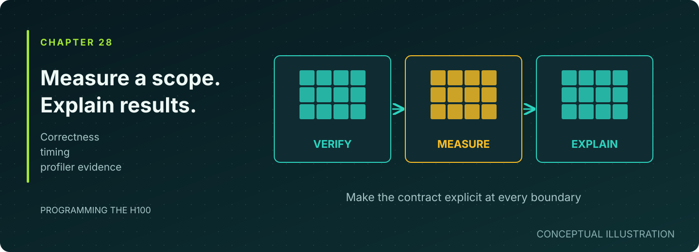
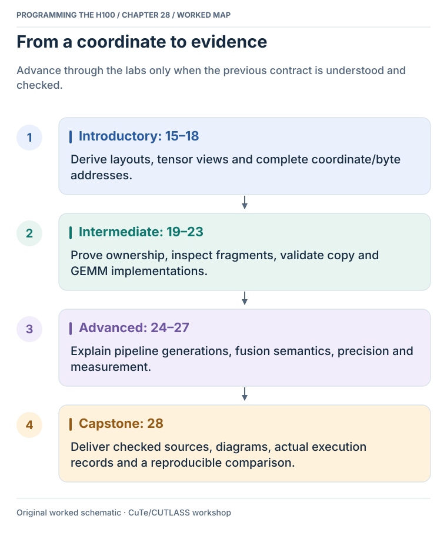
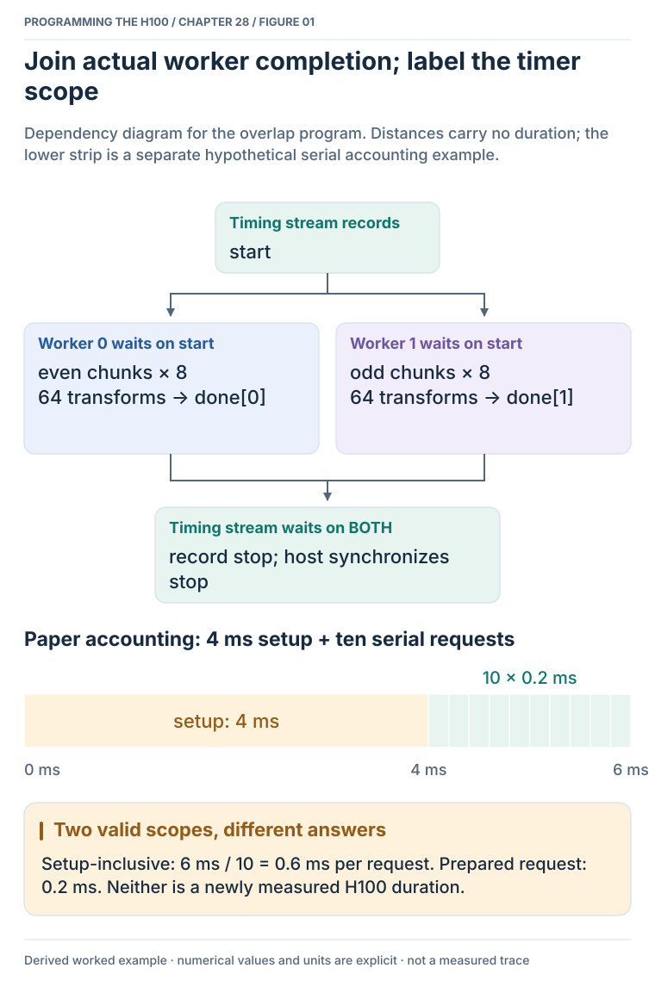

# 28. Benchmarking and Framework Integration Without Changing the Question

!!! note "Scope of framework integration"
    This chapter supplies benchmarking examples and an integration contract,
    not a compiled PyTorch extension. A production wrapper must guard the
    input device, validate dtype/shape/strides/alignment with `TORCH_CHECK`,
    obtain `at::cuda::getCurrentCUDAStream(device)`, allocate CUTLASS workspace
    through the framework allocator, call `can_implement`, and propagate
    initialization/run errors. Retain workspace until the stream finishes.
    A default-stream standalone program does not establish correct framework
    stream or graph-capture integration. The separately versioned CuTe DSL
    documentation is not evidence that its API matches this C++ v4.3.6 pin.

## Lesson 28 Companion Guide — Measure the Useful Operation and Preserve Framework Semantics

[](images/chapter-openers/28-workshop.svg)


!!! tip "Your goal in this chapter"

    Define a fair correctness and timing contract, distinguish serial latency from concurrent throughput, and preserve device, stream and lifetime rules in integration. Read [pipeline costs](25-cutlass-pipelines.md), [fusion](26-epilogue-fusion.md) and [precision](27-precision-block-scaling.md) first.

A kernel benchmark answers a narrow question about a particular operation on a particular system. A framework integration must additionally preserve layouts, numerical behavior, stream ordering and object lifetimes. Combining these tasks without an explicit contract can produce an impressive number for an operation the application never requested.

This chapter turns a verified Hopper GEMM into an experiment someone else can interpret. Its timing examples are arithmetic illustrations, not new measurements. The book's captured execution records remain the source of actual dates, systems, commands and outputs.

## 1 — Identify the implementation before comparing it

[](images/ch28/overview.svg)

CUTLASS C++ is a collection of CUDA C++ templates and components. CuTe C++ supplies tensor and layout abstractions used within that ecosystem. CuTe DSL is a separate Python kernel-authoring interface in the CUTLASS Python stack; it generates device code while retaining explicit layout, copy, MMA and pipeline concepts.

Triton is another compiler and programming model. A function decorated with `@triton.jit` and written with `triton.language` remains Triton even if a surrounding Python class is named `CuTeGEMM`. Likewise, a handwritten WMMA kernel does not become a CUTLASS GEMM because its source includes a CUTLASS header. PyTorch tensor operations are a framework-level interface, whose backend depends on the operation, configuration, build and hardware.

These distinctions matter when recording dependencies and interpreting results. Pin a CUTLASS C++ checkout separately from any Python DSL package. The C++ revision used elsewhere in this book is not an automatic promise that a newer DSL wheel supports the same CUDA, Python or driver versions. Check the selected release's installation requirements. [CUTLASS Python overview](https://docs.nvidia.com/cutlass/4.8.0/media/docs/pythonDSL/overview.html) and [Triton's programming model](https://triton-lang.org/main/programming-guide/chapter-1/introduction.html) describe different interfaces, not successive performance tiers.

## 2 — Freeze an operation contract

Write an experiment record before tuning. Include M, N, K, batch dimensions, transpose operations, physical strides, storage order, input/output/accumulator types, `alpha`, `beta`, epilogue and output ownership. Also state whether inputs are already resident on the GPU and in the required format.

A dense FP16 GEMM and a compressed-input GEMM that first dequantizes to FP16 differ in preprocessing and memory traffic. A GEMM-plus-bias-plus-activation cannot be compared fairly against bare GEMM without naming the omitted work. Row-major and column-major interfaces may require different leading dimensions even when the mathematical matrix is unchanged.

Keep the baseline useful: choose a library implementation for the same contract, configure its precision behavior explicitly, and include its necessary workspace. If an implementation cannot represent that contract, report unsupported input rather than silently changing the operation. This is especially important for a fused epilogue, noncontiguous tensors or quantized scale layouts.

## 3 — Make correctness a prerequisite for timing

First run deterministic nonuniform inputs against an independent reference. Exercise nonsquare dimensions, padded leading dimensions, nonzero beta, distinct C and D buffers where supported, and values that expose transposition. Report failures with coordinates and expected/actual values. Test invalid alignment or unsupported shapes through the documented rejection path.

Then add randomized and representative application inputs with an explicit tolerance policy. A comparison should reject nonfinite values unless they belong to the stated contract. A normwise relative error needs a zero-norm policy; elementwise relative error is unstable near zero without an absolute tolerance. Exact equality is appropriate only when the chosen values and arithmetic make exact results a justified expectation.

Separate representation error from arithmetic error as Chapter 27 explains. For FP16 inputs accumulated in FP32, compare with a reference using the same rounded inputs, then separately assess the effect of converting the original data to FP16. Do not let a permissive quantization tolerance hide a layout bug. Only time cases whose correctness checks actually ran and passed.

### Keep repeated invocations mathematically identical

An in-place epilogue can change the input to the next repetition. With `D=AB+C`, scalar `AB=2` and original `C=1`, the intended output is three. If D aliases C, the next invocation reads three and produces five; the following one produces seven. Warmup has already changed the timed problem before the first reported sample.

Choose distinct, unchanged C and D buffers where the implementation supports them, or reset the mutable input using a documented policy. State whether reset work is inside the timer. A multi-buffer rotation must preserve the same initial data and working-set assumptions for each method. Similarly, declare whether random input generation, quantization, workspace initialization or optimizer state updates occur once or per repetition. Correctness should check the operation actually timed, not only an earlier invocation with different state.

## 4 — Choose the timing scope explicitly

Three common scopes answer different questions:

| Scope | Includes | Useful question |
|---|---|---|
| Steady-state device work | Scheduled kernel work between events | How fast is this prepared operation? |
| Prepared API invocation | Host dispatch plus required device completion | What does one ready-to-run call cost? |
| End-to-end request | Needed packing, transfers, allocation, compilation and computation | What latency does this application receive? |

Not every request needs compilation or allocation. Report cold-start and warmed reuse separately instead of charging setup arbitrarily to one implementation. If weights are packed once and reused many times, publish that assumption and the packing cost. If activations require a new conversion for every call, that conversion belongs on the recurring path.

For serial, nonoverlapping requests, a useful accounting model is `T_total = T_setup + sum(T_request_i)`. Average amortized cost is `T_total / R` for R requests. In a concurrent pipeline, summing individual request intervals can double-count overlap. Instead measure the batch makespan from the defined batch start to completion of all R results, report throughput as `R / makespan`, and report individual request latency separately. State whether setup is inside that interval. Neither accounting method permits omitting synchronization dependencies or adding overlapping stages as if they executed serially.

## 5 — Place CUDA events around the actual dependency path

For one stream, record a start event, enqueue the intended operations, record a stop event on the same stream, wait for the stop event, and read elapsed time. Include warmup before this interval and check asynchronous errors at a synchronization boundary. Do not measure only the CPU duration of an asynchronous launch and call it kernel time.

For several streams, establish a start dependency in each participating stream and join all terminal work before the stop event. An event on the launcher's stream alone does not cover unrelated streams. The measured completion must mean the output is safe for the next consumer. [CUDA event timing guidance](https://docs.nvidia.com/cuda/cuda-c-best-practices-guide/index.html#using-cuda-gpu-timers) explains the synchronization assumptions behind device timing.

A host wall-clock timer can measure application latency if it waits for the required completion. It will include host dispatch and other requested work, so label it accordingly. CUDA event timing and host wall-clock timing can both be correct while answering different questions. Avoid comparing one method's event interval with another method's end-to-end wall time.

### A timing interval, one API call at a time

The following is an excerpt pattern, not a standalone program. Assume `stream`, `start` and `stop` have been created, inputs are prepared, and `launch_checked_gemm(stream)` submits the already-validated operation while checking its CUTLASS status. Here `check` checks a CUDA return value, as in the complete overlap example from Chapter 14.

```cpp
check(cudaEventRecord(start, stream));       // Mark the beginning on this stream.
launch_checked_gemm(stream);                // Enqueue the operation on that SAME stream.
check(cudaGetLastError());                  // Check the CUDA launch boundary too.
check(cudaEventRecord(stop, stream));        // This marker follows the operation.
check(cudaEventSynchronize(stop));           // Wait until the finish marker is reached.
float elapsed_ms = 0.0f;
check(cudaEventElapsedTime(&elapsed_ms, start, stop));
```

1. **Put the start in the queue.** Recording an event submits a marker; it does not mean all queued work finished before the CPU returned.
2. **Submit the actual operation.** The device stream orders the GEMM after `start`. A helper that launches on another stream would break this simple proof.
3. **Put the stop after the work.** The same stream cannot reach `stop` until its earlier GEMM finishes.
4. **Wait for the result.** Synchronizing `stop` makes the elapsed interval available and provides a boundary at which asynchronous errors can surface.
5. **Read the units.** `cudaEventElapsedTime` returns milliseconds. An illustrative `elapsed_ms=0.085` means 85 microseconds, not 85 milliseconds.

For two worker streams, the complete Chapter 14 program adds `cudaStreamWaitEvent` at the beginning and joins two completion events at the end. Trace those arrows before reusing the pattern; placing `stop` on an unrelated stream without the join measures a different interval.

### Draw the actual event join before trusting a stop event

For the Chapter 14 two-worker design, draw three queues. `start`, `done[0]`, `done[1]` and `stop` are **event markers**, not four kernels. Arrows encode dependencies rather than elapsed milliseconds:

```text
start (recorded on the timing stream)
  ├→ worker 0: wait start → even chunks × 8 → done[0] ─┐
  └→ worker 1: wait start → odd chunks × 8  → done[1] ─┤
                                                    v
timing stream:                 wait done[0] AND done[1] → stop
host:                          synchronize stop → read ms
```

Here even chunks are `0,2,...,14`, odd chunks are `1,3,...,15`, and `×8` means the eight workload repetitions. Each chunk includes its H2D, transform and D2H in that worker's stream order.

Read the drawing in four steps:

1. Record `start` on the timing stream. Both workers enqueue `cudaStreamWaitEvent(worker,start,0)` before their measured operations.
2. Each worker records its own completion event only after its final required operation, including any D2H needed for the useful result.
3. The timing stream enqueues waits on **both** completion events before recording `stop`. These waits prevent the timing stream from racing ahead of an unfinished worker.
4. Synchronize `stop` before reading elapsed time or consuming returned host data. A stop event recorded without the two waits could finish while a worker is still active.

This is the dependency structure implemented by the complete overlap program, not a separate copyable launch harness. Real execution can leave gaps between markers; the drawing alone predicts neither overlap nor its speedup. The single-stream timing snippet above needs no cross-stream join because all its measured work stays on one ordered stream.

[](images/worked/ch28-event-join-boundaries.svg)

### Work through amortization without hiding setup

Suppose, purely as a paper exercise, packing costs 4 ms once and each prepared request costs 0.2 ms. For ten serial requests:

1. Recurring work is `10×0.2=2 ms`.
2. Total including setup is `4+2=6 ms`.
3. Average request cost including setup is `6/10=0.6 ms`.
4. The prepared request cost is still 0.2 ms. Report both quantities with their boundaries.
5. At 100 requests the amortized cost becomes `(4+100×0.2)/100=0.24 ms`. Reuse changed the accounting, not the speed of the prepared kernel.

Put the units and timer boundaries on the same strip. These are the **hypothetical serial** costs just calculated, not the event intervals captured on H100:

```text
Elapsed wall time (ms):  0          4                 6
                        | setup    | ten requests   |
Setup-inclusive timer:  [----------------------------]
Prepared-request timer:            [0.2] [0.2] ... [0.2]

4 ms setup + (10 × 0.2 ms/request) = 6 ms total
6 ms / 10 requests = 0.6 ms/request, including setup
```

The widths are schematic, not a plotting scale. The ten requests in this accounting example are serial, so the elapsed intervals add. A timer around just one prepared request answers a different question from the setup-inclusive batch timer. Neither quantity is the 0.085 ms GEMM arithmetic example in the next section; those are separate illustrative workloads.

**Pause and check.** If requests overlap, can you replace makespan with the sum of their individual durations? No: overlapping intervals would be counted twice. Time the actual joined completion boundary instead.

### Exercise: batch throughput is not individual latency

Use two hypothetical requests with measured boundaries A=`[0.0,0.2]` ms and B=`[0.1,0.3]` ms. These intervals are a paper model, not captured H100 samples.

1. Each request's latency is 0.2 ms: subtract its own start from its own completion.
2. The joined batch spans 0.0 through 0.3 ms, so its makespan is 0.3 ms, not the 0.4-ms sum of individual durations.
3. Throughput is `2 / 0.0003 ≈ 6666.7 requests/s`. Dividing batch time by request count gives 0.15 ms/request as an **amortized batch cost**, not either request's latency.
4. A serial schedule with the same individual 0.2-ms work would take 0.4 ms for two requests, giving 5000 requests/s under that schedule. Concurrency changed the schedule's throughput; it did not make the individual 0.2-ms intervals become 0.15 ms.

**Check:** state which start/completion events define each request and the whole batch. **Pitfall:** timing only the first completion changes both the numerator and the useful-result boundary; it cannot support a claim that both requests finished.

## 6 — Calculate throughput in consistent units

A conventional dense GEMM work count is `2*M*N*K` floating-point operations. This treats each multiply-add as two operations; epilogue operations usually are not included in that conventional count. State when a result is instead batched, sparse, quantized or counts a different workload.

For M=N=2048 and K=4096:

`2*M*N*K = 34,359,738,368 FLOP`, approximately **34.36 GFLOP**.

At an **illustrative**, unmeasured time of 85 microseconds, throughput would be `34.359738368 / 0.085`, or about **404.23 TFLOP/s**. Dividing GFLOP by milliseconds produces TFLOP/s. Dividing by seconds instead requires the corresponding powers of ten. These are operation-count calculations, not a claim that this book's kernel achieved that time.

Compare with the matching hardware peak: datatype, accumulator mode, dense versus structured sparse execution and GPU variant must agree. Smaller stored operands do not justify using a native FP4 peak for a Hopper kernel that actually multiplies decoded FP16 values. Do not infer register or shared-memory bandwidth from a global-memory figure.

## 7 — Report variation and interference

Run enough repetitions to expose variation and publish the repetition count, warmup policy, median and an appropriate range or percentile. For tiny operations, time a documented batch to reduce event overhead, then divide by the operation count; recognize that a batch can change cache residency and scheduling compared with isolated requests.

Record GPU model and count, driver/toolkit/compiler versions, source revision, flags, input shape, workspace, schedule and clocks or power settings when relevant. Identify other GPU processes or communication traffic that affected the experiment. A favorable warm-cache result and a large working-set result are both useful if their conditions are named.

Use Nsight Systems to inspect stream gaps, launches and overlap, then Nsight Compute for a targeted kernel's resource and memory behavior. Profiling can perturb execution, so keep profiling results separate from the timing run. A larger tile or deeper pipeline is a hypothesis: resource pressure, occupancy and available work can reverse the expected benefit.

### Read a small timing distribution by hand

Suppose a paper exercise gives five elapsed times in milliseconds: `0.080, 0.081, 0.079, 0.082, 0.150`. No hardware measurement is asserted here.

1. Sort them: `0.079, 0.080, 0.081, 0.082, 0.150`.
2. The median is the middle sample, **0.081 ms**. The observed range is **0.079–0.150 ms**.
3. Their mean is **0.0944 ms**. The long sample affects the mean; silently removing it would conceal observed variation.
4. Investigate a known interruption separately and publish any exclusion rule before selecting favorable samples. The minimum alone does not describe a typical request.
5. Five samples are enough for this arithmetic exercise, not a stable tail-latency characterization. Collect an adequate sample set for the question and state the percentile convention if reporting percentiles.

Keep per-invocation statistics distinct from timings of repeated batches divided by batch size. The latter estimates amortized throughput under that batch's scheduling/cache conditions; it is not automatically the latency distribution of isolated calls.

## 8 — Respect the framework's stream and lifetime model

A PyTorch extension must select the input tensor's device and use the appropriate current CUDA stream for that device. Launching on an unrelated default stream can expose stale data or return an output whose producer is not ordered before its consumer. If a custom stream is necessary, establish explicit dependencies and follow the framework allocator's lifetime rules.

Validate device, dtype, shape, strides and alignment before obtaining raw pointers. Define whether noncontiguous inputs are accepted, copied or rejected. A hidden `.contiguous()` conversion changes the request cost and must be included when required. Keep inputs, outputs and workspace alive through asynchronous completion; returning from C++ does not mean device work has finished.

Use a documented integration layer rather than guessing opaque object or stream representations. [PyTorch's C++ extension tutorial](https://docs.pytorch.org/tutorials/advanced/cpp_extension.html) and [CUDA semantics](https://docs.pytorch.org/docs/stable/notes/cuda.html#cuda-streams) provide the framework context. Forward correctness alone does not implement autograd: training integration needs a defined backward path or an explicit inference-only interface.

## 9 — Preserve the CUTLASS launch lifecycle and fallback

The device adapter's lifecycle includes constructing arguments, checking `can_implement`, querying workspace, initializing and running on the selected stream. Match workspace sizing to those exact arguments. Check each returned status and subsequent CUDA completion; an accepted launch is not proof of a numerically correct result.

Define a fallback for unsupported dimensions, alignment, architecture or epilogue combinations. It should preserve the same mathematical operation and precision policy, or report a clear unsupported case. Do not catch every runtime error and silently retry: allocation failure, an invalid pointer or an asynchronous illegal access is not an ordinary shape-selection result.

Graph capture introduces additional requirements: avoid unexpected allocation or JIT work during capture, prepare supported workspace in advance, and ensure replay lifetimes remain valid. An inference wrapper, an autograd operator, a captured graph and a standalone benchmark are separate integration targets, each deserving its own test.

## 10 — A useful experiment ends with a reproducible decision

Publish what changed, the matching correctness evidence, the measured scope and the observed tradeoff. An efficient specialized kernel may win for repeated fixed shapes while losing when packing or compilation cannot be amortized. A library fallback may serve the remaining cases best.

The final deliverable is a validated dispatch decision with readable records, not a universal ranking of PyTorch, Triton, CuTe DSL and C++. Each can express different levels of control, and each can generate fast or slow implementations. The next workbook asks you to change one design choice at a time, predict its effect, verify correctness and explain the measurements that actually occur.

<!-- companion-summary:start -->
## Summary

- Freeze the operation, layout, precision and required preparation before comparing implementations; correctness is a prerequisite for timing.

- Name timing boundaries, join actual dependencies, report variation and match throughput to the executed arithmetic. Concurrent request intervals do not add into a batch makespan.

- Integration must preserve device selection, current-stream ordering, allocation lifetime and supported-input behavior. Turn these contracts into the [workbook capstone](29-workbook-capstone.md).
<!-- companion-summary:end -->
