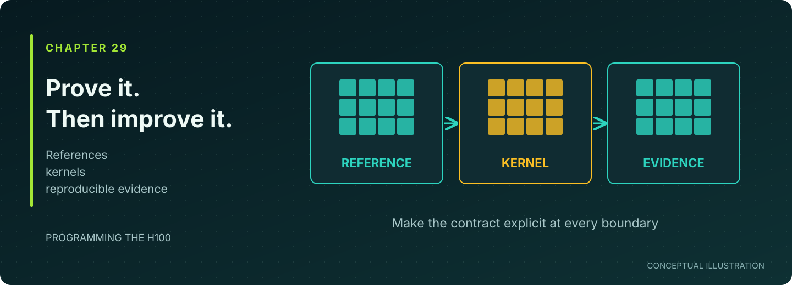
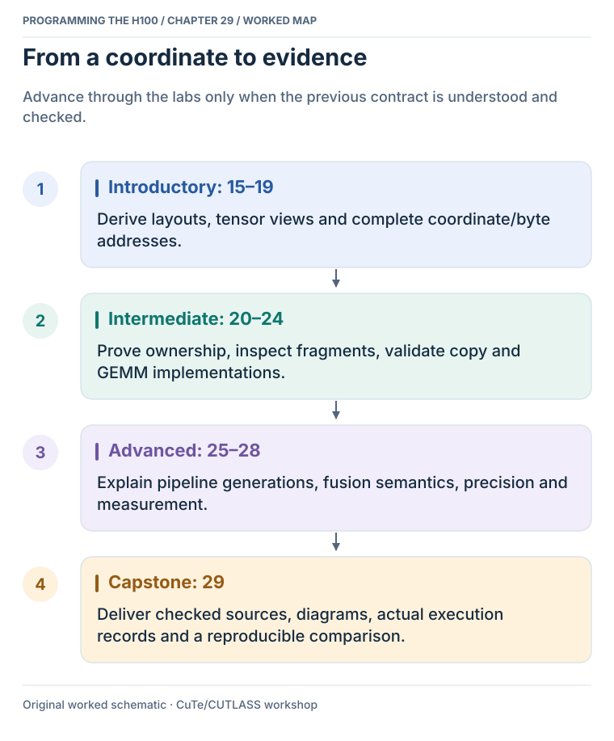

# 29. CuTe and CUTLASS Workbook — From Coordinates to Evidence
## Lesson 29 Companion Guide — Progress from Coordinate Proofs to a Reproducible Capstone

[](images/chapter-openers/29-workshop.svg)


!!! tip "Your goal in this chapter"

    Solve the beginner, intermediate and advanced labs, explain each worked answer, and submit a kernel comparison with reproducible correctness and measurement evidence. Use [Chapters 15–19](15-cute-layouts.md) for foundations and [Chapters 20–28](20-tiled-copy.md) for implementation and measurement.

This workbook turns the preceding chapters into problems you can solve, explain and extend. Start with a pencil and a small coordinate enumerator, then move to the GPU. The worked numbers below are **derived exercise answers**, not captured hardware measurements. For actual compilation dates, system information and program outputs, follow the book's execution records. A correct paper exercise does not establish that a new kernel compiled or ran.

Use the same pinned CUTLASS/CUDA environment as the preceding chapters. Preserve an unmodified working version before each experiment. Change one ownership rule, layout or schedule at a time; validate before timing. The beginner labs require arithmetic and small host-side checks. Intermediate labs require CUDA instruction and synchronization knowledge. Advanced labs combine the builder, precision and measurement chapters.

## Before you start — notation and checkpoints

| Symbol or term | Meaning in these labs |
| --- | --- |
| M, N, K | Output rows, output columns and reduction length in `A[M,K] × B[K,N]` |
| L or l | Batch count or one batch index; individual labs state whether batching is present |
| BM, BN, BK | Tile extents along those same axes, measured in elements |
| Leading dimension / stride | Physical spacing between selected coordinates; stated in elements unless a byte unit is explicit |
| Lane / thread / CTA | A lane within a warp, one CUDA thread, and a cooperating thread block |
| Reference | An independently calculated expected value, not a second copy of the implementation's indexing helpers |

Work through **labs 1–3** after [the introductory sequence](15-cute-layouts.md), **labs 4–6** after [copy ownership](20-tiled-copy.md), [MMA fragments](21-mma-atoms.md) and [shared layouts](22-shared-layouts.md), then **labs 7–9** after [pipelines](25-cutlass-pipelines.md), [fusion](26-epilogue-fusion.md), [precision](27-precision-block-scaling.md) and [measurement](28-benchmarking-integration.md). Answer each problem before opening its worked derivation. Move on when you can explain why the tempting wrong answer fails, not merely repeat the final number.

## 1 — Beginner lab: distinguish a view from storage

[](images/ch29/overview.svg)

**Problem.** A two-dimensional tensor has shape `(3,4)` and element strides `(8,1)`. List its offsets, logical size, storage span and FP16 byte offset for coordinate `(2,3)`. Does creating a compact view remove the padding from an existing allocation?

**Worked answer.** Its rows reference offsets `0..3`, `8..11` and `16..19`. There are 12 logical elements. A positive-stride allocation extending through the largest referenced element needs 20 elements; reserving three complete padded rows would instead need 24. Coordinate `(2,3)` maps to element 19, hence byte offset 38 for FP16. The gaps are real locations in the padded allocation, not additional tensor coordinates.

Constructing another layout changes the address interpretation. It does not copy the original rows into compact storage. A compact view over the same pointer would read different elements in rows one and two. To remove padding, perform a correctly indexed copy into a separate compact destination. Check both layouts against an array containing distinct coordinate-derived values; zeros cannot reveal this error.

**Extension.** Set the first stride to zero. Several rows now alias. Such a broadcast view can describe repeated reads, but independent parallel stores to those logical coordinates need an explicit ownership or reduction policy.

### Solve the first lab without skipping an address

If the answer above felt too quick, put the pieces on paper. A stride is measured in **elements**, not bytes:

1. **Read the domain.** Shape `(3,4)` permits row `i=0,1,2` and column `j=0,1,2,3`.
2. **Write the rule.** Strides `(8,1)` mean `offset(i,j)=8i+j`. Advancing one row skips eight elements; advancing one column skips one.
3. **Expand the first row.** With `i=0`, substitute `j=0,1,2,3` to obtain offsets `0,1,2,3`.
4. **Advance one row.** With `i=1`, the row begins at `8×1=8`, so its offsets are `8,9,10,11`. Offsets `4..7` are not in this logical view.
5. **Finish the table.** With `i=2`, the offsets are `16,17,18,19`. Three rows times four columns give 12 logical coordinates; the span through offset 19 requires 20 element positions.
6. **Convert the selected address.** At `(2,3)`, `8×2+3=19` elements. FP16 occupies two bytes, so the address is `base+38` bytes. Do not multiply only one term by two.
7. **Test the tempting shortcut.** A compact row-major view would use `4i+j`. Its `(1,0)` reads offset 4, while the padded source's `(1,0)` reads offset 8. A new view did not move any values.

```text
logical row 0 →  0  1  2  3    gap:  4  5  6  7
logical row 1 →  8  9 10 11    gap: 12 13 14 15
logical row 2 → 16 17 18 19
```

**Check yourself.** At `(1,2)`, the element offset is `8+2=10`, and the FP16 byte offset is 20. If you obtained 6, you silently replaced the padded stride with a compact one. Return to the stride definition before continuing.

## 2 — Beginner lab: rectangular CTA origins and boundaries

**Problem.** Compute `D[M,N] = A[M,K] B[K,N]` with `M=130`, `N=70`, `K=35`. All matrices are compact row-major. Choose CTA tiles `BM=64`, `BN=32`, `BK=16`. For tile coordinates `(tile_m,tile_n,tile_k)=(1,2,1)`, find the origins and offsets used by local coordinates `m=3`, `n=2`, `k=5`. Then describe the final boundary tiles.

**Worked answer.** The tile origins are `(m0,n0,k0)=(64,64,16)`. The participating global coordinates are `(m,n,k)=(67,66,21)`:

| Operand | Global coordinate | Element offset | FP16 byte offset |
| --- | --- | ---: | ---: |
| A | `(67,21)` | `67×35+21 = 2366` | 4732 |
| B | `(21,66)` | `21×70+66 = 1536` | 3072 |
| D | `(67,66)` | `67×70+66 = 4756` | 9512 |

Do not use `BM` or `BN` as the global leading dimension. They describe local tiles, whereas global row strides here are 35 for A and 70 for B/D. If a CuTe GEMM interface represents B as `(N,K)` rather than the mathematical `(K,N)`, the same row-major physical B is addressed by logical `(n,k)` with strides `(1,70)`. Swapping a logical convention does not itself transpose the allocation.

Ceiling division gives `ceil(130/64)=3` M tiles, `ceil(70/32)=3` N tiles and `ceil(35/16)=3` K iterations: nine output CTAs. The final output tile starts at `(128,64)` and contains only `2×6=12` valid outputs. The last K tile starts at 32 and contains three valid reduction positions. Predicate global loads/stores and supply the intended neutral values for invalid reduction elements; never replace the ceiling divisions with floor divisions and silently omit the edge.

### Draw every output tile, including the thin edge

For the problem above, each cell names a **count of valid output elements**, not their stored numerical values. Column boundaries and row boundaries are global logical coordinates:

```text
                              output column n
                      0..31       32..63       64..69
                      tile_n=0    tile_n=1     tile_n=2
output row m      +------------+------------+------------+
0..63, tile_m=0   | 64×32=2048 | 64×32=2048 | 64×6=384   |
                  +------------+------------+------------+
64..127, tile_m=1 | 64×32=2048 | 64×32=2048 | 64×6=384   |
                  +------------+------------+------------+
128..129, tile_m=2|  2×32=64   |  2×32=64   |  2×6=12    |
                  +------------+------------+------------+

Tile-coordinate envelope: m=0..191, n=0..95
Logical output domain:  m=0..129, n=0..69
```

1. Add the valid counts: `4×2048 + 2×384 + 2×64 + 12 = 9100`, which equals `M×N=130×70`. This checks that the thin row and column edges were not lost.
2. The nine full tile envelopes contain `9×64×32=18432` candidate positions. The other `18432−9100=9332` are not logical outputs, even though their tile-local indices exist.
3. The final corner tile starts at `(128,64)`. Local `(1,5)` maps to `(129,69)`, the last valid output, at row-major element offset `129×70+69=9099`.
4. Local `(0,6)` maps to `(128,70)`, which is invalid. Yet its naive row-major offset is `128×70+70=9030`, the same physical offset as valid `(129,0)`! An allocation-bounds check alone would miss this logical error and could corrupt another row.

The K tail is a separate boundary; the output predicate does not protect operand loads automatically:

```text
K tile 0: global k= 0..15   → 16 valid reduction positions
K tile 1: global k=16..31   → 16 valid reduction positions
K tile 2: global k=32..47   → only 32,33,34 are valid

Last tile's local kk:    0    1    2    3 ... 15
Global k:              32   33   34   35 ... 47
Load contribution:    real real real   0 ...  0
```

The final line describes a zero-fill reduction policy: three real contributions and thirteen neutral positions. It is not permission to read invalid global addresses and multiply the returned values by zero afterward. Predicate the load before accessing memory, then supply the neutral register/shared value.

### Add a batch without changing the local tile coordinates

As a separate extension, let L=2 and store independent, compact row-major outputs. Each batch has 9100 FP16 elements, so the output batch stride is 9100 **elements**, or 18,200 bytes:

```text
Physical output element offsets (two packed batches)
batch l=0: [0 ..................................... 9099]
batch l=1: [9100 ................................. 18199]
             ^ same local tile grid begins at a new base

batch 1's last logical coordinate: (l,m,n)=(1,129,69)
element offset = 1×9100 + 129×70 + 69 = 18199
FP16 byte offset = 18199×2 = 36398
```

The `(tile_m,tile_n)` grid is the same in both batches. Only the allocation origin changes through the declared batch stride. The final FP16 element occupies byte offsets 36,398 and 36,399, so a 36,400-byte packed allocation covers both complete logical outputs. A padded or framework-strided output needs its actual batch/row strides instead; do not reuse 9100 merely because the logical shape matches.

## 3 — Beginner lab: build an adversarial reference

**Problem.** Why is an all-ones GEMM insufficient to validate a layout? Design a stronger test before optimizing the kernel.

**Worked answer.** Every output of a compatible all-ones product equals K. A permutation of output positions may therefore leave the result apparently correct. Use distinct, bounded, nonuniform inputs; calculate a reference independently of the kernel's layout helpers. Include rectangular and ragged dimensions, padded leading dimensions, mixed signs, nonzero alpha/beta and untouched guard regions. Compare every output and verify the guards.

Use small integers or exactly representable binary fractions for an initial indexing test. Then add floating-point stress cases with an explicit absolute/relative tolerance and finite-value checks. A reference that reuses the kernel's erroneous indexing function is not independent. For quantized operands, maintain both an original-input reference and a reference using reconstructed quantized inputs; they answer different questions.

## 4 — Intermediate lab: copy ownership and transactions

**Problem.** One warp copies 128 consecutive FP32 elements. Lane `l` owns elements `4l+v`, for `v=0..3`. Does every element have one owner? Does a 16-byte-per-lane copy imply one memory transaction for the whole warp?

**Worked answer.** For any element `x` in `0..127`, the unique owner is `l=floor(x/4)` and `v=x mod 4`. Coverage is complete and ownership is unique. With a suitably aligned base, each lane's four-element vector begins at byte offset `16l`; the complete request spans 512 bytes. It cannot fit in one 32-byte sector. The address footprint covers 16 such sectors when sector-aligned; actual generated instructions, cache state and architecture determine the observed traffic.

Alignment of the original allocation does not guarantee alignment of every sliced tile pointer. Recheck the byte offset and bounds before assuming a vectorized copy is legal. In a `TiledCopy` exercise, enumerate thread/value coordinates, convert them to source and destination addresses, and verify coverage before evaluating performance. A correct partition is a proof about ownership; issuing the copy is a separate operation.

## 5 — Intermediate lab: an actual m16n8 accumulator mapping

**Problem.** For the FP32 accumulator fragment of floating-point `mma.sync.aligned.m16n8k16`, locate lane 13's four outputs. Which lane owns output `(11,3)`? Is this mapping also a WGMMA map?

**Worked answer.** For this instruction form, let `g=lane>>2` and `t=lane%4`. Accumulator entries 0 and 1 occupy row `g`; entries 2 and 3 occupy row `g+8`. Their columns are `2t+(i mod 2)`. Lane 13 has `g=3`, `t=1`, so its entries are `(3,2)`, `(3,3)`, `(11,2)`, `(11,3)`. Output `(11,3)` belongs to lane 13, entry 3. Across 32 lanes, four entries per lane account for all 128 outputs.

This k16 exercise uses the same four-value accumulator-coordinate pattern as the k8 atom decoded in [Chapter 21](21-mma-atoms.md); its input fragments and K-depth are different. This is a specific warp-level accumulator mapping, not a universal “16×16 MMA” convention and not a Hopper WGMMA fragment map. Input fragments have their own mappings and packed-register rules. Verify an atom against the exact operand types, instruction shape and [PTX fragment specification](https://docs.nvidia.com/cuda/archive/12.8.0/parallel-thread-execution/index.html#warp-level-matrix-fragment-mma-16816-float), then check what the CuTe atom encodes.

## 6 — Intermediate lab: derive a real bank conflict

**Problem.** Use the teaching model of 32 shared-memory banks with successive 32-bit words assigned to successive banks. What happens when lane `l` reads `float tile[l][0]` from `tile[32][32]`? What changes with a 33-element row stride?

**Worked answer.** With stride 32 words, lane `l` addresses word `32l`; its bank is `(32l) mod 32 = 0`. The lanes request distinct words in one bank: a 32-way conflict in this model. With stride 33, the bank becomes `(33l) mod 32 = l`, distributing the accesses across all banks.

Conversely, `tile[0][l]` already distributes contiguous FP32 words across banks. Adding row padding is not a cure for that access pattern. Multiple lanes reading exactly the same word can use broadcast behavior rather than causing this distinct-address conflict. Wider, narrower and vector instructions need a more detailed model; an instruction-compatible swizzle must agree between producer and consumer. Treat the example as a derivation, then inspect the real instruction and profiler counters.

## 7 — Advanced lab: stage indices need generations

**Problem.** A three-stage pipeline handles eight K tiles numbered 0 through 7. Give each tile's stage and generation. When may tile 7 overwrite stage 1?

**Worked answer.** Use the abstract bookkeeping `stage=t mod 3`, `generation=floor(t/3)`. The pairs are `(0,0)`, `(1,0)`, `(2,0)`, `(0,1)`, `(1,1)`, `(2,1)`, `(0,2)`, `(1,2)`. Tile 7 reuses the slot previously used by tiles 1 and 4.

Before overwriting it, the producer needs the empty/reuse permission for the preceding occupant, including completion of every asynchronous consumer that can still read that stage. A ready barrier says new input arrived; it does not by itself say old WGMMA reads are finished. Conversely, the consumer must wait for the correct current ready event, not merely observe a stale slot state. A parity bit may encode part of this progression, but its initial value and transition rules belong to the actual pipeline implementation; generation modulo two is not a substitute for its protocol.

Trace the prologue, all tile transitions and the drain. Repeat with one K tile and fewer K tiles than stages. Never bypass a wait just because the first large problem appeared to work. A final drain must complete outstanding operations before result use or storage teardown.

## 8 — Advanced lab: epilogue order changes the function

**Problem.** Compute `D=ReLU(alpha×P + beta×C + bias)` for `P=-3`, `alpha=2`, `C=4`, `beta=0.5`, `bias=1`. Is applying ReLU to P first equivalent?

**Worked answer.** The intended pre-activation is `-6+2+1=-3`, giving D=0. Applying ReLU to P first gives `0+2+1=3`: a different result. Bias orientation, activation placement and conversion boundaries are part of the operation contract. An epilogue graph should implement that contract, not merely include operators with familiar names.

Keep accumulation and epilogue arithmetic in the specified precision, then convert at the documented boundary. Test nonzero beta; a beta-zero example cannot detect a broken C path. If the output aliases C, obey the operator's aliasing contract and ensure the reference preserves the original C values.

## 9 — Advanced lab: precision, metadata and honest timing

**Problem.** A and B have reduction extent 35 and use blocks of 16 values along K. Count unpadded scale groups for A with 130 rows and B with 70 columns. Estimate packed storage and explain the execution distinction between Hopper and Blackwell.

**Worked answer.** Each row of A and each mathematical column of B needs three K groups: 390 scales for A and 210 for B. Do not group B along N simply because its physical allocation is row-major. A rowwise A packing uses 18 bytes per row for 35 nibbles, or 2340 bytes. A columnwise B packing similarly uses `70×18=1260` bytes. Those are illustrative separate-row/column packing contracts, not a native CUTLASS scale-layout prescription. An instruction-specific representation can require padding, a different interleave and a defined scale layout. The complete CPU encoder in Chapter 27 deliberately requires complete blocks; K=35 here is a paper exercise in defining a tail contract, not a supported direct call to that encoder. To implement it, specify padding to complete blocks while retaining the logical reduction length 35, then test that padded elements contribute zero.

For NVFP4, account for E2M1 elements, E4M3 block scales and global FP32 scaling. Zero blocks, rounding, saturation and the unused nibble need explicit rules. At large aligned sizes, elements plus one byte per 16-value scale cost 0.5625 bytes/value, approximately 7.11× smaller than FP32 before global scales and padding. Hopper dequantization followed by FP16/BF16 GEMM is not native NVFP4 Tensor Core execution; native Blackwell experiments need separate compatibility and execution evidence. See [NVIDIA's NVFP4 description](https://docs.nvidia.com/deeplearning/transformer-engine-releases/release-2.16/user-guide/features/low_precision_training/nvfp4/nvfp4.html).

For a separate hypothetical benchmark with **FP16 A, B and D**, beta zero, `M=N=2048` and `K=4096`, the conventional GEMM count is 34,359,738,368 operations. At a hypothetical 85 microseconds, throughput is approximately **404.23 TFLOPS**, not 203. Reading A and B once and writing D once requires 41,943,040 bytes, excluding C reads, scales and extra passes. At one millisecond that minimum traffic implies 41.94 GB/s. With FP32 D instead, its output store costs twice as many bytes and the corresponding total becomes 50,331,648 bytes; state the output type rather than importing a traffic count from another kernel. These calculations are consistency checks, not measured bandwidth or peak-utilization claims.

## 10 — Capstone: deliver a reproducible kernel comparison

Choose one supported operation and keep its semantics identical across the reference, baseline and tuned implementations. Submit:

- The source revision, pinned dependencies, exact compile commands and architecture target.
- A shape/stride/type table with aligned and ragged cases, numerical criteria and complete correctness results.
- A diagram of ownership, stage lifecycle and epilogue order that matches the implementation.
- Separate kernel-only and end-to-end timing boundaries, including quantization/layout conversion where relevant.
- Raw timing samples, warmup/JIT policy, summary statistics, hardware/software information and a precise execution date.
- A conclusion tied to measurements: what changed, why the evidence supports it, and which configurations remain outside the test.

Assess the submission in four passes. **Mapping:** reconstruct one nonuniform value's logical coordinate, owner and physical address. **Safety:** identify readiness and reuse edges, including tail/drain behavior. **Numerics:** distinguish representation, accumulation and epilogue errors. **Measurement:** reproduce the work count and timing boundary from the supplied record. A missing or failed check in one pass remains an open item even if the other three look convincing.

A convincing capstone can explain a slowdown. It need not promise a fixed fraction of peak. If a layout change reduces conflicts but increases register pressure or conversion cost, record that tradeoff. The final skill is connecting coordinates, numerical semantics and synchronization to evidence another reader can reproduce.

<!-- companion-summary:start -->
## Summary

- Trace coordinates through storage, thread/value ownership and instruction fragments before reasoning about bank conflicts or asynchronous stage reuse.

- Preserve the mathematical epilogue and quantization contract, and check operation counts, metadata and timing units independently.

- A capstone connects exact source and system records to full correctness checks, explicit timing scope and a measured conclusion. Derived exercise answers remain distinct from captured GPU results.
<!-- companion-summary:end -->
