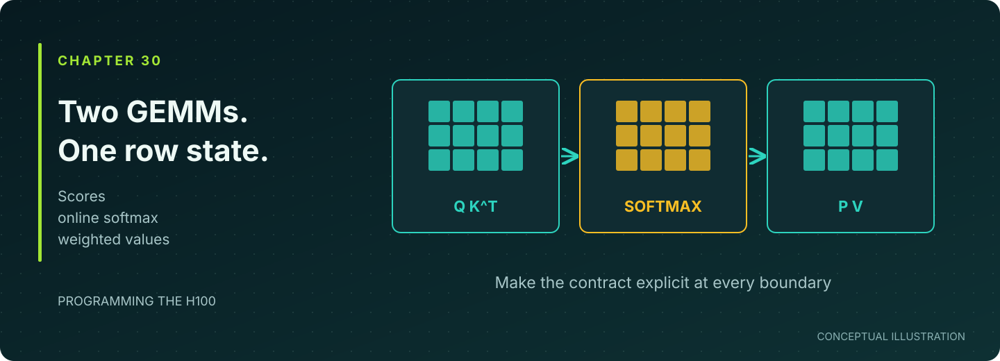
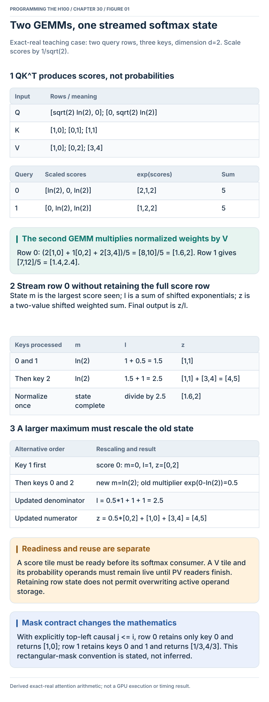

# 30. CUTLASS Attention Foundations — Work Every Softmax State

!!! success "GPU revalidation completed — November 21"
    Corrected current source was compiled and executed on H100. Historical logs
    remain unchanged. See the [repair record](review-fixes-2026-11-21.md) and
    [new dated results](validation-2026-11-21.md) for exact scope and sample output.


## Lesson 30 Companion Guide — From Two GEMMs to One Streaming Attention Contract

[](images/chapter-openers/30-workshop.svg)

!!! tip "Your goal in this chapter"

    Compute a complete attention example before reading a fused kernel. Track its scores, mask, row maximum, denominator and weighted-value numerator; derive its layouts independently of its arithmetic. Read [FlashAttention-3](12-flashattention-3.md), [strides](16-cute-strides.md), [the GEMM adapter](24-cutlass-gemm.md) and [pipeline ownership](25-cutlass-pipelines.md) first. [Chapter 31](31-cutlass-hopper-fmha.md) connects this contract to pinned Hopper FMHA code.

The CUTLASS example studied here is **`examples/88_hopper_fmha` in v4.3.6**, commit **`1afc6d355b8cb992398f17beb4425702f1d57ddd`**. Its README describes a forward GEMM–online-softmax–GEMM fusion and separate backward kernels. This chapter supplies the mathematical bridge. Its tiny d=2 problem is supported by the standalone SIMT CUDA reference below, but does not match the pinned Tensor Core FMHA runner's head-dimension specializations. Chapter 31 supplies the separate optimized CUTLASS implementation.

The accompanying [complete CPU oracle](examples/advanced/attention_walkthrough.py) uses Python binary64 arithmetic and the standard library. It independently compares a materialized reference with streaming updates. That checks the worked equations, masks and state transitions. It does not validate CUDA instruction ordering, FP16/FP8 rounding, the CUTLASS compiler interface or performance.

[Complete runnable CUDA reference](#14-complete-runnable-cuda-reference) · [Complete Python reference](#15-complete-runnable-python-reference) · [Optimized CUTLASS CUDA source](31-cutlass-hopper-fmha.md#319-complete-runnable-cuda-source).

## 1 — Define the operation and every axis

For one batch and one attention head, write

`S = (Q K^T) / sqrt(d)`

`P[i,j] = exp(S[i,j]) / sum_t exp(S[i,t])`

`O = P V`.

| Symbol | Shape | Meaning |
| --- | --- | --- |
| Q | Nq × d | One feature row per query |
| K | Nk × d | One feature row per key |
| V | Nk × dv | One output-value row per key |
| S, P | Nq × Nk | Scores and row-normalized probabilities |
| O | Nq × dv | Weighted value result per query |

The reduction in `Q K^T` is over d. The reduction in `P V` is over Nk. Confusing those axes gives a plausible-shaped intermediate that computes another operation. The mathematical transpose `K^T` does not require physically copying K into a transposed allocation; a compatible tensor view/instruction layout can represent the needed access.

This mathematical chapter permits `dv` distinct from d. The pinned example runner instead uses one D for Q, K, V and O. Likewise, no dropout, bias, rotary-position transformation or output projection is present in the toy contract. Additions need an explicit placement and numerical reference; they are not implied by the word attention.

## 2 — Choose inputs whose softmax can be checked exactly on paper

Let `a=sqrt(2)*ln(2)`, choose `d=dv=2`, and use:

```text
Q = [ a  0 ]      K = [ 1  0 ]      V = [ 1  0 ]
    [ 0  a ]          [ 0  1 ]          [ 0  2 ]
                      [ 1  1 ]          [ 3  4 ]
```

Here `Nq=2`, `Nk=3`. The numbers are a mathematical construction, not exactly representable FP16 inputs. Python approximates the transcendental constants in binary64, so its checks use an explicit `1e-12` relative/absolute tolerance. The hand derivation treats the equations over real numbers.

1. Query row zero dotted with key zero gives a; key one gives zero; key two gives a.
2. Scaling by `1/sqrt(2)` yields score row zero `[ln(2),0,ln(2)]`.
3. Query row one produces `[0,ln(2),ln(2)]`.
4. The unshifted exponentials are `[2,1,2]` and `[1,2,2]`. Each row sums to five.

Therefore the noncausal probability rows are `[2/5,1/5,2/5]` and `[1/5,2/5,2/5]`. Each has sum one and nonnegative entries. A sum-one check is necessary but cannot detect every key permutation; the nonuniform V values make that permutation observable at the output.

## 3 — Finish the second GEMM by hand

For output row zero, weight all three V rows:

`(2/5)*[1,0] + (1/5)*[0,2] + (2/5)*[3,4] = [8/5,2]`.

For output row one:

`(1/5)*[1,0] + (2/5)*[0,2] + (2/5)*[3,4] = [7/5,12/5]`.

The expected matrix is thus `O=[[1.6,2],[1.4,2.4]]`. The first component of row zero includes `2/5+6/5=8/5`; the second includes `2/5+8/5=2`. These are different weighted sums, not copies of the same softmax denominator.

**Pitfall:** multiplying every score row by V before normalizing would give unnormalized numerators `[8,10]` and `[7,12]`. Dividing by five is essential. Another wrong shortcut is normalizing each key tile independently and adding its outputs; tile-local denominators do not equal the complete row denominator.

## 4 — Use a stable maximum without changing the function

Subtracting one common value from a row of logits leaves its softmax unchanged. Choose row maximum m:

`exp(s_j)/sum_t exp(s_t) = exp(s_j-m)/sum_t exp(s_t-m)`.

For row zero, `m=ln(2)`. The stable exponential weights are `[1,1/2,1]`, denominator `l=5/2`, and weighted-value numerator `z=[4,5]`. Then `z/l=[8/5,2]` as before.

The denominator l is a scalar; z is a vector of length dv. Their magnitudes depend on the chosen maximum, but the normalized output does not. Save `LSE=m+ln(l)` if the implementation's contract requires natural-log log-sum-exp. Both noncausal rows have `LSE=ln(5)` in this example.

Some kernels evaluate exponentials with base two. The equivalent expression is `exp(s)=exp2(s*log2(e))`; it changes the scaling constant and the meaning of an internal maximum, not the requested function. Never mix a base-two maximum with a natural-exponential rescaling formula. Consult the selected implementation's units before comparing internal traces.

## 5 — Derive the online recurrence, including the numerator

A fused forward pass need not store the full P or S matrix in global memory. For one query row, retain `(m,l,z)` for all keys processed so far. Initially `m=-infinity`, `l=0`, `z=0`. For a new block of valid keys J:

`m_new = max(m, max_{j in J} s_j)`

`alpha = exp(m-m_new)`

`l_new = alpha*l + sum_{j in J} exp(s_j-m_new)`

`z_new = alpha*z + sum_{j in J} exp(s_j-m_new)*V[j,:]`.

1. Every old contribution was scaled relative to m.
2. The new state is scaled relative to `m_new`.
3. Multiplying the old denominator **and numerator** by alpha converts them to that new reference.
4. New contributions can then be added under one scale.
5. After the final actual key block, divide z by l once to produce O.

The first nonempty block uses alpha zero explicitly in the oracle, avoiding an undefined `-infinity-(-infinity)` calculation. A block containing no valid keys is skipped. An entirely masked row is rejected by this oracle rather than inventing a universal GPU convention for zero outputs or LSE.

## 6 — Follow every state through two real key blocks

[](images/worked/ch30-online-softmax.svg)

Split keys into block zero `{0,1}` and block one `{2}`. The second block is shorter; its third key is real, while nonexistent padding keys must not gain softmax weight.

| Query row / block | m | alpha for old state | l | z |
| --- | --- | ---: | ---: | --- |
| Row 0, keys 0–1 | ln(2) | 0 | 1.5 | [1,1] |
| Row 0, key 2 | ln(2) | 1 | 2.5 | [4,5] |
| Row 1, keys 0–1 | ln(2) | 0 | 1.5 | [0.5,2] |
| Row 1, key 2 | ln(2) | 1 | 2.5 | [3.5,6] |

For row zero's first block, stable weights one and one-half give `z=1*[1,0]+0.5*[0,2]=[1,1]`. Key two contributes `[3,4]` at stable weight one, so the final numerator is `[4,5]`. Divide by 2.5 to obtain `[1.6,2]`.

For row one, the first two stable weights are one-half and one. Its first numerator is `[0.5,2]`; adding key two yields `[3.5,6]`. Dividing by the same denominator gives `[1.4,2.4]`. Equal denominators do not make the two output vectors equal.

**Check:** the sequential trace and the materialized full-row reference agree. The CPU oracle also checks different valid partitions and traversal orders. Floating-point results need not be bit-identical under reassociation; matching within this stated tolerance is the criterion for these binary64 inputs.

## 7 — Force a maximum change so rescaling cannot be omitted

The previous order never increased m after the first tile. That cannot expose a missing rescale. Process row zero's key one first, then keys zero and two:

1. Key one has score zero and V row `[0,2]`. State is `m=0,l=1,z=[0,2]`.
2. The new block has scores `ln(2),ln(2)`, so `m_new=ln(2)`.
3. Old-state factor is `alpha=exp(-ln(2))=1/2`.
4. Rescale old `l` to 0.5 and old z to `[0,1]`.
5. Add two new weights of one: `l_new=0.5+1+1=2.5`.
6. Add new weighted vectors `[1,0]+[3,4]` to `[0,1]`, producing `[4,5]`.
7. Final output remains `[1.6,2]`.

If only l is rescaled, z incorrectly becomes `[4,6]`, giving `[1.6,2.4]`. If neither is rescaled, l becomes three and z `[4,6]`, giving `[4/3,2]`. A correct-looking component or normalized row is insufficient; check the whole vector against the independent reference.

## 8 — Define causal positions before applying a mask

The pinned `CausalFusion::before_softmax` demonstrates **top-left causal alignment**: a key is excluded when its logical index j exceeds query index i. For `Nq=2,Nk=3`, the Boolean mask is:

```text
                key j=0  j=1  j=2
query i=0          yes    no   no
query i=1          yes   yes   no
```

1. Row zero retains only key zero, so its normalized weight is one and output is `[1,0]`.
2. Row one retains scores `[0,ln(2)]`, whose exponentials are `[1,2]`.
3. Its weights are `[1/3,2/3,0]` and output is `[1/3,4/3]`.
4. The corresponding natural-log LSE values are `ln(2)` and `ln(3)`.

Mask logits before softmax: an excluded entry contributes zero weight and does not enter the row maximum or denominator. Setting an excluded logit to zero is wrong because `exp(0)=1`. The CPU helper represents masking with a separate Boolean `allowed` list while retaining finite logits; it does not accept literal infinity/NaN score inputs. Thus the mathematical negative-infinity mask and the helper's input representation are different. An entirely masked block is skipped, and an entirely masked row is rejected under its stated contract. Zero-filling an out-of-range K tile similarly does not automatically mask its score; it can create a false zero logit with positive softmax mass.

Rectangular attention makes the position convention visible. If the two queries represent the *last* two positions of a three-key sequence, use absolute query positions `i+1`. The valid test becomes `j<=i+1`, and the outputs are `[[2/3,2/3],[1.4,2.4]]`. This is a separate oracle contract, not what the pinned causal functor silently does. Its own comments explain where such an offset would be introduced. Head sharing, cached decode and unequal lengths require explicit positions and ownership, not merely `causal=true`.

## 9 — Separate memory offsets from score coordinates

A score coordinate `(i,j)` names a query/key pair, whereas a Q/K element coordinate names one feature. For compact row-major views use:

`Q(i,c): i*d+c`, `K(j,c): j*d+c`, `V(j,v): j*dv+v`, `O(i,v): i*dv+v`.

| View coordinate | Element offset | FP16 byte offset, if E=2 |
| --- | ---: | ---: |
| Q(1,1) | 1*2+1=3 | 6 |
| K(2,1) | 2*2+1=5 | 10 |
| V(2,0) | 2*2+0=4 | 8 |
| O(1,0) | 1*2+0=2 | 4 |

This byte column illustrates a hypothetical FP16 allocation; it does not claim that the CPU oracle used half storage or reproduced half rounding. With eight-byte binary64 elements, multiply the same offsets by eight instead. K's mathematical transpose in QKᵀ does not change its row-major `(j,c)` storage formula.

For two batches and three heads, choose illustrative mode order `(sequence,feature,(batch,head))` with Q strides `(d,1,(H*Nq*d,Nq*d))`. At `(i,c,b,h)=(1,1,1,2)`, offset is `1*2+1+1*12+2*4=23` elements, or 46 bytes for FP16. The last valid element occupies bytes 46–47 of the 48-byte Q allocation. K/V use Nk instead of Nq, so their batch/head strides are different.

The pinned sixteen-bit runner uses the same **mode order**, with `StrideQ`/`StrideK` represented as `tuple<int,_1,tuple<int,int>>`. Its FP8 V specialization uses a different stride pattern; do not transplant the sixteen-bit V map into the byte-element path. Supported TMA alignment and head dimensions impose additional restrictions beyond this affine address calculation.

## 10 — Map the mathematics to the pinned implementation

The [pinned runner’s file comment](https://github.com/NVIDIA/cutlass/blob/1afc6d355b8cb992398f17beb4425702f1d57ddd/examples/88_hopper_fmha/88_hopper_fmha.cu) describes four layers:

| Layer | What to locate | Mathematical obligation |
| --- | --- | --- |
| Runner/reference | Inputs, strides, checks and timing | Same operation and numerical criterion |
| Device operation | Workspace and launch orchestration | Correct pointers, shapes, lifetimes and completion |
| Kernel | Scheduling and roles | Complete query/output coverage |
| Collectives | QK, softmax state, PV and epilogue | Correct reductions, rescaling and output |

A small type excerpt from the [actual forward runner](https://github.com/NVIDIA/cutlass/blob/1afc6d355b8cb992398f17beb4425702f1d57ddd/examples/88_hopper_fmha/88_hopper_fmha.cu) exposes the construction boundary:

```cpp
// Excerpt: aliases/headers/template parameters come from the complete runner.
using Operation = cutlass::device::Universal<
    typename cutlass::fmha::kernel::FmhaBuilder<
      Element, ElementAccumulatorQK, ElementAccumulatorPV,
      TileShape, StrideQ, StrideK, StrideV,
      ActiveFusion, DispatchPolicy, KernelOptions...
    >::Kernel>;
```

This is not an ordinary GEMM builder with a different activation tag. Softmax is between two matrix products, and both row statistics and output numerators persist across key tiles. The implementation uses FMHA-specific collective/kernel/device components. The runner's problem tuple is `(B,H,Q,K,D)`; Q and K in that tuple are **sequence lengths**, not tensor pointers. Compare the tuple with the data and stride arguments before constructing a launch.

The pinned README lists forward FP16/BF16 head dimensions 32,64,128,256 and FP8 dimensions 128,256; backward is separately FP16 with dimensions 32,64,128. These are advertised example paths, not proof of all arbitrary shapes, masks and strides. The toy `d=2` belongs only to this mathematical chapter. A successful address calculation is not a supported launch.

The customization hook `before_softmax` receives score accumulators and their logical positions. `ResidualFusion` masks keys beyond Nk; `CausalFusion` applies the demonstrated causal comparison. Inspect the selected fusion's complete behavior rather than assuming every mask automatically combines every kind of tail. A real ragged causal configuration must be checked against its exact specialization and reference.

## 11 — Keep intermediate lifetime and arithmetic separate

A fused implementation still needs Q/K/V delivery, safe buffer reuse, complete WGMMA participation and valid output stores. The online recurrence proves how to combine mathematical contributions; it does not establish TMA arrival or asynchronous-reader completion. Conversely, correct barriers do not repair a wrong rescaling formula.

Map one physical stage to its logical key interval. Record when K/V become ready, which query rows consume them, when asynchronous readers finish, and which producer may next overwrite the stage. A probability fragment may be converted before PV; that conversion changes numerical error even if the state recurrence is algebraically correct. Match the reference to the selected accumulator/conversion policy.

Avoid claiming that streaming attention reads each input from HBM exactly once. Query tiling, cache residency and schedule affect requested and physical traffic. The important storage difference is that a full Nq×Nk score/probability matrix need not be materialized in global memory. Benchmark only after specifying dtype, mask, lengths, heads, position alignment, work count and useful-result boundary.

## 12 — Run the CPU oracle and read its evidence

From the repository root:

```bash
python3 docs/examples/advanced/attention_walkthrough.py
```

The oracle checks materialized versus online output and natural-log LSE; noncausal and two explicitly positioned causal masks; a maximum-increasing rescale; several partitions/traversal orders; a +1000 common logit shift; an initially fully masked block; duplicate/missing coverage rejection; and an all-masked-row diagnostic. It uses explicit checks that remain active under Python optimization.

Its output is CPU mathematical evidence only. Compile/run commands, UTC times, local platform and exact source hash appear in the capture below. CUTLASS/Hopper compilation, vendor numerical checks and GPU profiling are a separate task in [Chapter 31](31-cutlass-hopper-fmha.md).

<!-- attention-walkthrough:capture:start -->
**Actually executed locally on 2026-11-18T21:34:25.783435+00:00 (UTC).** Scope: CPU-only binary64 mathematical reference. System: `macOS-26.6-arm64-arm-64bit-Mach-O`; Python `3.14.5`. Python byte-compilation and execution both exited zero.

Source SHA-256: `2e59d020aaf1c7d763bff8f7a924ff20da3b34f578f07ea5735024475367ea52`. [Exact captured source](validation/2026-11-18-attention-cpu/attention_walkthrough.py) · [System information](validation/2026-11-18-attention-cpu/system.json) · [Commands and stage times](validation/2026-11-18-attention-cpu/commands.json) · [Compile log](validation/2026-11-18-attention-cpu/compile.log) · [Run log](validation/2026-11-18-attention-cpu/run.log).

The raw commands ran in the capture directory with its copied source. Equivalent scratch-directory commands are:

```bash
python3 -m py_compile attention_walkthrough.py
python3 attention_walkthrough.py
```

**Actual captured output:**

```text
NONCAUSAL O: [1.6, 2]; [1.4, 2.4]
ROW 0 BLOCK 0 keys=[0, 1]: m=0.69314718056 alpha=0 l=1.5 z=[1, 1]
ROW 0 BLOCK 1 keys=[2]: m=0.69314718056 alpha=1 l=2.5 z=[4, 5]
ROW 1 BLOCK 0 keys=[0, 1]: m=0.69314718056 alpha=0 l=1.5 z=[0.5, 2]
ROW 1 BLOCK 1 keys=[2]: m=0.69314718056 alpha=1 l=2.5 z=[3.5, 6]
TOP-LEFT CAUSAL O: [1, 0]; [0.333333333333, 1.33333333333]
OFFSET-1 CAUSAL O: [0.666666666667, 0.666666666667]; [1.4, 2.4]
RESCALE row0: alpha=0.5 l=2.5 z=[4, 5]
PASS: materialized/online references; causal positions; rescaling; partitions; shift stability; masked/invalid diagnostics
ATTENTION WALKTHROUGH PASS: CPU binary64 mathematics; no CUTLASS compilation or GPU execution
```

<!-- attention-walkthrough:capture:end -->

## 13 — Exercises with worked answers

The complete runnable versions follow these exercises: [CUDA reference](#14-complete-runnable-cuda-reference) and [Python reference](#15-complete-runnable-python-reference).

??? question "Exercise 1: move one V row"

    Keep Q/K unchanged, but replace key two's V row by `[0,0]`. What are the noncausal outputs?

    **Answer:** The probabilities stay unchanged. Row zero becomes `[2/5,2/5]`; row one becomes `[1/5,4/5]`. Masking key two instead would change the denominator and is a different operation.

??? question "Exercise 2: identify a bad mask"

    At causal query zero, an implementation replaces excluded scores by zero. What does it compute?

    **Answer:** Its exponentials are `[2,1,1]`, so probabilities are `[1/2,1/4,1/4]`. Output becomes `[1.25,1.5]`, rather than `[1,0]`. Excluded entries must contribute no softmax mass.

??? question "Exercise 3: why save two row statistics?"

    Can a streaming implementation retain only l and omit m?

    **Answer:** Not with this recurrence and arbitrary logits. l is defined relative to m. A new maximum changes that reference and requires alpha to rescale old l and z. Another algorithm could store other equivalent information, but it still needs a well-defined stable representation.

??? question "Exercise 4: count full-matrix storage"

    A separate example has Nq=Nk=1024 and materializes both S and P in FP32. How many bytes do just those two matrices occupy per head?

    **Answer:** `2*1024*1024*4=8388608` bytes, or 8 MiB. This excludes Q/K/V/O, temporary storage, extra heads/batches and allocator overhead. Avoiding that materialization is not a claim that all other memory traffic disappears.

## 14 — Complete runnable CUDA reference

[Download `attention_online.cu`](examples/attention/attention_online.cu).

This complete program implements the chapter's online recurrence with **one CUDA thread per query row**. It owns m, l and the numerator vector locally, skips excluded keys before updating any statistic, and writes O and natural-log LSE. A separate CPU implementation materializes a score row in binary64 and checks every result using the actual FP32 inputs; the small worked cases also check their closed-form results. No external CUDA helpers or CUTLASS headers are required.

This is a correctness-oriented SIMT reference, not a high-performance FlashAttention-3 or Tensor Core kernel. It deliberately supports the chapter's d=2 case. Q/K/V/O use separate, packed row-major allocations; d and dv may differ. The bounded contract is `1<=Nq,Nk<=1024`, `1<=d<=64`, `1<=dv<=16`, query offset 0–1024, and finite input magnitudes at most eight. With positive key length and nonnegative causal offset, every query has at least key zero available. Dropout, finite bias, arbitrary strides, multiple heads and fully masked rows are outside this small program's interface.

From the repository root on Hopper:

```bash
nvcc -std=c++17 -O2 -arch=sm_90a \
  docs/examples/attention/attention_online.cu -o attention_online
./attention_online
compute-sanitizer --tool memcheck --error-exitcode 3 ./attention_online
```

The tests cover the worked noncausal case, top-left causal alignment, offset-one alignment, reordered keys/values that force a maximum update, and three nonuniform rectangular cases with Nq=17, Nk=23, d=8 and dv=5. The last shapes also exercise a partial CUDA block. Every O and LSE value must be finite and satisfy `abs(error)<=1e-4+1e-4*abs(reference)`; initialization uses NaN sentinels so an unwritten output cannot pass. Those thresholds are the acceptance criteria for the seven recorded cases, not a proven error bound for every input in the permitted range or every attention datatype/distribution.

Inside `online_row`, read the operations in the same order as Sections 5–7: compute and scale one score, find next_m, rescale both l and z, add the new weighted value, then update m. The final division happens after all valid keys. This CUDA implementation treats each key as a singleton block; the Python walkthrough groups keys into larger blocks for its printed trace. Their intermediate states therefore need not appear at the same iteration boundaries. The CUDA host reference starts from the actual rounded FP32 Q/K/V values, while the Python mathematical example constructs its constants in binary64; compare each program against its stated reference and tolerance. The GPU reference does not allocate the full Nq-by-Nk score/probability matrix; reusing K/V across different query threads can still generate repeated memory traffic.

<!-- attention-row-capture:start -->
**Compiled and executed on H100 — November 18, 2026 at 19:06:09 EST.** Recorded execution start UTC: `2026-11-19T00:06:09.990504+00:00`. System: Ubuntu 22.04.5 LTS, kernel 6.8.0-1064-nvidia, CUDA compiler 12.8.93, GCC 11.4.0 and NVIDIA driver 580.105.08. The host had two H100 80GB HBM3 GPUs connected by NV18; this program ran on one GPU with `CUDA_VISIBLE_DEVICES=1`, not as a two-GPU workload. Device identity was captured separately.

Exact tested source SHA-256: `860d4976162dbee47edd0153d0eb8ff8089471d6ff8b7271653e6d8effad7b66`. [Captured CUDA source](validation/2026-11-18-h100-attention/online-row-01/attention_online.cu) · [Commands, dates and system](validation/2026-11-18-h100-attention/online-row-01/results.json) · [GPU identities](validation/2026-11-18-h100-attention/online-row-01/gpu-system.stdout.log) · [Compiler log](validation/2026-11-18-h100-attention/online-row-01/compile.stderr.log) · [Execution log](validation/2026-11-18-h100-attention/online-row-01/execute.stdout.log).

Compilation and execution exited zero. The actual numerical output was:

```text
PASS worked-full: all 4 O values and 2 LSE values checked; first O=[1.6, 2]
PASS worked-causal: all 4 O values and 2 LSE values checked; first O=[1, 0]
PASS worked-offset-1: all 4 O values and 2 LSE values checked; first O=[0.6666667, 0.6666667]
PASS worked-reordered: all 4 O values and 2 LSE values checked; first O=[1.6, 2]
PASS rectangular-full: all 85 O values and 17 LSE values checked; first O=[0.001319525, -0.002025958]
PASS rectangular-causal: all 85 O values and 17 LSE values checked; first O=[-0.6875, -0.375]
PASS rectangular-offset-1: all 85 O values and 17 LSE values checked; first O=[-0.6289223, -0.3164222]
CUDA ATTENTION PASS: seven cases; complete O/LSE checks; no performance claim.
```

Compute Sanitizer memcheck also exited zero and reported `ERROR SUMMARY: 0 errors`. [Raw memcheck stdout](validation/2026-11-18-h100-attention/online-row-01/memcheck.stdout.log) · [Raw memcheck stderr](validation/2026-11-18-h100-attention/online-row-01/memcheck.stderr.log). A clean memory check complements the output/LSE comparisons; it is not a speed measurement.

An earlier [host-only C++ check](validation/2026-11-18-attention-host-demo/commands.json) exercised the shared row arithmetic with CUDA-specific code excluded. Its [source/system record](validation/2026-11-18-attention-host-demo/system.json) is separate from the successful GPU run above.

The complete Python reference was also byte-compiled and executed on this host with Python 3.10.12. [Additional dated Python run](validation/2026-11-18-h100-attention/online-row-01/python-execute.stdout.log). The earlier local Python capture remains intact.

<!-- attention-row-capture:end -->

<!-- attention-row-source:start -->
```cuda
// Educational FP32 online attention: one CUDA thread per query row.
// No CUTLASS, Tensor Cores, dropout, bias or performance claim.
// CPU-only check: clang++ -x c++ -std=c++17 -O2  (continued)
//   -DATTENTION_HOST_ONLY attention_online.cu -o attention_host
// Hopper: nvcc -std=c++17 -O2 -arch=sm_90a attention_online.cu -o attention_online
#include <algorithm>
#include <cmath>
#include <cstdio>
#include <stdexcept>
#include <string>
#include <vector>
#ifndef ATTENTION_HOST_ONLY
#include <cuda_runtime.h>
#define ATTENTION_HD __host__ __device__
#else
#define ATTENTION_HD
#endif

constexpr int MAX_DV = 16;

struct Shape {
    int nq, nk, d, dv;
    bool causal;
    int query_offset;
};

// Q/K/V/O are packed row-major float arrays. Each row owns its z/l/m state.
ATTENTION_HD void online_row(const float* q,
                             const float* k,
                             const float* v,
                             float* out,
                             float* lse,
                             Shape s,
                             int i) {
    float m = -INFINITY, l = 0.0f;
    float z[MAX_DV] = {};
    const float scale = 1.0f / sqrtf(static_cast<float>(s.d));
    for (int j = 0; j < s.nk; ++j) {
        if (s.causal && j > i + s.query_offset)
            continue;
        float score = 0.0f;
        for (int c = 0; c < s.d; ++c)
            score += q[i * s.d + c] * k[j * s.d + c];
        score *= scale;
        const float next_m = fmaxf(m, score);
        const float alpha = l == 0.0f ? 0.0f : expf(m - next_m);
        const float weight = expf(score - next_m);
        l = alpha * l + weight;
        for (int c = 0; c < s.dv; ++c)
            z[c] = alpha * z[c] + weight * v[j * s.dv + c];
        m = next_m;
    }
    for (int c = 0; c < s.dv; ++c)
        out[i * s.dv + c] = l > 0.0f ? z[c] / l : NAN;
    lse[i] = l > 0.0f ? m + logf(l) : NAN;
}

#ifndef ATTENTION_HOST_ONLY
__global__ void attention_kernel(const float* q,
                                 const float* k,
                                 const float* v,
                                 float* out,
                                 float* lse,
                                 Shape s) {
    const int i = blockIdx.x * blockDim.x + threadIdx.x;
    if (i < s.nq)
        online_row(q, k, v, out, lse, s, i);
}

void check_cuda(cudaError_t status) {
    if (status != cudaSuccess)
        throw std::runtime_error(cudaGetErrorString(status));
}

struct DeviceBuffer {
    float* data = nullptr;

    explicit DeviceBuffer(size_t count) {
        check_cuda(cudaMalloc(reinterpret_cast<void**>(&data),
                              count * sizeof(float)));
    }

    DeviceBuffer(const DeviceBuffer&) = delete;
    DeviceBuffer& operator=(const DeviceBuffer&) = delete;

    ~DeviceBuffer() {
        if (data)
            cudaFree(data);
    }

    void release() {
        float* allocation = data;
        data = nullptr;
        check_cuda(cudaFree(allocation));
    }
};
#endif

void validate(const Shape& s,
              const std::vector<float>& q,
              const std::vector<float>& k,
              const std::vector<float>& v) {
    if (s.nq < 1 || s.nq > 1024 || s.nk < 1 || s.nk > 1024 ||
        s.d < 1 || s.d > 64 || s.dv < 1 || s.dv > MAX_DV ||
        s.query_offset < 0 || s.query_offset > 1024 ||
        q.size() != size_t(s.nq * s.d) ||
        k.size() != size_t(s.nk * s.d) ||
        v.size() != size_t(s.nk * s.dv))
        throw std::invalid_argument(
            "Unsupported shape, offset or storage extent");
    for (const auto* input : {&q, &k, &v})
        for (float x : *input)
            if (!std::isfinite(x) || std::fabs(x) > 8.0f)
                throw std::invalid_argument(
                    "Inputs must be finite with |x| <= 8");
}

// Independent materialized binary64 reference from the ACTUAL float inputs.
void reference(const Shape& s,
               const std::vector<float>& q,
               const std::vector<float>& k,
               const std::vector<float>& v,
               std::vector<double>& out,
               std::vector<double>& lse) {
    for (int i = 0; i < s.nq; ++i) {
        std::vector<double> scores(s.nk, -INFINITY);
        double m = -INFINITY;
        for (int j = 0; j < s.nk; ++j) {
            if (s.causal && j > i + s.query_offset)
                continue;
            double dot = 0;
            for (int c = 0; c < s.d; ++c)
                dot += double(q[i * s.d + c]) * k[j * s.d + c];
            scores[j] = dot / std::sqrt(double(s.d));
            m = std::max(m, scores[j]);
        }
        double sum = 0;
        for (double& score : scores) {
            score = std::exp(score - m);
            sum += score;
        }
        for (int c = 0; c < s.dv; ++c) {
            double value = 0;
            for (int j = 0; j < s.nk; ++j)
                value += (scores[j] / sum) * v[j * s.dv + c];
            out[i * s.dv + c] = value;
        }
        lse[i] = m + std::log(sum);
    }
}

void compare(const std::vector<float>& actual,
             const std::vector<double>& expected,
             const char* label) {
    if (actual.size() != expected.size())
        throw std::runtime_error("Result size mismatch");
    for (size_t i = 0; i < actual.size(); ++i) {
        const double tolerance =
            1e-4 + 1e-4 * std::fabs(expected[i]);
        if (!std::isfinite(actual[i]) ||
            !std::isfinite(expected[i]) ||
            std::fabs(double(actual[i]) - expected[i]) > tolerance)
            throw std::runtime_error(std::string(label) +
                                     " mismatch at " +
                                     std::to_string(i));
    }
}

void run_case(const char* name,
              Shape s,
              std::vector<float> q,
              std::vector<float> k,
              std::vector<float> v) {
    validate(s, q, k, v);
    std::vector<float> out(s.nq * s.dv, NAN), lse(s.nq, NAN);
    std::vector<double> expected(out.size()),
        expected_lse(lse.size());
    reference(s, q, k, v, expected, expected_lse);
#ifdef ATTENTION_HOST_ONLY
    // Executes the shared FP32 row function on the CPU; not a CUDA run.
    for (int i = 0; i < s.nq; ++i)
        online_row(q.data(),
                   k.data(),
                   v.data(),
                   out.data(),
                   lse.data(),
                   s,
                   i);
#else
    DeviceBuffer dq(q.size()), dk(k.size()), dv(v.size());
    DeviceBuffer dout(out.size()), dlse(lse.size());
    check_cuda(cudaMemcpy(dq.data,
                          q.data(),
                          q.size() * sizeof(float),
                          cudaMemcpyHostToDevice));
    check_cuda(cudaMemcpy(dk.data,
                          k.data(),
                          k.size() * sizeof(float),
                          cudaMemcpyHostToDevice));
    check_cuda(cudaMemcpy(dv.data,
                          v.data(),
                          v.size() * sizeof(float),
                          cudaMemcpyHostToDevice));
    check_cuda(
        cudaMemset(dout.data, 0xff, out.size() * sizeof(float)));
    check_cuda(
        cudaMemset(dlse.data, 0xff, lse.size() * sizeof(float)));
    attention_kernel<<<(s.nq + 127) / 128, 128>>>(
        dq.data, dk.data, dv.data, dout.data, dlse.data, s);
    check_cuda(cudaGetLastError());
    check_cuda(cudaDeviceSynchronize());
    check_cuda(cudaMemcpy(out.data(),
                          dout.data,
                          out.size() * sizeof(float),
                          cudaMemcpyDeviceToHost));
    check_cuda(cudaMemcpy(lse.data(),
                          dlse.data,
                          lse.size() * sizeof(float),
                          cudaMemcpyDeviceToHost));
    dq.release();
    dk.release();
    dv.release();
    dout.release();
    dlse.release();
#endif
    compare(out, expected, "O");
    compare(lse, expected_lse, "LSE");
    if (std::string(name) == "worked-full" ||
        std::string(name) == "worked-reordered") {
        compare(out, {1.6, 2.0, 1.4, 2.4}, "Closed-form O");
        compare(
            lse, {std::log(5.0), std::log(5.0)}, "Closed-form LSE");
    } else if (std::string(name) == "worked-causal") {
        compare(
            out, {1.0, 0.0, 1.0 / 3.0, 4.0 / 3.0}, "Closed-form O");
        compare(
            lse, {std::log(2.0), std::log(3.0)}, "Closed-form LSE");
    } else if (std::string(name) == "worked-offset-1") {
        compare(
            out, {2.0 / 3.0, 2.0 / 3.0, 1.4, 2.4}, "Closed-form O");
        compare(
            lse, {std::log(3.0), std::log(5.0)}, "Closed-form LSE");
    }
    std::printf(
        "PASS %s: all %zu O values and %zu LSE values checked; first O=[",
        name,
        out.size(),
        lse.size());
    for (int c = 0; c < std::min(s.dv, 2); ++c)
        std::printf("%s%.7g", c ? ", " : "", out[c]);
    std::puts("]");
}

int main() {
    try {
#ifndef ATTENTION_HOST_ONLY
        int count = 0;
        const cudaError_t status = cudaGetDeviceCount(&count);
        if (status != cudaSuccess || count == 0) {
            std::fprintf(stderr,
                         "BLOCKED: CUDA device unavailable (%s)\n",
                         cudaGetErrorString(status));
            return 2;
        }
        check_cuda(cudaSetDevice(0));
#endif
        const float a = std::sqrt(2.0f) * std::log(2.0f);
        const std::vector<float> q = {a, 0, 0, a};
        const std::vector<float> k = {1, 0, 0, 1, 1, 1};
        const std::vector<float> v = {1, 0, 0, 2, 3, 4};
        run_case("worked-full", {2, 3, 2, 2, false, 0}, q, k, v);
        run_case("worked-causal", {2, 3, 2, 2, true, 0}, q, k, v);
        run_case("worked-offset-1", {2, 3, 2, 2, true, 1}, q, k, v);
        run_case("worked-reordered",
                 {2, 3, 2, 2, false, 0},
                 q,
                 {0, 1, 1, 0, 1, 1},
                 {0, 2, 1, 0, 3, 4});
        Shape s{17, 23, 8, 5, false, 0};
        std::vector<float> q2(s.nq * s.d), k2(s.nk * s.d),
            v2(s.nk * s.dv);
        for (size_t i = 0; i < q2.size(); ++i)
            q2[i] = (int(i * 7 % 19) - 9) * 0.03125f;
        for (size_t i = 0; i < k2.size(); ++i)
            k2[i] = (int(i * 3 % 17) - 8) * 0.0625f;
        for (size_t i = 0; i < v2.size(); ++i)
            v2[i] = (int(i * 5 % 23) - 11) * 0.0625f;
        run_case("rectangular-full", s, q2, k2, v2);
        s.causal = true;
        run_case("rectangular-causal", s, q2, k2, v2);
        s.query_offset = 1;
        run_case("rectangular-offset-1", s, q2, k2, v2);
#ifdef ATTENTION_HOST_ONLY
        std::puts(
            "HOST ROW CHECK PASS: shared FP32 arithmetic versus binary64 reference; CUDA compilation/execution not performed.");
#else
        std::puts(
            "CUDA ATTENTION PASS: seven cases; complete O/LSE checks; no performance claim.");
#endif
        return 0;
    } catch (const std::exception& e) {
        std::fprintf(stderr, "FAIL: %s\n", e.what());
        return 1;
    }
}
```
<!-- attention-row-source:end -->

## 15 — Complete runnable Python reference

[Download `attention_walkthrough.py`](examples/advanced/attention_walkthrough.py). This is the full program used by the dated mathematical checks in Section 12. It runs with Python's standard library and prints each online state; no GPU or Python CUDA package is needed.

```bash
python3 docs/examples/advanced/attention_walkthrough.py
```

The input mask is the Boolean `allowed` list described in Section 8. Keep logits finite; represent excluded positions through the mask instead of passing literal negative infinity into this helper. Its all-masked-row rejection is intentional. Compare its binary64 arithmetic with the GPU reference's FP32 arithmetic rather than expecting identical last bits.

<!-- attention-python-source:start -->
```python
#!/usr/bin/env python3
"""CPU binary64 attention/online-softmax oracle, not a CUTLASS/GPU execution.

The tiny d=2 example is mathematical; pinned Hopper FMHA kernels require their
supported larger head dimensions, datatype/stride and launch contracts.
"""
import math


def require(condition, message):
    if not condition:
        raise ValueError(message)


def check_close(actual, expected):
    if isinstance(expected, (list, tuple)):
        require(len(actual) == len(expected), 'Result shape mismatch')
        for a, e in zip(actual, expected):
            check_close(a, e)
    elif not math.isfinite(actual) or not math.isclose(actual, expected,
                                                     rel_tol=1e-12, abs_tol=1e-12):
        raise AssertionError(f'{actual!r} != {expected!r}')


def score_rows(q, k):
    require(q and k and q[0], 'Nonempty Q/K required')
    d = len(q[0])
    require(all(len(row) == d for row in q + k), 'Q/K head dimension mismatch')
    require(all(math.isfinite(x) for row in q + k for x in row), 'Finite inputs required')
    scale = 1.0 / math.sqrt(d)
    return [[math.fsum(x * y for x, y in zip(qi, kj)) * scale for kj in k]
            for qi in q]


def reference_row(logits, values, allowed):
    """Materialized stable row reference; all-masked rows are explicitly rejected."""
    keys = [j for j, valid in enumerate(allowed) if valid]
    require(keys, 'All-masked row is outside this oracle contract')
    maximum = max(logits[j] for j in keys)
    weights = [math.exp(logits[j] - maximum) if allowed[j] else 0.0
               for j in range(len(logits))]
    denominator = math.fsum(weights)
    probabilities = [p / denominator for p in weights]
    output = [math.fsum(p * v[c] for p, v in zip(probabilities, values))
              for c in range(len(values[0]))]
    return output, maximum + math.log(denominator), probabilities


def online_row(logits, values, blocks, allowed=None):
    """Return output, natural-log LSE and every block's (m,l,z,alpha) state."""
    count = len(logits)
    require(count > 0 and len(values) == count and values[0], 'Nonempty matching K/V required')
    width = len(values[0])
    require(all(len(v) == width for v in values), 'Ragged V rows')
    require(all(math.isfinite(x) for x in logits), 'Finite unmasked score inputs required')
    require(all(math.isfinite(x) for v in values for x in v), 'Finite V required')
    allowed = list(allowed) if allowed is not None else [True] * count
    require(len(allowed) == count, 'Mask width mismatch')
    flat = [j for block in blocks for j in block]
    require(sorted(flat) == list(range(count)), 'Blocks must cover each key exactly once')
    maximum, denominator, numerator = -math.inf, 0.0, [0.0] * width
    trace = []
    for block in blocks:
        valid = [j for j in block if allowed[j]]
        if not valid:
            trace.append(dict(keys=list(block), skipped=True, m=maximum,
                              l=denominator, z=numerator[:], alpha=None))
            continue
        new_maximum = max(maximum, max(logits[j] for j in valid))
        alpha = 0.0 if maximum == -math.inf else math.exp(maximum - new_maximum)
        weights = [(j, math.exp(logits[j] - new_maximum)) for j in valid]
        denominator = alpha * denominator + math.fsum(p for _, p in weights)
        numerator = [alpha * numerator[c] + math.fsum(p * values[j][c] for j, p in weights)
                     for c in range(width)]
        maximum = new_maximum
        trace.append(dict(keys=list(block), skipped=False, m=maximum,
                          l=denominator, z=numerator[:], alpha=alpha))
    require(denominator > 0.0, 'All-masked row is outside this oracle contract')
    return [z / denominator for z in numerator], maximum + math.log(denominator), trace


def evaluate(q, k, v, causal=False, query_offset=0, blocks=None):
    logits = score_rows(q, k)
    require(len(k) == len(v), 'K/V sequence mismatch')
    require(isinstance(query_offset, int) and query_offset >= 0, 'Nonnegative position offset required')
    blocks = blocks if blocks is not None else [list(range(0, min(2, len(k)))), list(range(2, len(k)))]
    outputs, traces = [], []
    for i, row in enumerate(logits):
        allowed = [not causal or j <= i + query_offset for j in range(len(k))]
        reference, ref_lse, probabilities = reference_row(row, v, allowed)
        output, lse, trace = online_row(row, v, blocks, allowed)
        check_close(output, reference)
        check_close(lse, ref_lse)
        check_close(math.fsum(probabilities), 1.0)
        outputs.append(output)
        traces.append(trace)
    return outputs, traces


def pretty(values):
    return '[' + ', '.join(f'{x:.12g}' for x in values) + ']'


def main():
    ln2 = math.log(2.0)
    q = [[math.sqrt(2.0) * ln2, 0.0], [0.0, math.sqrt(2.0) * ln2]]
    k = [[1.0, 0.0], [0.0, 1.0], [1.0, 1.0]]
    v = [[1.0, 0.0], [0.0, 2.0], [3.0, 4.0]]
    scores = score_rows(q, k)
    check_close(scores, [[ln2, 0.0, ln2], [0.0, ln2, ln2]])
    full, traces = evaluate(q, k, v)
    check_close(full, [[1.6, 2.0], [1.4, 2.4]])
    print('NONCAUSAL O:', '; '.join(pretty(row) for row in full))
    for i, trace in enumerate(traces):
        for step, state in enumerate(trace):
            print(f'ROW {i} BLOCK {step} keys={state["keys"]}: '
                  f'm={state["m"]:.12g} alpha={state["alpha"]:.12g} '
                  f'l={state["l"]:.12g} z={pretty(state["z"])}')
    causal, _ = evaluate(q, k, v, causal=True)
    check_close(causal, [[1.0, 0.0], [1.0 / 3, 4.0 / 3]])
    print('TOP-LEFT CAUSAL O:', '; '.join(pretty(row) for row in causal))
    shifted, _ = evaluate(q, k, v, causal=True, query_offset=1)
    check_close(shifted, [[2.0 / 3, 2.0 / 3], [1.4, 2.4]])
    print('OFFSET-1 CAUSAL O:', '; '.join(pretty(row) for row in shifted))
    # A new maximum must rescale the old numerator AND denominator.
    reordered, reordered_trace = evaluate(q, k, v, blocks=[[1], [0, 2]])
    check_close(reordered, full)
    check_close(reordered_trace[0][1]['alpha'], 0.5)
    print('RESCALE row0:', f'alpha={reordered_trace[0][1]["alpha"]:.12g}',
          f'l={reordered_trace[0][1]["l"]:.12g}',
          f'z={pretty(reordered_trace[0][1]["z"])}')
    for blocks in [[[0], [1], [2]], [[2, 0], [1]], [[0, 1, 2]], [[2], [1], [0]]]:
        check_close(evaluate(q, k, v, blocks=blocks)[0], full)
    for row in scores:
        shifted_logits = [x + 1000.0 for x in row]
        check_close(online_row(shifted_logits, v, [[0, 1], [2]])[0],
                    reference_row(row, v, [True] * 3)[0])
    # An initially empty masked tile is skipped, not exp(-inf - -inf).
    check_close(online_row(scores[0], v, [[2], [0, 1]], [True, False, False])[0], [1, 0])
    for operation in [lambda: online_row(scores[0], v, [[0, 1], [1, 2]]),
                      lambda: online_row(scores[0], v, [[0, 1], [2]], [False] * 3)]:
        try:
            operation()
        except ValueError:
            pass
        else:
            raise AssertionError('Invalid contract accepted')
    print('PASS: materialized/online references; causal positions; rescaling; partitions; shift stability; masked/invalid diagnostics')
    print('ATTENTION WALKTHROUGH PASS: CPU binary64 mathematics; no CUTLASS compilation or GPU execution')


if __name__ == '__main__':
    main()
```
<!-- attention-python-source:end -->

## Summary

- Define the Q/K and P/V reduction axes, positions, mask and conversion policy before choosing an FMHA kernel.
- Online attention carries a row maximum, scalar denominator and vector numerator. A new maximum rescales both accumulated quantities; mask before contributing to any statistic.
- Layouts map feature coordinates to storage independently of score coordinates. A logical transpose, valid address map or tiny correct equation does not establish a supported Hopper launch.
- The CPU oracle checks the mathematics, and the standalone CUDA reference passed seven H100 cases against its binary64 reference plus memcheck. Continue to the optimized pinned implementation and its separate forward/backward record in [Chapter 31](31-cutlass-hopper-fmha.md).
