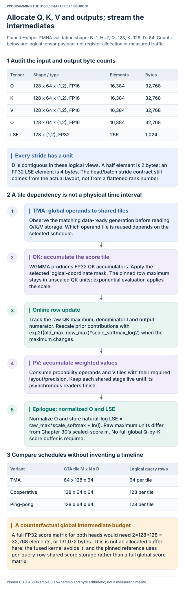

# Chapter 31: Building Fused Attention with CUTLASS on Hopper

## From two GEMMs to a complete attention kernel

[](images/chapter-openers/31-workshop.svg)

!!! abstract "Goal and prerequisites"

    Connect [Chapter 30's online-softmax arithmetic](30-cutlass-attention-foundations.md) to a complete, pinned NVIDIA implementation. You will trace tensor layouts, TMA loads, WGMMA consumers, normalization, output/LSE stores and the verification boundary. Read [tensor views](18-cute-tensors-tiling.md), [copy ownership](20-tiled-copy.md), [MMA fragments](21-mma-atoms.md) and [pipeline lifetimes](25-cutlass-pipelines.md) first; this chapter uses their objects rather than replacing them with pseudocode.

The implementation is [CUTLASS v4.3.6 example 88](https://github.com/NVIDIA/cutlass/tree/1afc6d355b8cb992398f17beb4425702f1d57ddd/examples/88_hopper_fmha), pinned to commit `1afc6d355b8cb992398f17beb4425702f1d57ddd`. It supplies forward **and backward** FMHA implementations. The lab below starts with FP16 forward and can additionally collect two FP16 backward cases. This is an official CUTLASS C++ implementation using CuTe; it is neither a Triton kernel nor the separate FlashAttention-3 software package. The upstream README relates its design to the FlashAttention-3 paper, while explicitly qualifying backward performance.

**H100 validation complete:** the pinned FP16 target compiled and passed six forward cases and two backward cases, covering all 17 expected verified variant results. D=64 forward/backward memchecks also reported zero errors. The dated record below is separate from the earlier workshop and identifies the exact sources, system, commands and outputs. It does not establish performance or correctness for untested extensions.

[Jump to the complete CUDA listing](#319-complete-runnable-cuda-source) · [Download `.cu`](examples/attention/88_hopper_fmha/88_hopper_fmha.cu) · [Download source and local headers](examples/attention/hopper-fmha-source.zip).

## 31.1 Establish the shape and storage contract

For each batch/head, attention computes `O = softmax(Q*K^T / sqrt(D) + mask)*V`. Here Q has Q rows and D columns, K/V have K rows and D columns, and O has Q rows and D columns. The identifier K therefore denotes the key sequence length here; it is not the reduction dimension of the first GEMM, which is D.

The runner's problem tuple is `(B,H,Q,K,D)`. Its CuTe tensor views group batch/head into a hierarchical third mode: Q/O use `(Q,D,(B,H))`, K/V use `(K,D,(B,H))`. In the default FP16 executable, the head element is contiguous. For Q/O, the initialized stride is `(D,1,(H*Q*D,Q*D))` when D is already aligned. Allocation code rounds storage D upward to a multiple of eight; the lab uses D in `{32,64,128,256}` so this padding does not obscure the example.

Take `B=1,H=2,Q=K=128,D=64`:

1. Q, K and V each hold `1*2*128*64=16384` half elements: **32768 bytes each**. O has the same count and storage width.
2. Q coordinate `(query=3,head_element=5,batch=0,head=1)` maps to element offset `3*64+5+1*(128*64)=8389`, or byte offset 16778. This is an address calculation, not a score value.
3. LSE has one FP32 value per query/head: `1*2*128=256` values, **1024 bytes**, with view `(Q,(B,H))`. It records the natural-log normalizer `log(sum_j exp(score_ij))` under the applied mask.
4. A hypothetical global FP32 score array would contain `B*H*Q*K=32768` values, or 131072 bytes. The fused kernel avoids materializing that full global intermediate. This is not the total memory footprint: inputs, outputs, reference allocations, shared memory, registers and any workspace remain real resources.

[](images/worked/ch31-fmha-ownership.svg)

**Check:** reconstruct an address using the actual strides before changing layout. The FP8 target uses a different V stride orientation; copying these FP16 stride assumptions into FP8 is incorrect. Although the README describes broader FP16/BF16 building-block support, the default runner explicitly selects `cutlass::half_t`; it has no BF16 command-line switch.

??? question "Exercise: double the number of heads"

    Keep all other values fixed and set H=4. What happens to Q and LSE storage?

    **Worked answer:** Q becomes 65536 bytes; LSE becomes 2048 bytes. A single query's softmax still ranges over 128 keys, not over all four heads.

### Share KV heads without aliasing query outputs

The pinned README explains that MHA, grouped-query attention (GQA) and multi-query attention (MQA) can be expressed through different tensor views. That does not make them command-line modes of the default runner. The collected baseline remains FP16 ordinary MHA; it has no GQA, MQA or BF16 CLI switch.

As a **mathematical storage exercise**, choose four query heads and two KV heads, with group size `Hq/Hkv=2`. Query head h reads KV head `floor(h/2)`:

| Query head h | 0 | 1 | 2 | 3 |
| --- | ---: | ---: | ---: | ---: |
| KV head | 0 | 0 | 1 | 1 |

1. Q and O still have four distinct head outputs. Softmax is computed separately for each query head using its own Q values; sharing K/V does not average those queries together.
2. For `Nq=2,Nk=3,D=4`, hypothetical packed FP16 Q uses `4*2*4*2=64` bytes. K and V each use `2*3*4*2=48` bytes, rather than the 96 bytes each needed for four independently stored KV heads.
3. Write the K offset in half elements as `floor(h/2)*(Nk*D)+j*D+c`. At key j=2 and feature c=1, query heads 0 and 1 both read offset nine (byte 18); heads 2 and 3 both read offset 21 (byte 42). This is intentional read sharing.
4. Output storage must retain the query-head identity. Reusing the shared-KV head index for O would cause two different query heads to overwrite the same output. Training also requires the appropriate accumulation of gradient contributions into shared K/V heads.
5. MQA is the limiting one-KV-head case: all four queries read KV head zero. With the same Nk/D/type, each K or V allocation becomes 24 bytes; Q/O still retain four query heads.

CuTe can represent the duplicated read view through hierarchical/broadcast layout modes. The exact head ordering, strides, query-to-KV grouping and derivative contract must agree between loader, reference and consumers. The offset formula above is a paper contract, not an implemented or executed GQA extension of this lab. Changing only H in the existing runner changes its MHA head count; it does not enable KV sharing.

## 31.2 Read the source in dependency order

Use the pinned [runner](https://github.com/NVIDIA/cutlass/blob/1afc6d355b8cb992398f17beb4425702f1d57ddd/examples/88_hopper_fmha/88_hopper_fmha.cu) as the entry point, then follow this map:

| Layer | Source/object to inspect | Question it answers |
| --- | --- | --- |
| Host runner | `Options`, `FwdRunner`, `run_fwd_64` | Which shapes, strides, datatype and kernel variants are instantiated? |
| Device adapter | `device/device_universal.hpp` | How are support checks, workspace, initialization and launch connected? |
| Kernel builder | `kernel/fmha_kernel_builder.hpp`, `FmhaBuilder` | Which mainloop, epilogue and kernel match the dispatch policy? |
| Kernel orchestration | `kernel/fmha_kernel_tma_warpspecialized.hpp` | Which participants load, compute and retire work? |
| Load/mainloop | `collective/fmha_collective_load.hpp`, `fmha_collective_tma_warpspecialized.hpp` | How do TMA stages feed the two matrix products? |
| Softmax/fusion | `fmha_collective_softmax.hpp`, `fmha_fusion.hpp` | Which rows are reduced, rescaled and masked? |
| Final stores | `collective/fmha_epilogue.hpp` | Which participants store O and one LSE per query? |

For D=64, the default executable instantiates **three variants**: TMA `64x128x64`, cooperative `128x64x64`, and ping-pong `128x64x64`. These triples mean `(query tile,key tile,head tile)`. They do not mean `(B,H,D)` or three different requested attention problems. The first query tile of a `128x64x64` variant covers queries 0–127; with K=128 it consumes two 64-key blocks. At B=1,H=2, both heads require their own computation and outputs.

The lifecycle is the familiar CUTLASS pattern: construct arguments containing pointers/strides and hardware information, request workspace, call `can_implement`, initialize, launch, then wait before validation. Do not skip support checking merely because D appears in the README. A listed head size does not promise arbitrary user pointers, strides, masks or resource settings are valid.

## 31.3 Follow one query tile through the fused mainloop

The warp-specialized mainloop uses `PipelineTmaAsync` stage state for Q and K/V storage. Its `CollectiveLoadTma` helpers build global views from TMA descriptors and the current tile coordinates. This turns the preceding CuTe layout lessons into actual copy ownership.

1. **Acquire storage and load operands.** A producer must acquire a reusable stage before issuing its TMA transaction. Consumers wait for that generation's completion. The Q tile supplies a block of queries; the K tile supplies a block of keys. Reusing a physical stage does not mean its previous generation is finished automatically.
2. **Form QK accumulators.** WGMMA computes dot products with FP32 QK accumulation in the default FP16 runner. Accumulator fragments are distributed among participating threads. Their logical query/key coordinates, not register order, determine mask and row-reduction semantics.
3. **Apply fusion and update row state.** `before_softmax` can change scores using those coordinates. Softmax maintains row maxima and denominator state. When a later key block raises the maximum, both the old denominator and old PV accumulator must be rescaled. The implementation uses base-two exponential instructions with a converted `scale_softmax_log2`; this implements the same mathematical exponential as Chapter 30, subject to its numerical approximation and precision choices.
4. **Multiply probabilities by V.** The second matrix product accumulates weighted value vectors. It shares the key-block progression with QK, but has different operand roles and fragment layouts. A QK fragment cannot be treated as an arbitrary row-major matrix without the associated CuTe mapping/conversion.
5. **Normalize and store.** The softmax finalization normalizes the accumulated output and produces LSE. `FmhaFwdEpilogue` uses the output partition/store path for O and the corresponding row ownership for LSE. Storing a row statistic from every lane would create redundant or conflicting writers; the code selects the appropriate participants.

**Keep the implementation's maximum in its actual units.** Chapter 30 defines mathematical scores `s=raw_QK/sqrt(D)` and tracks their maximum m. In the pinned default FP16 collective, `s_max` instead retains the **unscaled QK maximum**. The rescale is `exp2((old_s_max-new_s_max)*scale_softmax_log2)`, where `scale_softmax_log2=log2(e)/sqrt(D)`. Final natural-log LSE is `s_max*scale_softmax+log(sum)`, with `scale_softmax=1/sqrt(D)`. These are equivalent conventions when used consistently; copying only `m+log(l)` with an unscaled `s_max` is wrong.

The `before_softmax` hook receives those raw QK accumulators. Zero/minus-infinity masking is invariant under the positive scale, but a finite additive bias is not. At D=64, scale is 1/8: a desired bias of two **after** scaling would require raw bias 16 if inserted before that scaling, or application at an appropriate later stage. Dropout, finite bias and absolute causal positions each change the operation contract; this baseline does not enable a dropout mask or implement such extensions automatically.

**Expected check:** every logical output coordinate and its row's LSE correspond to the same query/head. A correct-looking O with a misplaced LSE can break backward even when a forward-only application never reads LSE. Pipeline stage release must follow the last operand consumer, not simply TMA issue or QK issue. The chapter explains dependencies; the figure is not a measured overlap timeline.

## 31.4 Specify masks before testing tails or decoding

The pinned `CausalFusion` masks a score when **query index < key index**. This is a **top-left** causal convention. With Q=2,K=3, allowed key sets are `{0}` and `{0,1}`. An incremental-decode interpretation placing these queries at the end of a three-token context instead needs an offset: allowed sets `{0,1}` and `{0,1,2}`. The source comments discuss this distinction; `--mask=causal` does not apply the offset automatically.

`ResidualFusion` is a separate noncausal key-boundary mask. TMA zero padding is not equivalent to a softmax mask: a padded zero score has exponential one and can change the denominator. `DefaultFusion` does not exclude such scores, and `CausalFusion` is not a composition with `ResidualFusion`. Therefore this lab uses aligned sequence lengths for full and causal runs. It makes no blanket claim that arbitrary unequal/ragged Q/K combinations work just because allocations are padded. A later tail test must choose a supported residual-mask path, verify its precise boundary behavior and check O **and** LSE; it is separate from these baseline cases.

All-masked rows require an explicit application contract. Do not infer one from the usual nonempty softmax formula. The pinned implementation has its own zero/NaN-denominator handling; the CPU arithmetic lesson rejects undefined all-masked cases instead of silently declaring them equivalent.

??? question "Exercise: locate the two queries in a three-key context"

    Q=2,K=3. Which keys can query row zero attend under the pinned top-left mask, and under an explicit query offset of one?

    **Worked answer:** top-left permits only key 0. With offset one, the query is at absolute position 1 and may use keys 0 and 1. Changing the offset changes the operation, not just a memory address; compare against the matching reference.

## 31.5 Build exactly the intended executable

Follow [Getting Started](getting-started.md) for a compatible driver, CUDA toolkit and host compiler. This additional CMake lab also needs CMake; on the supported Ubuntu host:

```bash
sudo apt-get update
sudo apt-get install --no-install-recommends cmake
bash tools/fetch_cutlass.sh /tmp/cutlass-attention-v436
python3 tools/run_cutlass_attention.py --cutlass /tmp/cutlass-attention-v436 \
  --output artifacts/attention-hopper-01
```

The last command prints a **plan**, including the pin, source/collector hashes and commands. It creates no execution evidence and launches no GPU work. The pinned source has a CUDA 12.0 minimum guard; this book's established Hopper toolchain is CUDA 12.8.93. Compile for **90a**, as the implementation uses architecture-specific SM90a paths. An A100, or a Blackwell device accepting some Hopper-compatible code, does not satisfy this example's exact runtime guard: it specifically checks compute capability 9.0.

To collect the separate GPU record on a suitable Hopper host:

```bash
python3 tools/run_cutlass_attention.py --cutlass /tmp/cutlass-attention-v436 \
  --output artifacts/attention-hopper-01 --execute
```

The collector archives the exact Git commit into a new evidence directory, hashes its source files, captures tool/system information, configures CMake with `CUTLASS_NVCC_ARCHS=90a`, and builds only target **`88_hopper_fmha`**. The separate target `88_hopper_fmha_fp8` defines `FP8`; this collector does not build or validate it. The official CMake recipe adds `--use_fast_math` on its supported non-Windows/non-Clang-host path, so record that build configuration when interpreting error and timing results.

Baseline cases cover D=32/64/128/256 with explicit B/H/Q/K/D/iterations, including aligned full and causal D=64/128 cases. Explicit dimensions matter: upstream defaults couple H to D and B to K. Each run selects the same problem for all variants instantiated at that D. Use a new output directory for every execution; the collector refuses to overwrite a previous record.

## 31.6 Understand exactly what verification proves

Pass `--verify`. Upstream `FwdRunner::verify` compares **O and LSE** to its device reference. For FP16 it requires maximum absolute difference below `1e-2` and mean absolute difference below `1e-3`, separately for both outputs. These are the pinned example's absolute thresholds, not universally justified tolerances for every model distribution.

The reference is a **GPU kernel**, not a CPU/FP64 oracle. It forms one query row's scores in dynamic shared memory and includes FP16 intermediate rounding; it does not materialize a complete global score matrix. Chapter 30's [CPU arithmetic walkthrough](30-cutlass-attention-foundations.md) independently checks the mathematical recurrence on tiny inputs. It does not consume this runner's random device inputs or independently certify the optimized kernel. A stronger new-input audit would export the exact Q/K/V and compare each O/LSE coordinate to a higher-precision reference under the identical mask/scale/layout contract.

Upstream prints `[OK]` only for a passed **verified** variant; `[--]` means execution without verification, and `[FAIL]` indicates failure. Architecture guards and some failed paths can still leave the executable with exit status zero. The collector therefore requires the expected count and exact names/order of `[OK]` variants, one launch header matching requested B/H/Q/K/D, direction and mask, finite reported rates and positive finite verbose timings, no failure diagnostics and successful process status. A duplicated success row, wrong problem header or nonfinite timing cannot become PASS merely because the row count matches. A skipped or missing kernel is **SKIP/INCOMPLETE**, never PASS; one successful variant cannot hide another variant's failure.

Logs retain argv, UTC start/end, separate stdout/stderr, source hashes and system information in `results.json` and sibling files. Those timestamps become execution dates only after an actual run. The host parser tests exercise false-success cases without claiming GPU validation:

```bash
python3 -m unittest discover -s tools/tests -p test_cutlass_attention.py -v
```

??? question "Exercise: a zero exit with incomplete verification"

    A D=64 run exits zero and prints two `[OK]` rows plus one `[--]` row. Is the complete case verified?

    **Worked answer:** no. This runner instantiates three variants at D=64, and `[--]` indicates an unverified result. The collector returns INCOMPLETE rather than PASS. A numerical failure instead returns FAIL, even if another variant succeeded.


<!-- attention-hopper-capture:start -->
### Captured H100 compilation and execution

**Executed November 18, 2026 at 19:08:51 EST**; the recorded UTC date is November 19. This was one selected H100 GPU (`CUDA_VISIBLE_DEVICES=0`) on a two-H100 80GB HBM3 host, 132 SMs per GPU, Ubuntu 22.04.5 LTS, kernel 6.8.0-1064-nvidia, driver 580.105.08, CUDA compiler 12.8.93, GCC 11.4.0, CMake 3.22.1 and Python 3.10.12. The NV18 connection describes the host; these are single-GPU attention tests.

CUTLASS commit: `1afc6d355b8cb992398f17beb4425702f1d57ddd`. Runner SHA-256: `b29f795d77867fbac7954c55c39042d7a5b145659f84742c568c305cfc47b4c5`. All 6,711 archived compiler-input files matched the complete pinned tree. [Results with exact argv, dates and log hashes](validation/2026-11-18-h100-attention/hopper-fmha/results.json) · [Compiler-input identities](validation/2026-11-18-h100-attention/hopper-fmha/source-sha256.json) · [Captured collector](validation/2026-11-18-h100-attention/hopper-fmha/collector.py) · [GPU/system log](validation/2026-11-18-h100-attention/hopper-fmha/gpu-system.stdout.log).

The recorded CMake configure/build commands selected `90a`, Release, FP16 target `88_hopper_fmha`, and disabled tests/profiler/library generation. Build parallelism was four. Both stages exited zero. [Configure output](validation/2026-11-18-h100-attention/hopper-fmha/configure.stdout.log) · [Build output](validation/2026-11-18-h100-attention/hopper-fmha/build.stdout.log) · [Build diagnostics](validation/2026-11-18-h100-attention/hopper-fmha/build.stderr.log).

| Case | Verified variants | Execution start UTC | Result |
| --- | ---: | --- | --- |
| d32-full | 2 | `2026-11-19T00:08:51.548617+00:00` | PASS · [Output](validation/2026-11-18-h100-attention/hopper-fmha/d32-full.stdout.log) |
| d64-full | 3 | `2026-11-19T00:08:51.977031+00:00` | PASS · [Output](validation/2026-11-18-h100-attention/hopper-fmha/d64-full.stdout.log) |
| d64-causal | 3 | `2026-11-19T00:08:52.301968+00:00` | PASS · [Output](validation/2026-11-18-h100-attention/hopper-fmha/d64-causal.stdout.log) |
| d128-full | 2 | `2026-11-19T00:08:52.624603+00:00` | PASS · [Output](validation/2026-11-18-h100-attention/hopper-fmha/d128-full.stdout.log) |
| d128-causal | 2 | `2026-11-19T00:08:52.950833+00:00` | PASS · [Output](validation/2026-11-18-h100-attention/hopper-fmha/d128-causal.stdout.log) |
| d256-full | 1 | `2026-11-19T00:08:53.278552+00:00` | PASS · [Output](validation/2026-11-18-h100-attention/hopper-fmha/d256-full.stdout.log) |
| d64-backward-no | 2 | `2026-11-19T00:08:53.598689+00:00` | PASS · [Output](validation/2026-11-18-h100-attention/hopper-fmha/d64-backward-no.stdout.log) |
| d64-backward-causal | 2 | `2026-11-19T00:08:53.919108+00:00` | PASS · [Output](validation/2026-11-18-h100-attention/hopper-fmha/d64-backward-causal.stdout.log) |

**Actual captured d64-full output:**

```text
###### B 1 H 2 Q 128 K 128 D 64 Forward Full #SM 132
 [OK]  tma 64x128x64                    : 1.34894 TFLOPS/s
       t=0.00621867ms, smem=74240b
 [OK]  tma ws cooperative 128x64x64     : 1.17203 TFLOPS/s
       t=0.00715733ms, smem=57856b
 [OK]  tma ws ping-pong 128x64x64       : 1.2025 TFLOPS/s
       t=0.006976ms, smem=75264b
```

**Actual captured d64-backward-no output:**

```text
###### B 1 H 2 Q 128 K 128 D 64 Backward Full #SM 132
 [OK]  tma ws cooperative 64x128x64     : 1.15788 TFLOPS/s
       t=0.018112ms, smem=116224b
 [OK]  tma ws cooperative 128x128x64    : 1.03315 TFLOPS/s
       t=0.0202987ms, smem=199168b
```

These are captured rates for small correctness configurations; they are not peak H100 or paper-FA3 benchmark results. Six forward invocations checked O/LSE; two backward invocations checked dQ/dK/dV against the pinned vendor references. The collector accepted every expected variant and returned PASS.

Additional D=64 full-forward and full-backward Compute Sanitizer memchecks passed with `ERROR SUMMARY: 0 errors`. [Supplemental commands and dates](validation/2026-11-18-h100-attention/attention-memory-01/results.json) · [Forward memcheck](validation/2026-11-18-h100-attention/attention-memory-01/d64-full-memcheck.stdout.log) · [Backward memcheck](validation/2026-11-18-h100-attention/attention-memory-01/d64-backward-no-memcheck.stdout.log). Instrumented timings are separate from the numerical-run timings above. FP8, BF16, GQA/MQA modifications and additional ragged/backward shapes remain outside this specific execution record.
<!-- attention-hopper-capture:end -->

## 31.7 Read the backward path as a new dependency graph

The library also implements FP16 backward for head dimensions 32,64,128. It is not an automatic derivative of a black-box forward launch. Given upstream gradient dO and softmax probabilities P, the mathematical relations per head are:

- `dV = P^T*dO` and `dP = dO*V^T`;
- `delta_i = sum_j P_ij*dP_ij = dot(dO_i,O_i)`;
- `dS_ij = P_ij*(dP_ij-delta_i)` for the scaled, masked score S;
- `dQ = dS*K/sqrt(D)` and `dK = dS^T*Q/sqrt(D)`.

Walk one row: P=`[1/4,3/4]`, V rows `[1,0]`, `[0,2]`, and dO=`[2,3]`. Then O=`[1/4,3/2]` and dP=`[2,6]`. Delta is `(1/4)*2+(3/4)*6=5`, also `dot(dO,O)=1/2+9/2=5`. Thus dS=`[-3/4,3/4]`, whose sum is zero. This row contributes dV rows `[1/2,3/4]` and `[3/2,9/4]`. The dQ/dK products then use the actual Q/K and the same score scale. The numbers demonstrate derivative bookkeeping, not a vendor-supported head size of two.

Follow `BwdRunner`, `device/fmha_device_bwd.hpp`, the backward mainloop, the `sum_OdO` kernel and conversion stage. Reconstructing probability tiles from scores/LSE avoids storing the whole probability matrix, but creates dependencies on the exact forward normalization and mask convention. The optimized gradients are compared against `reference/fmha_bwd_reference.hpp`; the pinned thresholds are again max `<1e-2`, mean `<1e-3`, separately for dQ, dK and dV.

Add `--include-backward` to the collector plan or execution command to request aligned D=64 full and causal backward cases. Each case expects two verified variant rows. The published Hopper record includes both of these D=64 backward cases and all four expected variant results; it neither validates every backward head size nor claims FA3-equivalent performance. The upstream README explicitly says backward kernels are more limited in performance than FA3.

??? question "Exercise: detect an incorrect softmax backward correction"

    For the worked row P=[1/4,3/4],dP=[2,6], someone uses delta=4 rather than five. What check exposes the error?

    **Worked answer:** the wrong dS is [-1/2,3/2], whose sum is one. The correct delta gives [-3/4,3/4], summing to zero. A softmax score-gradient row sums to zero in exact arithmetic; use an appropriate tolerance for floating-point checks.

## 31.8 Profile only after preserving the numerical contract

The small B=1,H=2 cases above are **correctness configurations**, not throughput benchmarks. Two heads and short query lengths provide only a few logical query tiles and can leave most of an H100 idle. Their captured TFLOP/s must not be presented as a peak-performance result. A throughput study needs a separately stated larger workload and adequate independent work, while preserving the same numerical contract.

`--verbose` prints per-variant elapsed milliseconds and shared-memory bytes. The upstream timer surrounds repeated device operations; initialization and reference checking lie outside that timed region. Its forward FLOP numerator is approximately `4*B*H*Q*K*D`, halved for causal mode. That convention omits softmax/masking work and approximates the causal triangle; it is not a count of every executed instruction. Compare kernels using the same shape, dtype, mask, precision, warmup and timing boundary.

Use Nsight Systems to inspect launch/overlap and Nsight Compute to investigate shared-memory/register pressure, pipeline stalls and Tensor Core activity. A profile or sanitizer run perturbs timing and is not the normal throughput record. The following are **commands to run after a real build**, not captured profiling results. Set the binary to the separately collected run directory. The symbol filter follows the actual `device_kernel<...FmhaKernel...>` launch type in the pinned adapter; inspect the profiler's kernel list if a tool version reports no match.

```bash
ATTENTION_BIN="$PWD/artifacts/attention-hopper-01/build/examples/88_hopper_fmha/88_hopper_fmha"
mkdir -p artifacts/attention-profiles
nsys profile --trace=cuda,nvtx --sample=none \
  --output=artifacts/attention-profiles/d64-full \
  "$ATTENTION_BIN" --b=1 --h=2 --q=128 --k=128 --d=64 \
  --mask=no --iterations=3 --verify --verbose
ncu --set basic --kernel-name-base demangled \
  --kernel-name 'regex:.*FmhaKernel.*' --launch-count 1 \
  --export artifacts/attention-profiles/d64-one-kernel \
  "$ATTENTION_BIN" --b=1 --h=2 --q=128 --k=128 --d=64 \
  --mask=no --iterations=3 --verify --verbose
```

Nsight Systems includes all selected variants and reference launches. Nsight Compute's one-launch filter examines one matching kernel, not the complete application timing or all variants. Choose new report names for another capture. Profiling requires the site's permitted performance-counter access; missing permissions or no matching kernel is not a successful profile. See the [Nsight Systems CLI](https://docs.nvidia.com/nsight-systems/UserGuide/index.html#cli-profile-command-switch-options) and [Nsight Compute CLI](https://docs.nvidia.com/nsight-compute/NsightComputeCli/index.html).

Keep optimization experiments in a new checkout/run directory: changing stage count, schedule or probability conversion can alter resource limits and numerical behavior. Recheck O, LSE and, when applicable, all three gradients before accepting a speed improvement.

## 31.9 Complete runnable CUDA source

[Download the complete `.cu` file](examples/attention/88_hopper_fmha/88_hopper_fmha.cu) · [Download the example with every local kernel/reference header](examples/attention/hopper-fmha-source.zip) · [Source manifest](examples/attention/88_hopper_fmha/source-manifest.json) · [BSD license](examples/attention/88_hopper_fmha/LICENSE.txt).

The full translation unit below is the exact pinned NVIDIA example, including `main`, argument parsing, allocation, forward/backward dispatch and numerical verification. Its local `collective/`, `device/`, `kernel/` and `reference/` headers contain the implementations it instantiates; all are included in the project download. CUTLASS/CuTe library headers still come from the pinned checkout, just as the GEMM chapters use library headers. The standalone `.cu` download therefore needs those dependencies; it is not a skeleton with missing kernel bodies.

Read the complete [warp-specialized kernel](examples/attention/88_hopper_fmha/kernel/fmha_kernel_tma_warpspecialized.hpp), [QK/PV mainloop](examples/attention/88_hopper_fmha/collective/fmha_collective_tma_warpspecialized.hpp), [online softmax](examples/attention/88_hopper_fmha/collective/fmha_collective_softmax.hpp) and [output epilogue](examples/attention/88_hopper_fmha/collective/fmha_epilogue.hpp) alongside the runner.

### Build this listing and run its checks

From the book repository root on the Hopper host, use a fresh scratch checkout. The copy below puts the exact downloadable project into the official example's build location:

```bash
bash tools/fetch_cutlass.sh /tmp/cutlass-attention-page-v436
cp -R docs/examples/attention/88_hopper_fmha/. \
  /tmp/cutlass-attention-page-v436/examples/88_hopper_fmha/
cmake -S /tmp/cutlass-attention-page-v436 \
  -B build/attention-page \
  -DCUTLASS_NVCC_ARCHS=90a -DCMAKE_BUILD_TYPE=Release \
  -DCUTLASS_ENABLE_TESTS=OFF -DCUTLASS_ENABLE_PROFILER=OFF \
  -DCUTLASS_ENABLE_EXAMPLES=ON -DCUTLASS_ENABLE_CUBLAS=OFF \
  -DCUTLASS_ENABLE_LIBRARY=OFF
cmake --build build/attention-page --target 88_hopper_fmha --parallel 1
./build/attention-page/examples/88_hopper_fmha/88_hopper_fmha \
  --b=1 --h=2 --q=128 --k=128 --d=64 --mask=no \
  --iterations=3 --verify --verbose
./build/attention-page/examples/88_hopper_fmha/88_hopper_fmha \
  --b=1 --h=2 --q=128 --k=128 --d=64 --mask=causal \
  --iterations=3 --verify --verbose --bwd
```

Use the collector in Section 31.5 when recording formal evidence: it also checks every expected result row and preserves system information, dates, hashes and logs. Direct invocation above is useful for studying this source, but exit zero alone is insufficient. Expected verified-variant counts are three for the D=64 forward call and two for its backward call. The dated Hopper execution record in Section 31.6 reports the actual results for this exact source.

The upstream banner's large all-2048 usage example is not this lab's command: D=2048 has no instantiated kernel in this pin. Use the explicit supported D=64 commands above. The listing preserves every source line, comment and license, with trailing whitespace removed for presentation; the downloads retain exact upstream bytes.

<!-- attention-complete-source:start -->
```cuda
/***************************************************************************************************
 * Copyright (c) 2024 - 2026 NVIDIA CORPORATION & AFFILIATES. All rights reserved.
 * SPDX-License-Identifier: BSD-3-Clause
 *
 * Redistribution and use in source and binary forms, with or without
 * modification, are permitted provided that the following conditions are met:
 *
 * 1. Redistributions of source code must retain the above copyright notice, this
 * list of conditions and the following disclaimer.
 *
 * 2. Redistributions in binary form must reproduce the above copyright notice,
 * this list of conditions and the following disclaimer in the documentation
 * and/or other materials provided with the distribution.
 *
 * 3. Neither the name of the copyright holder nor the names of its
 * contributors may be used to endorse or promote products derived from
 * this software without specific prior written permission.
 *
 * THIS SOFTWARE IS PROVIDED BY THE COPYRIGHT HOLDERS AND CONTRIBUTORS "AS IS"
 * AND ANY EXPRESS OR IMPLIED WARRANTIES, INCLUDING, BUT NOT LIMITED TO, THE
 * IMPLIED WARRANTIES OF MERCHANTABILITY AND FITNESS FOR A PARTICULAR PURPOSE ARE
 * DISCLAIMED. IN NO EVENT SHALL THE COPYRIGHT HOLDER OR CONTRIBUTORS BE LIABLE
 * FOR ANY DIRECT, INDIRECT, INCIDENTAL, SPECIAL, EXEMPLARY, OR CONSEQUENTIAL
 * DAMAGES (INCLUDING, BUT NOT LIMITED TO, PROCUREMENT OF SUBSTITUTE GOODS OR
 * SERVICES; LOSS OF USE, DATA, OR PROFITS; OR BUSINESS INTERRUPTION) HOWEVER
 * CAUSED AND ON ANY THEORY OF LIABILITY, WHETHER IN CONTRACT, STRICT LIABILITY,
 * OR TORT (INCLUDING NEGLIGENCE OR OTHERWISE) ARISING IN ANY WAY OUT OF THE USE
 * OF THIS SOFTWARE, EVEN IF ADVISED OF THE POSSIBILITY OF SUCH DAMAGE.
 *
 **************************************************************************************************/
/*! \file
    \brief Example implementation of fused multi-head attention for Hopper using CUTLASS 3.

    This example showcases the use of CUTLASS to build forward and backward fused
    multi-head attention (FMHA) collectives from existing CUTLASS collectives targeting
    the NVIDIA Hopper architecture.

    Background and motivation
    -------------------------
    CUTLASS is a highly flexible library that provides open-source building blocks
    for tensor core programming for GEMM or GEMM-like problems. Fused multi-head
    attention (FMHA) is a foundational kernel for large language models (LLMs) since it
    makes long sequence lengths feasible from a memory-usage perspective. It also
    improves computational efficiency since it transforms an outer-product-like and
    a matrix-vector-like GEMM into a fused operation with much higher arithmetic
    intensity. For more details, see Dao et al, 2022; Dao, 2023.
    Implementing this kernel in CUTLASS enabled easy customization and high
    performance.

    Introduction
    ------------
    The example targets the NVIDIA Hopper architecture, and takes advantage of
    warpgroup-wide tensor cores, the Tensor Memory Accelerator (TMA), just like
    GEMMs do. It provides both a forward and a backward pass (often abbreviated
    fwd and bwd in the code), and an optional FP8 mode for the forward pass.
    The code is structured into four layers: The runner (and the reference kernels)
    takes care of initialization, measurement, and testing; the device layer
    orchestrates kernel calls and partitions workspace; the kernel layer (just
    like the CUTLASS kernel layer); and the collective layer (most of the logic
    of FMHA is implemented here).

    Details
    -------
    This example contains a considerable amount of code. For a more detailed
    look at it, please refer to the README.md.

    Example usage:
      $ ./examples/88_hopper_fmha/88_hopper_fmha \
            --b=2048 --h=2048 --d=2048 --q=2048 --k=2048
*/

#include <iostream>

#include "cute/tensor.hpp"

#include "cutlass/cutlass.h"

#include "cutlass/util/command_line.h"
#include "cutlass/util/distribution.h"
#include "cutlass/util/host_tensor.h"
#include "cutlass/util/tensor_view_io.h"
#include "cutlass/util/reference/device/tensor_fill.h"

#include "collective/fmha_fusion.hpp"
#include "device/fmha_device_bwd.hpp"
#include "device/device_universal.hpp"
#include "kernel/fmha_kernel_builder.hpp"
#include "reference/fmha_reference.hpp"
#include "reference/fmha_bwd_reference.hpp"
#include "reference/reference_abs_error.hpp"

using namespace cute;
using namespace cutlass::fmha::kernel;
using namespace cutlass::fmha::collective;
using namespace cutlass::fmha;

// Uncomment for FP8
// #define FP8

///////////////////////////////////////////////////////////////////////////////////////////////////

/// Command line options parsing
struct Options {

  bool help;
  bool error;

  int b, h, q, k, d;
  int iterations;
  bool verify;
  bool verbose;
  bool causal;
  bool residual;
  bool bwd;

  Options():
    help(false),
    error(false),
    b(16), h(16), q(1024), k(1024), d(128),
    iterations(3), verify(false),
    causal(false), residual(false), bwd(false), verbose(false)
  { }

  // Parses the command line
  void parse(int argc, char const **args) {
    cutlass::CommandLine cmd(argc, args);

    Options defaults;

    if (cmd.check_cmd_line_flag("help")) {
      help = true;
      return;
    }

    cmd.get_cmd_line_argument("d", d, defaults.d);
    cmd.get_cmd_line_argument("h", h, -1);
    if (h == -1) h = 2048 / d;

    cmd.get_cmd_line_argument("q", q, -1);
    cmd.get_cmd_line_argument("k", k, -1);
    if (q == -1) q = k;
    if (k == -1) k = q;
    if (q == -1 && k == -1) q = k = defaults.q;

    cmd.get_cmd_line_argument("b", b, -1);
    if (b == -1) b = 16384 / k;
    if (b == 0) b = 1;

    cmd.get_cmd_line_argument("iterations", iterations, defaults.iterations);
    verify = cmd.check_cmd_line_flag("verify");
    verbose = cmd.check_cmd_line_flag("verbose");

    std::string mask;
    cmd.get_cmd_line_argument<std::string>("mask", mask, "");
    if (mask == "no" || mask == "") {
      causal = residual = false;
    }
    else if (mask == "causal") {
      residual = false;
      causal = true;
    }
    else if (mask == "residual") {
      residual = true;
      causal = false;
    }

    bwd = cmd.check_cmd_line_flag("bwd");
  }

  /// Prints the usage statement.
  std::ostream & print_usage(std::ostream &out) const {

    out << "88_hopper_fmha\n\n"
      << "  This example showcases the use of CUTLASS's collective operation builders to easily construct\n"
      << "  fused multi-head attention forward-pass kernels targeting NVIDIA's Hopper architecture.\n\n"
      << "Options:\n\n"
      << "  --help                      If specified, displays this usage statement\n\n"
      << "  --b=<int>                   Sets the B extent\n"
      << "  --h=<int>                   Sets the H extent\n"
      << "  --q=<int>                   Sets the Q extent\n"
      << "  --k=<int>                   Sets the K extent\n"
      << "  --d=<int>                   Sets the D extent\n"
      << "  --iterations=<int>          Benchmarking iterations\n"
      << "  --verify                    Verify results\n"
      << "  --verbose                   Print smem and execution time per kernel\n"
      << "  --mask=<no|residual|causal> Enables masking\n"
      << "  --bwd                       Runs the backwards pass\n"
      << "\n";

    return out;
  }
};

///////////////////////////////////////////////////////////////////////////////////////////////////

/// Helper to initialize a block of device data
template <class Element>
bool initialize_block(
  cutlass::DeviceAllocation<Element>& block,
  uint64_t seed=2023, bool init_one=false) {

  if (init_one) {
    cutlass::reference::device::BlockFillRandomUniform(
      block.get(), block.size(), seed, (Element) 1, (Element) 1);
  } else {
    cutlass::reference::device::BlockFillRandomGaussian(
      block.get(), block.size(), seed, (Element) 0, (Element) 1);
  }

  return true;
}

///////////////////////////////////////////////////////////////////////////////////////////////////

struct ExampleResult {
  bool passed = false;
  bool verified = false;
  float runtime_ms = 0;
  double tflops_s = 0;
  size_t smem_size = 0;
};

///////////////////////////////////////////////////////////////////////////////////////////////////

#if defined(CUTLASS_ARCH_MMA_SM90_SUPPORTED)

///////////////////////////////////////////////////////////////////////////////////////////////////

template<
  class TileShape,
  class DispatchPolicy,
  class ActiveFusion,
  class... KernelOptions
>
struct FwdRunner {

#ifdef FP8
  using Element = cutlass::float_e4m3_t;
  using ElementAccumulatorQK = find_option_t<Tag::kAccQK, float, KernelOptions...>;
#else
  using Element = cutlass::half_t;
  using ElementAccumulatorQK = float;
#endif

  using ElementAccumulatorPV = float;

  // B H Q K D
  using ProblemShapeType = cute::tuple<int, int, int, int, int>;


  using StrideQ = cute::tuple<int, _1, cute::tuple<int, int>>;  // Q D (B H)
  using StrideK = cute::tuple<int, _1, cute::tuple<int, int>>;  // K D (B H)
  using StrideV = std::conditional_t<sizeof(Element) == 1,
    cute::tuple<_1, int, cute::tuple<int, int>>,
    cute::tuple<int, _1, cute::tuple<int, int>>>;  // K D (B H)
  using StrideO = cute::tuple<int, _1, cute::tuple<int, int>>; // Q D (B H)
  using StrideLSE = cute::tuple<_1, cute::tuple<int, int>>; // Q (B H)

  using Operation = cutlass::device::Universal<
    typename cutlass::fmha::kernel::FmhaBuilder<
      Element, ElementAccumulatorQK, ElementAccumulatorPV,
      TileShape, StrideQ, StrideK, StrideV,
      ActiveFusion, DispatchPolicy, KernelOptions...
    >::Kernel>;

  //
  // Data members
  //

  /// Initialization
  StrideQ stride_Q;
  StrideK stride_K;
  StrideV stride_V;
  StrideO stride_O;
  StrideLSE stride_LSE;
  uint64_t seed = 0;

  cutlass::DeviceAllocation<Element> block_Q;
  cutlass::DeviceAllocation<Element> block_K;
  cutlass::DeviceAllocation<Element> block_V;
  cutlass::DeviceAllocation<Element> block_O;
  cutlass::DeviceAllocation<ElementAccumulatorPV> block_LSE;
  cutlass::DeviceAllocation<Element> block_ref_O;
  cutlass::DeviceAllocation<ElementAccumulatorPV> block_ref_LSE;

  //
  // Methods
  //
  bool verify(const ProblemShapeType& problem_size) {
    auto [B, H, Q, K, D] = problem_size;

    Tensor mQ = make_tensor(make_gmem_ptr(block_Q.get()),
      make_shape(Q, D, make_shape(B, H)),
      stride_Q);

    Tensor mK = make_tensor(make_gmem_ptr(block_K.get()),
      make_shape(K, D, make_shape(B, H)),
      stride_K);

    Tensor mV = make_tensor(make_gmem_ptr(block_V.get()),
      make_shape(K, D, make_shape(B, H)),
      stride_V);

    Tensor mO = make_tensor(make_gmem_ptr(block_ref_O.get()),
      make_shape(Q, D, make_shape(B, H)),
      stride_O);

    Tensor mLSE = make_tensor(make_gmem_ptr(block_ref_LSE.get()),
      make_shape(Q, make_shape(B, H)),
      stride_LSE);

    fmha_reference(problem_size, mQ, mK, mV, mO, mLSE, ActiveFusion{});
    cudaError_t result = cudaDeviceSynchronize();
    if (result != cudaSuccess) {
      std::cerr << "Reference kernel failed. Last CUDA error: "
                << cudaGetErrorString(result) << std::endl;
      return false;
    }

    const double kMaxDiffThresh = sizeof(Element) == 1 ? 1e-1 : 1e-2;
    const double kMeanDiffThresh = sizeof(Element) == 1 ? 1e-1 : 1e-3;

    // Check if output from CUTLASS kernel and reference kernel are equal or not
    double max_diff = 0;
    double mean_diff = 0;
    reference_abs_diff(block_O, block_ref_O, max_diff, mean_diff);
    bool passed_O = (max_diff < kMaxDiffThresh) && (mean_diff < kMeanDiffThresh);
    if (! passed_O) {
      std::cerr << "failed O: max diff " << max_diff
                << " mean " << mean_diff << std::endl;
    }

    reference_abs_diff(block_LSE, block_ref_LSE, max_diff, mean_diff);
    bool passed_LSE = (max_diff < kMaxDiffThresh) && (mean_diff < kMeanDiffThresh);
    if ( ! passed_LSE) {
      std::cerr << "failed LSE: max diff " << max_diff
                << " mean " << mean_diff << std::endl;
    }

    return passed_O && passed_LSE;
  }

  void initialize_stride(cute::tuple<int, int, int> const& shape, cute::tuple<_1, cute::tuple<int, int>>& stride) {
    auto [B, H, Q] = shape;
    stride = make_stride(_1{}, make_stride(H*Q, Q));
  }

  void initialize_stride(cute::tuple<int, int, int, int> const& shape, cute::tuple<int, _1, cute::tuple<int, int>>& stride) {
    auto [B, H, Q, D] = shape;
    stride = make_stride(D, _1{}, make_stride(H*Q*D, Q*D));
  }

  void initialize_stride(cute::tuple<int, int, int, int> const& shape, cute::tuple<_1, int, cute::tuple<int, int>>& stride) {
    auto [B, H, Q, D] = shape;
    stride = make_stride(_1{}, Q, make_stride(H*Q*D, Q*D));
  }

  /// Initialize operands to be used in the GEMM and reference GEMM
  void initialize(const ProblemShapeType& problem_size) {
    auto [B, H, Q, K, D] = problem_size;
    D = cutlass::round_up(D, 8); // Alignment

    auto shape_QO = cute::make_shape(B, H, Q, D);
    auto shape_KV = cute::make_shape(B, H, K, D);
    auto shape_LSE = cute::make_shape(B, H, Q);

    initialize_stride(shape_QO, stride_Q);
    initialize_stride(shape_KV, stride_K);
    initialize_stride(shape_KV, stride_V);
    initialize_stride(shape_QO, stride_O);
    initialize_stride(shape_LSE, stride_LSE);

    block_Q.reset(size(shape_QO));
    block_K.reset(size(shape_KV));
    block_V.reset(size(shape_KV));
    block_O.reset(size(shape_QO));
    block_LSE.reset(size(shape_LSE));
    block_ref_O.reset(size(shape_QO));
    block_ref_LSE.reset(size(shape_LSE));

    initialize_block(block_Q, seed + 2023, false);
    initialize_block(block_K, seed + 2022, false);
    initialize_block(block_V, seed + 2021, false);
  }

  ExampleResult run(const Options& options, const cutlass::KernelHardwareInfo& hw_info) {
    ProblemShapeType problem_size = ProblemShapeType{options.b, options.h, options.q, options.k, options.d};

    initialize(problem_size);

    typename Operation::Arguments arguments{
      problem_size,
      { block_Q.get(), stride_Q,
        block_K.get(), stride_K,
        block_V.get(), stride_V },
      { block_O.get(), stride_O,
      block_LSE.get(), stride_LSE },
      hw_info
    };

    Operation op;

    ExampleResult example_result;

    example_result.smem_size = Operation::Kernel::SharedStorageSize;

    size_t workspace_size = Operation::get_workspace_size(arguments);
    cutlass::device_memory::allocation<uint8_t> workspace(workspace_size);

    cutlass::Status status = op.can_implement(arguments);
    if (status != cutlass::Status::kSuccess) {
      std::cerr << "This kernel is not supported. Last CUDA error is: "
                << cudaGetErrorString(cudaGetLastError()) << std::endl;
      return example_result;
    }

    status = op.initialize(arguments, workspace.get());
    if (status != cutlass::Status::kSuccess) {
      std::cerr << "Failed to initialize the CUTLASS kernel. Last CUDA error is: "
                << cudaGetErrorString(cudaGetLastError()) << std::endl;
      return example_result;
    }

    // Run
    status = op.run();
    if (status != cutlass::Status::kSuccess) {
      std::cerr << "Failed to launch the CUTLASS kernel. Last CUDA error is: "
                << cudaGetErrorString(cudaGetLastError()) << std::endl;
      return example_result;
    }

    cudaError_t result = cudaDeviceSynchronize();
    if (result != cudaSuccess) {
      std::cerr << "Error running the CUTLASS kernel. Last CUDA error is: "
                << cudaGetErrorString(result) << std::endl;
      return example_result;
    }

    //
    // Construct events
    //

    cudaEvent_t events[2];

    for (auto & event : events) {
      result = cudaEventCreate(&event);
      if (result != cudaSuccess) {
        std::cerr << "cudaEventCreate() failed: " << cudaGetErrorString(result) << std::endl;
        return example_result;
      }
    }

    // Record an event at the start of a series of GEMMs
    result = cudaEventRecord(events[0]);
    if (result != cudaSuccess) {
      std::cerr << "cudaEventRecord() failed: " << cudaGetErrorString(result) << std::endl;
      return example_result;
    }

    for (int i = 0; i < options.iterations; i++) {
      status = op.run();
      if (status != cutlass::Status::kSuccess) {
        std::cerr << "Failed to launch the CUTLASS kernel. Last CUDA error is: "
                  << cudaGetErrorString(cudaGetLastError()) << std::endl;
        return example_result;
      }
    }

    //
    // Stop profiling loop
    //

    // Record an event when the GEMMs are complete
    result = cudaEventRecord(events[1]);
    if (result != cudaSuccess) {
      std::cerr << "cudaEventRecord() failed: " << cudaGetErrorString(result) << std::endl;
      return example_result;
    }

    // Wait for work on the device to complete.
    result = cudaEventSynchronize(events[1]);
    if (result != cudaSuccess) {
      std::cerr << "cudaEventSynchronize() failed: " << cudaGetErrorString(result) << std::endl;
      return example_result;
    }

    // Measure elapsed runtime
    float runtime_ms = 0;
    result = cudaEventElapsedTime(&runtime_ms, events[0], events[1]);
    if (result != cudaSuccess) {
      std::cerr << "cudaEventElapsed() failed: " << cudaGetErrorString(result) << std::endl;
      return example_result;
    }

    runtime_ms /= static_cast<float>(options.iterations);

    double flops = 4.0 * (std::is_same_v<ActiveFusion, CausalFusion> ? 0.5 : 1.0);
    flops *= static_cast<double>(get<0>(problem_size));
    flops *= static_cast<double>(get<1>(problem_size));
    flops *= static_cast<double>(get<2>(problem_size));
    flops *= static_cast<double>(get<3>(problem_size));
    flops *= static_cast<double>(get<4>(problem_size));
    double tflops_s = flops * 1e-12 /*tera*/ / (runtime_ms * 1e-3 /*ms*/);
    example_result.tflops_s = tflops_s;
    example_result.runtime_ms = runtime_ms;

    result = cudaDeviceSynchronize();
    if (result != cudaSuccess) {
      std::cerr << "Error running the CUTLASS kernel. Last CUDA error is: "
                << cudaGetErrorString(result) << std::endl;
      return example_result;
    }

    // Verify that the result is correct
    bool passed = true;
    if (options.verify) {
      passed = verify(problem_size);
      if (passed) example_result.verified = true;
    }

    if (!passed) {
      std::cerr << "Reference check failed" << std::endl;
      return example_result;
    }

    example_result.passed = true;

    return example_result;
  }

};

///////////////////////////////////////////////////////////////////////////////////////////////////

template<
  class TileShape,
  class DispatchPolicy,
  class ActiveFusion,
  class... KernelOptions
>
struct BwdRunner {

  using Element = cutlass::half_t;
  using ElementAccumulator = float;

  // B H Q K D
  using ProblemShapeType = cute::tuple<int, int, int, int, int>;

  using Operation = cutlass::fmha::device::FmhaBwd<Element, ElementAccumulator, TileShape, ActiveFusion, KernelOptions...>;

  // Just like forward
  using StrideQ = cute::tuple<int, int, int, _1>; // B H Q D
  using StrideK = cute::tuple<int, int, int, _1>; // B H K D
  using StrideV = cute::tuple<int, int, int, _1>; // B H K D
  using StrideO = cute::tuple<int, int, int, _1>; // B H Q D
  using StrideLSE = cute::tuple<int, int, _1>; // B H Q

  // Backwards specific
  using StrideDQ = cute::tuple<int, int, int, _1>; // B H Q D
  using StrideDK = cute::tuple<int, int, int, _1>; // B H K D
  using StrideDV = cute::tuple<int, int, int, _1>; // B H K D
  using StrideDO = cute::tuple<int, int, int, _1>; // B H Q D

  //
  // Data members
  //

  /// Initialization
  StrideQ stride_Q;
  StrideK stride_K;
  StrideV stride_V;
  StrideO stride_O;
  StrideLSE stride_LSE;

  StrideDQ stride_dQ;
  StrideDK stride_dK;
  StrideDV stride_dV;
  StrideDO stride_dO;

  uint64_t seed = 0;

  cutlass::DeviceAllocation<Element> block_Q;
  cutlass::DeviceAllocation<Element> block_K;
  cutlass::DeviceAllocation<Element> block_V;
  cutlass::DeviceAllocation<Element> block_O;
  cutlass::DeviceAllocation<ElementAccumulator> block_LSE;

  cutlass::DeviceAllocation<Element> block_dQ;
  cutlass::DeviceAllocation<Element> block_dK;
  cutlass::DeviceAllocation<Element> block_dV;
  cutlass::DeviceAllocation<Element> block_dO;

  cutlass::DeviceAllocation<Element> block_ref_dQ;
  cutlass::DeviceAllocation<Element> block_ref_dK;
  cutlass::DeviceAllocation<Element> block_ref_dV;

  //
  // Methods
  //
  bool verify(const ProblemShapeType& problem_size) {
    auto [B, H, Q, K, D] = problem_size;

    Tensor mQ = make_tensor(make_gmem_ptr(block_Q.get()),
      make_shape(Q, D, make_shape(B, H)),
      make_stride(get<2>(stride_Q), get<3>(stride_Q), make_stride(get<0>(stride_Q), get<1>(stride_Q))));

    Tensor mK = make_tensor(make_gmem_ptr(block_K.get()),
      make_shape(K, D, make_shape(B, H)),
      make_stride(get<2>(stride_K), get<3>(stride_K), make_stride(get<0>(stride_K), get<1>(stride_K))));

    Tensor mV = make_tensor(make_gmem_ptr(block_V.get()),
      make_shape(K, D, make_shape(B, H)),
      make_stride(get<2>(stride_V), get<3>(stride_V), make_stride(get<0>(stride_V), get<1>(stride_V))));

    Tensor mO = make_tensor(make_gmem_ptr(block_O.get()),
      make_shape(Q, D, make_shape(B, H)),
      make_stride(get<2>(stride_O), get<3>(stride_O), make_stride(get<0>(stride_O), get<1>(stride_O))));

    Tensor mLSE = make_tensor(make_gmem_ptr(block_LSE.get()),
      make_shape(Q, make_shape(B, H)),
      make_stride(get<2>(stride_LSE), make_stride(get<0>(stride_LSE), get<1>(stride_LSE))));

    Tensor mDQ = make_tensor(make_gmem_ptr(block_ref_dQ.get()),
      make_shape(Q, D, make_shape(B, H)),
      make_stride(get<2>(stride_dQ), get<3>(stride_dQ), make_stride(get<0>(stride_dQ), get<1>(stride_dQ))));

    Tensor mDK = make_tensor(make_gmem_ptr(block_ref_dK.get()),
      make_shape(K, D, make_shape(B, H)),
      make_stride(get<2>(stride_dK), get<3>(stride_dK), make_stride(get<0>(stride_dK), get<1>(stride_dK))));

    Tensor mDV = make_tensor(make_gmem_ptr(block_ref_dV.get()),
      make_shape(K, D, make_shape(B, H)),
      make_stride(get<2>(stride_dV), get<3>(stride_dV), make_stride(get<0>(stride_dV), get<1>(stride_dV))));

    Tensor mDO = make_tensor(make_gmem_ptr(block_dO.get()),
      make_shape(Q, D, make_shape(B, H)),
      make_stride(get<2>(stride_dO), get<3>(stride_dO), make_stride(get<0>(stride_dO), get<1>(stride_dO))));


    fmha_bwd_reference(problem_size, mQ, mK, mV, mO, mLSE, mDO, mDQ, mDK, mDV, ActiveFusion{});
    cudaError_t result = cudaDeviceSynchronize();
    if (result != cudaSuccess) {
      std::cerr << "Reference kernel failed. Last CUDA error: "
                << cudaGetErrorString(result) << std::endl;
      return false;
    }

    // Check if output from CUTLASS kernel and reference kernel are equal or not
    double max_diff = 0;
    double mean_diff = 0;
    reference_abs_diff(block_dQ, block_ref_dQ, max_diff, mean_diff);
    bool passed_dQ = (max_diff < 1e-2) && (mean_diff < 1e-3);
    if (! passed_dQ) {
      std::cerr << "failed dQ: max diff " << max_diff
                << " mean " << mean_diff << std::endl;
    }

    reference_abs_diff(block_dK, block_ref_dK, max_diff, mean_diff);
    bool passed_dK = (max_diff < 1e-2) && (mean_diff < 1e-3);
    if (! passed_dK) {
      std::cerr << "failed dK: max diff " << max_diff
                << " mean " << mean_diff << std::endl;
    }

    reference_abs_diff(block_dV, block_ref_dV, max_diff, mean_diff);
    bool passed_dV = (max_diff < 1e-2) && (mean_diff < 1e-3);
    if (! passed_dV) {
      std::cerr << "failed dV: max diff " << max_diff
                << " mean " << mean_diff << std::endl;
    }

    return passed_dQ && passed_dK && passed_dV;
  }

  /// Initialize operands to be used in the GEMM and reference GEMM
  void initialize(const ProblemShapeType& problem_size) {
    auto [B, H, Q, K, D] = problem_size;
    D = cutlass::round_up(D, 8);  // Alignment
    Q = cutlass::round_up(Q, 8);  // Alignment

    auto shape_QO = cute::make_shape(B, H, Q, D);
    auto shape_KV = cute::make_shape(B, H, K, D);
    auto shape_LSE = cute::make_shape(B, H, Q);

    stride_Q = cute::compact_row_major(shape_QO);
    stride_K = cute::compact_row_major(shape_KV);
    stride_V = cute::compact_row_major(shape_KV);
    stride_O = cute::compact_row_major(shape_QO);
    stride_LSE = cute::compact_row_major(shape_LSE);

    stride_dQ = stride_Q;
    stride_dK = stride_K;
    stride_dV = stride_V;
    stride_dO = stride_O;

    block_Q.reset(size(shape_QO));
    block_K.reset(size(shape_KV));
    block_V.reset(size(shape_KV));
    block_O.reset(size(shape_QO));
    block_LSE.reset(size(shape_LSE));

    block_dQ.reset(size(shape_QO));
    block_dK.reset(size(shape_KV));
    block_dV.reset(size(shape_KV));
    block_dO.reset(size(shape_QO));

    block_ref_dQ.reset(size(shape_QO));
    block_ref_dK.reset(size(shape_KV));
    block_ref_dV.reset(size(shape_KV));

    initialize_block(block_Q, seed + 2023, false);
    initialize_block(block_K, seed + 2022, false);
    initialize_block(block_V, seed + 2021, false);
    initialize_block(block_dO, seed + 2020, false);
    Tensor mQ = make_tensor(make_gmem_ptr(block_Q.get()),
      make_shape(Q, D, make_shape(B, H)),
      make_stride(get<2>(stride_Q), get<3>(stride_Q), make_stride(get<0>(stride_Q), get<1>(stride_Q))));

    Tensor mK = make_tensor(make_gmem_ptr(block_K.get()),
      make_shape(K, D, make_shape(B, H)),
      make_stride(get<2>(stride_K), get<3>(stride_K), make_stride(get<0>(stride_K), get<1>(stride_K))));

    Tensor mV = make_tensor(make_gmem_ptr(block_V.get()),
      make_shape(K, D, make_shape(B, H)),
      make_stride(get<2>(stride_V), get<3>(stride_V), make_stride(get<0>(stride_V), get<1>(stride_V))));

    Tensor mO = make_tensor(make_gmem_ptr(block_O.get()),
      make_shape(Q, D, make_shape(B, H)),
      make_stride(get<2>(stride_O), get<3>(stride_O), make_stride(get<0>(stride_O), get<1>(stride_O))));

    Tensor mLSE = make_tensor(make_gmem_ptr(block_LSE.get()),
      make_shape(Q, make_shape(B, H)),
      make_stride(get<2>(stride_LSE), make_stride(get<0>(stride_LSE), get<1>(stride_LSE))));

    fmha_reference(problem_size, mQ, mK, mV, mO, mLSE, ActiveFusion{});
  }

  ExampleResult run(const Options& options, const cutlass::KernelHardwareInfo& hw_info) {
    ProblemShapeType problem_size = ProblemShapeType{options.b, options.h, options.q, options.k, options.d};

    initialize(problem_size);

    typename Operation::Arguments arguments{
      problem_size,
      block_Q.get(), stride_Q,
      block_K.get(), stride_K,
      block_V.get(), stride_V,
      block_O.get(), stride_O,
      block_LSE.get(), stride_LSE,
      block_dO.get(), stride_dO,
      block_dQ.get(), stride_dQ,
      block_dK.get(), stride_dK,
      block_dV.get(), stride_dV,
      hw_info
    };

    Operation op;

    ExampleResult example_result;

    example_result.smem_size = Operation::Operation::Kernel::SharedStorageSize;

    size_t workspace_size = Operation::get_workspace_size(arguments);
    cutlass::device_memory::allocation<uint8_t> workspace(workspace_size);

    cutlass::Status status = op.can_implement(arguments);
    if (status != cutlass::Status::kSuccess) {
      std::cerr << "This kernel is not supported. Last CUDA error is: "
                << cudaGetErrorString(cudaGetLastError()) << std::endl;
      return example_result;
    }

    status = op.initialize(arguments, workspace.get());
    if (status != cutlass::Status::kSuccess) {
      std::cerr << "Failed to initialize the CUTLASS kernel. Last CUDA error is: "
                << cudaGetErrorString(cudaGetLastError()) << std::endl;
      return example_result;
    }

    // Run
    cudaMemset(block_dQ.get(), 0, block_dQ.size() * sizeof(Element));
    cudaMemset(block_dK.get(), 0, block_dK.size() * sizeof(Element));
    cudaMemset(block_dV.get(), 0, block_dV.size() * sizeof(Element));

    status = op.run();
    if (status != cutlass::Status::kSuccess) {
      std::cerr << "Failed to launch the CUTLASS kernel. Last CUDA error is: "
                << cudaGetErrorString(cudaGetLastError()) << std::endl;
      return example_result;
    }

    cudaError_t result = cudaDeviceSynchronize();
    if (result != cudaSuccess) {
      std::cerr << "Error running the CUTLASS kernel. Last CUDA error is: "
                << cudaGetErrorString(result) << std::endl;
      return example_result;
    }

    //
    // Construct events
    //

    cudaEvent_t events[2];

    for (auto & event : events) {
      result = cudaEventCreate(&event);
      if (result != cudaSuccess) {
        std::cerr << "cudaEventCreate() failed: " << cudaGetErrorString(result) << std::endl;
        return example_result;
      }
    }

    // Record an event at the start of a series of GEMMs
    result = cudaEventRecord(events[0]);
    if (result != cudaSuccess) {
      std::cerr << "cudaEventRecord() failed: " << cudaGetErrorString(result) << std::endl;
      return example_result;
    }

    for (int i = 0; i < options.iterations; i++) {
      status = op.run();
      if (status != cutlass::Status::kSuccess) {
        std::cerr << "Failed to launch the CUTLASS kernel. Last CUDA error is: "
                  << cudaGetErrorString(cudaGetLastError()) << std::endl;
        return example_result;
      }
    }

    //
    // Stop profiling loop
    //

    // Record an event when the GEMMs are complete
    result = cudaEventRecord(events[1]);
    if (result != cudaSuccess) {
      std::cerr << "cudaEventRecord() failed: " << cudaGetErrorString(result) << std::endl;
      return example_result;
    }

    // Wait for work on the device to complete.
    result = cudaEventSynchronize(events[1]);
    if (result != cudaSuccess) {
      std::cerr << "cudaEventSynchronize() failed: " << cudaGetErrorString(result) << std::endl;
      return example_result;
    }

    // Measure elapsed runtime
    float runtime_ms = 0;
    result = cudaEventElapsedTime(&runtime_ms, events[0], events[1]);
    if (result != cudaSuccess) {
      std::cerr << "cudaEventElapsed() failed: " << cudaGetErrorString(result) << std::endl;
      return example_result;
    }

    runtime_ms /= static_cast<float>(options.iterations);

    double flops = 10.0 * (std::is_same_v<ActiveFusion, CausalFusion> ? 0.5 : 1.0);
    flops *= static_cast<double>(get<0>(problem_size));
    flops *= static_cast<double>(get<1>(problem_size));
    flops *= static_cast<double>(get<2>(problem_size));
    flops *= static_cast<double>(get<3>(problem_size));
    flops *= static_cast<double>(get<4>(problem_size));
    double tflops_s = flops * 1e-12 /*tera*/ / (runtime_ms * 1e-3 /*ms*/);
    example_result.tflops_s = tflops_s;
    example_result.runtime_ms = runtime_ms;

    result = cudaDeviceSynchronize();
    if (result != cudaSuccess) {
      std::cerr << "Error running the CUTLASS kernel. Last CUDA error is: "
                << cudaGetErrorString(result) << std::endl;
      return example_result;
    }

    // Verify that the result is correct
    bool passed = true;
    if (options.verify) {
      passed = verify(problem_size);
      if (passed) example_result.verified = true;
    }

    if (!passed) {
      std::cerr << "Reference check failed" << std::endl;
      return example_result;
    }

    example_result.passed = true;

    return example_result;
  }

};

///////////////////////////////////////////////////////////////////////////////////////////////////

/// Helper to print a description of the example run and its result
void print_result(const std::string& description, ExampleResult result, bool verbose) {
  std::ios fmt(nullptr);
  fmt.copyfmt(std::cout);
  std::cout << (result.passed ? (result.verified ? " [OK]  " : " [--] ") : "[FAIL] ");
  std::cout << std::setw(32) << std::left << description;
  std::cout.copyfmt(fmt);
  std::cout << " : " << result.tflops_s << " TFLOPS/s" << std::endl;
  if (verbose) {
    std::cout << "       t=" << result.runtime_ms << "ms, "
        "smem=" << result.smem_size << "b" << std::endl;
  }
}

///////////////////////////////////////////////////////////////////////////////////////////////////

using KernelTma = cutlass::gemm::KernelTma;
using KernelCooperative = cutlass::gemm::KernelTmaWarpSpecializedCooperative;
using KernelPingpong = cutlass::gemm::KernelTmaWarpSpecializedPingpong;

///////////////////////////////////////////////////////////////////////////////////////////////////

template<class Fusion>
void run_fwd_32(Fusion fusion, Options const & options, cutlass::KernelHardwareInfo const& hw_info) {
  auto run = [&](auto shape, auto kernel, const char* name, auto... kernel_options) {
    FwdRunner<decltype(shape), decltype(kernel), Fusion, decltype(kernel_options)...> runner;
    auto result = runner.run(options, hw_info);
    print_result(name, result, options.verbose);
  };

  using HeadDim = _32;

  run(Shape< _64, _128, HeadDim>{}, KernelTma{}, "tma 64x128x32");
  run(Shape< _128, _64, HeadDim>{}, KernelCooperative{}, "tma ws cooperative 128x64x32");
}

///////////////////////////////////////////////////////////////////////////////////////////////////

template<class Fusion>
void run_fwd_64(Fusion fusion, Options const & options, cutlass::KernelHardwareInfo const& hw_info) {
  auto run = [&](auto shape, auto kernel, const char* name, auto... kernel_options) {
    FwdRunner<decltype(shape), decltype(kernel), Fusion, decltype(kernel_options)...> runner;
    auto result = runner.run(options, hw_info);
    print_result(name, result, options.verbose);
  };

  using HeadDim = _64;

  run(Shape< _64, _128, HeadDim>{}, KernelTma{}, "tma 64x128x64");
  run(Shape< _128, _64, HeadDim>{}, KernelCooperative{}, "tma ws cooperative 128x64x64");
  run(Shape< _128, _64, HeadDim>{}, KernelPingpong{}, "tma ws ping-pong 128x64x64");
}

///////////////////////////////////////////////////////////////////////////////////////////////////

template<class Fusion>
void run_fwd_128(Fusion fusion, Options const & options, cutlass::KernelHardwareInfo const& hw_info) {
  auto run = [&](auto shape, auto kernel, const char* name, auto... kernel_options) {
    FwdRunner<decltype(shape), decltype(kernel), Fusion, decltype(kernel_options)...> runner;
    auto result = runner.run(options, hw_info);
    print_result(name, result, options.verbose);
  };

  using HeadDim = _128;

  run(Shape<_128, _128, HeadDim>{}, KernelCooperative{}, "tma ws cooperative 128x128x128");
#ifdef FP8
  run(Shape<_128, _256, HeadDim>{}, KernelCooperative{}, "tma ws cooperative 128x256x128 acc fp16", Option<Tag::kAccQK, cutlass::half_t>{});
  run(Shape<_128, _256, HeadDim>{}, KernelCooperative{}, "tma ws cooperative 128x256x128 acc fp32");
#endif
  run(Shape<_128, _128, HeadDim>{}, KernelPingpong{}, "tma ws ping-pong 128x128x128");
}

///////////////////////////////////////////////////////////////////////////////////////////////////

template<class Fusion>
void run_fwd_256(Fusion fusion, Options const & options, cutlass::KernelHardwareInfo const& hw_info) {
  auto run = [&](auto shape, auto kernel, const char* name, auto... kernel_options) {
    FwdRunner<decltype(shape), decltype(kernel), Fusion, decltype(kernel_options)...> runner;
    auto result = runner.run(options, hw_info);
    print_result(name, result, options.verbose);
  };

  using HeadDim = _256;

#ifdef FP8
  run(Shape<_128, _128, HeadDim>{}, KernelCooperative{}, "tma ws cooperative 128x128x256");
  run(Shape<_128, _128, HeadDim>{}, KernelPingpong{}, "tma ws ping-pong 128x128x256");
#else
  run(Shape<_128, _64, HeadDim>{}, KernelCooperative{}, "tma ws cooperative 128x64x256");
#endif
}

///////////////////////////////////////////////////////////////////////////////////////////////////

template<class Fusion>
void run_bwd_32(Fusion fusion, Options const & options, cutlass::KernelHardwareInfo const& hw_info) {
  auto run = [&](auto shape, auto kernel, const char* name, auto... kernel_options) {
    BwdRunner<decltype(shape), decltype(kernel), Fusion, decltype(kernel_options)...> runner;
    auto result = runner.run(options, hw_info);
    print_result(name, result, options.verbose);
  };

  using HeadDim = _32;

  run(Shape< _64, _128, HeadDim>{}, KernelCooperative{}, "tma ws cooperative 64x128x32");
  run(Shape<_128, _128, HeadDim>{}, KernelCooperative{}, "tma ws cooperative 128x128x32");
}

///////////////////////////////////////////////////////////////////////////////////////////////////

template<class Fusion>
void run_bwd_64(Fusion fusion, Options const & options, cutlass::KernelHardwareInfo const& hw_info) {
  auto run = [&](auto shape, auto kernel, const char* name, auto... kernel_options) {
    BwdRunner<decltype(shape), decltype(kernel), Fusion, decltype(kernel_options)...> runner;
    auto result = runner.run(options, hw_info);
    print_result(name, result, options.verbose);
  };

  using HeadDim = _64;

  run(Shape< _64, _128, HeadDim>{}, KernelCooperative{}, "tma ws cooperative 64x128x64");
  run(Shape<_128, _128, HeadDim>{}, KernelCooperative{}, "tma ws cooperative 128x128x64");
}

///////////////////////////////////////////////////////////////////////////////////////////////////

template<class Fusion>
void run_bwd_128(Fusion fusion, Options const & options, cutlass::KernelHardwareInfo const& hw_info) {
  auto run = [&](auto shape, auto kernel, const char* name, auto... kernel_options) {
    BwdRunner<decltype(shape), decltype(kernel), Fusion, decltype(kernel_options)...> runner;
    auto result = runner.run(options, hw_info);
    print_result(name, result, options.verbose);
  };

  using HeadDim = _128;

  run(Shape<_64, _128, HeadDim>{}, KernelCooperative{}, "tma ws cooperative 64x128x128");
}

///////////////////////////////////////////////////////////////////////////////////////////////////

#endif // defined(CUTLASS_ARCH_MMA_SM90_SUPPORTED)

///////////////////////////////////////////////////////////////////////////////////////////////////

int main_single(int argc, char const **args) {

  cudaDeviceProp props;

  cudaError_t error = cudaGetDeviceProperties(&props, 0);
  if (error != cudaSuccess) {
    std::cerr << "cudaGetDeviceProperties() returned an error: " << cudaGetErrorString(error) << std::endl;
    return -1;
  }

  if (__CUDACC_VER_MAJOR__ < 12 || props.major < 9) {
    std::cout
      << "This example requires a GPU of NVIDIA's Hopper Architecture or "
      << "later (compute capability 90 or greater) and CUDA 12.0 or greater.\n";
    return 0;
  }

  else if (__CUDACC_VER_MAJOR__ < 12 || (props.major != 9 || props.minor != 0)) {
    std::cout
      << "This example requires a GPU of NVIDIA's Hopper Architecture "
      << "(compute capability 90) and CUDA 12.0 or greater.\n";
    return 0;
  }


  //
  // Parse options
  //

  Options options;

  options.parse(argc, args);

  if (options.help) {
    options.print_usage(std::cout) << std::endl;
    return 0;
  }

  if (options.error) {
    std::cerr << "Aborting execution." << std::endl;
    return -1;
  }

#if defined(CUTLASS_ARCH_MMA_SM90_SUPPORTED)

  //
  // Run examples
  //

  // The KernelHardwareInfo struct holds the number of SMs on the GPU with a given device ID. This
  // information is used by the underlying kernel.
  cutlass::KernelHardwareInfo hw_info;

  // Change device_id to another value if you are running on a machine with multiple GPUs and wish
  // to use a GPU other than that with device ID 0.
  hw_info.device_id = 0;
  hw_info.sm_count = cutlass::KernelHardwareInfo::query_device_multiprocessor_count(hw_info.device_id);

  std::cout << "###### B " << options.b << " H " << options.h << " Q " << options.q << " K " << options.k << " D " << options.d << " ";
  std::cout << (options.bwd ? "Backward" : "Forward") << " " << (options.causal ? "Causal" : "Full") << " ";
  std::cout << "#SM " << hw_info.sm_count << std::endl;

  auto with_fusion = [&](auto fn) {
    if (options.causal) {
      fn(CausalFusion{});
    } else if (options.residual){
      fn(ResidualFusion{});
    } else {
      fn(DefaultFusion{});
    }
  };

  with_fusion([&](auto fusion) {
    if (options.bwd) {
#ifndef FP8
      if (options.d <= 32) {
        run_bwd_32(fusion, options, hw_info);
      } else if (options.d <= 64) {
        run_bwd_64(fusion, options, hw_info);
      } else if (options.d <= 128) {
        run_bwd_128(fusion, options, hw_info);
      } else
#endif
      {
#ifdef FP8
        std::cout << "Backward is not implemented for FP8." << std::endl;
#else
        std::cout << "No backward kernel instantiated for d=" << options.d << std::endl;
#endif
      }
    } else {
#ifndef FP8
      if (options.d <= 32) {
        run_fwd_32(fusion, options, hw_info);
      } else
      if (options.d <= 64) {
        run_fwd_64(fusion, options, hw_info);
      } else
#endif
      if (options.d <= 128) {
        run_fwd_128(fusion, options, hw_info);
      } else
      if (options.d <= 256) {
        run_fwd_256(fusion, options, hw_info);
      }
      else {
        std::cout << "No forward kernel instantiated for d=" << options.d << std::endl;
      }
    }
  });
#endif

  return 0;
}

/////////////////////////////////////////////////////////////////////////////////////////////////

int main(int argc, char const **args) {
  std::vector<std::string> full_arguments(args, args + argc);

  int result = 0;

  bool recursed = false;
  for (size_t i = 1; i < full_arguments.size(); i++) {
    if (full_arguments[i].find(',') != std::string::npos) {
      auto arg = full_arguments[i];
      size_t eq_pos = arg.find('=');
      std::string prefix = eq_pos == std::string::npos ? "" : arg.substr(0, eq_pos+1);
      std::string rest = eq_pos == std::string::npos ? arg : arg.substr(eq_pos+1);
      for (;;) {
        size_t comma_pos = rest.find(',');
        std::string current = rest.substr(0, comma_pos);
        full_arguments[i] = prefix + current;
        std::vector<const char*> next_args;
        for (auto& elem : full_arguments) { next_args.push_back(elem.data()); }
        main(argc, next_args.data());
        if (comma_pos == std::string::npos) break;
        rest = rest.substr(comma_pos+1);
      }
      recursed = true;
      break;
    }
  }

  if (! recursed) {
    main_single(argc, args);
  }

  return result;
}

/////////////////////////////////////////////////////////////////////////////////////////////////
```
<!-- attention-complete-source:end -->

## Chapter Summary

Example 88 turns CuTe layouts, TMA stages, WGMMA fragments and online row state into complete attention operators. Correct use requires explicit dimensions, dtype/layout, mask alignment, pipeline lifetimes and a verifier that rejects upstream zero-exit skips. The source includes backward as well as forward; this lab's successful GPU record identifies its own source, system, dates and numerical checks rather than inheriting results from earlier workshops.
