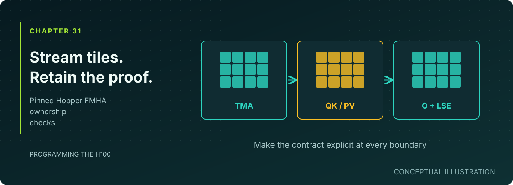

# Chapter 31: Building Fused Attention with CUTLASS on Hopper

## From two GEMMs to a complete attention kernel

[](images/chapter-openers/31-workshop.svg)

!!! abstract "Goal and prerequisites"

    Connect Chapter 30's online-softmax arithmetic to a complete, pinned NVIDIA implementation. You will trace tensor layouts, TMA loads, WGMMA consumers, normalization, output/LSE stores and the verification boundary. Read the CuTe tensor, copy, MMA and pipeline chapters first; this chapter uses their objects rather than replacing them with pseudocode.

The implementation is [CUTLASS v4.3.6 example 88](https://github.com/NVIDIA/cutlass/tree/1afc6d355b8cb992398f17beb4425702f1d57ddd/examples/88_hopper_fmha), pinned to commit `1afc6d355b8cb992398f17beb4425702f1d57ddd`. It supplies forward **and backward** FMHA implementations. The lab below starts with FP16 forward and can additionally collect two FP16 backward cases. This is an official CUTLASS C++ implementation using CuTe; it is neither a Triton kernel nor the separate FlashAttention-3 software package. The upstream README relates its design to the FlashAttention-3 paper, while explicitly qualifying backward performance.

**Status of this new lab:** source inspection, collection-plan checks and host-side parser tests are complete. The new example-88 kernels have no captured Hopper execution in this book yet. The existing workshop GPU records remain valid for their own sources; they are not evidence that this additional kernel has run. Commands below prepare that separate validation without inventing dates, outputs or performance numbers.

## 31.1 Establish the shape and storage contract

For each batch/head, attention computes `O = softmax(Q*K^T / sqrt(D) + mask)*V`. Here Q has Q rows and D columns, K/V have K rows and D columns, and O has Q rows and D columns. The identifier K therefore denotes the key sequence length here; it is not the reduction dimension of the first GEMM, which is D.

The runner's problem tuple is `(B,H,Q,K,D)`. Its CuTe tensor views group batch/head into a hierarchical third mode: Q/O use `(Q,D,(B,H))`, K/V use `(K,D,(B,H))`. In the default FP16 executable, the head element is contiguous. For Q/O, the initialized stride is `(D,1,(H*Q*D,Q*D))` when D is already aligned. Allocation code rounds storage D upward to a multiple of eight; the lab uses D in `{32,64,128,256}` so this padding does not obscure the example.

Take `B=1,H=2,Q=K=128,D=64`:

1. Q, K and V each hold `1*2*128*64=16384` half elements: **32768 bytes each**. O has the same count and storage width.
2. Q coordinate `(query=3,head_element=5,batch=0,head=1)` maps to element offset `3*64+5+1*(128*64)=8389`, or byte offset 16778. This is an address calculation, not a score value.
3. LSE has one FP32 value per query/head: `1*2*128=256` values, **1024 bytes**, with view `(Q,(B,H))`. It records the natural-log normalizer `log(sum_j exp(score_ij))` under the applied mask.
4. A hypothetical global FP32 score array would contain `B*H*Q*K=32768` values, or 131072 bytes. The fused kernel avoids materializing that full global intermediate. This is not the total memory footprint: inputs, outputs, reference allocations, shared memory, registers and any workspace remain real resources.

[](images/worked/ch31-fmha-ownership.svg)

**Check:** reconstruct an address using the actual strides before changing layout. The FP8 target uses a different V stride orientation; copying these FP16 stride assumptions into FP8 is incorrect. Although the README describes broader FP16/BF16 building-block support, the default runner explicitly selects `cutlass::half_t`; it has no BF16 command-line switch.

??? question "Exercise: double the number of heads"

    Keep all other values fixed and set H=4. What happens to Q and LSE storage?

    **Worked answer:** Q becomes 65536 bytes; LSE becomes 2048 bytes. A single query's softmax still ranges over 128 keys, not over all four heads.

## 31.2 Read the source in dependency order

Use the pinned [runner](https://github.com/NVIDIA/cutlass/blob/1afc6d355b8cb992398f17beb4425702f1d57ddd/examples/88_hopper_fmha/88_hopper_fmha.cu) as the entry point, then follow this map:

| Layer | Source/object to inspect | Question it answers |
| --- | --- | --- |
| Host runner | `Options`, `FwdRunner`, `run_fwd_64` | Which shapes, strides, datatype and kernel variants are instantiated? |
| Device adapter | `device/device_universal.hpp` | How are support checks, workspace, initialization and launch connected? |
| Kernel builder | `kernel/fmha_kernel_builder.hpp`, `FmhaBuilder` | Which mainloop, epilogue and kernel match the dispatch policy? |
| Kernel orchestration | `kernel/fmha_kernel_tma_warpspecialized.hpp` | Which participants load, compute and retire work? |
| Load/mainloop | `collective/fmha_collective_load.hpp`, `fmha_collective_tma_warpspecialized.hpp` | How do TMA stages feed the two matrix products? |
| Softmax/fusion | `fmha_collective_softmax.hpp`, `fmha_fusion.hpp` | Which rows are reduced, rescaled and masked? |
| Final stores | `collective/fmha_epilogue.hpp` | Which participants store O and one LSE per query? |

For D=64, the default executable instantiates **three variants**: TMA `64x128x64`, cooperative `128x64x64`, and ping-pong `128x64x64`. These triples mean `(query tile,key tile,head tile)`. They do not mean `(B,H,D)` or three different requested attention problems. The first query tile of a `128x64x64` variant covers queries 0–127; with K=128 it consumes two 64-key blocks. At B=1,H=2, both heads require their own computation and outputs.

The lifecycle is the familiar CUTLASS pattern: construct arguments containing pointers/strides and hardware information, request workspace, call `can_implement`, initialize, launch, then wait before validation. Do not skip support checking merely because D appears in the README. A listed head size does not promise arbitrary user pointers, strides, masks or resource settings are valid.

## 31.3 Follow one query tile through the fused mainloop

The warp-specialized mainloop uses `PipelineTmaAsync` stage state for Q and K/V storage. Its `CollectiveLoadTma` helpers build global views from TMA descriptors and the current tile coordinates. This turns the preceding CuTe layout lessons into actual copy ownership.

1. **Acquire storage and load operands.** A producer must acquire a reusable stage before issuing its TMA transaction. Consumers wait for that generation's completion. The Q tile supplies a block of queries; the K tile supplies a block of keys. Reusing a physical stage does not mean its previous generation is finished automatically.
2. **Form QK accumulators.** WGMMA computes dot products with FP32 QK accumulation in the default FP16 runner. Accumulator fragments are distributed among participating threads. Their logical query/key coordinates, not register order, determine mask and row-reduction semantics.
3. **Apply fusion and update row state.** `before_softmax` can change scores using those coordinates. Softmax maintains row maxima and denominator state. When a later key block raises the maximum, both the old denominator and old PV accumulator must be rescaled. The implementation uses base-two exponential instructions with a converted `scale_softmax_log2`; this implements the same mathematical exponential as Chapter 30, subject to its numerical approximation and precision choices.
4. **Multiply probabilities by V.** The second matrix product accumulates weighted value vectors. It shares the key-block progression with QK, but has different operand roles and fragment layouts. A QK fragment cannot be treated as an arbitrary row-major matrix without the associated CuTe mapping/conversion.
5. **Normalize and store.** The softmax finalization normalizes the accumulated output and produces LSE. `FmhaFwdEpilogue` uses the output partition/store path for O and the corresponding row ownership for LSE. Storing a row statistic from every lane would create redundant or conflicting writers; the code selects the appropriate participants.

**Expected check:** every logical output coordinate and its row's LSE correspond to the same query/head. A correct-looking O with a misplaced LSE can break backward even when a forward-only application never reads LSE. Pipeline stage release must follow the last operand consumer, not simply TMA issue or QK issue. The chapter explains dependencies; the figure is not a measured overlap timeline.

## 31.4 Specify masks before testing tails or decoding

The pinned `CausalFusion` masks a score when **query index < key index**. This is a **top-left** causal convention. With Q=2,K=3, allowed key sets are `{0}` and `{0,1}`. An incremental-decode interpretation placing these queries at the end of a three-token context instead needs an offset: allowed sets `{0,1}` and `{0,1,2}`. The source comments discuss this distinction; `--mask=causal` does not apply the offset automatically.

`ResidualFusion` is a separate noncausal key-boundary mask. TMA zero padding is not equivalent to a softmax mask: a padded zero score has exponential one and can change the denominator. `DefaultFusion` does not exclude such scores, and `CausalFusion` is not a composition with `ResidualFusion`. Therefore this lab uses aligned sequence lengths for full and causal runs. It makes no blanket claim that arbitrary unequal/ragged Q/K combinations work just because allocations are padded. A later tail test must choose a supported residual-mask path, verify its precise boundary behavior and check O **and** LSE; it is separate from these baseline cases.

All-masked rows require an explicit application contract. Do not infer one from the usual nonempty softmax formula. The pinned implementation has its own zero/NaN-denominator handling; the CPU arithmetic lesson rejects undefined all-masked cases instead of silently declaring them equivalent.

??? question "Exercise: locate the two queries in a three-key context"

    Q=2,K=3. Which keys can query row zero attend under the pinned top-left mask, and under an explicit query offset of one?

    **Worked answer:** top-left permits only key 0. With offset one, the query is at absolute position 1 and may use keys 0 and 1. Changing the offset changes the operation, not just a memory address; compare against the matching reference.

## 31.5 Build exactly the intended executable

Follow [Getting Started](getting-started.md) for a compatible driver, CUDA toolkit and host compiler. This additional CMake lab also needs CMake; on the supported Ubuntu host:

```bash
sudo apt-get update
sudo apt-get install --no-install-recommends cmake
bash tools/fetch_cutlass.sh /tmp/cutlass-attention-v436
python3 tools/run_cutlass_attention.py --cutlass /tmp/cutlass-attention-v436 \
  --output artifacts/attention-hopper-01
```

The last command prints a **plan**, including the pin, source/collector hashes and commands. It creates no execution evidence and launches no GPU work. The pinned source has a CUDA 12.0 minimum guard; this book's established Hopper toolchain is CUDA 12.8.93. Compile for **90a**, as the implementation uses architecture-specific SM90a paths. An A100, or a Blackwell device accepting some Hopper-compatible code, does not satisfy this example's exact runtime guard: it specifically checks compute capability 9.0.

To collect the separate GPU record on a suitable Hopper host:

```bash
python3 tools/run_cutlass_attention.py --cutlass /tmp/cutlass-attention-v436 \
  --output artifacts/attention-hopper-01 --execute
```

The collector archives the exact Git commit into a new evidence directory, hashes its source files, captures tool/system information, configures CMake with `CUTLASS_NVCC_ARCHS=90a`, and builds only target **`88_hopper_fmha`**. The separate target `88_hopper_fmha_fp8` defines `FP8`; this collector does not build or validate it. The official CMake recipe adds `--use_fast_math` on its supported non-Windows/non-Clang-host path, so record that build configuration when interpreting error and timing results.

Baseline cases cover D=32/64/128/256 with explicit B/H/Q/K/D/iterations, including aligned full and causal D=64/128 cases. Explicit dimensions matter: upstream defaults couple H to D and B to K. Each run selects the same problem for all variants instantiated at that D. Use a new output directory for every execution; the collector refuses to overwrite a previous record.

## 31.6 Understand exactly what verification proves

Pass `--verify`. Upstream `FwdRunner::verify` compares **O and LSE** to its device reference. For FP16 it requires maximum absolute difference below `1e-2` and mean absolute difference below `1e-3`, separately for both outputs. These are the pinned example's absolute thresholds, not universally justified tolerances for every model distribution.

The reference is a **GPU kernel**, not a CPU/FP64 oracle. It forms one query row's scores in dynamic shared memory and includes FP16 intermediate rounding; it does not materialize a complete global score matrix. Chapter 30's [CPU arithmetic walkthrough](30-cutlass-attention-foundations.md) independently checks the mathematical recurrence on tiny inputs. It does not consume this runner's random device inputs or independently certify the optimized kernel. A stronger new-input audit would export the exact Q/K/V and compare each O/LSE coordinate to a higher-precision reference under the identical mask/scale/layout contract.

Upstream prints `[OK]` only for a passed **verified** variant; `[--]` means execution without verification, and `[FAIL]` indicates failure. Architecture guards and some failed paths can still leave the executable with exit status zero. The collector therefore requires the expected count of `[OK]` rows, a launch header, no failure diagnostics and successful process status. A skipped or missing kernel is **SKIP/INCOMPLETE**, never PASS; one successful variant cannot hide another variant's failure.

Logs retain argv, UTC start/end, separate stdout/stderr, source hashes and system information in `results.json` and sibling files. Those timestamps become execution dates only after an actual run. The host parser tests exercise false-success cases without claiming GPU validation:

```bash
python3 -m unittest discover -s tools/tests -p test_cutlass_attention.py -v
```

??? question "Exercise: a zero exit with incomplete verification"

    A D=64 run exits zero and prints two `[OK]` rows plus one `[--]` row. Is the complete case verified?

    **Worked answer:** no. This runner instantiates three variants at D=64, and `[--]` indicates an unverified result. The collector returns INCOMPLETE rather than PASS. A numerical failure instead returns FAIL, even if another variant succeeded.

## 31.7 Read the backward path as a new dependency graph

The library also implements FP16 backward for head dimensions 32,64,128. It is not an automatic derivative of a black-box forward launch. Given upstream gradient dO and softmax probabilities P, the mathematical relations per head are:

- `dV = P^T*dO` and `dP = dO*V^T`;
- `delta_i = sum_j P_ij*dP_ij = dot(dO_i,O_i)`;
- `dS_ij = P_ij*(dP_ij-delta_i)` for the scaled, masked score S;
- `dQ = dS*K/sqrt(D)` and `dK = dS^T*Q/sqrt(D)`.

Walk one row: P=`[1/4,3/4]`, V rows `[1,0]`, `[0,2]`, and dO=`[2,3]`. Then O=`[1/4,3/2]` and dP=`[2,6]`. Delta is `(1/4)*2+(3/4)*6=5`, also `dot(dO,O)=1/2+9/2=5`. Thus dS=`[-3/4,3/4]`, whose sum is zero. This row contributes dV rows `[1/2,3/4]` and `[3/2,9/4]`. The dQ/dK products then use the actual Q/K and the same score scale. The numbers demonstrate derivative bookkeeping, not a vendor-supported head size of two.

Follow `BwdRunner`, `device/fmha_device_bwd.hpp`, the backward mainloop, the `sum_OdO` kernel and conversion stage. Reconstructing probability tiles from scores/LSE avoids storing the whole probability matrix, but creates dependencies on the exact forward normalization and mask convention. The optimized gradients are compared against `reference/fmha_bwd_reference.hpp`; the pinned thresholds are again max `<1e-2`, mean `<1e-3`, separately for dQ, dK and dV.

Add `--include-backward` to the collector plan or execution command to request aligned D=64 full and causal backward cases. Each case expects two verified variant rows. This is optional **planned** coverage until actual Hopper logs exist; it neither validates every backward head size nor claims FA3-equivalent performance. The upstream README explicitly says backward kernels are more limited in performance than FA3.

??? question "Exercise: detect an incorrect softmax backward correction"

    For the worked row P=[1/4,3/4],dP=[2,6], someone uses delta=4 rather than five. What check exposes the error?

    **Worked answer:** the wrong dS is [-1/2,3/2], whose sum is one. The correct delta gives [-3/4,3/4], summing to zero. A softmax score-gradient row sums to zero in exact arithmetic; use an appropriate tolerance for floating-point checks.

## 31.8 Profile only after preserving the numerical contract

The small B=1,H=2 cases above are **correctness configurations**, not throughput benchmarks. Two heads and short query lengths provide only a few logical query tiles and can leave most of an H100 idle. Their measured TFLOP/s, when eventually collected, must not be presented as a peak-performance result. A throughput study needs a separately stated larger workload and adequate independent work, while preserving the same numerical contract.

`--verbose` prints per-variant elapsed milliseconds and shared-memory bytes. The upstream timer surrounds repeated device operations; initialization and reference checking lie outside that timed region. Its forward FLOP numerator is approximately `4*B*H*Q*K*D`, halved for causal mode. That convention omits softmax/masking work and approximates the causal triangle; it is not a count of every executed instruction. Compare kernels using the same shape, dtype, mask, precision, warmup and timing boundary.

Use Nsight Systems to inspect launch/overlap and Nsight Compute to investigate shared-memory/register pressure, pipeline stalls and Tensor Core activity. A profile or sanitizer run perturbs timing and is not the normal throughput record. The following are **commands to run after a real build**, not captured profiling results. Set the binary to the separately collected run directory. The symbol filter follows the actual `device_kernel<...FmhaKernel...>` launch type in the pinned adapter; inspect the profiler's kernel list if a tool version reports no match.

```bash
ATTENTION_BIN="$PWD/artifacts/attention-hopper-01/build/examples/88_hopper_fmha/88_hopper_fmha"
mkdir -p artifacts/attention-profiles
nsys profile --trace=cuda,nvtx --sample=none \
  --output=artifacts/attention-profiles/d64-full \
  "$ATTENTION_BIN" --b=1 --h=2 --q=128 --k=128 --d=64 \
  --mask=no --iterations=3 --verify --verbose
ncu --set basic --kernel-name-base demangled \
  --kernel-name 'regex:.*FmhaKernel.*' --launch-count 1 \
  --export artifacts/attention-profiles/d64-one-kernel \
  "$ATTENTION_BIN" --b=1 --h=2 --q=128 --k=128 --d=64 \
  --mask=no --iterations=3 --verify --verbose
```

Nsight Systems includes all selected variants and reference launches. Nsight Compute's one-launch filter examines one matching kernel, not the complete application timing or all variants. Choose new report names for another capture. Profiling requires the site's permitted performance-counter access; missing permissions or no matching kernel is not a successful profile. See the [Nsight Systems CLI](https://docs.nvidia.com/nsight-systems/UserGuide/index.html#cli-profile-command-switch-options) and [Nsight Compute CLI](https://docs.nvidia.com/nsight-compute/NsightComputeCli/index.html).

Keep optimization experiments in a new checkout/run directory: changing stage count, schedule or probability conversion can alter resource limits and numerical behavior. Recheck O, LSE and, when applicable, all three gradients before accepting a speed improvement.

## Chapter Summary

Example 88 turns CuTe layouts, TMA stages, WGMMA fragments and online row state into complete attention operators. Correct use requires explicit dimensions, dtype/layout, mask alignment, pipeline lifetimes and a verifier that rejects upstream zero-exit skips. The source includes backward as well as forward; this new lab's GPU execution remains a separately collected result, with its own records rather than an inherited claim from earlier workshops.
