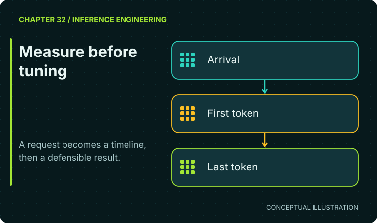
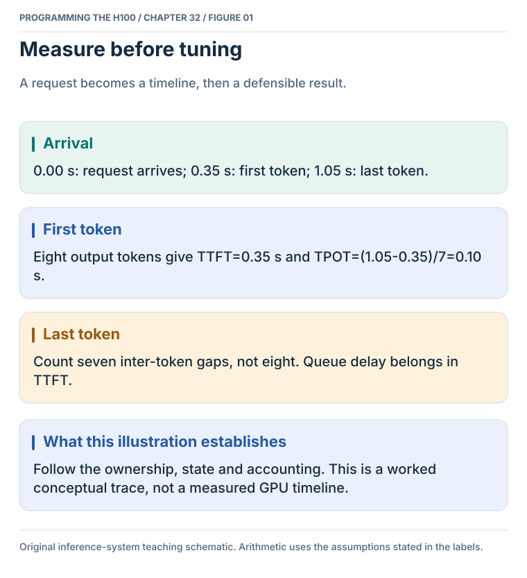

# Chapter 32: Inference Engine Anatomy and the Measurement Harness

[](images/chapter-openers/32-inference.svg)


!!! abstract "Goal and prerequisites"

    Learn what limits an LLM serving engine on a Hopper GPU, how continuous batching works, and how to measure a server honestly. You build a workload generator, a simulated engine and a metrics module that every later project reuses. Read [Chapter 1](01-h100-architecture.md) (memory hierarchy and bandwidth) and [Chapter 14](14-nsight-systems.md) (timelines) first.

!!! warning "Evidence level"

    The harness and engine below run on a **CPU**. The engine is a **simulation** whose cost constants are illustrative parameters, not H100 measurements. What the run verifies: the metric code (against a hand-computed case), the byte and bandwidth arithmetic, and the simulator's internal consistency (Little's law). What it cannot tell you: how fast any real server is. Replace the simulated engine with a client that talks to a real server, keep the rest.

## Worked system map

[](images/worked/ch32-inference.svg)


## 32.1 Two phases, two bottlenecks

Generating a reply has two phases.

**Prefill** processes prompt tokens together. Large dense prefills often become compute-bound; short prompts and attention-heavy long contexts can have other bottlenecks. **Decode** produces one token per sequence per step. Dense, low-batch decode often streams the model weights and attends to cached K/V, making bandwidth dominant. Larger batches, expert sparsity, windowed attention and communication can change this regime.

```
 prompt (512 tokens)                       reply (128 tokens)
 |-------- prefill --------|--d--|--d--|--d--|--d--| ... |--d--|
        compute-bound        each d = read all weights + KV cache: memory-bound
        sets TTFT            together set TPOT
```

### The decode floor

For a dense batch-1 step whose weights are streamed from HBM, the weight-read term is weight bytes divided by bandwidth. This is the assumed regime of the model, not a universal bound for every decoding algorithm. With the datasheet HBM3 bandwidth of about 3.35 TB/s per H100 SXM:

```
KV bytes/token (Llama-3-70B-shaped, BF16) = 327680 (320 KiB); 4096-token prompt = 1.34 GB
decode floor, 70B BF16 on 2 H100: 20.9 ms/token at batch 1 (weights only; ignores KV reads, all-reduce and launch cost)
decode floor, 70B FP8  on 1 H100: 20.9 ms/token at batch 1
```

The two lines give the same floor because halving the bytes per weight on half the GPUs reads the same bytes per GPU. A 70B model in FP8 is 70 GB of weights, which leaves almost no room for KV cache on an 80 GB card, so treat the single-GPU line as an arithmetic illustration, not a deployment plan.

Check the KV figure against your own model's configuration: it is `2 x layers x kv_heads x head_dim x bytes`, here `2 x 80 x 8 x 128 x 2`.

## 32.2 Continuous batching

Early servers batched requests, ran them together to completion, then took the next batch. A short request waited for the longest one. **Continuous batching** schedules at every decode iteration: finished requests leave, waiting requests join, and the batch stays full.

Batching helps because the weight read is shared by every sequence in the step. The KV cache is not shared, so its cost grows with the batch. This is why throughput rises with load and then flattens.

!!! warning "Common mistake"

    Reporting throughput without latency. A server can show high tokens per second by queueing requests until the batch is large, while every user waits. Throughput and latency must be reported together, at a stated load.

## 32.3 The metrics

| Metric | Definition | What it reveals |
|---|---|---|
| TTFT | Time from arrival to the first token | Queueing plus prefill |
| TPOT | Time per token after the first | Decode speed and batch size |
| p50, p99 | Median and 99th percentile of each | Typical versus tail-latency users |
| Throughput | Output tokens per second, whole server | Capacity |
| Goodput | Requests per second that meet **both** SLOs | Useful capacity |
| Cost | `GPU $/hour x GPUs x hours / million tokens` | Unit economics |

### Hand-check the metric code

Two requests: the first arrives at 0.0 s, gets its first token at 0.5 s and finishes at 0.9 s after 5 tokens; the second arrives at 1.0 s, first token at 1.2 s, finishes at 1.4 s after 3 tokens. TTFTs are 0.5 and 0.2, median 0.35. TPOTs are `0.4/4 = 0.10` and `0.2/2 = 0.10`. With a TTFT SLO of 0.4 s only the second request qualifies, so goodput is `1 / 1.4 = 0.714` requests per second.

```
hand-check: ttft_p50=0.350 (expect 0.350)  tpot_p50=0.100 (expect 0.100)  goodput=0.714 req/s (expect 0.714: only req 1 meets TTFT<=0.4)
```

## 32.4 The workload

A fair test fixes the workload and publishes it:

- **Arrivals:** Poisson with a stated rate (exponential gaps), so bursts happen as they do in practice.
- **Lengths:** log-normal prompt and output lengths with stated medians, or a recorded dataset such as a public chat corpus.
- **Sweep:** repeat at several rates, from idle to overloaded.
- **Seed:** fixed, so the run can be repeated.

## 32.5 The simulated engine

The simulator advances one iteration at a time. Each iteration admits waiting requests up to a batch limit, charges prefill time for the newly admitted prompts, then charges a decode step whose cost grows with the number of running sequences and the total cached tokens:

```python
step_t = cost.base + cost.per_seq * len(running) + cost.per_kv_token * kv
dt = prefill_t + step_t
```

Its constants (a 20 ms base step, 0.2 ms per sequence, 40,000 prompt tokens per second) are placeholders chosen to give plausible shapes.

### Check the simulator: Little's law

For any stable system, the average number of requests in the system equals the arrival rate times the average time each spends there (`L = lambda x W`). The simulator measures `L` independently, as the time-average of how many requests are present, and `W` from the per-request times:

```
Little's law: L=14.105  lambda*W=14.105  rel.diff=0.000%
```

The corrected integral counts requests that arrive during a running iteration for the remainder of that iteration. Since every request drains before the finite observation window ends, the two sides agree to floating-point roundoff; this is a pathwise accounting identity, not evidence that the assumed service costs match hardware. The older 0.321% discrepancy came from omitting those queued-arrival intervals. Historical captured logs remain unchanged.

### The load sweep

```
rate(req/s)  ttft_p50  ttft_p99  tpot_p50  tput(tok/s)  slo_ok  $/Mtok(@$4/GPU-h, 2 GPUs)
         1     0.046     0.082    0.0211          158    1.00     14.05
         4     0.051     0.099    0.0252          574    1.00      3.87
         8     0.061     0.121    0.0324         1009    1.00      2.20
        12     2.125     3.507    0.0388         1189    0.49      1.87
        16     4.176     8.611    0.0390         1225    0.37      1.81
```

Read the table as a shape, not as numbers to quote:

- Throughput climbs with load and flattens near 1,200 tokens per second: the batch is full.
- Cost per million tokens falls with load, because the fixed GPU bill is spread over more tokens.
- Between 8 and 12 requests per second TTFT jumps from about 0.06 s to over 2 s and SLO attainment drops to 0.49. The server is past its knee: new requests queue.
- The cheapest point (16 req/s) is also the one where only 37 percent of requests meet the SLO. Cost per token alone is a misleading target; goodput per dollar is better.

The $4 per GPU-hour is an assumed price for the arithmetic, not a quote.

## 32.6 Reusing the harness

| Project | What it plugs in |
|---|---|
| MoE expert parallelism (Ch. 33) | Layer-level communication cost in the step time |
| KV-cache offloading | Extra latency when a session resumes from a slower tier |
| Disaggregation | Separate prefill and decode pools with a transfer cost |
| Benchmark teardown | Real engines behind the same client |
| Autoscaler, router, cache | Cost and SLO attainment at fluctuating load |

For a real server, replace `simulate` with a client that sends the same requests and records first-token and last-token timestamps, and keep `summarize` unchanged.

## 32.7 Self-tests (21, all pass)

The metric hand-check and Little's law are two checks. The harness is reused by Chapters 33 to 46, so it gets a wider net. Run `python3 docs/examples/inference-systems/ch32_inference_harness.py --test`:

| Group | What is checked |
|---|---|
| Arithmetic (4) | KV bytes per token is 327,680 for the 70B shape and linear in layers; the decode floor halves when GPUs double and is linear in bytes per parameter |
| Percentile (4) | `q=0` is the minimum and `q=1` the maximum; the median of `[1,2,3,4]` is 2.5; a single element returns itself; the function is monotone in `q` |
| Workload (3) | the same seed gives identical requests and a different seed does not; arrivals never decrease and lengths are at least 1 |
| Engine (4) | `simulate` does not change its input; every request finishes with exactly `output` tokens and ordered timestamps; `max_batch=1` never overlaps two requests; at 10 times the arrival rate with the same lengths, p99 TTFT does not fall |
| Metrics (4) | the hand case (TPOT 0.10, TTFT p50 0.35, goodput 1/1.4); a tighter SLO never raises attainment; a one-token reply does not divide by zero; the cost formula gives $8,000 per million tokens for 1,000 tokens in one hour on two GPUs at $4 |
| Conservation (2) | Little's law within 2 percent on five seeds; `pct([])` raises `IndexError`, a documented failure |

```
21/21 self-tests pass
```

**The tests can fail.** Two deliberate breakages were tried on a copy: removing the batch cap from the admission loop fails the `max_batch=1` test, and dropping the `- 1` from the TPOT denominator fails the hand case. The second one passed all 20 earlier tests, which is why the hand case is part of the suite and not only a printed line.

## 32.8 Experiment A: the batch cap

The engine takes `max_batch`, the most sequences it will run in one iteration. In a real server an explicit scheduler limit such as vLLM’s `max_num_seqs` acts alongside KV-cache capacity and the token budget, so this experiment shows the shape of the trade, not a tuning guide. Rate 12 requests per second, 300 requests, seed 2 (`--extras`):

```
max_batch  ttft_p50  ttft_p99  tpot_p50  tput(tok/s)  slo_ok
        4   119.523   225.917    0.0211          184    0.03
        8    56.060   106.728    0.0223          340    0.04
       16    25.106    47.547    0.0247          585    0.09
       32     8.853    18.507    0.0295          899    0.21
       64     2.125     3.507    0.0388         1189    0.49
      128     0.077     0.160    0.0442         1246    1.00
```

- Throughput rises with the cap and TPOT also rises: each step carries more sequences, so each token takes longer, but more tokens leave per second.
- TTFT falls by three orders of magnitude, because the cap is what keeps arrivals waiting.
- Caps of 96, 112, 128 and 192 give the same result (TTFT p99 0.160 to 0.166 or lower, attainment 1.00). The cap stops mattering once it exceeds the number of sequences that are ever running at once, which here is between 81 and 96.
- The 64 row equals the 12 req/s row of the section 32.5 sweep. That is a consistency check: same seed, same default cap.

## 32.9 Experiment B: prefill interference

In the engine, a newly admitted prompt's prefill time is added to the iteration, so every running sequence waits for it. Rate 4 requests per second, 300 requests, seed 2, output median 128, prompt median varied:

```
prompt_median  ttft_p50  tpot_p50  tpot_p99  tput(tok/s)
          128     0.038    0.0238    0.0250          575
          512     0.051    0.0252    0.0279          574
         2048     0.105    0.0328    0.0458          573
         8192    13.962    0.1335    0.2249          426
```

- From 128 to 2048 the median TPOT rises from 23.8 to 32.8 ms even though the generated output is identical: the decode steps are stalled by other users' prefills.
- The 8192 row breaks the pattern. Throughput falls from about 575 to 426 tokens per second at the same offered rate, and TTFT p50 is 14 seconds. Prefill alone is saturating the server. The mean of a log-normal is `median x exp(sigma^2/2)` = `8192 x 1.2776` ≈ 10,466 tokens, which is 0.262 s of prefill per request at 40,000 tokens per second, and four requests per second need 1.05 s of prefill per second of wall time. Offered load exceeds capacity.
- Real engines mitigate this by splitting a long prefill into chunks and mixing them with decode steps (Chapter 44). The simulator does not, which is why this is the baseline that chapter improves on.

## 32.10 Failure modes and edge cases

| Situation | What happens | Where it shows |
|---|---|---|
| Offered load above capacity | the queue grows without bound during the run; wall time includes draining the tail, so measured throughput falls below offered load | Experiment A at cap 4; Experiment B at 8192 |
| Near the knee, few requests | results depend heavily on the seed: at 12 req/s, five seeds give TTFT p50 of 1.623, 0.762, 2.125, 0.752 and 0.108 s and SLO attainment of 0.58, 1.00, 0.49, 0.85 and 0.97. At 8 req/s the same seeds all give 0.058 to 0.063 s | report several seeds or a confidence interval near the knee |
| p99 from few samples | with 300 requests, p99 is the third-largest value; with 20 it is nearly the maximum | `pct` interpolates, it does not warn |
| Empty request list | `pct` raises `IndexError` | self-test 21 |
| Reply of one token | TPOT is defined as 0 (division guarded) | self-test 18 |
| SLO thresholds chosen after seeing the data | attainment can be made to look good by tuning the SLO | fix the SLO before the run |
| Cost computed from wall time | an overloaded run has a long drain, which raises cost per token for a reason that is not the engine's efficiency | compare at equal attainment |
| Little's law passes | says the bookkeeping is consistent for **any** cost constants, including absurd ones | do not read it as validation of the cost model |

**Not modelled:** KV-cache memory and the preemption it forces (Chapters 43 and 44); chunked prefill; prefix reuse (Chapter 45); more than one GPU, communication, and pipeline bubbles; speculative decoding; request cancellation, timeouts and retries; tokenizer, network and queueing outside the engine; variation in step time (the model uses a constant); GPU clock and thermal behaviour; streaming back-pressure from slow clients.

## 32.11 On real hardware (UNTESTED)

Nothing in this chapter has been run on a GPU server. These steps are from memory and must be checked against the version you install; flag names change between releases.

1. **Pick the engine and record its version.** For example, `python3 -m pip show vllm` (or the version your container reports) and `nvidia-smi --query-gpu=name,driver_version,memory.total --format=csv`. Write both into the run record.
2. **Start the server with fixed settings** and write them down: model, tensor-parallel size, maximum sequence length, maximum number of running sequences, GPU memory fraction. A result without these is not comparable.
3. **Replace `simulate` with a client.** It must send the same `Req` list at the same arrival times, record the time of the first streamed token and of the last, and fill `first_token`, `finish` and `generated`. Then call `summarize` unchanged. Use the same `make_workload` seed so the simulated and real runs see identical requests.
4. **Check the decode floor.** Run a single request with a long output and no other load. Measure TPOT. Compare it with `decode_floor_ms` only under the model’s assumptions: dense execution of the stated weight precision, batch 1, all weights read from HBM on each step, and the stated GPU bandwidth. A lower result can indicate changed precision, caching, sparsity, different hardware or a timing/counting error; it does not by itself prove a measurement is wrong.
5. **Sweep the rate** across idle, loaded and overloaded, repeat each point with at least three seeds, and plot TTFT p50 and p99, TPOT p50, throughput and attainment against rate. Find the knee as in section 32.5.
6. **Fit the cost model.** From the single-request run take `base`, from a batch-of-N run take `per_seq`, and rerun the simulator with those constants. Compare the simulated and real knees. The difference is the part of the model this chapter did not capture.
7. **Capture a profile** of one decode iteration with Nsight Systems ([Chapter 14](14-nsight-systems.md)) to confirm the iteration is dominated by the weight read, as section 32.1 assumes.

<!-- BEGIN COMPLETE INFERENCE SOURCE -->
## Complete runnable code

The complete implementation is shown below, including its checks and entry point. The listing and downloadable `.py` file contain exactly the same source. Copy the file under the displayed filename; keep supporting files in the same directory.

[Download all inference examples and supporting modules](examples/inference-systems/inference-systems.zip) or read the [environment and command guide](examples/inference-systems/README.md).

The [follow-up agent audit](inference-adversarial-review-2026-11-25.md) records the corrections, fresh CPU captures and hardware limits for this source.

Read it in three passes: start with `Req` and `CostModel` to identify the state; trace `simulate` for one request or token; then follow `summarize` and `run_tests` to see how the result is checked.

From the repository root:

```bash
python3 docs/examples/inference-systems/ch32_inference_harness.py --test
# Run the full chapter demonstrations:
python3 docs/examples/inference-systems/ch32_inference_harness.py
```

### ch32_inference_harness.py

[Download ch32_inference_harness.py](examples/inference-systems/ch32_inference_harness.py)

```python title="ch32_inference_harness.py" linenums="1"
"""Chapter 32: inference-engine anatomy and a measurement harness (CPU simulation).

Run:  python3 ch32_inference_harness.py          (the chapter's numbers)
      python3 ch32_inference_harness.py --test   (self-tests)
      python3 ch32_inference_harness.py --extras (batch-cap and prefill-interference experiments)
The engine below is a SIMULATION driven by an illustrative cost model. Its constants are parameters you
replace with measurements from a real server; none of its timings is an H100 measurement.
"""
import math
import random
from dataclasses import dataclass

# ------------------------------------------------------------- datasheet-level constants (check against your own)
H100_HBM_BW = 3.35e12            # bytes/s, H100 SXM HBM3 (NVIDIA datasheet value)
LLAMA70B = dict(layers=80, kv_heads=8, head_dim=128, params=70e9)


def kv_bytes_per_token(layers, kv_heads, head_dim, bytes_per_elem=2):
    return 2 * layers * kv_heads * head_dim * bytes_per_elem


def decode_floor_ms(params, bytes_per_param, n_gpus, bw=H100_HBM_BW):
    """Lower bound on one decode step at batch 1: every weight byte is read once, spread over n GPUs."""
    return params * bytes_per_param / (n_gpus * bw) * 1e3


# ------------------------------------------------------------- workload
@dataclass
class Req:
    rid: int
    arrival: float
    prompt: int
    output: int
    first_token: float = math.nan
    finish: float = math.nan
    generated: int = 0


def make_workload(n, rate, seed, prompt_med=512, out_med=128, sigma=0.7):
    rng = random.Random(seed)
    t, reqs = 0.0, []
    for i in range(n):
        t += rng.expovariate(rate)                                   # Poisson arrivals
        p = max(1, int(rng.lognormvariate(math.log(prompt_med), sigma)))
        o = max(1, int(rng.lognormvariate(math.log(out_med), sigma)))
        reqs.append(Req(i, t, p, o))
    return reqs


# ------------------------------------------------------------- simulated continuous-batching engine
@dataclass
class CostModel:
    base: float = 0.020              # s, fixed cost of a decode iteration (weight read)
    per_seq: float = 0.0002          # s per running sequence
    per_kv_token: float = 1.0e-8     # s per cached token read
    prefill_tps: float = 40000.0     # prompt tokens per second


def simulate(reqs, max_batch=64, cost=CostModel()):
    if max_batch <= 0:
        raise ValueError("max_batch must be positive")
    if any(r.arrival < 0 or r.prompt < 1 or r.output < 1 for r in reqs):
        raise ValueError("requests require nonnegative arrival and positive token lengths")
    reqs = sorted((Req(r.rid, r.arrival, r.prompt, r.output) for r in reqs), key=lambda r: r.arrival)
    waiting, running, now, i = [], [], 0.0, 0
    area, last_t = 0.0, 0.0                                           # for Little's law: integral of in-system count
    done = 0
    while done < len(reqs):
        while i < len(reqs) and reqs[i].arrival <= now:
            waiting.append(reqs[i]); i += 1
        if not running and not waiting:
            now = reqs[i].arrival                                      # idle: jump to next arrival
            continue
        admit = []
        while waiting and len(running) + len(admit) < max_batch:
            admit.append(waiting.pop(0))
        prefill_t = sum(r.prompt for r in admit) / cost.prefill_tps
        running += admit
        kv = sum(r.prompt + r.generated for r in running)
        step_t = cost.base + cost.per_seq * len(running) + cost.per_kv_token * kv
        in_system = len(running) + len(waiting)
        dt = prefill_t + step_t
        area += in_system * dt
        # Arrivals during the iteration are already in the system while queued,
        # even though admission can only happen at the next iteration boundary.
        end = now + dt
        j = i
        while j < len(reqs) and reqs[j].arrival <= end:
            area += end - reqs[j].arrival
            j += 1
        now = end
        for r in list(running):
            r.generated += 1
            if math.isnan(r.first_token):
                r.first_token = now
            if r.generated >= r.output:
                r.finish = now; running.remove(r); done += 1
    return reqs, now, area


# ------------------------------------------------------------- metrics
def pct(xs, q):
    xs = sorted(xs)
    k = (len(xs) - 1) * q
    lo, hi = math.floor(k), math.ceil(k)
    return xs[lo] + (xs[hi] - xs[lo]) * (k - lo)


def summarize(reqs, wall, gpu_hour_usd=None, n_gpus=1, slo_ttft=2.0, slo_tpot=0.1):
    ttft = [r.first_token - r.arrival for r in reqs]
    tpot = [(r.finish - r.first_token) / max(1, r.output - 1) for r in reqs]
    toks = sum(r.output for r in reqs)
    good = [r for r, a, b in zip(reqs, ttft, tpot) if a <= slo_ttft and b <= slo_tpot]
    out = dict(ttft_p50=pct(ttft, .5), ttft_p99=pct(ttft, .99), tpot_p50=pct(tpot, .5), tpot_p99=pct(tpot, .99),
               throughput_tok_s=toks / wall, goodput_req_s=len(good) / wall, slo_attainment=len(good) / len(reqs))
    if gpu_hour_usd:
        out["usd_per_million_tokens"] = gpu_hour_usd * n_gpus * (wall / 3600) / (toks / 1e6)
    return out


# ------------------------------------------------------------- self-tests (properties, not just one hand case)
def run_tests():
    """Twenty-one checks. Each is an invariant the harness must keep; none depends on the cost constants being realistic."""
    results = []

    def check(name, cond):
        results.append((name, bool(cond)))

    # arithmetic
    check("kv bytes/token for the 70B shape is 327680", kv_bytes_per_token(80, 8, 128) == 327680)
    check("kv bytes scale linearly with layers", kv_bytes_per_token(160, 8, 128) == 2 * kv_bytes_per_token(80, 8, 128))
    check("decode floor halves when GPUs double", abs(decode_floor_ms(70e9, 2, 2) * 2 - decode_floor_ms(70e9, 2, 1)) < 1e-9)
    check("decode floor is linear in bytes/param", abs(decode_floor_ms(70e9, 1, 2) * 2 - decode_floor_ms(70e9, 2, 2)) < 1e-9)
    # percentile
    check("pct: q=0 is min, q=1 is max", pct([3, 1, 2], 0) == 1 and pct([3, 1, 2], 1) == 3)
    check("pct: median of [1,2,3,4] is 2.5", pct([1, 2, 3, 4], .5) == 2.5)
    check("pct: one element", pct([7.0], .99) == 7.0)
    check("pct: monotone in q", all(pct(list(range(20)), a / 10) <= pct(list(range(20)), (a + 1) / 10) for a in range(10)))
    # workload
    w1, w2, w3 = make_workload(50, 4.0, 7), make_workload(50, 4.0, 7), make_workload(50, 4.0, 8)
    check("workload: same seed gives identical requests", [(r.arrival, r.prompt, r.output) for r in w1] == [(r.arrival, r.prompt, r.output) for r in w2])
    check("workload: different seed differs", [r.arrival for r in w1] != [r.arrival for r in w3])
    check("workload: arrivals non-decreasing, lengths >= 1",
          all(a.arrival <= b.arrival for a, b in zip(w1, w1[1:])) and all(r.prompt >= 1 and r.output >= 1 for r in w1))
    # engine
    src = make_workload(120, 6.0, 3)
    before = [(r.first_token, r.finish, r.generated) for r in src]
    reqs, wall, _ = simulate(src)
    check("simulate: does not mutate its input", before == [(r.first_token, r.finish, r.generated) for r in src])
    check("simulate: every request finishes with exactly `output` tokens, ordered times",
          all(r.generated == r.output and r.arrival <= r.first_token <= r.finish <= wall + 1e-9 for r in reqs))
    one, _, _ = simulate(make_workload(30, 50.0, 4), max_batch=1)
    check("max_batch=1 serves strictly one at a time (no overlap)", all(b.first_token > a.finish for a, b in zip(one, one[1:])))
    lo, wlo, _ = simulate(make_workload(200, 2.0, 5))
    hi, whi, _ = simulate(make_workload(200, 20.0, 5))
    check("same lengths, 10x the arrival rate: p99 TTFT does not fall",
          summarize(hi, whi)["ttft_p99"] >= summarize(lo, wlo)["ttft_p99"])
    # metrics
    loose, tight = summarize(reqs, wall, slo_ttft=5.0, slo_tpot=1.0), summarize(reqs, wall, slo_ttft=0.05, slo_tpot=0.02)
    toy = [Req(0, 0.0, 10, 5, first_token=0.5, finish=0.9), Req(1, 1.0, 10, 3, first_token=1.2, finish=1.4)]
    st = summarize(toy, 1.4, slo_ttft=0.4, slo_tpot=0.15)
    check("hand case: TPOT = (finish-first)/(output-1) = 0.10 for both, TTFT p50 = 0.35, goodput = 1/1.4",
          abs(st["tpot_p50"] - 0.10) < 1e-12 and abs(st["ttft_p50"] - 0.35) < 1e-12 and abs(st["goodput_req_s"] - 1 / 1.4) < 1e-12)
    check("tighter SLO never raises attainment", tight["slo_attainment"] <= loose["slo_attainment"])
    one_tok = [Req(0, 0.0, 5, 1, first_token=0.3, finish=0.3)]
    check("a 1-token reply does not divide by zero", summarize(one_tok, 0.3)["tpot_p50"] == 0.0)
    cost = summarize([Req(0, 0, 1, 1000, first_token=1.0, finish=2.0)], 3600.0, gpu_hour_usd=4.0, n_gpus=2)
    check("cost: $4 x 2 GPUs x 1 h / 1000 tokens = $8000 per million", abs(cost["usd_per_million_tokens"] - 8000.0) < 1e-6)
    ok = True
    for seed in range(5):
        rr, ww, aa = simulate(make_workload(300, 4.0, seed))
        L, lamW = aa / ww, len(rr) / ww * sum(r.finish - r.arrival for r in rr) / len(rr)
        ok &= abs(L - lamW) / L < 0.02
    check("Little's law within 2% on five seeds", ok)
    try:
        pct([], .5); empty_raises = False
    except IndexError:
        empty_raises = True
    check("pct([]) raises IndexError (documented failure mode)", empty_raises)
    for name, good in results:
        print(f"  [{'PASS' if good else 'FAIL'}] {name}")
    print(f"{sum(g for _, g in results)}/{len(results)} self-tests pass")
    return all(g for _, g in results)


def extras():
    """Two experiments the chapter discusses: the batch cap, and prefill interference with running decodes."""
    print("Experiment A: batch cap at 12 req/s (300 requests, seed 2)")
    print("max_batch  ttft_p50  ttft_p99  tpot_p50  tput(tok/s)  slo_ok")
    for mb in (4, 8, 16, 32, 64, 128):
        r, w, _ = simulate(make_workload(300, rate=12, seed=2), max_batch=mb)
        m = summarize(r, w)
        print(f"{mb:>9}  {m['ttft_p50']:8.3f}  {m['ttft_p99']:8.3f}  {m['tpot_p50']:8.4f}  {m['throughput_tok_s']:11.0f}  {m['slo_attainment']:6.2f}")
    print("\nExperiment B: prefill interference at 4 req/s (300 requests, seed 2, output median 128)")
    print("prompt_median  ttft_p50  tpot_p50  tpot_p99  tput(tok/s)")
    for pm in (128, 512, 2048, 8192):
        r, w, _ = simulate(make_workload(300, rate=4, seed=2, prompt_med=pm))
        m = summarize(r, w)
        print(f"{pm:>13}  {m['ttft_p50']:8.3f}  {m['tpot_p50']:8.4f}  {m['tpot_p99']:8.4f}  {m['throughput_tok_s']:11.0f}")


def main():
    kv = kv_bytes_per_token(**{k: LLAMA70B[k] for k in ("layers", "kv_heads", "head_dim")})
    print(f"KV bytes/token (Llama-3-70B-shaped, BF16) = {kv} ({kv/1024:.0f} KiB); 4096-token prompt = {kv*4096/1e9:.2f} GB")
    print(f"decode floor, 70B BF16 on 2 H100: {decode_floor_ms(70e9, 2, 2):.1f} ms/token at batch 1 "
          f"(weights only; ignores KV reads, all-reduce and launch cost)")
    print(f"decode floor, 70B FP8  on 1 H100: {decode_floor_ms(70e9, 1, 1):.1f} ms/token at batch 1")

    # metric function against a hand-computed case
    toy = [Req(0, 0.0, 10, 5, first_token=0.5, finish=0.9), Req(1, 1.0, 10, 3, first_token=1.2, finish=1.4)]
    s = summarize(toy, wall=1.4, slo_ttft=0.4, slo_tpot=0.15)
    print(f"hand-check: ttft_p50={s['ttft_p50']:.3f} (expect 0.350)  tpot_p50={s['tpot_p50']:.3f} (expect 0.100)  "
          f"goodput={s['goodput_req_s']:.3f} req/s (expect 0.714: only req 1 meets TTFT<=0.4)")

    # Little's law check: L = lambda * W
    reqs, wall, area = simulate(make_workload(400, rate=4.0, seed=1))
    lam = len(reqs) / wall
    W = sum(r.finish - r.arrival for r in reqs) / len(reqs)
    L = area / wall
    print(f"Little's law: L={L:.3f}  lambda*W={lam*W:.3f}  rel.diff={abs(L-lam*W)/L:.3%}")

    # load sweep (simulated, illustrative cost model)
    print("\nrate(req/s)  ttft_p50  ttft_p99  tpot_p50  tput(tok/s)  slo_ok  $/Mtok(@$4/GPU-h, 2 GPUs)")
    for rate in (1, 4, 8, 12, 16):
        r, w, _ = simulate(make_workload(300, rate=rate, seed=2))
        m = summarize(r, w, gpu_hour_usd=4.0, n_gpus=2)
        print(f"{rate:>10}  {m['ttft_p50']:8.3f}  {m['ttft_p99']:8.3f}  {m['tpot_p50']:8.4f}  "
              f"{m['throughput_tok_s']:11.0f}  {m['slo_attainment']:6.2f}  {m['usd_per_million_tokens']:8.2f}")


if __name__ == "__main__":
    import sys
    if "--extras" in sys.argv:
        extras(); sys.exit(0)
    if "--test" in sys.argv:
        sys.exit(0 if run_tests() else 1)
    main()
```

<!-- END COMPLETE INFERENCE SOURCE -->

## 32.12 Programming exercises

1. In Experiment A, which caps among 64, 80, 96 meet at least 95 percent attainment at 12 req/s? What does the cost per million tokens do between them (default 2 GPUs at $4 per hour)?
2. Compute the decode floor for an 8-billion-parameter model on one H100 in BF16 and in FP8, and its KV bytes per token for 32 layers, 8 KV heads and head dimension 128.
3. At 4 req/s, at what prompt median does prefill alone saturate the simulator? Compare with Experiment B.
4. Chunked prefill: change `simulate` so each iteration charges at most `chunk` prompt tokens of prefill and keeps the rest of a prompt waiting for later iterations. State, before running, what happens to TPOT p99 and to TTFT p50 in Experiment B at prompt median 2048.
5. Show that Little's law cannot detect a wrong `per_kv_token` constant, by changing it by a factor of 100 and rerunning the check.
6. Add a test that two runs of `simulate` on the same workload give identical results, and one that scaling all cost constants by 2 does not reduce any request's latency.

### Solutions

1. Caps 80 and 96 both reach attainment 1.00, and 64 does not (0.49). Cost per million tokens: $1.87 at 64, $1.79 at 80, $1.78 at 96. The cap that is cheapest per token is also the one that meets the SLO, because a cap that is too low leaves the GPU idle behind a queue while its fixed cost keeps accruing. Past 96 nothing changes, since the cap is no longer the binding limit.
2. `8e9 x 2 B / 3.35e12 B/s` = 4.78 ms in BF16 and 2.39 ms in FP8 (weights only, batch 1). KV per token: `2 x 32 x 8 x 128 x 2` = 131,072 bytes = 128 KiB.
3. Prefill demand is `rate x median x exp(sigma^2/2) / prefill_tps`. Setting it to 1 with sigma 0.7 gives `median = 40,000 / (4 x 1.2776)` ≈ 7,827 tokens. Decode steps also take time, so the true saturation point is lower. Experiment B shows 2048 healthy (about 26 percent prefill load) and 8192 overloaded (about 105 percent), which is consistent.
4. Prediction, not a measurement: TPOT p99 should fall, because a decode step no longer waits for a whole long prompt, only for one chunk. TTFT p50 should rise slightly, because a prompt is now finished over several iterations. Chapter 44 builds this and tests it.
5. The check compares `area/wall` with `lambda x W`; both are computed from the same simulated timeline. Any per-iteration cost, however wrong, produces a consistent timeline, so the two sides agree. Rerunning with `per_kv_token = 1e-6` (workload of 300 requests at 4 req/s, seed 1) leaves the corrected occupancy identity at floating-point roundoff (as at the default), while the mean request latency goes from 3.955 s to 8.165 s. The conclusion in section 32.5 stands: it validates bookkeeping only.
6. For identical runs, compare every `(first_token, finish)` pair. For the scaling test, multiply `base`, `per_seq`, `per_kv_token` by 2 and divide `prefill_tps` by 2; every `finish - arrival` must not decrease. This held for all 4,500 request comparisons in 30 runs (10 seeds, rates 2, 6 and 10 req/s, 150 requests each), but it is an empirical property of this simulator, not a theorem: if it ever fails, check first for a cost term applied with the wrong sign.

## Chapter Summary

Serving splits into compute-bound prefill, which sets TTFT, and memory-bound decode, which sets TPOT. The decode floor is weight bytes over bandwidth, about 21 ms per token for a 70B BF16 model across two H100s at batch 1, before KV reads and communication. Continuous batching refills the batch every iteration, and shared weight reads make throughput rise with load until the batch is full. A fair measurement fixes and publishes the workload, reports TTFT, TPOT, percentiles, goodput under an SLO and cost, and sweeps the load. The simulator in this chapter reproduces those shapes and passes a hand-computed metric check and Little's law, but its numbers are illustrative.

## Self-Check Questions

1. Why is decode limited by memory bandwidth while prefill is not?
2. Why can a 70B BF16 model not decode faster than about 21 ms per token on two H100s at batch 1, under the stated dense BF16, HBM-streaming assumptions?
3. In the sweep, why does cost per million tokens fall as the rate rises, and why is the cheapest row not the best operating point?
4. Why must a throughput figure always come with a latency figure?
5. What does Little's law check in the simulator, and what does it not check?

## Worked Solutions

1. Prefill multiplies large matrices (many tokens against the weights), so it is arithmetic-heavy. Decode handles one token per sequence and must read all weights and the KV cache for little arithmetic, so time is set by bytes moved.
2. Under the stated streaming model, each step reads every weight once, so its modeled time is at least weight bytes divided by aggregate memory bandwidth: `140 GB / (2 x 3.35 TB/s) = 20.9 ms`. Real systems add KV reads, communication and launch overhead.
3. The GPU bill is fixed per hour, so more tokens per hour means a lower cost per token. At 16 requests per second the server is overloaded, so only 37 percent of requests meet the SLO; the useful operating point is the highest load that still meets it.
4. A server can raise throughput by letting requests queue into large batches, which makes users wait. Throughput alone hides that.
5. It checks that the simulator's time-average occupancy equals arrival rate times mean residence time, which catches bookkeeping errors. It does not check that the cost constants resemble a real GPU.

## Files and sources

- Code: `docs/examples/inference-systems/ch32_inference_harness.py` (`--test` for the self-tests, `--extras` for Experiments A and B)
- The decode floor uses the NVIDIA H100 SXM datasheet bandwidth (3.35 TB/s). The KV formula is the standard `2 x layers x kv_heads x head_dim x bytes`. The cost model constants are placeholders.
