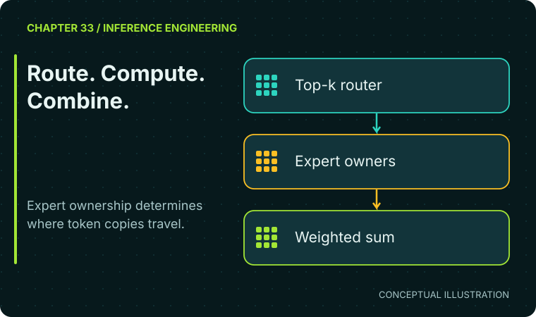
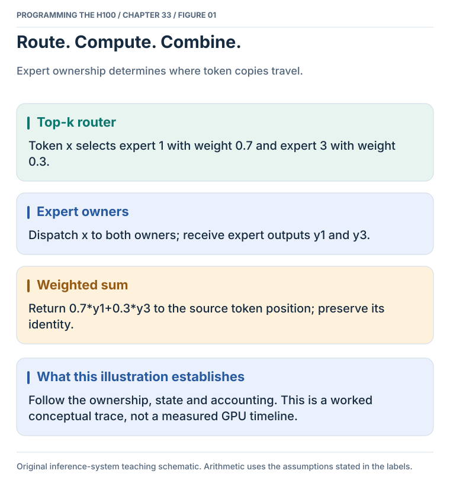

# Chapter 33: MoE Expert Parallelism: Sharding, All-to-All and Load Balance

[](images/chapter-openers/33-inference.svg)


!!! abstract "Goal and prerequisites"

    Learn how a Mixture-of-Experts (MoE) layer is served across several GPUs: which GPU holds which expert, how tokens travel to their experts and back, how much that costs, and why load imbalance, not arithmetic, is usually the problem. Read [Chapter 11](11-multi-gpu-nccl.md) (collectives, NVLink, InfiniBand) and [Chapter 32](32-inference-engine-and-harness.md) (the measurement harness) first.

!!! warning "Evidence level"

    Everything here ran on a **CPU**. The routing study is a simulation with a synthetic skew. The all-to-all check uses PyTorch's **gloo** backend on four CPU processes and verifies that the dispatch and combine **logic** returns the right answer. It does not measure NCCL, NVLink or InfiniBand performance. The bandwidth figures are datasheet values turned into lower bounds, not measurements.

## Worked system map

[](images/worked/ch33-inference.svg)


The equal-slot placement example now rejects expert-copy counts that do not divide evenly across GPUs instead of failing partway through packing. Its default experiments retain the same shapes. [November 25 rerun](validation-inference-2026-11-25.md).

## 33.1 What an MoE layer does

A dense feed-forward layer sends every token through the same weights. An MoE layer holds many expert networks and a small **router**. For each token the router scores all experts and sends the token to its top-`k` (often 2). The experts' outputs are combined, weighted by the router scores.

```
 token -> router -> top-2 experts: E17 (weight 0.7), E41 (weight 0.3)
                       |                       |
                     run E17                 run E41
                       +---------- weighted sum ----------> output
```

Only `k` of the `E` experts run for each token, so an MoE model has many parameters but modest compute per token. The cost is that the experts are too large for one GPU, so they are **sharded**: each GPU holds a subset. This is **expert parallelism**.

## 33.2 The communication pattern

With experts spread across `EP` GPUs, a token may need an expert that lives elsewhere. Each MoE layer therefore does two **all-to-all** exchanges:

1. **Dispatch:** every GPU sends each token copy to the GPU that owns its chosen expert.
2. **Combine:** after the experts run, results travel back to the token's home GPU.

```
 GPU0 tokens ---+--> GPU0 experts            each GPU sends some tokens to every GPU
 GPU1 tokens ---+--> GPU1 experts   dispatch   (all-to-all), computes its experts,
 GPU2 tokens ---+--> GPU2 experts   -------->   then sends results back (combine)
 GPU3 tokens ---+--> GPU3 experts
```

Both exchanges sit on the critical path of every MoE layer, so their cost multiplies by the number of MoE layers in the model.

### Worked Example 33.2.1: dispatch volume and a bandwidth floor

If routing spreads tokens evenly, a fraction `(EP-1)/EP` of each GPU's routed copies leaves the GPU. With 8,192 tokens per GPU, top-2 routing, hidden size 4,096 and BF16 activations:

```
== all-to-all dispatch volume per GPU per layer (hidden 4096, BF16, top-2, 8192 tokens/GPU) ==
EP= 8:   117.4 MB dispatch (+ same combine) -> floor    522.0 us over NVLink 450 GB/s one-way (datasheet)
EP=16:   125.8 MB dispatch (+ same combine) -> floor   5033.2 us over InfiniBand 50 GB/s (400 Gb/s)
```

Two things to read off:

- The data volume barely changes with `EP` (117 versus 126 MB). The **link** it crosses changes everything: about 0.5 ms inside an NVLink-connected node, about 5 ms once the traffic must cross a 400 Gb/s InfiniBand link. That is a tenfold penalty per layer, multiplied by every MoE layer.
- These are floors from datasheet bandwidth. Real all-to-all achieves a fraction of link bandwidth, and the dispatch must also be overlapped with compute to be hidden at all. The NVLink figure is the one-way rate per GPU; check it against your system's documentation.

This is why large MoE serving keeps expert parallelism inside an NVLink domain where possible, and why dispatch kernels are tuned separately for the latency-sensitive decode case and the bandwidth-heavy prefill case.

## 33.3 Load imbalance

The router is not uniform. Some experts are popular, so the GPUs holding them receive more tokens and the others wait. Every layer finishes only when the slowest GPU does, so what matters is the **imbalance**: the busiest GPU's load divided by the average.

### Worked Example 33.3.1: simulated skew

The simulation routes 20,000 tokens to 64 experts on 8 GPUs with top-2 routing. A `skew` parameter adds a per-expert popularity bias to the router scores. `contiguous` puts experts `0-7` on GPU 0, `8-15` on GPU 1 and so on. The other columns replicate the hottest experts and pack the copies onto the lightest GPU.

```
== load imbalance (max GPU load / mean), 64 experts on 8 GPUs, top-2 routing ==
skew  contiguous  +8 replicas  +16 replicas
 0.0       1.021        1.002         1.002
 0.5       2.224        1.004         1.005
 1.0       3.935        1.001         1.000
```

With no skew the contiguous placement is nearly balanced (1.02). With strong skew the busiest GPU carries almost four times the average, so the layer runs at roughly a quarter of the efficiency. Replicating hot experts brings every row close to 1.0.

!!! warning "What this simulation assumes"

    - **Replicas split load perfectly.** Each copy of an expert is assumed to receive an equal share of its tokens. Real routing needs a policy that actually achieves that.
    - **Replicas cost memory.** Each extra copy is another copy of the expert's weights; the run above spends 8 or 16 extra expert slots across the cluster.
    - **The skew is synthetic.** A real model's expert popularity depends on the data and changes over time, so placement must be re-balanced from measured load.

!!! warning "Training versus serving"

    Auxiliary load-balancing losses act on the router during **training**. At inference the router is fixed, so balance has to come from **placement**: expert replication, re-placement from live statistics (often called expert-parallel load balancing, EPLB), and capacity limits. A balanced training loss does not guarantee a balanced serving workload.

## 33.4 Verifying the dispatch and combine logic

An all-to-all is easy to get subtly wrong: send counts must match receive counts, token order must be restored, and results must be weighted and summed back to the right token. The check below runs four processes with the gloo backend. Each rank routes 64 tokens to 16 experts (4 per rank) with top-2 routing, exchanges sizes, dispatches tokens and expert ids, applies a trivial expert (multiply by `expert_id + 1`), returns results, restores the original order and sums with the router weights. Each rank compares the outcome with a single-process reference.

```
== gloo all-to-all dispatch/combine vs single-process reference (4 ranks) ==
rank 0: matches reference? True   tokens sent to ranks 0..3 = [39, 26, 30, 33]
rank 1: matches reference? True   tokens sent to ranks 0..3 = [27, 30, 41, 30]
rank 2: matches reference? True   tokens sent to ranks 0..3 = [39, 27, 35, 27]
rank 3: matches reference? True   tokens sent to ranks 0..3 = [34, 33, 32, 29]
```

The send counts differ by rank and by destination, which is why the exchange needs `all_to_all_single` with **uneven split sizes** and a preliminary exchange of those sizes. A fixed-size all-to-all would silently truncate or pad.

!!! note "What the check could not see, and the fix"

    The first version of this check passed even when the dispatch sent tokens to the **wrong rank**. The toy expert (`t * (e + 1)`) is a pure function of the expert id, so any rank can compute any expert and the output still matches the reference. A deliberately broken copy that used `dest = exp_flat % world` instead of `exp_flat // per_rank` printed `True` on all four ranks. The check now also asserts that every expert id a rank receives is one it owns (`recv_e // per_rank == rank`). The same broken copy now fails. The chapter's printed output is unchanged, because the correct code passes both tests.

### The pattern in code

```python
dest = exp_flat // per_rank                     # which rank owns each chosen expert
order = torch.argsort(dest, stable=True)        # group token copies by destination
send_counts = torch.bincount(dest, minlength=world)
dist.all_to_all_single(recv_counts, send_counts)            # 1. exchange sizes
dist.all_to_all_single(recv_x, send_x, r, s)                # 2. dispatch tokens
...                                                         # 3. run local experts
dist.all_to_all_single(back, out, s, r)                     # 4. combine: return results
result[order] = back                                        # 5. undo the sort
y.index_add_(0, tok_idx, result * weights.flatten()[:, None])   # 6. weighted sum per token
```

On GPUs the same structure uses NCCL all-to-all or a specialized dispatch library, and the experts run as one **grouped GEMM** so that many small matrix multiplies of different sizes execute in a single kernel launch. Chapters [20](20-tiled-copy.md) to [29](29-workbook-capstone.md) cover the GEMM machinery that a grouped GEMM builds on.

## 33.5 Self-tests (24, all pass)

Run `python3 /Users/oluwaseyiawoga/Developer/programming-the-h100/docs/examples/inference-systems/ch33_moe_expert_parallel.py --test` (about 15 seconds, needs PyTorch; the gloo checks start 2 to 4 processes each).

| Group | What is checked |
|---|---|
| Router (3) | output shape `[T, k]` with ids in range; the `k` experts of one token are distinct; the same seed gives the same assignment |
| Loads and imbalance (5) | expert loads sum to `T x k`; contiguous GPU loads conserve the total; a perfectly even load has imbalance exactly 1.0; imbalance is never below 1; more skew gives more imbalance |
| Placement (6) | total load is conserved with 0 and 8 replicas; replicas improve a skewed load; at skew 1.0, 8 and 16 replicas bring imbalance under 1.02; two hand-computed cases (loads `[100,1,1,1]` on 2 GPUs give `[101, 2]` with no replicas and `[67.667, 35.333]` with 2); a replica count that breaks `(E + R) % GPUs == 0` raises `ValueError` |
| Volume (3) | zero bytes on one GPU; linear in tokens; the 117.4 MB figure for EP=8 |
| gloo all-to-all (7) | match with the reference for 4 ranks (uniform, top-2), 2 ranks (top-1), and 4 ranks with every copy sent to rank 0 so three ranks receive nothing; send counts conserve `tokens x k` per rank; every send targets rank 0 in the last case |

```
24/24 self-tests pass
```

**The tests can fail.** Three broken copies were tried: skipping the undo-sort fails the 4-rank and 2-rank match; leaving out the router weights in the final sum fails the 4-rank and rank-0 match; giving a replica to the *least* loaded expert fails the "under 1.02" check and the two-replica hand case. The first version of this suite had 21 tests and let the third breakage pass, because "replicas improve a skewed load" is also true of a poor replica choice. The two hand cases and the 1.02 threshold were added for that reason.

## 33.6 Four more measurements

All use the same simulator as section 33.3 (64 experts, 8 GPUs, top-2).

**A. How many replicas?** Skew 1.0, 20,000 tokens, seed 0:

```
replicas  imbalance  extra expert weights
       0      2.935   0 %
       8      1.001   12.5 %
      16      1.000   25 %
      24      1.001   37.5 %
      32      1.001   50 %
```

Two points. Without replicas but with balanced packing the busiest GPU still carries 2.9 times the mean, against 3.9 for contiguous placement: packing helps, but a single expert cannot be split across GPUs, and the hottest one alone is about 2.9 times a GPU's average share. Eight replicas (12.5 percent more expert weights) remove the problem; more buy nothing here.

**B. The seed matters.** The same contiguous placement over eight seeds (20,000 tokens):

```
skew 0.5: 2.22 1.62 2.21 2.27 1.82 1.62 1.82 1.38   (min 1.38, max 2.27)
skew 1.0: 3.94 2.41 3.45 3.74 2.60 2.10 2.89 2.00   (min 2.00, max 3.94)
```

The 3.935 printed in section 33.3 is seed 0, which is the worst of the eight at skew 1.0. A different popularity draw gives half that. Read the table as "imbalance is large and highly variable", not as a constant.

**C. Small batches are noisy even with a perfectly uniform router.** Skew 0, contiguous placement, mean over eight seeds:

```
tokens per step   16     64     256    1024   4096   20000
mean imbalance    1.656  1.344  1.215  1.080  1.040  1.016
```

Decode steps carry few tokens per GPU, so some GPUs see several times the average just from sampling. Imbalance at decode is therefore a larger problem than the prefill-sized simulation of section 33.3 suggests.

**D. Volume against `EP` and `k`.** At 8,192 tokens per GPU, hidden 4,096, BF16:

```
EP            2      4      8      16     32
dispatch MB   67.1   100.7  117.4  125.8  130.0
top-k (EP=8)  k=1: 58.7   k=2: 117.4   k=4: 234.9   k=8: 469.8
```

The volume saturates toward `tokens x k x hidden x bytes` = 134.2 MB as `EP` grows, and is exactly linear in `k`.

## 33.7 Failure modes and edge cases

| Situation | What happens | Where it shows |
|---|---|---|
| Replica count with `(E + R) % GPUs != 0` | the packing runs out of slots and the code fails with `ValueError: min() arg is an empty sequence`, which does not name the cause | self-test 14; validate `R` before calling |
| A rank receives no tokens | the receive buffer has size 0; the code returns the empty tensor instead of stacking nothing | gloo test with every copy to rank 0 |
| Fixed-size all-to-all used for uneven counts | truncates or pads silently | section 33.4; uneven split sizes and a size exchange are required |
| Undo-sort forgotten | each token gets another token's result; the output is plausible-looking and wrong | broken copy 1 in section 33.5 |
| Router weights forgotten | the experts' outputs are summed unweighted | broken copy 2 |
| Dispatch to the wrong rank | invisible to a stateless toy expert; visible only if the receiving rank checks ownership | note in section 33.4 |
| One expert hotter than a whole GPU's share | cannot be fixed by moving experts; needs replicas | experiment A: 2.935 at 0 replicas |
| Placement computed from one load snapshot | goes stale when traffic changes | re-place from live counts |
| Small decode batches | imbalance from sampling alone | experiment C |

**Not modelled:** capacity limits and token dropping; shared experts that every token uses; expert compute time and its overlap with the all-to-all; router cost; hierarchical all-to-all (inside a node first, then across nodes); low-precision dispatch (sending FP8 activations); network topology and contention; the decode-specific low-latency dispatch kernels; the backward pass; and any NCCL or NVLink behaviour. The gloo test checks **logic** on CPU only.

## 33.8 What to measure on real hardware (untested)

!!! warning "UNTESTED ON H100"

    None of the following was run. Commands are from memory; verify flags and tool names against the versions you install.

| Measurement | How | Why |
|---|---|---|
| Topology | `nvidia-smi topo -m` | Shows which GPUs share NVLink and which cross PCIe or the network |
| Raw all-to-all bandwidth | `alltoall_perf` from NVIDIA's `nccl-tests` repository, for example `-b 8M -e 1G -f 2 -g 8` on one node | Gives the achieved fraction of the section 33.2 floor |
| Layer time split | Nsight Systems timeline ([Chapter 14](14-nsight-systems.md)): expert compute versus all-to-all | Shows the communication share |
| Imbalance | Per-GPU token counts per layer from the router, max divided by mean, over many steps | The slowest-GPU penalty; compare with experiments B and C |
| Scaling | Tokens per second as `EP` grows within and then across nodes | Finds where InfiniBand hurts |
| Overlap | Does dispatch overlap compute, or run in series? | Hidden versus exposed communication |
| Placement | Imbalance and throughput with and without replicas under real traffic | Whether replication pays for its memory (experiment A) |
| Decode versus prefill | Separate runs at small and large batch | The two regimes need different dispatch strategies |
| Engine switch | Check your engine's documentation for its expert-parallel option (vLLM has a flag for it in recent releases; verify the name) | Needed to run any of this on a real MoE checkpoint |

Report each against the harness from [Chapter 32](32-inference-engine-and-harness.md): fixed workload, TTFT, TPOT and cost, not kernel times alone.

## 33.9 Exercises

1. Compute the dispatch volume per GPU at `EP = 64` for the section 33.2 setup, and the limit as `EP` grows.
2. A model has 48 MoE layers. Using the section 33.2 floors, what is the total exposed all-to-all floor per forward pass at 8,192 tokens per GPU on `EP = 8` (NVLink) and on `EP = 16` (InfiniBand)? Then repeat the volume for a decode step with 64 tokens per GPU on `EP = 8` and say what limits it.
3. Explain the value 1.656 in experiment C for 16 tokens, without running code.
4. For 60 experts on 8 GPUs, which replica counts keep the placement code from failing?
5. Add a capacity limit: each expert accepts at most `C` token copies per step and the rest are dropped. What must change in the reference, and what invariant replaces "send counts sum to `tokens x k`"?
6. In `_worker`, replace the stateless toy expert with one that needs a per-rank weight. Predict which of the three gloo configurations fail if the dispatch uses `exp_flat % world`.

### Solutions

1. `8192 x 2 x 4096 x 2 x 63/64` = 132.1 MB. The limit is `8192 x 2 x 4096 x 2` = 134.2 MB, so going from 8 to 64 GPUs adds 12.5 percent to the volume per GPU.
2. NVLink: 48 x 522.0 µs = 25.1 ms. InfiniBand: 48 x 5,033.2 µs = 241.6 ms. Both are floors from datasheet bandwidth and cover dispatch plus combine. For a decode step with 64 tokens per GPU, the volume at `EP = 8` is `117.4 MB / 128` = 0.92 MB, whose bandwidth floor over NVLink is about 4 µs per layer. At that size the fixed latency of the exchange, not bandwidth, is what limits it, which is why decode uses different dispatch kernels.
3. With 16 tokens and top-2 there are only 32 token copies for 8 GPUs, a mean of 4 per GPU. Random sampling makes the busiest GPU hold about 7 of them (median over 200 seeds, range 5 to 13), so max over mean is well above 1 even though every expert is equally likely. As tokens grow the relative fluctuation shrinks roughly as one over the square root of the count, which matches the fall to 1.016 at 20,000.
4. `(60 + R) % 8 == 0`, so `R = 4, 12, 20, ...` (`R ≡ 4 mod 8`). With `R = 0` it fails because 60 is not divisible by 8.
5. Counting copies per expert, keep the first `C` and drop the rest; the reference must apply the same rule and treat dropped copies as contributing zero (or renormalise the remaining weights, whichever the model specifies; this must match). The conservation invariant becomes: sum of send counts = `tokens x k` minus the number dropped, and each expert's received count is at most `C`.
6. Prediction, not a measurement: with an expert that depends on per-rank weights, a copy sent to a rank that does not own the expert is computed wrongly or not at all, so all three configurations should fail. The ownership assertion added in section 33.4 already catches the mis-routing without changing the expert, and the broken copy fails 4 of the 24 tests, including all three `matches reference` checks.

## Chapter Summary

An MoE layer routes each token to its top-`k` experts, and with experts sharded across GPUs every layer does a dispatch and a combine all-to-all on the critical path. The data volume per GPU is nearly independent of the expert-parallel degree, but the link it crosses is not: a bandwidth floor of about 0.5 ms over NVLink becomes about 5 ms over a 400 Gb/s InfiniBand link for the same tensors, per layer. Popular experts overload some GPUs, and the busiest GPU sets the layer time; in a synthetic simulation contiguous placement reached 3.9 times the mean load, and replicating hot experts restored 1.0, at the price of extra weight memory and an assumption of perfectly shared load. Inference balance comes from placement, not from a training loss. A four-process gloo test confirmed that uneven-size dispatch, expert computation, combine and weighted summation reproduce a single-process reference; GPU performance is left for you to measure. The 24 self-tests also showed that the original dispatch check could not detect dispatch to the wrong rank, now fixed with an ownership assertion; and the imbalance figures vary widely with the random seed and fall toward 1 only as tokens per step grow.

## Self-Check Questions

1. Why does each MoE layer need two all-to-all exchanges?
2. In Worked Example 33.2.1 the dispatch volume barely changes between `EP=8` and `EP=16`. Why does the time floor change by about ten times?
3. Why is the layer time set by the most loaded GPU rather than by the average?
4. Why does a balancing loss used in training not guarantee balanced serving?
5. Why does the all-to-all in Section 33.4 first exchange the send counts?

## Worked Solutions

1. Dispatch sends each token copy to the GPU that owns its chosen expert, and combine returns the expert outputs to the token's home GPU so they can be weighted and summed.
2. The per-GPU data volume depends on tokens, `k`, hidden size and precision, and the `(EP-1)/EP` factor changes little. The time depends on the link: the 8-GPU case stays on NVLink at about 450 GB/s one-way, while the 16-GPU case must cross a 400 Gb/s InfiniBand link at about 50 GB/s, about nine times slower.
3. Every GPU must finish its experts before the combine and the next layer can proceed, so the layer completes when the slowest GPU does; extra idle time on the others is wasted.
4. The balancing loss shapes the router during training. At inference the router is fixed and sees different traffic, so some experts can still be much more popular than others. Placement, replication and re-balancing from live statistics address that.
5. Each rank sends a different number of token copies to each destination, so each receiver must know how much to expect before it can allocate its receive buffer and call the uneven-split exchange.

## Files and sources

- Code: `docs/examples/inference-systems/ch33_moe_expert_parallel.py` (`--test` for the 24 self-tests; the default run prints the chapter's numbers)
- Bandwidths are datasheet values (NVLink 450 GB/s one-way per H100, 400 Gb/s InfiniBand). The simulation's skew is synthetic.
