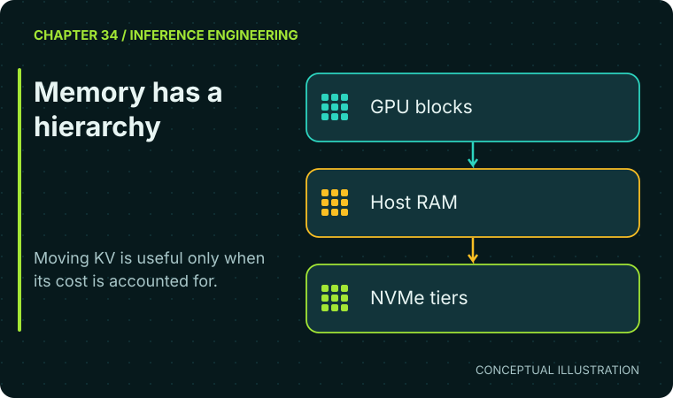

# Chapter 34: Hierarchical KV-Cache Offloading

[](images/chapter-openers/34-inference.svg)


!!! abstract "Goal and prerequisites"

    Learn when moving KV cache out of GPU memory pays off, and when it is slower than recomputing it. You build a tier simulator (GPU, CPU RAM, NVMe) and a rule for deciding what can be fetched without stalling decode. Read [Chapter 32](32-inference-engine-and-harness.md) (KV size and the decode floor) and [Chapter 5](05-cp-async-bulk-l2-hinting.md) (asynchronous copies) first.

!!! warning "Evidence level"

    CPU simulation with **assumed** bandwidths (PCIe 55 GB/s, one NVMe drive 10 GB/s) and an **assumed** prefill speed of 20,000 tokens per second. Change those three numbers to your measurements and the conclusions change with them; that sensitivity is the point of the chapter. Nothing here measures a real offload system.

## Worked system map

[](images/worked/ch34-inference.svg)


## 34.1 Why offload at all

The KV cache is the largest per-user object in a serving system: about 320 KiB per token for a Llama-3-70B-shaped model, so a 4,096-token conversation holds 1.34 GB. A GPU has tens of gigabytes to spare, so it holds tens of idle conversations. Chat and agent workloads keep many sessions that pause between turns and come back. Throwing the cache away forces a full prefill when the user returns; keeping all of it on the GPU does not fit.

A tiered design keeps hot sessions on the GPU, warm ones in host RAM and cold ones on NVMe:

```
 GPU HBM          ~3.35 TB/s    smallest, active sequences
 CPU RAM          PCIe ~55 GB/s    larger, recently used sessions
 NVMe SSD         ~10 GB/s       largest, cold sessions
```

## 34.2 The first question: restore or recompute?

Restoring a session means copying its KV back. The alternative is to run prefill on the saved text and rebuild it. Offloading only helps if the copy is faster.

### Worked Example 34.2.1

```
== restore vs recompute, per context length (assumed: PCIe 55 GB/s, NVMe 10 GB/s, prefill 20k tok/s) ==
tokens   KV size    restore(CPU)  restore(NVMe)  recompute
  1024     0.34 GB        6.1 ms        33.6 ms      51.2 ms
  4096     1.34 GB       24.4 ms       134.2 ms     204.8 ms
 16384     5.37 GB       97.6 ms       536.9 ms     819.2 ms
 65536    21.47 GB      390.5 ms      2147.5 ms    3276.8 ms
per token: restore CPU 6.0 us, NVMe 32.8 us, recompute 50.0 us
NVMe restore beats recompute only if prefill speed < 30,518 tok/s; CPU restore only if prefill speed < 167,847 tok/s
```

Everything here scales linearly in tokens, so the comparison is per token. With these assumptions a CPU restore is about eight times faster than recomputing, and an NVMe restore is only about 1.5 times faster.

The last line is the practical rule. **If your prefill is faster than about 30,000 tokens per second, reading from one NVMe drive loses to recomputing.** A cluster with fast prefill, short contexts or a slow drive should not use the NVMe tier at all. This is a number to measure on your own system, not to assume.

## 34.3 A tier simulator

The simulator holds whole sessions in least-recently-used (LRU) order. When a tier is full it demotes its oldest session to the next tier. A request for a session finds it in the first tier that holds it, pays the cheaper of restore and recompute, then moves it to the GPU. Session popularity follows a Zipf distribution: a few sessions are returned to constantly, most rarely.

```python
def access(self, sid, tokens):
    found = None
    for t in self.order:                      # gpu, cpu, nvme
        if sid in self.tier[t]:
            found = t
            del self.tier[t][sid]
            break
    self._insert("gpu", sid, tokens)          # evictions cascade downwards
    return found
```

### Worked Example 34.3.1

400 sessions of 4,096 tokens, 6,000 requests, a GPU that holds 40 sessions and a CPU tier that holds 120:

```
policy            gpu-hit  cpu-hit  nvme-hit  miss(recompute)  mean resume latency
gpu                 0.598    0.000     0.000            0.402      82.40 ms
gpu+cpu             0.598    0.236     0.000            0.166      39.79 ms
gpu+cpu+nvme        0.598    0.236     0.104            0.062      32.42 ms
```

The CPU tier cuts mean resume latency from 82 ms to 40 ms by converting about 24 percent of requests from full recomputes into 24 ms restores. Adding NVMe helps less: 40 ms down to 32 ms. That follows from the previous section: an NVMe restore is 134 ms against a 205 ms recompute, a modest gain for the 10 percent of requests it serves.

The hit rates depend on the popularity skew, the tier sizes and the reuse pattern. Measure them from real traffic traces before sizing tiers.

!!! warning "Where offload wins in practice"

    The reliable wins are **reuse**: multi-turn chat, shared system prompts and documents, and preempted requests that are swapped out and back. Offload does not make a single long conversation cheaper to run. Production systems built around this idea include LMCache and the KV-transfer layers in vLLM and similar engines.

## 34.4 What cannot be offloaded: the active sequence

One might hope to keep a long context in host RAM and stream it in for every decode step. The arithmetic says otherwise. A decode step is bounded by reading weights (21 ms on two H100s, Chapter 32), and with 80 layers that is about 0.26 ms of compute per layer. To hide a fetch behind that, the next layer's KV must arrive within 0.26 ms:

```
per-layer compute budget in a decode step ~ 0.263 ms (21 ms / 80 layers)
context   1024: fetching ONE layer's KV over PCIe takes  0.076 ms -> hidden behind compute
context   4096: fetching ONE layer's KV over PCIe takes  0.305 ms -> STALLS decode
context   8192: fetching ONE layer's KV over PCIe takes  0.610 ms -> STALLS decode
context  32768: fetching ONE layer's KV over PCIe takes  2.440 ms -> STALLS decode
largest per-layer KV fetch that hides behind one layer's compute (one sequence): ~3,525 tokens
```

A single sequence of about 3,500 tokens is the limit for fetching its KV a layer ahead, and a real batch holds many sequences all competing for the same PCIe link. So the rule is:

| Case | Offloadable? |
|---|---|
| Idle session between turns | Yes: restore before the next request, off the critical path |
| Preempted request | Yes: swap out and back |
| Shared prefix reused by many requests | Yes: restore once, serve many |
| Active sequence read every decode step | No: keep on the GPU |
| Long active sequence | Reduce the KV itself (quantized cache, fewer KV heads, sparse or windowed attention) |

"Without stalling decode" is achievable only by restoring **ahead** of need, using pinned host memory and a separate copy stream so the transfer overlaps other requests' compute ([Chapter 14](14-nsight-systems.md) shows how to see whether it does), and never by paging in the sequence being decoded.

## 34.5 Self-tests (23, all pass)

Run `python3 /Users/oluwaseyiawoga/Developer/programming-the-h100/docs/examples/inference-systems/ch34_kv_offload.py --test`.

| Group | What is checked |
|---|---|
| Arithmetic (4) | 327,680 bytes per token and 4,096 per layer; restore time linear in tokens; NVMe slower than CPU restore; at prefill speed equal to the NVMe rate, restore and recompute cost the same |
| Tier mechanics (8) | a first access is a miss; the cascade GPU, CPU, NVMe on a three-session hand case; an access returns the tier that held the session and moves it to the GPU; an immediate re-access hits the GPU; LRU picks the oldest as the victim and touching a session protects it; a session larger than every bounded tier is dropped; one larger than the GPU tier skips to the next |
| Invariants (3) | after 3,000 random accesses a session is never in two tiers and no bounded tier exceeds its capacity; with unbounded NVMe no session is ever lost |
| Whole runs (7) | hit fractions sum to 1; the GPU hit rate is the same under all three policies; adding a tier never raises the miss rate or the mean latency; determinism by seed; more skew gives a higher GPU hit rate; with very fast prefill the cost is capped by recompute; the decode-stall limit |
| Failure (1) | zero requests raises `ZeroDivisionError` |

```
23/23 self-tests pass
```

**The tests can fail.** Four broken copies: evicting the *newest* session instead of the oldest fails both LRU tests; not removing a session from its old tier when promoting it fails the "never in two tiers" test; removing the "larger than the tier" rule crashes the oversize tests; and charging the restore time even when recompute is cheaper passed all 22 tests of the first version of the suite, because at the default 20,000 tokens per second restore is always cheaper. That is why the fast-prefill test (number 22) was added.

The code's docstring used to call the hierarchy "inclusive". It is **exclusive**: a session lives in exactly one tier, and promoting it removes it from the lower one. The test above checks that, and the docstring is fixed.

## 34.6 Four more experiments

All use `run`: 400 sessions of 4,096 tokens, 6,000 requests, the GPU holds 40 sessions, seed 0 unless stated (`--extras`).

**A. Popularity skew** (GPU + 120-session CPU + unbounded NVMe):

```
zipf  gpu-hit  cpu-hit  nvme-hit  miss   mean resume latency
 0.6    0.197    0.348     0.389  0.067     74.30 ms
 0.8    0.331    0.331     0.272  0.067     58.15 ms
 1.1    0.598    0.236     0.104  0.062     32.42 ms
 1.4    0.817    0.116     0.020  0.048     15.25 ms
```

The miss column is almost constant because with unbounded NVMe the only misses are **first visits**: 399 distinct sessions were touched at zipf 0.6 (399/6000 = 0.0665) and 287 at zipf 1.4 (287/6000 = 0.048). The remaining variation is where the hit lands, and that decides latency: 74 ms when most requests reach down to NVMe and 15 ms when most stay on the GPU.

**B. How big should the CPU tier be?** (GPU + CPU only):

```
cpu sessions  gpu-hit  cpu-hit  miss   mean resume latency
           0    0.598    0.000  0.402     82.40 ms
          40    0.598    0.123  0.280     60.24 ms
         120    0.598    0.236  0.166     39.79 ms
         240    0.598    0.316  0.086     25.39 ms
         360    0.598    0.341  0.062     20.94 ms
```

Returns diminish. The first 40 sessions save 22.2 ms (0.55 ms per session), the next 80 save 20.5 ms (0.26 ms each), the next 120 save 14.4 ms (0.12 each), and the last 120 save 4.5 ms (0.04 each). The GPU hit rate does not move at all: it is set by the GPU tier alone.

**C. When does restore stop winning?** A 4,096-token session:

```
prefill tok/s  recompute   restore CPU   restore NVMe   cheapest
         5000     819.2 ms       24.4 ms       134.2 ms   CPU restore
        20000     204.8 ms       24.4 ms       134.2 ms   CPU restore
        30000     136.5 ms       24.4 ms       134.2 ms   CPU restore
        50000      81.9 ms       24.4 ms       134.2 ms   CPU restore
       200000      20.5 ms       24.4 ms       134.2 ms   recompute
```

NVMe restore never wins once prefill reaches about 30,500 tokens per second. CPU restore wins up to about 167,800 tokens per second. These are the two thresholds from section 34.2, shown as a table.

**D. Seed spread.** Mean resume latency for the GPU + CPU policy over eight seeds: 39.8, 40.2, 39.3, 38.3, 39.4, 39.3, 39.1, 37.8 ms (min 37.8, max 40.2). With 6,000 requests the policy comparison is stable across seeds; the 2.4 ms spread is small next to the 40 ms gap between policies.

## 34.7 Failure modes and edge cases

| Situation | What happens | Where it shows |
|---|---|---|
| Session larger than every bounded tier | silently dropped; the next request recomputes | self-test 11 |
| Session larger than the GPU tier only | skips to the next tier | self-test 12 |
| Promotion without removal from the old tier | the session is counted twice and memory is double-booked | broken copy 2 |
| Evicting the newest instead of the oldest | thrashing: hot sessions are demoted first | broken copy 1 |
| Prefill faster than the break-even speed | restore is slower than recompute; the code uses the cheaper one, a naive system that always restores loses | self-test 22 and experiment C |
| Unbounded NVMe | the tier grows without limit in this model (400 sessions x 1.34 GB = 537 GB); a real drive is finite | model assumption |
| Zero requests | division by zero when averaging | self-test 23 |
| Sessions of different lengths | the simulator uses a fixed length per run; whole-session LRU favours short sessions | not modelled |
| Active sequence read every step | cannot be offloaded; PCIe fetch exceeds the per-layer compute budget beyond about 3,500 tokens for one sequence | section 34.4 |

**Not modelled:** partial restores (only the prefix that matches); prefix sharing between sessions (Chapter 45); several concurrent restores contending for one PCIe link; the cost of **writing** a demoted session to CPU or NVMe, which uses the same links; NVMe queue depth and latency; pinned-memory allocation limits; session expiry and privacy deletion; compression or quantisation of stored KV; a restore that overlaps with the previous request's compute; and any real traffic trace.

## 34.8 What to measure on real hardware (untested)

!!! warning "UNTESTED ON H100"

    None of the following was run. Commands are from memory; verify flags against your installed versions.

    | Measurement | How |
    |---|---|
    | Real PCIe bandwidth | `nvidia-smi topo -m` for the topology; `bandwidthTest` from the CUDA samples with `--memory=pinned --mode=shmoo` (check that the sample is built and the flags match your version); or a small `cudaMemcpyAsync` loop from pinned memory |
    | Real NVMe bandwidth | a large sequential read with direct I/O, for example `fio --name=seq --filename=/path/to/testfile --rw=read --bs=1M --direct=1 --size=16G --iodepth=16` (use your own test path) |
    | Real prefill speed | Your engine on your model, at your prompt lengths, with the Chapter 32 client |
    | Break-even | The inequality from Worked Example 34.2.1 with the three numbers above |
    | Hit rate per tier | Replay a recorded session trace, not synthetic Zipf |
    | Overlap | Nsight Systems timeline: does the copy stream run beside compute without delaying the decode step? |
    | Engine support | Check your engine's documentation for a KV-offload or KV-transfer option and for whether it restores prefixes or whole sessions; flag names change between releases |
    | End effect | TTFT for returning sessions and tokens per second for active ones, using the Chapter 32 harness |

    Replace the three constants in `ch34_kv_offload.py` (`PCIE_BW`, `NVME_BW`, `PREFILL_TPS`) with your measurements and rerun `--extras`.

## 34.9 Exercises

1. The break-even prefill speed for a CPU restore is about 167,800 tokens per second at 55 GB/s. What is it for a PCIe link that actually delivers 25 GB/s?
2. How much KV memory do the 40 GPU sessions and the 120 CPU sessions of the simulation represent?
3. Explain the miss rates in experiment A: why are they 0.067 at zipf 0.6 and 0.048 at zipf 1.4, and why does the NVMe policy's miss rate not fall to zero?
4. Using experiment B, would you buy a 240-session CPU tier or a 120-session one? What other number do you need?
5. Why is the GPU hit rate identical for all three policies?
6. Eight sequences of 4,096 tokens are active and share the PCIe link. How long does fetching one layer's KV for all of them take, compared with the per-layer budget? And if the model had 64 KV heads instead of 8?

### Solutions

1. Per token: `327,680 / 25e9` = 13.1 µs, so break-even is `1 / 13.1 µs` ≈ 76,300 tokens per second. A slower link makes recompute competitive earlier.
2. `40 x 4,096 x 327,680` = 53.7 GB on the GPU and `120 x 4,096 x 327,680` = 161.1 GB in host memory. The GPU figure is KV only; weights and activations come on top.
3. With unbounded NVMe nothing is ever evicted for good, so a request misses only the first time its session appears. At zipf 0.6 almost all 400 sessions appear (399 of them), giving 399/6000 = 0.0665; at zipf 1.4 only 287 distinct sessions appear in 6,000 requests, giving 0.048. The rate cannot reach zero, because the first visit to each session has nothing to restore.
4. 240 sessions lowers mean resume latency from 39.8 ms to 25.4 ms, saving 14.4 ms for 120 more sessions (161 GB of host memory). Whether that is worth it depends on the price of that memory against the value of latency and, because the GPU's saved prefill capacity is also freed, on how loaded the prefill pool is. Neither number is in the chapter.
5. The GPU tier is an LRU over the request sequence. A session is on the GPU if it was accessed recently enough, regardless of where it was demoted to. Lower tiers affect only what happens after a GPU miss, not what the GPU holds.
6. Eight sequences need `8 x 0.305` = 2.44 ms per layer against a 0.263 ms budget: about nine times too slow. With 64 KV heads (no grouped-query attention) each token's per-layer KV is eight times larger, so the largest single sequence that can be fetched in time falls from about 3,525 to about 441 tokens.

## Chapter Summary

KV cache costs about 320 KiB per token, so idle sessions crowd out active ones, and tiering them into GPU, CPU RAM and NVMe can avoid recomputation. Whether a tier helps depends on one comparison: restoring KV from the tier against re-running prefill. With an assumed 55 GB/s PCIe link, 10 GB/s NVMe and 20,000 tokens per second prefill, a CPU restore beats recompute by about eight times but one NVMe drive by only about 1.5, and NVMe loses outright if prefill exceeds about 30,000 tokens per second. A Zipf-popularity simulation cut mean resume latency from 82 ms to 40 ms with a CPU tier and to 32 ms with NVMe added; returns diminish with tier size, and popularity skew matters more than any single constant. 23 self-tests check the tier mechanics and invariants. The active sequence cannot be paged in each step: one layer's fetch over PCIe exceeds the 0.26 ms per-layer compute budget beyond about 3,500 tokens. Offloading therefore serves idle, preempted and shared-prefix sessions, not the sequence being decoded.

## Self-Check Questions

1. Why is the restore-versus-recompute comparison independent of context length in this model?
2. At what prefill speed does the NVMe tier stop paying for itself, and why does a faster prefill move the answer in that direction?
3. Why does adding NVMe to a CPU tier help less than adding the CPU tier did?
4. Why can't an active sequence's KV be streamed from host memory every decode step?
5. Name two kinds of workload where offloading clearly helps and one where it does not.

## Worked Solutions

1. Both restore time and recompute time grow in proportion to the number of tokens, so the per-token costs (6.0, 32.8 and 50.0 microseconds) decide the question at any length.
2. At about 30,500 tokens per second. Recompute cost per token falls as prefill speeds up, and once it drops below the 32.8 microseconds per token an NVMe read costs, rebuilding is cheaper than reading.
3. The CPU tier restores in 24 ms against a 205 ms recompute, a large gain on a large share of requests. The NVMe tier restores in 134 ms, only modestly faster than recompute, and serves a smaller share.
4. Each layer's KV for a 4,096-token sequence takes about 0.3 ms to fetch over PCIe, longer than the 0.26 ms of compute available per layer, and every sequence in the batch would need the same link at once, so the fetch cannot be hidden.
5. Multi-turn chat or agent sessions that resume after a pause, and shared system prompts or documents reused across requests, benefit. A single long conversation being decoded continuously does not, because its KV is needed every step.

## Files and sources

- Code: `docs/examples/inference-systems/ch34_kv_offload.py` (`--test` for the 23 self-tests, `--extras` for experiments A to D)
- Bandwidths and prefill speed are assumed round numbers, not measurements. The LMCache project and the KV-transfer layers in vLLM are examples of production systems built on the same idea; this chapter makes no claim about their internals.
