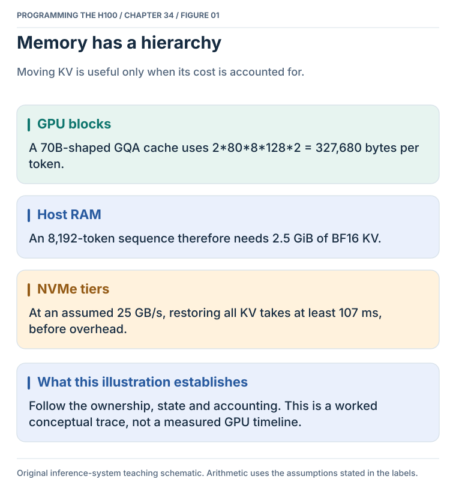

# Chapter 34: Hierarchical KV-Cache Offloading

[](images/chapter-openers/34-inference.svg)


!!! abstract "Goal and prerequisites"

    Learn when moving KV cache out of GPU memory pays off, and when it is slower than recomputing it. You build a tier simulator (GPU, CPU RAM, NVMe) and a rule for deciding what can be fetched without stalling decode. Read [Chapter 32](32-inference-engine-and-harness.md) (KV size and the decode floor) and [Chapter 5](05-cp-async-bulk-l2-hinting.md) (asynchronous copies) first.

!!! warning "Evidence level"

    CPU simulation with **assumed** bandwidths (PCIe 55 GB/s, one NVMe drive 10 GB/s) and an **assumed** prefill speed of 20,000 tokens per second. Change those three numbers to your measurements and the conclusions change with them; that sensitivity is the point of the chapter. Nothing here measures a real offload system.

## Worked system map

[](images/worked/ch34-inference.svg)


## 34.1 Why offload at all

The KV cache is the largest per-user object in a serving system: about 320 KiB per token for a Llama-3-70B-shaped model, so a 4,096-token conversation holds 1.34 GB. A GPU has tens of gigabytes to spare, so it holds tens of idle conversations. Chat and agent workloads keep many sessions that pause between turns and come back. Throwing the cache away forces a full prefill when the user returns; keeping all of it on the GPU does not fit.

A tiered design keeps hot sessions on the GPU, warm ones in host RAM and cold ones on NVMe:

```
 GPU HBM          ~3.35 TB/s    smallest, active sequences
 CPU RAM          PCIe ~55 GB/s    larger, recently used sessions
 NVMe SSD         ~10 GB/s       largest, cold sessions
```

## 34.2 The first question: restore or recompute?

Restoring a session means copying its KV back. The alternative is to run prefill on the saved text and rebuild it. Offloading only helps if the copy is faster.

### Worked Example 34.2.1

```
== restore vs recompute, per context length (assumed: PCIe 55 GB/s, NVMe 10 GB/s, prefill 20k tok/s) ==
tokens   KV size    restore(CPU)  restore(NVMe)  recompute
  1024     0.34 GB        6.1 ms        33.6 ms      51.2 ms
  4096     1.34 GB       24.4 ms       134.2 ms     204.8 ms
 16384     5.37 GB       97.6 ms       536.9 ms     819.2 ms
 65536    21.47 GB      390.5 ms      2147.5 ms    3276.8 ms
per token: restore CPU 6.0 us, NVMe 32.8 us, recompute 50.0 us
NVMe restore beats recompute only if prefill speed < 30,518 tok/s; CPU restore only if prefill speed < 167,847 tok/s
```

Everything here scales linearly in tokens, so the comparison is per token. With these assumptions a CPU restore is about eight times faster than recomputing, and an NVMe restore is only about 1.5 times faster.

The last line is the practical rule. **If your prefill is faster than about 30,000 tokens per second, reading from one NVMe drive loses to recomputing.** A cluster with fast prefill, short contexts or a slow drive should not use the NVMe tier at all. This is a number to measure on your own system, not to assume.

## 34.3 A tier simulator

The simulator holds whole sessions in least-recently-used (LRU) order. When a tier is full it demotes its oldest session to the next tier. A request for a session finds it in the first tier that holds it, pays the cheaper of restore and recompute, then moves it to the GPU. Session popularity follows a Zipf distribution: a few sessions are returned to constantly, most rarely.

```python
def access(self, sid, tokens):
    found = None
    for t in self.order:                      # gpu, cpu, nvme
        if sid in self.tier[t]:
            found = t
            del self.tier[t][sid]
            break
    self._insert("gpu", sid, tokens)          # evictions cascade downwards
    return found
```

### Worked Example 34.3.1

400 sessions of 4,096 tokens, 6,000 requests, a GPU that holds 40 sessions and a CPU tier that holds 120:

```
policy            gpu-hit  cpu-hit  nvme-hit  miss(recompute)  mean resume latency
gpu                 0.598    0.000     0.000            0.402      82.40 ms
gpu+cpu             0.598    0.236     0.000            0.166      39.79 ms
gpu+cpu+nvme        0.598    0.236     0.104            0.062      32.42 ms
```

The CPU tier cuts mean resume latency from 82 ms to 40 ms by converting about 24 percent of requests from full recomputes into 24 ms restores. Adding NVMe helps less: 40 ms down to 32 ms. That follows from the previous section: an NVMe restore is 134 ms against a 205 ms recompute, a modest gain for the 10 percent of requests it serves.

The hit rates depend on the popularity skew, the tier sizes and the reuse pattern. Measure them from real traffic traces before sizing tiers.

!!! warning "Where offload wins in practice"

    The reliable wins are **reuse**: multi-turn chat, shared system prompts and documents, and preempted requests that are swapped out and back. Offload does not automatically make a continuously decoded long conversation faster or cheaper; it may instead trade latency for feasible context capacity. Production systems built around this idea include LMCache and the KV-transfer layers in vLLM and similar engines.

## 34.4 Active-sequence offload is an overlap budget, not an impossibility

An active sequence needs its visible K/V repeatedly, so offloading trades GPU capacity for transfer work on the decode path. Whether that work can be hidden depends on the batch, per-rank KV ownership, available compute window, memory bandwidth and copy/compute scheduling. Systems such as [FlexGen](https://arxiv.org/abs/2303.06865) demonstrate that active-cache offload is possible; their throughput and latency objectives differ from a low-latency resident-cache server.

The earlier whole-session restore tables assume a single **effective aggregate** 55 GB/s restore path for the complete cache. The following is a separate per-rank overlap scenario with two independent links (110 GB/s aggregate); use the same topology and achieved bandwidth assumptions when comparing deployments.

Use the two-H100 example consistently. Assume the 8 GQA KV heads are evenly sharded across TP2, and **each GPU has its own independent 55 GB/s host-to-device link**. One rank owns `4096/2 = 2048` KV bytes per token per layer. Assume an evenly distributed 21 ms step, giving an ideal per-layer overlap window of `21/80 = 0.2625 ms`. These are model assumptions, not a measured copy pipeline:

```text
assumed per-layer overlap window in a decode step ~ 0.263 ms (21 ms / 80 layers)
context   1024: fetching ONE rank's layer KV over its PCIe link takes  0.038 ms -> fits ideal overlap window
context   4096: fetching ONE rank's layer KV over its PCIe link takes  0.153 ms -> fits ideal overlap window
context   8192: fetching ONE rank's layer KV over its PCIe link takes  0.305 ms -> exceeds ideal overlap window
context  32768: fetching ONE rank's layer KV over its PCIe link takes  1.220 ms -> exceeds ideal overlap window
ideal per-rank threshold with TP2 KV-head sharding (one sequence): ~7,050 tokens
```

Hand check: `0.0002625 * 55e9 / 2048 = 7049.56` tokens. If all 8 heads instead traverse one shared 55 GB/s link, use 4096 bytes and the threshold halves to about 3,525. The old chapter combined the TP2 step time with unsharded bytes without stating that shared-link assumption. For a batch, sum each rank's active contexts over the link it actually shares; do not multiply available bandwidth merely because there are two GPUs.

| Case | What to establish |
|---|---|
| Idle session between turns | Restore before reuse; its latency still matters to the returning request. |
| Preempted request | Account for both swap-out and swap-in, or compare recomputation. |
| Shared exact prefix | Restore reusable blocks once while preserving reference counts. |
| Active sequence | Measure whether per-rank fetches fit available overlap windows and whether contention slows compute. |
| Long active sequence | Consider a capacity/latency tradeoff, quantized KV or an attention scheme with a smaller visible cache. |

Pinned memory, asynchronous copies and enough staging space are prerequisites for useful overlap, not guarantees of it. A fetch that takes longer than its overlap window exposes a stall in this simple model. A shorter fetch only *could* be hidden: dependency ordering, initial pipeline fill, other transfers and HBM contention must also be measured. See [Chapter 14](14-nsight-systems.md) for the timeline checks.

## 34.5 Self-tests (23, all pass)

Run `python3 docs/examples/inference-systems/ch34_kv_offload.py --test`.

| Group | What is checked |
|---|---|
| Arithmetic (4) | 327,680 bytes per token and 4,096 per layer; restore time linear in tokens; NVMe slower than CPU restore; at prefill speed equal to the NVMe rate, restore and recompute cost the same |
| Tier mechanics (8) | a first access is a miss; the cascade GPU, CPU, NVMe on a three-session hand case; an access returns the tier that held the session and moves it to the GPU; an immediate re-access hits the GPU; LRU picks the oldest as the victim and touching a session protects it; a session larger than every bounded tier is dropped; one larger than the GPU tier skips to the next |
| Invariants (3) | after 3,000 random accesses a session is never in two tiers and no bounded tier exceeds its capacity; with unbounded NVMe no session is ever lost |
| Whole runs (7) | hit fractions sum to 1; the GPU hit rate is the same under all three policies; adding a tier never raises the miss rate or the mean latency; determinism by seed; more skew gives a higher GPU hit rate; with very fast prefill the cost is capped by recompute; the decode-stall limit |
| Failure (1) | zero requests raises `ZeroDivisionError` |

```
23/23 self-tests pass
```

**The tests can fail.** Four broken copies: evicting the *newest* session instead of the oldest fails both LRU tests; not removing a session from its old tier when promoting it fails the "never in two tiers" test; removing the "larger than the tier" rule crashes the oversize tests; and charging the restore time even when recompute is cheaper passed all 22 tests of the first version of the suite, because at the default 20,000 tokens per second restore is always cheaper. That is why the fast-prefill test (number 22) was added.

The code's docstring used to call the hierarchy "inclusive". It is **exclusive**: a session lives in exactly one tier, and promoting it removes it from the lower one. The test above checks that, and the docstring is fixed.

## 34.6 Four more experiments

All use `run`: 400 sessions of 4,096 tokens, 6,000 requests, the GPU holds 40 sessions, seed 0 unless stated (`--extras`).

**A. Popularity skew** (GPU + 120-session CPU + unbounded NVMe):

```
zipf  gpu-hit  cpu-hit  nvme-hit  miss   mean resume latency
 0.6    0.197    0.348     0.389  0.067     74.30 ms
 0.8    0.331    0.331     0.272  0.067     58.15 ms
 1.1    0.598    0.236     0.104  0.062     32.42 ms
 1.4    0.817    0.116     0.020  0.048     15.25 ms
```

The miss column is almost constant because with unbounded NVMe the only misses are **first visits**: 399 distinct sessions were touched at zipf 0.6 (399/6000 = 0.0665) and 287 at zipf 1.4 (287/6000 = 0.048). The remaining variation is where the hit lands, and that decides latency: 74 ms when most requests reach down to NVMe and 15 ms when most stay on the GPU.

**B. How big should the CPU tier be?** (GPU + CPU only):

```
cpu sessions  gpu-hit  cpu-hit  miss   mean resume latency
           0    0.598    0.000  0.402     82.40 ms
          40    0.598    0.123  0.280     60.24 ms
         120    0.598    0.236  0.166     39.79 ms
         240    0.598    0.316  0.086     25.39 ms
         360    0.598    0.341  0.062     20.94 ms
```

Returns diminish. The first 40 sessions save 22.2 ms (0.55 ms per session), the next 80 save 20.5 ms (0.26 ms each), the next 120 save 14.4 ms (0.12 each), and the last 120 save 4.5 ms (0.04 each). The GPU hit rate does not move at all: it is set by the GPU tier alone.

**C. When does restore stop winning?** A 4,096-token session:

```
prefill tok/s  recompute   restore CPU   restore NVMe   cheapest
         5000     819.2 ms       24.4 ms       134.2 ms   CPU restore
        20000     204.8 ms       24.4 ms       134.2 ms   CPU restore
        30000     136.5 ms       24.4 ms       134.2 ms   CPU restore
        50000      81.9 ms       24.4 ms       134.2 ms   CPU restore
       200000      20.5 ms       24.4 ms       134.2 ms   recompute
```

NVMe restore never wins once prefill reaches about 30,500 tokens per second. CPU restore wins up to about 167,800 tokens per second. These are the two thresholds from section 34.2, shown as a table.

**D. Seed spread.** Mean resume latency for the GPU + CPU policy over eight seeds: 39.8, 40.2, 39.3, 38.3, 39.4, 39.3, 39.1, 37.8 ms (min 37.8, max 40.2). With 6,000 requests the policy comparison is stable across seeds; the 2.4 ms spread is small next to the 40 ms gap between policies.

## 34.7 Failure modes and edge cases

| Situation | What happens | Where it shows |
|---|---|---|
| Session larger than every bounded tier | silently dropped; the next request recomputes | self-test 11 |
| Session larger than the GPU tier only | skips to the next tier | self-test 12 |
| Promotion without removal from the old tier | the session is counted twice and memory is double-booked | broken copy 2 |
| Evicting the newest instead of the oldest | thrashing: hot sessions are demoted first | broken copy 1 |
| Prefill faster than the break-even speed | restore is slower than recompute; the code uses the cheaper one, a naive system that always restores loses | self-test 22 and experiment C |
| Unbounded NVMe | the tier grows without limit in this model (400 sessions x 1.34 GB = 537 GB); a real drive is finite | model assumption |
| Zero requests | division by zero when averaging | self-test 23 |
| Sessions of different lengths | the simulator uses a fixed length per run; whole-session LRU favours short sessions | not modelled |
| Active sequence read every step | feasibility depends on per-rank bytes, shared-link bandwidth and the measured overlap window; this ideal TP2 example gives about 7,050 tokens per sequence | section 34.4 |

**Not modelled:** partial restores (only the prefix that matches); prefix sharing between sessions (Chapter 45); several concurrent restores contending for one PCIe link; the cost of **writing** a demoted session to CPU or NVMe, which uses the same links; NVMe queue depth and latency; pinned-memory allocation limits; session expiry and privacy deletion; compression or quantisation of stored KV; a restore that overlaps with the previous request's compute; and any real traffic trace.

## 34.8 What to measure on real hardware (untested)

!!! warning "UNTESTED ON H100"

    None of the following was run. Commands are from memory; verify flags against your installed versions.

    | Measurement | How |
    |---|---|
    | Real PCIe bandwidth | `nvidia-smi topo -m` for the topology; `bandwidthTest` from the CUDA samples with `--memory=pinned --mode=shmoo` (check that the sample is built and the flags match your version); or a small `cudaMemcpyAsync` loop from pinned memory |
    | Real NVMe bandwidth | a large sequential read with direct I/O, for example `fio --name=seq --filename=/path/to/testfile --rw=read --bs=1M --direct=1 --size=16G --iodepth=16` (use your own test path) |
    | Real prefill speed | Your engine on your model, at your prompt lengths, with the Chapter 32 client |
    | Break-even | The inequality from Worked Example 34.2.1 with the three numbers above |
    | Hit rate per tier | Replay a recorded session trace, not synthetic Zipf |
    | Overlap | Nsight Systems timeline: does the copy stream run beside compute without delaying the decode step? |
    | Engine support | Check your engine's documentation for a KV-offload or KV-transfer option and for whether it restores prefixes or whole sessions; flag names change between releases |
    | End effect | TTFT for returning sessions and tokens per second for active ones, using the Chapter 32 harness |

    Replace the three constants in `ch34_kv_offload.py` (`PCIE_BW`, `NVME_BW`, `PREFILL_TPS`) with your measurements and rerun `--extras`.

<!-- BEGIN COMPLETE INFERENCE SOURCE -->
## Complete runnable code

The complete implementation is shown below, including its checks and entry point. The listing and downloadable `.py` file contain exactly the same source. Copy the file under the displayed filename; keep supporting files in the same directory.

[Download all inference examples and supporting modules](examples/inference-systems/inference-systems.zip) or read the [environment and command guide](examples/inference-systems/README.md).

The [follow-up agent audit](inference-adversarial-review-2026-11-25.md) records the corrections, fresh CPU captures and hardware limits for this source.

Read it in three passes: start with `restore_seconds` and `recompute_seconds` to identify the state; trace `TierCache` for one request or token; then follow `run_tests` and `extras` to see how the result is checked.

From the repository root:

```bash
python3 docs/examples/inference-systems/ch34_kv_offload.py --test
# Run the full chapter demonstrations:
python3 docs/examples/inference-systems/ch34_kv_offload.py
```

### ch34_kv_offload.py

[Download ch34_kv_offload.py](examples/inference-systems/ch34_kv_offload.py)

```python title="ch34_kv_offload.py" linenums="1"
"""Chapter 34: hierarchical KV-cache offloading -- tier simulator, restore-vs-recompute, and the decode-stall test.

Run:  python3 ch34_kv_offload.py          (the chapter's numbers)
      python3 ch34_kv_offload.py --test   (self-tests)
      python3 ch34_kv_offload.py --extras (four extra experiments)
CPU simulation. Bandwidths are assumed round numbers (parameters). Nothing here is a measurement.
"""
import random
from collections import OrderedDict

# ---- model shape (Llama-3-70B-like) and assumed hardware parameters
LAYERS, KV_HEADS, HEAD_DIM, BYTES = 80, 8, 128, 2
KV_PER_TOKEN = 2 * LAYERS * KV_HEADS * HEAD_DIM * BYTES              # 327,680
KV_PER_TOKEN_LAYER = 2 * KV_HEADS * HEAD_DIM * BYTES                 # 4,096 globally
KV_SHARDS = 2                    # evenly sharded GQA heads across the two H100 ranks
KV_PER_TOKEN_LAYER_PER_RANK = KV_PER_TOKEN_LAYER // KV_SHARDS         # 2,048 per rank/link
PCIE_BW = 55e9                   # B/s host<->GPU, PCIe Gen5 x16 practical (assumption)
NVME_BW = 10e9                   # B/s one NVMe drive (assumption; drives range ~7-14 GB/s)
PREFILL_TPS = 20000.0            # prompt tokens/s the cluster recomputes at (assumption; measure yours)
DECODE_STEP_S = 0.021            # s, bandwidth floor from Chapter 32 (weights only)


def restore_seconds(tokens, tier):
    bw = {"cpu": PCIE_BW, "nvme": NVME_BW}[tier]
    return tokens * KV_PER_TOKEN / bw


def recompute_seconds(tokens):
    return tokens / PREFILL_TPS


class TierCache:
    """Exclusive LRU hierarchy of whole sessions: a session lives in exactly one tier, and evictions demote it one
    tier down. cap is in tokens per tier (None = unbounded; a tier of 0 holds nothing and passes sessions down)."""
    def __init__(self, gpu_tok, cpu_tok, nvme_tok):
        self.cap = {"gpu": gpu_tok, "cpu": cpu_tok, "nvme": nvme_tok}
        self.tier = {k: OrderedDict() for k in self.cap}                    # session -> tokens
        self.order = ["gpu", "cpu", "nvme"]

    def used(self, t):
        return sum(self.tier[t].values())

    def _insert(self, t, sid, tokens):
        if self.cap[t] is None:
            self.tier[t][sid] = tokens; return
        if self.cap[t] == 0 or tokens > self.cap[t]:
            nxt = self.order.index(t) + 1
            if nxt < len(self.order): self._insert(self.order[nxt], sid, tokens)
            return
        while self.used(t) + tokens > self.cap[t]:
            vid, vtok = self.tier[t].popitem(last=False)                   # evict LRU, demote it
            nxt = self.order.index(t) + 1
            if nxt < len(self.order): self._insert(self.order[nxt], vid, vtok)
        self.tier[t][sid] = tokens

    def access(self, sid, tokens):
        """Return the tier that held the session ('gpu','cpu','nvme') or None; then place it on the GPU tier."""
        found = None
        for t in self.order:
            if sid in self.tier[t]:
                found = t
                del self.tier[t][sid]
                break
        self._insert("gpu", sid, tokens)
        return found


def run(policy, n_sessions=400, n_requests=6000, tokens=4096, seed=0, zipf=1.1, gpu_sessions=40, cpu_sessions=120):
    gpu_tok = gpu_sessions * tokens
    cpu_tok = {"gpu": 0, "gpu+cpu": cpu_sessions * tokens, "gpu+cpu+nvme": cpu_sessions * tokens}[policy]
    nvme_tok = None if policy == "gpu+cpu+nvme" else 0
    cache = TierCache(gpu_tok, cpu_tok, nvme_tok)
    rng = random.Random(seed)
    weights = [1 / (i + 1) ** zipf for i in range(n_sessions)]              # a few sessions are very popular
    hits = {"gpu": 0, "cpu": 0, "nvme": 0, None: 0}
    lat = 0.0
    for _ in range(n_requests):
        sid = rng.choices(range(n_sessions), weights)[0]
        found = cache.access(sid, tokens)
        hits[found] += 1
        if found in (None,):
            lat += recompute_seconds(tokens)
        elif found in ("cpu", "nvme"):
            lat += min(restore_seconds(tokens, found), recompute_seconds(tokens))   # use whichever is cheaper
    return {k: v / n_requests for k, v in hits.items()}, lat / n_requests


def run_tests():
    results = []

    def check(name, cond):
        results.append((name, bool(cond)))

    def invariants(c):
        seen = {}
        for t in c.order:
            for sid in c.tier[t]:
                seen[sid] = seen.get(sid, 0) + 1
        within = all(c.cap[t] is None or c.used(t) <= c.cap[t] for t in c.order)
        return all(v == 1 for v in seen.values()), within

    check("KV bytes per token is 327,680 and per layer x 80 equals it", KV_PER_TOKEN == 327680 and KV_PER_TOKEN_LAYER * LAYERS == KV_PER_TOKEN)
    check("restore time is linear in tokens", abs(restore_seconds(2000, "cpu") - 2 * restore_seconds(1000, "cpu")) < 1e-12)
    check("NVMe restore is slower than CPU restore (bandwidth ordering)", restore_seconds(1000, "nvme") > restore_seconds(1000, "cpu"))
    be = 1 / (KV_PER_TOKEN / NVME_BW)
    check("break-even: at prefill = NVMe tokens/s, restore equals recompute", abs(restore_seconds(1000, "nvme") - 1000 / be) < 1e-12)
    # tier mechanics on a hand case: GPU holds 1 session, CPU 1, NVMe unbounded
    c = TierCache(100, 100, None)
    r1, r2, r3 = c.access("a", 100), c.access("b", 100), c.access("c", 100)
    check("first access of a session is a miss (None)", (r1, r2, r3) == (None, None, None))
    check("cascade: c on GPU, b demoted to CPU, a demoted to NVMe", ("c" in c.tier["gpu"], "b" in c.tier["cpu"], "a" in c.tier["nvme"]) == (True, True, True))
    check("access returns the tier that held it, then it moves to GPU", c.access("a", 100) == "nvme" and "a" in c.tier["gpu"] and "c" in c.tier["cpu"])
    check("immediate re-access hits the GPU", c.access("a", 100) == "gpu")
    # LRU order inside a tier
    c = TierCache(200, 400, 0)
    for sid in "abc": c.access(sid, 100)
    check("LRU: with room for 2 on GPU, the oldest (a) is the one demoted", "a" in c.tier["cpu"] and set(c.tier["gpu"]) == {"b", "c"})
    c.access("b", 100); c.access("d", 100)
    check("LRU: touching b makes c the next victim", "c" in c.tier["cpu"] and set(c.tier["gpu"]) == {"b", "d"})
    # oversize sessions
    c = TierCache(100, 100, 0)
    c.access("big", 500)
    check("a session larger than every bounded tier is dropped, so the next access misses", c.access("big", 500) is None)
    c = TierCache(100, 1000, 0)
    c.access("mid", 500)
    check("a session larger than the GPU tier skips to the CPU tier", "mid" in c.tier["cpu"] and c.access("mid", 500) == "cpu")
    # random-walk invariants
    rng = random.Random(1)
    c = TierCache(5 * 64, 8 * 64, 12 * 64)
    ok1 = ok2 = True
    for _ in range(3000):
        c.access(rng.randrange(60), 64)
        a, b = invariants(c)
        ok1 &= a; ok2 &= b
    check("3000 random accesses: a session is never in two tiers", ok1)
    check("3000 random accesses: no bounded tier exceeds its capacity", ok2)
    # nothing is lost while NVMe is unbounded
    c = TierCache(5 * 64, 8 * 64, None)
    ids = set()
    for _ in range(2000):
        sid = rng.randrange(60); ids.add(sid); c.access(sid, 64)
    held = {sid for t in c.order for sid in c.tier[t]}
    check("with unbounded NVMe, every session ever seen is still held somewhere", held == ids)
    # whole-run properties
    runs = {pol: run(pol) for pol in ("gpu", "gpu+cpu", "gpu+cpu+nvme")}
    check("hit fractions sum to 1", all(abs(sum(h.values()) - 1) < 1e-9 for h, _ in runs.values()))
    g = [runs[p][0]["gpu"] for p in runs]
    check("GPU hit rate does not depend on the lower tiers (exclusive LRU)", max(g) - min(g) < 1e-12)
    m = [runs[p][0][None] for p in runs]
    lat = [runs[p][1] for p in runs]
    check("adding a tier never raises the miss rate or the mean resume latency", m[0] >= m[1] >= m[2] and lat[0] >= lat[1] >= lat[2])
    check("determinism: same seed same result, different seed differs", run("gpu+cpu", seed=3) == run("gpu+cpu", seed=3) and run("gpu+cpu", seed=3) != run("gpu+cpu", seed=4))
    gh = [run("gpu", zipf=z)[0]["gpu"] for z in (0.5, 1.1, 1.5)]
    check("more popularity skew means a higher GPU hit rate", gh[0] < gh[1] < gh[2])
    hidden = (DECODE_STEP_S / LAYERS) * PCIE_BW / KV_PER_TOKEN_LAYER_PER_RANK
    check("decode-stall limit: at the printed token count the fetch time equals the per-layer budget",
          abs(hidden * KV_PER_TOKEN_LAYER_PER_RANK / PCIE_BW - DECODE_STEP_S / LAYERS) < 1e-12 and 7000 < hidden < 7100)
    global PREFILL_TPS
    saved, PREFILL_TPS = PREFILL_TPS, 500000.0                  # prefill so fast that recomputing beats any restore
    h_fast, lat_fast = run("gpu+cpu+nvme")
    cap = (1 - h_fast["gpu"]) * recompute_seconds(4096)
    PREFILL_TPS = saved
    check("with very fast prefill the resume cost is capped by recompute (the min() in run)", lat_fast <= cap + 1e-12)
    try:
        run("gpu", n_requests=0); raised = False
    except ZeroDivisionError:
        raised = True
    check("zero requests raises ZeroDivisionError (documented failure)", raised)
    for name, good in results:
        print(f"  [{'PASS' if good else 'FAIL'}] {name}")
    print(f"{sum(g for _, g in results)}/{len(results)} self-tests pass")
    return all(g for _, g in results)


def extras():
    print("Experiment A: popularity skew (gpu+cpu+nvme, 400 sessions, 6000 requests, seed 0)")
    print("zipf  gpu-hit  cpu-hit  nvme-hit  miss   mean resume latency")
    for z in (0.6, 0.8, 1.1, 1.4):
        h, lat = run("gpu+cpu+nvme", zipf=z)
        print(f"{z:4.1f}  {h['gpu']:7.3f}  {h['cpu']:7.3f}  {h['nvme']:8.3f}  {h[None]:5.3f}  {lat*1e3:8.2f} ms")
    print("\nExperiment B: CPU tier size (gpu+cpu, GPU 40 sessions)")
    print("cpu sessions  gpu-hit  cpu-hit  miss   mean resume latency")
    for cs in (0, 40, 120, 240, 360):
        h, lat = run("gpu+cpu", cpu_sessions=cs)
        print(f"{cs:12d}  {h['gpu']:7.3f}  {h['cpu']:7.3f}  {h[None]:5.3f}  {lat*1e3:8.2f} ms")
    print("\nExperiment C: break-even against prefill speed, 4096-token session")
    print("prefill tok/s  recompute   restore CPU   restore NVMe   cheapest")
    for tps in (5000, 10000, 20000, 30000, 50000, 100000, 200000):
        rc, rcpu, rnv = 4096 / tps, restore_seconds(4096, "cpu"), restore_seconds(4096, "nvme")
        best = min((rc, "recompute"), (rcpu, "CPU restore"), (rnv, "NVMe restore"))[1]
        print(f"{tps:13d}  {rc*1e3:8.1f} ms  {rcpu*1e3:9.1f} ms  {rnv*1e3:10.1f} ms   {best}")
    print("\nExperiment D: seed spread of mean resume latency (gpu+cpu)")
    v = [run("gpu+cpu", seed=s)[1] * 1e3 for s in range(8)]
    print("ms per seed:", " ".join(f"{x:.1f}" for x in v), f" (min {min(v):.1f}, max {max(v):.1f})")


def main():
    print(f"KV bytes/token = {KV_PER_TOKEN:,} ; per token per layer = {KV_PER_TOKEN_LAYER:,}")
    print("\n== restore vs recompute, per context length (assumed: PCIe 55 GB/s, NVMe 10 GB/s, prefill 20k tok/s) ==")
    print("tokens   KV size    restore(CPU)  restore(NVMe)  recompute")
    for n in (1024, 4096, 16384, 65536):
        print(f"{n:6d}  {n*KV_PER_TOKEN/1e9:7.2f} GB  {restore_seconds(n,'cpu')*1e3:9.1f} ms  "
              f"{restore_seconds(n,'nvme')*1e3:10.1f} ms  {recompute_seconds(n)*1e3:8.1f} ms")
    per_tok_cpu = KV_PER_TOKEN / PCIE_BW
    per_tok_nvme = KV_PER_TOKEN / NVME_BW
    print(f"per token: restore CPU {per_tok_cpu*1e6:.1f} us, NVMe {per_tok_nvme*1e6:.1f} us, recompute {1e6/PREFILL_TPS:.1f} us")
    print(f"NVMe restore beats recompute only if prefill speed < {1/per_tok_nvme:,.0f} tok/s; "
          f"CPU restore only if prefill speed < {1/per_tok_cpu:,.0f} tok/s")

    print("\n== tier simulation: 400 sessions, 4096-token contexts, Zipf popularity, GPU holds 40 sessions ==")
    print("policy            gpu-hit  cpu-hit  nvme-hit  miss(recompute)  mean resume latency")
    for pol in ("gpu", "gpu+cpu", "gpu+cpu+nvme"):
        h, lat = run(pol)
        print(f"{pol:16s}  {h['gpu']:7.3f}  {h['cpu']:7.3f}  {h['nvme']:8.3f}  {h[None]:15.3f}  {lat*1e3:9.2f} ms")

    print("\n== can an ACTIVE sequence's KV be paged in during decode without stalling? ==")
    per_layer_compute = DECODE_STEP_S / LAYERS
    print(f"assumed per-layer overlap window in a decode step ~ {per_layer_compute*1e3:.3f} ms (21 ms / 80 layers)")
    for ctx in (1024, 4096, 8192, 32768):
        need = ctx * KV_PER_TOKEN_LAYER_PER_RANK / PCIE_BW
        print(f"context {ctx:6d}: fetching ONE rank's layer KV over its PCIe link takes {need*1e3:6.3f} ms -> "
              f"{'fits ideal overlap window' if need <= per_layer_compute else 'exceeds ideal overlap window'}")
    hidden_tokens = per_layer_compute * PCIE_BW / KV_PER_TOKEN_LAYER_PER_RANK
    print(f"ideal per-rank threshold with TP2 KV-head sharding (one sequence): ~{hidden_tokens:,.0f} tokens")


if __name__ == "__main__":
    import sys
    if "--extras" in sys.argv:
        extras(); sys.exit(0)
    if "--test" in sys.argv:
        sys.exit(0 if run_tests() else 1)
    main()
```

<!-- END COMPLETE INFERENCE SOURCE -->

## 34.9 Exercises

1. The break-even prefill speed for a CPU restore is about 167,800 tokens per second at 55 GB/s. What is it for a PCIe link that actually delivers 25 GB/s?
2. How much KV memory do the 40 GPU sessions and the 120 CPU sessions of the simulation represent?
3. Explain the miss rates in experiment A: why are they 0.067 at zipf 0.6 and 0.048 at zipf 1.4, and why does the NVMe policy's miss rate not fall to zero?
4. Using experiment B, would you buy a 240-session CPU tier or a 120-session one? What other number do you need?
5. Why is the GPU hit rate identical for all three policies?
6. Eight sequences of 4,096 tokens are active and share the PCIe link. How long does fetching one layer's KV for all of them take, compared with the per-layer budget? And if the model had 64 KV heads instead of 8?

### Solutions

1. Per token: `327,680 / 25e9` = 13.1 µs, so break-even is `1 / 13.1 µs` ≈ 76,300 tokens per second. A slower link makes recompute competitive earlier.
2. `40 x 4,096 x 327,680` = 53.7 GB on the GPU and `120 x 4,096 x 327,680` = 161.1 GB in host memory. The GPU figure is KV only; weights and activations come on top.
3. With unbounded NVMe nothing is ever evicted for good, so a request misses only the first time its session appears. At zipf 0.6 almost all 400 sessions appear (399 of them), giving 399/6000 = 0.0665; at zipf 1.4 only 287 distinct sessions appear in 6,000 requests, giving 0.048. The rate cannot reach zero, because the first visit to each session has nothing to restore.
4. 240 sessions lowers mean resume latency from 39.8 ms to 25.4 ms, saving 14.4 ms for 120 more sessions (161 GB of host memory). Whether that is worth it depends on the price of that memory against the value of latency and, because the GPU's saved prefill capacity is also freed, on how loaded the prefill pool is. Neither number is in the chapter.
5. The GPU tier is an LRU over the request sequence. A session is on the GPU if it was accessed recently enough, regardless of where it was demoted to. Lower tiers affect only what happens after a GPU miss, not what the GPU holds.
6. With TP2 head sharding and independent per-rank links, eight sequences need `8 x 0.153` ≈ 1.22 ms per rank per layer against a 0.263 ms window, about 4.6 times too long. With 64 KV heads, the per-rank bytes are eight times larger, and the ideal single-sequence threshold falls from about 7,050 to about 881 tokens. A shared host link needs its combined traffic budget instead.

## Chapter Summary

KV cache costs about 320 KiB per token, so idle sessions crowd out active ones, and tiering them into GPU, CPU RAM and NVMe can avoid recomputation. Whether a tier helps depends on one comparison: restoring KV from the tier against re-running prefill. With an assumed 55 GB/s PCIe link, 10 GB/s NVMe and 20,000 tokens per second prefill, a CPU restore beats recompute by about eight times but one NVMe drive by only about 1.5, and NVMe loses outright if prefill exceeds about 30,000 tokens per second. A Zipf-popularity simulation cut mean resume latency from 82 ms to 40 ms with a CPU tier and to 32 ms with NVMe added; returns diminish with tier size, and popularity skew matters more than any single constant. 23 self-tests check the tier mechanics and invariants. Active-cache offload is possible but costs recurring bandwidth. In the ideal TP2-sharded example a single rank's fetch exceeds the assumed 0.26 ms window beyond about 7,050 tokens; larger batches and shared links reduce that budget. Idle, preempted and shared-prefix sessions avoid this recurring cost and are often easier offload targets.

## Self-Check Questions

1. Why is the restore-versus-recompute comparison independent of context length in this model?
2. At what prefill speed does the NVMe tier stop paying for itself, and why does a faster prefill move the answer in that direction?
3. Why does adding NVMe to a CPU tier help less than adding the CPU tier did?
4. When can active-sequence KV transfers fit a decode overlap window, and why is fitting that window not a guarantee?
5. Name two kinds of workload where offloading clearly helps and one where it does not.

## Worked Solutions

1. Both restore time and recompute time grow in proportion to the number of tokens, so the per-token costs (6.0, 32.8 and 50.0 microseconds) decide the question at any length.
2. At about 30,500 tokens per second. Recompute cost per token falls as prefill speeds up, and once it drops below the 32.8 microseconds per token an NVMe read costs, rebuilding is cheaper than reading.
3. The CPU tier restores in 24 ms against a 205 ms recompute, a large gain on a large share of requests. The NVMe tier restores in 134 ms, only modestly faster than recompute, and serves a smaller share.
4. In the stated TP2-sharded case each rank's layer KV for 4,096 tokens takes about 0.153 ms over its independent 55 GB/s link, below the ideal 0.263 ms window. That suggests possible overlap for one sequence, not a guarantee: more sequences, shared links, dependency stalls and copy/compute contention can exceed the budget.
5. Multi-turn chat or agent sessions that resume after a pause, and shared system prompts or documents reused across requests, benefit. A continuously decoded conversation is a harder offload target because its KV is needed every step; offload may enable a larger context, but its recurring transfer cost must meet the chosen latency or throughput objective.

## Files and sources

- Code: `docs/examples/inference-systems/ch34_kv_offload.py` (`--test` for the 23 self-tests, `--extras` for experiments A to D)
- Bandwidths and prefill speed are assumed round numbers, not measurements. The LMCache project and the KV-transfer layers in vLLM are examples of production systems built on the same idea; this chapter makes no claim about their internals.
