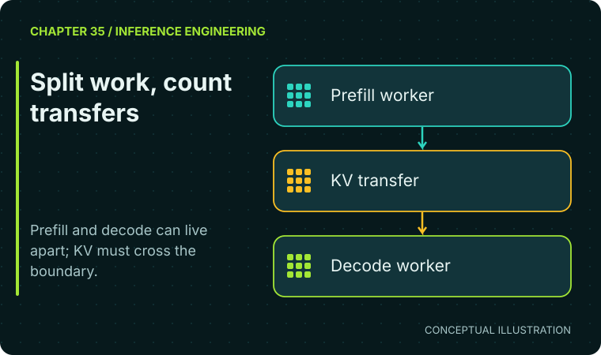
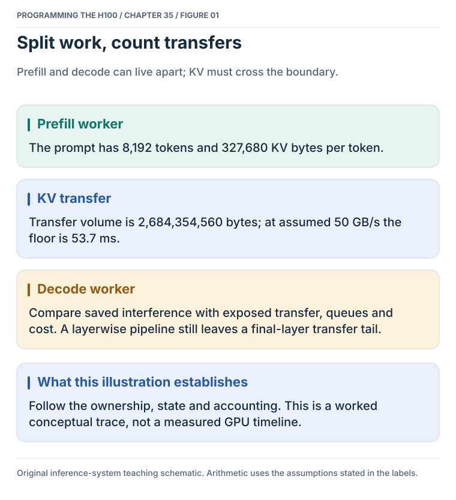

# Chapter 35: Disaggregated Prefill/Decode over RDMA

[](images/chapter-openers/35-inference.svg)


!!! abstract "Goal and prerequisites"

    Learn why serving systems sometimes split prefill and decode onto separate GPU pools, what it costs to move the KV cache between them, and how to decide whether the split pays off. Read [Chapter 11](11-multi-gpu-nccl.md) (NVLink, InfiniBand), [Chapter 32](32-inference-engine-and-harness.md) (the harness) and [Chapter 34](34-kv-cache-offloading.md) (KV size and transfer reasoning) first.

!!! warning "Evidence level"

    CPU arithmetic and a **simulation** that reuses Chapter 32's placeholder cost model. Hardware bandwidths and capacities are datasheet values; check yours. The simulation shows a mechanism, not the performance of a real cluster, and its pool sizes are not tuned. No RDMA transfer was performed.

## Worked system map

[](images/worked/ch35-inference.svg)


## 35.1 Why split the phases

Prefill is compute-bound and decode is memory-bound ([Chapter 32](32-inference-engine-and-harness.md)). On one GPU they interfere: when a new prompt's prefill runs inside a batch, every decoding user waits for it, so inter-token latency spikes. Disaggregation gives each phase its own pool, so prefill bursts do not stall decode, and each pool can be sized and configured for its own bottleneck.

The price is that every request's KV cache, built on a prefill GPU, must reach a decode GPU.

```
 request -> [prefill pool] --- KV cache over RDMA/NVLink ---> [decode pool] -> tokens
             compute-bound                                     memory-bound
             sets TTFT                                         sets TPOT
```

## 35.2 What the transfer costs

The size is the KV arithmetic from earlier chapters: 320 KiB per token for a Llama-3-70B-shaped model. Moving it over a network link takes `bytes / bandwidth`.

### Worked Example 35.2.1

```
== KV transfer time for one prompt (no overlap) and EXPOSED time with ideal layer-wise streaming ==
tokens   KV size     100 Gb/s   200 Gb/s   400 Gb/s    exposed@400 (prefill 20k tok/s, 80 layers)
  1024     0.34 GB      26.8       13.4        6.7 ms       0.1 ms
  4096     1.34 GB     107.4       53.7       26.8 ms       0.3 ms
 16384     5.37 GB     429.5      214.7      107.4 ms       1.3 ms
 65536    21.47 GB    1718.0      859.0      429.5 ms       5.4 ms
```

A 4,096-token prompt costs 27 ms on a 400 Gb/s link and 107 ms on a 100 Gb/s link. That is added to the first inter-token gap unless it is hidden.

The "exposed" column assumes **80 equal-cost layers and ideal layer-wise streaming**: each layer's KV is sent once that layer produces it, and one link serializes transfers. Even with a fast link, the final layer's bytes must travel after prefill ends. Here the link is faster than per-layer compute, so exposed time is one layer's transfer, for example `26.8435/80 = 0.3355 ms` for 4,096 tokens. If the link is slower, a backlog adds exposed time. The old `max(0,total_transfer-total_prefill)` expression omitted availability of the last layer and incorrectly printed zero. This remains an idealized lower-cost pipeline, not a measured overlap trace. Real transfers contend with other traffic, need both ends ready, and may use different tensor-parallel layouts that require re-sharding the KV before it can be used. Measure it.

Practical transports for this are GPUDirect RDMA over InfiniBand or RoCE, and NVLink inside a node. Systems that implement the idea include DistServe, Splitwise, Mooncake and NVIDIA's Dynamo with its NIXL transfer library; read their papers and documentation for the details this chapter omits.

## 35.3 The hardware mapping is a hypothesis

The LinkedIn project description pairs H100s for prefill with L40S GPUs for decode. Test that with arithmetic before building it. Decode is bandwidth-bound, and the two cards differ sharply:

### Worked Example 35.3.1

70B weights in FP8 (70 GB), 4,096-token sequences, datasheet bandwidth and capacity:

```
config          decode floor    KV room   max 4K-token seqs (upper bound)
2 x H100 SXM       10.4 ms/tok    90.0 GB     67
2 x L40S           40.5 ms/tok    26.0 GB     19
4 x L40S           20.3 ms/tok   122.0 GB     90
```

The L40S has about 864 GB/s of memory bandwidth against about 3.35 TB/s on an H100 SXM, so on the same number of GPUs its decode floor is four times worse, and it has 48 GB instead of 80 GB. It also lacks NVLink, so tensor parallelism runs over PCIe. Four L40S have a decode floor about twice that of two H100s (20.3 against 10.4 ms) while holding more sequences, so the case for them is **cost**, not speed: it holds only if the L40S cost enough less per unit of served throughput, after the all-reduce overhead of tensor parallelism over PCIe.

Treat "H100 for prefill, cheaper GPU for decode" as a cost hypothesis to measure. The capacity column is an upper bound that ignores activations and framework overhead.

Prefill and decode may also want different parallelism layouts (for example a different tensor-parallel degree), which means the KV cache must be re-sharded on arrival.

## 35.4 When does splitting win? A simulation

The simulation compares, on the **same total number of GPUs**, two colocated instances (requests alternate between them, prefill runs inside the decode iteration) against one prefill instance plus one decode instance. The decode instance never pays prefill time; the prefill instance emits the first token; the KV transfer uses 400 Gb/s. Prompts have median 2,048 tokens and outputs median 128, with Poisson arrivals.

```
rate  mode          ttft_p99   tpot_p99   slo_ok(ttft<=2s,tpot<=0.1s)
   6  colocated x2     0.379     0.0364      1.00
   6  disagg 1+1       0.474     0.0287      1.00
  10  colocated x2     0.477     0.0508      1.00
  10  disagg 1+1       0.516     0.0341      1.00
  14  colocated x2     1.272     0.0736      1.00
  14  disagg 1+1       1.042     0.1351      0.96
```

Read it as three lessons:

1. **Decode is protected.** At 6 and 10 requests per second the disaggregated TPOT p99 is 21 to 33 percent lower (0.0287 against 0.0364, and 0.0341 against 0.0508), because decode iterations no longer absorb prefill work. This is the benefit.
2. **It is not free.** At low load TTFT p99 is higher for the split (0.474 against 0.379): all prefill now queues on one instance instead of two. The KV transfer does **not** appear in TTFT in this model, because the first token is produced by the prefill instance; it appears in TPOT instead (section 35.7, experiment B). If your design lets the decode side produce the first token, the transfer moves into TTFT.
3. **The pool ratio matters.** At 14 requests per second the single decode instance becomes the bottleneck and TPOT p99 is much worse for the split (0.1351 against 0.0736), and SLO attainment falls to 0.96. A 1:1 split is not the right ratio for this workload; the prefill-to-decode ratio has to follow the workload's prompt and output lengths. Section 35.7 tests that claim: one prefill and **two** decode instances bring TPOT p99 back to 0.0291 and attainment to 1.00 at the same rate, but that is three GPUs against two, and at equal GPU counts the split does not beat colocation once the load is high.

The cost functions are deliberately simplified and are not calibrated to identical real kernels: the colocated model charges a prefill term plus a complete decode iteration when first admitting a request, whereas the split model emits its first token at the end of its standalone prefill term. This asymmetry can favour the split at short prompts and must be fitted consistently before drawing a hardware comparison. Neither simulates shared-link transfer contention.

These numbers come from placeholder constants. The mechanism (interference removed, a transfer and a queue added, a ratio to tune) is the content; the values are not.

## 35.5 Decision checklist

| Question | If yes | If no |
|---|---|---|
| Are prompts long relative to outputs? | Prefill interference is large; splitting may help | Colocated is simpler and likely as good |
| Is a tight TPOT service-level objective violated by prefill bursts? | Split protects it | Keep colocated, consider chunked prefill |
| Is there a fast link (NVLink, or 200 to 400 Gb/s RDMA)? | Transfer may fit an overlap window | Transfer increases TTFT or the first-to-second-token gap, depending on where the first token is emitted |
| Can both pools be kept busy? | Utilization improves | Idle pools waste GPUs |
| Do prefill and decode need different layouts? | Budget for re-sharding | Simpler |

Also compare against cheaper alternatives first: chunked prefill (splitting long prompts so decode iterations interleave) removes much of the interference without a transfer.

## 35.6 Self-tests (25, all pass)

The simulation was extended in this pass: `sim_disagg_pool(reqs, n_prefill, n_decode, ...)` runs several prefill servers and several decode instances, and `sim_disagg` is now its 1+1 case. Two latent defects in the old function were fixed on the way: it **modified the request objects it was given**, and a request with a one-token reply was sent through an extra decode step. The default workload contains no one-token replies (0 in the checked 20,000-request workload sample), so the default timing tables are unchanged; a regression test confirms `pool(1,1)` equals the old behaviour.

Run `python3 docs/examples/inference-systems/ch35_disaggregation.py --test`.

| Group | What is checked |
|---|---|
| Transfer (5) | KV 327,680 bytes per token; 26.8 ms for 4,096 tokens at 400 Gb/s; linear in tokens and inverse in bandwidth; the exposed final-layer tail remains positive with a fast link, backlog grows for fast prefill, and exposed time never exceeds the full transfer |
| Hardware mapping (3) | the decode floor halves when GPUs double; the printed rows for 2 x H100 and 4 x L40S; 70 GB of weights on one 48 GB card gives negative KV room and 0 sequences while still printing a floor |
| Colocated (2) | one replica equals the plain simulator; two replicas return every request once |
| Disaggregated (12) | input unchanged; every request returned once; TTFT at least the request's own prefill time; decode cannot finish before the KV arrives; a single prefill server is FIFO; determinism; a faster link never raises median TPOT; a one-token reply finishes at its first token; two exact hand cases for a single request; `pool(1,1)` equals the old function; 2+2 completes the same work |
| Chapter claims (3) | at 6 and 10 req/s the split has lower TPOT p99; at 6 req/s it has higher TTFT p99; at 14 req/s its TPOT p99 is worse and attainment lower |

```
25/25 self-tests pass
```

The three "chapter claims" tests turn the prose of section 35.4 into regression tests: if a later change to the cost model reverses a claim, the test fails instead of the text silently going stale.

**The tests can fail.** Three broken copies: first token stamped at the end of decoding fails three tests; removing the FIFO prefill queue fails two; and dropping the transfer time from the decode start passed all 23 tests of the first version, because a 128-token decode takes far longer than any transfer. The two exact single-request cases were added for that reason.

## 35.7 Four more experiments

Prompt median 2,048, output median 128, 500 requests, seed 3, 400 Gb/s link unless stated. The simulator's prefill speed is its default 40,000 tokens per second, which is why a different figure (20,000) appears in the exposed-time column of section 35.2: that column is a standalone arithmetic illustration (`--extras`).

**A. Pool ratio at a fixed GPU count.**

```
GPUs  rate  layout        ttft_p99  tpot_p99  slo_ok
   3    21  colocated x3     0.921    0.0697    1.00
   3    21  disagg 1+2        8.441    0.0297    0.19
   3    21  disagg 2+1        0.396    0.3699    0.65
   4    28  colocated x4     0.534    0.0739    1.00
   4    28  disagg 1+3       14.199    0.0266    0.16
   4    28  disagg 2+2        0.592    0.0751    1.00
   4    28  disagg 3+1        0.303    0.4893    0.52
```

The ratio is the whole story. A wrong ratio collapses the SLO attainment to between 0.16 and 0.65, because the underloaded pool is idle while the overloaded one queues: too few prefill servers (1+2, 1+3) blow up TTFT to 8 and 14 seconds with a protected, fast TPOT, and too few decode instances (2+1, 3+1) do the reverse. With the right ratio (2+2 at 28 req/s) the split matches colocation and **does not beat it** on these constants. In this simulator the case for splitting is protecting TPOT at moderate load, not a general throughput gain.

The 14 req/s case of section 35.4 was left at two GPUs. Giving that workload a third GPU as a second decode instance (1+2) gives TTFT p99 1.042, TPOT p99 0.0291 and attainment 1.00.

**B. Link speed** (1+1, 10 req/s):

```
link Gb/s  ttft_p99  tpot_p50  tpot_p99
       25     0.516    0.0324    0.0494
      100     0.516    0.0311    0.0362
      200     0.516    0.0309    0.0348
      400     0.516    0.0308    0.0341
  ~infinite     0.516    0.0307    0.0339
```

TTFT does not change at all; TPOT p99 rises from 0.0341 to 0.0494 at 25 Gb/s. The reason is the model's definition: the first token comes from prefill, and the transfer sits between the first and second token, so it is amortised into TPOT. Above 100 Gb/s the link stops mattering for this workload.

**C. Prompt length** (rate 6, two GPUs):

```
prompt_med  mode        ttft_p99  tpot_p99  slo_ok
       256  colocated      0.071    0.0244    1.00
       256  disagg 1+1     0.041    0.0274    1.00
      2048  colocated      0.379    0.0364    1.00
      2048  disagg 1+1     0.474    0.0287    1.00
      8192  colocated      6.235    0.2129    0.14
      8192  disagg 1+1    45.299    0.0292    0.08
```

At short prompts there is little interference to remove and the split is slightly worse on TPOT (0.0274 against 0.0244). At 8,192 the mean prompt is about 10,300 tokens, so one prefill server at 40,000 tokens per second needs `6 x 10,296 / 40,000` = 1.54 seconds of work per second and is saturated: TTFT p99 reaches 45 seconds. The decode side is protected (TPOT p99 0.0292 against 0.2129) but the bottleneck has moved to prefill. Colocated also fails here (SLO attainment 0.14), so both designs are overloaded; the split just fails differently.

**D. Seed spread** (rate 10, TPOT p99): the split has the lower TPOT p99 in **8 of 8 seeds** (colocated 0.0483 to 0.0573, split 0.0336 to 0.0526). The headline claim of the chapter does not depend on the seed. The margin does: seed 0 gives 0.0535 against 0.0526, almost a tie, and seed 1 gives 0.0483 against 0.0336.

## 35.8 Failure modes and edge cases

| Situation | What happens | Where it shows |
|---|---|---|
| Wrong pool ratio | one pool idles while the other queues; SLO attainment falls to 0.16 to 0.65 | experiment A |
| A single prefill server at long prompts | saturates: TTFT p99 45 s at prompt median 8,192 | experiment C |
| Slow link | the transfer is amortised into TPOT; 25 Gb/s raises p99 by 45 percent here | experiment B |
| Where the first token is produced | decides whether the transfer counts toward TTFT or TPOT; this model chooses prefill, a real system may not | section 35.2 |
| Weights larger than the decode GPUs' memory | KV room negative, 0 sequences; the floor is still printed and looks plausible | self-test 8 |
| One-token reply | now finishes at its first token; before this pass it was given an extra decode step | self-test 18 |
| Simulator mutating its input | fixed; a second run on the same list used stale `first_token` values | self-test 11 |
| Decode node lost mid-transfer | not modelled; the request must be re-prefilled or the transfer retried | section 35.9 |
| Different tensor-parallel layouts on the two pools | KV must be re-sharded on arrival; not modelled | section 35.3 |

**Not modelled:** KV re-sharding between layouts; link contention among many simultaneous transfers; decode-instance memory limits (only `max_batch`); load balancing across decode instances beyond round-robin on readiness; prefill batching (the prefill server handles one prompt at a time); chunked prefill, which would be the colocated baseline to beat; failures and retries; prefix reuse; and the cost of the prefill and decode GPUs, which would differ in a mixed fleet.

## 35.9 What to measure on real hardware (untested)

!!! warning "UNTESTED ON H100"

    None of the following was run. Commands are from memory; verify against your installed versions.

    | Measurement | How |
    |---|---|
    | Link bandwidth between nodes | `ib_write_bw` (from the `perftest` package) between two hosts, or `nccl-tests` `sendrecv_perf` / `alltoall_perf`; compare with the datasheet figure |
    | Actual transfer time and exposed time | Time KV movement per prompt length on your link; compare with the table above |
    | Interference | TPOT p99 colocated versus split at equal GPU count, using the [Chapter 32](32-inference-engine-and-harness.md) harness |
    | Best pool ratio | Sweep prefill:decode GPU counts at several prompt and output length mixes, as in experiment A |
    | Cost | Dollars per million tokens at a fixed SLO, including any cheaper decode GPU |
    | Re-sharding | Time to convert KV between different parallel layouts, if they differ |
    | Failure behavior | Kill a decode node mid-transfer and record what the client sees |
    | Engine support | Check your engine's documentation for a prefill/decode disaggregation or KV-transfer mode; names and maturity differ between releases |

    To redo the section 35.7 sweep on your numbers, edit `CostModel` in `ch32_inference_harness.py` with values fitted from the Chapter 32 runbook and rerun `--extras`.

<!-- BEGIN COMPLETE INFERENCE SOURCE -->
## Complete runnable code

The complete implementation is shown below, including its checks and entry point. The listing and downloadable `.py` file contain exactly the same source. Copy the file under the displayed filename; keep supporting files in the same directory.

[Download all inference examples and supporting modules](examples/inference-systems/inference-systems.zip) or read the [environment and command guide](examples/inference-systems/README.md).

The [follow-up agent audit](inference-adversarial-review-2026-11-25.md) records the corrections, fresh CPU captures and hardware limits for this source.

Supporting modules: [ch32_inference_harness.py](examples/inference-systems/ch32_inference_harness.py).

Read it in three passes: start with `transfer_ms` and `decode_config` to identify the state; trace `sim_colocated` and `sim_disagg_pool` for one request or token; then follow `run_tests` to see how the result is checked.

From the repository root:

```bash
python3 docs/examples/inference-systems/ch35_disaggregation.py --test
# Run the full chapter demonstrations:
python3 docs/examples/inference-systems/ch35_disaggregation.py
```

### ch35_disaggregation.py

[Download ch35_disaggregation.py](examples/inference-systems/ch35_disaggregation.py)

```python title="ch35_disaggregation.py" linenums="1"
"""Chapter 35: disaggregated prefill/decode -- transfer maths, hardware mapping, and an interference simulation.

Run:  python3 ch35_disaggregation.py          (the chapter's numbers)
      python3 ch35_disaggregation.py --test   (self-tests)
      python3 ch35_disaggregation.py --extras (four extra experiments)
CPU simulation with the placeholder cost model of Chapter 32. Hardware figures are datasheet values;
prices are ASSUMPTIONS. Nothing here is a measurement of a real cluster.
"""
import math
from ch32_inference_harness import (CostModel, Req, kv_bytes_per_token, make_workload, summarize)

KV = kv_bytes_per_token(80, 8, 128)           # 327,680 B/token for a Llama-3-70B-shaped model


# ------------------------------------------------------------- 1. KV transfer arithmetic
def transfer_ms(tokens, gbit_per_s):
    return tokens * KV / (gbit_per_s * 1e9 / 8) * 1e3


def exposed_ms(tokens, gbit_per_s, prefill_tps, layers=80):
    """Ideal equal-layer pipeline: layer KV becomes available only at its end.

    A link serializes layer transfers. Even when it is faster than prefill,
    the final layer's transfer cannot finish before that layer produces KV.
    """
    if layers <= 0 or prefill_tps <= 0 or gbit_per_s <= 0 or tokens < 0:
        raise ValueError("positive layers/rates and nonnegative token count required")
    prefill = tokens / prefill_tps * 1e3
    transfer = transfer_ms(tokens, gbit_per_s) / layers
    finished = 0.0
    for layer in range(1, layers + 1):
        finished = max(finished, layer * prefill / layers) + transfer
    return max(0.0, finished - prefill)


# ------------------------------------------------------------- 2. hardware mapping (datasheet values, check yours)
GPUS = {  # name: (HBM/GDDR bandwidth B/s, memory bytes)
    "H100 SXM": (3.35e12, 80e9),
    "L40S": (0.864e12, 48e9),
}


def decode_config(name, n, weight_bytes=70e9, ctx_tokens=4096):
    bw, mem = GPUS[name]
    floor_ms = weight_bytes / (n * bw) * 1e3                         # weights read once per step
    kv_room = n * mem - weight_bytes
    seqs = max(0, int(kv_room // (ctx_tokens * KV)))                 # ignores activations/overheads: upper bound
    return floor_ms, kv_room / 1e9, seqs


# ------------------------------------------------------------- 3. interference simulation
def sim_colocated(reqs, replicas, max_batch, cost):
    from ch32_inference_harness import simulate
    if replicas <= 0 or max_batch <= 0:
        raise ValueError("replicas and max_batch must be positive")
    shards = [[] for _ in range(replicas)]
    for i, r in enumerate(reqs):
        shards[i % replicas].append(Req(r.rid, r.arrival, r.prompt, r.output))
    out, wall = [], 0.0
    for sh in shards:
        done, w, _ = simulate(sh, max_batch=max_batch, cost=cost)
        out += done; wall = max(wall, w)
    return out, wall


def _decode_instance(pending, max_batch, cost):
    """One decode instance. pending: list of (ready_time, request, first_token_time). Never charges prefill time."""
    pending = sorted(pending, key=lambda x: x[0])
    running, now, i, done = [], 0.0, 0, []
    gen = {}
    while len(done) < len(pending):
        while i < len(pending) and pending[i][0] <= now and len(running) < max_batch:
            running.append(pending[i]); gen[pending[i][1].rid] = 1; pending[i][1].generated = 1; i += 1
        if not running:
            now = pending[i][0]; continue
        kv = sum(r.prompt + gen[r.rid] for _, r, _ in running)
        now += cost.base + cost.per_seq * len(running) + cost.per_kv_token * kv
        for item in list(running):
            _, r, first = item
            gen[r.rid] += 1
            r.generated = gen[r.rid]
            if gen[r.rid] >= r.output:
                r.first_token, r.finish = first, now
                done.append(r); running.remove(item)
    return done, now


def sim_disagg_pool(reqs, n_prefill, n_decode, max_batch, cost, link_gbit):
    """n_prefill FIFO prefill servers (a request goes to whichever frees first), then a KV transfer, then one of
    n_decode decode instances (assigned round-robin in order of readiness). Works on copies of the requests."""
    import heapq
    if min(n_prefill, n_decode, max_batch) <= 0 or link_gbit <= 0:
        raise ValueError("pool sizes, batch cap and link bandwidth must be positive")
    if any(r.prompt < 1 or r.output < 1 or r.arrival < 0 for r in reqs):
        raise ValueError("requests require positive token counts and nonnegative arrival")
    if len({r.rid for r in reqs}) != len(reqs):
        raise ValueError("request IDs must be unique")
    reqs = sorted((Req(r.rid, r.arrival, r.prompt, r.output) for r in reqs), key=lambda r: r.arrival)
    free = [0.0] * n_prefill
    ready, finished = [], []
    for r in reqs:
        start = max(heapq.heappop(free), r.arrival)
        t = start + r.prompt / cost.prefill_tps
        heapq.heappush(free, t)
        if r.output <= 1:                                             # nothing left to decode: done at the first token
            r.first_token = r.finish = t
            r.generated = 1
            finished.append(r)
            continue
        ready.append((t + transfer_ms(r.prompt, link_gbit) / 1e3, r, t))   # first token is produced by prefill
    ready.sort(key=lambda x: x[0])
    done, wall = list(finished), max([r.finish for r in finished], default=0.0)
    for k in range(n_decode):
        d, now = _decode_instance(ready[k::n_decode], max_batch, cost)
        done += d; wall = max(wall, now)
    return done, wall


def sim_disagg(reqs, max_batch, cost, link_gbit):
    return sim_disagg_pool(reqs, 1, 1, max_batch, cost, link_gbit)


def _wl(rate, seed=3, n=500, prompt_med=2048, out_med=128):
    return make_workload(n, rate=rate, seed=seed, prompt_med=prompt_med, out_med=out_med)


def run_tests():
    from ch32_inference_harness import simulate
    results = []
    cost = CostModel()

    def check(name, cond):
        results.append((name, bool(cond)))

    check("KV bytes per token is 327,680", KV == 327680)
    check("transfer: 4096 tokens at 400 Gb/s is 26.8 ms (chapter figure)", abs(transfer_ms(4096, 400) - 26.8435) < 0.001)
    check("transfer is linear in tokens and inverse in bandwidth",
          abs(transfer_ms(2000, 100) - 2 * transfer_ms(1000, 100)) < 1e-9 and abs(transfer_ms(1000, 200) * 2 - transfer_ms(1000, 100)) < 1e-9)
    check("fast link still exposes the final layer transfer; fast prefill exposes the backlog",
          abs(exposed_ms(4096, 400, 20000) - transfer_ms(4096,400)/80) < 1e-9 and exposed_ms(4096, 400, 1e6) > transfer_ms(4096,400)/80)
    check("exposed never exceeds the full transfer time", all(0 <= exposed_ms(n, g, t) <= transfer_ms(n, g) + 1e-9
                                                              for n in (512, 4096, 65536) for g in (100, 400) for t in (1e3, 2e4, 1e6)))
    f2, room2, s2 = decode_config("H100 SXM", 2)
    f4, room4, s4 = decode_config("H100 SXM", 4)
    check("decode floor halves when the GPU count doubles", abs(f2 / 2 - f4) < 1e-9)
    check("chapter figures: 2xH100 10.4 ms / 90.0 GB / 67 seqs; 4xL40S 20.3 ms / 122.0 GB / 90 seqs",
          (round(f2, 1), round(room2, 1), s2) == (10.4, 90.0, 67) and (round(decode_config("L40S", 4)[0], 1), round(decode_config("L40S", 4)[1], 1), decode_config("L40S", 4)[2]) == (20.3, 122.0, 90))
    f1, room1, s1 = decode_config("L40S", 1)
    check("weights that do not fit (70 GB on one 48 GB card): KV room negative, sequences 0, floor still printed (documented failure)",
          room1 < 0 and s1 == 0 and f1 > 0)
    # colocated
    reqs = _wl(6)
    c1, w1 = sim_colocated(reqs, 1, 64, cost)
    ref, wref, _ = simulate(_wl(6), max_batch=64, cost=cost)
    check("one colocated replica equals the plain simulator", sorted((r.first_token, r.finish) for r in c1) == sorted((r.first_token, r.finish) for r in ref))
    c2, _ = sim_colocated(reqs, 2, 64, cost)
    check("colocated x2 returns every request exactly once", sorted(r.arrival for r in c2) == sorted(r.arrival for r in reqs))
    # disaggregated
    before = [(r.first_token, r.finish) for r in reqs]
    d, wd = sim_disagg(reqs, 64, cost, 400)
    check("disagg does not modify its input", before == [(r.first_token, r.finish) for r in reqs])
    check("disagg returns every request exactly once", len(d) == len(reqs) and sorted(r.arrival for r in d) == sorted(r.arrival for r in reqs))
    check("TTFT is at least the request's own prefill time", all(r.first_token - r.arrival >= r.prompt / cost.prefill_tps - 1e-9 for r in d))
    check("decode cannot start before the KV arrives: finish - first >= transfer time",
          all(r.finish - r.first_token >= transfer_ms(r.prompt, 400) / 1e3 - 1e-9 for r in d if r.output > 1))
    byarr = sorted(d, key=lambda r: r.arrival)
    check("single prefill server is FIFO: first tokens come in arrival order", all(a.first_token <= b.first_token for a, b in zip(byarr, byarr[1:])))
    check("determinism", [(r.first_token, r.finish) for r in sim_disagg(_wl(10), 64, cost, 400)[0]] == [(r.first_token, r.finish) for r in sim_disagg(_wl(10), 64, cost, 400)[0]])
    slow = summarize(sim_disagg(_wl(10), 64, cost, 100)[0], 1.0)["tpot_p50"]
    fast = summarize(sim_disagg(_wl(10), 64, cost, 400)[0], 1.0)["tpot_p50"]
    free = summarize(sim_disagg(_wl(10), 64, cost, 1e9)[0], 1.0)["tpot_p50"]
    check("a faster link never raises median TPOT (100 Gb/s >= 400 Gb/s >= ~free)", slow >= fast >= free)
    one = [Req(0, 0.0, 1000, 1)]
    do, _ = sim_disagg(one, 64, cost, 400)
    check("a one-token reply finishes at its first token (no extra decode step)", do[0].finish == do[0].first_token)
    # exact single-request case: prompt 1000, output 3, arrival 0
    one3 = sim_disagg([Req(0, 0.0, 1000, 3)], 64, cost, 400)[0][0]
    t_pf = 1000 / cost.prefill_tps
    ready_t = t_pf + transfer_ms(1000, 400) / 1e3
    step = lambda kv: cost.base + cost.per_seq * 1 + cost.per_kv_token * kv
    expect = ready_t + step(1000 + 1) + step(1000 + 2)
    check("hand case: one request, prompt 1000, output 3: first = prefill time, finish = prefill + transfer + 2 decode steps",
          abs(one3.first_token - t_pf) < 1e-12 and abs(one3.finish - expect) < 1e-12)
    one3_slow = sim_disagg([Req(0, 0.0, 1000, 3)], 64, cost, 100)[0][0]
    check("hand case: a 4x slower link delays that request's finish by exactly the extra transfer time",
          abs((one3_slow.finish - one3.finish) - (transfer_ms(1000, 100) - transfer_ms(1000, 400)) / 1e3) < 1e-12)
    pool, _ = sim_disagg_pool(_wl(14), 1, 1, 64, cost, 400)
    base, _ = sim_disagg(_wl(14), 64, cost, 400)
    check("pool(1,1) equals the original 1+1 function", sorted((r.first_token, r.finish) for r in pool) == sorted((r.first_token, r.finish) for r in base))
    p2, _ = sim_disagg_pool(_wl(14), 2, 2, 64, cost, 400)
    check("2+2 completes every request and total generated work equals 1+1", len(p2) == 500 and sum(r.output for r in p2) == sum(r.output for r in base))
    # the chapter's three claims, as regression tests on the published seed
    m = {}
    for rate in (6, 10, 14):
        co, wc = sim_colocated(_wl(rate), 2, 64, cost)
        di, wdd = sim_disagg(_wl(rate), 64, cost, 400)
        m[rate] = (summarize(co, wc), summarize(di, wdd))
    check("claim 1: at 6 and 10 req/s the split has lower TPOT p99", all(m[r][1]["tpot_p99"] < m[r][0]["tpot_p99"] for r in (6, 10)))
    check("claim 2: at 6 req/s the split has higher TTFT p99", m[6][1]["ttft_p99"] > m[6][0]["ttft_p99"])
    check("claim 3: at 14 req/s the split's TPOT p99 is worse and its SLO attainment lower",
          m[14][1]["tpot_p99"] > m[14][0]["tpot_p99"] and m[14][1]["slo_attainment"] < m[14][0]["slo_attainment"])
    for name, good in results:
        print(f"  [{'PASS' if good else 'FAIL'}] {name}")
    print(f"{sum(g for _, g in results)}/{len(results)} self-tests pass")
    return all(g for _, g in results)


def extras():
    cost = CostModel()
    print("Experiment A: pool ratio at fixed GPU count (500 requests, prompt median 2048, output median 128, seed 3)")
    print("GPUs  rate  layout        ttft_p99  tpot_p99  slo_ok")
    for gpus, rate in ((3, 21), (4, 28)):
        co, w = sim_colocated(_wl(rate), gpus, 64, cost); m = summarize(co, w)
        print(f"{gpus:4d}  {rate:4d}  colocated x{gpus}  {m['ttft_p99']:8.3f}  {m['tpot_p99']:8.4f}  {m['slo_attainment']:6.2f}")
        for npf in range(1, gpus):
            d, w = sim_disagg_pool(_wl(rate), npf, gpus - npf, 64, cost, 400); m = summarize(d, w)
            print(f"{gpus:4d}  {rate:4d}  disagg {npf}+{gpus-npf}     {m['ttft_p99']:8.3f}  {m['tpot_p99']:8.4f}  {m['slo_attainment']:6.2f}")
    print("\nExperiment B: link speed (1+1, rate 10)")
    print("link Gb/s  ttft_p99  tpot_p50  tpot_p99")
    for g in (25, 100, 200, 400, 1e9):
        d, w = sim_disagg(_wl(10), 64, cost, g); m = summarize(d, w)
        print(f"{g:9.0f}  {m['ttft_p99']:8.3f}  {m['tpot_p50']:8.4f}  {m['tpot_p99']:8.4f}")
    print("\nExperiment C: prompt length at rate 6, 2 GPUs (colocated x2 vs 1+1)")
    print("prompt_med  mode        ttft_p99  tpot_p99  slo_ok")
    for pm in (256, 2048, 8192):
        co, w = sim_colocated(_wl(6, prompt_med=pm), 2, 64, cost); m = summarize(co, w)
        print(f"{pm:10d}  colocated   {m['ttft_p99']:8.3f}  {m['tpot_p99']:8.4f}  {m['slo_attainment']:6.2f}")
        d, w = sim_disagg(_wl(6, prompt_med=pm), 64, cost, 400); m = summarize(d, w)
        print(f"{pm:10d}  disagg 1+1  {m['ttft_p99']:8.3f}  {m['tpot_p99']:8.4f}  {m['slo_attainment']:6.2f}")
    print("\nExperiment D: seed spread at rate 10 (TPOT p99, colocated x2 vs 1+1)")
    wins = 0
    for sd in range(8):
        co, w = sim_colocated(_wl(10, seed=sd), 2, 64, cost); a = summarize(co, w)["tpot_p99"]
        d, w = sim_disagg(_wl(10, seed=sd), 64, cost, 400); b = summarize(d, w)["tpot_p99"]
        wins += b < a
        print(f"seed {sd}: colocated {a:.4f}  disagg {b:.4f}  {'split wins' if b < a else 'colocated wins'}")
    print(f"split has the lower TPOT p99 in {wins} of 8 seeds")


def main():
    print(f"KV bytes/token = {KV:,}")
    print("\n== KV transfer time for one prompt (no overlap) and EXPOSED time with ideal layer-wise streaming ==")
    print("tokens   KV size     100 Gb/s   200 Gb/s   400 Gb/s    exposed@400 (prefill 20k tok/s, 80 layers)")
    for n in (1024, 4096, 16384, 65536):
        print(f"{n:6d}  {n*KV/1e9:7.2f} GB  {transfer_ms(n,100):8.1f}   {transfer_ms(n,200):8.1f}   {transfer_ms(n,400):8.1f} ms  "
              f"{exposed_ms(n,400,20000):8.1f} ms")

    print("\n== decode hardware mapping: 70B FP8 weights (70 GB), 4096-token sequences (datasheet bandwidth/capacity) ==")
    print("config          decode floor    KV room   max 4K-token seqs (upper bound)")
    for name, n in (("H100 SXM", 2), ("L40S", 2), ("L40S", 4)):
        f, room, s = decode_config(name, n)
        print(f"{n} x {name:9s}  {f:8.1f} ms/tok  {room:6.1f} GB   {s:4d}")

    print("\n== interference simulation: same total GPUs (2 instances); placeholder cost model ==")
    cost = CostModel()
    print("rate  mode          ttft_p99   tpot_p99   slo_ok(ttft<=2s,tpot<=0.1s)")
    for rate in (6, 10, 14):
        reqs = make_workload(500, rate=rate, seed=3, prompt_med=2048, out_med=128)
        col, w1 = sim_colocated(reqs, 2, 64, cost)
        m1 = summarize(col, w1)
        dis, w2 = sim_disagg(make_workload(500, rate=rate, seed=3, prompt_med=2048, out_med=128), 64, cost, 400)
        m2 = summarize(dis, w2)
        print(f"{rate:4d}  colocated x2  {m1['ttft_p99']:8.3f}  {m1['tpot_p99']:9.4f}  {m1['slo_attainment']:8.2f}")
        print(f"{rate:4d}  disagg 1+1    {m2['ttft_p99']:8.3f}  {m2['tpot_p99']:9.4f}  {m2['slo_attainment']:8.2f}")


if __name__ == "__main__":
    import sys
    if "--extras" in sys.argv:
        extras(); sys.exit(0)
    if "--test" in sys.argv:
        sys.exit(0 if run_tests() else 1)
    main()
```

<!-- END COMPLETE INFERENCE SOURCE -->

## 35.10 Exercises

1. In experiment B, TTFT p99 is identical for every link speed. Explain, and say where the transfer shows up instead. How would the metrics change if the decode instance produced the first token?
2. Compute the prefill server's utilisation at 14 req/s from the mean prompt length (2,574 tokens) and the 40,000 tokens-per-second prefill rate. What does it say about the 1+1 result at that rate?
3. Predict the utilisation of one prefill server at 21 req/s and use it to explain the `disagg 1+2` row of experiment A.
4. The 1+1 row at 14 req/s has TPOT p99 0.1351 but 1+2 has 0.0291. Is it fair to conclude that the split is better than colocation at 14 req/s?
5. What did the original `sim_disagg` do with a request whose output was one token, and why did that not change any number in this chapter?
6. Using `decode_config`, what are the decode floor, KV room and sequence capacity of three L40S? Where does it fall between the two- and four-GPU rows?

### Solutions

1. The model stamps the first token at the end of prefill, before the transfer starts, so TTFT cannot depend on the link. The transfer lies between the first and second token, and TPOT is computed as `(finish - first) / (output - 1)`, so it is spread over the remaining tokens: 25 Gb/s gives TPOT p99 0.0494 against 0.0341 at 400 Gb/s. If the decode side produced the first token, the transfer would delay it and would show up in TTFT (about 54 ms for an 8,192-token prompt at 400 Gb/s, 859 ms at 25 Gb/s).
2. `14 x 2,574 / 40,000` = 0.90. The single prefill server is 90 percent utilised, close to saturation, so queueing is already significant and TTFT p99 is 1.04 s. The prefill side is almost as stretched as the decode side in that row.
3. `21 x 2,574 / 40,000` = 1.35. One server cannot keep up, so its queue grows during the run and TTFT p99 reaches 8.4 s. The decode side, with two instances, is comfortably underloaded, hence the very low TPOT.
4. No. 1+2 uses three GPUs; the colocated comparison at two GPUs is 1.272 s TTFT p99, 0.0736 TPOT p99 and attainment 1.00 (section 35.4). The fair comparisons are at equal GPU counts, which experiment A gives: at 3 GPUs and 21 req/s colocated x3 meets the SLO fully while both splits miss it, and at 4 GPUs the best split (2+2) ties colocated.
5. It sent the request through the decode loop, which only checks completion after incrementing the token count, so a one-token reply was given a second decode step and its `finish` was later than its `first_token`. The default workload contains no one-token replies (0 in 20,000 requests), so no printed value changed. It now finishes at the first token.
6. Floor `70e9 / (3 x 0.864e12)` = 27.0 ms per token, KV room `3 x 48 - 70` = 74.0 GB, capacity 55 sequences. That sits between 2 x L40S (40.5 ms, 26.0 GB, 19) and 4 x L40S (20.3 ms, 122.0 GB, 90), as expected from the linear scaling.

## Chapter Summary

Disaggregation puts compute-bound prefill and memory-bound decode on separate pools so prefill bursts cannot stall decoding users, at the cost of moving each request's KV cache between pools. For a 4,096-token prompt that transfer is about 27 ms on a 400 Gb/s link and 107 ms on 100 Gb/s, and layer-wise streaming can overlap most of it in the ideal case, while a final-layer tail remains. The pairing of H100s with L40S GPUs is a cost hypothesis: an L40S has about a quarter of an H100's memory bandwidth and no NVLink, so matching an H100's decode floor takes about four times as many of them. In a simulation on equal GPU counts, the split lowered TPOT p99 by 21 to 33 percent at moderate load, raised TTFT p99 at low load, and lost badly once its single decode instance saturated, so the pool ratio must be tuned. Decide with a measured comparison, and try chunked prefill first.

## Self-Check Questions

1. What is the one thing disaggregation buys and the one thing it costs?
2. Why can layer-wise streaming overlap most KV transfer with prefill, and why does a final-layer tail remain?
3. Why is "H100 for prefill, L40S for decode" a cost hypothesis and not a performance claim?
4. In the simulation, why did the split have worse TTFT at low load?
5. Why did the split fail at 14 requests per second, and what would you change?

## Worked Solutions

1. It removes prefill interference from decode, protecting inter-token latency. It costs a KV-cache transfer for every request, plus pool-ratio and layout complexity.
2. Sending a layer's KV once that layer finishes overlaps it with later-layer compute. The final layer's KV becomes ready only at the end of prefill, so even a fast uncontended link exposes that final transfer. The ideal model uses 80 equal-cost layers, one serialized link and compatible layouts; real scheduling, contention and re-sharding can add more delay.
3. The L40S has about 864 GB/s of bandwidth against 3.35 TB/s and lacks NVLink, so it decodes more slowly per GPU. It can only win if enough of them cost less than the H100s they replace for the same throughput.
4. All prefill work queued on a single prefill instance instead of being spread over two. The KV transfer is not part of TTFT in this simulation (the first token comes from prefill), so it is not the reason; it delays the start of decoding and shows up in TPOT.
5. The single decode instance, handling twice the work per GPU of the colocated case, became the bottleneck and its batch limit made requests wait. Give decode a larger share of the GPUs and re-run the sweep to find the ratio that suits the workload. Section 35.7 does this: 1 prefill + 2 decode fixes the 14 req/s case, at the cost of a third GPU.

## Files and sources

- Code: `docs/examples/inference-systems/ch35_disaggregation.py` (`--test` for the 25 self-tests, `--extras` for experiments A to D). It imports the harness from `ch32_inference_harness.py`, which must be in the same directory.
- GPU figures are datasheet values (H100 SXM 3.35 TB/s and 80 GB; L40S 864 GB/s and 48 GB). The systems named in section 35.2 (DistServe, Splitwise, Mooncake, NVIDIA Dynamo with NIXL) are pointers for further reading; this chapter makes no claim about their internals.
