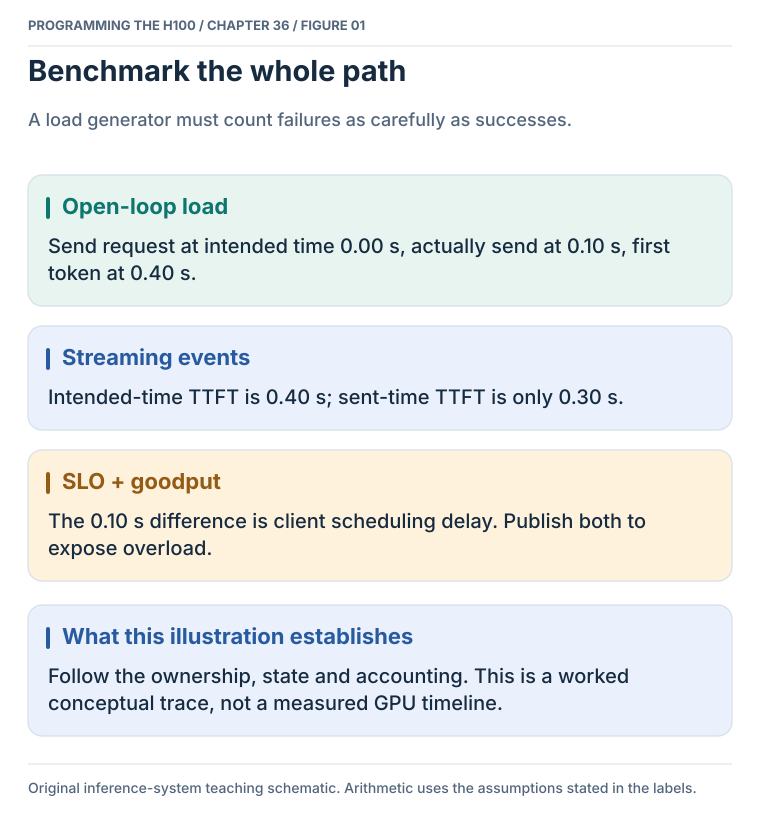

# Chapter 36: Public Benchmark Teardown: vLLM, SGLang and TensorRT-LLM

[](images/chapter-openers/36-inference.svg)


!!! abstract "Goal and prerequisites"

    Build a benchmark you could defend in public. You will get a load generator and statistics library that avoid the classic measurement errors, a test suite that proves they do, and a runbook for pointing the same client at vLLM, SGLang and TensorRT-LLM on real H100s. Read [Chapter 32](32-inference-engine-and-harness.md) (metrics and the simulated engine) first; this chapter replaces its simulator with a real network client.

!!! warning "Evidence level: read this first"

    - **Verified here (CPU):** the client, the streaming parsers, the percentile and bootstrap code, the Pareto and knee logic, the run manifest, and a mock three-engine study. 22 self-tests pass (14 pure, 8 against mock servers on localhost), plus 5 qualitative checks on the demonstrations.
    - **Invented:** the three "engines" in the mock study are made-up servers with made-up parameters. **No number in this chapter is a vLLM, SGLang or TensorRT-LLM result.**
    - **Timing output varies:** the mock servers run on wall-clock `asyncio` timing, so every latency number printed below is a *sample from one execution*. Another execution gives different numbers, and borderline verdicts can flip (Section 36.8 shows one that did). The tests therefore assert qualitative relations, never exact values.
    - **Untested on H100:** every launch command in Section 36.9 and the real teardown itself. Flags change between versions; confirm each against `--help` for the exact version you run. The original capture exercised mock servers. The [Chapter 47 lab](47-vllm-tuning-lab.md) and [dated record](validation-inference-2026-11-25.md) separately exercise its current streaming client against a small real vLLM model; the three-engine comparison remains untested.

## Worked system map

[](images/worked/ch36-inference.svg)


The November 25 correction also rejects malformed/no-content streams as failures and defines one-token TPOT as zero, since there are no inter-token intervals. Earlier raw captures remain unchanged.

## 36.1 Why most published benchmarks cannot be trusted

A comparison of serving engines fails in predictable ways. Every item below has produced a headline number that did not reproduce.

| # | Error | What it does to the result |
|---|---|---|
| 1 | Different precision or parallelism per engine (FP8 against BF16, TP=2 against TP=1) | Compares configurations, not engines |
| 2 | Different features on (prefix caching, speculative decoding, chunked prefill, CUDA graphs) | Credits an engine for a feature, or penalizes it for one |
| 3 | Closed-loop load ("N users, each waits for the last reply") | The client slows down when the server does, hiding queueing (coordinated omission, Section 36.5) |
| 4 | All requests sent at time zero | Measures a burst drain, not steady-state serving |
| 5 | Latency measured from when the client got around to sending | A stalled client erases its own delay |
| 6 | Failed or timed-out requests dropped from the statistics | Overstates throughput and goodput |
| 7 | One run, no warm-up exclusion, no spread | Reports noise as a difference |
| 8 | Averages instead of percentiles, or throughput without latency | Hides the tail users experience |
| 9 | Different clients, tokenizers or prompt counts per engine | Measures the benchmark tools |
| 10 | Output length decided by the model (different stopping per engine) | Different amounts of work per request |
| 11 | Unlabelled hardware state (clocks, driver, versions) | Not reproducible by anyone, including you next month |
| 12 | Only the winning workload shown | Selection bias |
| 13 | Prefix caching left on for one engine and off for another, with repeated prompts | Measures cache hits, not the engine |

The rest of the chapter is a defence against this list.

## 36.2 What each engine ships

All three engines expose an OpenAI-compatible HTTP server and ship their own benchmark client. That is both a convenience and a trap, because each client has its own defaults.

| Engine | Server | Vendor benchmark client | Notes from the documentation |
|---|---|---|---|
| vLLM | `vllm serve` | `vllm bench serve` | `--request-rate` with Poisson arrivals by default; `inf` sends everything at time zero; `--burstiness` switches to a gamma process; `--max-concurrency` caps in-flight requests; `--metadata` and `--save-detailed` record context and per-request data; goodput follows the DistServe paper's definition |
| SGLang | `python -m sglang.launch_server` | `python3 -m sglang.bench_serving` | Reports TTFT, TPOT and inter-token latency; its documentation says to start each server on the same hardware and precision and **run one at a time**; `bench_one_batch_server` sends a single batch and is explicitly not steady-state |
| TensorRT-LLM | `trtllm-serve` | `tensorrt_llm.serve.scripts.benchmark_serving` and `trtllm-bench` | Serving is configured with flags and a YAML file; the project's methodology is launch with `trtllm-serve`, then run the benchmark script |

**Design decision:** use **one** client for all three engines, written once, against the OpenAI-compatible endpoint. Use each vendor's client only as a cross-check, with the same model, prompt lengths, output lengths and request rate: on the same server the numbers should agree within noise. If they do not, find out why before publishing anything.

## 36.3 Experimental design

Decide these before running anything, and write them in the report.

| Variable | Rule | Why |
|---|---|---|
| Model and revision | Identical weights, identical checkpoint revision | |
| Precision | Same weight and KV-cache dtype, or report each engine's best supported option as a separate, labelled row | An FP8 engine against a BF16 engine is two experiments |
| Parallelism | Same GPU count and tensor-parallel degree | |
| Batch and scheduling limits | Equalize the maximum sequences and batched tokens where the engines expose them; otherwise report the values | Dominant drivers of the throughput and latency trade-off |
| Features | Prefix caching, speculative decoding, chunked prefill: all explicit, all reported. For a fair engine comparison on random prompts, disable prefix caching on every engine | Section 36.1 item 13 |
| Output length | Force a fixed output length per request (`ignore_eos`), drawn from a stated distribution | Equal work per request. The client marks a request **failed** if the output length differs, so an engine that ignores the flag shows up as failures, not as a silent speed-up |
| Prompts | Fixed seed, same prompt set, length counted with one tokenizer | |
| Sampling | Same temperature, top-p and seed settings | |
| Load | Open-loop Poisson arrivals at several rates, spanning idle to overloaded | Section 36.5 |
| Duration | At least 1,000 requests per point after warm-up for p99 claims (Section 36.6) | Percentiles need samples |
| Repeats | At least three, restarting the server each time | Run-to-run variation |
| Hardware state | Record GPU model, driver, CUDA version, clocks, power cap, persistence mode | Reproducibility |
| Isolation | Server and client in separate processes (ideally separate hosts or cores); one engine on the machine at a time | |

## 36.4 The client, piece by piece

The full file is `ch36_benchmark_teardown.py` ([download](examples/inference-systems/ch36_benchmark_teardown.py)). It uses only the Python standard library and speaks plain HTTP, so for an HTTPS endpoint put a local TLS-terminating proxy in front.

### Streaming parser

Servers stream tokens as Server-Sent Events, usually inside HTTP chunked encoding. The two layers can split an event anywhere, so the parser must not assume event boundaries line up with network reads, and it must cope with `\n`, `\r\n` and a `\r\n` pair cut between two reads. The parser accumulates bytes, normalizes line endings (holding back a trailing `\r`), and emits only events whose terminating blank line has arrived, joining multi-line `data:` fields with a newline as the specification says:

```python
def feed(self, chunk: bytes):
    data = self.buf + chunk
    hold = b""
    if data.endswith(b"\r"):          # may be the first half of CRLF: keep it for the next feed
        data, hold = data[:-1], b"\r"
    data = data.replace(b"\r\n", b"\n").replace(b"\r", b"\n")
    ...                                # split on blank lines, collect data: fields
    self.buf = data + hold
```

Tests: four different streams (mixed LF and CRLF, **CRLF only**, multi-line data, and a stream ending in a partial event) are each cut at 200 random places, and every cutting must give the same events as the uncut stream. A trailing partial event is never emitted; the client then sees no `[DONE]` and counts the request as failed.

### Open-loop arrivals and intended time

Arrival times are drawn in advance from a Poisson process (exponential gaps). Each request records when the schedule said to send it (`intended`) and when it was actually sent (`sent`). Latency is measured from `intended`, so if the client itself stalls (garbage collection, a busy event loop, a slow DNS lookup) the delay is charged to the request rather than hidden.

### The request, and what counts as success

The payload is a real OpenAI-style streaming completion request: model name, a prompt of the requested length, `max_tokens`, temperature 0, `stream: true`, `stream_options: {"include_usage": true}` and, by default, `ignore_eos: true` (accepted by vLLM and SGLang; confirm for your engine, or pass `--no-ignore-eos`).

A request is successful only if the stream ended with the terminal `[DONE]` event **and** the token count equals the requested output length. The token count is the server's own `usage.completion_tokens` when it is reported, because real engines sometimes merge several tokens into one event or send empty deltas; the number of content events is kept separately (`nevents`) and used only as a fallback. HTTP errors, timeouts, truncated streams and wrong lengths are all failures, recorded with a reason. Failures stay in the denominator of every rate and attainment figure.

Timestamps: `first` is the arrival time of the first content event, `end` the arrival time of the last event, `itl` the gaps between content events. TTFT is `first - intended`, TPOT is `(end - first) / (ntok - 1)`, end-to-end latency is `end - intended`. If an engine merges tokens into events, ITL is per event, not per token; TPOT is unaffected.

### Running it against a real server

```bash
python3 /full/path/ch36_benchmark_teardown.py run \
    --url http://127.0.0.1:8000/v1/completions --model <served-model-name> \
    --rate 10 --n 1200 --warmup 100 --seed 1 --n-in 512 --n-out 128 \
    --slo-ttft 0.5 --slo-tpot 0.05 --usd-per-gpu-hour <your-price> --gpus 2 \
    --out /full/path/results/engine-a_rate10_run1.jsonl
```

It prints the summary, a count of failure reasons, a run manifest, and writes every per-request record to the JSONL file so any number can be recomputed. Prompts are built from the word "hello" repeated, so token counts are approximate on the input side; read the true prompt length from the server's usage field if you need it. (Unique random prompts are better when measuring prefix caching; extend `make_payload` for that.)

## 36.5 Coordinated omission, demonstrated

A closed-loop client with N workers sends a new request only when a reply comes back, so when the server slows down the client sends less. The queue never builds as it would for independent users, and measured latency stays modest. An open-loop client keeps the arrival schedule, so the queue builds as it would in production.

The mock server has 4 slots and takes about 0.43 s per request, so its capacity is **about 9 requests per second**. The demonstration therefore runs in three regimes.

### Worked Example 36.5.1: below and above capacity

```
  open-loop, Poisson arrivals, capacity of the mock server about 9 req/s:
    below capacity (5 req/s)  : ttft_p99 =    415.2 ms   e2e_p99 =   1314.6 ms   (n=87)
    2x overload, short run    : ttft_p99 =   2349.0 ms   e2e_p99 =   2645.3 ms   (n=37)
    2x overload, long run     : ttft_p99 =  10059.7 ms   e2e_p99 =  10359.3 ms   (n=157)
  closed-loop, 4 workers      : ttft_p99 =     42.4 ms   e2e_p99 =   1074.2 ms   (n=87)
```

(Sample output; yours will differ.) Read it in three steps:

1. **Below capacity** the open-loop p99 TTFT is 415 ms, because Poisson arrivals still cluster and a burst waits for a slot. The closed-loop client shows 42 ms. The gap (roughly tenfold here) is real, and it is the honest price of random arrivals; it is also bounded, unlike the overload case below.
2. **Above capacity there is no steady state.** Doubling the run length from 37 to 157 requests quadruples the p99 TTFT (2.3 s to 10 s). The right statement is not "p99 is 10 s at 18 req/s" but "the system is unstable at 18 req/s: latency grows without bound for as long as the load lasts". A benchmark point beyond the knee is a statement about how long you ran, not about the engine.
3. **The closed-loop client reports 42 ms for the same server**, because it never offers more than 4 requests at a time. It answers a different question (how fast is it for 4 users who always wait?) and cannot reveal overload.

### Worked Example 36.5.2: a stalled client

The client blocks its own event loop for 0.6 s while 100 requests are being issued at 40 per second. About 24 requests should have been sent during the stall; they go out late, immediately afterwards.

```
  0.6 s client stall at request 40 (of 100, 40 req/s offered):
    share with TTFT > 300 ms measured from SEND time     =  3.2%
    share with TTFT > 300 ms measured from INTENDED time = 12.6%
    mean TTFT: from send   36.7 ms   from intended   92.6 ms
```

Measured from the send time, the late requests look healthy and the client's own stall vanishes from the data. Measured from the intended time, the stall is counted, as a user who clicked at the scheduled moment would have experienced it. This is also why a benchmark client must be lightweight and isolated: a stalled client is charged to the server under test.

The exact percentages depend on timing; the self-checks assert only that the open-loop p99 below capacity stays within 30 times the closed-loop figure, that the intended-time share and mean exceed the send-time ones, that the overloaded open-loop p99 is at least 5 times the closed-loop figure, and that it grows with run length.

## 36.6 Statistics

### Warm-up, per run

The first requests hit cold caches, compile kernels or capture CUDA graphs. Discard them **by arrival order**, a fixed count chosen in advance, **from each run separately**, and report the number discarded. An earlier version of this harness pooled the runs first and then dropped the earliest requests overall, which removed all warm-up from the first run and none from the second. A self-test now builds two runs 1,000 s apart and checks that 10 are dropped from each. Throughput is computed over the **sum of the per-run windows**, so the idle gap between runs does not dilute tokens per second or inflate cost per token; a second self-test uses the same two runs to check that.

### Percentiles

Use linear interpolation between order statistics (the default of common numerical libraries). The self-test compares the implementation with NumPy for p50 and p99. Report p50, p99 and, where the sample allows, p99.9, and report the sample size next to every percentile, because the p99 of 50 requests is a single observation.

### Bootstrap confidence intervals, and where they fail

Resample the per-request values with replacement many times, compute the statistic each time, and take the 2.5th and 97.5th percentiles. The self-test measures how often the 95 percent interval contains the true value, on lognormal data with a known answer:

```
bootstrap coverage of true value (nominal 0.95): median n=120 -> 0.92; p99 n=160 -> 0.77; p99 n=1000 -> 0.85
```

- **Median:** close to nominal at 120 samples.
- **p99:** poor. At 160 requests the "95 percent" interval contains the truth only about 77 percent of the time, and at 1,000 requests about 85 percent. A resample can never exceed the sample maximum, so the interval is too narrow exactly where the tail is thin.

The consequence is a rule: **treat a p99 interval as a lower bound on the uncertainty, not an exact statement.** Use at least 1,000 requests per point for p99 claims, repeat the run at least three times, and look at the per-run p99 values printed beside the interval. In the first version of the mock study, engine C at 15 req/s had a run whose p99 (70 ms) lay outside its own interval [87, 200]: that was this effect, visible in the table.

### Comparing two engines

To ask "does A differ from B?", bootstrap the **difference** of the statistic. If the interval excludes zero the difference exceeds resampling noise for this workload; if it includes zero the data cannot separate them. Because the interval is optimistic for p99, require the difference to be consistent across the repeated runs before claiming it.

## 36.7 Pareto frontiers, knees and cost

One number cannot rank engines: they trade latency, throughput and cost, and the trade changes with load.

- **Pareto frontier:** a point is dominated if another is no worse on every axis and better on at least one. The implementation is tested on 200 random points: every kept point is non-dominated, and every dropped point is dominated.
- **Feasibility first:** only points that meet the SLO belong on the frontier. A cheap point at which half the requests miss their latency target is a failure, not a competitor.
- **Knee:** the highest offered rate at which SLO attainment stays at or above a threshold (here 99 percent, with failures counted as misses). Capacity planning uses the knee, not peak throughput.
- **Cost:** `usd_per_gpu_hour x GPUs x wall_hours / million_output_tokens`, over the sum of run windows. State the price and where it comes from. Below the knee, cost per token mostly reflects idle capacity (the same GPUs serve fewer tokens), so it falls as load rises until the knee; comparing cost at unequal utilization compares loads, not engines.

## 36.8 A mock teardown, end to end

Three **invented** engines (different per-token latency, concurrency capacity and GPU count) are driven at 15, 35 and 70 requests per second, three repeats of 150 requests each (450 per point, 420 after warm-up). The table is a **sample from one execution**.

```
  engine     rate     n  ttft_p99(ms)  [95% CI]            tpot_p99(ms)  tok/s  fail  attain  $/Mtok  per-run p99 (ms)
  engine-A    15   420         40.2  [  36.3,   45.6]          6.1    681     0    1.00    3.26  38 / 41 / 38
  engine-A    35   420         83.0  [  65.2,  120.8]          7.1   1571     0    1.00    1.41  56 / 79 / 117
  engine-A    70   420       1257.5  [1216.7, 1312.2]          7.3   1979     0    0.45    1.12  1071 / 1226 / 1294
  engine-B    15   420         40.3  [  36.1,   44.4]          7.2    686     0    1.00    3.24  39 / 41 / 38
  engine-B    35   420         38.9  [  36.1,   45.1]         12.5   1555     0    1.00    1.43  36 / 43 / 37
  engine-B    70   420       1242.9  [1165.0, 1301.1]         15.0   1871     0    0.52    1.19  1074 / 1170 / 1300
  engine-C    15   420        151.0  [ 119.9,  183.9]          6.5    676     0    1.00    1.64  142 / 157 / 117
  engine-C    35   420       2206.9  [2155.4, 2281.7]          6.6   1111     0    0.21    1.00  1671 / 2065 / 2272
  engine-C    70   420       4120.4  [4006.7, 4210.4]          6.6   1104     0    0.10    1.01  4056 / 3979 / 4209

  knee: engine-A 35 req/s, engine-B 35 req/s, engine-C 15 req/s
  p99 TTFT difference A-B at 35 req/s: 95% CI [25.2, 82.1] ms -> engines differ beyond resampling noise
  SLO-feasible Pareto-optimal (cost, p99 TTFT, throughput): engine-A@35, engine-B@35
  excluded as infeasible (SLO attainment < 99%): engine-A@70, engine-B@70, engine-C@35, engine-C@70
  note: the lowest $/Mtok anywhere is engine-C@35 (1.00); it is NOT SLO-feasible
```

How to read it, and what each line teaches:

1. **The A-versus-B comparison is fragile.** Here the interval excludes zero, but look at the per-run p99 for engine A at 35 req/s: 56, 79 and 117 ms. One run in three is twice another. An earlier version of this study used 90 requests per run and two runs; its interval for the same comparison included zero in one execution and excluded it in another. The honest summary is "B is probably better at 35 req/s in the tail, by tens of milliseconds, and the claim needs more repeats and requests". Do not pick the favourable execution.
2. **The cheapest point is not a valid choice.** Engine C at 35 req/s has the lowest cost per million tokens in the table (1.00), yet only 21 percent of its requests meet the SLO. The program prints this explicitly: the cheapest point anywhere is not SLO-feasible. Engine A at 70 req/s (1.12) is also cheaper than anything feasible and also infeasible (45 percent attainment).
3. **Different knees.** A and B sustain 35 req/s within SLO; C only 15. Engine C's saturation also shows in its throughput: it stops at about 1,100 tokens per second whatever the offered load.
4. **Failures are zero here** because the mock servers inject none. The socket self-tests show the other path: with 30 percent injected 503 errors, 15 of 60 requests fail and attainment drops to 0.75.
5. **Tail intervals are optimistic.** Section 36.6 measured p99 interval coverage below 90 percent even at 1,000 requests; the intervals above come from 420 requests.

The mock engines were built to produce these shapes. Real engines will produce different ones, and some of the differences will be configuration, not engine quality.

## 36.9 Runbook for real H100s (untested)

!!! warning "UNTESTED ON H100"

    None of this was executed. Flags below follow each project's documentation at the time of writing but change between releases; run `--help` for your version and record the version in the report. The client in this chapter has only been run against the mock server.

### 1. Capture and fix the environment

```bash
mkdir -p /full/path/env
nvidia-smi -q > /full/path/env/nvidia-smi-full.txt
nvidia-smi --query-gpu=name,driver_version,clocks.sm,clocks.mem,persistence_mode,power.limit --format=csv > /full/path/env/gpu.csv
sudo nvidia-smi -pm 1                       # persistence mode, so the driver stays loaded between runs
sudo nvidia-smi -lgc <min_mhz>,<max_mhz>    # optional: lock SM clocks; choose values for your card, or just record them
pip freeze > /full/path/env/pip-freeze.txt  # inside each engine's container or venv
```

Pin each engine by container image tag or exact package version. Record whether other processes share the GPU. During runs, sample `nvidia-smi --query-gpu=clocks_throttle_reasons.active,temperature.gpu,power.draw --format=csv -l 1` (the field name is `clocks_event_reasons.active` on newer drivers) so thermal or power throttling shows up in the data.

### 2. Launch one engine at a time, same model, same GPUs, prefix caching off

```bash
# vLLM  (check: vllm serve --help)
vllm serve <model> --tensor-parallel-size 2 --port 8000 --no-enable-prefix-caching \
    --max-num-seqs <N> --max-num-batched-tokens <N> --max-model-len <N>

# SGLang  (check: python -m sglang.launch_server --help)
python -m sglang.launch_server --model-path <model> --tp-size 2 --port 30000 --disable-radix-cache \
    --max-running-requests <N> --max-total-tokens <N>

# TensorRT-LLM  (check: trtllm-serve --help). Engine settings go in a YAML file; the flag that passes it
# is --config in recent releases and --extra_llm_api_options in older ones.
trtllm-serve <model> --tp_size 2 --max_batch_size <N> --max_num_tokens <N> --max_seq_len <N> --config engine.yml
```

Equalize the scheduling limits where each engine exposes them (the placeholders above) and write the values in the report. Record any KV-cache dtype and quantization option explicitly. If an engine cannot disable prefix caching, use unique random prompts per request and say so.

### 3. Point the one client at each server

Run the Section 36.4 command against each server with the same seed, prompt and output lengths, and rates. Restart the server between repeats. Name the JSONL files by engine, rate and run so a script can aggregate them.

### 4. Cross-check with the vendor clients on the same server

```bash
vllm bench serve --backend vllm --base-url http://127.0.0.1:8000 --model <model> \
    --dataset-name random --random-input-len 512 --random-output-len 128 --ignore-eos \
    --num-prompts 1200 --request-rate 10 --seed 1 --metadata engine=vllm
python3 -m sglang.bench_serving --backend sglang --port 30000 --model <model> \
    --dataset-name random --random-input-len 512 --random-output-len 128 \
    --num-prompts 1200 --request-rate 10
```

Match model, input and output lengths, request rate and seed to the chapter's client, and confirm the exact flag names with `--help` (the random-dataset and ignore-eos options differ between versions). Do not use `--request-rate inf` for a steady-state comparison: in vLLM's client that sends every request at time zero, which measures draining a burst. Use `--max-concurrency` only if you intend a capped, closed-loop-style test, and label it. If the vendor client and this one disagree by more than the run-to-run spread on the same server, resolve that first.

### 5. Sweep and decide

Run at least five offered rates from well below to well above the expected knee, three or more repeats each, then produce the Section 36.8 table and the report below.

## 36.10 Report template

| Section | Contents |
|---|---|
| Question | One sentence: "Which engine gives the lowest cost per million tokens at p99 TTFT under 500 ms and p99 TPOT under 50 ms for chat-length requests on 2 x H100?" |
| Environment | GPU model and count, driver, CUDA, host CPU, container tags, clocks, power cap, throttle log |
| Engines and configs | Exact launch commands, scheduling limits, precision, features on and off |
| Workload | Arrival process and rates, prompt and output length distributions with seed, number of requests per point and warm-up discarded per run |
| Results | Per engine and rate: TTFT and TPOT p50 and p99 with intervals and sample sizes, throughput, failures by reason, SLO attainment, cost per million tokens, per-run spread |
| Frontier | SLO-feasible Pareto set and the knee per engine |
| Where each engine loses | At least one workload or rate where each engine is worst, and why |
| Threats to validity | Items from Section 36.1 you could not control |
| Reproduction | Repository with scripts, raw per-request JSONL, manifest and a single command |

## 36.11 Failure-mode catalogue

| Symptom | Likely cause | Check |
|---|---|---|
| Throughput far below the vendor's published figure | Different workload (shorter outputs, higher concurrency), batch limits, or a closed-loop client | Run the vendor's client on the same server with matched flags |
| p99 TTFT swings between runs | Too few requests, noisy host, thermal or power throttling | Increase requests, record clocks and throttle reasons, repeat |
| Many requests fail with "wrong-length stream" | Engine ignores `ignore_eos`, or the usage field is absent so merged events are miscounted | Inspect the JSONL `err` and `nevents` fields; try `--no-ignore-eos` and compare; check that the server returns usage in streaming mode |
| Zero failures at every load | Failures swallowed | Inject errors (mock) or overload deliberately and confirm they are counted |
| Latency improves at high load | Closed-loop client | Switch to open-loop |
| Latency grows with run length | The point is above the knee | Report it as unstable, not as a p99 |
| Events never parse | Server sends a different framing (for example CRLF) or non-JSON events | The parser handles CR and LF; check `err == "unparseable event"` and look at the raw bytes |
| Engines differ only in the tail | Scheduling policy differences | Compare TPOT distributions and queueing |
| One engine uses much less memory and "wins" | Smaller KV cache, so a lower concurrency ceiling | Compare maximum concurrent sequences |
| Results change after a driver update | Environment drift | Re-run, and keep the manifest with the data |
| Suspiciously good latency on repeated prompts | Prefix cache hits | Disable prefix caching or use unique prompts |

## Chapter Summary

A defensible serving benchmark controls precision, parallelism, features, scheduling limits, output length and hardware state, and then uses one open-loop client for every engine. Open-loop arrivals with latency measured from the intended send time avoid coordinated omission: a mock server below capacity shows a bounded gap between open-loop and closed-loop clients (about tenfold in the sample run), above capacity it has no steady state at all (p99 grows with run length), and a 0.6 s client stall is visible only when measured from intended time. Success means a finished stream with the server-reported token count equal to the request, and failures stay in every denominator. Warm-up is discarded per run and throughput is computed over the sum of run windows. Percentile bootstrap intervals are reliable for medians but under-cover p99 (about 77 percent at 160 requests and 85 percent at 1,000 against a nominal 95), so p99 claims need at least 1,000 requests, repeats and agreement between runs; in the mock study the comparison of two engines sat near the noise floor and flipped between executions at small sample sizes. Engines are ranked by an SLO-feasible Pareto frontier and by the knee where attainment drops below 99 percent, never by cost per token or peak throughput alone: the cheapest point in the mock table failed its SLO. The harness is verified on CPU against mock servers; the three real engines still need to be measured on H100s following the runbook.

## Self-Check Questions

1. Why does a closed-loop load generator understate latency on an overloaded server?
2. Why is latency measured from the intended send time and not the actual one?
3. Why must failed requests remain in the denominator of SLO attainment?
4. In Worked Example 36.8, engine C at 35 req/s has the lowest cost per million tokens. Why is it not a candidate, and what else in the table is cheaper than every feasible point?
5. An open-loop run at 18 req/s on a server with 9 req/s capacity reports p99 TTFT of 10 s after 157 requests and 2.3 s after 37. What should the report say?
6. Why must each engine be run alone on the machine?
7. Why does `--request-rate inf` not measure steady-state serving?
8. List three configuration differences that would make an engine comparison invalid even with a perfect load generator.
9. Why does the client use the server's `usage.completion_tokens` and not the number of streamed events?

## Worked Solutions

1. The client sends a new request only after a reply returns, so when the server slows down the client sends less, the queue never builds as it would for independent users, and measured latency stays low.
2. If the client stalls, requests that should have been sent are sent late. Measuring from the actual send time makes them look fast and hides the stall; measuring from the intended time charges the delay, as a real user would experience it.
3. Dropping failures lets an overloaded server look better by removing its worst outcomes. Counting them as misses makes attainment reflect what users received.
4. Only 21 percent of its requests meet the SLO, so it is far past its knee. Engine A at 70 req/s (cost 1.12) is also cheaper than every feasible point (the cheapest feasible is 1.41 at engine A, 35 req/s) and also infeasible (45 percent attainment). Cheap points above the knee are cheap because the GPUs are saturated, which is the cause of the latency failure.
5. It should say the system is unstable at that load: latency grows with the length of the run, so no p99 is meaningful, and capacity is below 18 req/s. Report the knee from rates below capacity instead.
6. Engines compete for GPU memory, clocks, PCIe and CPU, so a second engine running changes the first's results and the comparison measures interference.
7. Every request is issued at time zero, so the server faces a one-time burst and then drains it; there is no steady arrival process and the latency reflects queue position, not service under load.
8. Examples: different precision or KV-cache dtype, different tensor-parallel degree, prefix caching on for one engine and off for another, speculative decoding on for one, different maximum batch or token limits, different output lengths because one engine stops early.
9. Real engines can send several tokens in one event or send empty deltas, so event counts under- or over-count tokens and would mark successful requests as failures. The server's own count is the work it reports having done; the event count is kept only as a fallback.

## Coding Exercises

1. **Run-level bootstrap.** Write `run_bootstrap_ci(runs, stat, B)` that resamples whole runs (with replacement) and then requests within each chosen run, and compare its coverage of the true p99 with the plain bootstrap in the self-test. Expect it to be wider; with only three runs it is a poor estimate itself, which is why more repeats are the real remedy.
2. **Prefix-cache probe.** Extend `make_payload` to send either unique random prompts or a fixed prompt, and write a test with a mock server that responds faster for repeated prompts, showing that the fixed-prompt run reports lower TTFT than the unique-prompt run on an identical engine.
3. **Closed-loop with a think-time.** Add a `think_s` parameter to `run_closed_loop` and show that with a long think time the closed-loop client approaches open-loop behaviour at low load, and explain why it still cannot reveal overload.

### Solution sketches

1. Build `runs` as lists of per-request values; for each of B iterations draw `len(runs)` run indices with replacement, then for each chosen run draw its requests with replacement, concatenate, and apply the statistic. Run the coverage experiment with 5 simulated runs of 200 requests each.
2. The mock handler uses `hash(prompt)` in a set to decide whether to apply a cache discount to the prefill time; the test sends 40 identical prompts and 40 unique ones and asserts the p50 TTFT difference exceeds the discount minus noise.
3. After each reply the worker does `await asyncio.sleep(think_s)` before its next request. As `think_s` grows, offered load per worker falls and queues vanish, so latency looks like the open-loop result at low load; at overload the workers still wait for replies, so the offered load stays capped at the number of workers divided by the (growing) response time.

## Sources

- vLLM `bench serve` command reference: <https://docs.vllm.ai/cli/bench/serve.html>
- SGLang bench serving guide: <https://docs.sglang.io/docs/developer_guide/bench_serving.md>
- SGLang benchmark and profiling guide: <https://docs.sglang.io/docs/developer_guide/benchmark_and_profiling>
- TensorRT-LLM, running benchmarks with `trtllm-serve`: <https://nvidia.github.io/TensorRT-LLM/1.3.0rc29/commands/trtllm-serve/run-benchmark-with-trtllm-serve.html>
- NVIDIA developer blog, LLM inference benchmarking with TensorRT-LLM (`trtllm-bench`): <https://developer.nvidia.com/blog/llm-inference-benchmarking-performance-tuning-with-tensorrt-llm>
- DistServe (goodput definition): <https://arxiv.org/pdf/2401.09670>
