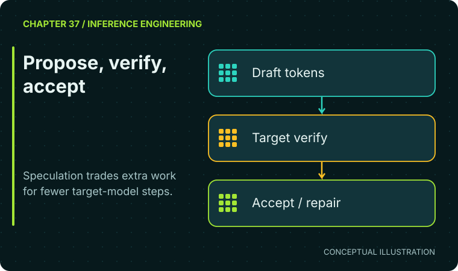
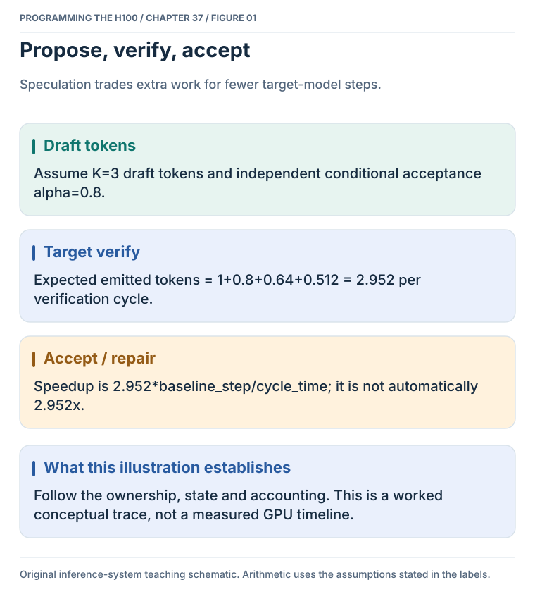

# Chapter 37: Speculative Decoding at 70B: Multi-GPU Target, Cost Model and Measurement Protocol

[](images/chapter-openers/37-inference.svg)


!!! abstract "Goal and prerequisites"

    Predict, before renting any GPUs, whether speculative decoding will speed up a 70B model on 2 x H100, which draft and which depth K to use, and at what batch the benefit shrinks. Then measure it with the Chapter 36 harness. Read [Chapter 32](32-inference-engine-and-harness.md) (decode floor) and [Chapter 36](36-benchmark-teardown.md) (measurement). The statistics of rejection sampling are derived in the Triton book's speculative decoding chapter; here the focus is the multi-GPU system cost, including the KV cache that decides how large a batch fits at all.

!!! warning "Evidence level: read this first"

    - **Verified here (CPU):** the cost model, the expected-tokens formulas (the closed form against a simulation of the accept/reject chain), 19 property tests, and every table below (they are the program's output).
    - **Assumed:** `mfu = 0.5`, 1 ms fixed overhead per step, 12 microseconds per tensor-parallel all-reduce, 90 percent memory utilization, 2 GB reserve per GPU, the model shapes, and every acceptance rate alpha in the tables. **No acceptance rate in this chapter was measured on a real model pair**, and the draft models are shape-only stand-ins. Every speedup is a model prediction, not a benchmark.
    - **Untested on H100:** the launch commands in Section 37.9. Flag names change between releases; check `--help` for your version.

## Worked system map

[](images/worked/ch37-inference.svg)


## 37.1 Why speculation helps, and exactly when

Decode of a large model is limited by reading memory, not by arithmetic. For 70B parameters in BF16 on 2 GPUs (tensor parallel 2), each GPU holds 70 GB and one step takes at least `70e9 / 3.35e12 = 20.9 ms`. The step reads the same weights whether it processes one token or a hundred, until the arithmetic catches up with the memory traffic.

Speculative decoding exploits that slack. A small **draft** proposes K tokens cheaply; the large **target** checks all K (plus one more position) in a **single** pass. Rejection sampling accepts a prefix of the proposals and always yields one extra token, and the output distribution is exactly the target's. If the pass costs little more than a one-token pass, several tokens are emitted for roughly the price of one.

The benefit depends on four quantities:

1. **alpha**, the per-token acceptance probability (how well the draft imitates the target).
2. **The draft's cost** relative to the target step, including its own KV cache reads.
3. **The slack in the target step:** the verify pass processes `batch x (K+1)` tokens, and once that count exceeds the compute-bound threshold, extra tokens are no longer free.
4. **Memory:** the weights, the draft and the KV cache all share each GPU, which limits the batch before the compute threshold is reached (Section 37.3).

The vLLM documentation makes the qualitative point that speculation reduces inter-token latency for memory-bound workloads at low to medium request rates.

## 37.2 The cost model

```python
def step_time(m, batch, ctx, tokens_per_seq=1, mfu=0.5, overhead=1.0e-3):
    mem  = (m.weights_per_gpu() + batch * ctx * m.kv_per_gpu_token()) / HBM_BW
    comp = 2.0 * m.params * batch * tokens_per_seq / (m.gpus * m.peak * mfu)
    return max(mem, comp) + overhead + m.comm_s()
```

One forward costs the larger of the memory time (weights **plus every sequence's KV cache**, read once per step) and the arithmetic time, plus a fixed overhead and tensor-parallel communication. This is a roofline model: coarse, but it captures the crossover that decides everything. Components:

- **KV bytes per token** for a Llama-3-70B shape (80 layers, 8 KV heads, head dimension 128, 2-byte values): `2 x 80 x 8 x 128 x 2 = 327,680` bytes, which is **163,840 bytes per GPU** at TP2 because the KV heads are sharded. At 2,048 tokens of context one sequence holds 0.34 GB per GPU.
- **Tensor-parallel communication:** two all-reduces per layer, 160 per step, at an assumed 12 microseconds each: **1.92 ms**. That is about 9 percent of the 20.9 ms weight-read floor, so it is not negligible; measure it with `nccl-tests`.
- **Compute:** `2 x params` FLOPs per token, at an assumed 50 percent of peak (989 TFLOP/s BF16, 1,979 TFLOP/s FP8, per GPU).

Expected tokens per verify pass with per-position acceptance alpha and K proposals:

```
E[tokens] = (1 - alpha^(K+1)) / (1 - alpha)                       (i.i.d. alpha)
E[tokens] = 1 + sum_i  prod_{j<=i} alpha_j                        (position-dependent alpha_j)
```

One speculation cycle costs K sequential draft steps plus one verify pass of K+1 tokens per sequence, and `speedup = E x base_step / cycle`. The formulas assume neither EOS nor a remaining output-token limit stops the cycle early; real request boundaries can reduce emitted tokens. They also omit KV writes, attention FLOPs, proposal communication and kernel-specific tiling costs, so use the result as a sensitivity model, not a calibrated runtime predictor.

### The compute crossover is 148 tokens, not 295

The arithmetic time per token for 70B on 2 GPUs at 50 percent MFU is `140e9 / (2 x 989e12 x 0.5) = 0.1416 ms`. The weight-read time is 20.9 ms. They are equal at `20.9 / 0.1416 = 147.6` tokens in flight. (At 100 percent MFU the figure would be about 295; the model assumes half of peak.) KV traffic raises the memory time and pushes the crossover up; at FP8, batch 96, 2k context it is about 284 tokens. A test checks the 147.6 figure.

## 37.3 Memory decides the feasible batch

Before any speed comparison, ask what fits. Per GPU, with 90 percent utilization of 80 GiB (77.3 GB) and a 2 GB reserve:

| Configuration | Weights on worst-loaded rank | Left for combined KV | Combined-KV context-token budget | Max batch at 2k context |
|---|---|---|---|---|
| 70B BF16, TP2, 1B draft on GPU0 | 70 GB + 2.4 GB | 2.9 GB | 14,798 | 7 |
| 70B BF16, TP2, **8B draft on GPU0** | 70 GB + 16 GB | negative | 0 | 0 |
| 70B FP8, TP2, 1B draft on GPU0 | 35 GB + 2.4 GB | 37.9 GB | 192,817 | 94 |
| 70B FP8, TP2, 8B draft on GPU0 | 35 GB + 16 GB | 24.3 GB | 82,429 | 40 |
| 70B FP8, TP2, EAGLE-style head | 35 GB + 1.8 GB | 38.5 GB | 229,310 | 111 |

Two consequences:

1. **A BF16 70B model on 2 x H100 is KV-limited to a handful of sequences.** At 2k context only 7 sequences fit beside the 1B draft; the roofline's compute-bound regime (about 148 tokens in flight) is reached only by raising K, not by batch. A BF16 8B draft cannot share a GPU with the BF16 target at all (70 + 16 = 86 GB exceeds the 77 GB budget); it needs a third GPU. The tables therefore use the 1B draft for BF16 and show 8B only for FP8.
2. **FP8 weights change the picture.** Halving the weights frees about 35 GB per GPU for KV, so 40 to 111 sequences at 2k context fit in these modeled configurations, and the batch dimension becomes meaningful. FP8 also halves the weight-read floor to 10.5 ms.

The draft's own KV is counted in both memory capacity and reads: 32 KiB per token for the 1B-shaped draft and 128 KiB for the 8B-shaped draft. On GPU0, divide the remaining byte budget by `target KV bytes/token/rank + draft KV bytes/token`, then divide by context length. Other target ranks have more room, so GPU0 limits admission. The 2 GB reserve must also cover temporary speculative positions, metadata and workspaces; the result is still a model-based capacity bound rather than an engine-reported admission limit.

## 37.4 Verified properties

The file `ch37_spec_decode_70b.py` ([download](examples/inference-systems/ch37_spec_decode_70b.py)) checks 19 properties; the notable ones:

```
  [PASS] 70B BF16 TP2 weights-only decode floor = 20.9 ms
  [PASS] KV bytes/token for a Llama-3-70B shape = 327,680 total, 163,840 per GPU at TP2
  [PASS] 80 layers x 2 all-reduces x 12 us = 1.92 ms TP communication
  [PASS] compute/memory crossover with no KV is 147.6 tokens (NOT 295: MFU 0.5 halves it)
  [PASS] BF16 TP2 + 8B draft colocated does not fit (70 GB + 16 GB > 77 GB budget)
  [PASS] FP8 TP2 + 8B draft colocated fits; max batch at 2k context equals the hand computation (40)
  [PASS] positional formula equals the i.i.d. formula for constant alpha
  [PASS] positional formula matches simulation for decaying alpha (3.578)
  [PASS] K=0 gives speedup exactly 1.0
  [PASS] speedup strictly increases with alpha
  [PASS] best K nondecreasing in alpha ([2, 3, 5, 11])
  [PASS] FP8 TP2, ctx 256, K=4: speedup nonincreasing in batch ([2.21, 2.16, 1.44, 0.89, 0.69, 0.66])
  [PASS] a draft as expensive as the target loses to plain decoding
```

The accept/reject simulation (200,000 cycles for each of 16 alpha and K pairs) is a **sanity check of the closed form**, not independent evidence of the model: it confirms the algebra, not the physics. The nonincreasing-in-batch test uses a short context (256) where the batch can grow past the crossover, and shows speculation falling below 1.0 (0.89x at 128 sequences, 0.66x at 512) once the verify pass is compute-bound. With the realistic 2k context that regime is not reachable by batch alone, because the KV cache runs out first.

## 37.5 Predicted speedups (assumptions, not measurements)

Best K searched over 1 to 12 in each cell. "n/a (KV)" marks batches that do not fit in memory.

**A. 70B BF16, TP2, 1B draft on GPU0, context 1,024.** Base step 23.9 ms at B=1 (20.9 weights + 1.0 overhead + 1.9 comm + KV), 24.2 ms at B=8; the corrected combined-KV budget admits at most 14 sequences at this context.

| alpha | B=1 | B=4 | B=8 | B=16 | B=24 |
|---|---|---|---|---|---|
| 0.5 | 1.54x (K=3) | 1.54x (K=3) | 1.53x (K=3) | n/a (KV) | n/a (KV) |
| 0.7 | 2.16x (K=5) | 2.15x (K=5) | 2.15x (K=5) | n/a (KV) | n/a (KV) |
| 0.8 | 2.76x (K=7) | 2.75x (K=7) | 2.74x (K=7) | n/a (KV) | n/a (KV) |
| 0.9 | 4.00x (K=11) | 3.98x (K=11) | 3.95x (K=11) | n/a (KV) | n/a (KV) |

**B1. 70B FP8, TP2, 1B draft, context 2,048 (max batch 94).** Base step 13.5 ms at B=1, 19.8 ms at B=64.

| alpha | B=1 | B=8 | B=32 | B=64 | B=96 |
|---|---|---|---|---|---|
| 0.5 | 1.39x (K=2) | 1.38x (K=2) | 1.36x (K=2) | 1.34x (K=2) | n/a (KV) |
| 0.7 | 1.83x (K=4) | 1.81x (K=4) | 1.78x (K=3) | 1.68x (K=2) | n/a (KV) |
| 0.8 | 2.24x (K=5) | 2.22x (K=5) | 2.16x (K=5) | 1.94x (K=3) | n/a (KV) |
| 0.9 | 3.02x (K=8) | 2.97x (K=8) | 2.74x (K=5) | 2.27x (K=3) | n/a (KV) |

Ridge values for feasible displayed batches: 149, 159, 193 and 238 for B = 1, 8, 32 and 64. B=96 no longer fits once the draft KV is counted.

**B2. Same, 8B draft (max batch 40).**

| alpha | B=1 | B=8 | B=32 | B=64 |
|---|---|---|---|---|
| 0.5 | 1.05x (K=1) | 1.03x (K=1) | 1.00x (K=1) | n/a (KV) |
| 0.7 | 1.18x (K=1) | 1.17x (K=1) | 1.13x (K=1) | n/a (KV) |
| 0.8 | 1.31x (K=2) | 1.28x (K=2) | 1.22x (K=2) | n/a (KV) |
| 0.9 | 1.49x (K=4) | 1.46x (K=3) | 1.37x (K=3) | n/a (KV) |

**B3. Same, EAGLE-style head (one decoder layer's worth of parameters, reusing target features; max batch 111).**

| alpha | B=1 | B=8 | B=32 | B=64 | B=96 |
|---|---|---|---|---|---|
| 0.5 | 1.42x (K=2) | 1.43x (K=2) | 1.46x (K=2) | 1.49x (K=2) | 1.50x (K=2) |
| 0.7 | 1.90x (K=4) | 1.93x (K=4) | 1.99x (K=4) | 1.92x (K=3) | 1.87x (K=2) |
| 0.8 | 2.35x (K=5) | 2.38x (K=6) | 2.48x (K=5) | 2.24x (K=3) | 2.09x (K=2) |
| 0.9 | 3.21x (K=9) | 3.27x (K=9) | 3.15x (K=5) | 2.60x (K=3) | 2.32x (K=2) |

What the tables say, and what they do not:

1. **BF16 at 2 x H100 gives large predicted gains for a tiny batch** (1.5x to 4x), because the step is a pure weight read and an independent small draft is cheap. But only 7 to 14 sequences fit, so this is a latency configuration, not a throughput one.
2. **At FP8 the predicted gains are smaller** (1.4x to 3.0x at B=1 for the 1B draft), because the base step is already 13.5 ms and the draft's fixed overhead is a larger fraction of it. They shrink with batch (2.24x at B=1 to 1.94x at B=64 for alpha 0.8) as the verify pass approaches and passes the ridge; none falls below 1.0 within the feasible batch for the 1B draft.
3. **The 8B draft is a poor trade at FP8**: 1.05x to 1.49x, falling to approximately 1.00x at 32 sequences with alpha 0.5; 64 sequences no longer fit the corrected memory model. Its weights and KV reads cost several milliseconds per draft step.
4. **The EAGLE-style row has a larger modeled gain at a feasible shared batch** (2.24x against 1.94x at B=64, alpha 0.8) because its one-layer KV cache is tiny, and the 1B B=96 point is excluded by memory. Equal-alpha comparisons isolate the assumed cost side; they cannot establish which real draft wins. Acceptance depends on the trained head, target and workload and must be measured.
5. **The best K moves with alpha and with the draft**: deeper for a cheap draft and a high alpha. The K=11 cells in Table A sit on a flat curve (K=10 to 12 differ by under 0.5 percent) and real alpha usually decays with position (Section 37.7), so treat them as "deep", not as a precise optimum.
6. **Everything depends on alpha, which is not in this chapter's data.** The tables show sensitivity; they do not tell you which row applies to your model pair and prompts. Measure it (Section 37.8).

### Worked Example 37.5.1: one low-batch cell by hand

Table A: 70B BF16, 1B draft, alpha 0.8, K=7, B=1, context 1,024.

- Expected tokens: `(1 - 0.8^8) / 0.2 = (1 - 0.1678) / 0.2 = 4.16`.
- Base step: weights 20.90 ms, KV `1 x 1024 x 163,840 = 0.17 GB` -> 0.05 ms, overhead 1.00, comm 1.92: **23.87 ms**.
- Draft step: 1B weights 2.4 GB plus KV `1024 x 32,768 = 0.03 GB`, memory time 0.73 ms, plus 1.00 overhead (no comm, one GPU): 1.73 ms. Seven steps: 12.1 ms.
- Verify: 8 tokens in flight, still memory-bound: 23.87 ms.
- Cycle: 36.0 ms. Speedup: `4.16 x 23.87 / 36.0 = 2.76`. Matches the table.

The fixed overhead (1.0 ms) is larger than the draft's weight-read time (0.7 ms), so cutting launch and scheduling overhead matters more for a tiny draft than shrinking it further.

### Worked Example 37.5.2: one high-batch cell by hand

Table B1: 70B FP8, 1B draft, alpha 0.8, K=3, B=64, context 2,048. This replaces the old B=96 example, which did not fit after accounting for the draft KV.

- Expected tokens: `1 + 0.8 + 0.64 + 0.512 = 2.952`.
- Target KV: `64 x 2048 x 163,840 = 21.475 GB`; weights plus KV take `(35 + 21.475)/3350 = 16.858 ms`. Add 1.0 ms overhead and 1.92 ms communication: **19.778 ms** for the baseline step.
- Verify processes 256 positions. Compute costs `2 x 70e9 x 256 / (2 x 1979e12 x 0.5) = 18.110 ms`, above the memory term. Add 2.92 ms: **21.030 ms**.
- Draft KV: `64 x 2048 x 32,768 = 4.295 GB`. Together with its 2.4 GB weights the memory term is 1.998 ms; with 1 ms overhead a draft step costs **2.998 ms**. Three steps cost 8.995 ms.
- Cycle: `21.030 + 8.995 = 30.026 ms`. Predicted speedup: `2.952 x 19.778 / 30.026 = 1.94x`, matching the corrected table.
- Capacity check on GPU0: weights `35+2.4`, context KV `21.475+4.295`, and reserve 2 sum to **65.17 GB**, below the assumed 77.3 GB usable budget. Count the draft KV before calling a cell feasible.

## 37.6 Multi-GPU placement of the draft

The target occupies 2 GPUs with tensor parallelism. The draft must run somewhere, and the choice changes the cost and the memory:

| Placement | Effect | When it fits |
|---|---|---|
| Draft on one target GPU, no TP (`draft_tensor_parallel_size = 1` in vLLM) | One GPU computes the draft while the other idles; proposals must reach the other rank (small broadcast); **KV capacity becomes uneven** because GPU0 holds the draft weights, so the worst GPU sets the batch limit (the model charges this) | Small drafts such as 1B or an EAGLE-style head |
| Draft sharded with the same TP | Draft weights per GPU halve, but a per-layer all-reduce is added; for a small draft the communication exceeds the arithmetic | Large drafts (8B and up) when memory forces it |
| Draft on a separate GPU | No memory contention, one more GPU, a transfer of proposals each cycle | BF16 targets that cannot colocate an 8B draft |
| Draft heads on the target (EAGLE, MTP, Medusa style) | Very cheap: reuse target hidden states; needs a trained head | When one exists for your model |

The model prices only the first row: the draft is a single-GPU model on GPU0, and the proposal transfer is not charged (add a `comm` term from your interconnect measurements). The target's tensor-parallel communication is charged as 1.92 ms per step, an assumed value.

## 37.7 Failure modes and edge cases

| Situation | Effect | Mitigation |
|---|---|---|
| alpha varies with position | The i.i.d. formula is wrong in either direction: with the first-position rate it overstates (4.69 vs 3.58 in Solution 4), with the mean rate it understates (2.94 vs 3.58) | Measure acceptance per position and use `E = 1 + sum_i prod_{j<=i} alpha_j` |
| High temperature or creative text | Draft and target distributions overlap less (direction depends on the models) | Tune K per workload; consider n-gram or suffix methods for repetitive content |
| KV cache nearly full | Large batches do not fit; evictions and recompute dominate | Compute the feasible batch (Section 37.3) before tuning K |
| Batch grows past the ridge | Verify turns compute-bound and speculation slows everything (0.89x at 128 sequences, short context) | Dynamic speculation depth, or disable above a measured batch threshold |
| Draft and target tokenizers differ | This simple token-ID verifier cannot compare their probabilities directly | Use matching token semantics for this method; tokenizer-alignment methods require a different verifier |
| Draft too large or too slow | Cycle cost exceeds the savings | Compare draft step time with target step time first |
| Incorrect distributions in acceptance/residual sampling | Breaks the target-distribution guarantee | Use the actual proposal q and desired target p after their transforms. Their temperatures/top-p/top-k need not match mathematically; engine support can impose additional restrictions |
| Prefix caching or other features interact | Support varies by engine and release; the SGLang docs list limitations for some modes | Check the release notes for your version |
| Acceptance measured on one dataset, served on another | Surprise slowdown | Measure on the production distribution |
| Tensor-parallel communication larger than assumed | Base step and verify grow by the same fixed amount. With fixed draft cost, their ratio can move the predicted speedup upward toward E, although absolute latency still grows | Measure the all-reduce latency and update `AR_LATENCY` |

### The synthetic alpha experiment, and why not to over-read it

The file also computes alpha from distributions: `alpha = sum_x min(p(x), q(x))`, the overlap of target `p` and draft `q`. With draft logits equal to target logits plus Gaussian noise of standard deviation 0.8, over 400 random 50-token distributions:

```
  T=0.2 : alpha=0.708     T=0.5 : alpha=0.726     T=1.0 : alpha=0.782     T=1.5 : alpha=0.818
```

Alpha **rises** with temperature here because a higher temperature flattens both distributions and shrinks the effect of the logit noise. That is a property of this synthetic noise model, not of real models. The experiment's value is that it shows the correct definition of alpha and a way to compute it from logged distributions. Do not quote its numbers.

## 37.8 Measuring it: protocol on real hardware

Use [Chapter 36](36-benchmark-teardown.md)'s open-loop client and manifest. Add the speculation-specific steps:

1. **Baseline first.** Run the target alone, no speculation, same engine, same flags, at the same offered rates.
2. **Measure alpha per position.** Most engines expose acceptance or accepted-length metrics (vLLM logs speculative decoding statistics and exposes `vllm:spec_decode_*` metrics in recent versions; SGLang exposes `sglang:spec_*` metrics). List the metric names from your server's `/metrics` endpoint and record mean accepted length and per-position acceptance on **your** prompts.
3. **Sweep K** (for example 1, 2, 3, 5, 8) at low and high offered load. Plot speedup against K for each load.
4. **Sweep load** to find where speculation stops helping on your hardware. Compare it with the model's prediction; a different crossover tells you the real MFU, overhead and communication cost.
5. **Check output equivalence.** At temperature 0, outputs with and without speculation should match token for token on the vast majority of prompts; small differences can come from numerical non-determinism in batched kernels. At temperature above 0, compare distributions statistically (the total variation test in the Triton book's speculative chapter), not strings.
6. **Report the SLO view.** Speculation helps TPOT at low load and can hurt TTFT slightly (extra prefill for the draft) and tail latency at high load. Report p99 TTFT, p99 TPOT and goodput, not only mean speed.
7. **Calibrate the model.** Fit `mfu`, `overhead` and `AR_LATENCY` so the model matches your measured base step times, then compare predicted and measured speedup. The gap is what your engine's real behavior adds.

### What you can compare against

The SGLang documentation publishes a single-H100 comparison on a smaller model: roughly 158 tokens per second without speculation, 244 with EAGLE-2 and 373 with EAGLE-3. These are vendor figures on one model and one GPU, useful as an order of magnitude (1.5x to 2.4x with trained draft heads), and say nothing about 70B on two GPUs.

## 37.9 Runbook (untested on H100)

!!! warning "UNTESTED ON H100"

    Commands follow the vLLM and SGLang documentation for the versions visible when this chapter was written. Verify every flag with `--help` for your exact version, and confirm that your release supports `method: draft_model` and `draft_tensor_parallel_size`; the older separate speculative flags are deprecated in vLLM.

```bash
# --- vLLM: separate draft model, target on 2 GPUs, draft on 1 ---
vllm serve <70B-model> --tensor-parallel-size 2 \
  --speculative-config '{"method":"draft_model","model":"<small-draft-model>",
                         "num_speculative_tokens":5,"draft_tensor_parallel_size":1}'

# --- vLLM: no draft model (lookup based), cheap to try first ---
vllm serve <70B-model> --tensor-parallel-size 2 \
  --speculative-config '{"method":"ngram","num_speculative_tokens":5,"prompt_lookup_max":4}'

# --- SGLang: EAGLE-3 draft head ---
python -m sglang.launch_server --model-path <70B-model> --tp-size 2 \
  --speculative-algorithm EAGLE3 --speculative-draft-model-path <eagle3-draft> \
  --speculative-num-steps 3 --speculative-eagle-topk 1 --speculative-num-draft-tokens 4

# --- list the speculative metrics each server exposes ---
curl -s http://127.0.0.1:8000/metrics | grep -i spec      # vLLM
curl -s http://127.0.0.1:30000/metrics | grep -i spec     # SGLang (needs --enable-metrics)
```

vLLM takes all speculative settings through one `--speculative-config` JSON; SGLang's tree parameters (`num-steps`, `eagle-topk`, `num-draft-tokens`) interact and should be tuned together with `--cuda-graph-max-bs` and memory settings. Always run the baseline with the same flags minus the speculative ones, and check the KV capacity each engine reports at startup against Section 37.3.

<!-- BEGIN COMPLETE INFERENCE SOURCE -->
## Complete runnable code

The complete implementation is shown below, including its checks and entry point. The listing and downloadable `.py` file contain exactly the same source. Copy the file under the displayed filename; keep supporting files in the same directory.

[Download all inference examples and supporting modules](examples/inference-systems/inference-systems.zip) or read the [environment and command guide](examples/inference-systems/README.md).

The [follow-up agent audit](inference-adversarial-review-2026-11-25.md) records the corrections, fresh CPU captures and hardware limits for this source.

Read it in three passes: start with `Model` and `step_time` to identify the state; trace `kv_budget_tokens` and `speedup` for one request or token; then follow `selftests` and `tables` to see how the result is checked.

From the repository root:

```bash
python3 docs/examples/inference-systems/ch37_spec_decode_70b.py
```

### ch37_spec_decode_70b.py

[Download ch37_spec_decode_70b.py](examples/inference-systems/ch37_spec_decode_70b.py)

```python title="ch37_spec_decode_70b.py" linenums="1"
#!/usr/bin/env python3
"""Chapter 37: speculative decoding at 70B -- roofline cost model with KV cache, memory feasibility, tests.
Pure standard library. Run:  python3 ch37_spec_decode_70b.py
Nothing here was run on an H100. Hardware constants are published peak figures; `mfu`, the per-all-reduce latency,
the fixed per-step overhead and every acceptance rate alpha are ASSUMPTIONS to be replaced by measurements."""
import math, random, statistics

# ---------- hardware ----------
HBM_BW = 3.35e12            # bytes/s, H100 SXM peak
PEAK_BF16 = 989e12          # dense FLOP/s per GPU
PEAK_FP8 = 1979e12
GPU_MEM = 80 * 2**30        # 80 GiB = 85.9e9 bytes
MEM_UTIL = 0.90             # fraction of GPU memory the engine may use (vLLM-style gpu_memory_utilization)
RESERVE = 2.0e9             # activations, CUDA graphs, workspace per GPU (assumed)
AR_LATENCY = 12e-6          # one small NVLink all-reduce (ASSUMED, measure with nccl-tests)

class Model:
    def __init__(s, name, params, bpp, gpus, layers, kv_heads, head_dim, peak=PEAK_BF16, kv_bpp=2):
        s.name, s.params, s.bpp, s.gpus, s.layers = name, params, bpp, gpus, layers
        s.peak = peak
        s.kv_bytes_per_token = 2 * layers * kv_heads * head_dim * kv_bpp      # K and V, all layers, whole model
    def weights_per_gpu(s): return s.params * s.bpp / s.gpus
    def kv_per_gpu_token(s): return s.kv_bytes_per_token / s.gpus             # KV heads are sharded across TP ranks
    def comm_s(s): return 2 * s.layers * AR_LATENCY if s.gpus > 1 else 0.0   # 2 all-reduces per layer

def llama70(bpp=2, peak=PEAK_BF16): return Model("70B", 70e9, bpp, 2, 80, 8, 128, peak)
def draft(name, params, layers, kv_heads, head_dim): return Model(name, params, 2, 1, layers, kv_heads, head_dim)
D1B = draft("1B", 1.2e9, 16, 8, 64)        # Llama-3.2-1B-like
D8B = draft("8B", 8.0e9, 32, 8, 128)       # Llama-3-8B-like
EAGLE = draft("eagle-head", 0.9e9, 1, 8, 128)   # one decoder layer's worth, reuses target features (ASSUMED shape)

def step_time(m, batch, ctx, tokens_per_seq=1, mfu=0.5, overhead=1.0e-3):
    """One forward. Memory time reads the weights once plus every sequence's KV cache; compute time covers
    batch*tokens_per_seq tokens. Roofline: the larger of the two, plus fixed overhead and tensor-parallel comm."""
    mem = (m.weights_per_gpu() + batch * ctx * m.kv_per_gpu_token()) / HBM_BW
    comp = 2.0 * m.params * batch * tokens_per_seq / (m.gpus * m.peak * mfu)
    return max(mem, comp) + overhead + m.comm_s()

def crossover_tokens(m, batch, ctx, mfu=0.5):
    """Tokens in flight at which compute time equals memory time (the roofline ridge) for this batch and context."""
    mem = (m.weights_per_gpu() + batch * ctx * m.kv_per_gpu_token()) / HBM_BW
    return mem / (2.0 * m.params / (m.gpus * m.peak * mfu))

def kv_budget_tokens(target, draft_on_gpu0=None):
    """Equivalent target-KV token capacity on the worst-loaded rank.

    The draft's weights AND KV occupy GPU0. Express their combined KV cost
    in target-token equivalents so max_batch remains floor(capacity/context).
    Speculative temporary slots/metadata must fit the explicit RESERVE; this
    remains a modeled upper bound, not an engine-reported admission limit.
    """
    extra = draft_on_gpu0.weights_per_gpu() if draft_on_gpu0 else 0.0
    free = MEM_UTIL * GPU_MEM - target.weights_per_gpu() - extra - RESERVE
    combined_kv = target.kv_per_gpu_token() + (draft_on_gpu0.kv_per_gpu_token() if draft_on_gpu0 else 0.0)
    return max(0.0, free / combined_kv)


def max_batch(target, ctx, draft_m=None):
    if ctx <= 0:
        raise ValueError("context length must be positive")
    return int(kv_budget_tokens(target, draft_m) // ctx)


def expected_tokens(alpha, K):
    """E[tokens per verify pass], i.i.d. per-position acceptance alpha."""
    return K + 1.0 if alpha >= 1.0 else (1.0 - alpha ** (K + 1)) / (1.0 - alpha)

def expected_tokens_positional(alphas):
    """E = 1 + sum_i prod_{j<=i} alpha_j   (alphas[i] is the acceptance prob at position i+1 GIVEN earlier accepted)."""
    e, p = 1.0, 1.0
    for a in alphas:
        p *= a; e += p
    return e

def cycle_time(target, dm, K, batch, ctx, mfu=0.5):
    td = K * step_time(dm, batch, ctx, 1, mfu)                 # K sequential draft steps
    tv = step_time(target, batch, ctx, K + 1, mfu)             # one verify pass over K+1 tokens per sequence
    return td + tv

def speedup(target, dm, alpha, K, batch, ctx, mfu=0.5):
    base = step_time(target, batch, ctx, 1, mfu)
    return expected_tokens(alpha, K) * base / cycle_time(target, dm, K, batch, ctx, mfu)

def best_K(target, dm, alpha, batch, ctx, Kmax=12, mfu=0.5):
    best = max(range(1, Kmax + 1), key=lambda k: speedup(target, dm, alpha, k, batch, ctx, mfu))
    return best, speedup(target, dm, alpha, best, batch, ctx, mfu)

def simulate_tokens_per_pass(alpha, K, n=200000, seed=0):
    rng = random.Random(seed); tot = 0
    for _ in range(n):
        acc = 0
        while acc < K and rng.random() < alpha: acc += 1
        tot += acc + 1
    return tot / n

def simulate_positional(alphas, n=200000, seed=0):
    rng = random.Random(seed); tot = 0
    for _ in range(n):
        acc = 0
        for a in alphas:
            if rng.random() < a: acc += 1
            else: break
        tot += acc + 1
    return tot / n

def acceptance(p, q): return sum(min(a, b) for a, b in zip(p, q))
def softmax(z, T):
    m = max(z); e = [math.exp((x - m) / T) for x in z]; s = sum(e); return [x / s for x in e]

def alpha_vs_temperature(seed=1, V=50, noise=0.8, temps=(0.2, 0.5, 1.0, 1.5)):
    """Synthetic: draft logits = target logits + noise. The TREND is a property of this noise model, not of real models."""
    rng = random.Random(seed); out = {}
    for T in temps:
        vals = []
        for _ in range(400):
            zt = [rng.gauss(0, 3) for _ in range(V)]
            zd = [x + rng.gauss(0, noise) for x in zt]
            vals.append(acceptance(softmax(zt, T), softmax(zd, T)))
        out[T] = statistics.mean(vals)
    return out

# ---------- self tests ----------
def selftests():
    r = []
    def chk(name, ok, info=""):
        r.append(ok); print(f"  [{'PASS' if ok else 'FAIL'}] {name} {info}")
    t = llama70(); t8 = llama70(1, PEAK_FP8)
    chk("70B BF16 TP2 weights-only decode floor = 20.9 ms", abs(t.weights_per_gpu() / HBM_BW * 1e3 - 20.9) < 0.05)
    chk("KV bytes/token for a Llama-3-70B shape = 327,680 total, 163,840 per GPU at TP2",
        t.kv_bytes_per_token == 327680 and t.kv_per_gpu_token() == 163840)
    chk("80 layers x 2 all-reduces x 12 us = 1.92 ms TP communication", abs(t.comm_s() - 1.92e-3) < 1e-9)
    x = crossover_tokens(t, 1, 0)
    chk("compute/memory crossover with no KV is 147.6 tokens (NOT 295: MFU 0.5 halves it)", abs(x - 147.6) < 0.5, f"({x:.1f})")
    chk("crossover grows with KV traffic: 24 seqs x 1024 ctx gives a higher ridge",
        crossover_tokens(t, 24, 1024) > crossover_tokens(t, 1, 1024))
    # memory feasibility
    mb2k = max_batch(t, 2048, D1B)
    chk("BF16 TP2 + 1B draft: max batch at 2k context is small (KV-limited)", 1 <= mb2k <= 20, f"(max batch {mb2k})")
    chk("BF16 TP2 + 8B draft colocated does not fit (70 GB + 16 GB > 77 GB budget)", kv_budget_tokens(t, D8B) == 0.0)
    free = MEM_UTIL * GPU_MEM - 35e9 - 16e9 - RESERVE                 # independent hand computation
    chk("FP8 TP2 + 8B draft colocated fits; max batch at 2k context equals the hand computation",
        max_batch(t8, 2048, D8B) == int(free / (163840 + D8B.kv_per_gpu_token()) // 2048) and max_batch(t8, 2048, D8B) > 0,
        f"(max batch {max_batch(t8, 2048, D8B)})")
    # math identities
    errs = [abs(simulate_tokens_per_pass(a, K) - expected_tokens(a, K)) for a in (0.3, .6, .8, .9) for K in (1, 3, 5, 8)]
    chk("E[tokens] closed form agrees with simulating the accept/reject chain (a sanity check of the formula)", max(errs) < 0.02, f"(max err {max(errs):.4f})")
    chk("limits: alpha=0 gives 1 token, alpha=1 gives K+1", expected_tokens(0, 5) == 1.0 and expected_tokens(1, 5) == 6.0)
    chk("positional formula equals the i.i.d. formula for constant alpha",
        abs(expected_tokens_positional([0.7] * 5) - expected_tokens(0.7, 5)) < 1e-12)
    dec = [0.9, 0.8, 0.7, 0.6, 0.5]
    chk("positional formula matches simulation for decaying alpha", abs(expected_tokens_positional(dec) - simulate_positional(dec)) < 0.02,
        f"({expected_tokens_positional(dec):.3f})")
    chk("acceptance(p,p)=1; disjoint support = 0", abs(acceptance([.5, .5, 0], [.5, .5, 0]) - 1) < 1e-12 and acceptance([.5, .5, 0], [0, 0, 1]) == 0)
    # speedup properties
    chk("K=0 gives speedup exactly 1.0", abs(speedup(t, D1B, 0.8, 0, 1, 1024) - 1.0) < 1e-12)
    s = [speedup(t, D1B, a, 4, 1, 1024) for a in (0.2, 0.4, 0.6, 0.8, 0.95)]
    chk("speedup strictly increases with alpha", all(a < b for a, b in zip(s, s[1:])))
    ks = [best_K(t, D1B, a, 1, 1024)[0] for a in (0.3, 0.5, 0.7, 0.9)]
    chk("best K nondecreasing in alpha", all(a <= b for a, b in zip(ks, ks[1:])), f"({ks})")
    sb = [speedup(t8, D1B, 0.8, 4, b, 256) for b in (16, 32, 64, 128, 256, 512)]
    chk("FP8 TP2, ctx 256, K=4: speedup nonincreasing in batch (past the crossover it must fall)",
        all(a >= b - 1e-9 for a, b in zip(sb, sb[1:])), f"({[round(v, 2) for v in sb]})")
    chk("a draft as expensive as the target loses to plain decoding", speedup(t, t, 0.7, 4, 1, 1024) < 1.0)
    chk("for batch 1 the 1B draft beats the 8B draft at equal alpha (cheaper cycle)",
        speedup(t8, D1B, 0.8, 4, 1, 1024) > speedup(t8, D8B, 0.8, 4, 1, 1024))
    return all(r)

def fmt(t, dm, alpha, B, ctx, mb):
    if B > mb: return "n/a (KV)  "
    k, s = best_K(t, dm, alpha, B, ctx)
    return f"{s:4.2f}x K={k:<2d} "

def tables():
    t, t8 = llama70(), llama70(1, PEAK_FP8)
    print("\n== A. Target 70B BF16 on TP2. Draft 1B colocated on GPU0. ctx = 1024 (ASSUMED alpha, mfu 0.5, overhead 1 ms) ==")
    mb = max_batch(t, 1024, D1B); print(f"   KV budget {kv_budget_tokens(t, D1B):,.0f} tokens -> max batch {mb} at ctx 1024")
    Bs = (1, 4, 8, 16, 24)
    print("   alpha   " + "".join(f"B={b:<10d}" for b in Bs))
    for a in (0.5, 0.7, 0.8, 0.9):
        print(f"   {a:.1f}     " + "".join(fmt(t, D1B, a, b, 1024, mb) for b in Bs))
    print("   base step (ms): " + ", ".join(f"B={b}: {step_time(t, b, 1024)*1e3:.1f}" for b in Bs if b <= mb))
    for dm, nm in ((D1B, "1B draft"), (D8B, "8B draft"), (EAGLE, "EAGLE-style head")):
        mb = max_batch(t8, 2048, dm)
        print(f"\n== B. Target 70B FP8 on TP2. {nm} colocated. ctx = 2048. KV budget {kv_budget_tokens(t8, dm):,.0f} tokens -> max batch {mb} ==")
        Bs = (1, 8, 32, 64, 96, 128)
        print("   alpha   " + "".join(f"B={b:<10d}" for b in Bs))
        for a in (0.5, 0.7, 0.8, 0.9):
            print(f"   {a:.1f}     " + "".join(fmt(t8, dm, a, b, 2048, mb) for b in Bs))
        print("   base step (ms): " + ", ".join(f"B={b}: {step_time(t8, b, 2048)*1e3:.1f}" for b in Bs if b <= mb))
        print("   ridge (tokens in flight) : " + ", ".join(f"B={b}: {crossover_tokens(t8, b, 2048):.0f}" for b in Bs if b <= mb))
    print("\n== C. alpha vs temperature (synthetic noise model; trend is NOT a property of real models) ==")
    for T, a in alpha_vs_temperature().items(): print(f"   T={T:<4}: alpha={a:.3f}")

if __name__ == "__main__":
    print("self-tests:"); ok = selftests(); tables()
    print("\nALL PASS" if ok else "\nFAILURES"); raise SystemExit(0 if ok else 1)
```

<!-- END COMPLETE INFERENCE SOURCE -->

## 37.10 Exercises

1. Compute by hand Table A's cell for alpha 0.7, K=5, B=1 (BF16, 1B draft, context 1,024). Report expected tokens, draft step, verify step, cycle and speedup.
2. For the same configuration at alpha 0.9, find where the speedup peaks over K and describe the curve's shape.
3. Why does Table B1 never show a speedup below 1.0, while the short-context test in Section 37.4 does?
4. The per-position acceptance is 0.9, 0.8, 0.7, 0.6, 0.5. Compute the expected tokens per pass, then compare it with the i.i.d. formula using (a) the first-position rate and (b) the mean rate, K=5.
5. A draft step costs 0.73 ms of memory time plus 1.0 ms overhead. Which saves more: halving the draft's weights, or halving the overhead?
6. Your measured BF16 baseline step at B=1 is 25.5 ms, not 23.9. Give two explanations and how you would tell them apart.
7. Show that the BF16 70B target with an 8B draft cannot run on 2 GPUs, and give two ways to make it feasible with their costs.
8. Design the experiment that decides whether to disable speculation above a batch threshold.
9. Derive the corrected combined-KV capacity formula and explain why the old FP8 + 8B maximum of 72 sequences falls to 40.

## 37.11 Solutions

1. Expected tokens `(1 - 0.7^6)/0.3 = 2.94`. Base step 23.87 ms (Example 37.5.1). Draft step 1.73 ms, five steps 8.63 ms. Verify (6 tokens, memory-bound): 23.87 ms. Cycle 32.5 ms. Speedup `2.94 x 23.87 / 32.5 = 2.16`, matching the table.
2. The speedup at alpha 0.9 is 3.64x at K=6, 3.88x at K=8, 3.98x at K=10, **4.00x at K=11**, 3.99x at K=12, 3.95x at K=14 and 3.86x at K=16. The curve is flat from K=10 to 12 (under 0.5 percent) and falls slowly after, because each extra draft step costs a fixed 1.7 ms while the marginal expected tokens shrink as `0.9^K`.
3. In Table B1 the feasible batch (at most 94 sequences at 2k context) keeps the verify pass near the ridge but the KV traffic keeps the base step memory-bound, so verification stays cheap. The short-context test uses context 256, where the KV cache is small enough for batches of 128 to 512 to fit, and there verify is deep in the compute-bound region.
4. Positional: `1 + 0.9 + 0.72 + 0.504 + 0.3024 + 0.1512 = 3.58`. i.i.d. with the first-position rate 0.9: `(1 - 0.9^6)/0.1 = 4.69` (overstates by 31 percent). i.i.d. with the mean rate 0.7: `(1 - 0.7^6)/0.3 = 2.94` (understates by 18 percent). Neither shortcut is right; use measured positional rates.
5. Halving the overhead saves 0.5 ms per draft step; halving the draft's weights saves `1.2 GB / 3.35 TB/s = 0.36 ms`. The overhead is the better target, and it also applies to every draft size.
6. Candidate causes: lower achievable memory bandwidth than the 3.35 TB/s peak (real kernels reach perhaps 70 to 90 percent, which alone would put the weight read near 23 to 30 ms), or a larger tensor-parallel communication cost than 1.92 ms. Tell them apart by timing a pure weight-read kernel for effective bandwidth, and by profiling the step for all-reduce time.
7. BF16 weights are 140 GB across 2 GPUs, 70 GB each; adding 16 GB of 8B draft gives 86 GB, more than the 77.3 GB budget (and more than the 80 GiB card). Options: (a) run the draft on a third GPU: the model gives 1.47x, 1.71x and 2.12x at B=1, context 1,024, for alpha 0.7, 0.8 and 0.9 (best K 2, 3 and 6, proposal transfer not charged), against 2.16x, 2.76x and 4.00x for a 1B draft on GPU0, for a 50 percent increase in hardware; (b) quantize the target to FP8, which frees 35 GB per GPU (the cost is a quality evaluation and a change of baseline).
8. Run the baseline and speculative configurations across offered rates, record the batch actually in flight (from the engine's metrics), find the rate at which speculative p99 TPOT crosses the baseline, set the threshold below it with margin, and verify with a ramp test that goodput does not drop at the switch point.
9. Solve `B*ctx*(target_KV_per_token_per_rank + draft_KV_per_token) <= usable_bytes - target_weights_per_rank - draft_weights - reserve`. At ctx=2048 the FP8+8B case has about 24.309 GB for KV and costs `2048*(163840+131072) = 603,979,776` bytes per sequence. The floor is 40 sequences. The tables now use this combined allocation, rather than the old target-only limit of 72.

## Chapter Summary

For a memory-bound 70B model on 2 H100s the decode floor is 20.9 ms per token, about 24 ms with overhead, tensor-parallel communication and KV reads, and a verify pass over K+1 tokens costs almost the same until about 148 tokens are in flight. Speculative decoding converts that slack into speed: expected tokens per pass is `(1 - alpha^(K+1))/(1 - alpha)` for constant alpha, or `1 + sum prod alpha_j` when acceptance varies with position, and a cycle costs K draft steps plus one verify. Memory comes first: BF16 weights leave room for only 7 to 14 sequences at 1 to 2k context, an 8B BF16 draft does not fit beside the target at all, and FP8 weights open the modeled batch to roughly 40 to 111 sequences, depending on the draft. The cost model predicts 1.5x to 4x at BF16 with a tiny batch and 1.3x to 3x at FP8, shrinking with batch as the verify pass approaches the compute ridge, with a short-context case dropping below 1.0 once verify is compute-bound. These are predictions under assumed MFU, overhead, communication and acceptance rates, and have not been measured on hardware. The acceptance rate is the dominant unknown and must be measured per position on production prompts. The sound deployment pattern is to compute the feasible batch, measure a baseline, sweep K and load with the open-loop harness, calibrate the model, and shorten K or disable speculation above the batch where it stops helping.

## Sources

- vLLM speculative decoding documentation: <https://docs.vllm.ai/en/latest/features/speculative_decoding/index.html>
- vLLM draft model guide: <https://docs.vllm.ai/en/v0.17.1/features/speculative_decoding/draft_model/>
- SGLang speculative decoding documentation: <https://docs.sglang.io/docs/advanced_features/speculative_decoding>
- SGLang adaptive speculative decoding: <https://sgl-project.github.io/advanced_features/adaptive_speculative_decoding.html>

- Exact speculative rejection sampling: [Leviathan et al., Fast Inference from Transformers via Speculative Decoding](https://arxiv.org/abs/2211.17192).
