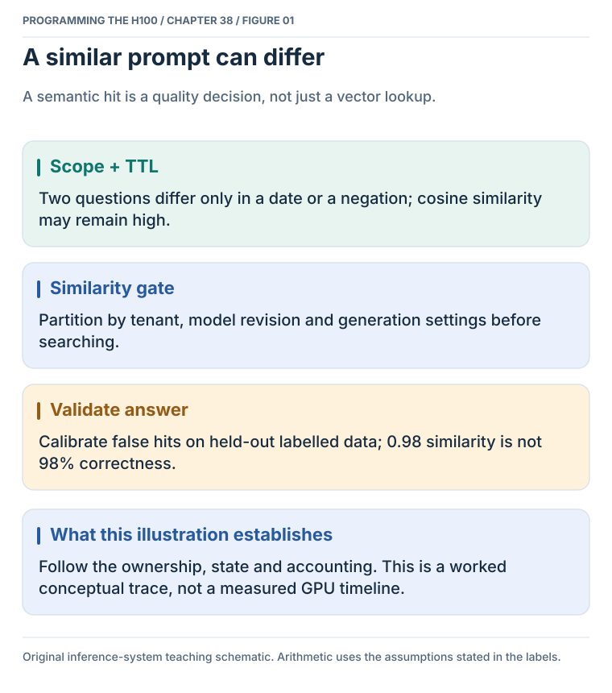

# Chapter 38 — Semantic Cache: Thresholds, False Hits, Economics

[](images/chapter-openers/38-inference.svg)


!!! warning "Evidence status"
    **Run on CPU, in a synthetic world:** the cache data structure, the Wilson interval, a cluster bootstrap, the economics formulas and 17 self-tests (`ch38_semantic_cache.py`).
    **Invented:** the embeddings. There is no embedding model in this chapter. Queries are synthetic unit vectors, so every similarity, threshold and rate below is a property of that synthetic world and **does not transfer** to a real model. Section 38.9 is the procedure that measures the real numbers; it is **UNTESTED** against a real embedding model.
    Sample outputs vary with seeds; the self-tests assert properties, not these exact numbers.

A semantic cache returns a stored answer when a new query is "close enough" to an old one, skipping the LLM call. The project brief says "98% similarity". That number means nothing on its own: it depends on the embedding model, and it says nothing about how often the cache returns a *wrong* answer. This chapter builds the cache, measures the wrong-answer rate with a confidence interval, and turns it into dollars.

## Worked system map

[](images/worked/ch38-inference.svg)


## 38.1 What is being cached, and what "same" means

A cache hit is correct only if the stored answer is also a correct answer to the new query. Embedding similarity is a proxy for that. The proxy fails in a specific way: queries that differ in one decisive token ("refund within 30 days" vs "within 3 days", "enable" vs "disable", a different account number) embed *very* close together. We call these **sibling intents** (hard negatives). Paraphrases of one intent should be close; siblings should not be, and often are.

```
 same intent (paraphrase)      cosine ~ high
 sibling intent (hard negative) cosine ~ high-ish  <- the dangerous overlap
 unrelated                      cosine ~ 0
```

## 38.2 The data structure

`SemanticCache` keeps entries in **partitions** keyed by everything that must be identical for an answer to be reusable: tenant, model, system-prompt hash, sampling parameters. A lookup only compares against its own partition. Per partition:

- cosine similarity by one matrix–vector product (vectors are unit length);
- strict TTL: an entry created at *t* is valid for `now < t + ttl`;
- LRU eviction at `max_entries` (ties broken by oldest creation);
- hit only if the best similarity ≥ threshold.

Complexity of a lookup is O(entries × dim) per partition. That is fine to ~10⁵ entries on CPU; beyond that you use an ANN index (HNSW) and accept that recall of the index is now a second source of misses. Nothing in this chapter depends on the index.

## 38.3 Self-tests (17, all pass)

| Test | What it establishes |
|---|---|
| world sanity | mean cosine same > sibling > unrelated |
| unit norm | synthetic vectors are normalised |
| exact repeat | stored vector hits at τ=0.999999 with similarity 1 |
| partition isolation | 600 random ops (157 hits, so hits are exercised), no cross-partition return. True by construction of the dict keying; it guards regressions |
| TTL boundary | valid at 99.9 s, expired at exactly 100 s |
| LRU | touching entry 0 makes entry 1 the victim |
| determinism | same seed, same counts |
| monotone hit rate | **empirical**, not a theorem for a streaming cache (a higher τ means more inserts, which can mean more later hits): hit rate is nonincreasing over the grid used |
| false-hit trend | false-hit rate at τ=0.99 below that at 0.80 |
| Wilson, 0 events | upper bound for 0/200 is 0.0188 |
| Wilson exact coverage | exact binomial sum at n=200, p=0.02 gives 0.9331; asserted in [0.92, 0.98] because Wilson coverage oscillates with n and p |
| cluster bootstrap (2) | returns None with no events; on 40 false hits carried by 5 of 10 entries the interval [0.16, 0.64] is wider than the naive Wilson [0.31, 0.50] |
| exact-match baseline | (v, v, new, v) gives hit rate 0.50 |
| cost by hand | function equals the hand calculation |
| break-even | at the break-even cost, cache cost equals no-cache cost |
| `calibrate()` | picks the lowest τ whose Wilson upper bound ≤ 1% |

## 38.4 Experiment 1 — the similarity distributions

Sample output (synthetic embeddings):

| pair type | mean | p1 | p5 | p50 | p95 | p99 |
|---|---|---|---|---|---|---|
| same intent | 0.962 | 0.945 | 0.950 | 0.962 | 0.972 | 0.976 |
| sibling | 0.885 | 0.834 | 0.850 | 0.886 | 0.915 | 0.925 |
| unrelated | 0.000 | −0.278 | −0.201 | −0.002 | 0.206 | 0.282 |

| τ | recall of paraphrases | sibling false-match rate |
|---|---|---|
| 0.85 | 1.000 | 0.952 |
| 0.90 | 1.000 | 0.222 |
| 0.93 | 1.000 | 0.004 |
| 0.95 | 0.953 | 0.000 |
| 0.97 | 0.115 | 0.000 |
| 0.98 | 0.001 | 0.000 |

!!! note "This world is kinder than reality"
    Here the paraphrase p1 (0.945) sits above the sibling p99 (0.925), so a clean gap exists around 0.93–0.945. Real embedding models usually overlap: some true paraphrases score below some true siblings. Then no threshold gives both high recall and a low false-hit rate, and you trade one against the other. The synthetic world cannot tell you where that overlap is. Only a labelled set from your own traffic can.

Note the sharp cliff: recall falls from 0.953 at τ=0.95 to 0.115 at 0.97. A "98%" threshold in this world would cache almost nothing.

## 38.5 Experiment 2 — a streaming cache

3 seeds × 4000 queries, intents Zipf(1.0) over 240 intents, 10% exact repeats; a miss "calls the model" and inserts. Every hit is served by one cache entry, and **false hits cluster on bad entries**: a single wrong entry keeps serving wrong answers to every sibling query. At τ=0.90 the 640 false hits came from only **177 distinct entries**. Treating them as independent events (the Wilson column) therefore gives intervals that are too narrow. The cluster bootstrap resamples entries instead.

| τ | hit rate | false / hit | Wilson (assumes independence) | cluster bootstrap | bad entries / serving entries | wrong / request |
|---|---|---|---|---|---|---|
| 0.85 | 0.979 | 0.6390 | [0.6303, 0.6476] | [0.5822, 0.6890] | 228 / 246 | 0.6257 |
| 0.90 | 0.948 | 0.0563 | [0.0522, 0.0607] | [0.0390, 0.0795] | 177 / 599 | 0.0533 |
| 0.93 | 0.941 | 0.0003 | [0.0001, 0.0008] | [0.0000, 0.0006] | 3 / 660 | 0.0003 |
| 0.95 | 0.927 | 0.0000 | [0.0000, 0.0003] | (0 events) | 0 / 779 | 0.0000 |
| 0.97 | 0.538 | 0.0000 | [0.0000, 0.0006] | (0 events) | 0 / 2172 | 0.0000 |
| 0.98 | 0.131 | 0.0000 | [0.0000, 0.0024] | (0 events) | 0 / 1213 | 0.0000 |
| 0.99 | 0.101 | 0.0000 | [0.0000, 0.0032] | (0 events) | 0 / 973 | 0.0000 |

How to read it:

- At τ=0.90 the cluster interval [0.039, 0.080] is about twice as wide as Wilson's [0.052, 0.061].
- With zero events a bootstrap is undefined. The honest bound is at the entry level: 0 bad entries among 779 serving entries at τ=0.95 gives a Wilson upper bound of **0.49% bad entries**. A zero count is never "no risk".
- At τ=0.93, three bad entries is too few for a percentile bootstrap to be trusted; the entry-level Wilson interval on 3 / 660 is [0.15%, 1.3%].

**The baseline that matters is an exact-match cache, not "no cache".** A hash cache on the same streams hits 0.100 of requests with zero false hits. At τ ≥ 0.98 the semantic cache's whole hit rate (0.101–0.131) is essentially those exact repeats; the semantic part adds nearly nothing there. The hit rates above are high because 240 intents repeat across 12 000 queries; a long-tail workload will have far fewer.

## 38.6 Experiment 3 — economics

Per request, the cache costs

`cost = c_emb + (1 − hit) × c_llm + wrong × c_bad`

where `wrong` is wrong answers per request and `c_bad` is the cost of one wrong answer (escalation, refund, lost trust). `c_bad` is the number nobody has, and it decides the answer. Assumed: c_llm = $0.004, c_emb = $0.00002.

Net saving versus **no cache**, milli-dollars per request (an exact-match cache would save 0.402 at every `c_bad`, so subtract that to see what the *semantic* part adds):

| τ | c_bad=$0.01 | $0.05 | $0.25 | $1.00 | break-even c_bad |
|---|---|---|---|---|---|
| 0.85 | −2.360 | −27.387 | −152.520 | −621.770 | 0.006 |
| 0.90 | 3.237 | 1.104 | −9.563 | −49.563 | 0.071 |
| 0.93 | 3.743 | 3.733 | 3.683 | 3.495 | 14.981 |
| 0.95 | 3.689 | 3.689 | 3.689 | 3.689 | ∞ |
| 0.97 | 2.134 | 2.134 | 2.134 | 2.134 | ∞ |

Best τ by `c_bad`: 0.93 for $0.01 and $0.05; 0.95 for $0.25 and $1.00.

**How fragile that ordering is.** τ=0.93 had 3 false hits in 12 000 requests. The two thresholds cross where `c_bad` = (extra hits × c_llm)/(extra wrong answers) = **$0.225**. With 2 false hits instead of 3 the crossover moves to $0.338; with 4 it moves to $0.169. The break-even `c_bad` for τ=0.93 (14.98) also rests on those 3 events: using the Wilson interval for wrong answers per request, [0.000085, 0.000735], it ranges from about **$5 to $44**. So the 0.93-versus-0.95 choice is not resolved by this experiment; what is clear is that τ ≤ 0.90 is unsafe and τ ≥ 0.97 forfeits most of the hit rate.

**Hand check, τ=0.90, c_bad=$0.05.** Saving = 0.948×4 − 0.02 − 0.0533×50 = 3.792 − 0.02 − 2.665 = 1.107 milli-dollars (table: 1.104; difference is rounding of the inputs).
**Break-even, τ=0.90.** (0.948×0.004 − 0.00002)/0.0533 = 0.0708, matching 0.071.

Two lessons. A cache that is wrong 5% of the time (τ=0.90) breaks even at a wrong-answer cost of about 7 cents; whether that is above or below your real cost is your call, and you should measure it. And the best threshold *moves* with `c_bad`; it is a business parameter, not a model constant.

## 38.7 Experiment 4 — "98%" is model-specific

The same threshold on two synthetic "embedding models" (A: tight paraphrases, B: noisier):

| model | τ=0.95 hit rate | τ=0.98 hit rate |
|---|---|---|
| A | 0.908 | 0.125 |
| B | 0.107 | 0.103 |

A threshold copied from a blog post can turn a 91% hit rate into 11% on a different model. Calibrate per model, and recalibrate on every model change.

## 38.8 Failure modes

| Failure | Mechanism | Evidence here | Defence |
|---|---|---|---|
| Sibling confusion | one-token differences embed close | 0.64 false/hit at τ=0.85 | calibrate on hard negatives; add a rerank or exact-match guard on numbers, negations, entities |
| Cross-tenant leak | shared partition, tenant-specific answers | shared: 1873 of 3718 hits wrong tenant (0.504); partitioned: 1 of 3489 | partition by tenant; never share caches across tenants |
| Staleness | the underlying answer changes | τ=0.97, change at t=2000 s, run ends at 4000 s: TTL=∞ 99 stale of 1109 hits after the change (0.089); TTL 3600 s behaves like ∞ because only 2000 s follow the change; TTL 600 s: 9 of 662 (0.014); 120 s: 0 of 329 | TTL by volatility, explicit invalidation on source change |
| Embedding-model upgrade | old and new vectors are not comparable | by construction | include the embedding model version in the partition key; rebuild |
| Parameter mismatch | temperature, tools, system prompt differ | by construction | include them in the key |
| Poisoning | one bad answer is served forever | by construction | do not cache failed, truncated or low-confidence responses; TTL bounds the damage |
| Personal data | cached answers contain user data | by construction | do not cache responses that included user-specific retrieval; per-user partition |

The single wrong answer under partitioning (1 of 3489 hits) is an ordinary sibling false hit: within one tenant's partition the stored answer belonged to a neighbouring intent. Partitioning removes the cross-tenant channel; it does not remove sibling errors.

## 38.9 Runbook: calibrating on real traffic (UNTESTED against a real model)

**Two different error rates are in play.** A labelled pair set measures the *pairwise* false-match rate: given two queries with different intents, how often is their cosine above τ. Production measures the *per-hit* false rate: of the lookups that hit, how many served a wrong answer. They differ because a lookup takes the **maximum** similarity over N stored entries, so more entries mean more chances for a sibling to clear τ; and because a labelled set that oversamples adversarial negatives overstates how common siblings are in real traffic. Use the pair set to **choose a candidate threshold**; use shadow mode to **accept** it.

1. **Install.** `pip install numpy sentence-transformers`.
2. **Build a labelled pair set.** At least 1000 pairs from your own logs: same-intent paraphrases and adversarial negatives (same template, different number/entity/negation). Label "same" only if the cached answer would be acceptable. Write it as JSON lines, one object per line: `{"a": "...", "b": "...", "same": true}`.
3. **Sweep.** `python3 /full/path/ch38_semantic_cache.py calibrate /full/path/pairs.jsonl BAAI/bge-small-en-v1.5` (any sentence-transformers model name). It prints recall and the Wilson upper bound on the pairwise false-match rate for each threshold from 0.80 to 0.99 and the lowest threshold with upper bound ≤ 1%. The `calibrate()` logic is tested; the model-loading path is not.
4. **Size the sample.** For zero observed false matches to certify ≤ 1% pairwise you need about 381 different-intent pairs; for 0.1%, about 3838.
5. **Shadow mode (the acceptance test).** Serve every request from the model, but also look up the cache. On each would-be hit, compare the cached answer with the fresh one using a rubric, exact match or a judge model, plus a hand-checked sample. Count false hits **by serving entry**, and report the bad-entry rate with a Wilson interval and the per-hit rate with a cluster bootstrap over entries (as in 38.5). Accept only if the upper bounds meet your budget.
6. **Canary.** Serve from the cache to 1–5% of traffic, with a one-click kill switch and a dashboard of hit rate, shadow-disagreement rate and user re-asks.
7. **Re-run steps 2–6** on any change of embedding model, system prompt or tenant mix.

## 38.10 Exercises

1. **Sample size.** How many different-intent pairs, with zero observed false matches, are needed for the Wilson upper bound on the *pairwise* false-match rate to reach 1%? Does that certify the per-hit rate?
2. **Break-even hit rate.** With no wrong answers, what hit rate makes the cache pay for its embedding cost (c_llm = $0.004, c_emb = $0.00002)?
3. **Shared partition.** With two tenants and tenant-specific answers, why does the shared cache return the wrong tenant's answer about half the time?
4. **TTL choice.** Experiment 6 ran 4000 s with one change event. What can it and what can it not tell you about choosing a TTL for answers that change once a day?
5. **Model upgrade.** Why can you not keep old vectors after switching embedding models, even if both output 768 dimensions?
6. **Code.** Add a guard to `lookup` that refuses a hit when the two queries contain different digits. Write a property test.
7. **Reading CIs.** A sweep shows 0 false hits in 150 hits at τ=0.96. Is it safe to deploy at 1% tolerance?

### Solutions

1. With x=0, the Wilson upper bound is z²/(n+z²). Set it to 0.01: n = z²(1/0.01 − 1) = 3.8415 × 99 = 380.3, so 381 (check: 3.8415/(381+3.8415) = 0.00998). It certifies only the pairwise rate. The per-hit rate also depends on how many entries compete for each lookup and on how siblings are distributed in real traffic, which a pair set built with oversampled adversarial negatives does not reproduce; shadow mode measures it.
2. Savings per request are hit × c_llm; cost is c_emb. Break-even hit = 0.00002/0.004 = 0.005, i.e. 0.5%. Wrong answers raise this; the embedding is cheap, so hit rate is rarely the problem. The false-hit rate is.
3. The cache returns the nearest stored query regardless of who stored it. If the two tenants ask the same questions equally often, the nearest stored copy was written by the other tenant about half the time. Measured: 0.504.
4. It shows the direction and the trade: at TTL=120 s there were no stale serves (0 of 329) but the hit rate fell from 0.49 to 0.18; at 600 s, 1.4% of post-change hits were stale and the hit rate was 0.33; TTL=3600 s was indistinguishable from infinity because only 2000 s followed the change. It cannot give a TTL for a once-a-day change: the run is 4000 s with a single change, and the right TTL depends on the change interval and on `c_bad × stale_rate` against `c_llm × hit_rate_lost`, which need your own traffic. A better design is explicit invalidation when the source changes, with TTL as a backstop.
5. Different models define different spaces. Cosine similarity between a vector from model A and one from model B is meaningless even at equal dimension. Version the key and rebuild.
6. A sketch: extract `re.findall(r"\d+", text)` from both queries and require the multisets to match before returning a hit. Property: for any stored query q and a copy of q with one digit changed, lookup returns None at any threshold. Keep the original text in the entry metadata to do this.
7. No. The Wilson upper bound for 0/150 is z²/(150+z²) = 3.8415/153.84 = 0.025, i.e. up to 2.5%, above a 1% tolerance. You need about 381 (Exercise 1).

## 38.11 Summary

- A threshold is only meaningful with the embedding model and a labelled set.
- Measure the false-hit rate with a Wilson interval and certify the *upper* bound.
- The right threshold depends on the cost of a wrong answer, which is a business number.
- Partition by tenant, model, prompt and parameters; version the embedding model; expire by volatility.
- Hits cluster on bad entries; intervals that assume independence are too narrow. Compare against an exact-match cache, not against no cache.
- Everything here ran on synthetic vectors. Run Section 38.9 on real traffic before trusting any number.

## Sources and files

- Code: `docs/examples/inference-systems/ch38_semantic_cache.py`
- Wilson, E. B. (1927), "Probable inference, the law of succession, and statistical inference", JASA 22(158).
