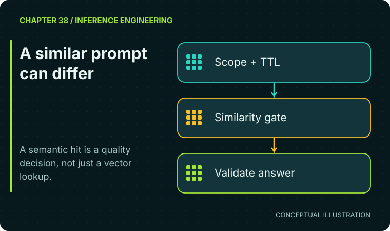

# Chapter 38 — Semantic Cache: Thresholds, False Hits, Economics

[](images/chapter-openers/38-inference.svg)


!!! warning "Evidence status"
    **Run on CPU, in a synthetic world:** the cache data structure, the Wilson interval, a cluster bootstrap, the economics formulas and 17 self-tests (`ch38_semantic_cache.py`).
    **Invented:** the embeddings. There is no embedding model in this chapter. Queries are synthetic unit vectors, so every similarity, threshold and rate below is a property of that synthetic world and **does not transfer** to a real model. Section 38.9 is the procedure that measures the real numbers; it is **UNTESTED** against a real embedding model.
    Sample outputs vary with seeds; the self-tests assert properties, not these exact numbers.

A semantic cache returns a stored answer when a new query is "close enough" to an old one, skipping the LLM call. The project brief says "98% similarity". That number means nothing on its own: it depends on the embedding model, and it says nothing about how often the cache returns a *wrong* answer. This chapter builds the cache, measures the wrong-answer rate with a confidence interval, and turns it into dollars.

## Worked system map

[](images/worked/ch38-inference.svg)


## 38.1 What is being cached, and what "same" means

A cache hit is correct only if the stored answer is also a correct answer to the new query. Embedding similarity is a proxy for that. The proxy fails in a specific way: queries that differ in one decisive token ("refund within 30 days" vs "within 3 days", "enable" vs "disable", a different account number) embed *very* close together. We call these **sibling intents** (hard negatives). Paraphrases of one intent should be close; siblings should not be, and often are.

```
 same intent (paraphrase)      cosine ~ high
 sibling intent (hard negative) cosine ~ high-ish  <- the dangerous overlap
 unrelated                      cosine ~ 0
```

## 38.2 The data structure

`SemanticCache` keeps entries in **partitions** keyed by everything that must be identical for an answer to be reusable: tenant, model, system-prompt hash, sampling parameters. A lookup only compares against its own partition. Per partition:

- cosine similarity by one matrix–vector product (vectors are unit length);
- strict TTL: an entry created at *t* is valid for `now < t + ttl`;
- LRU eviction at `max_entries` (ties broken by oldest creation);
- hit only if the best similarity ≥ threshold.

The cache rejects non-unit, nonfinite or wrong-dimensional vectors before changing state. Its dimension, TTL and per-partition capacity must be positive.

Derive the tenant partition from authenticated server-side identity, not text supplied by the requester. The example limits entries per partition, not total memory across arbitrary partitions; production needs a global budget and lifecycle cleanup. Expired entries cannot match but remain allocated until replacement, so `size()` counts stored slots rather than currently valid answers.

Complexity of a lookup is O(entries × dim) per partition. Whether 10⁵ entries is acceptable depends on dimension, latency target, concurrency and CPU memory bandwidth; benchmark the lookup before choosing an ANN index (such as HNSW), whose recall is then a second source of misses. Nothing in this chapter depends on the index.

## 38.3 Self-tests (17, all pass)

| Test | What it establishes |
|---|---|
| world sanity | mean cosine same > sibling > unrelated |
| unit norm | synthetic vectors are normalised |
| exact repeat | stored vector hits at τ=0.999999 with similarity 1 |
| partition isolation | 600 random ops (157 hits, so hits are exercised), no cross-partition return. True by construction of the dict keying; it guards regressions |
| TTL boundary | valid at 99.9 s, expired at exactly 100 s |
| LRU | touching entry 0 makes entry 1 the victim |
| determinism | same seed, same counts |
| monotone hit rate | **empirical**, not a theorem for a streaming cache (a higher τ means more inserts, which can mean more later hits): hit rate is nonincreasing over the grid used |
| false-hit trend | false-hit rate at τ=0.99 below that at 0.80 |
| Wilson, 0 events | upper bound for 0/200 is 0.0188 |
| Wilson exact coverage | exact binomial sum at n=200, p=0.02 gives 0.9331; asserted in [0.92, 0.98] because Wilson coverage oscillates with n and p |
| cluster bootstrap (2) | returns None with no events; on 40 false hits carried by 5 of 10 entries the interval [0.16, 0.64] is wider than the naive Wilson [0.31, 0.50] |
| exact-match baseline | (v, v, new, v) gives hit rate 0.50 |
| cost by hand | function equals the hand calculation |
| break-even | at the break-even cost, cache cost equals no-cache cost |
| `calibrate()` | picks the lowest τ whose Wilson upper bound ≤ 1% |

## 38.4 Experiment 1 — the similarity distributions

Sample output (synthetic embeddings):

| pair type | mean | p1 | p5 | p50 | p95 | p99 |
|---|---|---|---|---|---|---|
| same intent | 0.962 | 0.945 | 0.950 | 0.962 | 0.972 | 0.976 |
| sibling | 0.885 | 0.834 | 0.850 | 0.886 | 0.915 | 0.925 |
| unrelated | 0.000 | −0.278 | −0.201 | −0.002 | 0.206 | 0.282 |

| τ | recall of paraphrases | sibling false-match rate |
|---|---|---|
| 0.85 | 1.000 | 0.952 |
| 0.90 | 1.000 | 0.222 |
| 0.93 | 1.000 | 0.004 |
| 0.95 | 0.953 | 0.000 |
| 0.97 | 0.115 | 0.000 |
| 0.98 | 0.001 | 0.000 |

!!! note "This world is kinder than reality"
    Here the paraphrase p1 (0.945) sits above the sibling p99 (0.925), so a clean gap exists around 0.93–0.945. Real embedding models usually overlap: some true paraphrases score below some true siblings. Then no threshold gives both high recall and a low false-hit rate, and you trade one against the other. The synthetic world cannot tell you where that overlap is. Only a labelled set from your own traffic can.

Note the sharp cliff: recall falls from 0.953 at τ=0.95 to 0.115 at 0.97. A "98%" threshold in this world would cache almost nothing.

## 38.5 Experiment 2 — a streaming cache

3 seeds × 4000 queries, intents Zipf(1.0) over 240 intents, 10% exact repeats; a miss "calls the model" and inserts. Every hit is served by one cache entry, and **false hits cluster on bad entries**: a single wrong entry keeps serving wrong answers to every sibling query. At τ=0.90 the 640 false hits came from only **177 distinct entries**. Treating them as independent events (the Wilson column) therefore gives intervals that are too narrow. The cluster bootstrap resamples entries instead. This assumes independence across entries; if different entries share users, templates, sessions or an error mechanism, resample those larger groups instead. Entry-level Wilson bounds also need approximately independent entry labels.

| τ | hit rate | false / hit | Wilson (assumes independence) | cluster bootstrap | bad entries / serving entries | wrong / request |
|---|---|---|---|---|---|---|
| 0.85 | 0.979 | 0.6390 | [0.6303, 0.6476] | [0.5822, 0.6890] | 228 / 246 | 0.6257 |
| 0.90 | 0.948 | 0.0563 | [0.0522, 0.0607] | [0.0390, 0.0795] | 177 / 599 | 0.0533 |
| 0.93 | 0.941 | 0.0003 | [0.0001, 0.0008] | [0.0000, 0.0006] | 3 / 660 | 0.0003 |
| 0.95 | 0.927 | 0.0000 | [0.0000, 0.0003] | (0 events) | 0 / 779 | 0.0000 |
| 0.97 | 0.538 | 0.0000 | [0.0000, 0.0006] | (0 events) | 0 / 2172 | 0.0000 |
| 0.98 | 0.131 | 0.0000 | [0.0000, 0.0024] | (0 events) | 0 / 1213 | 0.0000 |
| 0.99 | 0.101 | 0.0000 | [0.0000, 0.0032] | (0 events) | 0 / 973 | 0.0000 |

How to read it:

- At τ=0.90 the cluster interval [0.039, 0.080] is about twice as wide as Wilson's [0.052, 0.061].
- With zero events the empirical percentile bootstrap degenerates at zero and supplies no useful upper risk bound. The honest bound is at the entry level: 0 bad entries among 779 serving entries at τ=0.95 gives a Wilson upper bound of **0.49% bad entries**. A zero count is never "no risk".
- At τ=0.93, three bad entries is too few for a percentile bootstrap to be trusted; the entry-level Wilson interval on 3 / 660 is [0.15%, 1.3%].

**The baseline that matters is an exact-match cache, not "no cache".** A hash cache on the same streams hits 0.100 of requests with zero false hits. At τ ≥ 0.98 the semantic cache's whole hit rate (0.101–0.131) is essentially those exact repeats; the semantic part adds nearly nothing there. The hit rates above are high because 240 intents repeat across 12 000 queries; a long-tail workload will have far fewer.

## 38.6 Experiment 3 — economics

Per request, the cache costs

`cost = c_emb + (1 − hit) × c_llm + wrong × c_bad`

where `wrong` is wrong answers per request and `c_bad` is the cost of one wrong answer (escalation, refund, lost trust). `c_bad` is the number nobody has, and it decides the answer. Assumed: c_llm = $0.004, c_emb = $0.00002.

Net saving versus **no cache**, milli-dollars per request (an exact-match cache would save 0.402 at every `c_bad`, so subtract that to see what the *semantic* part adds):

| τ | c_bad=$0.01 | $0.05 | $0.25 | $1.00 | break-even c_bad |
|---|---|---|---|---|---|
| 0.85 | −2.360 | −27.387 | −152.520 | −621.770 | 0.006 |
| 0.90 | 3.237 | 1.104 | −9.563 | −49.563 | 0.071 |
| 0.93 | 3.743 | 3.733 | 3.683 | 3.495 | 14.981 |
| 0.95 | 3.689 | 3.689 | 3.689 | 3.689 | ∞ |
| 0.97 | 2.134 | 2.134 | 2.134 | 2.134 | ∞ |

Best τ by `c_bad`: 0.93 for $0.01 and $0.05; 0.95 for $0.25 and $1.00.

**How fragile that ordering is.** τ=0.93 had 3 false hits in 12 000 requests. The two thresholds cross where `c_bad` = (extra hits × c_llm)/(extra wrong answers) = **$0.225**. With 2 false hits instead of 3 the crossover moves to $0.338; with 4 it moves to $0.169. The break-even `c_bad` for τ=0.93 (14.98) also rests on those 3 events: using the Wilson interval for wrong answers per request, [0.000085, 0.000735], it ranges from about **$5 to $44**. So the 0.93-versus-0.95 choice is not resolved by this experiment; what is clear is that τ ≤ 0.90 is unsafe and τ ≥ 0.97 forfeits most of the hit rate.

**Hand check, τ=0.90, c_bad=$0.05.** Saving = 0.948×4 − 0.02 − 0.0533×50 = 3.792 − 0.02 − 2.665 = 1.107 milli-dollars (table: 1.104; difference is rounding of the inputs).
**Break-even, τ=0.90.** (0.948×0.004 − 0.00002)/0.0533 = 0.0708, matching 0.071.

If there are no wrong answers but the saved LLM cost is smaller than embedding cost, no nonnegative wrong-answer price makes the cache profitable. The helper returns `-inf` for that infeasible break-even case; `+inf` means it pays at every nonnegative wrong-answer price when the observed wrong rate is zero.

Two lessons. A cache that is wrong 5% of the time (τ=0.90) breaks even at a wrong-answer cost of about 7 cents; whether that is above or below your real cost is your call, and you should measure it. And the best threshold *moves* with `c_bad`; it is a business parameter, not a model constant.

## 38.7 Experiment 4 — "98%" is model-specific

The same threshold on two synthetic "embedding models" (A: tight paraphrases, B: noisier):

| model | τ=0.95 hit rate | τ=0.98 hit rate |
|---|---|---|
| A | 0.908 | 0.125 |
| B | 0.107 | 0.103 |

A threshold copied from a blog post can turn a 91% hit rate into 11% on a different model. Calibrate per model, and recalibrate on every model change.

## 38.8 Failure modes

| Failure | Mechanism | Evidence here | Defence |
|---|---|---|---|
| Sibling confusion | one-token differences embed close | 0.64 false/hit at τ=0.85 | calibrate on hard negatives; add a rerank or exact-match guard on numbers, negations, entities |
| Cross-tenant leak | shared partition, tenant-specific answers | shared: 1873 of 3718 hits wrong tenant (0.504); partitioned: 1 of 3489 | partition by tenant; never share caches across tenants |
| Staleness | the underlying answer changes | τ=0.97, change at t=2000 s, run ends at 4000 s: TTL=∞ 99 stale of 1109 hits after the change (0.089); TTL 3600 s behaves like ∞ because only 2000 s follow the change; TTL 600 s: 9 of 662 (0.014); 120 s: 0 of 329 | TTL by volatility, explicit invalidation on source change |
| Embedding-model upgrade | old and new vectors are not comparable | by construction | include the embedding model version in the partition key; rebuild |
| Parameter mismatch | temperature, tools, system prompt differ | by construction | include them in the key |
| Poisoning | one bad answer is served forever | by construction | do not cache failed, truncated or low-confidence responses; TTL bounds the damage |
| Personal data | cached answers contain user data | by construction | do not cache responses that included user-specific retrieval; per-user partition |

The single wrong answer under partitioning (1 of 3489 hits) is an ordinary sibling false hit: within one tenant's partition the stored answer belonged to a neighbouring intent. Partitioning removes the cross-tenant channel; it does not remove sibling errors.

## 38.9 Runbook: calibrating on real traffic (UNTESTED against a real model)

**Two different error rates are in play.** A labelled pair set measures the *pairwise* false-match rate: given two queries with different intents, how often is their cosine above τ. Production measures the *per-hit* false rate: of the lookups that hit, how many served a wrong answer. They differ because a lookup takes the **maximum** similarity over N stored entries, so more entries mean more chances for a sibling to clear τ; and because a labelled set that oversamples adversarial negatives overstates how common siblings are in real traffic. Use the pair set to **choose a candidate threshold**; use shadow mode to **accept** it.

1. **Install.** `pip install numpy sentence-transformers`.
2. **Build a labelled pair set.** At least 1000 pairs from your own logs: same-intent paraphrases and adversarial negatives (same template, different number/entity/negation). Label "same" only if the cached answer would be acceptable. Write it as JSON lines, one object per line: `{"a": "...", "b": "...", "same": true}`.
3. **Sweep.** `python3 /full/path/ch38_semantic_cache.py calibrate /full/path/pairs.jsonl BAAI/bge-small-en-v1.5` (any sentence-transformers model name). It prints recall and the Wilson upper bound on the pairwise false-match rate for each threshold from 0.80 to 0.99 and the lowest threshold with upper bound ≤ 1%. The `calibrate()` logic is tested; the model-loading path is not.
4. **Size the sample.** For a fixed threshold and independent labelled negative pairs, an approximate Wilson upper bound ≤ 1% with zero observed false matches requires about 381 different-intent pairs; for 0.1%, about 3838.
5. **Shadow mode (the acceptance test).** Serve every request from the model, but also look up the cache. On each would-be hit, compare the cached answer with the fresh one using a rubric, exact match or a judge model, plus a hand-checked sample. Count false hits **by serving entry**, and report the bad-entry rate with a Wilson interval and the per-hit rate with a cluster bootstrap over entries (as in 38.5). Accept only if the upper bounds meet your budget.
6. **Canary.** Serve from the cache to 1–5% of traffic, with a one-click kill switch and a dashboard of hit rate, shadow-disagreement rate and user re-asks.
7. **Re-run steps 2–6** on any change of embedding model, system prompt or tenant mix.

<!-- BEGIN COMPLETE INFERENCE SOURCE -->
## Complete runnable code

The complete implementation is shown below, including its checks and entry point. The listing and downloadable `.py` file contain exactly the same source. Copy the file under the displayed filename; keep supporting files in the same directory.

[Download all inference examples and supporting modules](examples/inference-systems/inference-systems.zip) or read the [environment and command guide](examples/inference-systems/README.md).

The [follow-up agent audit](inference-adversarial-review-2026-11-25.md) records the corrections, fresh CPU captures and hardware limits for this source.

Read it in three passes: start with `World` and `SemanticCache` to identify the state; trace `run_stream` and `calibrate` for one request or token; then follow `selftests` and `calib_selftest` to see how the result is checked.

From the repository root:

```bash
python3 docs/examples/inference-systems/ch38_semantic_cache.py --selftest
# Run the full chapter demonstrations:
python3 docs/examples/inference-systems/ch38_semantic_cache.py
```

### ch38_semantic_cache.py

[Download ch38_semantic_cache.py](examples/inference-systems/ch38_semantic_cache.py)

```python title="ch38_semantic_cache.py" linenums="1"
#!/usr/bin/env python3
"""Chapter 38: a semantic response cache, its threshold, its false hits, its economics, and its failure modes.

Run:  python3 ch38_semantic_cache.py            # self-tests + all experiments (about 30-60 s, CPU, needs numpy)
      python3 ch38_semantic_cache.py --selftest # self-tests only

WHAT IS REAL: the cache data structure (partitioned by tenant/model/params, TTL, LRU, cosine lookup), the Wilson
confidence interval, the economics formulas, and the experimental method.
WHAT IS INVENTED: the "embeddings". There is no embedding model here: queries are synthetic unit vectors in which a
paraphrase is its intent's centre plus noise, and "sibling" intents (the same question with a different number,
negation, entity...) are centres placed close together. Every similarity value, every threshold and every rate printed
below is a property of this synthetic world. NONE of them transfers to a real embedding model; Section 38.9 shows how
to measure the real ones.
"""
import math
import sys
import time

import numpy as np


# =============================================================== 1. synthetic world (stand-in for an embedding model)
def unit(m):
    return m / np.linalg.norm(m, axis=-1, keepdims=True)


class World:
    """F families of M sibling intents. Siblings are near each other (hard negatives); families are far apart.
    s_para: paraphrase noise (bigger = noisier embedding model). s_sib: sibling spread inside a family."""
    def __init__(self, seed=0, families=60, members=4, dim=64, s_para=0.20, s_sib=0.30):
        self.rng = np.random.default_rng(seed)
        self.dim, self.F, self.M, self.s_para = dim, families, members, s_para
        fam = unit(self.rng.standard_normal((families, dim)))
        self.family = np.repeat(np.arange(families), members)
        self.centres = unit(fam[self.family] + s_sib * self._noise(families * members))
        self.n_intents = families * members

    def _noise(self, rows):
        return self.rng.standard_normal((rows, self.dim)) / math.sqrt(self.dim)

    def paraphrase(self, intents):
        intents = np.asarray(intents)
        return unit(self.centres[intents] + self.s_para * self._noise(len(intents)))

    def stream(self, n, zipf=1.0, dup_frac=0.10):
        """n queries: intents ~ Zipf; a fraction are exact repeats of an earlier query vector."""
        p = 1.0 / np.arange(1, self.n_intents + 1) ** zipf
        p /= p.sum()
        intents = self.rng.choice(self.n_intents, size=n, p=p)
        vecs = self.paraphrase(intents)
        for i in range(1, n):
            if self.rng.random() < dup_frac:                      # exact repeat of an earlier request
                j = self.rng.integers(0, i)
                intents[i], vecs[i] = intents[j], vecs[j]
        return intents, vecs


# =============================================================== 2. the cache
class SemanticCache:
    """Cosine-similarity response cache.

    Entries live in PARTITIONS keyed by whatever must be identical for an answer to be reusable (tenant, model,
    system prompt hash, sampling parameters...). A lookup only ever compares against its own partition.
    Per partition: at most `max_entries` (LRU eviction) and entries older than `ttl` seconds are invalid (strict:
    an entry created at t is valid for now < t + ttl). Vectors must be unit length; lookup returns the best match
    at or above the threshold, or None."""
    def __init__(self, dim, threshold, ttl=math.inf, max_entries=100000):
        if dim <= 0 or max_entries <= 0 or ttl <= 0 or math.isnan(ttl):
            raise ValueError("dimension, capacity and TTL must be positive")
        if not math.isfinite(threshold) or not -1 <= threshold <= 1:
            raise ValueError("cosine threshold must be finite and in [-1, 1]")
        self.dim, self.threshold, self.ttl, self.max_entries = dim, threshold, ttl, max_entries
        self.parts = {}                                           # key -> dict(mat, n, meta[list of dict])

    def _part(self, key):
        if key not in self.parts:
            self.parts[key] = dict(mat=np.zeros((64, self.dim)), n=0, meta=[])
        return self.parts[key]

    def _vector(self, vec):
        vec = np.asarray(vec, dtype=float)
        if vec.shape != (self.dim,) or not np.isfinite(vec).all():
            raise ValueError("cache vector must have the declared dimension and finite values")
        if not np.isclose(np.linalg.norm(vec), 1.0, rtol=1e-5, atol=1e-7):
            raise ValueError("cosine cache requires unit-length vectors")
        return vec

    def lookup(self, key, vec, now=0.0):
        vec = self._vector(vec)
        p = self.parts.get(key)
        if p is None or p["n"] == 0:
            return None, -1.0
        sims = p["mat"][:p["n"]] @ vec
        created = np.array([m["created"] for m in p["meta"]])
        sims = np.where(now < created + self.ttl, sims, -np.inf)    # expired entries cannot match
        j = int(np.argmax(sims))
        if sims[j] >= self.threshold:
            p["meta"][j]["last_used"] = now
            return p["meta"][j], float(sims[j])
        return None, float(sims[j]) if np.isfinite(sims[j]) else -1.0

    def insert(self, key, vec, answer, now=0.0, **extra):
        vec = self._vector(vec)
        p = self._part(key)
        meta = dict(answer=answer, created=now, last_used=now, **extra)
        if p["n"] < self.max_entries:
            if p["n"] == p["mat"].shape[0]:
                p["mat"] = np.vstack([p["mat"], np.zeros_like(p["mat"])])
            slot = p["n"]; p["n"] += 1
            p["meta"].append(meta)
        else:                                                      # evict least recently used (ties: oldest created)
            slot = min(range(p["n"]), key=lambda i: (p["meta"][i]["last_used"], p["meta"][i]["created"]))
            p["meta"][slot] = meta
        p["mat"][slot] = vec
        return meta

    def size(self, key=None):
        return sum(p["n"] for p in self.parts.values()) if key is None else self.parts.get(key, {"n": 0})["n"]


# =============================================================== 3. statistics and economics
def wilson(x, n, z=1.959964):
    """95% Wilson score interval for a binomial proportion. Well behaved at x=0 and for small p, unlike the normal interval."""
    if n == 0:
        return (0.0, 1.0)
    p = x / n
    d = 1 + z * z / n
    c = (p + z * z / (2 * n)) / d
    h = z * math.sqrt(p * (1 - p) / n + z * z / (4 * n * n)) / d
    return max(0.0, c - h), min(1.0, c + h)


def wilson_exact_coverage(n, p, z=1.959964):
    """EXACT coverage of the Wilson interval for Binomial(n, p): sum the pmf over every x whose interval contains p."""
    cov = 0.0
    for x in range(n + 1):
        lo, hi = wilson(x, n, z)
        if lo <= p <= hi:
            cov += math.comb(n, x) * p ** x * (1 - p) ** (n - x)
    return cov


def cluster_bootstrap_ratio(num, den, B=2000, seed=0):
    """95% percentile bootstrap CI for sum(num)/sum(den) resampling CLUSTERS (here: cache entries), because the
    false hits of one bad entry are not independent events. Returns None if there are no events at all."""
    num, den = np.asarray(num, float), np.asarray(den, float)
    if num.sum() == 0:
        return None
    rng = np.random.default_rng(seed)
    idx = rng.integers(0, len(num), (B, len(num)))
    r = num[idx].sum(1) / np.maximum(den[idx].sum(1), 1)
    return float(np.percentile(r, 2.5)), float(np.percentile(r, 97.5))


def exact_match_stream(vecs):
    """Baseline: a hash (exact-match) cache. Hit iff the identical vector was seen before. Zero false hits by construction
    (identical vector = identical intent here). This, not 'no cache', is what a semantic cache must beat."""
    seen, hits = set(), 0
    for v in vecs:
        k = v.tobytes()
        if k in seen:
            hits += 1
        else:
            seen.add(k)
    return hits / len(vecs)


def cost_per_request(hit_rate, wrong_rate, c_llm, c_emb, c_bad):
    """Every request pays the embedding/lookup; misses pay the LLM; wrong answers pay c_bad (escalation, refund, trust)."""
    return c_emb + (1 - hit_rate) * c_llm + wrong_rate * c_bad


def breakeven_bad_cost(hit_rate, wrong_rate, c_llm, c_emb):
    """Largest c_bad at which the cache is still no worse than no cache: c_llm = cost_per_request(...)."""
    net_saved = hit_rate * c_llm - c_emb
    if wrong_rate > 0:
        return net_saved / wrong_rate
    # With no wrong answers c_bad is irrelevant, but a cache with insufficient
    # hits may still fail to pay for its embedding cost even when c_bad=0.
    return math.inf if net_saved >= 0 else -math.inf


# =============================================================== 4. experiments
def run_stream(world, intents, vecs, threshold, ttl=math.inf, key_fn=None, answer_fn=None, now_fn=None, versions=None):
    """Replay a stream. Miss -> 'call the model' (the correct answer for that intent) and insert. Hit -> serve the cached
    answer. Returns counts and per-request details."""
    cache = SemanticCache(world.dim, threshold, ttl)
    n = len(intents)
    hits = false_hits = stale = 0
    entries = []                                                   # every inserted entry; hits are CLUSTERED on entries
    for i in range(n):
        now = now_fn(i) if now_fn else float(i)
        key = key_fn(i) if key_fn else "default"
        truth = answer_fn(i) if answer_fn else int(intents[i])
        entry, sim = cache.lookup(key, vecs[i], now)
        if entry is not None:
            hits += 1
            entry["served"] = entry.get("served", 0) + 1
            if entry["answer"] != truth:
                false_hits += 1
                entry["bad"] = entry.get("bad", 0) + 1
        else:
            entries.append(cache.insert(key, vecs[i], truth, now))
    served = np.array([e.get("served", 0) for e in entries]); bad = np.array([e.get("bad", 0) for e in entries])
    return dict(n=n, hits=hits, false_hits=false_hits, served=served, bad=bad)


def cosine_table(world, n_pairs=20000):
    rng = np.random.default_rng(99)
    a = rng.integers(0, world.n_intents, n_pairs)
    same = (world.paraphrase(a) * world.paraphrase(a)).sum(1)
    sib_b = (a // world.M) * world.M + (a % world.M + rng.integers(1, world.M, n_pairs)) % world.M
    sib = (world.paraphrase(a) * world.paraphrase(sib_b)).sum(1)
    other_b = (a + world.M * rng.integers(1, world.F, n_pairs)) % world.n_intents
    other = (world.paraphrase(a) * world.paraphrase(other_b)).sum(1)
    return same, sib, other


def threshold_sweep(world, taus, n=4000, seeds=(1, 2, 3)):
    out = {}
    for tau in taus:
        h = f = t = 0
        sv, bd = [], []
        for s in seeds:
            w = World(seed=s, s_para=world.s_para)
            intents, vecs = w.stream(n)
            r = run_stream(w, intents, vecs, tau)
            h += r["hits"]; f += r["false_hits"]; t += r["n"]
            sv.append(r["served"]); bd.append(r["bad"])
        out[tau] = dict(n=t, hits=h, false_hits=f, served=np.concatenate(sv), bad=np.concatenate(bd))
    return out


def selftests():
    res = []

    def check(name, cond):
        res.append(bool(cond))
        print(f"  [{'PASS' if cond else 'FAIL'}] {name}")

    w = World(seed=0)
    same, sib, other = cosine_table(w, 8000)
    check(f"world sanity: mean cosine same-intent ({same.mean():.3f}) > sibling ({sib.mean():.3f}) > unrelated ({other.mean():.3f})",
          same.mean() > sib.mean() > other.mean())
    check("all synthetic vectors have unit norm", np.allclose(np.linalg.norm(w.paraphrase(np.arange(50)), axis=1), 1.0))

    # exact duplicate hits at (almost) threshold 1
    c = SemanticCache(w.dim, 0.999999)
    v = w.paraphrase([3])[0]
    c.insert("t", v, "ans")
    e, s = c.lookup("t", v)
    check("an exact repeat of a stored vector hits at threshold 0.999999 with similarity 1", e is not None and abs(s - 1.0) < 1e-9)

    # partition isolation (property test over random operations)
    rng = np.random.default_rng(5)
    c = SemanticCache(w.dim, 0.5)
    ok, nhit = True, 0
    for step in range(600):
        key = f"tenant{rng.integers(0, 3)}"
        vec = w.paraphrase([int(rng.integers(0, w.n_intents))])[0]
        if rng.random() < 0.5:
            c.insert(key, vec, ("owner", key))
        else:
            e, _ = c.lookup(key, vec)
            nhit += e is not None
            ok &= (e is None or e["answer"] == ("owner", key))
    check(f"partition isolation: in 600 random operations ({nhit} of them hits, so the test exercises hits) no lookup returns another partition's entry. By construction of the dict keying; this guards regressions", ok and nhit > 0)

    # TTL, strict boundary
    c = SemanticCache(w.dim, 0.9, ttl=100.0)
    c.insert("k", v, "a", now=0.0)
    check("TTL: valid at t=99.9, expired at exactly t=100 (strict) and after",
          c.lookup("k", v, 99.9)[0] is not None and c.lookup("k", v, 100.0)[0] is None and c.lookup("k", v, 500.0)[0] is None)

    # LRU eviction
    c = SemanticCache(w.dim, 0.99, max_entries=3)
    vs = w.paraphrase([0, 10, 20, 30])
    for i in range(3):
        c.insert("k", vs[i], i, now=float(i))
    c.lookup("k", vs[0], now=10.0)                                  # touch entry 0 so entry 1 is now the LRU
    c.insert("k", vs[3], 3, now=11.0)
    kept = {m["answer"] for m in c.parts["k"]["meta"]}
    check("LRU: capacity 3, after touching entry 0 the least recently used (entry 1) is evicted", kept == {0, 2, 3})

    # determinism
    r1 = run_stream(*(lambda ww: (ww, *ww.stream(1500)))(World(seed=4)), 0.95)
    r2 = run_stream(*(lambda ww: (ww, *ww.stream(1500)))(World(seed=4)), 0.95)
    check("replaying the same seeded stream gives identical counts and per-entry tallies",
          (r1["n"], r1["hits"], r1["false_hits"]) == (r2["n"], r2["hits"], r2["false_hits"]) and np.array_equal(r1["served"], r2["served"]) and np.array_equal(r1["bad"], r2["bad"]))

    # monotonicity in the threshold
    taus = (0.80, 0.88, 0.92, 0.95, 0.97, 0.99)
    sw = threshold_sweep(w, taus, n=2500, seeds=(1, 2))
    hr = [sw[t]["hits"] / sw[t]["n"] for t in taus]
    check(f"EMPIRICAL (not a theorem for a streaming cache: a higher threshold means more inserts, which can mean more later hits): hit rate is nonincreasing over this threshold grid {[round(x, 2) for x in hr]}", all(a >= b - 1e-9 for a, b in zip(hr, hr[1:])))
    fr = {t: sw[t]["false_hits"] / max(1, sw[t]["hits"]) for t in taus}
    check(f"false-hit rate at threshold 0.99 ({fr[0.99]:.3f}) is below that at 0.80 ({fr[0.80]:.3f})", fr[0.99] < fr[0.80])

    # Wilson interval
    lo, hi = wilson(0, 200)
    check(f"Wilson upper bound for 0 events in 200 trials is {hi:.4f} (about 3/n = 0.015 to 0.019)", 0.018 < hi < 0.0195 and lo == 0.0)
    cov = wilson_exact_coverage(200, 0.02)
    check(f"Wilson 95% interval, EXACT coverage at n=200, p=0.02 (binomial sum, no simulation): {cov:.4f}; asserted in [0.92, 0.98] (Wilson coverage oscillates with n and p)",
          0.92 <= cov <= 0.98)
    check("cluster bootstrap: with 5 entries carrying all 40 false hits of 100 hits the interval is wide, and with no events it returns None",
          cluster_bootstrap_ratio(np.array([8, 8, 8, 8, 8, 0, 0, 0, 0, 0]), np.array([10] * 10)) is not None
          and cluster_bootstrap_ratio(np.zeros(10), np.ones(10)) is None)
    lo, hi = cluster_bootstrap_ratio(np.array([8, 8, 8, 8, 8, 0, 0, 0, 0, 0]), np.array([10] * 10))
    check(f"... and it is wider than the naive Wilson interval on the same 40/100: cluster [{lo:.2f},{hi:.2f}] vs Wilson [{wilson(40, 100)[0]:.2f},{wilson(40, 100)[1]:.2f}]",
          (hi - lo) > (wilson(40, 100)[1] - wilson(40, 100)[0]))
    ex = exact_match_stream(np.vstack([v[None], v[None], w.paraphrase([5]), v[None]]))
    check(f"exact-match baseline: 4 queries (v, v, new, v) -> hit rate {ex:.2f} (= 2/4: the 2nd and 4th are repeats; the 3rd is new)", abs(ex - 0.5) < 1e-12)

    # economics: hand computation
    cpr = cost_per_request(0.40, 0.01, c_llm=0.004, c_emb=0.00002, c_bad=0.10)
    check(f"cost per request by hand: 0.00002 + 0.6*0.004 + 0.01*0.10 = {0.00002 + 0.0024 + 0.001:.5f}; function gives {cpr:.5f}",
          abs(cpr - 0.00342) < 1e-12)
    be = breakeven_bad_cost(0.40, 0.01, 0.004, 0.00002)
    check(f"break-even bad-answer cost = (0.40*0.004 - 0.00002)/0.01 = {be:.4f}, and at that cost the cache equals no cache",
          abs(cost_per_request(0.40, 0.01, 0.004, 0.00002, be) - 0.004) < 1e-12)
    return all(res)


def experiments():
    w = World(seed=0)
    print("\n== 1. Cosine similarity of query pairs in the synthetic world (NOT a real embedding model) ==")
    same, sib, other = cosine_table(w)
    q = lambda a, p: np.percentile(a, p)
    print(f"  {'pair type':28s} {'mean':>6s} {'p1':>6s} {'p5':>6s} {'p50':>6s} {'p95':>6s} {'p99':>6s}")
    for name, a in (("same intent (paraphrase)", same), ("sibling intent (hard negative)", sib), ("unrelated", other)):
        print(f"  {name:28s} {a.mean():6.3f} {q(a,1):6.3f} {q(a,5):6.3f} {q(a,50):6.3f} {q(a,95):6.3f} {q(a,99):6.3f}")
    print("\n  threshold   recall of paraphrases   sibling false-match rate")
    for tau in (0.85, 0.90, 0.93, 0.95, 0.97, 0.98, 0.99):
        print(f"  {tau:9.2f}   {np.mean(same >= tau):21.3f}   {np.mean(sib >= tau):24.3f}")

    print("\n== 2. Streaming cache: hit rate and false hits versus threshold (3 seeds x 4000 queries, Zipf 1.0, 10% exact repeats) ==")
    taus = (0.85, 0.90, 0.93, 0.95, 0.97, 0.98, 0.99, 0.999)
    sw = threshold_sweep(w, taus)
    print(f"  {'tau':>6s} {'hit rate':>9s} {'false/hit':>10s} {'Wilson (iid, too narrow)':>26s} {'cluster bootstrap':>20s} {'bad entries':>12s} {'wrong/request':>14s}")
    for t in taus:
        r = sw[t]; fr = r["false_hits"] / max(1, r["hits"]); lo, hi = wilson(r["false_hits"], r["hits"])
        cb = cluster_bootstrap_ratio(r["bad"], r["served"])
        cbs = f"[{cb[0]:7.4f},{cb[1]:7.4f}]" if cb else "(0 events)".rjust(17)
        nserv = int((r["served"] > 0).sum()); nbad = int((r["bad"] > 0).sum())
        print(f"  {t:6.3f} {r['hits']/r['n']:9.3f} {fr:10.4f} [{lo:7.4f},{hi:7.4f}] {cbs:>20s} {nbad:5d}/{nserv:<6d} {r['false_hits']/r['n']:14.4f}")
    r95 = sw[0.95]
    print(f"  at tau=0.95 there were 0 false hits among {int((r95['served'] > 0).sum())} serving entries: Wilson upper bound on the BAD-ENTRY rate = {wilson(0, int((r95['served'] > 0).sum()))[1]:.4f}")
    r90 = sw[0.90]
    print(f"  at tau=0.90 the {r90['false_hits']} false hits came from only {int((r90['bad'] > 0).sum())} distinct entries (clustering)")

    xs = [exact_match_stream(World(seed=s_).stream(4000)[1]) for s_ in (1, 2, 3)]
    exact_hit = float(np.mean(xs))
    print(f"\n  EXACT-MATCH (hash) cache baseline on the same streams: hit rate {exact_hit:.3f}, zero false hits. At tau >= 0.98 the semantic cache's whole hit rate is this.")

    print("\n== 3. Economics (ASSUMED costs): c_llm=$0.004, c_emb=$0.00002 per request; sweep the cost of a wrong answer ==")
    c_llm, c_emb = 0.004, 0.00002
    print(f"  {'tau':>6s}" + "".join(f"  c_bad=${b:<5g}" for b in (0.01, 0.05, 0.25, 1.0)) + "   break-even c_bad")
    best = {}
    for b in (0.01, 0.05, 0.25, 1.0):
        best[b] = max(taus, key=lambda t: c_llm - cost_per_request(sw[t]["hits"] / sw[t]["n"], sw[t]["false_hits"] / sw[t]["n"], c_llm, c_emb, b))
    for t in taus:
        r = sw[t]; h, wr = r["hits"] / r["n"], r["false_hits"] / r["n"]
        cells = "".join(f"  {1e3 * (c_llm - cost_per_request(h, wr, c_llm, c_emb, b)):9.3f}" for b in (0.01, 0.05, 0.25, 1.0))
        be = breakeven_bad_cost(h, wr, c_llm, c_emb)
        print(f"  {t:6.3f}{cells}   {('inf' if be == math.inf else f'{be:8.3f}'):>8s}")
    print("  (cells: net saving in milli-dollars per request versus NO cache; negative = the cache costs money)")
    print(f"  Exact-match baseline saves {1e3 * exact_hit * c_llm:.3f} milli-dollars per request at any c_bad (no false hits). The semantic cache's EXTRA saving over it is the cell minus that.")
    print("  best threshold by c_bad: " + ", ".join(f"${b}: {best[b]}" for b in best))
    h93, w93, h95, w95 = sw[0.93]["hits"] / sw[0.93]["n"], sw[0.93]["false_hits"] / sw[0.93]["n"], sw[0.95]["hits"] / sw[0.95]["n"], sw[0.95]["false_hits"] / sw[0.95]["n"]
    cross = (h93 - h95) * c_llm / (w93 - w95) if w93 > w95 else math.inf
    print(f"  crossover c_bad between tau=0.93 and 0.95: {cross:.3f}  (above it 0.95 wins). tau=0.93 has only {sw[0.93]['false_hits']} false hits in {sw[0.93]['n']} requests;")
    for k in (max(0, sw[0.93]['false_hits'] - 1), sw[0.93]['false_hits'] + 1):
        wk = k / sw[0.93]["n"]
        ck = (h93 - h95) * c_llm / (wk - w95) if wk > w95 else math.inf
        print(f"    with {k} false hits instead the crossover would be {ck:.3f}")

    print("\n== 4. Why '98%' is meaningless without the model: the same threshold on two embedding models ==")
    for name, sp in (("model A (tight paraphrases, s_para=0.20)", 0.20), ("model B (noisier paraphrases, s_para=0.35)", 0.35)):
        ww = World(seed=0, s_para=sp)
        rs = threshold_sweep(ww, (0.95, 0.98), n=3000)
        for t in (0.95, 0.98):
            r = rs[t]
            print(f"  {name:46s} tau={t}: hit rate {r['hits']/r['n']:.3f}  false/hit {r['false_hits']/max(1,r['hits']):.4f}")

    print("\n== 5. Cross-tenant leak: same questions, tenant-specific answers; cache keyed with and without the tenant ==")
    w5 = World(seed=11)
    n = 4000
    intents, vecs = w5.stream(n)
    tenant = np.random.default_rng(3).integers(0, 2, n)
    for label, keyfn in (("one shared partition", lambda i: "all"), ("partition per tenant", lambda i: f"t{tenant[i]}")):
        r = run_stream(w5, intents, vecs, 0.95, key_fn=keyfn, answer_fn=lambda i: (int(tenant[i]), int(intents[i])))
        print(f"  {label:22s}: hits {r['hits']:5d}  answers belonging to the wrong tenant {r['false_hits']:5d} ({r['false_hits']/max(1,r['hits']):.3f} of hits)")

    print("\n== 6. Staleness: tau=0.97; 25% of answers change at t=2000 (1 request/second, horizon 4000 s, so only 2000 s follow the change; TTL 3600 therefore behaves like infinity) ==")
    w6 = World(seed=21)
    n = 4000
    intents, vecs = w6.stream(n, dup_frac=0.0)
    changed = np.random.default_rng(8).random(w6.n_intents) < 0.25
    version = lambda i: 1 if (i >= 2000 and changed[intents[i]]) else 0
    for ttl in (math.inf, 3600.0, 600.0, 120.0):
        cache = SemanticCache(w6.dim, 0.97, ttl)
        hits_after = stale_after = hits = 0
        for i in range(n):
            e, _ = cache.lookup("k", vecs[i], float(i))
            truth = (int(intents[i]), version(i))
            if e is not None:
                hits += 1
                if i >= 2000:
                    hits_after += 1
                    stale_after += e["answer"] != truth
            else:
                cache.insert("k", vecs[i], truth, float(i))
        print(f"  ttl={'inf' if ttl == math.inf else int(ttl):>5}: hit rate {hits / n:.3f}   after the change: {stale_after:4d} stale of {hits_after:4d} hits ({stale_after / max(1, hits_after):.3f})")


def calibrate(sims, same, taus, max_false_hit=0.01):
    """Pick the LOWEST threshold whose Wilson UPPER bound on the false-match rate among DIFFERENT-intent pairs is
    <= max_false_hit. sims: cosine per labelled pair; same: bool per pair (True = same intent / reusable answer).
    Returns (chosen_tau or None, table rows (tau, recall, false_x, false_n, upper))."""
    sims, same = np.asarray(sims), np.asarray(same, bool)
    diff = sims[~same]
    rows, chosen = [], None
    for t in sorted(taus):
        x = int((diff >= t).sum())
        up = wilson(x, len(diff))[1]
        rows.append((t, float((sims[same] >= t).mean()), x, len(diff), up))
        if chosen is None and up <= max_false_hit:
            chosen = t
    return chosen, rows


def calibrate_cli(path, model_name):
    """UNTESTED against a real model. pairs.jsonl lines: {"a": "...", "b": "...", "same": true|false}"""
    import json
    from sentence_transformers import SentenceTransformer          # pip install sentence-transformers
    model = SentenceTransformer(model_name)
    pairs = [json.loads(l) for l in open(path)]
    ea = model.encode([p["a"] for p in pairs], normalize_embeddings=True)
    eb = model.encode([p["b"] for p in pairs], normalize_embeddings=True)
    sims = (ea * eb).sum(1)
    chosen, rows = calibrate(sims, [p["same"] for p in pairs], [round(0.80 + 0.01 * i, 2) for i in range(20)])
    for t, rec, x, n, up in rows:
        print(f"tau={t:.2f} recall={rec:.3f} false_matches={x}/{n} upper95={up:.4f}")
    print("chosen threshold:", chosen)


def calib_selftest():
    w = World(seed=0)
    rng = np.random.default_rng(2)
    a = rng.integers(0, w.n_intents, 3000)
    sa = w.paraphrase(a)
    same_sims = (sa * w.paraphrase(a)).sum(1)
    b = (a // w.M) * w.M + (a % w.M + rng.integers(1, w.M, 3000)) % w.M
    sib_sims = (sa * w.paraphrase(b)).sum(1)
    sims = np.concatenate([same_sims, sib_sims])
    lab = np.concatenate([np.ones(3000, bool), np.zeros(3000, bool)])
    chosen, rows = calibrate(sims, lab, [0.90, 0.92, 0.93, 0.94, 0.95, 0.96])
    ok = chosen is not None and all(r[4] > 0.01 for r in rows if r[0] < chosen) and rows[[r[0] for r in rows].index(chosen)][4] <= 0.01
    print(f"  [{'PASS' if ok else 'FAIL'}] calibrate() picks tau={chosen}: lowest threshold with Wilson upper bound <= 1% on 3000 sibling pairs")
    return ok


if __name__ == "__main__":
    if len(sys.argv) > 1 and sys.argv[1] == "calibrate":
        calibrate_cli(sys.argv[2], sys.argv[3]); sys.exit(0)
    t0 = time.time()
    print("self-tests:")
    ok = selftests()
    ok = calib_selftest() and ok
    if "--selftest" not in sys.argv:
        experiments()
    print(f"\n{'ALL PASS' if ok else 'FAILURES'}   ({time.time() - t0:.0f} s)")
    sys.exit(0 if ok else 1)
```

<!-- END COMPLETE INFERENCE SOURCE -->

## 38.10 Exercises

1. **Sample size.** How many different-intent pairs, with zero observed false matches, are needed for the Wilson upper bound on the *pairwise* false-match rate to reach 1%? Does that certify the per-hit rate?
2. **Break-even hit rate.** With no wrong answers, what hit rate makes the cache pay for its embedding cost (c_llm = $0.004, c_emb = $0.00002)?
3. **Shared partition.** With two tenants and tenant-specific answers, why does the shared cache return the wrong tenant's answer about half the time?
4. **TTL choice.** Experiment 6 ran 4000 s with one change event. What can it and what can it not tell you about choosing a TTL for answers that change once a day?
5. **Model upgrade.** Why can you not keep old vectors after switching embedding models, even if both output 768 dimensions?
6. **Code.** Add a guard to `lookup` that refuses a hit when the two queries contain different digits. Write a property test.
7. **Reading CIs.** A sweep shows 0 false hits in 150 hits at τ=0.96. Is it safe to deploy at 1% tolerance?

### Solutions

1. With x=0, the Wilson upper bound is z²/(n+z²). Set it to 0.01: n = z²(1/0.01 − 1) = 3.8415 × 99 = 380.3, so 381 (check: 3.8415/(381+3.8415) = 0.00998). This is an approximate pointwise bound on the pairwise rate for a fixed threshold and independent examples; selecting the threshold from the same sweep does not yield a simultaneous certification. Use fresh holdout pairs and cluster/group splitting where examples share a template or user. The per-hit rate also depends on how many entries compete for each lookup and on how siblings are distributed in real traffic, which a pair set built with oversampled adversarial negatives does not reproduce; shadow mode measures it.
2. Savings per request are hit × c_llm; cost is c_emb. Break-even hit = 0.00002/0.004 = 0.005, i.e. 0.5%. Wrong answers raise this; the embedding is cheap, so hit rate is rarely the problem. The false-hit rate is.
3. The cache returns the nearest stored query regardless of who stored it. If the two tenants ask the same questions equally often, the nearest stored copy was written by the other tenant about half the time. Measured: 0.504.
4. It shows the direction and the trade: at TTL=120 s there were no stale serves (0 of 329) but the hit rate fell from 0.49 to 0.18; at 600 s, 1.4% of post-change hits were stale and the hit rate was 0.33; TTL=3600 s was indistinguishable from infinity because only 2000 s followed the change. It cannot give a TTL for a once-a-day change: the run is 4000 s with a single change, and the right TTL depends on the change interval and on `c_bad × stale_rate` against `c_llm × hit_rate_lost`, which need your own traffic. A better design is explicit invalidation when the source changes, with TTL as a backstop.
5. Different models define different spaces. Cosine similarity between a vector from model A and one from model B is meaningless even at equal dimension. Version the key and rebuild.
6. A sketch: extract `re.findall(r"\d+", text)` from both queries and require the multisets to match before returning a hit. Property: for any stored query q and a copy of q with one digit changed, lookup returns None at any threshold. Keep the original text in the entry metadata to do this.
7. No. The Wilson upper bound for 0/150 is z²/(150+z²) = 3.8415/153.84 = 0.025, i.e. up to 2.5%, above a 1% tolerance. You need about 381 (Exercise 1).

## 38.11 Summary

- A threshold is only meaningful with the embedding model and a labelled set.
- Use Wilson intervals for independent pair/entry counts and cluster-aware estimates for per-hit error; a threshold sweep needs a fresh acceptance set, and a small upper bound is not a deterministic guarantee.
- The right threshold depends on the cost of a wrong answer, which is a business number.
- Partition by tenant, model, prompt and parameters; version the embedding model; expire by volatility.
- Hits cluster on bad entries; intervals that assume independence are too narrow. Compare against an exact-match cache, not against no cache.
- Everything here ran on synthetic vectors. Run Section 38.9 on real traffic before trusting any number.

## Sources and files

- Code: `docs/examples/inference-systems/ch38_semantic_cache.py`
- Wilson, E. B. (1927), "Probable inference, the law of succession, and statistical inference", JASA 22(158).
