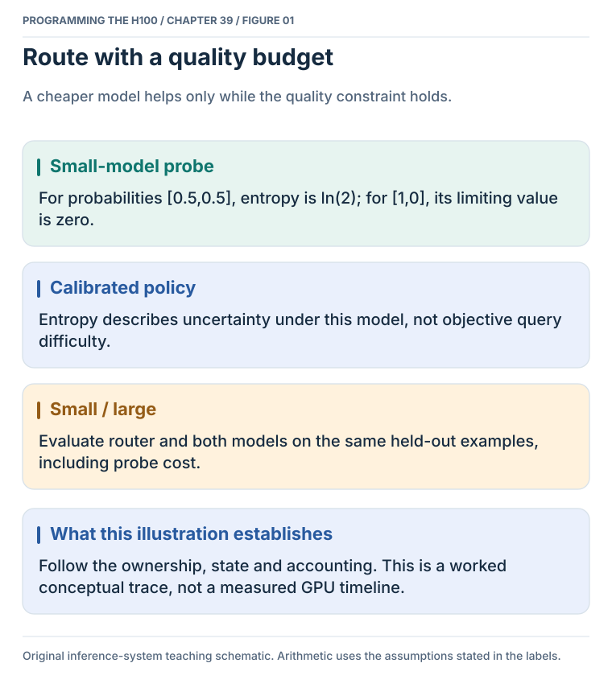

# Chapter 39 — Multi-Model Complexity Router: Entropy, Calibration, Cost

[](images/chapter-openers/39-inference.svg)


!!! warning "Evidence status"
    **Run on CPU, in a synthetic world:** the entropy feature, the routing and cost accounting, the calibration procedure, a real-data `calibrate` command, and 21 self-tests (`ch39_complexity_router.py`).
    **Invented:** both "models" and all queries. Each query has a latent difficulty *d*; the small and large models answer correctly with made-up probabilities that depend on *d*; the small model's token logits are synthetic. Every number below is a property of that world, **not of any real model pair**. Section 39.9 is the procedure for measuring the real numbers; it is **UNTESTED** on a real model pair.
    Sample outputs vary with seeds; the self-tests assert properties, not these exact numbers.

A complexity router sends easy queries to a small, cheap model and hard ones to a large, expensive one. The project brief says to route on "entropy". This chapter fixes what that means, shows how to choose the threshold without fooling yourself, and measures when the router actually saves money. In this synthetic world it saves **less than you would hope**, and the reasons are the useful part.

## Worked system map

[](images/worked/ch39-inference.svg)


## 39.1 What "entropy" means here

"Entropy" is ambiguous until you fix five things. We fix them:

| Choice | Definition used |
|---|---|
| Which distribution | the **small** model's next-token distribution, `softmax(logits)`, temperature 1 |
| Which positions | the first **K = 8** greedily decoded tokens of the small model's answer |
| Aggregation | **mean** over those K positions |
| Units | **nats** (natural log). Divide by ln 2 for bits |
| Range | 0 ≤ H ≤ ln V; for V = 64, ln V = 4.159 nats |

The implementation treats exactly masked (`-inf`) logits as zero-probability terms, so `0 log 0 = 0`; a row with every token masked is rejected because it has no probability distribution.

Formally, for one position with probabilities p_v: H = −Σ_v p_v ln p_v. The router feature is the mean of H over the K positions. A threshold τ (in nats) sends a query to the large model when the feature exceeds τ.

**Consequences of that definition.**

- The small model must run first, for K tokens, to produce the feature. Unrouted queries simply let it finish its answer (cost `c_s`). Routed queries waste the K-token prefix and then pay the large model: `k·c_s + c_l`, where **k = cost of the K-token prefix / cost of a full small answer**, between 0 and 1. With routed fraction *f*, cost relative to always-large is `((1−f)·c_s + f·(k·c_s + c_l)) / c_l`. **k = 1 is the worst case** (the whole small answer is produced before escalating, as in a cascade) and an upper bound on cost; a short prefix of a long answer has k well below 1. Routed queries also pay extra **latency**: the small model's prefill plus K decode steps before escalation.
- τ is specific to the small model, its tokenizer and vocabulary, the prompt template, and the sampling temperature. Change any of them and τ must be recalibrated.
- An API that returns only the top-k logprobs gives you a *truncated* entropy (renormalised over k tokens), which is not the same quantity. Use the same truncation at calibration and at serving.

**Hand check.** A three-way distribution (0.5, 0.25, 0.25) has H = 0.5 ln 2 + 2 × 0.25 ln 4 = 0.3466 + 0.6931 = 1.0397 nats, which is 1.5 bits (Exercise 1).

## 39.2 The synthetic world

Difficulty d ~ Beta(2, 3). The small model answers correctly with probability `0.97 − 0.85 d`, the large model with `0.98 − 0.25 d` (both clipped to [0.02, 1]). The small model's logits are Gaussian noise plus a boost on one token; the boost shrinks with *d* and carries per-query noise, so easy queries tend to give peaked, low-entropy distributions and the feature is informative but imperfect. A second, weaker baseline feature, prompt length, is also generated.

## 39.3 Self-tests (21, all pass)

| Group | What is checked |
|---|---|
| Entropy (6) | uniform = ln V; one-hot = 0; 0 ≤ H ≤ ln V on random logits; shift invariance; fair coin = ln 2; flatter means larger H |
| World (2) | corr(H, d) is positive and below 1; large model beats small |
| Routing (3) | routed fraction nonincreasing in τ; τ = −∞ equals always-large exactly; τ = +∞ equals always-small exactly |
| AUC (2) | oracle ≥ entropy > length > 0.5; a constant score has AUC exactly 0.5 |
| Cost (4) | hand computations at k = 1 and k = 0.2; routing everything costs (k·c_s + c_l)/c_l, never below 1; break-even price ratio `1 + f·k/(1−f)` equals 6.25 at k = 1 and 2.05 at k = 0.2 and the router then costs exactly 1.0 |
| Calibration (4) | the chosen τ meets its own criterion on validation (weak, true by construction); conservative τ ≤ naive τ (a theorem, since SE ≥ 0); **generalisation**: over 100 splits, scored on 100 000 fresh queries, the conservative rule violates the 2-point target in 8/100 and the naive rule in 55/100; the `calibrate` file entry point works on an exported jsonl |

## 39.4 How informative is the feature?

Sample output on 60 000 queries:

| quantity | value |
|---|---|
| always-small quality | 0.628 |
| always-large quality | 0.878 |
| corr(H, d) | 0.784 |
| AUC of oracle *d* for "small model wrong" | 0.706 |
| AUC of entropy | 0.668 |
| AUC of prompt length | 0.630 |

AUC 0.668 means: pick one query the small model got wrong and one it got right; the wrong one has the higher entropy 66.8% of the time. Even the oracle that knows *d* exactly reaches only 0.706, because in this world the small model errs at random even on easy queries (its accuracy at *d* = 0 is 0.97, at *d* = 0.5 it is 0.545). **A router cannot predict what is not predictable.** This ceiling decides everything below.

## 39.5 The cost–quality frontier

Quality as a function of the routed fraction, c_small = 1, c_large = 15. The cost column is the **worst case k = 1** (relative to always-large); see 39.8 for a short prefix:

| routed | oracle *d* | entropy | length | random | cost ratio |
|---|---|---|---|---|---|
| 0.10 | 0.675 | 0.670 | 0.667 | 0.652 | 0.167 |
| 0.20 | 0.714 | 0.707 | 0.701 | 0.677 | 0.267 |
| 0.30 | 0.747 | 0.741 | 0.731 | 0.703 | 0.367 |
| 0.40 | 0.777 | 0.769 | 0.758 | 0.727 | 0.467 |
| 0.50 | 0.803 | 0.794 | 0.785 | 0.752 | 0.567 |
| 0.70 | 0.845 | 0.837 | 0.828 | 0.802 | 0.767 |
| 1.00 | 0.878 | 0.878 | 0.878 | 0.878 | 1.067 |

Entropy beats random and beats prompt length, and sits close to the oracle. But all curves are only modestly above the straight line from (0, 0.628) to (1, 0.878). At 50% routed, entropy gets 0.794 against random's 0.752: 4.2 points of quality for the same cost. Note the last row: at k = 1, routing everything costs **1.067**, more than always-large, because the small model ran first. With a K-token prefix that is 20% of an answer (k = 0.2) it costs 1.013, still above 1.

## 39.6 Calibrating the threshold without fooling yourself

The goal: a low-cost router whose quality loss is at most δ = 0.02 relative to always-large. The threshold procedure below is a selection heuristic followed by an independent check, not a finite-sample certification. Procedure:

1. Split labelled data into **validation** (choose τ) and **test** (report). Never report on the data that chose τ.
2. For each candidate τ, compute the per-query **paired gap** `router_correct − large_correct`. Pairing matters: both models answered the same queries, so the gap's standard error is much smaller than comparing two independent accuracies (here the gap's standard deviation is 0.186).
3. **Naive:** take the largest τ with mean gap ≥ −δ.
   **Conservative heuristic:** take the largest τ with `mean gap − 1.645·SE ≥ −δ`. This is a pointwise normal-approximation margin, not a simultaneous 95% guarantee after searching thresholds. Validate the selected rule on untouched data, and account for clustering and repeated tuning.

**How to score a threshold.** The violation rate must be measured on a *large fresh set*, not on the 2000-query test half that came out of the same split, because a small test half has its own standard error (about 0.005) and so reports violations that are really test noise. Each chosen τ below is scored on both: its own 2000-query test half, and a fresh 100 000-query set from the same generator (a good approximation of its true gap).

| validation n | splits | method | P(test-half gap < −0.02) | **P(fresh-set gap < −0.02)** | mean fresh gap | routed |
|---|---|---|---|---|---|---|
| 1000 | 300 | naive | 0.500 | 0.473 | −0.0204 | 0.825 |
| 1000 | 300 | conservative | 0.117 | **0.043** | −0.0120 | 0.885 |
| 2000 | 300 | naive | 0.547 | 0.437 | −0.0199 | 0.827 |
| 2000 | 300 | conservative | 0.090 | **0.033** | −0.0137 | 0.872 |
| 5000 | 120 | naive | 0.467 | 0.300 | −0.0188 | 0.834 |
| 5000 | 120 | conservative | 0.100 | **0.033** | −0.0150 | 0.862 |
| 20000 | 40 | naive | 0.450 | 0.200 | −0.0189 | 0.832 |
| 20000 | 40 | conservative | 0.075 | **0.000** | −0.0169 | 0.847 |

Read the fresh-set column. The naive rule sits on the boundary, so it violates the target in **20–47%** of splits (it improves with more validation data but never reaches the nominal rate). The conservative rule violates in **0–4.3%**, consistent with its nominal one-sided 5%. (The splits are few at 40 for the last row, so "0.000" means "none in 40", not "never".) The test-half column overstates both (9–12% for the conservative rule) because a 2000-query test half has its own sampling noise; it is a poor measure of whether a threshold generalises.

**Validation size trades cost, not validity.** More validation data lets the conservative rule route fewer queries (88.5% at n = 1000, 84.7% at n = 20 000) because its safety margin `1.645·SE` shrinks. A rough guide: for a margin of δ/2 = 0.01 you need `(2 × 1.645 × 0.186 / 0.02)² ≈ 940` validation queries. The conservative rule costs routed fraction (0.872 vs 0.827 at n = 2000, which at k = 1 and a 15× price gap is a cost ratio of about 0.94 vs 0.89), and that is the price of not breaking the quality target.

## 39.7 Distribution shift

Threshold calibrated on Beta(2,3) difficulty (τ = 1.408 nats), deployed on other traffic. Because `gap = (unrouted fraction) × (large-model error − small-model error in the unrouted slice)`, the table shows both factors:

| traffic | routed | quality | always-large | gap | unrouted slice | small-model error in it | large-model error in it |
|---|---|---|---|---|---|---|---|
| same, Beta(2,3) | 0.841 | 0.859 | 0.877 | −0.0185 | 0.159 | 0.179 | 0.063 |
| harder, Beta(3,2) | 0.964 | 0.821 | 0.827 | −0.0060 | 0.036 | 0.240 | 0.074 |
| much harder, Beta(5,2) | 0.993 | 0.800 | 0.801 | −0.0016 | 0.007 | 0.338 | 0.120 |
| easier, Beta(2,5) | 0.724 | 0.881 | 0.907 | **−0.0266** | 0.276 | 0.158 | 0.062 |

**Hand check, easier traffic:** 0.276 × (0.158 − 0.062) = 0.0265 ✓. Same traffic: 0.159 × (0.179 − 0.063) = 0.0184 ✓.

What this shows: the breach on easier traffic comes from the **larger unrouted slice** (27.6% instead of 15.9%), not from worse errors inside it (the small model's error rate in the unrouted slice is actually *lower*, 0.158 against 0.179). A fixed τ leaves more queries unrouted when the traffic is easier, and each unrouted query carries a quality cost that the calibration allowed for only at the calibration traffic mix. Note also that the same-traffic gap (−0.0185) was already only 0.0015 inside the target. Harder traffic is safe but expensive: nearly everything is escalated. Monitor the routed fraction, the quality of the unrouted slice (sampled and judged), and the feature distribution against the calibration set, and re-run calibration on a schedule and on every change of small model, prompt template or temperature.

## 39.8 When does the router pay at all?

At the calibrated routed fraction f = 0.84, the router costs `((1−f)·c_s + f·(k·c_s + c_l))/c_l` of always-large. It is below 1 only if `c_l/c_s > 1 + f·k/(1−f)`: **6.25 at k = 1** (the printed 6.24 uses the unrounded f) and **2.05 at k = 0.2**.

| c_l / c_s | cost ratio, k = 1 (worst case) | cost ratio, k = 0.2 |
|---|---|---|
| 2 | 1.340 | 1.004 |
| 5 | 1.040 | 0.905 |
| 10 | 0.940 | 0.873 |
| 15 | 0.906 | 0.862 |
| 30 | 0.873 | 0.851 |
| 100 | 0.850 | 0.843 |

**Hand checks, c_l/c_s = 15.** k = 1: (0.16 × 1 + 0.84 × 16)/15 = 13.6/15 = 0.9067 ✓. k = 0.2: (0.16 × 1 + 0.84 × 15.2)/15 = 12.928/15 = 0.8619 ✓.

The earlier version of this chapter charged every query the full small-model cost, which is the k = 1 worst case. How large k is depends on your answer length: it is the cost of prefill plus K = 8 decode steps relative to the whole small answer, so measure it. Whatever k is, the router also adds latency to every routed query (the small model's prefill and K decode steps before escalation), which the cost ratio does not show.

Honest conclusion for this world: holding quality within 2 points of the large model, a feature this weak routes 84% of traffic upward and saves 5–14% at a 15× price gap depending on k. A complexity router earns its keep only when (a) the small model's errors are predictable (AUC well above 0.67), (b) a large fraction of traffic is genuinely easy, and (c) the price gap is large. Measure all three before building it.

## 39.9 Runbook: measuring it on a real model pair (UNTESTED on a real pair)

The calibration code and the file reader are tested on synthetic data; the model calls are not.

1. **Sample traffic.** A representative sample, stratified by task type. Use at least the validation size from 39.6 (about 940 for a 0.01 margin at this gap spread, more if your gap has a wider spread) plus an equal test half. Run **both** models on every query.
2. **Judge.** Score each answer with a rubric, exact match, or a judge model; spot-check by hand. The router can only be as good as this label.
3. **Log the feature.** For the small model, request logprobs for the first K = 8 tokens. With vLLM use `logprobs` on the OpenAI-compatible endpoint; servers return only top-k logprobs, so compute the entropy of the renormalised top-k and use the **same k** at calibration and at serving. Write one JSON object per query to a file: `{"entropy": 1.37, "small_correct": true, "large_correct": true}` (entropy in nats, averaged over the K positions).
4. **Check the ceiling.** `python3 /full/path/ch39_complexity_router.py calibrate /full/path/records.jsonl --delta 0.02 --seed 0 --c-small 1 --c-large 15 --prefix-frac 0.2` prints `auc_small_wrong` among its fields. An AUC near 0.5 warns that the overall ranking is weak; it does not mathematically exclude a useful operating region. Inspect the held-out cost–quality frontier and stop if no threshold meets the quality and cost target. The same command prints the conservative τ, the routed fraction, the test-half gap with its one-sided 95% lower bound, the cost ratio at k = 1 and at your `--prefix-frac`, both break-even price ratios, and the validation size you would need for a δ/2 margin.
5. **Repeat with different `--seed` values** and compare the chosen τ: a threshold that moves a lot between seeds means too little data.
6. **Measure k and the latency.** Time the small model's prefill plus 8 decode steps against a full answer on your hardware.
7. **Shadow, then canary.** Log what the router would have done while serving everything from the large model. Then canary 1–5% with a kill switch, and track unrouted-slice quality separately from overall quality.

## 39.10 Failure catalogue

| Failure | Cause | Defence |
|---|---|---|
| Threshold violates target in production | naive calibration; winner's curse | conservative rule; separate test set |
| Silent quality loss on easy traffic | confident small model that is wrong | audit the unrouted slice; add a cheap verifier for high-stakes classes |
| Saving disappears on hard traffic | router escalates nearly everything | track routed fraction; alert when it passes ~90% |
| τ stops working after a change | entropy depends on model, prompt template, temperature, tokenizer | recalibrate on any change |
| Router costs more than always-large | the prefix is wasted on routed queries; low price gap | compute break-even `1 + f·k/(1−f)` before building |
| Truncated logprobs | API returns top-k only | calibrate and serve with the same k |
| Judge error | label noise treated as truth | check judge against human labels on a sample |

<!-- BEGIN COMPLETE INFERENCE SOURCE -->
## Complete runnable code

The complete implementation is shown below, including its checks and entry point. The listing and downloadable `.py` file contain exactly the same source. Copy the file under the displayed filename; keep supporting files in the same directory.

[Download all inference examples and supporting modules](examples/inference-systems/inference-systems.zip) or read the [environment and command guide](examples/inference-systems/README.md).

The [follow-up agent audit](inference-adversarial-review-2026-11-25.md) records the corrections, fresh CPU captures and hardware limits for this source.

Read it in three passes: start with `router_feature` and `evaluate` to identify the state; trace `calibrate_tau` for one request or token; then follow `selftests` and `experiments` to see how the result is checked.

From the repository root:

```bash
python3 docs/examples/inference-systems/ch39_complexity_router.py --selftest
# Run the full chapter demonstrations:
python3 docs/examples/inference-systems/ch39_complexity_router.py
```

### ch39_complexity_router.py

[Download ch39_complexity_router.py](examples/inference-systems/ch39_complexity_router.py)

```python title="ch39_complexity_router.py" linenums="1"
#!/usr/bin/env python3
"""Chapter 39: a multi-model complexity router. Entropy defined precisely, threshold calibrated on held-out data.

Run:  python3 ch39_complexity_router.py            # self-tests + experiments (CPU, numpy, ~30 s)
      python3 ch39_complexity_router.py --selftest

WHAT IS REAL: the entropy definition and its code, the routing/cost/quality accounting, the calibration procedure,
the statistics. WHAT IS INVENTED: the models and queries. There is a latent difficulty d in [0,1] per query; the small
and large "models" answer correctly with probabilities that are made-up functions of d, and the small model's token
logits are synthetic. Every number printed is a property of that synthetic world, not of any real model pair.
"""
import math
import sys
import time

import numpy as np

V = 64            # synthetic vocabulary size
K = 8             # number of generated tokens the feature averages over


# ------------------------------------------------------------------ 1. the feature, defined precisely
def token_entropy_nats(logits):
    """Shannon entropy H = -sum_v p_v ln p_v, in NATS, of softmax(logits) over the vocabulary (last axis), at temperature 1.
    Numerically stable (log-sum-exp), invariant to adding a constant to the logits, bounded by 0 <= H <= ln V."""
    logits = np.asarray(logits, dtype=float)
    if logits.ndim == 0 or logits.shape[-1] == 0:
        raise ValueError("logits must have a nonempty vocabulary axis")
    if np.isnan(logits).any() or np.isposinf(logits).any():
        raise ValueError("logits may contain finite values or negative-infinity masks only")
    maximum = logits.max(axis=-1, keepdims=True)
    if not np.isfinite(maximum).all():
        raise ValueError("each row needs at least one unmasked token")
    z = logits - maximum
    lse = np.log(np.exp(z).sum(axis=-1, keepdims=True))
    logp = z - lse
    p = np.exp(logp)
    # lim(p*log(p), p->0) = 0, including exactly masked logits.
    terms = np.zeros_like(p)
    np.multiply(p, logp, out=terms, where=p > 0)
    return -terms.sum(axis=-1)


def router_feature(logits_kv):
    """THE feature: mean over the first K greedy-decoded tokens of the SMALL model's next-token entropy (nats).
    logits_kv shape (N, K, V). Requires running the small model for K tokens first, so the small model's cost is
    always paid; the large model's cost is paid only for routed queries."""
    return token_entropy_nats(logits_kv).mean(axis=-1)


# ------------------------------------------------------------------ 2. synthetic world
def p_small(d):  # probability the small model answers correctly, as a function of difficulty (INVENTED)
    return np.clip(0.97 - 0.85 * d, 0.02, 1)


def p_large(d):  # large model degrades much more slowly (INVENTED)
    return np.clip(0.98 - 0.25 * d, 0.02, 1)


def make_data(n, seed, a=2.0, b=3.0, sharp_noise=0.9):
    """n queries. d ~ Beta(a,b). Small-model logits: one token gets a boost whose size falls with difficulty, so easy
    queries give peaked (low-entropy) distributions; per-query noise in the boost makes the feature imperfect."""
    rng = np.random.default_rng(seed)
    d = rng.beta(a, b, n)
    boost = np.maximum(0.0, 7.0 * (1 - d) + sharp_noise * rng.standard_normal(n))[:, None, None]
    logits = rng.standard_normal((n, K, V)) * 1.0
    logits[:, :, 0] += boost[:, :, 0]
    H = router_feature(logits)
    length = 20 + 60 * d + 15 * rng.standard_normal(n)                 # weak baseline feature: prompt length
    u1, u2 = rng.random(n), rng.random(n)
    return dict(d=d, H=H, length=length, cs=(u1 < p_small(d)), cl=(u2 < p_large(d)))


def split(data, frac, rng):
    n = len(next(iter(data.values())))
    idx = rng.permutation(n)
    a, b = idx[: int(n * frac)], idx[int(n * frac):]
    return {k: v[a] for k, v in data.items()}, {k: v[b] for k, v in data.items()}


# ------------------------------------------------------------------ 3. routing, cost, quality
def evaluate(data, score, tau):
    """Route to the large model when score > tau. Returns routed fraction, quality, and the per-query paired gap
    (router correct - large correct), which is what the confidence statements are about."""
    routed = score > tau
    correct = np.where(routed, data["cl"], data["cs"]).astype(float)
    return dict(frac=float(routed.mean()), quality=float(correct.mean()), gap=correct - data["cl"].astype(float))


def cost_ratio(frac, c_small, c_large, prefix_frac=1.0):
    """Cost relative to always-large. The feature needs only the first K tokens of the small model's answer.
      unrouted queries: the small model finishes its answer              -> c_s
      routed queries:   the K-token prefix is wasted, then the large model -> prefix_frac * c_s + c_l
    prefix_frac = cost of the K-token prefix / cost of a full small-model answer, in [0, 1]. prefix_frac = 1 is the WORST
    CASE (the whole small answer is produced before escalating, as in a cascade) and is the upper bound on the cost.
    ratio = ((1 - f) c_s + f (prefix_frac c_s + c_l)) / c_l"""
    return ((1 - frac) * c_small + frac * (prefix_frac * c_small + c_large)) / c_large


def breakeven_price_ratio(frac, prefix_frac=1.0):
    """Smallest c_l/c_s at which the router costs no more than always-large: 1 + f k / (1 - f)."""
    return 1 + frac * prefix_frac / (1 - frac) if frac < 1 else math.inf


def auc(score, positive):
    """P(score of a random positive > score of a random negative), ties count 1/2 (rank formulation)."""
    score, positive = np.asarray(score), np.asarray(positive, bool)
    order = np.argsort(score, kind="mergesort")
    ranks = np.empty(len(score)); ranks[order] = np.arange(1, len(score) + 1)
    # average ranks for ties
    s_sorted = score[order]
    i = 0
    while i < len(s_sorted):
        j = i
        while j + 1 < len(s_sorted) and s_sorted[j + 1] == s_sorted[i]:
            j += 1
        if j > i:
            ranks[order[i:j + 1]] = (i + 1 + j + 1) / 2
        i = j + 1
    n1, n0 = positive.sum(), (~positive).sum()
    return float((ranks[positive].sum() - n1 * (n1 + 1) / 2) / (n1 * n0))


# ------------------------------------------------------------------ 4. calibration
Z95_ONE_SIDED = 1.645


def calibrate_tau(val, score, delta=0.02, conservative=True, grid=200):
    """Choose the LARGEST threshold (fewest queries routed, so cheapest) such that quality loss versus always-large is
    within delta on the validation set.
      naive:        mean gap >= -delta
      conservative: mean gap - 1.645*SE(gap) >= -delta   (one-sided 95% lower bound on the paired gap)
    Candidate thresholds are quantiles of the validation scores. Returns tau (or -inf = route everything if none qualifies)."""
    qs = np.quantile(score, np.linspace(0, 1, grid))[::-1]       # high tau first (cheapest first)
    n = len(score)
    for tau in qs:
        g = evaluate(val, score, tau)["gap"]
        m, se = g.mean(), g.std(ddof=1) / math.sqrt(n)
        stat = m - Z95_ONE_SIDED * se if conservative else m
        if stat >= -delta:
            return float(tau)
    return -math.inf


def calibrate_file(path, delta=0.02, seed=0, c_small=1.0, c_large=15.0, prefix_frac=0.2, quiet=False):
    """Real-data entry point. Input: JSON lines {"entropy": float, "small_correct": bool, "large_correct": bool}, one per
    query, produced by running BOTH models on a sample of your traffic (entropy = the feature of 39.1 for the small model).
    Splits 50/50 (seeded), picks the conservative threshold on the validation half, reports on the test half."""
    import json
    rows = [json.loads(l) for l in open(path) if l.strip()]
    data = dict(H=np.array([r["entropy"] for r in rows], float), cs=np.array([r["small_correct"] for r in rows], bool),
                cl=np.array([r["large_correct"] for r in rows], bool))
    val, test = split(data, 0.5, np.random.default_rng(seed))
    tau = calibrate_tau(val, val["H"], delta, True)
    e = evaluate(test, test["H"], tau)
    g = e["gap"]
    se = g.std(ddof=1) / math.sqrt(len(g))
    sigma = float(np.std(evaluate(val, val["H"], tau)["gap"], ddof=1))
    n_needed = int(math.ceil((2 * Z95_ONE_SIDED * sigma / delta) ** 2)) if sigma > 0 else 0
    out = dict(n=len(rows), tau=tau, frac=e["frac"], test_quality=e["quality"], test_gap=float(g.mean()), test_gap_lower95=float(g.mean() - Z95_ONE_SIDED * se),
               always_large=float(test["cl"].mean()), always_small=float(test["cs"].mean()),
               cost_ratio_k1=cost_ratio(e["frac"], c_small, c_large, 1.0), cost_ratio_k=cost_ratio(e["frac"], c_small, c_large, prefix_frac),
               breakeven_k1=breakeven_price_ratio(e["frac"], 1.0), breakeven_k=breakeven_price_ratio(e["frac"], prefix_frac),
               auc_small_wrong=auc(data["H"], ~data["cs"]), validation_n_for_half_delta_margin=n_needed)
    if not quiet:
        for k, v in out.items():
            print(f"  {k:32s} {v:.4f}" if isinstance(v, float) else f"  {k:32s} {v}")
    return out


def selftests():
    res = []

    def check(name, cond):
        res.append(bool(cond))
        print(f"  [{'PASS' if cond else 'FAIL'}] {name}")

    z = np.zeros((3, V))
    check(f"entropy of a uniform distribution = ln V = {math.log(V):.4f} nats", np.allclose(token_entropy_nats(z), math.log(V)))
    oh = np.full((1, V), -1e4); oh[0, 5] = 0
    check("entropy of a (numerically) one-hot distribution is 0", abs(token_entropy_nats(oh)[0]) < 1e-9)
    rng = np.random.default_rng(0)
    L = rng.standard_normal((200, V)) * 3
    H = token_entropy_nats(L)
    check("0 <= H <= ln V for 200 random logit vectors", (H >= -1e-12).all() and (H <= math.log(V) + 1e-12).all())
    check("H is invariant to adding a constant to the logits", np.allclose(H, token_entropy_nats(L + 123.4)))
    two = np.full((1, V), -1e4); two[0, 0] = 0; two[0, 1] = 0
    check(f"entropy of a fair two-way split is ln 2 = {math.log(2):.4f}", abs(token_entropy_nats(two)[0] - math.log(2)) < 1e-9)
    check("H is larger for a higher-temperature (flatter) distribution", token_entropy_nats(L[:1] / 3)[0] > token_entropy_nats(L[:1] * 3)[0])

    D = make_data(20000, seed=0)
    check(f"synthetic world: correlation(H, d) = {np.corrcoef(D['H'], D['d'])[0, 1]:.3f} is positive and not 1",
          0.5 < np.corrcoef(D["H"], D["d"])[0, 1] < 0.99)
    check(f"the large model is more accurate than the small one ({D['cl'].mean():.3f} vs {D['cs'].mean():.3f})", D["cl"].mean() > D["cs"].mean())

    taus = np.quantile(D["H"], [0.99, 0.9, 0.7, 0.5, 0.3, 0.1, 0.01])
    fr = [evaluate(D, D["H"], t)["frac"] for t in taus]
    check(f"routed fraction is nonincreasing in the threshold {[round(f, 2) for f in fr]}", all(a <= b + 1e-12 for a, b in zip(fr, fr[1:])))
    check("tau = -inf routes everything: quality = always-large exactly",
          abs(evaluate(D, D["H"], -math.inf)["quality"] - D["cl"].mean()) < 1e-12)
    check("tau = +inf routes nothing: quality = always-small exactly",
          abs(evaluate(D, D["H"], math.inf)["quality"] - D["cs"].mean()) < 1e-12)

    a_h = auc(D["H"], ~D["cs"])
    a_len = auc(D["length"], ~D["cs"])
    a_d = auc(D["d"], ~D["cs"])
    check(f"AUC for predicting small-model errors: oracle d {a_d:.3f} >= entropy {a_h:.3f} > length {a_len:.3f} > 0.5",
          a_d >= a_h > a_len > 0.5)
    check("AUC of a constant score is exactly 0.5 (ties)", abs(auc(np.zeros(100), np.arange(100) % 2 == 0) - 0.5) < 1e-12)

    cr = cost_ratio(0.3, 1.0, 15.0)
    hand = (0.7 * 1.0 + 0.3 * (1.0 + 15.0)) / 15.0
    check(f"cost ratio by hand, worst case k=1: (0.7*1 + 0.3*(1+15))/15 = {hand:.4f}; function gives {cr:.4f}", abs(cr - hand) < 1e-12)
    cr2 = cost_ratio(0.3, 1.0, 15.0, prefix_frac=0.2)
    hand2 = (0.7 * 1.0 + 0.3 * (0.2 + 15.0)) / 15.0
    check(f"cost ratio by hand, K-token prefix = 20% of a full small answer: (0.7 + 0.3*15.2)/15 = {hand2:.4f}; function gives {cr2:.4f}", abs(cr2 - hand2) < 1e-12)
    check("routing everything costs (k c_s + c_l)/c_l: 1.0667 at k=1 and 1.0133 at k=0.2, never below 1",
          abs(cost_ratio(1.0, 1.0, 15.0) - 16 / 15) < 1e-12 and abs(cost_ratio(1.0, 1.0, 15.0, 0.2) - 15.2 / 15) < 1e-12)
    be1, be2 = breakeven_price_ratio(0.84, 1.0), breakeven_price_ratio(0.84, 0.2)
    check(f"break-even price ratio 1 + f k/(1-f) at f=0.84: {be1:.2f} for k=1, {be2:.2f} for k=0.2; the router costs exactly 1.0 of always-large there",
          abs(be1 - 6.25) < 1e-9 and abs(be2 - 2.05) < 1e-9 and abs(cost_ratio(0.84, 1.0, be2, 0.2) - 1.0) < 1e-9)

    rng = np.random.default_rng(1)
    val, test = split(make_data(30000, seed=2), 0.5, rng)
    tau = calibrate_tau(val, val["H"], delta=0.02, conservative=True)
    gv = evaluate(val, val["H"], tau)["gap"].mean()
    check(f"(weak, by construction) the chosen threshold meets its own criterion on validation: gap {gv:+.4f} >= -0.02 (tau={tau:.3f})", gv >= -0.02 - 1e-9)
    check("(a theorem, since SE >= 0) the conservative threshold is no higher than the naive one",
          calibrate_tau(val, val["H"], conservative=True) <= calibrate_tau(val, val["H"], conservative=False) + 1e-12)
    # the real test: does the chosen tau generalise? score it on a large FRESH set
    fresh = make_data(100000, seed=555)
    vc = vn = 0
    NS = 100
    for k in range(NS):
        d = make_data(4000, seed=7000 + k)
        v, _ = split(d, 0.5, np.random.default_rng(k))
        gc = evaluate(fresh, fresh["H"], calibrate_tau(v, v["H"], 0.02, True))["gap"].mean()
        gn = evaluate(fresh, fresh["H"], calibrate_tau(v, v["H"], 0.02, False))["gap"].mean()
        vc += gc < -0.02; vn += gn < -0.02
    check(f"GENERALISATION over {NS} splits, scored on 100k fresh queries: conservative violates the 2-point target in {vc}/{NS} ({vc / NS:.2f}), naive in {vn}/{NS} ({vn / NS:.2f}); asserted: conservative <= 0.12 and strictly fewer than naive",
          vc / NS <= 0.12 and vc < vn)
    # calibrate CLI on an exported file
    import json, tempfile, os
    ex = make_data(3000, seed=9)
    with tempfile.NamedTemporaryFile("w", suffix=".jsonl", delete=False) as fh:
        for i in range(3000):
            fh.write(json.dumps(dict(entropy=float(ex["H"][i]), small_correct=bool(ex["cs"][i]), large_correct=bool(ex["cl"][i]))) + "\n")
        path = fh.name
    out = calibrate_file(path, delta=0.02, seed=0, c_small=1.0, c_large=15.0, prefix_frac=0.2, quiet=True)
    os.unlink(path)
    check(f"calibrate_file() on an exported jsonl: n={out['n']}, tau={out['tau']:.3f}, routed {out['frac']:.2f}, test gap {out['test_gap']:+.4f}", out["n"] == 3000 and out["tau"] > -math.inf and 0 < out["frac"] <= 1)
    return all(res)


def experiments():
    D = make_data(60000, seed=0)
    c_s, c_l = 1.0, 15.0
    always_l, always_s = D["cl"].mean(), D["cs"].mean()

    print(f"\n== 1. The feature: entropy (nats) vs difficulty. always-small quality {always_s:.3f}, always-large {always_l:.3f} ==")
    print(f"  corr(H, d) = {np.corrcoef(D['H'], D['d'])[0, 1]:.3f};  H range [{D['H'].min():.2f}, {D['H'].max():.2f}], ln V = {math.log(V):.2f}")
    print(f"  AUC for 'small model wrong':  oracle d {auc(D['d'], ~D['cs']):.3f} | entropy {auc(D['H'], ~D['cs']):.3f} | prompt length {auc(D['length'], ~D['cs']):.3f}")

    print("\n== 2. Frontier: routed fraction -> quality and cost (c_small=1, c_large=15), by routing signal ==")
    print(f"  {'route frac':>10s} | {'oracle d':>9s} {'entropy':>9s} {'length':>9s} {'random':>9s}   quality;  cost ratio = {cost_ratio(0.3, c_s, c_l):.3f} at 0.30")
    rng = np.random.default_rng(5)
    rnd = rng.random(len(D["d"]))
    for f in (0.1, 0.2, 0.3, 0.4, 0.5, 0.7, 1.0):
        row = []
        for name in ("d", "H", "length"):
            tau = np.quantile(D[name], 1 - f) if f < 1 else -math.inf
            row.append(evaluate(D, D[name], tau)["quality"])
        tau = np.quantile(rnd, 1 - f) if f < 1 else -math.inf
        row.append(evaluate(D, rnd, tau)["quality"])
        print(f"  {f:10.2f} | " + " ".join(f"{q:9.3f}" for q in row) + f"   cost {cost_ratio(f, c_s, c_l):.3f}")

    print("\n== 3. Calibration: naive vs conservative. Each chosen tau is scored on (a) its own 2000-query test half and (b) a 100 000-query FRESH set ==")
    fresh = make_data(100000, seed=999)
    print(f"  {'validation n':>12s} {'splits':>6s} {'method':13s} {'P(test-half gap < -.02)':>24s} {'P(fresh-set gap < -.02)':>24s} {'mean fresh gap':>15s} {'routed':>7s}")
    for nval, splits_n in ((1000, 300), (2000, 300), (5000, 120), (20000, 40)):
        out = {"naive": [], "conservative": []}
        for k in range(splits_n):
            d = make_data(2 * nval, seed=1000 + k)
            v, t = split(d, 0.5, np.random.default_rng(k))
            for mode in out:
                tau = calibrate_tau(v, v["H"], 0.02, conservative=(mode == "conservative"))
                out[mode].append((evaluate(t, t["H"], tau)["gap"].mean(), evaluate(fresh, fresh["H"], tau)["gap"].mean(), evaluate(fresh, fresh["H"], tau)["frac"]))
        for mode, arr in out.items():
            a_ = np.array(arr)
            print(f"  {nval:12d} {splits_n:6d} {mode:13s} {np.mean(a_[:, 0] < -0.02):24.3f} {np.mean(a_[:, 1] < -0.02):24.3f} {a_[:, 1].mean():15.4f} {a_[:, 2].mean():7.3f}")
    g = evaluate(D, D["H"], 1.4)["gap"]
    print(f"  per-query paired gap std (tau=1.4): {g.std(ddof=1):.3f}  -> to make 1.645*SE <= delta/2 = 0.01 you need about {int(math.ceil((2 * Z95_ONE_SIDED * g.std(ddof=1) / 0.02) ** 2))} validation queries")

    print("\n== 4. Distribution shift: calibrate on Beta(2,3) difficulty, deploy on harder traffic ==")
    v = make_data(30000, seed=7)
    tau = calibrate_tau(v, v["H"], 0.02, True)
    print(f"  calibrated tau = {tau:.3f} nats")
    for name, (a, b) in (("same traffic Beta(2,3)", (2, 3)), ("harder Beta(3,2)", (3, 2)), ("much harder Beta(5,2)", (5, 2)), ("easier Beta(2,5)", (2, 5))):
        t = make_data(30000, seed=8, a=a, b=b)
        e = evaluate(t, t["H"], tau)
        un = t["H"] <= tau
        print(f"  {name:24s}: routed {e['frac']:.3f}  quality {e['quality']:.3f}  always-large {t['cl'].mean():.3f}  gap {e['gap'].mean():+.4f}   unrouted slice {un.mean():.3f}: small-model error rate in it {1 - t['cs'][un].mean():.3f}, large-model {1 - t['cl'][un].mean():.3f}")

    print("\n== 5. When does the router pay? cost ratio at the calibrated routed fraction, worst case (k=1: whole small answer wasted) and K-token prefix = 20% of an answer (k=0.2) ==")
    tau = calibrate_tau(v, v["H"], 0.02, True)
    f = evaluate(D, D["H"], tau)["frac"]
    print(f"  calibrated routed fraction on the 60k set: {f:.3f}; break-even price ratio c_l/c_s = 1 + f k/(1-f): {breakeven_price_ratio(f, 1.0):.2f} (k=1), {breakeven_price_ratio(f, 0.2):.2f} (k=0.2)")
    print(f"  {'c_l/c_s':>8s} {'cost k=1':>9s} {'cost k=0.2':>11s}")
    for r in (2, 5, 10, 15, 30, 100):
        print(f"  {r:8d} {cost_ratio(f, 1.0, float(r), 1.0):9.3f} {cost_ratio(f, 1.0, float(r), 0.2):11.3f}")
    print("  (the router also adds latency to every ROUTED query: the small model's prefill plus K decode steps before escalation)")
    print("\n== 6. What does an entropy of ~1.4 nats look like in this synthetic world? mean over 4000 draws of the per-position distribution ==")
    rng = np.random.default_rng(3)
    for boost in (7.0, 6.0, 5.0, 4.0, 3.0):
        lg = rng.standard_normal((4000, V)); lg[:, 0] += boost
        Hs = token_entropy_nats(lg); z = lg - lg.max(-1, keepdims=True); p = np.exp(z) / np.exp(z).sum(-1, keepdims=True)
        top = p.max(-1); srt = -np.sort(-p, -1)
        print(f"  boost {boost:3.1f}: H = {Hs.mean():.2f} nats, top-token probability {top.mean():.2f}, mass beyond the top 5 tokens {1 - srt[:, :5].sum(-1).mean():.2f}")


if __name__ == "__main__":
    if len(sys.argv) > 1 and sys.argv[1] == "calibrate":
        import argparse
        ap = argparse.ArgumentParser(); ap.add_argument("cmd"); ap.add_argument("path")
        ap.add_argument("--delta", type=float, default=0.02); ap.add_argument("--seed", type=int, default=0)
        ap.add_argument("--c-small", type=float, default=1.0); ap.add_argument("--c-large", type=float, default=15.0)
        ap.add_argument("--prefix-frac", type=float, default=0.2)
        a_ = ap.parse_args()
        calibrate_file(a_.path, a_.delta, a_.seed, a_.c_small, a_.c_large, a_.prefix_frac)
        sys.exit(0)
    t0 = time.time()
    print("self-tests:")
    ok = selftests()
    if "--selftest" not in sys.argv:
        experiments()
    print(f"\n{'ALL PASS' if ok else 'FAILURES'}   ({time.time() - t0:.0f} s)")
    sys.exit(0 if ok else 1)
```

<!-- END COMPLETE INFERENCE SOURCE -->

## 39.11 Exercises

1. Compute the entropy of (0.5, 0.25, 0.25) in nats and in bits.
2. The calibrated threshold is 1.408 nats. Express it in bits, and describe what a per-position entropy near 1.4 nats looks like in this synthetic world (Experiment 6).
3. What does the router cost relative to always-large if it routes every query, with c_small = 1, c_large = 15, at k = 1 and at k = 0.2?
4. The naive rule violated the 2-point target in 44% of splits on the fresh set (n_val = 2000). Why not about 5%, and why does the conservative rule not violate more than about 4%?
5. Easier traffic broke the target but harder traffic did not. Using the decomposition in 39.7, explain, and say what you would monitor.
6. Entropy AUC is 0.668. If you could raise it to 0.85 with a better feature, which quantities in the cost tables would change?
7. **Code.** Add a cascade variant: the small model answers; a verifier returns a confidence; low-confidence answers go to the large model. Write the cost formula, including the verifier.

### Solutions

1. H = 0.5 ln 2 + 0.25 ln 4 + 0.25 ln 4 = 0.3466 + 0.3466 + 0.3466 = 1.0397 nats. Divide by ln 2 = 0.6931: 1.5 bits. (Check: 0.5 × 1 + 0.5 × 2 = 1.5 bits.)
2. 1.408 / 0.6931 = 2.031 bits, about a third of the maximum ln 64 = 4.159 nats. In this world (Experiment 6) a per-position entropy of 1.36 nats is a distribution with one dominant token at about 0.76 probability and about 17% of the mass spread thinly beyond the top five of the 64 tokens; 2.11 nats is a top token near 0.58. Note that the feature is a mean over 8 positions, so a single position can be far from the mean. The perplexity `e^1.408 = 4.09` is an arithmetic equivalence ("as uncertain as 4 equally likely tokens"), not a description of where the mass sits.
3. k = 1: (1 + 15)/15 = 1.0667, 6.7% more than always-large. k = 0.2: (0.2 + 15)/15 = 1.0133, 1.3% more. In both cases routing everything is worse than not routing, because the prefix was wasted.
4. A threshold chosen as the edge of "mean gap ≥ −δ" among 200 candidates has its validation gap at the boundary by construction, helped by selection on noise (winner's curse). On fresh data the true gap is below the boundary a large fraction of the time (44% here, 20% at n_val = 20 000). The conservative rule asks for the one-sided 95% lower bound to clear the boundary, but a pointwise margin does not guarantee a 5% violation probability after searching 200 thresholds. The 0–4.3% rates in that experiment are empirical; the separate self-test experiment records 8/100 violations. The 2000-query test half reports about 9–12% for the conservative rule only because the test half itself has a standard error of about 0.005; scoring on a large fresh set removes that noise.
5. By the decomposition gap = unrouted fraction × (large error − small error in the slice): easier traffic leaves 27.6% unrouted instead of 15.9%, and the small model's error in the slice is 0.158 (not worse than the calibration traffic's 0.179), so the loss magnitude grows from 0.0185 to 0.0265 (the signed gap falls from −0.0185 to −0.0265). Harder traffic leaves only 3.6% unrouted, so the gap shrinks even though the small model errs more in that slice (0.240). Monitor routed fraction, quality of the unrouted slice (sampled and judged), and the feature distribution against the calibration set.
6. The routed fraction needed to reach the quality target would fall (fewer queries need escalating), which lowers the cost ratio and moves the break-even price ratio `1 + f·k/(1 − f)` down toward 1. The always-large and always-small quality columns do not change.
7. Cost per request = c_small + c_verifier + f_escalated × c_large, relative to always-large: (c_s + c_v + f·c_l)/c_l. It pays only if the verifier is cheap relative to the large model and its errors are less correlated with the small model's than entropy is. Measure verifier AUC the same way as in 39.4.

## 39.12 Summary

- Fix the definition: which model, which tokens, which aggregation, which units. τ is meaningless without them.
- The K-token prefix is always paid and wasted on routed queries, so routing everything costs more than not routing. k = 1 is the worst case; measure k.
- Calibrate on held-out data with a paired, conservative bound, and score the threshold on a large fresh set. The naive choice violated its target in 20–47% of splits; the conservative one in 0–4%.
- The ceiling is how predictable the small model's errors are. In this world it was low, and the router saved 5–14% at a 15× price gap depending on k.
- All numbers here are synthetic. Run Section 39.9 on your real model pair before building anything on this.

## Files

- Code: `docs/examples/inference-systems/ch39_complexity_router.py`
