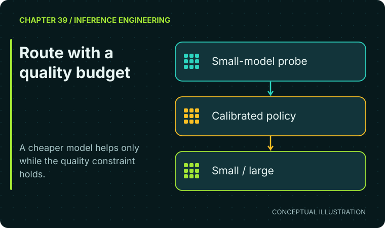

# Chapter 39 — Multi-Model Complexity Router: Entropy, Calibration, Cost

!!! warning "Evidence status"
    **Run on CPU, in a synthetic world:** the entropy feature, the routing and cost accounting, the calibration procedure, a real-data `calibrate` command, and 21 self-tests (`ch39_complexity_router.py`).
    **Invented:** both "models" and all queries. Each query has a latent difficulty *d*; the small and large models answer correctly with made-up probabilities that depend on *d*; the small model's token logits are synthetic. Every number below is a property of that world, **not of any real model pair**. Section 39.9 is the procedure for measuring the real numbers; it is **UNTESTED** on a real model pair.
    Sample outputs vary with seeds; the self-tests assert properties, not these exact numbers.

A complexity router sends easy queries to a small, cheap model and hard ones to a large, expensive one. The project brief says to route on "entropy". This chapter fixes what that means, shows how to choose the threshold without fooling yourself, and measures when the router actually saves money. In this synthetic world it saves **less than you would hope**, and the reasons are the useful part.

## Worked system map

## 39.1 What "entropy" means here

"Entropy" is ambiguous until you fix five things. We fix them:

| Choice | Definition used |
|---|---|
| Which distribution | the **small** model's next-token distribution, `softmax(logits)`, temperature 1 |
| Which positions | the first **K = 8** greedily decoded tokens of the small model's answer |
| Aggregation | **mean** over those K positions |
| Units | **nats** (natural log). Divide by ln 2 for bits |
| Range | 0 ≤ H ≤ ln V; for V = 64, ln V = 4.159 nats |

Formally, for one position with probabilities p_v: H = −Σ_v p_v ln p_v. The router feature is the mean of H over the K positions. A threshold τ (in nats) sends a query to the large model when the feature exceeds τ.

**Consequences of that definition.**

- The small model must run first, for K tokens, to produce the feature. Unrouted queries simply let it finish its answer (cost `c_s`). Routed queries waste the K-token prefix and then pay the large model: `k·c_s + c_l`, where **k = cost of the K-token prefix / cost of a full small answer**, between 0 and 1. With routed fraction *f*, cost relative to always-large is `((1−f)·c_s + f·(k·c_s + c_l)) / c_l`. **k = 1 is the worst case** (the whole small answer is produced before escalating, as in a cascade) and an upper bound on cost; a short prefix of a long answer has k well below 1. Routed queries also pay extra **latency**: the small model's prefill plus K decode steps before escalation.
- τ is specific to the small model, its tokenizer and vocabulary, the prompt template, and the sampling temperature. Change any of them and τ must be recalibrated.
- An API that returns only the top-k logprobs gives you a *truncated* entropy (renormalised over k tokens), which is not the same quantity. Use the same truncation at calibration and at serving.

**Hand check.** A three-way distribution (0.5, 0.25, 0.25) has H = 0.5 ln 2 + 2 × 0.25 ln 4 = 0.3466 + 0.6931 = 1.0397 nats, which is 1.5 bits (Exercise 1).

## 39.2 The synthetic world

Difficulty d ~ Beta(2, 3). The small model answers correctly with probability `0.97 − 0.85 d`, the large model with `0.98 − 0.25 d` (both clipped to [0.02, 1]). The small model's logits are Gaussian noise plus a boost on one token; the boost shrinks with *d* and carries per-query noise, so easy queries tend to give peaked, low-entropy distributions and the feature is informative but imperfect. A second, weaker baseline feature, prompt length, is also generated.

## 39.3 Self-tests (21, all pass)

| Group | What is checked |
|---|---|
| Entropy (6) | uniform = ln V; one-hot = 0; 0 ≤ H ≤ ln V on random logits; shift invariance; fair coin = ln 2; flatter means larger H |
| World (2) | corr(H, d) is positive and below 1; large model beats small |
| Routing (3) | routed fraction nonincreasing in τ; τ = −∞ equals always-large exactly; τ = +∞ equals always-small exactly |
| AUC (2) | oracle ≥ entropy > length > 0.5; a constant score has AUC exactly 0.5 |
| Cost (4) | hand computations at k = 1 and k = 0.2; routing everything costs (k·c_s + c_l)/c_l, never below 1; break-even price ratio `1 + f·k/(1−f)` equals 6.25 at k = 1 and 2.05 at k = 0.2 and the router then costs exactly 1.0 |
| Calibration (4) | the chosen τ meets its own criterion on validation (weak, true by construction); conservative τ ≤ naive τ (a theorem, since SE ≥ 0); **generalisation**: over 100 splits, scored on 100 000 fresh queries, the conservative rule violates the 2-point target in 8/100 and the naive rule in 55/100; the `calibrate` file entry point works on an exported jsonl |

## 39.4 How informative is the feature?

Sample output on 60 000 queries:

| quantity | value |
|---|---|
| always-small quality | 0.628 |
| always-large quality | 0.878 |
| corr(H, d) | 0.784 |
| AUC of oracle *d* for "small model wrong" | 0.706 |
| AUC of entropy | 0.668 |
| AUC of prompt length | 0.630 |

AUC 0.668 means: pick one query the small model got wrong and one it got right; the wrong one has the higher entropy 66.8% of the time. Even the oracle that knows *d* exactly reaches only 0.706, because in this world the small model errs at random even on easy queries (its accuracy at *d* = 0 is 0.97, at *d* = 0.5 it is 0.545). **A router cannot predict what is not predictable.** This ceiling decides everything below.

## 39.5 The cost–quality frontier

Quality as a function of the routed fraction, c_small = 1, c_large = 15. The cost column is the **worst case k = 1** (relative to always-large); see 39.8 for a short prefix:

| routed | oracle *d* | entropy | length | random | cost ratio |
|---|---|---|---|---|---|
| 0.10 | 0.675 | 0.670 | 0.667 | 0.652 | 0.167 |
| 0.20 | 0.714 | 0.707 | 0.701 | 0.677 | 0.267 |
| 0.30 | 0.747 | 0.741 | 0.731 | 0.703 | 0.367 |
| 0.40 | 0.777 | 0.769 | 0.758 | 0.727 | 0.467 |
| 0.50 | 0.803 | 0.794 | 0.785 | 0.752 | 0.567 |
| 0.70 | 0.845 | 0.837 | 0.828 | 0.802 | 0.767 |
| 1.00 | 0.878 | 0.878 | 0.878 | 0.878 | 1.067 |

Entropy beats random and beats prompt length, and sits close to the oracle. But all curves are only modestly above the straight line from (0, 0.628) to (1, 0.878). At 50% routed, entropy gets 0.794 against random's 0.752: 4.2 points of quality for the same cost. Note the last row: at k = 1, routing everything costs **1.067**, more than always-large, because the small model ran first. With a K-token prefix that is 20% of an answer (k = 0.2) it costs 1.013, still above 1.

## 39.6 Calibrating the threshold without fooling yourself

The goal: the cheapest router whose quality is within δ = 0.02 of always-large. Procedure:

1. Split labelled data into **validation** (choose τ) and **test** (report). Never report on the data that chose τ.
2. For each candidate τ, compute the per-query **paired gap** `router_correct − large_correct`. Pairing matters: both models answered the same queries, so the gap's standard error is much smaller than comparing two independent accuracies (here the gap's standard deviation is 0.186).
3. **Naive:** take the largest τ with mean gap ≥ −δ.
   **Conservative:** take the largest τ with `mean gap − 1.645·SE ≥ −δ` (one-sided 95% lower bound).

**How to score a threshold.** The violation rate must be measured on a *large fresh set*, not on the 2000-query test half that came out of the same split, because a small test half has its own standard error (about 0.005) and so reports violations that are really test noise. Each chosen τ below is scored on both: its own 2000-query test half, and a fresh 100 000-query set from the same generator (a good approximation of its true gap).

| validation n | splits | method | P(test-half gap < −0.02) | **P(fresh-set gap < −0.02)** | mean fresh gap | routed |
|---|---|---|---|---|---|---|
| 1000 | 300 | naive | 0.500 | 0.473 | −0.0204 | 0.825 |
| 1000 | 300 | conservative | 0.117 | **0.043** | −0.0120 | 0.885 |
| 2000 | 300 | naive | 0.547 | 0.437 | −0.0199 | 0.827 |
| 2000 | 300 | conservative | 0.090 | **0.033** | −0.0137 | 0.872 |
| 5000 | 120 | naive | 0.467 | 0.300 | −0.0188 | 0.834 |
| 5000 | 120 | conservative | 0.100 | **0.033** | −0.0150 | 0.862 |
| 20000 | 40 | naive | 0.450 | 0.200 | −0.0189 | 0.832 |
| 20000 | 40 | conservative | 0.075 | **0.000** | −0.0169 | 0.847 |

Read the fresh-set column. The naive rule sits on the boundary, so it violates the target in **20–47%** of splits (it improves with more validation data but never reaches the nominal rate). The conservative rule violates in **0–4.3%**, consistent with its nominal one-sided 5%. (The splits are few at 40 for the last row, so "0.000" means "none in 40", not "never".) The test-half column overstates both (9–12% for the conservative rule) because a 2000-query test half has its own sampling noise; it is a poor measure of whether a threshold generalises.

**Validation size trades cost, not validity.** More validation data lets the conservative rule route fewer queries (88.5% at n = 1000, 84.7% at n = 20 000) because its safety margin `1.645·SE` shrinks. A rough guide: for a margin of δ/2 = 0.01 you need `(2 × 1.645 × 0.186 / 0.02)² ≈ 940` validation queries. The conservative rule costs routed fraction (0.872 vs 0.827 at n = 2000, which at k = 1 and a 15× price gap is a cost ratio of about 0.94 vs 0.89), and that is the price of not breaking the quality target.

## 39.7 Distribution shift

Threshold calibrated on Beta(2,3) difficulty (τ = 1.408 nats), deployed on other traffic. Because `gap = (unrouted fraction) × (small-model error − large-model error in the unrouted slice)`, the table shows both factors:

| traffic | routed | quality | always-large | gap | unrouted slice | small-model error in it | large-model error in it |
|---|---|---|---|---|---|---|---|
| same, Beta(2,3) | 0.841 | 0.859 | 0.877 | −0.0185 | 0.159 | 0.179 | 0.063 |
| harder, Beta(3,2) | 0.964 | 0.821 | 0.827 | −0.0060 | 0.036 | 0.240 | 0.074 |
| much harder, Beta(5,2) | 0.993 | 0.800 | 0.801 | −0.0016 | 0.007 | 0.338 | 0.120 |
| easier, Beta(2,5) | 0.724 | 0.881 | 0.907 | **−0.0266** | 0.276 | 0.158 | 0.062 |

**Hand check, easier traffic:** 0.276 × (0.158 − 0.062) = 0.0265 ✓. Same traffic: 0.159 × (0.179 − 0.063) = 0.0184 ✓.

What this shows: the breach on easier traffic comes from the **larger unrouted slice** (27.6% instead of 15.9%), not from worse errors inside it (the small model's error rate in the unrouted slice is actually *lower*, 0.158 against 0.179). A fixed τ leaves more queries unrouted when the traffic is easier, and each unrouted query carries a quality cost that the calibration allowed for only at the calibration traffic mix. Note also that the same-traffic gap (−0.0185) was already only 0.0015 inside the target. Harder traffic is safe but expensive: nearly everything is escalated. Monitor the routed fraction, the quality of the unrouted slice (sampled and judged), and the feature distribution against the calibration set, and re-run calibration on a schedule and on every change of small model, prompt template or temperature.

## 39.8 When does the router pay at all?

At the calibrated routed fraction f = 0.84, the router costs `((1−f)·c_s + f·(k·c_s + c_l))/c_l` of always-large. It is below 1 only if `c_l/c_s > 1 + f·k/(1−f)`: **6.25 at k = 1** (the printed 6.24 uses the unrounded f) and **2.05 at k = 0.2**.

| c_l / c_s | cost ratio, k = 1 (worst case) | cost ratio, k = 0.2 |
|---|---|---|
| 2 | 1.340 | 1.004 |
| 5 | 1.040 | 0.905 |
| 10 | 0.940 | 0.873 |
| 15 | 0.906 | 0.862 |
| 30 | 0.873 | 0.851 |
| 100 | 0.850 | 0.843 |

**Hand checks, c_l/c_s = 15.** k = 1: (0.16 × 1 + 0.84 × 16)/15 = 13.6/15 = 0.9067 ✓. k = 0.2: (0.16 × 1 + 0.84 × 15.2)/15 = 12.928/15 = 0.8619 ✓.

The earlier version of this chapter charged every query the full small-model cost, which is the k = 1 worst case. How large k is depends on your answer length: it is the cost of prefill plus K = 8 decode steps relative to the whole small answer, so measure it. Whatever k is, the router also adds latency to every routed query (the small model's prefill and K decode steps before escalation), which the cost ratio does not show.

Honest conclusion for this world: holding quality within 2 points of the large model, a feature this weak routes 84% of traffic upward and saves 5–14% at a 15× price gap depending on k. A complexity router earns its keep only when (a) the small model's errors are predictable (AUC well above 0.67), (b) a large fraction of traffic is genuinely easy, and (c) the price gap is large. Measure all three before building it.

## 39.9 Runbook: measuring it on a real model pair (UNTESTED on a real pair)

The calibration code and the file reader are tested on synthetic data; the model calls are not.

1. **Sample traffic.** A representative sample, stratified by task type. Use at least the validation size from 39.6 (about 940 for a 0.01 margin at this gap spread, more if your gap has a wider spread) plus an equal test half. Run **both** models on every query.
2. **Judge.** Score each answer with a rubric, exact match, or a judge model; spot-check by hand. The router can only be as good as this label.
3. **Log the feature.** For the small model, request logprobs for the first K = 8 tokens. With vLLM use `logprobs` on the OpenAI-compatible endpoint; servers return only top-k logprobs, so compute the entropy of the renormalised top-k and use the **same k** at calibration and at serving. Write one JSON object per query to a file: `{"entropy": 1.37, "small_correct": true, "large_correct": true}` (entropy in nats, averaged over the K positions).
4. **Check the ceiling.** `python3 /full/path/ch39_complexity_router.py calibrate /full/path/records.jsonl --delta 0.02 --seed 0 --c-small 1 --c-large 15 --prefix-frac 0.2` prints `auc_small_wrong` among its fields. If it is near 0.5, stop: no threshold will help. The same command prints the conservative τ, the routed fraction, the test-half gap with its one-sided 95% lower bound, the cost ratio at k = 1 and at your `--prefix-frac`, both break-even price ratios, and the validation size you would need for a δ/2 margin.
5. **Repeat with different `--seed` values** and compare the chosen τ: a threshold that moves a lot between seeds means too little data.
6. **Measure k and the latency.** Time the small model's prefill plus 8 decode steps against a full answer on your hardware.
7. **Shadow, then canary.** Log what the router would have done while serving everything from the large model. Then canary 1–5% with a kill switch, and track unrouted-slice quality separately from overall quality.

## 39.10 Failure catalogue

| Failure | Cause | Defence |
|---|---|---|
| Threshold violates target in production | naive calibration; winner's curse | conservative rule; separate test set |
| Silent quality loss on easy traffic | confident small model that is wrong | audit the unrouted slice; add a cheap verifier for high-stakes classes |
| Saving disappears on hard traffic | router escalates nearly everything | track routed fraction; alert when it passes ~90% |
| τ stops working after a change | entropy depends on model, prompt template, temperature, tokenizer | recalibrate on any change |
| Router costs more than always-large | the prefix is wasted on routed queries; low price gap | compute break-even `1 + f·k/(1−f)` before building |
| Truncated logprobs | API returns top-k only | calibrate and serve with the same k |
| Judge error | label noise treated as truth | check judge against human labels on a sample |

## 39.11 Exercises

1. Compute the entropy of (0.5, 0.25, 0.25) in nats and in bits.
2. The calibrated threshold is 1.408 nats. Express it in bits, and describe what a per-position entropy near 1.4 nats looks like in this synthetic world (Experiment 6).
3. What does the router cost relative to always-large if it routes every query, with c_small = 1, c_large = 15, at k = 1 and at k = 0.2?
4. The naive rule violated the 2-point target in 44% of splits on the fresh set (n_val = 2000). Why not about 5%, and why does the conservative rule not violate more than about 4%?
5. Easier traffic broke the target but harder traffic did not. Using the decomposition in 39.7, explain, and say what you would monitor.
6. Entropy AUC is 0.668. If you could raise it to 0.85 with a better feature, which quantities in the cost tables would change?
7. **Code.** Add a cascade variant: the small model answers; a verifier returns a confidence; low-confidence answers go to the large model. Write the cost formula, including the verifier.

### Solutions

1. H = 0.5 ln 2 + 0.25 ln 4 + 0.25 ln 4 = 0.3466 + 0.3466 + 0.3466 = 1.0397 nats. Divide by ln 2 = 0.6931: 1.5 bits. (Check: 0.5 × 1 + 0.5 × 2 = 1.5 bits.)
2. 1.408 / 0.6931 = 2.031 bits, about a third of the maximum ln 64 = 4.159 nats. In this world (Experiment 6) a per-position entropy of 1.36 nats is a distribution with one dominant token at about 0.76 probability and about 17% of the mass spread thinly beyond the top five of the 64 tokens; 2.11 nats is a top token near 0.58. Note that the feature is a mean over 8 positions, so a single position can be far from the mean. The perplexity `e^1.408 = 4.09` is an arithmetic equivalence ("as uncertain as 4 equally likely tokens"), not a description of where the mass sits.
3. k = 1: (1 + 15)/15 = 1.0667, 6.7% more than always-large. k = 0.2: (0.2 + 15)/15 = 1.0133, 1.3% more. In both cases routing everything is worse than not routing, because the prefix was wasted.
4. A threshold chosen as the edge of "mean gap ≥ −δ" among 200 candidates has its validation gap at the boundary by construction, helped by selection on noise (winner's curse). On fresh data the true gap is below the boundary a large fraction of the time (44% here, 20% at n_val = 20 000). The conservative rule asks for the one-sided 95% lower bound to clear the boundary, so the true gap falls below −δ at about the nominal 5% (measured 0–4.3%). The 2000-query test half reports about 9–12% for the conservative rule only because the test half itself has a standard error of about 0.005; scoring on a large fresh set removes that noise.
5. By the decomposition gap = unrouted fraction × (small error − large error in the slice): easier traffic leaves 27.6% unrouted instead of 15.9%, and the small model's error in the slice is 0.158 (not worse than the calibration traffic's 0.179), so the gap grows from 0.0185 to 0.0265. Harder traffic leaves only 3.6% unrouted, so the gap shrinks even though the small model errs more in that slice (0.240). Monitor routed fraction, quality of the unrouted slice (sampled and judged), and the feature distribution against the calibration set.
6. The routed fraction needed to reach the quality target would fall (fewer queries need escalating), which lowers the cost ratio and moves the break-even price ratio `1 + f·k/(1 − f)` down toward 1. The always-large and always-small quality columns do not change.
7. Cost per request = c_small + c_verifier + f_escalated × c_large, relative to always-large: (c_s + c_v + f·c_l)/c_l. It pays only if the verifier is cheap relative to the large model and its errors are less correlated with the small model's than entropy is. Measure verifier AUC the same way as in 39.4.

## 39.12 Summary

- Fix the definition: which model, which tokens, which aggregation, which units. τ is meaningless without them.
- The K-token prefix is always paid and wasted on routed queries, so routing everything costs more than not routing. k = 1 is the worst case; measure k.
- Calibrate on held-out data with a paired, conservative bound, and score the threshold on a large fresh set. The naive choice violated its target in 20–47% of splits; the conservative one in 0–4%.
- The ceiling is how predictable the small model's errors are. In this world it was low, and the router saved 5–14% at a 15× price gap depending on k.
- All numbers here are synthetic. Run Section 39.9 on your real model pair before building anything on this.

## Files

- Code: `docs/examples/inference-systems/ch39_complexity_router.py`
