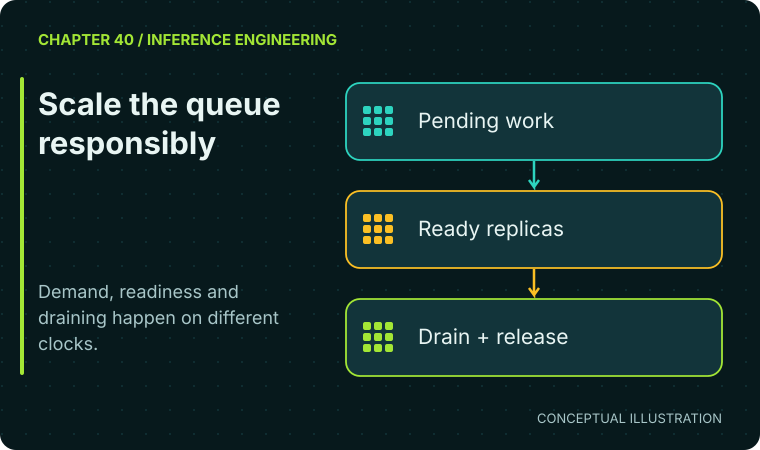
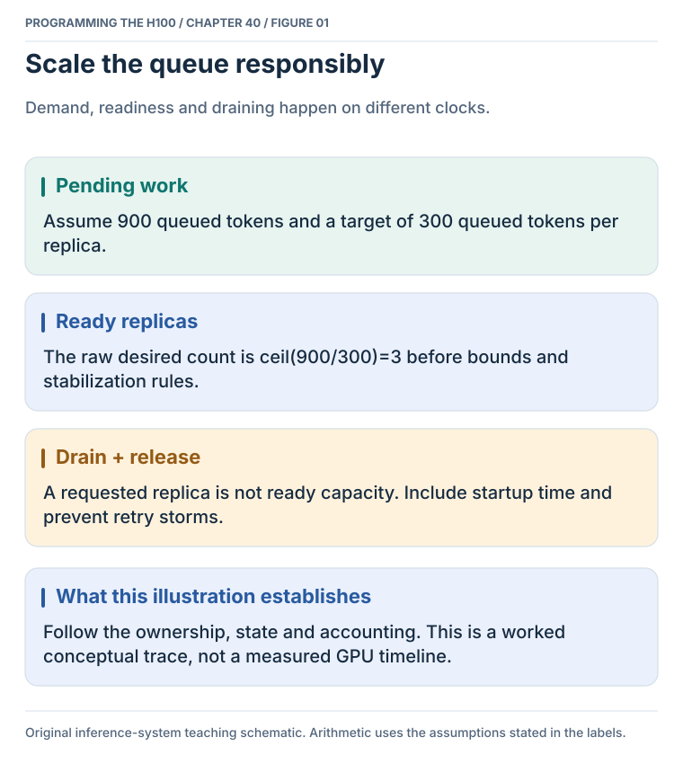

# Chapter 40 — Queue-Based GPU Autoscaling with KEDA

[](images/chapter-openers/40-inference.svg)


!!! warning "Evidence status"
    **Run on CPU, in a simulator:** the scaling rules (modelled on the documented KEDA and Kubernetes HPA behaviour), the queue and billing accounting, 23 self-tests, and seven experiments (`ch40_gpu_autoscaler.py`). Experiment cells show the mean and, in brackets, the minimum–maximum over several seeds.
    **Not run on any cluster.** The workload (arrival rates, service times, cold-start times) and the GPU price ($4/GPU-hour) are **assumed**. The manifest and runbook in 40.9 are **UNTESTED**.
    **What the simulator leaves out, and why it matters:**

    - **One GPU per replica.** A 70B model in BF16 has 140 GB of weights and does not fit one 80 GB H100, so a real replica is a tensor-parallel group and **GPU-seconds here are replica-seconds**: multiply by the tensor-parallel degree.
    - **One global FIFO queue.** Real vLLM pods behind a Service each keep their own queue; backlog already assigned to an old pod does not move to a new one, so real wake-up and burst latency is worse than shown.
    - **No node provisioning.** Time to get a GPU node, and any delay before the cluster autoscaler removes an idle node, are not modelled; the second would erode the savings from removing pods.
    - **Fixed cold start**, no image-pull variance, no readiness subtleties, 0.1 s time step.

GPU inference autoscaling is hard for one reason: **a new replica is not capacity until it has loaded its weights**, which takes tens of seconds to minutes, while the scaler decides every 15 seconds. Most of this chapter's results come from that gap, and several of them contradict the folklore "autoscaling saves money".

## Worked system map

[](images/worked/ch40-inference.svg)


## 40.1 The moving parts (what the documentation says)

Facts below are from the KEDA ScaledObject specification and the Kubernetes HPA documentation (links at the end).

| Component | Behaviour |
|---|---|
| KEDA operator | handles **0 ↔ 1** replicas (activation / deactivation) |
| HPA controller | handles **1 ↔ N**, driven by the metric KEDA exposes |
| `pollingInterval` | default **30 s**: how often KEDA checks each trigger. It governs 0 ↔ 1; the HPA polls on its own schedule (the controller manager's sync period, 15 s by default) for 1 ↔ N |
| `useCachedMetrics` | default **false**. When true, KEDA caches each trigger's metric for the polling interval so scaling respects it |
| `cooldownPeriod` | default **300 s**: wait after the trigger was last active before scaling to **zero**; it applies only to scaling to zero, so it does nothing when `minReplicaCount` > 0 |
| `minReplicaCount` / `maxReplicaCount` | default **0** / **100** |
| `advanced.horizontalPodAutoscalerConfig.behavior` | passes scaling-behaviour settings straight to the HPA |
| HPA default scale-up | no stabilization window; per 15 s the larger of +100% or +4 pods (`selectPolicy: Max`) |
| HPA default scale-down | **300 s** stabilization window; at most 100% per 15 s |

The stabilization window works as a rolling maximum: when metrics say "scale down", the HPA uses the highest desired replica count from the window.

## 40.2 The model in this chapter

`Scaler` implements those rules as pure logic:

- KEDA checks the trigger every 30 s. If replicas = 0 and the metric > 0, it sets 1. If the metric has been 0 for 300 s and `min_replicas = 0`, it sets 0.
- Every 15 s the HPA computes `desired = ceil(metric / target)` for an external metric with an average-value target. It does nothing if the ratio `(metric/current)/target` is within 10% of 1. Scale-up per period is limited to `current + max(100% of current, 4)`. Scale-down uses the maximum desired value over the last 300 s and at most 100% per period. The result is clamped to `[max(min,1), max]`.
- By default the HPA reads a **fresh** metric at each sync (`useCachedMetrics: false`). `cached_metrics=True` models the alternative where it reads the value KEDA cached at its last 30 s poll.
- The default metric is **outstanding requests = waiting + running**; the target is **3 per replica** (each replica has 4 slots, so about 75% slot occupancy). A `rate` metric (arrivals in the last 30 s divided by 30, times the mean service time) is the Little's-law estimate of steady demand and **ignores backlog**; a `queue` metric counts only waiting requests.

!!! note "Where the HPA formula comes from"
    The Kubernetes documentation's general formula is `desiredReplicas = ceil(currentReplicas × currentMetric / desiredMetric)`. For an external metric with an `AverageValue` target the controller divides the total by the replica count first, which makes the result `ceil(total / target)`. The simulator uses the latter.

Unstarted requests at the drain horizon have only a **lower bound** on queue wait. They remain in the SLO denominator and count as failures to demonstrate timely service, even when that lower bound is below the SLO. The returned `never_started` count should be reported; percentile waits containing censored requests are lower-bound summaries, not exact tail estimates.

## 40.3 Self-tests (23, all pass)

| Group | What is checked |
|---|---|
| HPA arithmetic (4) | metric 30 / target 3 from 4 replicas goes to 8 (the scale-up cap), not 10; the path from 1 replica is 5, 10, 20, 40, 80, 100 (clamped at max); 10% tolerance in and just outside |
| Stabilization (2) | with a 300 s window the replica count holds, then falls; with no window it falls at once |
| KEDA (4) | activation 0 → 1; scale to zero only after 300 s idle (the 11th idle poll, not before); `min=1` never reaches zero; a request during cooldown resets it |
| Accounting (6) | static N: GPU-seconds = N × horizon exactly; no negative wait; with ample capacity every arrival starts and finishes; concurrency never exceeds replicas × slots; busy slot-seconds equal total service time; sojourn = wait + service |
| Billing through scaling (2) | with a scripted scaler and no traffic: GPU-seconds equal 2 × 600 plus 3 × (time the extra replicas existed) across a scale-up and a drain, and across a scale-up whose still-warming pods are cancelled |
| Metric timing (1) | a spike starting just after KEDA's t = 30 poll is acted on at the HPA's t = 45 sync with the default fresh metric and at t = 60 with `useCachedMetrics` |
| Rate metric (1) | in steady state it tracks the true outstanding count (8.92 vs 9.11 against the expected 3 req/s × 3 s = 9) |
| Behaviour (3) | low-load wait is near zero and sojourn ≈ service; a request after scale-to-zero waits at least the cold start and at most cold start + 30 s polling lag; same seed gives identical results |

## 40.4 The cold-start budget

Time from "the load changes" to "a new replica serves" is

`lag = HPA sync (0 to 15 s) + metric pipeline + pod scheduling + image pull + weight load + warm-up`

and for 0 → 1 the HPA sync is replaced by KEDA's polling delay (0 to 30 s). The metric pipeline (for example a Prometheus scrape interval) is **not modelled**.

The weight-load term is bandwidth arithmetic. These are **assumed** bandwidths, not measurements:

| Model on disk | Size | at 1 GB/s | at 2 GB/s | at 7 GB/s |
|---|---|---|---|---|
| 70B, BF16 | 140 GB | 140 s | 70 s | 20 s |
| 70B, FP8 | 70 GB | 70 s | 35 s | 10 s |

Image pull, scheduling, CUDA graph capture and warm-up are on top. The experiments use 15, 30, 60, 120, 180 and 300 s to span the range.

## 40.5 Experiment 1 — static versus autoscaled, one hour, five seeds

Load steps 2 → 6 → 10 → 4 req/s (15 minutes each). One replica serves 4/3 = 1.33 req/s at saturation. SLO: wait ≤ 5 s. Cold start 60 s. Autoscaled runs start from steady state (2 replicas).

| policy | GPU-s | attainment | peak replicas | $/1k requests |
|---|---|---|---|---|
| static 4 (sized for the average) | 14 800 | 0.100 [0.096–0.107] | 4 | 0.83 |
| static 9 (sized for the peak) | 33 300 | 1.000 | 9 | 1.86 |
| autoscale, default (fresh metric) | 37 043 [31 116–43 129] | 0.992 [0.979–1.000] | 23 [14–36] | 2.07 [1.74–2.42] |
| autoscale, `useCachedMetrics` | 41 501 [31 271–54 473] | 0.982 [0.970–1.000] | 36 [14–69] | 2.32 [1.74–3.03] |
| autoscale, scale-up capped at +8 | 37 076 [31 116–42 889] | 0.993 [0.982–1.000] | 23 [14–35] | 2.07 [1.74–2.40] |
| autoscale, rate metric | 25 512 [25 146–25 806] | 0.951 [0.929–0.966] | 11 [11–12] | 1.42 [1.41–1.44] |
| autoscale, rate metric + 60 s window | 23 229 [22 883–23 591] | 0.934 [0.916–0.963] | 11 [11–12] | 1.30 [1.28–1.32] |

**Hand checks.** Static 9: 9 × 3700 s = 33 300 GPU-s; × $4/3600 = $37.00; over about 19.8 thousand requests that is $1.86 per thousand ✓. An ideal scaler tracking load at the target would average 5.5 replicas × 3600 s = 19 800 GPU-s.

What this shows:

- **The default autoscaler is roughly a wash against static-for-peak.** It averaged 11% more GPU-seconds (+25% with the cached metric) with a seed range that runs from 7% below to 30% above, and it missed the SLO slightly more (0.992 vs 1.000). Autoscaling this workload with default behaviour does not reliably save money; it saves it on some seeds.
- Fresh and cached metrics differ on average (37 043 vs 41 501) but the seed ranges overlap heavily; the clearer difference is peak replicas (23 vs 36).
- Capping scale-up at +8 changes nothing here (37 076 vs 37 043).
- **A rate-based metric is much cheaper** (−23% against static-for-peak) but **attainment falls to 0.951**: it provisions to demand with no allowance for backlog, so it is a different point on the cost–SLO trade-off, not a free improvement.
- `min=0` and `min=1` are identical in this experiment because the system is never idle.

## 40.6 Where the overshoot comes from (a causal test)

The default autoscaler peaks at 23 replicas on average (up to 36) when about 11 replicas serve the final 10 req/s step. A single 2 → 12 req/s step (held 600 s, cold start 60 s) makes the effect visible, and we ablate the suspected causes. Steady need at 12 req/s is about 12 replicas (36 outstanding at a target of 3). Five seeds.

| variant | peak replicas | attainment, step window | GPU-s |
|---|---|---|---|
| baseline: cold 60 s, window 300 s, default policy | 100 [100–100] | 0.823 [0.813–0.828] | 47 354 [46 705–47 870] |
| cold start 1 s (backlog cannot build) | 21 [16–28] | 0.952 [0.936–0.964] | 18 393 [16 961–20 232] |
| scale-down window 0 (nothing is held) | 100 [100–100] | 0.751 [0.615–0.862] | 19 768 [17 179–23 083] |
| rate metric (ignores backlog) | 13 [13–14] | 0.650 [0.600–0.720] | 13 852 [13 531–14 476] |
| scale-up capped at +8 | 60 [59–60] | 0.830 [0.819–0.838] | 32 638 [31 221–33 346] |
| `useCachedMetrics` | 100 [100–100] | 0.792 [0.785–0.798] | 47 562 [46 880–48 170] |

Reading the ablations:

- **Both a backlog build-up during the cold start and the scale-down window are needed to reach the baseline cost.** Removing the cold start (1 s) cuts the peak from 100 to 21 and GPU-seconds by 61%. Removing the window leaves the peak at 100 but cuts GPU-seconds by 58%, because the 100 replicas are no longer held for five minutes. The mechanism: while new pods warm up, demand exceeds capacity and the backlog grows; the metric includes the backlog, so the HPA computes a replica count for a load that is partly transient; and the 300 s rolling maximum then pays to hold the overshoot.
- The rate metric removes the overshoot (peak 13) and 71% of the cost, but **attainment drops to 0.650**: backlog accumulated during the cold start drains slowly because the fleet is sized for steady demand with only 25% slot headroom. Cheaper and worse. Lowering the target, or adding a backlog term, trades cost back for attainment.
- Capping scale-up at +8 cut GPU-seconds by 31% (47 354 → 32 638) with attainment indistinguishable at five seeds (0.830 vs 0.823; the ranges overlap).

**Exercise 7** asks you to explore a combination.

## 40.7 Experiments on bursts, scale-to-zero, load testing, flapping and metrics

### Experiment 2 — a 10× burst (2 → 20 req/s for 120 s at t = 600)

Attainment is in the window [600, 1020). Three seeds. "Floor" is `minReplicaCount`; peak replicas in the capped table is always the cap.

**maxReplicaCount = 100:**

| cold | floor | attainment | p99 wait | peak replicas | GPU-s |
|---|---|---|---|---|---|
| 15 s | 2 | 0.565 [0.544–0.599] | 26.9 s | 93 | 36 619 |
| 15 s | 8 | 0.738 [0.716–0.756] | 13.5 s | 64 | 32 066 |
| 15 s | 16 | **1.000** | 1.0 s | 26 | 29 676 |
| 60 s | 2 | 0.222 [0.217–0.232] | 59.5 s | 100 | 42 520 |
| 60 s | 8 | 0.361 [0.356–0.367] | 35.4 s | 100 | 47 439 |
| 60 s | 16 | **1.000** | 1.2 s | 28 | 30 111 |
| 180 s | 2 | 0.137 [0.131–0.141] | 148.0 s | 100 | 53 925 |
| 180 s | 8 | 0.186 [0.173–0.193] | 94.5 s | 100 | 56 909 |
| 180 s | 16 | **1.000** | 1.3 s | 28 | 30 296 |

**maxReplicaCount = 24:**

| cold | floor | attainment | p99 wait | GPU-s |
|---|---|---|---|---|
| 15 s | 2 | 0.417 [0.363–0.483] | 26.9 s | 14 262 |
| 15 s | 8 | 0.685 [0.656–0.717] | 13.5 s | 19 332 |
| 15 s | 16 | **1.000** | 1.0 s | 28 861 |
| 60 s | 2 | 0.199 [0.196–0.201] | 59.5 s | 14 882 |
| 60 s | 8 | 0.241 [0.231–0.251] | 35.4 s | 19 457 |
| 60 s | 16 | **1.000** | 1.2 s | 28 861 |
| 180 s | 2 | 0.125 [0.119–0.130] | 148.0 s | 17 077 |
| 180 s | 8 | 0.184 [0.171–0.192] | 94.5 s | 20 842 |
| 180 s | 16 | **1.000** | 1.3 s | 28 886 |

**How to read both tables.**

- A floor of 16 held the burst with no SLO loss at every cold start and with either cap. Reactive scaling needs three HPA steps (2 → 6 → 12 → 24, 45 s) to reach about 20 replicas, plus the cold start before they serve, against a burst that lasts 120 s.
- **Headroom is not cheaper, it is a price for the SLO.** With the cap at 24, the floor-16 fleet costs about twice the GPU-seconds of the capped low floors (28 861 vs 14 262–20 842) and is the only configuration that meets the SLO. With the cap at 100 the low floors cost *more* than floor 16 (32 000–57 000 vs 30 000), but only because the overshoot builds up to 100 replicas; the cap is what makes that go away.
- **Hand check.** 16 replicas × 1600 s = 25 600 GPU-s of floor; the extra 3 261 GPU-s (28 861 − 25 600) is about 8 replicas above the floor for roughly 410 s.

**The sizing is sharp.** A floor of 16 has a capacity of 16 × 1.33 = 21.3 req/s. With the cap at 24, cold start 60 s, three seeds:

| burst rate | attainment in the window | p99 wait | peak replicas |
|---|---|---|---|
| 18 req/s | 1.000 | 0.4 s | 23 |
| 20 req/s | 1.000 | 1.2 s | 24 |
| 22 req/s | 0.923 [0.845–0.976] | 5.7 s | 24 |
| 25 req/s | 0.463 [0.434–0.506] | 13.1 s | 24 |

A burst only 10% above the floor's capacity already breaks the SLO. Size the floor from measured peaks with margin, not from the average burst.

### Experiment 3 — scale to zero

Load of 3 req/s for 300 s, idle, then 1 req/s for 60 s at t = 1500. Cold start 60 s. Three seeds; the first-request wait is for one seed. "Cap +1" limits scale-up to one pod per period. **For this experiment requests are assumed to wait somewhere while there are zero replicas** (see below for why that needs a gateway).

| policy | GPU-s | attainment | replicas created |
|---|---|---|---|
| `min=0`, default HPA behaviour | 10 017 [9 422–10 953] | 0.938 [0.935–0.940] | 22 [21–24] |
| `min=0`, no scale-down window | 3 308 [3 031–3 799] | 0.845 [0.731–0.935] | 39 [33–51] |
| `min=0`, cap +1 | 5 306 [4 786–5 746] | 0.938 [0.935–0.940] | 9 [8–10] |
| `min=0`, no window, cap +1 | 2 222 [2 147–2 327] | 0.823 [0.667–0.935] | 15 [14–16] |
| `min=0`, rate metric | **2 821** [2 730–2 986] | 0.938 [0.935–0.940] | 2 [2–3] |
| `min=1`, default HPA behaviour | 5 001 [4 511–5 726] | 1.000 [0.999–1.000] | 4 [3–5] |

The first request after the idle period waits **89.7 s** in every `min=0` row when the burst starts exactly on a KEDA poll boundary (t = 1500) and **74.7 s** when it starts at t = 1515. That is the cold start (60 s) plus the time until KEDA's next poll (0 to 30 s), so the earlier figure of "cold start + 29.7 s" was the worst phase by construction. All 62 requests of the wake-up burst miss the 5 s SLO in the `min=0` rows (62 of 960 requests, hence 0.938).

**What this says about scale-to-zero.**

- The saving is real but depends on how the scaler behaves after waking. With default HPA behaviour `min=0` used **twice** the GPU-seconds of `min=1` (10 017 vs 5 001): the backlog that builds during the cold start makes the HPA create about 22 replicas and the 300 s window holds them. That is the overshoot of 40.6, not something intrinsic to scale-to-zero.
- With a backlog-blind rate metric, `min=0` used **44% fewer** GPU-seconds than `min=1` (2 821 vs 5 001) at the cost of the wake-up burst missing its SLO.
- The "no window" variants are cheapest of all but their attainment is lower and varies widely across seeds (0.82–0.85, ranges down to 0.67). I did not isolate why; releasing capacity while requests are still arriving is the likely reason.

**Scale-from-zero needs something in front of the pods.** With `minReplicaCount: 0` there are no vLLM pods, so the vLLM metrics (`vllm:num_requests_waiting` and the rest) do not exist, and a request sent to a Service with no ready endpoints is rejected, not queued. A real scale-from-zero setup needs a component that holds requests and exposes a metric: your own gateway or queue, or KEDA's HTTP add-on (check its current status and fit). The simulator's queue at zero replicas has no counterpart in the Section 40.9 manifest.

### Experiment 4 — testing the scaler: open loop versus closed loop

The open-loop run is offered a 20 req/s burst for 120 s. The closed-loop runs are **not** offered that burst: each client waits for its reply, then thinks, so offered load is whatever the clients and the system's latency allow.

| load generator | peak outstanding | p99 wait | attainment | peak replicas |
|---|---|---|---|---|
| open loop, 20 req/s burst | **1301** | 60.9 s | 0.397 | 100 |
| closed loop, 8 clients, think 3 s | 8 | 0.1 s | 1.000 | 3 |
| closed loop, 64 clients, think 0.5 s | 64 | 19.7 s | 0.982 | 22 |

A closed loop can never have more than `clients` requests outstanding, and its arrival rate falls as latency rises, so it cannot reproduce the demand that overwhelms the scaler. With enough clients (64) it does exercise the scaler, up to 22 replicas, but it still never presents 1301 outstanding requests and reports 0.982 attainment where the open-loop burst gives 0.397. Test the scaler with a load generator whose arrival times do not depend on responses, as in Chapter 36.

### Experiment 5 — flapping and the stabilization window

Load alternates 2 ↔ 12 req/s every 150 s, cold start 60 s, three seeds.

| scale-down window | scale events | replicas created | warm-up GPU-s (created × 60) | attainment | GPU-s |
|---|---|---|---|---|---|
| 0 s | 93 | 649 | 38 960 | 0.355 [0.283–0.405] | 49 049 |
| 60 s | 54 | 584 | 35 060 | 0.375 [0.362–0.398] | 82 525 |
| 300 s | 11 | 101 | 6 080 | 0.899 [0.892–0.906] | 58 009 |
| 600 s | 10 | 99 | 5 920 | 0.899 [0.892–0.906] | 84 242 |

The 60 s window is the most expensive of the short windows because it still removes capacity at every trough but, unlike 0 s, holds the overshoot for a minute: 584 replicas are created (35 060 GPU-seconds spent only warming up) and the surviving ones are kept. A 300 s window rides through the 150 s troughs (101 creations). A 600 s window holds peak capacity so long that it costs 45% more than 300 s for the same attainment.

### Experiment 6 — which metric

Steady 8 req/s for 30 minutes, starting from 8 replicas, three seeds.

| metric | attainment | p99 wait | GPU-s | peak replicas |
|---|---|---|---|---|
| waiting + running | 1.000 | 0.2 s | 22 102 [20 355–23 746] | 13 |
| waiting only (queue depth) | 0.749 [0.744–0.758] | 64.7 s | 132 401 [131 002–134 261] | 100 |
| rate (Little's law) | 1.000 | 0.4 s | 16 995 [16 905–17 070] | 9 |

With adequate capacity the queue is almost always empty, so a queue-only metric reads "no load", scales down, lets the queue build, and then scales up hard: a sawtooth that cost 6.0× more and failed the SLO. **Scale on total outstanding work or on a rate-based estimate, not on the waiting queue alone.** In steady load the rate metric was cheapest and equally good; its weakness is the step response shown in 40.6.

## 40.8 Failure catalogue

| Failure | Mechanism | Where seen |
|---|---|---|
| Overshoot | backlog built during cold start inflates the metric, and the window holds the result | 40.6 |
| Burst shorter than scale-up latency | capacity arrives after the burst | Exp 2 |
| Burst just above the floor's capacity | 22 req/s against 21.3 | Exp 2 |
| Wake-up overshoot | scale from zero then builds a fleet for the backlog | Exp 3 |
| Nothing to queue requests at zero replicas | no pods, so no vLLM metrics and rejected requests | Exp 3 |
| Test blind to scaling | closed-loop load cannot present the burst | Exp 4 |
| Flapping | window shorter than the load oscillation | Exp 5 |
| Sawtooth | queue-only metric | Exp 6 |
| Cost of the window | a long scale-down window holds idle GPUs | Exp 1, 5 |
| Cached metric | with `useCachedMetrics` the HPA acts on a value up to 30 s old | Exp 1, 7 |
| Per-pod queues | real backlog stays with old pods, worse than the simulator's global queue | not modelled |
| Node provisioning and node scale-down | GPU nodes take time to arrive and linger after pods leave | not modelled |
| Metric pipeline lag | scrape intervals add to every decision | not modelled |
| Readiness too early | pod marked ready before weights and graphs are warm | not modelled |

## 40.9 Manifest and runbook (UNTESTED)

Everything here is **untested on a cluster**. Documented: the ScaledObject fields `pollingInterval`, `cooldownPeriod`, `minReplicaCount`, `maxReplicaCount` and `advanced.horizontalPodAutoscalerConfig.behavior` (KEDA specification), and the Prometheus trigger fields `serverAddress`, `query` and `threshold` (all required; the example writes `threshold` as a quoted string). The metric names `vllm:num_requests_running` and `vllm:num_requests_waiting` are listed in the vLLM metrics documentation, but that page does not confirm the label names: the `model_name` label is likely, `namespace` depends on your scrape configuration. Fix the labels to match your setup.

```yaml
apiVersion: keda.sh/v1alpha1
kind: ScaledObject
metadata:
  name: vllm-llama70b
spec:
  scaleTargetRef:
    name: vllm-llama70b            # your Deployment; each replica is a tensor-parallel group
  pollingInterval: 15
  # cooldownPeriod is omitted: it only governs scaling to zero, and minReplicaCount > 0 here
  minReplicaCount: 16              # from the Experiment 2 workload (20 req/s peak x 3 s / 4 slots = 15 replicas at full slots); replace with YOUR measured peak plus margin
  maxReplicaCount: 24
  advanced:
    horizontalPodAutoscalerConfig:
      behavior:
        scaleUp:
          stabilizationWindowSeconds: 0
          policies:
            - type: Pods
              value: 8
              periodSeconds: 15
        scaleDown:
          stabilizationWindowSeconds: 300
          policies:
            - type: Percent
              value: 25
              periodSeconds: 60
  triggers:
    - type: prometheus
      metadata:
        serverAddress: http://prometheus.monitoring:9090
        query: sum(vllm:num_requests_running{namespace="llm",model_name="llama70b"}) + sum(vllm:num_requests_waiting{namespace="llm",model_name="llama70b"})
        threshold: "3"
```

For a service that scales to zero, put a gateway or queue in front that holds requests and exposes its own depth metric, and point the trigger at that.

Runbook:

1. **Measure the cold start first.** From `kubectl apply` to the first successful request on a fresh pod, on a fresh node and on a warm node. This number sets everything else.
2. **Run the scaler open loop.** Use the Chapter 36 client with a rate that does not depend on responses. A step of 2 then 12 req/s, back to back: `python3 /full/path/ch36_benchmark_teardown.py run --url http://HOST:8000 --model MODEL --rate 2 --n 600 --warmup 30 --seed 1 --out /full/path/step1.json && python3 /full/path/ch36_benchmark_teardown.py run --url http://HOST:8000 --model MODEL --rate 12 --n 7200 --warmup 30 --seed 2 --out /full/path/step2.json` (300 s at 2 req/s, then 600 s at 12 req/s). Watch `kubectl get hpa -w` and `kubectl get scaledobject` alongside.
3. **Record per step:** wait/TTFT p99, SLO attainment, replica count over time, GPU-seconds (replicas × tensor-parallel degree × time), and peak outstanding.
4. **Check for overshoot:** peak replicas against `ceil(steady outstanding / target)`. A ratio above about 2 means the scale-up policy or window is too aggressive for your cold start.
5. **Tune in this order:** the scale-up cap, the scale-down window, the floor for headroom, and then the metric. Re-run steps 2 to 4 after each change, over several seeds.
6. **Scale to zero:** only after measuring the wake-up cost as in Experiment 3 on your own cold start, and only with a gateway in front.

<!-- BEGIN COMPLETE INFERENCE SOURCE -->
## Complete runnable code

The complete implementation is shown below, including its checks and entry point. The listing and downloadable `.py` file contain exactly the same source. Copy the file under the displayed filename; keep supporting files in the same directory.

[Download all inference examples and supporting modules](examples/inference-systems/inference-systems.zip) or read the [environment and command guide](examples/inference-systems/README.md).

The [follow-up agent audit](inference-adversarial-review-2026-11-25.md) records the corrections, fresh CPU captures and hardware limits for this source.

Read it in three passes: start with `Scaler` to identify the state; trace `simulate` and `summarize` for one request or token; then follow `selftests` and `experiments` to see how the result is checked.

From the repository root:

```bash
python3 docs/examples/inference-systems/ch40_gpu_autoscaler.py --selftest
# Run the full chapter demonstrations:
python3 docs/examples/inference-systems/ch40_gpu_autoscaler.py
```

### ch40_gpu_autoscaler.py

[Download ch40_gpu_autoscaler.py](examples/inference-systems/ch40_gpu_autoscaler.py)

```python title="ch40_gpu_autoscaler.py" linenums="1"
#!/usr/bin/env python3
"""Chapter 40: queue-based GPU autoscaling (KEDA + HPA semantics) in a discrete-time simulator.

Run:  python3 ch40_gpu_autoscaler.py            # self-tests + experiments (CPU, numpy, ~1-2 min)
      python3 ch40_gpu_autoscaler.py --selftest

WHAT IS REAL: the scaling rules (modelled on the documented KEDA and Kubernetes HPA behaviour, see the chapter), the
queueing/billing accounting, the test and measurement method. WHAT IS INVENTED: the workload (arrival rates, service
times, cold-start times, GPU price). Nothing here was run on a cluster; every number is a property of the simulator.
Simplifications are listed in the chapter (no node provisioning delay, no image pull variance, no readiness gate beyond
a fixed cold start, no pod termination grace period beyond draining, FIFO queue, one GPU per replica).
"""
import math
import sys
import time
from collections import deque

import numpy as np


# ------------------------------------------------------------------ 1. the scaler (pure logic, no simulator inside)
class Scaler:
    """KEDA ScaledObject + HPA semantics.
    KEDA checks the trigger every `poll` seconds (default 30). KEDA alone handles 0 <-> 1: activate when the metric > 0;
    deactivate to 0 after the metric has been 0 for `cooldown` seconds (default 300) when min_replicas == 0.
    The HPA handles 1 <-> N every `hpa_period` seconds (default 15). With useCachedMetrics=false (the documented default) it
    reads a FRESH metric at each sync, so pollingInterval does not govern 1 <-> N; with cached_metrics=True it reads the
    value KEDA last cached at its poll. Either way:
        desired = ceil(metric_total / target_per_replica)            (external metric, AverageValue)
    no change if |ratio-1| <= tolerance (default 0.1) where ratio = (metric/current)/target;
    scale-up per period limited to max(100% of current, +4 pods) (selectPolicy Max, default);
    scale-down uses the maximum desired value over the last `down_window` seconds (default 300) and at most 100% per period.
    Result is clamped to [max(min_replicas,1) .. max_replicas] while the HPA is active."""
    def __init__(self, target, min_replicas=0, max_replicas=100, poll=30.0, cooldown=300.0, hpa_period=15.0,
                 tolerance=0.1, down_window=300.0, up_pods=4, up_percent=100.0, down_percent=100.0, cached_metrics=False):
        self.target, self.min_r, self.max_r = target, min_replicas, max_replicas
        self.poll, self.cooldown, self.hpa_period = poll, cooldown, hpa_period
        self.tol, self.down_window = tolerance, down_window
        self.up_pods, self.up_pct, self.down_pct = up_pods, up_percent, down_percent
        self.cached_metrics = cached_metrics       # KEDA useCachedMetrics (documented default: false -> the HPA gets a fresh value every sync)
        self.sample = 0.0
        self.idle_since = None
        self.history = deque()             # (time, desired) for the scale-down stabilization window

    def keda_poll(self, now, metric, current):
        """Called every `poll` seconds. Returns a new replica count if KEDA decides 0<->1, else None."""
        self.sample = metric
        if current == 0:
            self.idle_since = None
            return 1 if metric > 0 else None
        if metric > 0:
            self.idle_since = None
            return None
        if self.idle_since is None:
            self.idle_since = now
        if self.min_r == 0 and now - self.idle_since >= self.cooldown:
            return 0
        return None

    def hpa(self, now, current):
        """Called every `hpa_period` seconds while current >= 1. Returns the new replica count."""
        lo = max(self.min_r, 1)
        raw = math.ceil(self.sample / self.target) if self.sample > 0 else 0
        ratio = (self.sample / current) / self.target if current > 0 else math.inf
        desired = current if abs(ratio - 1.0) <= self.tol else raw
        desired = min(max(desired, lo), self.max_r)
        self.history.append((now, desired))
        while self.history and self.history[0][0] < now - self.down_window:
            self.history.popleft()
        if desired > current:
            limit = current + max(math.floor(current * self.up_pct / 100.0), self.up_pods)
            return min(desired, limit, self.max_r)
        if desired < current:
            stabilised = max(d for _, d in self.history)          # rolling maximum over the window
            target = min(max(stabilised, desired), current)
            limit = current - math.floor(current * self.down_pct / 100.0)
            return max(target, limit, lo)
        return current


# ------------------------------------------------------------------ 2. workload
def make_arrivals(segments, rng):
    """segments: [(t0, t1, rate_per_s)]. Poisson arrivals within each (independent of system state = OPEN loop)."""
    out = []
    for t0, t1, rate in segments:
        if rate <= 0:
            continue
        t = t0
        while True:
            t += rng.exponential(1.0 / rate)
            if t >= t1:
                break
            out.append(t)
    return np.array(out)


def lognormal_service(n, mean, sigma, rng):
    mu = math.log(mean) - sigma * sigma / 2
    return rng.lognormal(mu, sigma, n)


# ------------------------------------------------------------------ 3. the simulator
def simulate(arrivals, svc, horizon, slots=4, cold=60.0, scaler=None, static=None, init_replicas=None, dt=0.1,
             metric="outstanding", closed_clients=None, think=1.0, rng=None, trace=None, svc_prior=3.0, mtrace=None):
    """Replay. Open loop by default. Each replica serves up to `slots` requests concurrently; a new replica becomes
    ready `cold` seconds after it is created (billed from creation). FIFO queue. `metric`: 'outstanding' = waiting +
    running requests (what the scaler divides by target); 'queue' = waiting only.
    Returns per-request wait (censored at the horizon for unstarted requests), billing and event counts."""
    n = len(arrivals) if closed_clients is None else None
    reps = []                                   # dicts: ready_at, running (list of finish times), draining
    created = 0

    def spawn(now, count):
        nonlocal created
        for _ in range(count):
            reps.append(dict(ready_at=now + cold, running=[], draining=False))
            created += 1

    cur0 = static if static is not None else (init_replicas if init_replicas is not None else (0 if scaler and scaler.min_r == 0 else max(1, scaler.min_r if scaler else 1)))
    for _ in range(cur0):
        reps.append(dict(ready_at=0.0, running=[], draining=False))

    queue = deque()                             # request ids waiting
    waits, started_at, finished = {}, {}, {}
    arr = list(arrivals) if closed_clients is None else []
    ai = 0
    nxt_id = 0
    client_next = [rng.random() * think for _ in range(closed_clients)] if closed_clients else []
    arr_time = {}
    svc_list = svc
    gpu_s = 0.0
    events = []                                 # (t, new_count)
    t = 0.0
    next_poll = 0.0
    next_hpa = scaler.poll if scaler is not None else 0.0     # the HPA first acts after KEDA's first metric sample
    if scaler is not None:
        scaler.history.append((0.0, len(reps)))                  # previous desired state = the starting replica count
    max_out = 0
    busy_slot_s = 0.0
    n_started_dur, sum_started_dur = 0, 0.0
    arr_np = np.asarray(arrivals) if closed_clients is None else None
    steps = int(horizon / dt)
    for step in range(steps):
        now = step * dt
        # arrivals
        if closed_clients is None:
            while ai < len(arr) and arr[ai] <= now:
                arr_time[ai] = arr[ai]
                queue.append(ai)
                ai += 1
        else:
            for c in range(closed_clients):
                if client_next[c] is not None and client_next[c] <= now:
                    rid = nxt_id; nxt_id += 1
                    arr_time[rid] = client_next[c]
                    queue.append(rid)
                    client_next[c] = None
                    arr.append((rid, c))
        # completions
        for r in reps:
            done = [f for f in r["running"] if f <= now]
            if done:
                r["running"] = [f for f in r["running"] if f > now]
        # remove drained replicas
        reps[:] = [r for r in reps if not (r["draining"] and not r["running"])]
        # starts
        for r in reps:
            if r["draining"] or r["ready_at"] > now:
                continue
            while queue and len(r["running"]) < slots:
                rid = queue.popleft()
                dur = float(svc_list[rid % len(svc_list)]) if closed_clients else float(svc_list[rid])
                waits[rid] = now - arr_time[rid]
                started_at[rid] = now
                r["running"].append(now + dur)
                finished[rid] = now + dur
                busy_slot_s += dur
                n_started_dur += 1; sum_started_dur += dur
        if closed_clients is not None:
            for rid, c in [(rid, c) for rid, c in arr if rid in finished and finished[rid] <= now and client_next[c] is None and (rid, c) in arr]:
                client_next[c] = now + think
                arr.remove((rid, c))
        # scaler
        outstanding = len(queue) + sum(len(r["running"]) for r in reps)
        max_out = max(max_out, outstanding)
        if trace is not None and step % int(15 / dt) == 0:
            trace.append((now, outstanding, len(queue), sum(1 for r in reps if r['ready_at'] <= now and not r['draining']), len(reps)))
        if scaler is not None:
            if metric == "outstanding":
                m = outstanding
            elif metric == "queue":
                m = len(queue)
            else:                                   # 'rate': Little's-law estimate of steady demand, ignores backlog
                lam = (ai - int(np.searchsorted(arr_np, now - 30.0))) / 30.0
                mean_s = sum_started_dur / n_started_dur if n_started_dur else svc_prior
                m = lam * mean_s
            live = [r for r in reps if not r["draining"]]
            cur = len(live)
            if now >= next_poll:
                next_poll += scaler.poll
                new = scaler.keda_poll(now, m, cur)
                if new is not None and new != cur:
                    cur = _resize(reps, cur, new, now, spawn)
                    events.append((now, cur))
            if now >= next_hpa:
                next_hpa += scaler.hpa_period
                if mtrace is not None:
                    mtrace.append((now, outstanding, m))
                if cur >= 1:
                    if not scaler.cached_metrics:
                        scaler.sample = m                  # fresh metric at HPA sync (useCachedMetrics: false)
                    new = scaler.hpa(now, cur)
                    if new != cur:
                        cur = _resize(reps, cur, new, now, spawn)
                        events.append((now, cur))
        gpu_s += len(reps) * dt
    # censor requests that never started
    total = (ai if closed_clients is None else nxt_id)
    w = np.array([waits.get(i, horizon - arr_time[i]) for i in range(total)])
    started = np.array([i in waits for i in range(total)])
    return dict(wait=w, started=started, gpu_s=gpu_s, steps=steps, dt=dt, events=events, created=created, n=total, max_out=max_out,
                busy_slot_s=busy_slot_s, finished=finished, started_at=started_at, arr_time=arr_time, reps_end=len(reps))


def _resize(reps, cur, new, now, spawn):
    if new > cur:
        spawn(now, new - cur)
    else:
        # drain: pick replicas with the least work first, not-yet-ready ones first of all (cancel them)
        live = [r for r in reps if not r["draining"]]
        live.sort(key=lambda r: (r["ready_at"] <= now, len(r["running"])))
        for r in live[: cur - new]:
            if r["ready_at"] > now:
                reps.remove(r)
            else:
                r["draining"] = True
    return new


# ------------------------------------------------------------------ 4. metrics
def pct(a, p):
    return float(np.percentile(a, p)) if len(a) else float("nan")


def summarize(res, slo_wait, price_gpu_hr, window=None, arrivals=None):
    w, n = res["wait"], res["n"]
    started = res["started"]
    if window is not None and arrivals is not None:
        sel = (arrivals[:n] >= window[0]) & (arrivals[:n] < window[1])
        w = w[sel]
        started = started[sel]
    # An unstarted request has only a lower-bound wait, never an observed SLO success.
    ok = float((started & (w <= slo_wait)).mean()) if len(w) else float("nan")
    cost = res["gpu_s"] / 3600.0 * price_gpu_hr
    return dict(n=len(w), p50=pct(w, 50), p99=pct(w, 99), attain=ok, gpu_s=res["gpu_s"], cost=cost,
                cost_per_1k=1000.0 * cost / max(1, res["n"]), never_started=int((~res["started"]).sum()), events=len(res["events"]))


# ------------------------------------------------------------------ 5. tests
def selftests():
    res = []

    def check(name, cond):
        res.append(bool(cond))
        print(f"  [{'PASS' if cond else 'FAIL'}] {name}")

    # ---- scaler: pure logic
    s = Scaler(target=3.0, min_replicas=1)
    s.sample = 30.0
    check("HPA formula: metric 30, target 3 -> desired ceil(30/3) = 10 (capped by the scale-up policy from 4 replicas: 4 + max(4,4) = 8)",
          s.hpa(0.0, 4) == 8)
    s = Scaler(target=3.0, min_replicas=1); s.sample = 500.0
    seq, cur = [], 1
    for k in range(6):
        cur = s.hpa(15.0 * k, cur); seq.append(cur)
    check(f"scale-up path from 1 replica toward desired 167 under 'max(100%, +4 pods)' per 15 s, clamped at max_replicas=100: {seq}", seq == [5, 10, 20, 40, 80, 100])
    s = Scaler(target=3.0, min_replicas=1); s.sample = 3.3
    check("tolerance: metric/current/target = 1.1 is within 10% -> no change", s.hpa(0.0, 1) == 1)
    s = Scaler(target=3.0, min_replicas=1); s.sample = 3.31
    check("just outside tolerance (ratio 1.1033) -> scales to ceil(3.31/3) = 2", s.hpa(0.0, 1) == 2)

    s = Scaler(target=3.0, min_replicas=1, down_window=300.0); cur = 10
    s.sample = 30.0; cur = s.hpa(0.0, cur)
    s.sample = 3.0; outs = []
    for k in range(1, 22):
        cur = s.hpa(15.0 * k, cur); outs.append(cur)
    check(f"scale-down stabilization: after load drops, replicas stay at 10 for the 300 s window then fall (first fall at step {next(i for i, v in enumerate(outs) if v < 10) + 1} of 21)",
          outs[0] == 10 and outs[-1] < 10 and all(v == 10 for v in outs[:19]))
    s = Scaler(target=3.0, min_replicas=1, down_window=0.0); s.sample = 30.0; cur = s.hpa(0.0, 10)
    s.sample = 3.0
    check("with no stabilization window the same drop scales down at once (to the 100%/period limit, floor 1)", s.hpa(15.0, cur) == 1)

    s = Scaler(target=3.0, min_replicas=0, cooldown=300.0, poll=30.0)
    check("KEDA activation: 0 replicas and metric > 0 -> 1", s.keda_poll(0.0, 5.0, 0) == 1)
    out = [s.keda_poll(30.0 * k, 0.0, 1) for k in range(1, 14)]
    check("KEDA scale to zero only after the metric has been 0 for the cooldown (300 s): returns 0 at the 11th idle poll, not before",
          out[:10] == [None] * 10 and out[10] == 0)
    s2 = Scaler(target=3.0, min_replicas=1)
    check("min_replicas = 1 never scales to zero", all(s2.keda_poll(30.0 * k, 0.0, 1) is None for k in range(1, 100)))
    s3 = Scaler(target=3.0, min_replicas=0, cooldown=300.0)
    for k in range(1, 8):
        s3.keda_poll(30.0 * k, 0.0, 1)
    s3.keda_poll(240.0, 1.0, 1)
    check("a request arriving during the cooldown resets it", s3.idle_since is None)

    # ---- simulator
    rng = np.random.default_rng(0)
    arr = make_arrivals([(0, 600, 4.0)], rng)
    svc = lognormal_service(len(arr), 3.0, 0.5, rng)
    r = simulate(arr, svc, 700.0, slots=4, cold=30.0, static=6)
    check(f"static N: GPU-seconds = N * horizon exactly ({r['gpu_s']:.1f} = 6 * 700)", abs(r["gpu_s"] - 6 * 700.0) < 1e-6)
    check("every request that started did so at or after its arrival (no negative wait)", (r["wait"] >= -1e-9).all())
    comp = sum(1 for i, f in r["finished"].items() if f <= 700.0)
    check(f"with ample capacity (6 replicas for 4 req/s) every one of the {r['n']} arrivals starts and finishes before the horizon ({int(r['started'].sum())} started, {comp} finished)",
          int(r["started"].sum()) == r["n"] and comp == r["n"])
    # slots never exceeded: replay concurrency from start/finish pairs
    pts = sorted([(r["started_at"][i], 1) for i in r["started_at"]] + [(r["finished"][i], -1) for i in r["started_at"]])
    cmax = cc = 0
    for _, d in pts:
        cc += d; cmax = max(cmax, cc)
    check(f"concurrency never exceeds replicas x slots: max in flight {cmax} <= 6 x 4 = 24", cmax <= 24)
    check("busy slot-seconds equal the sum of service durations of the started requests",
          abs(r["busy_slot_s"] - sum(svc[i] for i in r["started_at"])) < 1e-6)

    # Little's law, steady state, plenty of capacity
    rng = np.random.default_rng(1)
    arr = make_arrivals([(0, 3000, 3.0)], rng)
    svc = lognormal_service(len(arr), 3.0, 0.5, rng)
    r = simulate(arr, svc, 3200.0, slots=4, cold=1.0, static=4)
    ids = [i for i in r["finished"] if 300 < r["arr_time"][i] < 2800]
    soj = np.array([r["finished"][i] - r["arr_time"][i] for i in ids])
    wt = np.array([r["wait"][i] for i in ids])
    sv = np.array([svc[i] for i in ids])
    check(f"bookkeeping identity: sojourn = wait + service for every request (max abs error {np.abs(soj - wt - sv).max():.2e})", np.abs(soj - wt - sv).max() < 1e-9)
    check(f"low utilisation (3 req/s offered vs 5.33 capacity): mean wait {wt.mean():.2f} s is below one tick-plus-queueing bound of 1 s; mean sojourn {soj.mean():.2f} s is mean service 3 s plus that wait",
          wt.mean() < 1.0 and abs(soj.mean() - 3.0 - wt.mean()) < 0.15)

    # cold start lower bound from zero
    sc = Scaler(target=3.0, min_replicas=0)
    arr = np.array([10.0]); svc = np.array([2.0])
    r = simulate(arr, svc, 400.0, slots=4, cold=90.0, scaler=sc)
    check(f"scale from zero: first request waits at least the cold start (wait {r['wait'][0]:.1f} s >= 90) plus KEDA's polling lag",
          r["wait"][0] >= 90.0 and r["wait"][0] <= 90.0 + 30.0 + 1.0)

    # billing through scaling paths: scripted scaler, no arrivals
    class Scripted:
        def __init__(self, sched):
            self.sched, self.poll, self.hpa_period, self.min_r, self.cached_metrics, self.history, self.sample = sched, 30.0, 15.0, 1, True, deque(), 0.0
        def keda_poll(self, now, metric, current):
            return None
        def hpa(self, now, current):
            want = current
            for t_from, n in self.sched:
                if now >= t_from:
                    want = n
            return want
    none = np.array([]); nosvc = np.array([])
    r = simulate(none, nosvc, 600.0, slots=4, cold=30.0, scaler=Scripted([(105.0, 5), (300.0, 2)]), init_replicas=2)
    first_up = r["events"][0][0]; first_down = r["events"][1][0]
    exp = 2 * 600.0 + 3 * (first_down - first_up)
    check(f"billing across a scale-up and a drain: events at {first_up:.0f} s (to 5) and {first_down:.0f} s (to 2): GPU-s {r['gpu_s']:.1f} = 2*600 + 3*({first_down:.0f}-{first_up:.0f}) = {exp:.1f} within one tick of drain", abs(r["gpu_s"] - exp) <= 3 * 0.1 * 2 + 1e-6)
    r = simulate(none, nosvc, 600.0, slots=4, cold=30.0, scaler=Scripted([(105.0, 5), (120.0, 2)]), init_replicas=2)
    up, dn = r["events"][0][0], r["events"][1][0]
    exp = 2 * 600.0 + 3 * (dn - up)
    check(f"billing when pods still warming are CANCELLED by a scale-down: up at {up:.0f} s, down at {dn:.0f} s: GPU-s {r['gpu_s']:.1f} = 2*600 + 3*({dn:.0f}-{up:.0f}) = {exp:.1f}; replicas alive at the end {r['reps_end']} == 2",
          abs(r["gpu_s"] - exp) <= 3 * 0.1 + 1e-6 and r["reps_end"] == 2)

    # fresh versus cached metric at the HPA
    rng = np.random.default_rng(11)
    a = make_arrivals([(31, 200, 10.0)], rng); v = lognormal_service(len(a), 3.0, 0.5, rng)
    firsts = []
    for cached in (False, True):
        r = simulate(a, v, 200.0, slots=4, cold=30.0, scaler=Scaler(target=3.0, min_replicas=1, cached_metrics=cached), init_replicas=1)
        firsts.append(r["events"][0][0])
    check(f"a spike starts at t=31 just after KEDA's poll at t=30: with the default FRESH metric the HPA first scales at t={firsts[0]:.0f} (its t=45 sync); with useCachedMetrics it waits for the next KEDA poll and scales at t={firsts[1]:.0f}",
          abs(firsts[0] - 45.0) <= 0.2 and abs(firsts[1] - 60.0) <= 0.2)

    # rate metric (Little's law) tracks outstanding in steady state
    rng = np.random.default_rng(12)
    a = make_arrivals([(0, 1500, 3.0)], rng); v = lognormal_service(len(a), 3.0, 0.5, rng)
    mt = []
    simulate(a, v, 1500.0, slots=4, cold=1.0, scaler=Scaler(target=3.0, min_replicas=4, max_replicas=4), init_replicas=4, metric="rate", mtrace=mt)
    sel = [(o, m) for t_, o, m in mt if 300 <= t_ <= 1400]
    mo, mm = np.mean([x[0] for x in sel]), np.mean([x[1] for x in sel])
    check(f"rate metric (arrivals in the last 30 s / 30 x mean service) tracks the true outstanding count in steady state: mean {mm:.2f} vs {mo:.2f} (within 10%; both near 3 req/s x 3 s = 9)", abs(mm - mo) / mo < 0.10)

    # determinism
    def run_once():
        rng = np.random.default_rng(7)
        a = make_arrivals([(0, 300, 5.0), (300, 400, 20.0)], rng)
        v = lognormal_service(len(a), 3.0, 0.5, rng)
        return simulate(a, v, 500.0, cold=45.0, scaler=Scaler(target=3.0, min_replicas=1))
    a, b = run_once(), run_once()
    check("same seed, same result (waits, GPU-seconds, scaling events)", np.array_equal(a["wait"], b["wait"]) and a["gpu_s"] == b["gpu_s"] and a["events"] == b["events"])
    return all(res)


def experiments():
    PRICE = 4.0           # ASSUMED $ per GPU-hour (one GPU per replica; see the chapter for tensor parallelism)
    SLO = 5.0             # wait <= 5 s
    SL, MEAN = 4, 3.0     # 4 concurrent slots per replica, mean service 3 s => capacity 4/3 = 1.33 req/s per replica

    def workload(segs, seed):
        rng = np.random.default_rng(seed)
        a = make_arrivals(segs, rng)
        return a, lognormal_service(len(a), MEAN, 0.5, rng)

    def agg(segs, seeds, horizon, make_kw, window=None, cold=60.0, init=None):
        """Run the same policy over several seeds; return dict of lists."""
        out = dict(gpu=[], att=[], attw=[], p99w=[], peak=[], cost1k=[], events=[], created=[])
        for sd in seeds:
            a, v = workload(segs, sd)
            kw = make_kw()
            r = simulate(a, v, horizon, slots=SL, cold=cold, init_replicas=init, **kw)
            s = summarize(r, SLO, PRICE)
            out["gpu"].append(s["gpu_s"]); out["att"].append(s["attain"]); out["p99w"].append(s["p99"]); out["cost1k"].append(s["cost_per_1k"])
            out["events"].append(s["events"]); out["created"].append(r["created"])
            out["peak"].append(kw["static"] if "static" in kw else max([c for _, c in r["events"]] + [init or 0]))
            if window is not None:
                out["attw"].append(summarize(r, SLO, PRICE, window=window, arrivals=a)["attain"])
        return out

    def fm(x, fmt="{:.0f}"):
        x = np.asarray(x, float)
        return (fmt + " [" + fmt + "-" + fmt + "]").format(x.mean(), x.min(), x.max())

    print(f"\nAssumptions: {SL} slots/replica, mean service {MEAN}s (capacity {SL / MEAN:.2f} req/s per replica), SLO wait <= {SLO}s, ${PRICE}/GPU-hour (ASSUMED)")
    print("Scaler: HPA period 15 s (fresh metric by default, i.e. useCachedMetrics=false), KEDA poll 30 s (0<->1 only unless cached), tolerance 0.1,")
    print("        scale-up max(100%,+4)/15 s, scale-down window 300 s, cooldown 300 s, max 100 replicas; target 3 outstanding per replica")
    print("Cells show mean [min-max] over seeds. One global FIFO queue (real pods hold their own queues): see the chapter's limits.")

    print("\n== 1. Steady diurnal-like load, 1 hour (2 -> 6 -> 10 -> 4 req/s), cold start 60 s; 5 seeds ==")
    segs = [(0, 900, 2.0), (900, 1800, 6.0), (1800, 2700, 10.0), (2700, 3600, 4.0)]
    seeds = (1, 2, 3, 4, 5)
    print(f"  {'policy':36s} {'GPU-s':>22s} {'attainment':>20s} {'peak replicas':>16s} {'$/1k req':>20s}")
    pol = [("static 4 (sized for the average)", lambda: dict(static=4), None),
           ("static 9 (sized for the peak)", lambda: dict(static=9), None),
           ("autoscale default (fresh metric)", lambda: dict(scaler=Scaler(target=3.0, min_replicas=1)), 2),
           ("autoscale, useCachedMetrics (30 s)", lambda: dict(scaler=Scaler(target=3.0, min_replicas=1, cached_metrics=True)), 2),
           ("autoscale, scale-up capped at +8", lambda: dict(scaler=Scaler(target=3.0, min_replicas=1, up_percent=0.0, up_pods=8)), 2),
           ("autoscale, rate (Little's-law) metric", lambda: dict(scaler=Scaler(target=3.0, min_replicas=1), metric="rate"), 2),
           ("autoscale, rate metric + 60 s window", lambda: dict(scaler=Scaler(target=3.0, min_replicas=1, down_window=60.0), metric="rate"), 2)]
    for name, mk, init in pol:
        o = agg(segs, seeds, 3700.0, mk, init=init)
        print(f"  {name:36s} {fm(o['gpu']):>22s} {fm(o['att'], '{:.3f}'):>20s} {fm(o['peak']):>16s} {fm(o['cost1k'], '{:.2f}'):>20s}")

    print("\n== 2. A 10x burst (2 -> 20 req/s for 120 s at t=600); attainment in the window [600, 1020); 3 seeds ==")
    segs = [(0, 600, 2.0), (600, 720, 20.0), (720, 1500, 2.0)]
    for maxr in (100, 24):
        print(f"  -- maxReplicaCount = {maxr}")
        print(f"  {'cold':>5s} {'floor':>6s} {'attain (burst window)':>24s} {'p99 wait (window)':>20s} {'peak replicas':>15s} {'GPU-s':>20s}")
        for cold in (15.0, 60.0, 180.0):
            for fl in (2, 8, 16):
                o = agg(segs, (2, 3, 4), 1600.0, lambda: dict(scaler=Scaler(target=3.0, min_replicas=fl, max_replicas=maxr)), window=(600, 1020), cold=cold, init=max(fl, 2))
                print(f"  {cold:5.0f} {fl:6d} {fm(o['attw'], '{:.3f}'):>24s} {fm(o['p99w'], '{:.1f}'):>20s} {fm(o['peak']):>15s} {fm(o['gpu']):>20s}")
    print("  -- floor 16, maxReplicaCount 24, cold 60 s: how sharp is the sizing? (capacity at 16 replicas = 21.3 req/s)")
    print(f"  {'burst req/s':>12s} {'attain (burst window)':>24s} {'p99 wait (window)':>20s} {'peak replicas':>15s}")
    for rate in (18.0, 20.0, 22.0, 25.0):
        sg = [(0, 600, 2.0), (600, 720, rate), (720, 1500, 2.0)]
        o = agg(sg, (2, 3, 4), 1600.0, lambda: dict(scaler=Scaler(target=3.0, min_replicas=16, max_replicas=24)), window=(600, 1020), cold=60.0, init=16)
        print(f"  {rate:12.0f} {fm(o['attw'], '{:.3f}'):>24s} {fm(o['p99w'], '{:.1f}'):>20s} {fm(o['peak']):>15s}")

    print("\n== 3. Scale to zero: 3 req/s for 300 s, idle, then 1 req/s for 60 s. Cold start 60 s. 3 seeds; first-request wait on seed 3 ==")
    print("   (Requests are assumed to queue somewhere while there are zero replicas: see the chapter for why that needs a gateway.)")
    print(f"  {'policy':34s} {'GPU-s':>20s} {'attain (all)':>20s} {'replicas created':>18s}")
    for start in (1500.0, 1515.0):
        segs = [(0, 300, 3.0), (start, start + 60, 1.0)]
        print(f"  -- wake-up burst starts at t={start:.0f} s ({'exactly on a 30 s KEDA poll boundary' if start % 30 == 0 else '15 s after a poll boundary'})")
        pol = [("min=0, default HPA behaviour", lambda: dict(scaler=Scaler(target=3.0, min_replicas=0))),
               ("min=0, no scale-down window", lambda: dict(scaler=Scaler(target=3.0, min_replicas=0, down_window=0.0))),
               ("min=0, scale-up capped at +1", lambda: dict(scaler=Scaler(target=3.0, min_replicas=0, up_percent=0.0, up_pods=1))),
               ("min=0, no window, +1 cap", lambda: dict(scaler=Scaler(target=3.0, min_replicas=0, down_window=0.0, up_percent=0.0, up_pods=1))),
               ("min=0, rate metric", lambda: dict(scaler=Scaler(target=3.0, min_replicas=0), metric="rate")),
               ("min=1, default HPA behaviour", lambda: dict(scaler=Scaler(target=3.0, min_replicas=1)))]
        for name, mk in pol:
            o = agg(segs, (1, 2, 3), 2200.0, mk, init=3)
            a, v = workload(segs, 3)
            r = simulate(a, v, 2200.0, slots=SL, cold=60.0, init_replicas=3, **mk())
            idx = int(np.searchsorted(a, start))
            print(f"  {name:34s} {fm(o['gpu']):>20s} {fm(o['att'], '{:.3f}'):>20s} {fm(o['created']):>18s}   first wait {r['wait'][idx]:6.1f} s")

    print("\n== 4. Testing the scaler: open-loop burst vs closed-loop clients (same 120 s window; the closed loops are NOT offered the burst) ==")
    segs = [(0, 300, 2.0), (300, 420, 20.0), (420, 900, 2.0)]
    a, v = workload(segs, 4)
    ro = simulate(a, v, 1000.0, slots=SL, cold=60.0, scaler=Scaler(target=3.0, min_replicas=1), init_replicas=2)
    so = summarize(ro, SLO, PRICE)
    print(f"  open loop (Poisson, 20 req/s burst): peak outstanding {ro['max_out']:5d}  p99 wait {so['p99']:7.1f} s  attain {so['attain']:.3f}  peak replicas {max(c for _, c in ro['events'])}")
    for clients, think in ((8, 3.0), (64, 0.5)):
        rc = simulate(None, v, 1000.0, slots=SL, cold=60.0, scaler=Scaler(target=3.0, min_replicas=1), init_replicas=2, closed_clients=clients, think=think, rng=np.random.default_rng(0))
        sc = summarize(rc, SLO, PRICE)
        pk = max([c for _, c in rc["events"]] + [2])
        print(f"  closed loop, {clients:2d} clients, think {think} s: peak outstanding {rc['max_out']:5d}  p99 wait {sc['p99']:7.1f} s  attain {sc['attain']:.3f}  peak replicas {pk}")
    print("  A closed loop can only ever have `clients` requests outstanding. It exercises the scaler only if clients >= the demand you want to test, and its arrival rate falls as latency rises.")

    print("\n== 5. Flapping: load alternating 2 <-> 12 req/s every 150 s, by scale-down stabilization window; 3 seeds ==")
    segs = []
    for k in range(12):
        segs.append((150 * k, 150 * (k + 1), 12.0 if k % 2 else 2.0))
    print(f"  {'down window':>11s} {'scale events':>14s} {'replicas created':>18s} {'warm-up GPU-s (created x 60)':>30s} {'attainment':>18s} {'GPU-s':>20s}")
    for win in (0.0, 60.0, 300.0, 600.0):
        o = agg(segs, (1, 2, 3), 1850.0, lambda: dict(scaler=Scaler(target=3.0, min_replicas=1, down_window=win)), init=2)
        print(f"  {win:11.0f} {fm(o['events']):>14s} {fm(o['created']):>18s} {fm(np.array(o['created']) * 60.0):>30s} {fm(o['att'], '{:.3f}'):>18s} {fm(o['gpu']):>20s}")

    print("\n== 6. Metric choice, steady 8 req/s for 30 minutes starting from 8 replicas; 3 seeds ==")
    print(f"  {'metric':14s} {'attainment':>18s} {'p99 wait':>18s} {'GPU-s':>22s} {'peak replicas':>15s}")
    for m in ("outstanding", "queue", "rate"):
        o = agg([(0, 1800, 8.0)], (1, 2, 3), 1900.0, lambda: dict(scaler=Scaler(target=3.0, min_replicas=1), metric=m), init=8)
        print(f"  {m:14s} {fm(o['att'], '{:.3f}'):>18s} {fm(o['p99w'], '{:.1f}'):>18s} {fm(o['gpu']):>22s} {fm(o['peak']):>15s}")

    print("\n== 7. Where does the overshoot come from? Ablations on a 2 -> 12 req/s step (held 600 s); 5 seeds. Steady need at 12 req/s is about 12 replicas ==")
    segs = [(0, 300, 2.0), (300, 900, 12.0), (900, 1500, 2.0)]
    seeds = (1, 2, 3, 4, 5)
    print(f"  {'variant':44s} {'peak replicas':>16s} {'attain (step window)':>22s} {'GPU-s':>22s}")
    ab = [("baseline: cold 60 s, window 300 s, default policy", 60.0, lambda: dict(scaler=Scaler(target=3.0, min_replicas=1))),
          ("cold start 1 s (backlog cannot build)", 1.0, lambda: dict(scaler=Scaler(target=3.0, min_replicas=1))),
          ("scale-down window 0 (nothing is held)", 60.0, lambda: dict(scaler=Scaler(target=3.0, min_replicas=1, down_window=0.0))),
          ("rate metric (ignores backlog)", 60.0, lambda: dict(scaler=Scaler(target=3.0, min_replicas=1), metric="rate")),
          ("scale-up capped at +8", 60.0, lambda: dict(scaler=Scaler(target=3.0, min_replicas=1, up_percent=0.0, up_pods=8))),
          ("useCachedMetrics (30 s)", 60.0, lambda: dict(scaler=Scaler(target=3.0, min_replicas=1, cached_metrics=True)))]
    for name, cold, mk in ab:
        o = agg(segs, seeds, 1600.0, mk, window=(300, 900), cold=cold, init=2)
        print(f"  {name:44s} {fm(o['peak']):>16s} {fm(o['attw'], '{:.3f}'):>22s} {fm(o['gpu']):>22s}")


if __name__ == "__main__":
    t0 = time.time()
    print("self-tests:")
    ok = selftests()
    if "--selftest" not in sys.argv:
        experiments()
    print(f"\n{'ALL PASS' if ok else 'FAILURES'}   ({time.time() - t0:.0f} s)")
    sys.exit(0 if ok else 1)
```

<!-- END COMPLETE INFERENCE SOURCE -->

## 40.10 Exercises

1. From 1 replica with the default HPA scale-up policy and a desired count of 167, list the replica counts at each 15 s period and the time to reach the cap of 100.
2. A 70B FP8 model is 70 GB. How long does the weight load take at 2 GB/s and at 7 GB/s, and what is the worst-case time from "the load changes" to "a new replica can serve" with the default fresh HPA metric, ignoring pull, warm-up and scrape lag?
3. Why does a queue-only metric produce a sawtooth, and how much did it cost in Experiment 6?
4. In Experiment 3 default-behaviour `min=0` used 10 017 GPU-seconds and `min=1` used 5 001, although `min=0` saved about 900 idle GPU-seconds. Explain, and say what would make `min=0` cheaper.
5. A teammate load-tests the autoscaler with 64 concurrent clients and reports "the scaler handles 10× bursts". What is wrong with that conclusion?
6. In the ablation, capping scale-up at +8 cut GPU-seconds by 31% with indistinguishable attainment. Why?
7. The rate metric cut cost by 71% in the step ablation but attainment fell from 0.823 to 0.650. Propose a change that recovers attainment, and say what you would measure to confirm it.
8. How many replicas hold a 20 req/s burst at the stated service time and target, and why is a floor of 16 sharp rather than safe?

### Solutions

1. Each period adds `max(100% of current, 4)`: 1 → 5 → 10 → 20 → 40 → 80 → 100 (160 clamped to the cap, since the desired count is above 100). Six decisions at 15 s spacing, so the sixth is 75 s after the first. The replicas created at the last step are ready one cold start later: full capacity is at least 75 s + cold start.
2. 70 GB / 2 GB/s = 35 s; 70 GB / 7 GB/s = 10 s. With a fresh metric the HPA acts at its next sync, so the worst case is 15 s (sync) + load time: 50 s and 25 s, plus image pull, warm-up and any Prometheus scrape interval. With `useCachedMetrics: true`, or for scale from zero, add up to 30 s of KEDA polling.
3. With enough capacity the queue is nearly empty, so the metric says "no load" and the scaler removes replicas; the queue then builds, the metric spikes, and the scaler scales up hard. Each spike builds a large fleet that the 300 s window holds. Cost: 132 401 GPU-seconds against 22 102 (6.0×) and attainment 0.749 against 1.000.
4. The wake-up burst (62 requests) waits through the whole cold start, so a backlog of tens of requests forms; the HPA divides it by the target of 3, creates about 22 replicas, and the 300 s window keeps them. The extra cost comes from that overshoot, not from scale-to-zero. `min=0` became cheaper than `min=1` when the scaler ignored backlog (rate metric: 2 821 GPU-seconds) or released capacity at once (window 0: 3 308), at the price of the wake-up burst missing its SLO (and, for window 0, lower and more variable attainment).
5. Closed-loop clients cannot present more than their own number of outstanding requests, and their arrival rate falls as latency rises. With 64 clients and 0.5 s think time the scaler reached 22 replicas and reported 0.982 attainment, while an open-loop 20 req/s burst produced 1301 outstanding requests, 100 replicas and 0.397. The test measures a fixed concurrency, not a burst. Use open-loop arrivals.
6. Attainment is bounded by the 60 s cold start, which no scale-up rate can shorten: the first minute of the step is lost either way. The extra replicas the default policy built (100 against 60) arrived after the backlog had formed and only cost money until the 300 s window released them.
7. The rate metric sizes the fleet for steady demand with only 25% slot headroom, so the backlog accumulated during the cold start drains slowly. Options: lower the target (for example 2 instead of 3) to buy headroom; add a backlog term to the metric; keep a floor. Measure attainment and GPU-seconds over several seeds at each setting, and check the peak replicas and the time the backlog takes to drain after a step.
8. 20 req/s × 3 s = 60 requests in flight. At full slot use, 60/4 = 15 replicas; at the target of 3 per replica, 60/3 = 20. A floor of 16 has a capacity of 21.3 req/s, only 6% above the burst, so a burst of 22 req/s already dropped attainment to 0.923 (0.845–0.976 over seeds) and 25 req/s to 0.463. A floor is a sizing decision from measured peaks with margin, not a safety net.

## 40.11 Summary

- A replica is not capacity until it is warm. Everything about GPU autoscaling follows from the cold-start gap.
- With default behaviour the autoscaler was roughly a wash against a fleet sized for the peak (+11% GPU-seconds on average, seeds from −7% to +30%). Its overshoot comes from the cold-start backlog inflating the metric and the 300 s window holding the result; removing either cut cost by about 60%.
- A rate-based metric removes the overshoot and is much cheaper, but it lowers attainment on steps. It is a different point on the trade-off, not a fix.
- For bursts shorter than the scale-up latency, headroom is the only thing that kept the SLO, at about twice the GPU-seconds of the capped alternatives, and it has a sharp edge (22 req/s against a 21.3 req/s floor).
- Scale-to-zero can be much cheaper (−44% with a backlog-blind metric) or twice as expensive (default behaviour) depending on the scaler's behaviour after waking; it needs a gateway to queue requests, and the first request waits the cold start plus 0 to 30 s.
- Scale on waiting + running, or a rate estimate; not the waiting queue alone.
- Test the scaler with open-loop arrivals.
- Everything here is simulated. Measure your real cold start and run the runbook before trusting any number.

## Files and sources

- Code: `docs/examples/inference-systems/ch40_gpu_autoscaler.py`
- KEDA ScaledObject specification: <https://keda.sh/docs/2.16/reference/scaledobject-spec/>
- KEDA scaling deployments (0↔1 handled by KEDA, 1↔N by the HPA): <https://keda.sh/docs/2.16/concepts/scaling-deployments/>
- KEDA Prometheus scaler: <https://keda.sh/docs/2.16/scalers/prometheus/>
- Kubernetes Horizontal Pod Autoscaling (default behaviour and stabilization window): <https://kubernetes.io/docs/tasks/run-application/horizontal-pod-autoscale/>
- vLLM metrics documentation: <https://docs.vllm.ai/en/v0.8.5/serving/metrics.html>
