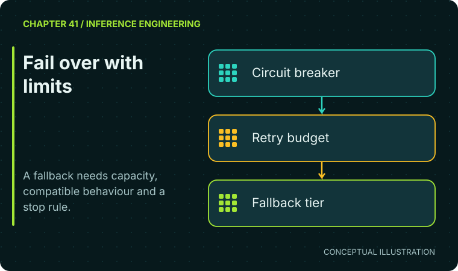
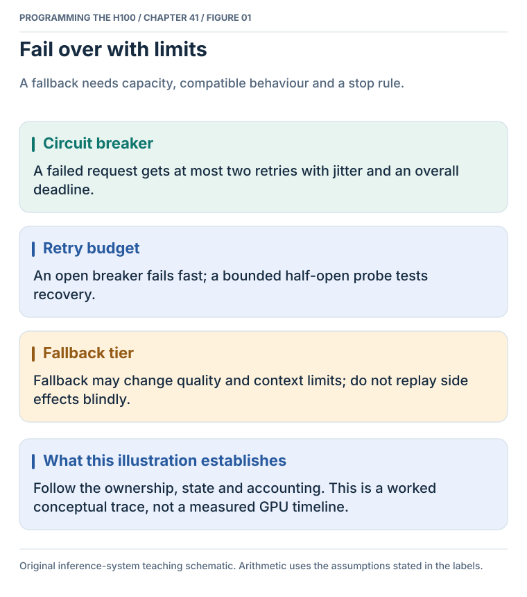

# Chapter 41 — Resilience and Edge Fallback (WebGPU and MLX)

[](images/chapter-openers/41-inference.svg)


!!! warning "Evidence status"
    **Run on CPU, in a simulator:** the circuit breaker, retry budget and jittered backoff; a per-client simulation of five outage shapes under six policies; a fleet simulation of a capacity dip with retries; the edge-feasibility arithmetic; 17 self-tests and three experiments (`ch41_edge_fallback.py`, standard library only). Experiment cells show the mean and, in brackets, the minimum–maximum over three seeds.
    **No browser or edge-model execution.** No WebGPU page, WebLLM engine or MLX model was executed for this chapter. The remote and edge speeds (remote 0.5 s to first token and 60 tokens/s; edge 300 tokens/s prefill, 25 tokens/s decode, 2048-token context, one request at a time with two waiting) and the fleet numbers (70 req/s offered, 100 req/s capacity) are **assumed**. The browser and Apple-silicon runbooks in 41.10 are **UNTESTED**.
    **What the simulator leaves out:**

    - **Answer quality.** The edge model is smaller, so its answers differ from the remote model's. The simulator counts an edge answer as a success; you must decide whether that is acceptable for your product.
    - **Device variance.** Thermal throttling, battery saver, background tabs, memory pressure and the device's own GPU driver are not modelled.
    - **Model download and load time.** The first edge answer on a cold device needs the weights downloaded and compiled; the simulator assumes they are already resident.
    - **Network detail.** Failures are drawn from five idealised shapes, with no TLS, DNS, proxy or mobile-network behaviour.
    - **Correlated clients.** The per-client simulation has one client. The fleet simulation has a single global queue and identical clients.

A remote GPU service fails in ways that a health check does not see: connections refused, requests that hang, responses that are ten times slower, streams that stop halfway. This chapter builds the client-side machinery that keeps the user's request alive through those failures (timeouts, bounded retries, a circuit breaker, a local fallback) and the server-side rule that keeps a recovering service from being buried by its own clients. The central results are about interactions: each mechanism helps in some failures and hurts in others, and retries can turn a 30-second dip into a permanent outage.

## Worked system map

[](images/worked/ch41-inference.svg)


## 41.1 Five ways a remote endpoint fails

| Shape | What the client sees | Fast or slow failure |
|---|---|---|
| **refused** | the connection is rejected at once | fast: tens of milliseconds |
| **hang** | the request is accepted and nothing comes back | slow: the client's timeout decides |
| **brownout** | some requests exceed the timeout, others succeed | mixed |
| **flapping** | the endpoint alternates between down and up every 10 s | mixed |
| **mid-stream drop** | the first tokens arrive, then the stream ends early | slow, and the work already received is lost unless you keep it |

Each shape punishes a different policy. A fast failure makes immediate retries useless (they all fail within a second). A slow failure makes every retry expensive (3 s each). A mixed failure defeats a breaker that counts consecutive failures, because successes keep resetting the count. A mid-stream drop makes "retry from scratch" redo work that was already paid for.

The per-client workload permits overlapping requests. A chronological event queue delivers each remote completion or timeout before its result can update the shared breaker; backoffs also resume at their scheduled event times. A synchronous helper remains available only for isolated unit examples.

The simulated timeline is 300 s with an outage from 60 s to 180 s (40% of the time). Requests arrive about every 12 s. Ten per cent have a 3000-token prompt, which is longer than the edge model's 2048-token context.

## 41.2 The building blocks

### Circuit breaker

```python
class CircuitBreaker:
    def allow(self, now):            # -> ("closed" | "probe" | None, gen)
        ...
    def record(self, gen, ok, now):  # ignores results from an older gen
        ...
```

States: **closed** (calls go through; `threshold` consecutive failures open it), **open** (calls are refused locally for `open_for` seconds), **half-open** (exactly one probe goes through; success closes, failure reopens). Two details carry the weight:

- **Generation counter.** Each state change increments `gen`. A call remembers the `gen` it started under; if the breaker has changed state since, its result is ignored. Without this, a slow success that was issued before the breaker opened would close it again.
- **Probe timeout.** If the half-open probe never reports back (the caller crashed, the request was cancelled), the breaker would wait forever. After `open_for` more seconds the probe is declared lost and a new one is allowed.

### Retry budget

```python
class RetryBudget:
    def on_request(self): tokens = min(cap, tokens + ratio)
    def try_retry(self):  # spend one token or refuse
```

Each original request earns `ratio` tokens (here 0.1); each retry spends one. Over any period the number of retries cannot exceed the initial tokens plus `ratio` times the number of requests. A retry budget bounds retries by `initial_tokens + 0.1 × original_requests`; the initial burst means a short interval can exceed 10%. In the long run that burst is amortized, unlike independent per-request retry caps.

### Backoff with full jitter

`delay = uniform(0, min(cap, base · 2^attempt))`. Exponential growth spaces retries out; the uniform draw from zero spreads clients that failed together so they do not return together. Jitter does not reduce the *amount* of retried work; it only spreads it in time (41.7 shows the limit of that).

## 41.3 Self-tests (17, all pass)

```text
python3 ch41_edge_fallback.py tests
```

| # | Property |
|---|---|
| 1 | The breaker opens after N consecutive failures; a success resets the count |
| 2 | Open refuses until `open_for`, then allows exactly one probe; success closes |
| 3 | A failed probe reopens; a lost probe is replaced after `open_for` |
| 4 | A stale result (older generation) is ignored |
| 5 | Retry budget: retries granted ≤ initial + ratio × requests, for ratios 0, 0.1, 0.5 |
| 6 | Backoff stays in [0, min(cap, base·2^k)] with mean about half the upper bound |
| 7 | No outage: every policy succeeds on every request with one remote try each |
| 8 | A fixed seed gives identical results |
| 9 | Refused: edge fallback beats a single try; the breaker cuts remote load against plain retries |
| 10 | The edge never serves beyond its context window and never exceeds its queue limit |
| 11 | The edge cannot rescue prompts longer than its context |
| 12 | After a mid-stream drop, resume gives lower mean edge latency than restarting (5 of 5 seeds) |
| 13 | Fleet without a dip: all policies complete at least 99% of requests |
| 14 | Fleet conservation: requests served ≤ capacity; completed ≤ arrivals |
| 15 | Fleet: expired-request shedding recovers sooner and wastes less than naive retries |
| 16 | Fleet retry budget: retries ≤ initial + 10% of arrivals |
| 17 | Edge arithmetic hand checks (41.8) |

## 41.4 The six client policies

| Policy | Attempts | Backoff | Breaker | Edge | Resume |
|---|---|---|---|---|---|
| P0 single try | 1 | | | | |
| P1 retry ×3, no backoff | 4 | | | | |
| P2 + jittered backoff | 4 | yes | | | |
| P3 + circuit breaker | 4 | yes | yes | | |
| P4 + edge fallback | 4 | yes | yes | yes | |
| P5 + mid-stream resume | 4 | yes | yes | yes | yes |

Every policy has the same 30 s deadline per request and a 3 s wait for the first token. **Resume** keeps the tokens already received; the next attempt (remote or edge) replays `prompt + received tokens` and generates only the remainder, so an edge fallback after a drop at token 100 of 200 pays prefill for the extra 100 tokens but decodes only 100.

### Hand checks

- **No protection.** An outage covering 40% of the timeline should leave about 60% success. P0 measured 57.3% (54.2–60.7% over seeds); with about 25 requests per client, a few requests either way moves it by 4 points.
- **Edge fallback ceiling.** The edge fails only on requests it cannot hold: 10% long prompts × 40% outage = 4%, so about 96% success. P4 measured 95.8%.
- **Remote load.** With four attempts on every request in the outage, `0.4 × 4 + 0.6 × 1 = 2.2` remote calls per request. P1 measured 2.25–2.28.

## 41.5 Experiment 1 — five outage shapes, six policies

Success rate (%), 95th-percentile latency of successful requests (s), share served by the edge (%), remote calls per request.

**Refused (fast failure)**

| Policy | Success % | p95 s | Edge % | Remote/req |
|---|---|---|---|---|
| P0 | 57.3 [54.2–60.7] | 5.3 [5.1–5.5] | 0.0 [0.0–0.0] | 1.00 [1.00–1.00] |
| P1 | 57.3 [54.2–60.7] | 5.3 [5.1–5.5] | 0.0 [0.0–0.0] | 2.28 [2.18–2.38] |
| P2 | 57.3 [54.2–60.7] | 5.3 [5.1–5.5] | 0.0 [0.0–0.0] | 2.28 [2.18–2.38] |
| P3 | 54.6 [52.4–57.1] | 5.3 [5.1–5.5] | 0.0 [0.0–0.0] | 0.88 [0.86–0.90] |
| P4 | 95.8 [95.2–96.4] | 20.6 [16.2–26.8] | 41.3 [39.3–42.9] | 0.88 [0.86–0.90] |
| P5 | 95.8 [95.2–96.4] | 20.6 [16.2–26.8] | 41.3 [39.3–42.9] | 0.88 [0.86–0.90] |

**Hang (slow failure)**

| Policy | Success % | p95 s | Edge % | Remote/req |
|---|---|---|---|---|
| P0 | 57.3 [54.2–60.7] | 5.3 [5.1–5.5] | 0.0 [0.0–0.0] | 1.00 [1.00–1.00] |
| P1 | 60.3 [58.3–61.9] | 8.1 [5.1–13.6] | 0.0 [0.0–0.0] | 2.25 [2.18–2.29] |
| P2 | 60.3 [58.3–61.9] | 8.3 [5.1–14.2] | 0.0 [0.0–0.0] | 2.25 [2.18–2.29] |
| P3 | 54.6 [52.4–57.1] | 5.3 [5.1–5.5] | 0.0 [0.0–0.0] | 0.89 [0.86–0.96] |
| P4 | 95.8 [95.2–96.4] | 21.1 [19.2–23.8] | 41.3 [39.3–42.9] | 0.89 [0.86–0.96] |
| P5 | 95.8 [95.2–96.4] | 21.1 [19.2–23.8] | 41.3 [39.3–42.9] | 0.89 [0.86–0.96] |

**Brownout (half the outage-time attempts time out)**

| Policy | Success % | p95 s | Edge % | Remote/req |
|---|---|---|---|---|
| P0 | 90.9 [85.7–95.2] | 5.3 [5.1–5.5] | 0.0 [0.0–0.0] | 1.00 [1.00–1.00] |
| P1 | 100.0 [100.0–100.0] | 7.1 [5.5–9.6] | 0.0 [0.0–0.0] | 1.14 [1.05–1.25] |
| P2 | 100.0 [100.0–100.0] | 7.2 [5.5–9.8] | 0.0 [0.0–0.0] | 1.14 [1.05–1.25] |
| P3 | 100.0 [100.0–100.0] | 7.2 [5.5–9.8] | 0.0 [0.0–0.0] | 1.14 [1.05–1.25] |
| P4 | 100.0 [100.0–100.0] | 7.2 [5.5–9.8] | 0.0 [0.0–0.0] | 1.14 [1.05–1.25] |
| P5 | 100.0 [100.0–100.0] | 7.2 [5.5–9.8] | 0.0 [0.0–0.0] | 1.14 [1.05–1.25] |

**Flapping (10 s down, 10 s up)**

| Policy | Success % | p95 s | Edge % | Remote/req |
|---|---|---|---|---|
| P0 | 81.5 [76.2–89.3] | 5.2 [5.0–5.5] | 0.0 [0.0–0.0] | 1.00 [1.00–1.00] |
| P1 | 98.4 [95.2–100.0] | 11.2 [8.4–12.9] | 0.0 [0.0–0.0] | 1.40 [1.14–1.54] |
| P2 | 100.0 [100.0–100.0] | 11.6 [8.6–13.4] | 0.0 [0.0–0.0] | 1.40 [1.14–1.54] |
| P3 | 84.5 [75.0–92.9] | 7.9 [5.2–11.4] | 0.0 [0.0–0.0] | 1.13 [1.07–1.24] |
| P4 | 98.4 [95.2–100.0] | 17.4 [11.7–21.6] | 13.9 [7.1–25.0] | 1.13 [1.07–1.24] |
| P5 | 98.4 [95.2–100.0] | 17.4 [11.7–21.6] | 13.9 [7.1–25.0] | 1.13 [1.07–1.24] |

**Mid-stream drop**

| Policy | Success % | p95 s | Edge % | Remote/req |
|---|---|---|---|---|
| P0 | 57.3 [54.2–60.7] | 5.3 [5.1–5.5] | 0.0 [0.0–0.0] | 1.00 [1.00–1.00] |
| P1 | 60.3 [58.3–61.9] | 7.7 [5.1–12.3] | 0.0 [0.0–0.0] | 2.27 [2.18–2.33] |
| P2 | 60.3 [58.3–61.9] | 8.0 [5.1–12.8] | 0.0 [0.0–0.0] | 2.27 [2.18–2.33] |
| P3 | 54.6 [52.4–57.1] | 5.3 [5.1–5.5] | 0.0 [0.0–0.0] | 0.89 [0.86–0.92] |
| P4 | 95.8 [95.2–96.4] | 22.2 [18.5–28.7] | 41.3 [39.3–42.9] | 0.89 [0.86–0.92] |
| P5 | 97.4 [95.8–100.0] | 16.0 [11.7–23.4] | 42.9 [39.3–47.6] | 0.89 [0.86–0.92] |

These are fresh results from the chronological request scheduler. Policies are compared with the same seeds and request arrivals; ranges are minimum–maximum across three seeds, not confidence intervals.

### What the tables say

1. **Retries do nothing for a fast failure.** Under *refused*, P1 and P2 match P0 exactly: all four attempts fail inside one second and the outage is two minutes long. The only effect is 2.3× the remote calls.
2. **The edge is what turns a 40% outage into a 4% one.** P4 reaches 95.8% in three of the five shapes. The residual 4% is the long prompts the edge cannot hold. The price is latency: the edge's p95 is about 21–22 s because each edge answer takes several seconds after the client has already spent up to 12 s on remote attempts before the breaker opens.
3. **A breaker without a fallback loses availability.** P3 is *below* P0 (54.6% against 57.3%) under refused, hang and mid-stream drop: it stays open for up to 10 s after the endpoint recovers and refuses requests that would have succeeded. It reduces remote load (0.88–0.89 calls per request against 2.25–2.28), which is its job, but with nowhere to send the refused requests the user sees only failures.
4. **The breaker can lose to plain retries.** Under flapping, P2 reaches 100.0% and P4 98.4%, because each up-phase lets a retry through and the breaker's open window sends traffic to an edge that cannot take the 10% long prompts. A breaker tuned for a hard outage (`threshold = 3`, `open_for = 10 s`) is mis-tuned for a flapping one; the choice depends on which failure you expect.
5. **This brownout sample never opens the breaker.** Successes reset the consecutive-failure count, so P3–P5 behave like P1 and the edge is never used. If the objective is to react to a sustained high failure fraction, consider a failure-rate threshold over a window; a consecutive-failure trigger can miss interleaved failures and successes.
6. **Resume pays when work was already done.** After a mid-stream drop, P5 gains 1.6 points of success and cuts p95 from 22.2 s to 16.0 s, because the edge generates only the remaining tokens. P5 is not better anywhere else, because there is nothing to resume.

## 41.6 Resume: why replay works and where it does not

A continuation can be requested without a dedicated server resume endpoint, provided the API lets the caller reconstruct the exact prefix and generation state. The client keeps the tokens it received, appends them to the prompt and asks the next backend to continue. Token-ID prefixes and the same model, tokenizer, prompt template, stopping rules and deterministic decoding are needed to reproduce the original continuation. Re-tokenizing visible text or changing batching/numerics can break exact agreement even under greedy decoding; validate the round trip. In contrast, with sampling, or with a *different* model (the edge fallback), the continuation will not match what the first model would have said, so the text can change style or contradict its first half. The edge fallback also cannot replay a conversation that has outgrown 2048 tokens: the simulator refuses such requests, and so must a real client.

## 41.7 Experiment 2 — retries against a recovering fleet

A fleet of identical clients offers 70 req/s to a service that can complete 100 req/s. For 30 s (t = 20 to 50) capacity falls to 30 req/s. Clients give up on an attempt after 5 s and, depending on policy, retry up to three times. The server is a single FIFO queue.

| Policy | Recovery after the dip | Peak queue | Wasted work | Logical requests completed |
|---|---|---|---|---|
| F0 no retries | 30 s | 1188 [1142–1220] | 3475 | 67.1% |
| F1 immediate retries ×3 | never | 22 837 | 10 636 | 15.6% |
| F2 + jittered backoff | never | 22 445 | 10 636 | 15.6% |
| F3 + retry budget 10% | 52 s [50–55] | 1582 | 5769 | 52.5% |
| F4 + expired-request shedding | 0 s | 622 | 610 | 86.6% |
| F5 shedding only (no retries) | 0 s | 384 | 582 | 86.5% |

"Recovery" is the time after capacity returns until a 5-second window again completes at least 90% of the offered rate (63 req/s). "Wasted work" is requests the server processed after the client had already given up.

Goodput (requests completed in time, per second) in 5-second windows, seed 0:

```text
F1  68 71 71 67 30 22  0  0  0  0  0  0  0 ...        (never recovers)
F4  68 71 71 67 30 23  4  1  2  2 99 100 83 74 63 69 70 ...
```

### Reading the result

- **Hand check of the backlog.** During the dip the queue grows by `70 − 30 = 40` requests/s for 30 s: 1200 requests. F0 peaked at 1188.
- **A backlog longer than the timeout makes completed work worthless.** At 100 req/s, 500 queued requests mean a 5 s wait. Everything behind that point is abandoned by its client before it is served, but a server that does not look at request age still serves it. Capacity is spent on answers nobody is waiting for.
- **Retries make it self-sustaining.** F1 turns each abandoned attempt into a new one: the queue reaches 22 800 and the service completes nothing for the rest of the run, even though capacity returned at t = 50. This is a *metastable failure*: the trigger (the dip) has ended, but the overload keeps itself alive.
- **Jitter is not the fix.** F1 and F2 are identical in outcome. Jitter spreads retries in time; it does not reduce how many there are, and with the queue already past the timeout every spread-out retry still arrives to a hopeless queue.
- **A retry budget limits the damage.** F3 recovers after 52 s, with 52.5% of requests completed, because retries add at most 10% to the offered load and the queue can drain.
- **Shedding is the decisive change.** F4 and F5 recover in the first window after capacity returns (goodput 99 req/s, the queued backlog being served), with 86.5% of requests completed. Dropping a request whose age already exceeds the client timeout costs the server almost nothing and removes exactly the work that was wasted. F5, with no retries at all, does as well as F4: **the server-side rule did the work, and the client-side retries added nothing in this scenario.**
- **The shed rule must use information the server has.** The simulator sheds on request age against the timeout; in practice this needs a deadline or timestamp propagated in the request, or the server to cancel work when the client's connection closes.

## 41.8 Edge feasibility arithmetic

Decode on a single stream is bound by memory bandwidth: every generated token reads all the weights once. An upper bound is `bandwidth ÷ weight bytes`.

| Device (assumed bandwidth) | Model | Weights | Decode bound |
|---|---|---|---|
| phone, 60 GB/s | 3B, 4-bit | 1.5 GB | 40 tok/s |
| phone, 60 GB/s | 8B, 4-bit | 4.0 GB | 15 tok/s |
| laptop, 100 GB/s | 3B, 4-bit | 1.5 GB | 66.7 tok/s |
| laptop, 100 GB/s | 8B, 4-bit | 4.0 GB | 25 tok/s |
| 200 GB/s | 8B, 4-bit | 4.0 GB | 50 tok/s |
| 200 GB/s | 8B, 8-bit | 8.0 GB | 25 tok/s |

Hand check: 8 × 10⁹ parameters × 0.5 bytes = 4 GB; 200 ÷ 4 = 50. These are ceilings: real engines reach a fraction of them, and the simulator's 25 tokens/s edge decode corresponds to the 8B 4-bit laptop row only if the engine reaches its bound. **The bandwidth figures are assumed round numbers, not specifications of any device; look up your target's.**

### WebGPU buffer limits

The WebGPU defaults are a `maxStorageBufferBindingSize` of 134 217 728 bytes (128 MiB) and a `maxBufferSize` of 268 435 456 bytes (256 MiB). Limits higher than the default exist on many adapters but must be **requested when the device is created**; otherwise you get the defaults. A 1.5 GB model therefore needs at least 12 separate 128 MiB bindings unless the engine requests a larger limit (`ceil(1.5·10⁹ / 134 217 728) = 12`), and 4 GB needs 30. This is a design constraint on the engine, not something to work around in an application; WebLLM handles it for you, but a model that exceeds what the adapter can provide fails to load rather than running slowly.

## 41.9 The engines

**WebLLM** (`@mlc-ai/web-llm`) runs models in the browser on WebGPU and exposes an OpenAI-style API (streaming, JSON mode, function calling). It is created with `CreateMLCEngine(model, config)`. The weights are downloaded on first use and cached in the browser; the cache backend is chosen through `AppConfig.cacheBackend` (`"cache"` by default, also `"indexeddb"`, `"opfs"` and `"cross-origin"`, the last needing a browser extension). Budget the first download in your loading UI: it is a multi-hundred-megabyte transfer.

**MLX LM** (`pip install mlx-lm`) runs on Apple silicon through MLX. The command-line tools are `mlx_lm.generate`, `mlx_lm.chat` and `mlx_lm.server`; `mlx_lm.convert` with the quantize option makes a 4-bit copy of a Hugging Face model. `--prefill-step-size` (default 2048) trades peak memory during prompt processing against prompt speed. Check each command's `-h` for the options of your installed version, because they change between releases.

Neither engine is a server replacement: one stream at a time on one device, with the context limit of the model you could fit.

## 41.10 Runbook (UNTESTED)

None of the steps below has been run. Treat the first two as capability probes and the rest as a template.

**1. Does the browser have WebGPU, and with what limits?** In the page's console:

```javascript
const adapter = await navigator.gpu?.requestAdapter();
console.log(!!adapter, adapter && adapter.limits.maxStorageBufferBindingSize,
            adapter && adapter.limits.maxBufferSize);
```

Expect 134 217 728 and 268 435 456 *or higher* (the adapter's maximum); the device you get from `requestDevice()` carries only the defaults unless you pass `requiredLimits`.

**2. A minimal WebLLM call (substitute a model id from the engine's current list):**

```javascript
import { CreateMLCEngine } from "@mlc-ai/web-llm";
const engine = await CreateMLCEngine(MODEL_ID, {
  initProgressCallback: (p) => console.log(p.text),
});
const r = await engine.chat.completions.create({
  messages: [{ role: "user", content: "Say hello in five words." }],
  max_tokens: 32,
});
console.log(r.choices[0].message.content);
```

**3. Apple silicon:**

```bash
python3 -m pip install mlx-lm
mlx_lm.generate --prompt "How tall is Mt Everest?"
mlx_lm.generate -h        # confirm the options of your version
```

**4. Wiring the fallback.** Per request: (a) check the breaker; (b) try the remote call with a 3 s first-token timeout and a 30 s total deadline (`AbortController`); (c) on failure, spend a retry-budget token and wait a jittered delay, or go to the edge; (d) on a mid-stream failure, keep the received text and replay it as a prefix; (e) show the user that the answer came from a smaller local model. Log every fallback with its reason.

**5. What to measure on the device before trusting any number here:** time to first token and tokens/s for your model at your prompt lengths; peak memory; behaviour when the tab is backgrounded; battery and temperature over ten minutes of use; the first-load download time on your slowest target network.

## 41.11 Failure catalogue

| Failure | Cause | Defence |
|---|---|---|
| Retry storm after a dip | Abandoned requests are still served; retries add load | Server sheds requests older than the client timeout; retry budget; deadline propagation |
| Breaker closed by a stale success | A call issued before the breaker opened returns late | Generation counter; ignore stale results |
| Breaker stuck half-open | The probe call was cancelled or lost | Probe timeout |
| Breaker never opens on a brownout | Successes reset a consecutive-failure counter | Trip on failure rate over a window |
| Breaker adds outage after recovery | Open window outlives the failure and nothing receives the traffic | Short `open_for`, a fallback, or a lower threshold for probing |
| Breaker flaps against a flapping endpoint | Window shorter than the flap period | Match `open_for` to the failure shape; consider plain retries there |
| Immediate retries on a fast failure | All attempts fail in the same second | Backoff; do not retry connection-refused beyond one attempt |
| Backoff without jitter | Clients that failed together return together | Full jitter |
| Retried non-idempotent request | Replay duplicates a side effect | Idempotency key; do not retry tool-calling requests blindly |
| Mid-stream restart pays twice | Received tokens discarded | Keep tokens and replay as prefix (greedy/same model only) |
| Edge answer differs from remote | Smaller or different model, or sampling | Label the answer; avoid resume across models when consistency matters |
| Edge cannot hold the request | Prompt plus output exceeds the edge context | Check length before routing to the edge; fail fast with a clear message |
| Edge overload | One request at a time; queue grows | Bounded queue; reject the third waiting request |
| Weights exceed buffer limits | WebGPU default 128 MiB binding / 256 MiB buffer | Request higher limits at device creation; choose a model the adapter can hold |
| First edge use is a long download | Weights fetched on first load | Prefetch when idle; show progress; cache backend |
| Fallback never exercised | Only used in outages | Inject faults on a schedule; run the fallback path in tests |

<!-- BEGIN COMPLETE INFERENCE SOURCE -->
## Complete runnable code

The complete implementation is shown below, including its checks and entry point. The listing and downloadable `.py` file contain exactly the same source. Copy the file under the displayed filename; keep supporting files in the same directory.

[Download all inference examples and supporting modules](examples/inference-systems/inference-systems.zip) or read the [environment and command guide](examples/inference-systems/README.md).

The [follow-up agent audit](inference-adversarial-review-2026-11-25.md) records the corrections, fresh CPU captures and hardware limits for this source.

Read it in three passes: start with `CircuitBreaker` and `RetryBudget` to identify the state; trace `run_client` and `simulate_fleet` for one request or token; then follow `selftests` to see how the result is checked.

From the repository root:

```bash
python3 docs/examples/inference-systems/ch41_edge_fallback.py tests
# Run the full chapter demonstrations:
python3 docs/examples/inference-systems/ch41_edge_fallback.py
```

### ch41_edge_fallback.py

[Download ch41_edge_fallback.py](examples/inference-systems/ch41_edge_fallback.py)

```python title="ch41_edge_fallback.py" linenums="1"
#!/usr/bin/env python3
"""Chapter 41 -- Resilience and edge fallback (CPU-only, stdlib only).

Parts
  1. CircuitBreaker, RetryBudget, full-jitter backoff   (the building blocks)
  2. Per-client simulation: five outage shapes x six policies P0..P5
  3. Fleet simulation: a capacity dip, retries, and metastable collapse
  4. Edge feasibility arithmetic (bandwidth bound, WebGPU buffer limits)

Every number printed by `experiments()` comes from the ASSUMED models in the
constants below. Nothing here touches WebGPU, WebLLM or MLX.

    python3 ch41_edge_fallback.py            # tests + experiments
    python3 ch41_edge_fallback.py tests      # tests only
"""
import heapq
import math
import sys
from collections import deque
from dataclasses import dataclass
from random import Random

# ----------------------------------------------------------------------------
# Assumed model constants (not measurements)
# ----------------------------------------------------------------------------
TTFT = 0.5           # remote time to first token, s
REMOTE_RATE = 60.0   # remote decode, tokens/s
TTFT_TIMEOUT = 3.0   # client gives up waiting for a first token after this
DEADLINE = 30.0      # total budget per logical request, s
OUTAGE = (60.0, 180.0)
HORIZON = 300.0

EDGE_PREFILL = 300.0  # tokens/s
EDGE_DECODE = 25.0    # tokens/s
EDGE_CTX = 2048       # context window, tokens
EDGE_QUEUE = 2        # waiting slots behind the one running request


# ----------------------------------------------------------------------------
# 1. Building blocks
# ----------------------------------------------------------------------------
class CircuitBreaker:
    """closed -> open -> half_open -> closed.

    allow(now) returns (mode, gen) with mode in {"closed", "probe", None}.
    record(gen, ok, now) ignores results whose gen is stale, so a slow call
    that started before the breaker opened cannot close it again.
    """

    def __init__(self, threshold=3, open_for=10.0):
        self.threshold = threshold
        self.open_for = open_for
        self.state = "closed"
        self.fails = 0
        self.opened_at = 0.0
        self.probe_at = 0.0
        self.gen = 0

    def allow(self, now):
        if self.state == "closed":
            return "closed", self.gen
        if self.state == "open":
            if now - self.opened_at >= self.open_for:
                self.state = "half_open"
                self.gen += 1
                self.probe_at = now
                return "probe", self.gen
            return None, self.gen
        # half_open: exactly one probe in flight; a lost probe is replaced
        if now - self.probe_at >= self.open_for:
            self.gen += 1
            self.probe_at = now
            return "probe", self.gen
        return None, self.gen

    def record(self, gen, ok, now):
        if gen != self.gen:
            return False
        if self.state == "closed":
            if ok:
                self.fails = 0
            else:
                self.fails += 1
                if self.fails >= self.threshold:
                    self._open(now)
        elif self.state == "half_open":
            if ok:
                self.state = "closed"
                self.fails = 0
                self.gen += 1
            else:
                self._open(now)
        return True

    def _open(self, now):
        self.state = "open"
        self.opened_at = now
        self.gen += 1


class RetryBudget:
    """Token bucket: every request earns `ratio` tokens, a retry costs one."""

    def __init__(self, ratio=0.1, cap=10.0, initial=None):
        self.ratio = ratio
        self.cap = cap
        self.initial = cap if initial is None else initial
        self.tokens = self.initial
        self.requests = 0
        self.granted = 0

    def on_request(self):
        self.requests += 1
        self.tokens = min(self.cap, self.tokens + self.ratio)

    def try_retry(self):
        if self.tokens >= 1.0:
            self.tokens -= 1.0
            self.granted += 1
            return True
        return False


def backoff(rng, attempt, base=0.2, cap=2.0):
    """Full jitter: uniform(0, min(cap, base * 2**attempt))."""
    return rng.uniform(0.0, min(cap, base * 2 ** attempt))


# ----------------------------------------------------------------------------
# 2. Per-client simulation
# ----------------------------------------------------------------------------
@dataclass
class Req:
    t: float
    prompt: int
    out: int


def make_requests(seed, horizon=HORIZON, mean_gap=12.0):
    rng = Random(seed)
    t, reqs = 0.0, []
    while True:
        t += rng.expovariate(1.0 / mean_gap)
        if t >= horizon:
            return reqs
        prompt = 3000 if rng.random() < 0.10 else rng.randint(100, 800)
        reqs.append(Req(t, prompt, rng.randint(80, 300)))


def _u(seed, idx, attempt):
    return Random(f"{seed}-{idx}-{attempt}").random()


def in_outage(scn, t):
    if scn == "none" or not (OUTAGE[0] <= t < OUTAGE[1]):
        return False
    if scn == "flapping":
        return int((t - OUTAGE[0]) // 10) % 2 == 0
    return True


def remote_attempt(scn, t, out, have, u):
    """-> (duration, status, tokens_held_after). status: ok|refused|timeout|dropped."""
    remaining = out - have
    full = TTFT + remaining / REMOTE_RATE
    if not in_outage(scn, t):
        return full, "ok", out
    if scn == "refused":
        return 0.05, "refused", have
    if scn in ("hang", "flapping"):
        return TTFT_TIMEOUT, "timeout", have
    if scn == "brownout":
        return (TTFT_TIMEOUT, "timeout", have) if u < 0.5 else (full, "ok", out)
    if scn == "middrop":
        if remaining <= 1:
            return full, "ok", out
        got = remaining // 2
        return TTFT + got / REMOTE_RATE, "dropped", have + got
    raise ValueError(scn)


@dataclass(frozen=True)
class Policy:
    name: str
    attempts: int = 1
    backoff: bool = False
    breaker: bool = False
    edge: bool = False
    resume: bool = False


POLICIES = [
    Policy("P0 single try"),
    Policy("P1 retry x3, no backoff", attempts=4),
    Policy("P2 +jittered backoff", attempts=4, backoff=True),
    Policy("P3 +circuit breaker", attempts=4, backoff=True, breaker=True),
    Policy("P4 +edge fallback", attempts=4, backoff=True, breaker=True, edge=True),
    Policy("P5 +mid-stream resume", attempts=4, backoff=True, breaker=True,
           edge=True, resume=True),
]


class ClientState:
    def __init__(self):
        self.br = CircuitBreaker()
        self.edge_jobs = []
        self.edge_max_active = 0
        self.edge_ctx_violations = 0
        self.remote_attempts = 0


def edge_serve(state, t, req, have):
    """Returns finish time, or None if the edge cannot take the request."""
    eff_prompt = req.prompt + have
    remaining = req.out - have
    if eff_prompt + remaining > EDGE_CTX:
        return None
    active = [f for f in state.edge_jobs if f > t]
    if len(active) >= 1 + EDGE_QUEUE:
        return None
    start = max([t] + active)
    finish = start + eff_prompt / EDGE_PREFILL + remaining / EDGE_DECODE
    state.edge_jobs.append(finish)
    state.edge_max_active = max(state.edge_max_active, len(active) + 1)
    if eff_prompt + remaining > EDGE_CTX:
        state.edge_ctx_violations += 1
    return finish


def _serve_events(req, idx, pol, scn, state, seed, rng):
    """Yield absolute wake-up times; mutate shared state only at that event time."""
    t, deadline, have = req.t, req.t + DEADLINE, 0
    for k in range(pol.attempts):
        if t >= deadline:
            break
        gen = None
        if pol.breaker:
            mode, gen = state.br.allow(t)
            if mode is None:
                break
        dur, status, held = remote_attempt(scn, t, req.out, have,
                                           _u(seed, idx, k))
        state.remote_attempts += 1
        t_end = t + dur
        yield t_end
        if pol.breaker:
            state.br.record(gen, status == "ok", t_end)
        if status == "ok":
            return (t_end <= deadline), t_end - req.t, "remote"
        if pol.resume:
            have = held
        t = t_end + (backoff(rng, k) if pol.backoff else 0.0)
        if t > t_end:
            yield t
    if pol.edge and t < deadline:
        fin = edge_serve(state, t, req, have if pol.resume else 0)
        if fin is not None and fin <= deadline:
            return True, fin - req.t, "edge"
    return False, None, None


def serve(req, idx, pol, scn, state, seed, rng):
    """Drive one isolated request synchronously (used by the unit examples)."""
    task = _serve_events(req, idx, pol, scn, state, seed, rng)
    while True:
        try:
            next(task)
        except StopIteration as done:
            return done.value


def run_client(pol, scn, seed):
    reqs = make_requests(seed)
    state, rng = ClientState(), Random(seed + 7)
    # Requests may overlap. Deliver results/backoffs in chronological order;
    # finishing a request before visiting the next arrival leaks future state.
    res = [None] * len(reqs)
    events = [(r.t, i, _serve_events(r, i, pol, scn, state, seed, rng))
              for i, r in enumerate(reqs)]
    heapq.heapify(events)
    while events:
        now, i, task = heapq.heappop(events)
        try:
            wake_at = next(task)
            assert wake_at >= now
            heapq.heappush(events, (wake_at, i, task))
        except StopIteration as done:
            res[i] = done.value
    n = len(reqs)
    lats = sorted(l for ok, l, s in res if ok)
    p95 = lats[min(len(lats) - 1, int(0.95 * len(lats)))] if lats else float("nan")
    return {
        "n": n,
        "success": sum(1 for ok, _, _ in res if ok) / n,
        "edge_share": sum(1 for _, _, s in res if s == "edge") / n,
        "p95": p95,
        "remote_per_req": state.remote_attempts / n,
        "state": state,
    }


# ----------------------------------------------------------------------------
# 3. Fleet simulation: capacity dip and retry storm
# ----------------------------------------------------------------------------
@dataclass(frozen=True)
class FleetPolicy:
    name: str
    retries: bool = False
    jitter: bool = False
    budget: bool = False
    shed: bool = False


FLEET_POLICIES = [
    FleetPolicy("F0 no retries"),
    FleetPolicy("F1 immediate retries x3", retries=True),
    FleetPolicy("F2 +jittered backoff", retries=True, jitter=True),
    FleetPolicy("F3 +retry budget 10%", retries=True, jitter=True, budget=True),
    FleetPolicy("F4 +expired-request shedding", retries=True, jitter=True,
                budget=True, shed=True),
    FleetPolicy("F5 shedding only", shed=True),
]


def simulate_fleet(pol, seed=0, horizon=150.0, lam=70.0, mu=100.0,
                   dip=(20.0, 50.0), dip_frac=0.3, timeout=5.0,
                   max_retries=3, dt=0.05, window=5.0):
    rng = Random(seed)
    arrivals, t = [], 0.0
    while True:
        t += rng.expovariate(lam)
        if t >= horizon:
            break
        arrivals.append(t)
    ai = 0
    attempts = {}        # id -> [logical, arrive, state, attempt_no]
    queue = deque()
    timeouts, retries = [], []   # heaps
    logical_ok, logical_fail = set(), set()
    budget = RetryBudget(0.1, cap=1e9, initial=50.0) if pol.budget else None
    nid, credit = 0, 0.0
    nwin = int(horizon / window)
    good = [0] * nwin
    wasted = shed_n = served = 0
    peak_q = 0
    steps = int(horizon / dt)
    for s in range(steps):
        now = s * dt
        end = now + dt

        def enqueue(logical, attempt_no, at):
            nonlocal nid
            attempts[nid] = [logical, at, "queued", attempt_no]
            queue.append(nid)
            heapq.heappush(timeouts, (at + timeout, nid))
            nid += 1

        while ai < len(arrivals) and arrivals[ai] < end:
            if budget:
                budget.on_request()
            enqueue(ai, 0, arrivals[ai])
            ai += 1
        while retries and retries[0][0] < end:
            due, logical, attempt_no = heapq.heappop(retries)
            enqueue(logical, attempt_no, due)
        while timeouts and timeouts[0][0] < end:
            dl, a = heapq.heappop(timeouts)
            logical, arrive, st, k = attempts[a]
            if st != "queued":
                continue
            attempts[a][2] = "abandoned"
            if (pol.retries and k < max_retries and logical not in logical_ok
                    and (budget is None or budget.try_retry())):
                delay = 0.0
                if pol.jitter:
                    delay = rng.uniform(0.0, min(8.0, 1.0 * 2 ** k))
                heapq.heappush(retries, (dl + delay, logical, k + 1))
            else:
                if logical not in logical_ok:
                    logical_fail.add(logical)
        in_dip = dip[0] <= now < dip[1]
        credit += (mu * dip_frac if in_dip else mu) * dt
        while credit >= 1.0 and queue:
            a = queue.popleft()
            logical, arrive, st, k = attempts[a]
            if pol.shed and (now - arrive) >= timeout:
                shed_n += 1
                continue
            credit -= 1.0
            served += 1
            if st == "queued" and (now - arrive) < timeout:
                attempts[a][2] = "done"
                logical_ok.add(logical)
                logical_fail.discard(logical)
                good[min(nwin - 1, int(now / window))] += 1
            else:
                wasted += 1
        if not queue:
            credit = min(credit, 1.0)
        peak_q = max(peak_q, len(queue))
    goodput = [g / window for g in good]
    rec = None
    for w in range(int(dip[1] / window), nwin):
        if goodput[w] >= 0.9 * lam:
            rec = w * window - dip[1]
            break
    return {
        "goodput": goodput, "recovery_s": rec, "peak_queue": peak_q,
        "wasted": wasted, "shed": shed_n, "served": served,
        "arrivals": len(arrivals), "ok": len(logical_ok),
        "capacity_units": (mu * (horizon - (dip[1] - dip[0]))
                           + mu * dip_frac * (dip[1] - dip[0])),
        "budget": budget,
    }


# ----------------------------------------------------------------------------
# 4. Edge feasibility arithmetic
# ----------------------------------------------------------------------------
def edge_decode_bound(bandwidth_gb_s, params_b, bits):
    """Upper bound on decode tokens/s: bandwidth / bytes of weights per token."""
    return bandwidth_gb_s / (params_b * bits / 8.0)


def weight_gb(params_b, bits):
    return params_b * bits / 8.0


def min_bindings(model_bytes, limit_bytes):
    return math.ceil(model_bytes / limit_bytes)


# ----------------------------------------------------------------------------
# Tests
# ----------------------------------------------------------------------------
def selftests():
    out = []

    def t(name):
        def deco(f):
            f()
            out.append(name)
        return deco

    @t("1 breaker opens after N consecutive failures, a success resets the count")
    def _():
        b = CircuitBreaker(3, 10)
        for ok in (False, False, True, False, False):
            m, g = b.allow(0)
            b.record(g, ok, 0)
        assert b.state == "closed" and b.fails == 2
        m, g = b.allow(0)
        b.record(g, False, 0)
        assert b.state == "open"

    @t("2 open rejects until open_for, then exactly one probe")
    def _():
        b = CircuitBreaker(1, 10)
        m, g = b.allow(0)
        b.record(g, False, 0)
        assert b.allow(5)[0] is None
        m, g = b.allow(10)
        assert m == "probe" and b.state == "half_open"
        assert b.allow(11)[0] is None          # second caller refused
        b.record(g, True, 12)
        assert b.state == "closed"

    @t("3 a failed probe reopens; a lost probe is replaced after open_for")
    def _():
        b = CircuitBreaker(1, 10)
        m, g = b.allow(0)
        b.record(g, False, 0)
        m, g = b.allow(10)
        b.record(g, False, 11)
        assert b.state == "open" and b.opened_at == 11
        m, g = b.allow(21)
        assert m == "probe"
        assert b.allow(25)[0] is None
        m2, g2 = b.allow(31)                   # probe never reported back
        assert m2 == "probe" and g2 != g

    @t("4 stale results are ignored (slow call cannot close an open breaker)")
    def _():
        b = CircuitBreaker(1, 10)
        m, slow_gen = b.allow(0)
        m, g = b.allow(0)
        b.record(g, False, 1)                  # opens
        assert b.state == "open"
        assert b.record(slow_gen, True, 2) is False
        assert b.state == "open"

    @t("5 retry budget: granted retries never exceed initial + ratio*requests")
    def _():
        rng = Random(1)
        for ratio in (0.0, 0.1, 0.5):
            rb = RetryBudget(ratio, cap=20, initial=5)
            for _ in range(2000):
                rb.on_request()
                for _ in range(rng.randint(0, 3)):
                    rb.try_retry()
            assert rb.granted <= rb.initial + ratio * rb.requests + 1e-9
            assert 0 <= rb.tokens <= rb.cap

    @t("6 full-jitter backoff stays in [0, min(cap, base*2^k)], mean about half")
    def _():
        rng = Random(2)
        for k in range(8):
            hi = min(2.0, 0.2 * 2 ** k)
            xs = [backoff(rng, k) for _ in range(4000)]
            assert min(xs) >= 0 and max(xs) <= hi
            assert abs(sum(xs) / len(xs) - hi / 2) < 0.05 * hi + 0.01

    @t("7 no outage: every policy succeeds on all requests, one remote try each")
    def _():
        for p in POLICIES:
            r = run_client(p, "none", 3)
            assert r["success"] == 1.0 and abs(r["remote_per_req"] - 1.0) < 1e-12

    @t("8 simulation is deterministic for a fixed seed")
    def _():
        a = run_client(POLICIES[5], "middrop", 4)
        b = run_client(POLICIES[5], "middrop", 4)
        assert all(a[k] == b[k] for k in ("success", "p95", "edge_share"))

    @t("9 refused: edge policy beats single try; breaker cuts remote load vs P1")
    def _():
        for seed in range(3):
            r0 = run_client(POLICIES[0], "refused", seed)
            r1 = run_client(POLICIES[1], "refused", seed)
            r3 = run_client(POLICIES[3], "refused", seed)
            r4 = run_client(POLICIES[4], "refused", seed)
            assert r4["success"] > r0["success"]
            assert r3["remote_per_req"] <= r1["remote_per_req"]

    @t("10 edge never serves beyond its context window, never exceeds its queue")
    def _():
        for scn in ("hang", "refused", "middrop"):
            for seed in range(3):
                r = run_client(POLICIES[5], scn, seed)
                assert r["state"].edge_ctx_violations == 0
                assert r["state"].edge_max_active <= 1 + EDGE_QUEUE

    @t("11 edge cannot rescue prompts longer than its context")
    def _():
        r = run_client(POLICIES[4], "hang", 5)
        reqs = make_requests(5)
        long_in_outage = sum(1 for q in reqs if q.prompt > EDGE_CTX
                             and in_outage("hang", q.t))
        assert long_in_outage > 0
        assert r["success"] < 1.0

    @t("12 resume lowers mean latency vs restarting after a mid-stream drop")
    def _():
        def mean_lat(p, seed):
            reqs = make_requests(seed)
            st, rng = ClientState(), Random(seed + 7)
            ls = [serve(q, i, p, "middrop", st, seed, rng)
                  for i, q in enumerate(reqs)]
            v = [l for ok, l, s in ls if ok and s == "edge"]
            return sum(v) / len(v)
        wins = sum(mean_lat(POLICIES[5], s) < mean_lat(POLICIES[4], s)
                   for s in range(5))
        assert wins == 5

    @t("13 fleet, no dip: goodput about equals arrival rate for every policy")
    def _():
        for p in FLEET_POLICIES:
            r = simulate_fleet(p, seed=1, dip=(1e9, 1e9 + 1))
            assert r["ok"] >= 0.99 * r["arrivals"]

    @t("14 fleet conservation: served <= capacity, ok <= arrivals")
    def _():
        for p in FLEET_POLICIES:
            r = simulate_fleet(p, seed=2)
            assert r["served"] <= r["capacity_units"] + 2
            assert r["ok"] <= r["arrivals"]
            assert sum(r["goodput"]) * 5 <= r["served"] + 1e-9

    @t("15 fleet: shedding recovers sooner than the naive-server retry storm")
    def _():
        naive = simulate_fleet(FLEET_POLICIES[1], seed=3)
        shed = simulate_fleet(FLEET_POLICIES[4], seed=3)
        assert shed["recovery_s"] is not None
        assert naive["recovery_s"] is None or shed["recovery_s"] < naive["recovery_s"]
        assert shed["wasted"] < naive["wasted"]

    @t("16 retry budget bounds fleet retries to initial + 10% of arrivals")
    def _():
        r = simulate_fleet(FLEET_POLICIES[3], seed=4)
        b = r["budget"]
        assert b.granted <= b.initial + 0.1 * b.requests + 1e-9

    @t("17 edge arithmetic hand checks")
    def _():
        assert abs(edge_decode_bound(200, 8, 4) - 50.0) < 1e-9
        assert abs(weight_gb(3, 4) - 1.5) < 1e-12
        assert min_bindings(1.5e9, 128 * 2 ** 20) == 12
        assert min_bindings(128 * 2 ** 20, 128 * 2 ** 20) == 1

    return out


# ----------------------------------------------------------------------------
# Experiments
# ----------------------------------------------------------------------------
def fmt(v, spec=".1f", scale=1.0):
    v = [x * scale for x in v]
    return f"{sum(v) / len(v):{spec}} [{min(v):{spec}}-{max(v):{spec}}]"


def experiments():
    seeds = (0, 1, 2)
    print("\n=== Experiment 1: per-client outage shapes (mean [min-max], 3 seeds) ===")
    for scn in ("refused", "hang", "brownout", "flapping", "middrop"):
        print(f"\nscenario: {scn}")
        print(f"{'policy':26s} {'success %':>16s} {'p95 s':>16s} "
              f"{'edge %':>14s} {'remote/req':>14s}")
        for p in POLICIES:
            rs = [run_client(p, scn, s) for s in seeds]
            print(f"{p.name:26s} {fmt([r['success'] for r in rs], '.1f', 100):>16s} "
                  f"{fmt([r['p95'] for r in rs]):>16s} "
                  f"{fmt([r['edge_share'] for r in rs], '.1f', 100):>14s} "
                  f"{fmt([r['remote_per_req'] for r in rs], '.2f'):>14s}")

    print("\n=== Experiment 2: fleet retry storm "
          "(lam=70/s, mu=100/s, dip to 30% for 30 s, timeout 5 s) ===")
    print(f"{'policy':30s} {'recovery s':>14s} {'peak queue':>16s} "
          f"{'wasted':>16s} {'ok %':>14s}")
    for p in FLEET_POLICIES:
        rs = [simulate_fleet(p, seed=s) for s in seeds]
        rec = [r["recovery_s"] for r in rs]
        rec_s = ("never" if any(x is None for x in rec)
                 else fmt([float(x) for x in rec], ".0f"))
        print(f"{p.name:30s} {rec_s:>14s} "
              f"{fmt([r['peak_queue'] for r in rs], '.0f'):>16s} "
              f"{fmt([r['wasted'] for r in rs], '.0f'):>16s} "
              f"{fmt([r['ok'] / r['arrivals'] for r in rs], '.1f', 100):>14s}")
    print("\ngoodput per 5 s window, seed 0 (req/s):")
    for p in (FLEET_POLICIES[1], FLEET_POLICIES[4]):
        r = simulate_fleet(p, seed=0)
        print(f"{p.name:30s}", " ".join(f"{g:3.0f}" for g in r["goodput"]))

    print("\n=== Experiment 3: edge feasibility arithmetic (upper bounds) ===")
    print(f"{'device (assumed GB/s)':26s} {'model':12s} {'weights GB':>11s} "
          f"{'tok/s bound':>12s}")
    for dev, bw in (("phone 60", 60), ("laptop 100", 100), ("M-Pro 200", 200)):
        for params, bits in ((3, 4), (8, 4), (8, 8)):
            print(f"{dev:26s} {params}B @ {bits}-bit   "
                  f"{weight_gb(params, bits):11.1f} "
                  f"{edge_decode_bound(bw, params, bits):12.1f}")
    for gb in (1.5, 4.0):
        print(f"{gb} GB of weights needs >= "
              f"{min_bindings(gb * 1e9, 128 * 2 ** 20)} bindings at the 128 MiB default")


if __name__ == "__main__":
    names = selftests()
    for n in names:
        print("PASS", n)
    print(f"{len(names)} tests passed")
    if "tests" not in sys.argv[1:]:
        experiments()
```

<!-- END COMPLETE INFERENCE SOURCE -->

## 41.12 Exercises

1. In Experiment 1 under *refused*, P1 equals P0 in success. Explain why in one sentence, and say what change to the retry policy would make retries useful against a fast failure.
2. P3 scores 54.6% against P0's 57.3% under *hang*. Is the breaker broken? What would you add so the breaker helps rather than hurts?
3. Compute the number of remote calls per request expected from P1 under *hang* if the outage covered 25% of the timeline, with four attempts during the outage and one otherwise.
4. In the fleet model, the offered load is 70 req/s, capacity is 100 req/s, the dip is 30 s at 30% capacity and the client timeout is 5 s. Estimate the queue length at the end of the dip and how long, with no retries and no shedding, the service needs to drain it to the point where a new request is again served within the timeout.
5. A 7B model in 4-bit uses 3.5 GB of weights. On a device with 120 GB/s of memory bandwidth, what is the decode ceiling, and how many 128 MiB storage bindings does the model need?

### Solutions

1. All four attempts happen within about a second, and the outage lasts two minutes, so every retry lands inside it. Retries are only useful against a fast failure if they are spread over the outage's duration (a long backoff, or a periodic probe by the breaker) or sent to a different backend.
2. It is working as designed: it opened and then refused requests for up to `open_for` seconds after recovery, with nowhere to send them. Add a fallback (the edge, or a degraded response), or keep `open_for` short so the probe finds the recovery quickly.
3. `0.25 × 4 + 0.75 × 1 = 1.75` calls per request.
4. Growth: `(70 − 30) × 30 = 1200` requests. A new request is served within 5 s when the queue holds fewer than `100 × 5 = 500` requests ahead of it. After the dip the queue shrinks at `100 − 70 = 30` req/s, so it takes `(1200 − 500) / 30 ≈ 23 s`. Experiment 2 measured 30 s for F0, which includes the 5 s window granularity and the 90% threshold.
5. Decode ceiling `120 / 3.5 ≈ 34.3 tok/s`. Bindings: `3.5·10⁹ / 134 217 728 = 26.07`, so 27.

## 41.13 Summary

- A remote endpoint fails in five shapes; each defeats a different policy. Design against the shapes you expect, and test against all five.
- Retries do nothing for a fast failure, and they multiply the load during a slow one (2.2× remote calls here).
- A circuit breaker saves remote load (0.88–0.89 calls per request against 2.25–2.28) but, without a fallback, costs availability after recovery. It can also lose to plain retries against a flapping endpoint, and it never opens on a brownout if it counts consecutive failures.
- An edge fallback bounds the outage at what the edge cannot serve: 40% down became about 4% failed, with a latency cost (p95 20–24 s) and a quality cost the simulator does not measure.
- Resuming after a mid-stream drop cut p95 from 22.2 s to 16.0 s and raised success by 1.6 points, for the one failure where work was already done.
- A retry storm is a server problem as much as a client one: dropping requests whose clients have already given up restored goodput at once; jitter alone did not, and neither did retries.
- Edge capacity is set by memory bandwidth and by what fits the WebGPU limits; measure both on your target devices.
- Everything here is simulated. The WebGPU, WebLLM and MLX steps have not been run.

## Files and sources

- Code: `docs/examples/inference-systems/ch41_edge_fallback.py`
- WebGPU limits (`GPUSupportedLimits`): <https://developer.mozilla.org/en-US/docs/Web/API/GPUSupportedLimits>
- WebLLM repository and README (OpenAI-style API, `CreateMLCEngine`, cache backends): <https://github.com/mlc-ai/web-llm>
- WebLLM paper: <https://arxiv.org/abs/2412.15803>
- MLX LM repository and README: <https://github.com/ml-explore/mlx-lm>
- MLX LM on PyPI (command-line options such as `--prefill-step-size`): <https://pypi.org/project/mlx-lm/>
