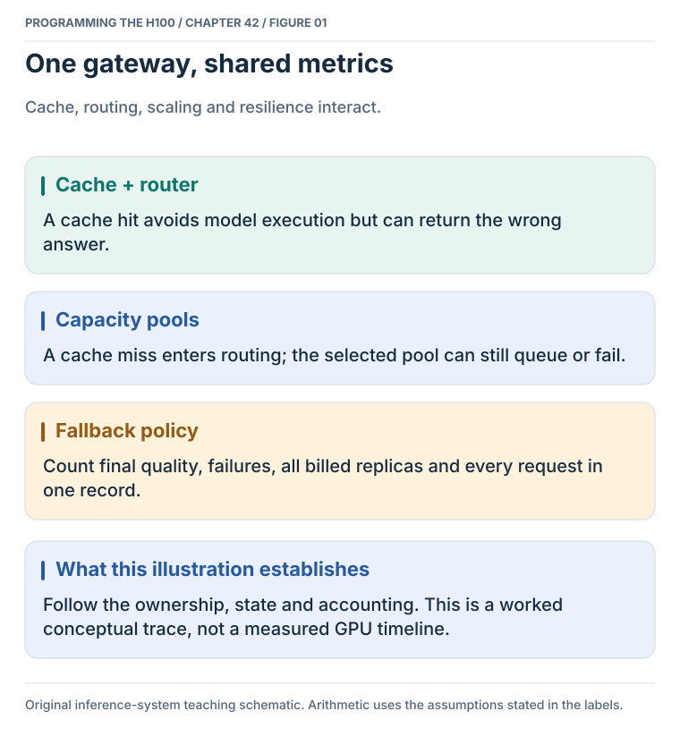

# Chapter 42 — Capstone: One Gateway, Four Mechanisms, One Harness

[](images/chapter-openers/42-inference.svg)


!!! warning "Evidence status"
    **Run on CPU, in a simulator:** a gateway that chains the semantic cache (Chapter 38), the complexity router (Chapter 39), queue-autoscaled GPU pools (Chapter 40) and the circuit breaker (Chapter 41), measured with the record type and statistics of the Chapter 36 harness. 12 self-tests and three experiments (`ch42_gateway_capstone.py`). Experiment cells show the mean and, in brackets, the minimum–maximum over three seeds.
    **Not run on any GPU, cluster or network.** The request rates, service times, prices, cold start, cache and router behaviour are **assumed** or come from the earlier chapters' synthetic worlds. No number here predicts a real deployment. The runbook in 42.9 is **UNTESTED**.
    **What the simulator leaves out:**

    - **Real engine behaviour.** A replica is "4 slots, lognormal service time". Continuous batching, KV-cache pressure and prefix caching (Chapters 43–46) are not modelled.
    - **In-flight cache dedup.** A cache entry becomes visible one nominal service time after its request starts, but two identical requests in flight at once both go to the model.
    - **The router's wait.** The router's K-token prefix is charged to the small pool as load, but it does not delay the large-pool request beyond a fixed 0.15 s.
    - **Fallback target.** The fallback is the small pool, not an on-device model (Chapter 41's edge); the circuit breaker is Chapter 41's, unchanged.
    - **Node provisioning, per-pod queues, network and tenants,** as listed in Chapter 40.
    - **Drift.** The router threshold is calibrated once per seed and never re-checked.

The previous four chapters each built one mechanism and tested it alone. A gateway uses them together, and the mechanisms interact: the cache changes the load the autoscaler sees, the router changes the quality the cache is protecting, and the breaker's fallback is the capacity the router starved. This chapter wires them into one simulator and asks the question a portfolio project exists to answer: **what does each mechanism buy once the others are present, and what does it cost?**

## Worked system map

[](images/worked/ch42-inference.svg)


## 42.1 The pipeline

```text
                 request
                    │
            ┌───────▼────────┐  hit  ──────────────────────────► answer (0.02 s)
            │ semantic cache │
            │   (ch38)       │
            └───────┬────────┘
                 miss
            ┌───────▼────────┐
            │ router (ch39)  │  entropy > τ ?
            └───┬────────┬───┘
            hard│        │easy
        ┌───────▼──┐  ┌──▼───────┐
        │ breaker  │  │  small   │  autoscaled or static pool (ch40)
        │ (ch41)   │  │  pool    │
        └───┬───┬──┘  └──────────┘
        up  │   │ open / down
     ┌──────▼┐  └────────────────► small pool (fallback, lower quality)
     │ large │  autoscaled or static pool (ch40)
     │ pool  │
     └───────┘
```

Every request leaves with one of four fates: cache **hit**, served by the **large** pool, served by the **small** pool (routed or fallback), or **failed** (a hung large pool and no fallback).

## 42.2 What is reused and what is new

| Piece | From | Used as |
|---|---|---|
| `World`, `SemanticCache` | Chapter 38 | The request stream (6000 intents, Zipf 0.6, 10% exact repeats) and the cache, threshold 0.92 |
| `make_data`, `calibrate_tau` | Chapter 39 | Per-intent difficulty, entropy feature and the two models' correctness; τ calibrated per seed for ≤2% quality loss (conservative) |
| `Scaler`, `simulate`, `make_arrivals`, `lognormal_service` | Chapter 40 | The pools: FIFO queue, 4 slots per replica, 60 s cold start, KEDA/HPA rules |
| `CircuitBreaker` | Chapter 41 | Guards the large pool: 3 consecutive failures open it for 10 s |
| `Rec`, `summarize_runs`, `diff_ci`, `percentile` | Chapter 36 | Per-request records, SLO attainment with failures in the denominator, pooled percentiles, bootstrap difference CIs |
| `gateway()` | new | The glue: one pass in arrival order, then the two pools, then the records |

### Assumptions

| Quantity | Value |
|---|---|
| Offered load | 4 req/s, a 100 s burst at 12 req/s from t = 400, back to 4 req/s until t = 900 (about 4400 requests) |
| Small pool | mean service 0.6 s, $1.00 per replica-hour |
| Large pool | mean service 3.0 s, $4.00 per replica-hour |
| Cold start | 60 s; billed from creation |
| SLO | first token within 5 s of the request's arrival (failures count against it), 50 ms per output token |
| Billing window | 900 s plus a 180 s drain, the same for every configuration |
| Outage (42.7) | the large pool is unreachable from t = 600 to 720; clients wait 3 s, then fail |

## 42.3 The glue, in the order requests flow

```python
for i in range(n):                              # arrival order
    ... insert cache entries whose completion time has passed ...
    entry, _ = cache.lookup("k", vecs[i], now=t)
    if entry is not None:                       # hit
        correct[i] = (entry["answer"] == intent) and entry["correct"]
        continue
    pool = "large" if (not cfg.router or H[intent] > tau) else "small"
    if pool == "large" and cfg.router:
        jobs["small"].append((t, ("prefix", i)))    # the K-token prefix runs on the small pool
    if pool == "large":
        down = outage and in_outage(t)
        if breaker is not None:
            mode, gen = breaker.allow(t)
            if mode is None:      pool = "small"                       # breaker open
            else:
                breaker.record(gen, not down, t + (HANG if down else 0))
                if down:          pool, delay = "small", delay + HANG  # attempt hung
        elif down:                kind[i] = "fail"; continue           # no fallback
    jobs[pool].append((t + delay, ("req", i)))
```

Four modelling choices set what the results mean:

1. **A cache hit is correct only if the entry is for the same intent and the answer stored with it was correct.** A hit on a sibling intent is a wrong answer; a hit on the right intent inherits whichever model produced it, including a wrong small-model answer.
2. **The cache learns from what it was served.** An entry is inserted one nominal service time after its request started, with the correctness of the model that answered, so a fallback answer from the small model can be cached and served again.
3. **The router's prefix costs the small pool real capacity.** Chapter 39 showed that the feature needs the small model's first K tokens; every request routed large therefore also puts a job of 20% of a small answer on the small pool.
4. **Quality counts failures.** A failed request is a wrong answer. Quality is the fraction of all requests answered correctly.

## 42.4 Self-tests (12, all pass)

```text
python3 ch42_gateway_capstone.py tests
```

| # | Property |
|---|---|
| 1 | Every request has exactly one fate (hit, large, small, fail) |
| 2 | All-large with no cache: quality equals the mean large-model correctness of the drawn intents, exactly |
| 3 | Router threshold −∞ sends everything to the large pool and reproduces the all-large quality |
| 4 | A threshold of 1.0 gives only exact-repeat hits, none wrong |
| 5 | No hit is served before its entry was inserted |
| 6 | The run is deterministic for a fixed seed |
| 7 | No request is served before it arrived; first token precedes the end |
| 8 | Static all-large cost equals replicas × simulated time × price |
| 9 | With no outage, adding the fallback policy changes no request's fate |
| 10 | During an outage, fallback strictly reduces failures; without it, every failure is a large-pool request in the window |
| 11 | SLO attainment never exceeds the success rate |
| 12 | The cache serves more than 30% of requests on this workload (a guard that the cache is active in the other tests) |

## 42.5 Experiment 1 — the ladder, no outage

Each row adds one mechanism or one sizing decision. "Static 12" is a large pool of twelve replicas; "static 12+2" adds two small replicas.

| Config | $/1k requests | SLO attainment % | TTFT p50 s | TTFT p99 s | Quality % | Hit % | To large % |
|---|---|---|---|---|---|---|---|
| A all-large, static 12 | 3.271 [3.238–3.326] | 100.0 | 0.45 | 0.52 | 87.6 [86.9–88.7] | 0 | 100 |
| B + cache, static 12 | 3.281 [3.248–3.336] | 100.0 | 0.41 | 0.50 | 86.6 [85.8–87.8] | 46.2 | 53.8 |
| B2 + cache, static 7 | 1.918 [1.899–1.950] | 100.0 | 0.41 | 0.50 | 86.6 [85.8–87.8] | 46.2 | 53.8 |
| C + router, static 12+2 | 3.417 [3.383–3.474] | 100.0 | 0.20 | 0.65 | 85.5 [85.0–86.4] | 46.3 | 47.2 |
| C2 + router, static 6+1 | 1.713 [1.697–1.742] | 100.0 | 0.20 | 0.65 | 85.5 [85.0–86.4] | 46.3 | 47.2 |
| F autoscaler only | 5.451 [5.420–5.475] | 89.8 [88.5–91.2] | 0.46 | 53.13 [48.44–58.59] | 87.6 [86.9–88.7] | 0 | 100 |
| D cache + router + autoscaler | 4.544 [4.449–4.601] | 93.3 [92.6–94.1] | 0.20 | 39.43 [34.24–44.59] | 85.5 [85.0–86.4] | 46.3 | 47.2 |

TTFT p50, D minus A, pooled across seeds: 95% bootstrap CI [−0.26, −0.23] s.

### Hand checks

- **Request count.** 400 s × 4 + 100 s × 12 + 400 s × 4 = 4400; the runs have about 4400.
- **Cost of row A.** 12 replicas × 1080 s × $4/3600 = $14.40 for about 4400 requests: $3.27 per thousand. Matches 3.271.
- **Cost of row B2.** 7 × 1080 × 4/3600 = $8.40, plus nothing for a small pool that does not exist: 8.40 / 4.4 = $1.91 per thousand. Matches 1.918.
- **Cost of row C2.** (6 × 4 + 1 × 1) × 1080 / 3600 = $7.50: $1.70 per thousand. Matches 1.713.
- **Sizing.** The large pool's share of the burst is 12 req/s × (1 − 0.46) = 6.5 req/s; at 3 s each that is 19.4 requests in flight, which needs 19.4 / 4 = 4.9 replicas at full slot use and 6.9 at 70%. Row B2 used 7.
- **Quality.** The cache costs 1.0 point (87.6 → 86.6) and the router a further 1.1 (86.6 → 85.5); the two losses add, as the per-request correctness of each decision is independent in this model.

### What the ladder says

1. **A cache saves nothing until the fleet shrinks.** Row B has the same cost as row A: 46% of requests no longer reach the large pool, and the twelve replicas still bill the same hours. Right-sizing the fleet to the reduced load (row B2) is what cuts the bill, by 41%.
2. **The router, at this tolerance, saves little.** The conservative calibration (≤2% quality loss) sends about 88% of cache misses to the large pool, so C2's cost is 11% below B2's, and it costs 1.1 points of quality. Its larger effect is on median latency (0.41 s to 0.20 s): hits are 46% of requests, so the median sits just past them, and in row C the next-fastest group is the small pool's answers rather than the large pool's. The router is also a *load* on the small pool: row C is dearer than row B by the cost of the extra replicas.
3. **The autoscaler, as configured, loses to a fleet sized by someone who knew the burst.** Row F costs more than the static oracle (5.45 against 3.27 per thousand) and misses the SLO on 10% of requests, with a p99 first-token latency near 53 s: the burst waits through a 60 s cold start, then the 300 s scale-down window holds the overshoot, as Chapter 40 found. Rows B2 and C2 are *oracle-sized* (they use the burst height, which a real operator would have to guess), so they are the achievable floor, not a promise.
4. **The cache and router help the autoscaler too.** Row D is 17% cheaper than row F (4.54 against 5.45) and attains the SLO on 93.3% rather than 89.8%, because there is less load to scale for.
5. **The latency CI is narrow because the effect is the cache.** D's median is 0.25 s lower than A's (CI −0.26 to −0.23): the median request is a hit or a quick small-pool answer. It says nothing about the tail, which the autoscaler dominates.

## 42.6 The harness is the point

Each row comes from the same `Rec` records and `summarize_runs` as Chapter 36, so the rules that chapter argued for hold here: warm-up is discarded per run; latency is measured from the intended arrival time; failures stay in the denominator of SLO attainment; ranges are over seeds; differences carry a bootstrap interval. If the gateway were real, the same summary code would run on the same records produced by a network client instead of a simulator.

## 42.7 Experiment 2 — the large pool goes down

Config D, with the large pool unreachable from t = 600 to 720.

| Policy | Failures | SLO attainment % | Quality % | $/1k | Fallbacks |
|---|---|---|---|---|---|
| No fallback | 187 [177–205] | 89.1 [88.0–89.9] | 82.1 [81.8–82.5] | 4.539 | 0 |
| Breaker + small-pool fallback | 0 | 93.3 [92.6–94.1] | 84.5 [84.0–85.2] | 4.539 | 187 [180–199] |

- **Hand check.** The window holds about 490 requests; 60% of them are cache hits late in the run, and about 88% of misses route large, so roughly 490 × 0.4 × 0.88 ≈ 170 requests need the large pool. The measured 187 failures (and, with the breaker, 187 fallbacks) are in that range.
- **The fallback restores the SLO figure to its no-outage level** (93.3%, row D) at a quality cost: the quality is 84.5% against 85.5% with no outage, because the fallback answers come from the small model, which is less accurate on the hard queries that routed large. Without the fallback, quality falls to 82.1%.
- **No extra cost.** Both policies cost the same: the 187 extra small-pool requests do not make the small pool scale.
- **First three requests.** The breaker needs three failures to open, so the first three requests in the window each wait 3 s before reaching the small pool; after that requests go directly, apart from one probe every 10 s that also waits 3 s.

## 42.8 Experiment 3 — the cache threshold, end to end

Config D, varying the cosine threshold.

| Threshold | Hit % | Wrong hits (% of hits) | Quality % | $/1k |
|---|---|---|---|---|
| 0.85 | 69.7 | 64.2 [61.6–67.6] | 48.2 [45.8–50.1] | 3.830 [3.113–4.302] |
| 0.92 | 46.2 | 2.8 [2.3–3.3] | 85.5 [85.0–86.4] | 4.544 |
| 0.97 | 17.5 | 0.0 | 86.6 [86.1–87.3] | 5.096 |
| no cache | 0 | — | 86.6 [86.1–87.3] | 5.314 |

- **The cheapest setting is useless.** Threshold 0.85 has the lowest cost and answers fewer than half the requests correctly: two thirds of its hits are on a sibling intent. A cost column without a quality column would have recommended it.
- **Hand check.** At 0.92, 46.2% hits × 2.8% wrong = 1.3% of requests answered wrongly by the cache; at the 87% base accuracy those would have been right about 87% of the time, so the cache costs about 1.1 points, as measured (86.6 → 85.5).
- **0.97 buys safety, not savings.** Quality equals the no-cache figure, and the cost falls only 4%.
- **The threshold is a quality decision with a price,** exactly as Chapter 38 concluded; here it is visible in the end-to-end number.

## 42.9 Runbook for a real gateway (UNTESTED)

None of this has been run. It describes how to replace each simulated part with a real one while keeping the measurement the same.

1. **Fix the measurement first.** Use the Chapter 36 client in open-loop mode against a *single* URL (the gateway), with the offered-rate schedule above and fixed output lengths. Record the run manifest. Keep warm-up, per-run statistics and failure accounting exactly as in Chapter 36.
2. **Run the ladder in the same order:** (A) the large model alone with a static fleet; (B) add the cache and repeat at the *same* fleet, then at a fleet sized to the measured hit rate; (C) add the router, with the small model's prefix cost measured, not assumed; (D) add the autoscaler last, with a measured cold start.
3. **Calibrate on your traffic, not these worlds:** the cache threshold from labelled same-intent / different-intent pairs (Chapter 38); the router threshold from labelled correctness (Chapter 39); the cold start by timing a new replica to first token (Chapter 40).
4. **Inject the fault in a controlled way,** for example by scaling the large deployment to zero replicas for two minutes and restoring it (`kubectl scale deployment/<large> --replicas=0`, then back to the original count). Record failures, attainment and quality for each policy as in 42.7. Do this in a test environment.
5. **Report with the Chapter 36 template:** the ladder table with ranges over repeated runs, the CI on each pairwise difference you claim, and the manifest.

## 42.10 Failure catalogue

| Failure | Cause | Defence |
|---|---|---|
| Savings never appear on the bill | Cache or router reduces load but the fleet keeps its size | Size pools to the measured reduced load; make capacity follow demand |
| Autoscaler loses to a hand-sized fleet | Cold start, scale-down window and burst | Headroom floor, backlog-aware metric, shorter cold start (Chapter 40) |
| Cache saves money and quality goes with it | Threshold too low; sibling intents match | Calibrate on labelled pairs; report quality beside cost |
| Fallback answer cached and re-served | Small-model answer stored under the same key | Store the producing model with the entry; do not serve degraded answers as full-quality hits |
| Router starves its own fallback | The small pool is sized for the easy queries only | Size the small pool for fallback load, not just routed load |
| Router prefix ignored in capacity planning | Every large-routed request also runs K tokens on the small model | Add the prefix load to the small pool's sizing |
| Breaker opens late | Three consecutive failures at 3 s each | Lower the first-token timeout or the threshold; trip on failure rate |
| Quality metric excludes failures | Averaged over answered requests only | Count a failure as a wrong answer, as here |
| Gains attributed to the wrong mechanism | Measured with all mechanisms changed at once | Build the ladder one rung at a time, same workload, same seeds |
| Router drifts | Traffic mix shifts after calibration | Re-check on fresh labelled samples on a schedule |

## 42.11 Exercises

1. With the same workload, what does a large-pool static fleet of 8 replicas cost per thousand requests with the cache on and no router? (Use 4400 requests, a 1080 s billing window and the $4 price.)
2. If the hit rate in the burst were 60% rather than 46%, how many large replicas keep 70% slot utilisation during the burst, with no router?
3. Row F costs more than row A. Give two reasons from this chapter, and one change that would help.
4. At threshold 0.92, 46.2% of requests hit and 2.8% of hits are wrong. How many of 4400 requests are answered wrongly by the cache?
5. The router sends 12% of misses to the small pool. A second team proposes raising that to 40% by loosening the quality tolerance. Name the two costs, besides latency, that the ladder shows you must measure before accepting.

### Solutions

1. 8 × 1080 s × $4 / 3600 = $9.60 for 4400 requests: $2.18 per thousand (plus about $0.01 per thousand for the embedding model).
2. Burst rate 12 req/s; misses 40%: 4.8 req/s; at 3 s each, 14.4 in flight; at 4 slots, 3.6 replicas at full use; at 70%, 5.1; so 6 replicas.
3. (a) The autoscaler starts from one replica and each new replica takes 60 s to warm, so the burst waits; (b) the HPA's scale-down window keeps the overshoot for 300 s and bills it. One change: a higher floor of replicas, a backlog-aware metric, or a shorter cold start.
4. 4400 × 0.462 × 0.028 ≈ 57 requests.
5. The quality loss (the ladder lost 1.1 points at 12%, and would lose more at 40%), and the capacity: the small pool must now carry three times the routed load plus the prefix jobs and any fallback traffic, so its sizing, and its cost, change.

## 42.12 Summary

- Each mechanism was tested alone in Chapters 38–41; this chapter measures them together on one workload with the Chapter 36 statistics.
- A cache or router reduces load, not cost: the bill falls only when the fleet shrinks to match (−41% with a right-sized fleet in the cache-only case, −48% with the router).
- Autoscaling, with a 60 s cold start and default scaling rules, cost more than a fleet sized for the burst and missed the SLO on 7–10% of requests; the cache and router reduced its cost by 17%.
- The router, at a conservative quality tolerance, sent about 88% of misses to the large model, saved about 11% and cost 1.1 points of quality; its prefix is a real load on the small pool.
- With the large pool down for two minutes, the breaker and a small-pool fallback turned 187 failures into 0 and restored the SLO figure, at a quality cost of 1.0 point.
- Cost without quality is a trap: the cheapest cache threshold answered fewer than half the requests correctly.
- All of this is simulated. The method (a ladder, one change at a time, same records and same statistics) is what transfers; the numbers do not.

## Files and sources

- Code: `docs/examples/inference-systems/ch42_gateway_capstone.py` (imports `ch36_benchmark_teardown.py`, `ch38_semantic_cache.py`, `ch39_complexity_router.py`, `ch40_gpu_autoscaler.py` and `ch41_edge_fallback.py` from the same folder)
- Chapters reused: [Chapter 36](36-benchmark-teardown.md), [Chapter 38](38-semantic-cache.md), [Chapter 39](39-complexity-router.md), [Chapter 40](40-gpu-autoscaler.md), [Chapter 41](41-edge-fallback-resilience.md)
