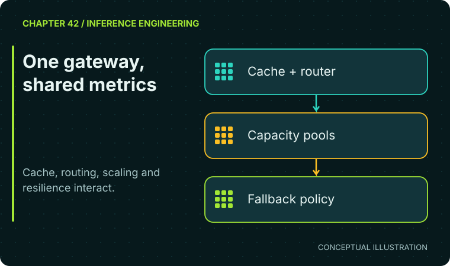

# Chapter 42 — Capstone: One Gateway, Four Mechanisms, One Harness

[](images/chapter-openers/42-inference.svg)


!!! warning "Evidence status"
    **Run on CPU, in a simulator:** a gateway that chains the semantic cache (Chapter 38), the complexity router (Chapter 39), queue-autoscaled GPU pools (Chapter 40) and the circuit breaker (Chapter 41), measured with the record type and statistics of the Chapter 36 harness. 12 self-tests and three experiments (`ch42_gateway_capstone.py`). Experiment cells show the mean and, in brackets, the minimum–maximum over three seeds.
    **Not run on any GPU, cluster or network.** The request rates, service times, prices, cold start, cache and router behaviour are **assumed** or come from the earlier chapters' synthetic worlds. No number here predicts a real deployment. The runbook in 42.9 is **UNTESTED**.
    **What the simulator leaves out:**

    - **Real engine behaviour.** A replica is "4 slots, lognormal service time". Continuous batching, KV-cache pressure and prefix caching (Chapters 43–46) are not modelled.
    - **In-flight cache dedup.** A cache entry becomes visible only when its producing model request actually completes, after queueing and cold-start delays; two identical requests in flight at once still both go to the model.
    - **The router's wait.** The router's K-token prefix occupies the small pool. A large-model request is admitted only after that prefix actually completes. A direct-small job includes the prefix, and its first content is held until the modeled decision is ready.
    - **Fallback target.** The fallback is the small pool, not an on-device model (Chapter 41's edge); the circuit breaker is Chapter 41's, unchanged.
    - **Node provisioning, per-pod queues, network and tenants,** as listed in Chapter 40.
    - **Drift.** The router threshold is calibrated once per seed and never re-checked.

The previous four chapters each built one mechanism and tested it alone. A gateway uses them together, and the mechanisms interact: the cache changes the load the autoscaler sees, the router changes the quality the cache is protecting, and the breaker's fallback is the capacity the router starved. This chapter wires them into one simulator and asks the question a portfolio project exists to answer: **what does each mechanism buy once the others are present, and what does it cost?**

## Worked system map

[](images/worked/ch42-inference.svg)


## 42.1 The pipeline

```text
                 request
                    │
            ┌───────▼────────┐  hit  ──────────────────────────► answer (0.02 s)
            │ semantic cache │
            │   (ch38)       │
            └───────┬────────┘
                 miss
            ┌───────▼────────┐
            │ router (ch39)  │  entropy > τ ?
            └───┬────────┬───┘
            hard│        │easy
        ┌───────▼──┐  ┌──▼───────┐
        │ breaker  │  │  small   │  autoscaled or static pool (ch40)
        │ (ch41)   │  │  pool    │
        └───┬───┬──┘  └──────────┘
        up  │   │ open / down
     ┌──────▼┐  └────────────────► small pool (fallback, lower quality)
     │ large │  autoscaled or static pool (ch40)
     │ pool  │
     └───────┘
```

Every request leaves with one of four fates: cache **hit**, served by the **large** pool, served by the **small** pool (routed or fallback), or **failed** (a hung large pool and no fallback).

## 42.2 What is reused and what is new

| Piece | From | Used as |
|---|---|---|
| `World`, `SemanticCache` | Chapter 38 | The request stream (6000 intents, Zipf 0.6, 10% exact repeats) and the cache, threshold 0.92 |
| `make_data`, `calibrate_tau` | Chapter 39 | Per-intent difficulty, entropy feature and the two models' correctness; τ calibrated per seed for ≤2% quality loss (conservative) |
| `Scaler`, `simulate`, `make_arrivals`, `lognormal_service` | Chapter 40 | The pools: FIFO queue, 4 slots per replica, 60 s cold start, KEDA/HPA rules |
| `CircuitBreaker` | Chapter 41 | Guards the large pool: 3 consecutive failures open it for 10 s |
| `Rec`, `summarize_runs`, `percentile` | Chapter 36 | Per-request records, SLO attainment with failures in the denominator and per-run percentile summaries |
| `gateway()` | new | The glue: one chronological event queue for arrivals, prefix/model completions, timeouts and pool/scaler ticks |

### Assumptions

| Quantity | Value |
|---|---|
| Offered load | 4 req/s, a 100 s burst at 12 req/s from t = 400, back to 4 req/s until t = 900 (about 4400 requests) |
| Small pool | mean service 0.6 s, $1.00 per replica-hour |
| Large pool | mean service 3.0 s, $4.00 per replica-hour |
| Cold start | 60 s; billed from creation |
| SLO | first token within 5 s of the request's arrival (failures count against it), 50 ms per output token |
| Billing window | 900 s plus a 180 s drain, the same for every configuration |
| Outage (42.7) | the large pool is unreachable from t = 600 to 720; clients wait 3 s, then fail |

## 42.3 Follow one request through the event loop

The gateway processes events in time order. Completed operations become visible before a request arriving at the same timestamp, and arrivals join their queues before a scheduler tick at that timestamp. Pool scheduling and KEDA/HPA decisions are sampled every 0.1 s; service completion and timeout events retain their exact scheduled times.

1. **Arrival:** perform a cache lookup using only entries whose producing request has already completed. A hit returns after the assumed 20 ms lookup delay.
2. **Router:** for an uncached request, a large route first queues a prefix job on the small pool. A direct-small route uses a single full-small job that includes the prefix; no answer bytes are released before the modeled routing decision.
3. **Prefix completion:** only then may the large route ask the breaker and enter the large pool. The prefix is actual small-pool load, not a free feature.
4. **Attempt:** a healthy large request queues and computes. An unreachable large pool schedules a timeout three seconds later; it does not update the breaker early. With fallback enabled, an already-open breaker queues the request on the small pool immediately.
5. **Completion:** record its response and correctness. Only a successfully completed model request may create a cache entry. A request still unserved at the drain horizon cannot populate the cache.
6. **Accounting:** integrate every provisioned replica, including warming and draining replicas, into GPU-seconds. Failed requests remain in the quality and SLO denominators.

### Trace it by hand

Assume request A arrives at 10.0 s, waits until 12.0 s for a replica and takes 3.0 s of model service. Its cache entry becomes visible at **15.0 s**, not at `10+3=13` s. An identical request at 14.0 s must miss; one at 15.1 s may hit. Cold start or queueing therefore changes the cache's useful hit rate, rather than being hidden by a nominal completion timestamp.

Now assume a routed request enters the small pool at 20.0 s, starts at 21.0 s and its prefix costs 0.12 s. It can enter the large pool no earlier than **21.12 s**. If that endpoint hangs, its breaker failure notification occurs at **24.12 s**. A second request at 22.0 s must not see that future failure yet.

Correctness of a cache hit also depends on answer identity: a hit on the wrong intent is wrong, and a correct-intent hit can inherit an incorrect small-model answer. The simulated correctness labels are an oracle for evaluation, not a production confidence signal. In a real gateway, cache admission needs a policy that excludes failed or degraded responses without consulting unavailable ground truth.

## 42.4 Self-tests (12, all pass)

```text
python3 ch42_gateway_capstone.py tests
```

| # | Property |
|---|---|
| 1 | Every request has exactly one fate (hit, large, small, fail) |
| 2 | All-large with no cache: quality equals the mean large-model correctness of the drawn intents, exactly |
| 3 | Router threshold −∞ sends everything to the large pool and reproduces the all-large quality |
| 4 | A threshold of 1.0 gives only exact-repeat hits, none wrong |
| 5 | No hit is served before insertion; added adversarial regression also checks insertion equals the producing request’s actual completion |
| 6 | The run is deterministic for a fixed seed |
| 7 | No request is served before it arrived; first token precedes the end |
| 8 | Static all-large cost equals replicas × simulated time × price |
| 9 | With no outage, adding the fallback policy changes no request's fate |
| 10 | During an outage, fallback strictly reduces failures; without it, every failure is a large-pool request in the window |
| 11 | SLO attainment never exceeds the success rate |
| 12 | The cache serves more than 30% of requests on this workload (a guard that the cache is active in the other tests) |

## 42.5 Experiment 1 — the ladder, no outage

Each row adds one mechanism or one sizing decision. "Static 12" is a large pool of twelve replicas; "static 12+2" adds two small replicas.

| Config | $/1k requests | SLO attainment % | TTFT p50 s | TTFT p99 s | Quality % | Hit % | To large % |
|---|---|---|---|---|---|---|---|
| A all-large, static 12 | 3.271 [3.238–3.326] | 100.0 [100.0–100.0] | 0.45 [0.45–0.45] | 0.52 [0.50–0.55] | 87.6 [86.9–88.7] | 0.0 | 100.0 |
| B +cache, static 12 | 3.281 [3.248–3.336] | 100.0 [100.0–100.0] | 0.41 [0.41–0.41] | 0.50 [0.50–0.50] | 86.6 [85.8–87.8] | 46.2 | 53.8 |
| B2 +cache, static 7 | 1.918 [1.899–1.950] | 100.0 [100.0–100.0] | 0.41 [0.41–0.41] | 0.50 [0.50–0.50] | 86.6 [85.8–87.8] | 46.2 | 53.8 |
| C +router, static 12+2 | 3.417 [3.383–3.474] | 100.0 [100.0–100.0] | 0.22 [0.20–0.23] | 0.80 [0.79–0.81] | 85.5 [85.0–86.4] | 46.2 | 47.3 |
| C2 +router, static 6+1 | 1.713 [1.697–1.742] | 100.0 [100.0–100.0] | 0.22 [0.20–0.23] | 0.82 [0.80–0.83] | 85.5 [85.0–86.4] | 46.2 | 47.3 |
| F autoscaler only | 5.451 [5.420–5.475] | 89.8 [88.5–91.2] | 0.46 [0.46–0.46] | 53.13 [48.44–58.59] | 87.6 [86.9–88.7] | 0.0 | 100.0 |
| D cache+router+autoscale | 4.608 [4.442–4.749] | 92.4 [91.5–93.4] | 0.23 [0.21–0.24] | 43.23 [38.13–47.56] | 85.5 [85.1–86.3] | 45.5 | 48.0 |

The paired per-run difference in TTFT p50 (D minus A) is **−0.22 s on average**, with a three-seed range **−0.24 to −0.21 s**. These three runs do not establish a precise confidence interval.

### Hand checks

- **Request count.** 400 s × 4 + 100 s × 12 + 400 s × 4 = 4400; the runs have about 4400.
- **Cost of row A.** 12 replicas × 1080 s × $4/3600 = $14.40 for about 4400 requests: $3.27 per thousand. Matches 3.271.
- **Cost of row B2.** 7 × 1080 × 4/3600 = $8.40, plus nothing for a small pool that does not exist: 8.40 / 4.4 = $1.91 per thousand. Matches 1.918.
- **Cost of row C2.** (6 × 4 + 1 × 1) × 1080 / 3600 = $7.50: $1.70 per thousand. Matches 1.713.
- **Sizing.** The large pool's share of the burst is 12 req/s × (1 − 0.46) = 6.5 req/s; at 3 s each that is 19.4 requests in flight, which needs 19.4 / 4 = 4.9 replicas at full slot use and 6.9 at 70%. Row B2 used 7.
- **Quality.** The cache costs 1.0 point (87.6 → 86.6) and the router a further 1.1 (86.6 → 85.5); these differences telescope arithmetically; additive changes do not establish independence between the mechanisms.

### What the ladder says

1. **A cache saves nothing until the fleet shrinks.** Row B has the same cost as row A: 46% of requests no longer reach the large pool, and the twelve replicas still bill the same hours. Right-sizing the fleet to the reduced load (row B2) is what cuts the bill, by 41%.
2. **The router, at this tolerance, saves little.** The conservative calibration (≤2% quality loss) sends about 88% of cache misses to the large pool, so C2's cost is 11% below B2's, and it costs 1.1 points of quality. Its larger effect is on median latency (0.41 s to 0.22 s): hits are 46% of requests, so the median sits just past them, and in row C the next-fastest group is the small pool's answers rather than the large pool's. The router is also a *load* on the small pool: row C is dearer than row B by the cost of the extra replicas.
3. **The autoscaler, as configured, loses to a fleet sized by someone who knew the burst.** Row F costs more than the static oracle (5.45 against 3.27 per thousand) and misses the SLO on 10% of requests, with a p99 first-token latency near 53 s: the burst waits through a 60 s cold start, then the 300 s scale-down window holds the overshoot, as Chapter 40 found. Rows B2 and C2 are *oracle-sized* (they use the burst height, which a real operator would have to guess), so they are the achievable floor, not a promise.
4. **The cache and router help the autoscaler too.** Row D is about 15% cheaper than row F (4.61 against 5.45) and attains the SLO on 92.4% rather than 89.8%, because there is less load to scale for.
5. **The median and the tail answer different questions.** The paired D-minus-A median difference averages −0.22 s over three seeds because hits and small-pool answers are fast. That does not establish a reliable confidence interval or improve the p99 tail, which remains dominated by cold start and queueing.

## 42.6 The harness is the point

Each row comes from the same `Rec` records and `summarize_runs` as Chapter 36, so the rules that chapter argued for hold here: warm-up is discarded per run; latency is measured from the intended arrival time; failures stay in the denominator of SLO attainment; ranges are over independent seeds; median-latency differences are paired by seed. Request-level bootstrap intervals would be misleading because cache entries and shared queues correlate requests. If the gateway were real, the same summary code would run on the same records produced by a network client instead of a simulator.

## 42.7 Experiment 2 — the large pool goes down

Config D, with the large pool unreachable from t = 600 to 720.

| Policy | Failures | SLO attainment % | Quality % | $/1k | Fallbacks |
|---|---|---|---|---|---|
| no fallback | 187 [177–205] | 88.2 [86.9–89.3] | 82.1 [81.7–82.4] | 4.603 [4.427–4.749] | 0 [0–0] |
| breaker + small-pool fallback | 0 [0–0] | 92.4 [91.5–93.4] | 84.5 [83.9–85.2] | 4.609 [4.427–4.749] | 192 [185–204] |

- **Hand check.** The window holds about 490 requests; 60% of them are cache hits late in the run, and about 88% of misses route large, so roughly 490 × 0.4 × 0.88 ≈ 170 requests need the large pool. The measured 187 failures are in that range. The fallback run has about 192 fallbacks; causal completion and cache histories can differ between policies, so those counts need not be identical.
- **The fallback restores the SLO figure to its no-outage level** (92.4%, row D) at a quality cost: the quality is 84.5% against 85.5% with no outage, because the fallback answers come from the small model, which is less accurate on the hard queries that routed large. Without the fallback, quality falls to 82.1%.
- **Account for fallback cost.** Additional small-pool work may change scaling. Compare the measured replica-seconds rather than assuming a fallback is free.
- **First three requests.** The breaker needs three failures to open, so failures are counted only when their timeouts actually occur. Several requests can already be in flight before the third failure opens the breaker, so more than three may wait through the timeout. Subsequent arrivals can bypass the large pool until a permitted probe tests recovery.

## 42.8 Experiment 3 — the cache threshold, end to end

Config D, varying the cosine threshold.

| Threshold | Hit % | Wrong hits (% of hits) | Quality % | $/1k |
|---|---|---|---|---|
| 0.85 | 68.7 [68.3–69.1] | 62.4 [60.1–66.6] | 49.8 [46.8–51.7] | 4.176 [4.091–4.250] |
| 0.92 | 45.5 [45.0–45.9] | 2.8 [2.4–3.4] | 85.5 [85.1–86.3] | 4.608 [4.442–4.749] |
| 0.97 | 17.0 [16.3–17.7] | 0.0 [0.0–0.0] | 86.6 [86.1–87.3] | 5.145 [4.936–5.258] |
| no cache | 0.0 | — | 86.6 [86.1–87.3] | 5.369 [5.204–5.458] |

- **The cheapest setting is useless.** Threshold 0.85 has the lowest cost and answers fewer than half the requests correctly: two thirds of its hits are on a sibling intent. A cost column without a quality column would have recommended it.
- **Hand check.** At 0.92, 45.5% hits × 2.8% wrong = 1.3% of requests answered wrongly by the cache; at the 87% base accuracy those would have been right about 87% of the time, so the cache costs about 1.1 points, as measured (86.6 → 85.5).
- **0.97 buys safety, not savings.** Quality equals the no-cache figure, and the cost falls only 4%.
- **The threshold is a quality decision with a price,** exactly as Chapter 38 concluded; here it is visible in the end-to-end number.

## 42.9 Runbook for a real gateway (UNTESTED)

None of this has been run. It describes how to replace each simulated part with a real one while keeping the measurement the same.

1. **Fix the measurement first.** Use the Chapter 36 client in open-loop mode against a *single* URL (the gateway), with the offered-rate schedule above and fixed output lengths. Record the run manifest. Keep warm-up, per-run statistics and failure accounting exactly as in Chapter 36.
2. **Run the ladder in the same order:** (A) the large model alone with a static fleet; (B) add the cache and repeat at the *same* fleet, then at a fleet sized to the measured hit rate; (C) add the router, with the small model's prefix cost measured, not assumed; (D) add the autoscaler last, with a measured cold start.
3. **Calibrate on your traffic, not these worlds:** the cache threshold from labelled same-intent / different-intent pairs (Chapter 38); the router threshold from labelled correctness (Chapter 39); the cold start by timing a new replica to first token (Chapter 40).
4. **Inject the fault in a controlled way,** for example by scaling the large deployment to zero replicas for two minutes and restoring it (`kubectl scale deployment/<large> --replicas=0`, then back to the original count). Record failures, attainment and quality for each policy as in 42.7. Do this in a test environment.
5. **Report with the Chapter 36 template:** the ladder table with ranges over repeated runs, paired run-level uncertainty for each difference you claim, with enough independent runs to support it, and the manifest.

## 42.10 Failure catalogue

| Failure | Cause | Defence |
|---|---|---|
| Savings never appear on the bill | Cache or router reduces load but the fleet keeps its size | Size pools to the measured reduced load; make capacity follow demand |
| Autoscaler loses to a hand-sized fleet | Cold start, scale-down window and burst | Headroom floor, backlog-aware metric, shorter cold start (Chapter 40) |
| Cache saves money and quality goes with it | Threshold too low; sibling intents match | Calibrate on labelled pairs; report quality beside cost |
| Fallback answer cached and re-served | Small-model answer stored under the same key | Store the producing model with the entry; do not serve degraded answers as full-quality hits |
| Router starves its own fallback | The small pool is sized for the easy queries only | Size the small pool for fallback load, not just routed load |
| Router prefix ignored in capacity planning | Every large-routed request also runs K tokens on the small model | Add the prefix load to the small pool's sizing |
| Breaker opens late | Three completed failures are required; other attempts may already be in flight during their 3 s timeouts | Lower the first-token timeout or the threshold; trip on failure rate |
| Quality metric excludes failures | Averaged over answered requests only | Count a failure as a wrong answer, as here |
| Gains attributed to the wrong mechanism | Measured with all mechanisms changed at once | Build the ladder one rung at a time, same workload, same seeds |
| Router drifts | Traffic mix shifts after calibration | Re-check on fresh labelled samples on a schedule |

<!-- BEGIN COMPLETE INFERENCE SOURCE -->
## Complete runnable code

The complete implementation is shown below, including its checks and entry point. The listing and downloadable `.py` file contain exactly the same source. Copy the file under the displayed filename; keep supporting files in the same directory.

[Download all inference examples and supporting modules](examples/inference-systems/inference-systems.zip) or read the [environment and command guide](examples/inference-systems/README.md).

The [follow-up agent audit](inference-adversarial-review-2026-11-25.md) records the corrections, fresh CPU captures and hardware limits for this source.

Supporting modules: [ch36_benchmark_teardown.py](examples/inference-systems/ch36_benchmark_teardown.py), [ch38_semantic_cache.py](examples/inference-systems/ch38_semantic_cache.py), [ch39_complexity_router.py](examples/inference-systems/ch39_complexity_router.py), [ch40_gpu_autoscaler.py](examples/inference-systems/ch40_gpu_autoscaler.py), [ch41_edge_fallback.py](examples/inference-systems/ch41_edge_fallback.py).

Read it in three passes: start with `Cfg` to identify the state; trace `gateway` and `summarize_cfg` for one request or token; then follow `selftests` and `experiments` to see how the result is checked.

From the repository root:

```bash
python3 docs/examples/inference-systems/ch42_gateway_capstone.py tests
# Run the full chapter demonstrations:
python3 docs/examples/inference-systems/ch42_gateway_capstone.py
```

### ch42_gateway_capstone.py

[Download ch42_gateway_capstone.py](examples/inference-systems/ch42_gateway_capstone.py)

```python title="ch42_gateway_capstone.py" linenums="1"
#!/usr/bin/env python3
"""Chapter 42 -- Capstone: one gateway, four mechanisms, one measurement harness (CPU only).

Request path:   semantic cache (ch38) -> complexity router (ch39) -> small / large GPU pools
                with queue-based autoscaling (ch40) -> circuit breaker + fallback (ch41).
Measurement:    Rec records and summarize_runs / diff_ci / percentile from ch36.

Everything below the module imports is an ASSUMED model; nothing was run on a GPU.

    python3 ch42_gateway_capstone.py            # tests + experiments
    python3 ch42_gateway_capstone.py tests
"""
import sys
from dataclasses import dataclass, replace

import numpy as np

from ch36_benchmark_teardown import Rec, summarize_runs, percentile
from ch38_semantic_cache import World, SemanticCache
from ch39_complexity_router import make_data, calibrate_tau
from ch40_gpu_autoscaler import Scaler, make_arrivals, lognormal_service
from ch41_edge_fallback import CircuitBreaker

# ---------------------------------------------------------------- assumed constants
HORIZON, DRAIN = 900.0, 180.0
SEGS = [(0, 400, 4.0), (400, 500, 12.0), (500, HORIZON, 4.0)]    # req/s, with a burst
THRESH = 0.92                       # cache cosine threshold
FAMILIES, ZIPF = 1500, 0.6          # cache workload (6000 intents)
CACHE_LAT = 0.02                    # s, embedding + lookup on a hit
C_EMB = 1e-5                        # $ per request for the embedding model (assumed)
PREFIX_FRAC = 0.2                   # the router's K-token prefix costs this fraction of a small answer
OUTAGE = (600.0, 720.0)             # the large pool is unreachable
HANG = 3.0                          # client waits this long for a hung large pool
COLD = 60.0
SLO_TTFT, SLO_TPOT = 5.0, 0.05
POOLS = {
    "small": dict(mean=0.6, sigma=0.5, slots=4, price=1.0, tok=40.0, prefill=0.15),
    "large": dict(mean=3.0, sigma=0.5, slots=4, price=4.0, tok=30.0, prefill=0.40),
}


@dataclass(frozen=True)
class Cfg:
    name: str
    cache: bool = False
    router: bool = False
    autoscale: bool = False
    fallback: bool = False
    large_static: int = 12
    small_static: int = 2
    thresh: float = THRESH


def in_outage(t):
    return OUTAGE[0] <= t < OUTAGE[1]


def _scaler():
    return Scaler(target=3.0, min_replicas=1, max_replicas=40)


def gateway(cfg, seed, outage=False):
    """Causal discrete-event simulation: decisions see only completed prior events.

    Pool admission/scaling is sampled every 0.1 s as in Chapter 40. Service
    completions, request arrivals, prefix completions and breaker timeouts are
    separate ordered events. In particular, only a successful completed model
    request may publish a semantic-cache entry.
    """
    import heapq
    from collections import deque

    rng = np.random.default_rng(seed)
    arr = make_arrivals(SEGS, rng)
    n = len(arr)
    world = World(seed=seed, families=FAMILIES)
    intents, vecs = world.stream(n, zipf=ZIPF)
    data = make_data(world.n_intents, seed + 100)
    val = make_data(2000, seed + 200)
    tau = calibrate_tau(val, val["H"], delta=0.02)
    if cfg.router == "all_large":
        tau = -np.inf
    svc_all = {p: lognormal_service(n, POOLS[p]["mean"], POOLS[p]["sigma"],
                                    np.random.default_rng(seed * 31 + j))
               for j, p in enumerate(("small", "large"))}
    cache = SemanticCache(world.dim, cfg.thresh) if cfg.cache else None
    breaker = CircuitBreaker(3, 10.0) if cfg.fallback else None
    simh, dt = HORIZON + DRAIN, 0.1
    recs = [Rec(intended=t, sent=t) for t in arr]
    kind = [None] * n
    correct = np.zeros(n, bool)
    fallbacks = hit_wrong = 0
    insert_log, cache_hit_events, prefix_log = [], [], []
    direct_small = set()
    pools, gpu_s = {}, {p: 0.0 for p in POOLS}
    events, serial = [], 0

    def event(at, priority, action, payload):
        nonlocal serial
        serial += 1
        heapq.heappush(events, (at, priority, serial, action, payload))

    for p in POOLS:
        active = p == "large" or cfg.router or cfg.fallback
        count = (1 if cfg.autoscale else
                 cfg.large_static if p == "large" else cfg.small_static) if active else 0
        scaler = _scaler() if cfg.autoscale and active else None
        if scaler is not None:
            scaler.history.append((0.0, count))
        pools[p] = dict(queue=deque(), reps=[dict(ready_at=0.0, running={}, draining=False)
                                            for _ in range(count)],
                        scaler=scaler, next_poll=0.0,
                        next_hpa=scaler.poll if scaler else 0.0)

    def enqueue(pool, rid, at, prefix=False, gen=None):
        pools[pool]["queue"].append((rid, at, prefix, gen))

    def resize(state, new, now):
        live = [r for r in state["reps"] if not r["draining"]]
        if new > len(live):
            state["reps"].extend(dict(ready_at=now+COLD, running={}, draining=False)
                                  for _ in range(new-len(live)))
        else:
            live.sort(key=lambda r: (r["ready_at"] <= now, len(r["running"])))
            for replica in live[:len(live)-new]:
                if replica["ready_at"] > now:
                    state["reps"].remove(replica)
                else:
                    replica["draining"] = True

    def large_decision(rid, now):
        nonlocal fallbacks
        down = outage and in_outage(now)
        gen = None
        if breaker is not None:
            mode, gen = breaker.allow(now)
            if mode is None:
                kind[rid] = "small"
                fallbacks += 1
                enqueue("small", rid, now)
                return
        if down:
            # Deliver this result only after the timeout; no future-state mutation.
            event(now+HANG, 0, "timeout", (rid, gen))
        else:
            kind[rid] = "large"
            enqueue("large", rid, now, gen=gen)

    for rid, at in enumerate(arr):
        event(float(at), 1, "arrival", rid)
    for step in range(int(round(simh/dt))):
        event(step*dt, 2, "tick", None)

    while events:
        now, _priority, _serial, action, payload = heapq.heappop(events)
        if now > simh:
            break
        if action == "arrival":
            rid = payload
            if cache is not None:
                entry, _sim = cache.lookup("k", vecs[rid], now=now)
                if entry is not None:
                    kind[rid] = "hit"
                    correct[rid] = entry["answer"] == int(intents[rid]) and entry["correct"]
                    hit_wrong += int(entry["answer"] != int(intents[rid]))
                    recs[rid].first = recs[rid].end = now+CACHE_LAT
                    recs[rid].ntok, recs[rid].ok = 100, True
                    insert_log.append((entry["created"], now))
                    cache_hit_events.append((entry["producer"], entry["created"], now))
                    continue
            route_large = not cfg.router or data["H"][intents[rid]] > tau
            if route_large and cfg.router:
                enqueue("small", rid, now, prefix=True)
            elif route_large:
                large_decision(rid, now)
            else:
                kind[rid] = "small"
                direct_small.add(rid)
                enqueue("small", rid, now)
        elif action == "timeout":
            rid, gen = payload
            if breaker is not None:
                breaker.record(gen, False, now)
                kind[rid] = "small"
                fallbacks += 1
                enqueue("small", rid, now)
            else:
                kind[rid] = "fail"
                recs[rid].err, recs[rid].end = "timeout", now
        elif action == "complete":
            pool, replica, rid, prefix, gen, started, jobid = payload
            replica["running"].pop(jobid)
            if prefix:
                prefix_log.append((rid, started, now))
                large_decision(rid, now)
                continue
            r, P = recs[rid], POOLS[pool]
            duration = now-started
            r.first = started+min(P["prefill"], duration*0.5)
            if rid in direct_small:
                # The single full-small job includes its routing prefix. Do not
                # release that prefix before the small/large decision is ready.
                decision_at = started+PREFIX_FRAC*duration
                prefix_log.append((rid, started, decision_at))
                r.first = max(r.first, decision_at)
            r.end, r.ntok, r.ok = now, max(2, int(duration*P["tok"])), True
            correct[rid] = bool(data["cl" if pool == "large" else "cs"][intents[rid]])
            if breaker is not None and pool == "large":
                breaker.record(gen, True, now)
            if cache is not None:
                cache.insert("k", vecs[rid], int(intents[rid]), now=now,
                             correct=bool(correct[rid]), producer=rid)
        else:  # pool scheduler / scaler tick
            for pool, state in pools.items():
                state["reps"][:] = [r for r in state["reps"]
                                         if not (r["draining"] and not r["running"])]
                for replica in state["reps"]:
                    if replica["draining"] or replica["ready_at"] > now:
                        continue
                    while state["queue"] and len(replica["running"]) < POOLS[pool]["slots"]:
                        rid, at, prefix, gen = state["queue"].popleft()
                        assert at <= now
                        duration = float(svc_all[pool][rid])*(PREFIX_FRAC if prefix else 1.0)
                        jobid = (rid, prefix)
                        replica["running"][jobid] = now+duration
                        event(now+duration, 0, "complete",
                              (pool, replica, rid, prefix, gen, now, jobid))
                scaler = state["scaler"]
                if scaler is not None:
                    outstanding = len(state["queue"])+sum(len(r["running"]) for r in state["reps"])
                    current = sum(not r["draining"] for r in state["reps"])
                    if now >= state["next_poll"]:
                        state["next_poll"] += scaler.poll
                        new = scaler.keda_poll(now, outstanding, current)
                        if new is not None and new != current:
                            resize(state, new, now)
                            current = new
                    if now >= state["next_hpa"]:
                        state["next_hpa"] += scaler.hpa_period
                        if current:
                            if not scaler.cached_metrics:
                                scaler.sample = outstanding
                            new = scaler.hpa(now, current)
                            if new != current:
                                resize(state, new, now)
                gpu_s[pool] += len(state["reps"])*dt

    for rid, r in enumerate(recs):
        if not r.ok:
            correct[rid] = False
            if kind[rid] is None:
                kind[rid] = "fail"
            if not r.err:
                r.err = "unserved by drain horizon"
    cost = sum(gpu_s[p]/3600.0*POOLS[p]["price"] for p in gpu_s)+(n*C_EMB if cache else 0.0)
    return dict(recs=recs, n=n, kind=kind, correct=correct, cost=cost, gpu_s=gpu_s, tau=tau,
                hits=kind.count("hit"), hit_wrong=hit_wrong, fallbacks=fallbacks,
                insert_log=insert_log, cache_hit_events=cache_hit_events, prefix_log=prefix_log,
                arr=arr, quality=float(correct.mean()), failures=sum(not r.ok for r in recs))


def summarize_cfg(runs):
    s = summarize_runs([r["recs"] for r in runs], warmup=10, slo_ttft=SLO_TTFT, slo_tpot=SLO_TPOT)
    return s


# ---------------------------------------------------------------- tests
CA = Cfg("A all-large, static 12")
CB = Cfg("B +cache, static 12", cache=True)
CB2 = Cfg("B2 +cache, static 7", cache=True, large_static=7)
CC = Cfg("C +router, static 12+2", cache=True, router=True)
CC2 = Cfg("C2 +router, static 6+1", cache=True, router=True, large_static=6, small_static=1)
CF = Cfg("F autoscaler only", autoscale=True)
CD = Cfg("D cache+router+autoscale", cache=True, router=True, autoscale=True)
LADDER = [CA, CB, CB2, CC, CC2, CF, CD]


def selftests():
    out = []

    def t(name):
        def deco(f):
            f()
            out.append(name)
        return deco

    base = gateway(CA, 1)

    @t("1 every request has exactly one fate; counts add up")
    def _():
        g = gateway(CC, 1)
        assert len(g["kind"]) == g["n"] and all(k in ("hit", "large", "small", "fail") for k in g["kind"])
        assert sum(1 for k in g["kind"] if k in ("hit", "large", "small", "fail")) == g["n"]

    @t("2 all-large, no cache: quality equals the mean large-model correctness of the drawn intents")
    def _():
        g = base
        rng = np.random.default_rng(1)
        arr = make_arrivals(SEGS, rng)
        world = World(seed=1, families=FAMILIES)
        intents, _v = world.stream(len(arr), zipf=ZIPF)
        data = make_data(world.n_intents, 101)
        assert g["failures"] == 0
        assert abs(g["quality"] - float(np.mean(data["cl"][intents]))) < 1e-12

    @t("3 router: tau=-inf routes everything large; cache off gives the all-large quality")
    def _():
        g = gateway(Cfg("x", router="all_large"), 1)
        assert g["kind"].count("small") == 0 and g["kind"].count("large") == g["n"]
        assert abs(g["quality"] - base["quality"]) < 1e-12

    @t("4 a threshold of 1.0 gives only exact-repeat hits, none of them wrong")
    def _():
        g = gateway(Cfg("x", cache=True, thresh=1.0 - 1e-12), 1)
        assert g["hit_wrong"] == 0 and g["hits"] > 0

    @t("5 no hit is served before its entry was inserted")
    def _():
        g = gateway(CB, 2)
        assert g["insert_log"] and all(ins <= hit for ins, hit in g["insert_log"])

    @t("6 deterministic for a fixed seed")
    def _():
        a, b = gateway(CD, 3), gateway(CD, 3)
        assert a["cost"] == b["cost"] and a["quality"] == b["quality"] and a["kind"] == b["kind"]

    @t("7 a request is never served before it arrived; first token before end")
    def _():
        g = gateway(CD, 2)
        for r in g["recs"]:
            if r.ok:
                assert r.first >= r.intended and r.end >= r.first

    @t("8 static all-large cost equals replicas x simulated time x price")
    def _():
        expect = 12 * (HORIZON + DRAIN) / 3600.0 * POOLS["large"]["price"]
        assert abs(base["cost"] - expect) / expect < 0.01

    @t("9 no outage: the fallback policy changes nothing")
    def _():
        a = gateway(Cfg("x", cache=True, router=True, fallback=True), 1)
        b = gateway(Cfg("x", cache=True, router=True), 1)
        assert a["kind"] == b["kind"] and a["fallbacks"] == 0

    @t("10 outage: fallback strictly reduces failures; without it every outage-time large request fails")
    def _():
        c = Cfg("x", cache=True, router=True, large_static=12)
        no = gateway(c, 1, outage=True)
        fb = gateway(replace(c, fallback=True), 1, outage=True)
        assert no["failures"] > fb["failures"]
        assert no["failures"] == sum(1 for k, a in zip(no["kind"], no["arr"]) if k == "fail")

    @t("11 SLO attainment never exceeds success rate (failures stay in the denominator)")
    def _():
        s = summarize_cfg([gateway(CC, 1, outage=True)])
        assert s["slo_attain"] <= s["success_rate"] + 1e-12

    @t("12 cache hits lower the load: fewer requests reach the pools")
    def _():
        g = gateway(CB, 1)
        assert g["hits"] > 0.3 * g["n"]

    return out


# ---------------------------------------------------------------- experiments
def fmt(v, spec=".1f", scale=1.0):
    v = [x * scale for x in v]
    return f"{sum(v) / len(v):{spec}} [{min(v):{spec}}-{max(v):{spec}}]"


def run_cfg(cfg, seeds, outage=False):
    runs = [gateway(cfg, s, outage) for s in seeds]
    per = [summarize_cfg([r]) for r in runs]
    return runs, per


def experiments():
    seeds = (0, 1, 2)
    print("\n=== Experiment 1: the ladder, no outage (mean [min-max], 3 seeds) ===")
    print(f"{'config':26s} {'$/1k req':>16s} {'SLO attain %':>16s} {'ttft p50 s':>14s} {'ttft p99 s':>16s} "
          f"{'quality %':>16s} {'hit %':>8s} {'large %':>8s}")
    store = {}
    for c in LADDER:
        runs, per = run_cfg(c, seeds)
        store[c.name] = runs
        n = [r["n"] for r in runs]
        print(f"{c.name:26s} "
              f"{fmt([r['cost'] / r['n'] * 1000 for r in runs], '.3f'):>16s} "
              f"{fmt([p['slo_attain'] for p in per], '.1f', 100):>16s} "
              f"{fmt([p['ttft_p50'] for p in per], '.2f'):>14s} "
              f"{fmt([p['ttft_p99'] for p in per], '.2f'):>16s} "
              f"{fmt([r['quality'] for r in runs], '.1f', 100):>16s} "
              f"{100 * sum(r['hits'] for r in runs) / sum(n):8.1f} "
              f"{100 * sum(r['kind'].count('large') for r in runs) / sum(n):8.1f}")
    sa = summarize_cfg(store[CA.name]); sd = summarize_cfg(store[CD.name])
    paired_diffs = [percentile(summarize_cfg([d])["ttft_samples"], 0.5) -
                    percentile(summarize_cfg([a])["ttft_samples"], 0.5)
                    for d, a in zip(store[CD.name], store[CA.name])]
    print(f"\nTTFT p50, D minus A, paired per-run mean [min-max]: {fmt(paired_diffs, '.2f')} s; "
          "3 runs do not establish a precise confidence interval")

    print("\n=== Experiment 2: large pool unreachable for 120 s (t = 600-720), config D ===")
    D = CD
    print(f"{'policy':26s} {'failures':>14s} {'SLO attain %':>16s} {'quality %':>16s} {'$/1k req':>16s} {'fallbacks':>12s}")
    for label, c in (("no fallback", D), ("breaker + small-pool fallback", replace(D, fallback=True))):
        runs, per = run_cfg(c, seeds, outage=True)
        print(f"{label:26s} {fmt([r['failures'] for r in runs], '.0f'):>14s} "
              f"{fmt([p['slo_attain'] for p in per], '.1f', 100):>16s} "
              f"{fmt([r['quality'] for r in runs], '.1f', 100):>16s} "
              f"{fmt([r['cost'] / r['n'] * 1000 for r in runs], '.3f'):>16s} "
              f"{fmt([r['fallbacks'] for r in runs], '.0f'):>12s}")

    print("\n=== Experiment 3: cache threshold, end to end (config D) ===")
    print(f"{'threshold':>10s} {'hit %':>14s} {'wrong-hit % of hits':>22s} {'quality %':>16s} {'$/1k req':>16s}")
    for th in (0.85, 0.92, 0.97):
        runs, _ = run_cfg(replace(D, thresh=th), seeds)
        print(f"{th:10.2f} {fmt([100 * r['hits'] / r['n'] for r in runs], '.1f'):>14s} "
              f"{fmt([100 * r['hit_wrong'] / max(1, r['hits']) for r in runs], '.1f'):>22s} "
              f"{fmt([r['quality'] for r in runs], '.1f', 100):>16s} "
              f"{fmt([r['cost'] / r['n'] * 1000 for r in runs], '.3f'):>16s}")
    runs, _ = run_cfg(replace(D, cache=False), seeds)
    print(f"{'no cache':>10s} {'0.0':>14s} {'-':>22s} {fmt([r['quality'] for r in runs], '.1f', 100):>16s} "
          f"{fmt([r['cost'] / r['n'] * 1000 for r in runs], '.3f'):>16s}")


if __name__ == "__main__":
    names = selftests()
    for nme in names:
        print("PASS", nme)
    print(f"{len(names)} tests passed")
    if "tests" not in sys.argv[1:]:
        experiments()
```

<!-- END COMPLETE INFERENCE SOURCE -->

## 42.11 Exercises

1. With the same workload, what does a large-pool static fleet of 8 replicas cost per thousand requests with the cache on and no router? (Use 4400 requests, a 1080 s billing window and the $4 price.)
2. If the hit rate in the burst were 60% rather than 46%, how many large replicas keep 70% slot utilisation during the burst, with no router?
3. Row F costs more than row A. Give two reasons from this chapter, and one change that would help.
4. At threshold 0.92, 45.5% of requests hit and 2.8% of hits are wrong. How many of 4400 requests are answered wrongly by the cache?
5. The router sends 12% of misses to the small pool. A second team proposes raising that to 40% by loosening the quality tolerance. Name the two costs, besides latency, that the ladder shows you must measure before accepting.

### Solutions

1. 8 × 1080 s × $4 / 3600 = $9.60 for 4400 requests: $2.18 per thousand (plus about $0.01 per thousand for the embedding model).
2. Burst rate 12 req/s; misses 40%: 4.8 req/s; at 3 s each, 14.4 in flight; at 4 slots, 3.6 replicas at full use; at 70%, 5.1; so 6 replicas.
3. (a) The autoscaler starts from one replica and each new replica takes 60 s to warm, so the burst waits; (b) the HPA's scale-down window keeps the overshoot for 300 s and bills it. One change: a higher floor of replicas, a backlog-aware metric, or a shorter cold start.
4. 4400 × 0.455 × 0.028 ≈ 56 requests.
5. The quality loss (the ladder lost 1.1 points at 12%, and would lose more at 40%), and the capacity: the small pool must now carry three times the routed load plus the prefix jobs and any fallback traffic, so its sizing, and its cost, change.

## 42.12 Summary

- Each mechanism was tested alone in Chapters 38–41; this chapter measures them together on one workload with the Chapter 36 statistics.
- A cache or router reduces load, not cost: the bill falls only when the fleet shrinks to match (−41% with a right-sized fleet in the cache-only case, −48% with the router).
- Autoscaling, with a 60 s cold start and default scaling rules, cost more than a fleet sized for the burst and missed the SLO on roughly 8–10% of requests; the cache and router reduced its cost by about 15%.
- The router, at a conservative quality tolerance, sent about 88% of misses to the large model, saved about 11% and cost 1.1 points of quality; its prefix is a real load on the small pool.
- With the large pool down for two minutes, the breaker and a small-pool fallback reduced mean failures from 187 to 0 and restored the SLO figure, at a quality cost of 1.0 point.
- Cost without quality is a trap: the cheapest cache threshold answered fewer than half the requests correctly.
- All of this is simulated. The method (a ladder, one change at a time, same records and same statistics) is what transfers; the numbers do not.

## Files and sources

- Code: `docs/examples/inference-systems/ch42_gateway_capstone.py` (imports `ch36_benchmark_teardown.py`, `ch38_semantic_cache.py`, `ch39_complexity_router.py`, `ch40_gpu_autoscaler.py` and `ch41_edge_fallback.py` from the same folder)
- Chapters reused: [Chapter 36](36-benchmark-teardown.md), [Chapter 38](38-semantic-cache.md), [Chapter 39](39-complexity-router.md), [Chapter 40](40-gpu-autoscaler.md), [Chapter 41](41-edge-fallback-resilience.md)
