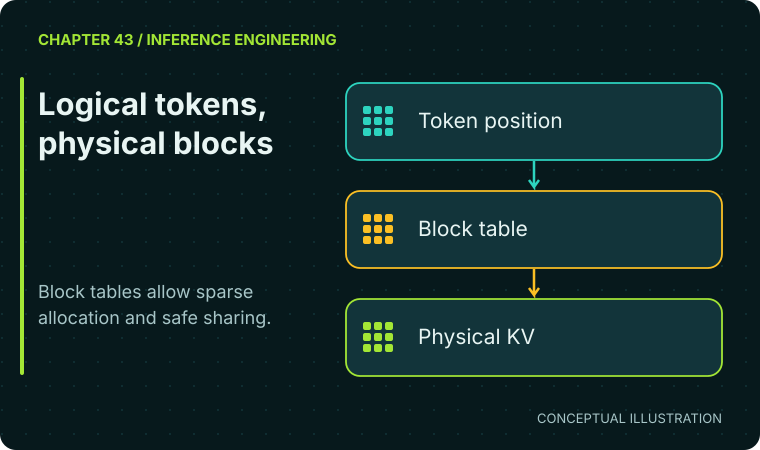
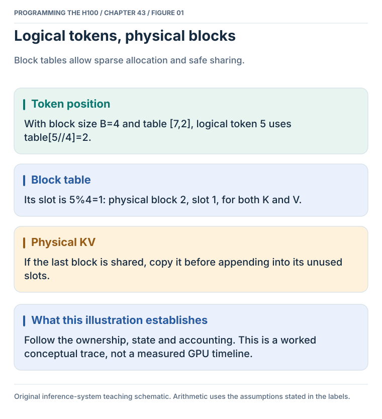

# Chapter 43 — A Paged KV Cache from Scratch

[](images/chapter-openers/43-inference.svg)


!!! warning "Evidence status"
    **Run on CPU (NumPy):** the block allocator, the paged cache with fork and copy-on-write, paged attention with an online softmax, 17 original self-tests including a randomised property test, plus boundary regressions, and four experiments (`ch43_paged_kv_cache.py`).
    **Not run on any GPU.** Nothing here measures speed. The memory results are exact counts; the length distribution (lognormal, median 300 tokens, clipped to 2048) is **assumed**, not taken from a real workload. The vLLM commands in 43.11 are **UNTESTED** and written from memory of the CLI: check every flag against `vllm serve --help` for your version.

This is the first chapter of Part XIV, where we build the core of an inference engine in the style of vLLM and SGLang, one piece at a time, with every piece tested on a CPU. The chapter numbers start at 43 because Chapters 41 and 42 are still reserved for Part XIII.

Chapter 32 gave the anatomy of an engine. Here we build its memory manager.

## Worked system map

[](images/worked/ch43-inference.svg)


The November 25 correction validates K/V shape and conversion **before** allocation or copy-on-write, and rejects negative/out-of-range block indices. See the [fresh execution record](validation-inference-2026-11-25.md).

## 43.1 The problem the KV cache creates

During generation each sequence keeps a key and a value vector per token, per layer, per KV head. For a model with `L` layers, `h_kv` KV heads, head dimension `d`, and `b` bytes per element:

`bytes per token = 2 × L × h_kv × d × b`

Hand arithmetic, BF16 (`b = 2`), using the published Llama-3 shapes (8 KV heads, head dimension 128; 32 layers for the 8B model, 80 for the 70B model):

| Model | Bytes per token | One 2048-token reservation |
|---|---|---|
| 8B | 2 × 32 × 8 × 128 × 2 = 131 072 B = 128 KiB | 256 MiB |
| 70B | 2 × 80 × 8 × 128 × 2 = 327 680 B = 320 KiB | 640 MiB |

(Check the layer and head counts against your model's `config.json`.) The script prints the same numbers.

The cache grows by one token per step, and nobody knows in advance how long a sequence will be. The naive design reserves one contiguous region of `max_len` tokens per sequence. That wastes everything between the real length and `max_len`, and it also fragments memory as sequences of different sizes come and go.

Paging, the idea behind vLLM's PagedAttention, borrows from virtual memory: cut the cache into fixed-size **blocks** of `B` tokens, give each sequence a **block table** that lists its blocks in order, and let the blocks live anywhere in the pool.

```
sequence s (len 10, B = 4)         physical pool (blocks)
  block table: [7, 2, 5]            0 [ ........ ]
   logical block 0 -> physical 7    1 [ ........ ]
   logical block 1 -> physical 2    2 [ tok 4-7  ]  <- full
   logical block 2 -> physical 5    3 [ ........ ]
                                    5 [ tok 8-9 . .]  <- 2 of 4 slots used
                                    7 [ tok 0-3  ]  <- full
```

Only the last block can be partly empty, so the waste per sequence is at most `B − 1` slots.

## 43.2 The allocator

`BlockAllocator` keeps a free list and a **reference count** per block. `alloc` pops a block and sets its count to 1; `incref` adds a sharer; `decref` removes one and returns the block to the free list at zero. Two defensive rules do real work:

- `decref` on a block with count 0 raises (a double free).
- `incref` on a free block raises (a use-after-free).

These two checks catch the most common memory-manager bugs at the moment they happen rather than as silent corruption later.

## 43.3 The cache: block tables, append, fork

`PagedKVCache` owns two pools, `K` and `V`, each shaped `(n_blocks, B, heads, dim)`, plus a table `sid → {table, len}`.

**Append** writes one token at slot `len % B` of the last block:

1. If `len % B == 0`, the last block is full (or the sequence is empty): allocate a new block.
2. Otherwise, if the last block is shared (refcount above 1), **copy it first** (copy-on-write): allocate a new block, copy the old contents, drop one reference to the old block, and point the table at the copy.
3. Write the token.

**Fork** gives a new sequence the parent's table and increments every block's refcount. It copies no data, so forking costs `O(blocks)` of bookkeeping and zero bytes of KV.

**Atomicity.** Both allocation points (new block, copy-on-write copy) happen *before* any state is changed, so an `OutOfBlocks` leaves the cache exactly as it was (tests 11 and 12). A scheduler can therefore catch the exception and preempt something without having to repair a half-finished append.

## 43.4 Paged attention

The attention for one decode query must read the sequence's whole cache. Gathering it into one contiguous array would copy the very bytes paging avoids moving. `paged_attention` instead walks the block table and keeps a running softmax (the same online trick as flash attention): for each block it updates a running maximum `m`, running denominator `l` and running weighted sum `acc`, rescaling the old values when the maximum grows.

```
for each block b in table:
    scores = q · K[b]ᵀ / √d
    m' = max(m, max(scores))
    rescale = exp(m − m')
    l   = l·rescale + Σ exp(scores − m')
    acc = acc·rescale + exp(scores − m') · V[b]
    m = m'
result = acc / l
```

Test 13 compares this against ordinary dense attention in float64 for `B ∈ {1, 2, 5, 16}` and lengths from 1 to 100: the largest difference is 4.4e-16. Test 14 checks that the answer does not depend on where the blocks sit in the pool, and test 15 that a fork attends identically to its parent.

A GPU kernel does the same walk with the block table in global memory; making it fast (coalesced loads, one block per thread block, split-K for long sequences) is a kernel problem outside this chapter.

## 43.5 Self-tests (17, all pass)

| # | What is checked |
|---|---|
| 1–3 | allocator: every block handed out once and recovered; double free and use-after-free raise; empty pool fails cleanly |
| 4 | append then gather returns exactly the appended data, for `B = 1, 3, 4, 16` |
| 5 | freeing a sequence returns all of its blocks |
| 6 | fork allocates nothing; tables are identical |
| 7 | child append copies the shared partial block; the parent's data is unchanged and exactly one block was added |
| 8 | the same, with the parent appending after the fork |
| 9 | fork exactly at a block boundary shares everything and the next append adds one fresh block, not a copy |
| 10 | once the parent is freed, the child's refcount is 1 and it appends in place |
| 11–12 | an append, and a copy-on-write append, that hit `OutOfBlocks` change nothing |
| 13–15 | paged attention equals dense attention, regardless of block placement and across forks |
| 16 | **property test:** 20 random sessions of 400 operations (add, append, fork, free, with a deliberately small pool so OOM occurs) against a plain-list reference model; after every operation the invariants hold and every sequence's K and V equal the reference |
| 17 | the contiguous first-fit allocator used in Experiment 4 reuses freed holes |

`check_invariants` verifies after each operation that every block's refcount equals the number of table entries pointing at it, that a block is on the free list exactly when its refcount is zero, that the free list has no duplicates, and that each table has `ceil(len / B)` entries. A leak or a double-free shows up as a failure of that check.

## 43.6 Experiment 1 — internal waste versus block size

200 000 sequence lengths (lognormal, median 300, clipped to [1, 2048], mean 433.1):

| B | measured waste per sequence (slots) | theory (B − 1)/2 | waste as % of live tokens | block-table entries per sequence |
|---|---|---|---|---|
| 1 | 0.00 | 0.00 | 0.00% | 433.1 |
| 4 | 1.47 | 1.50 | 0.34% | 108.7 |
| 8 | 3.44 | 3.50 | 0.79% | 54.6 |
| 16 | 7.37 | 7.50 | 1.70% | 27.5 |
| 32 | 15.23 | 15.50 | 3.52% | 14.0 |
| 64 | 30.92 | 31.50 | 7.14% | 7.3 |
| 128 | 62.00 | 63.50 | 14.31% | 3.9 |
| 256 | 126.33 | 127.50 | 29.17% | 2.2 |

The waste per sequence tracks `(B − 1)/2`, the average of a uniformly distributed last-block fill, to within about 3%. The gap comes from clipping at lengths 1 and 2048, which are not uniform modulo `B`. **The cost of a big block is internal waste; the cost of a small block is a long table to walk, and on a GPU, less contiguous reading per block.** The table-length column is only bookkeeping size: how it affects kernel speed is not measured here.

## 43.7 Experiment 2 — how many sequences fit

A pool of 65 536 token slots.

| scheme | sequences that fit | vs contiguous |
|---|---|---|
| contiguous, reserve 2048 tokens each | 32 | 1.0× |
| paged, B = 1 | 150.0 | 4.7× |
| paged, B = 16 | 147.5 | 4.6× |
| paged, B = 64 | 139.8 | 4.4× |
| paged, B = 256 | 116.3 | 3.6× |

(mean over 200 trials of filling the pool with fresh lengths). The 4.6× gain at `B = 16` is almost entirely **not reserving `max_len`**: with a mean length of 433 and a reservation of 2048, a contiguous scheme holds about 21% live data. The result depends on the assumed length distribution: if real sequences were close to `max_len` the gain would shrink toward 1×. Measure your own length distribution (Chapter 36's harness records lengths).

## 43.8 Experiment 3 — sharing a prompt with fork

A prompt of `P` tokens is prefilled once, forked into `n` children, the parent is freed, and each child generates `g` tokens. Blocks used, by simulation and by formula:

`blocks = ⌊P/B⌋ + n × ⌈((P mod B) + g) / B⌉`

(the full blocks of the prompt are shared; the partial prompt block is copied by every child but the last, which inherits it in place, so each child owns `⌈((P mod B) + g)/B⌉` blocks counting that one).

| B | P | n | g | blocks (fork) | formula | blocks (no sharing) | saving |
|---|---|---|---|---|---|---|---|
| 16 | 512 | 8 | 64 | 64 | 64 | 288 | 77.8% |
| 16 | 520 | 8 | 64 | 72 | 72 | 296 | 75.7% |
| 16 | 1000 | 16 | 128 | 206 | 206 | 1136 | 81.9% |
| 64 | 1000 | 16 | 128 | 63 | 63 | 288 | 78.1% |
| 16 | 100 | 4 | 400 | 110 | 110 | 128 | 14.1% |

The simulation matches the formula in every row (the script asserts it). Sharing helps when the shared prompt is long compared with what each child adds: 78–82% for long prompts, 14% when the children generate four times as many tokens as the prompt held. The no-sharing column is `n × ⌈(P + g)/B⌉`.

**Hand check, row 1:** `⌊512/16⌋ = 32` shared blocks, plus `8 × ⌈(0 + 64)/16⌉ = 32`: 64 blocks. Without sharing: `8 × ⌈576/16⌉ = 288`. Saving `1 − 64/288 = 77.8%` ✓.

This is the mechanism behind parallel sampling and beam search. Chapter 45 generalises it to prefixes shared across *different* requests.

## 43.9 Experiment 4 — external fragmentation

A contiguous allocator can refuse a request even though enough total space is free, because the free space is split into holes. Paging cannot, since any free block is usable. The stream: one arrival per step, a 50% chance that one random sequence departs, 20 000 steps, a pool of 65 536 slots, lengths with median 200. Both systems saturate.

| | refused | refused although total free space was enough | mean live tokens / pool (after warm-up) |
|---|---|---|---|
| contiguous (first-fit) | 9492 | **9492** | 0.893 |
| paged, B = 16 | 9557 | **0** | 0.950 |

**This is the best case for the contiguous scheme:** it allocates exactly the final length, which a real server does not know in advance (Experiment 2 is the realistic comparison). Even so, every one of its refusals happened with enough total free space, which is fragmentation by definition, and it holds 5.7 points less live data than the paged cache. The paged cache's refusals are genuine: it was full to within less than one request.

## 43.10 Failure modes and edge cases

| Situation | What happens | Handled by |
|---|---|---|
| Pool exhausted mid-append | `OutOfBlocks`, state unchanged | atomic append (tests 11–12); the scheduler must preempt |
| Free of an unknown or already-freed sequence | `KeyError` / double-free `ValueError` | allocator checks |
| Fork then both children append | each copies the last shared block once; the last owner writes in place | copy-on-write (tests 7, 8, 10) |
| Fork at a block boundary | no copy at all | test 9 |
| Prefix longer than the pool | prefill fails partway | scheduler must check `blocks_needed` before admitting (Chapter 44) |
| Block size 1 | zero internal waste, but tables as long as the sequences | Experiment 1 |
| Sequence length 0 | `gather` returns empty arrays; `paged_attention` rejects the empty visible-key set | explicit attention precondition |
| Writing into a shared block without copying | silently corrupts the other sequence | the refcount check in `append`; test 16 would catch it |

**Not modelled:** multiple layers and the per-layer pools (each layer has its own K and V, but they share the block table, so the table and the allocator are per sequence, not per layer); GPU memory-bandwidth effects; swapping blocks to CPU (Chapter 34 covers offloading); sliding-window or other attention variants that free old blocks; quantised KV cache.

## 43.11 On real hardware (UNTESTED)

These commands describe a separate block-size/capacity experiment; verify every flag against your installed version. The [Chapter 47 lab](47-vllm-tuning-lab.md) has a pinned, executed small-model setup, but does not measure this chapter’s block-size comparison.

1. Print the engine's own accounting: start the server and read the startup log for the number of GPU blocks and the KV cache size in tokens.

   `vllm serve MODEL --block-size 16 --gpu-memory-utilization 0.90 --max-model-len 4096`

2. Compare the logged capacity with your own arithmetic from 43.1: `free memory after weights × utilization ÷ (bytes per token × B)` blocks. A difference larger than a few percent means activations or other buffers are taking memory you did not count.
3. Repeat with `--block-size 8`, `16` and `32` (check which values your version accepts) and record the capacity and, with the Chapter 36 client, the throughput at a fixed rate. Experiment 1 predicts the capacity change; the throughput change is a kernel effect this chapter cannot predict.
4. Record the real distribution of `prompt + output` lengths from your traffic, and redo Experiment 2 with it.

<!-- BEGIN COMPLETE INFERENCE SOURCE -->
## Complete runnable code

The complete implementation is shown below, including its checks and entry point. The listing and downloadable `.py` file contain exactly the same source. Copy the file under the displayed filename; keep supporting files in the same directory.

[Download all inference examples and supporting modules](examples/inference-systems/inference-systems.zip) or read the [environment and command guide](examples/inference-systems/README.md).

The [follow-up agent audit](inference-adversarial-review-2026-11-25.md) records the corrections, fresh CPU captures and hardware limits for this source.

Read it in three passes: start with `BlockAllocator` and `PagedKVCache` to identify the state; trace `dense_attention` and `paged_attention` for one request or token; then follow `selftests` to see how the result is checked.

From the repository root:

```bash
python3 docs/examples/inference-systems/ch43_paged_kv_cache.py tests
# Run the full chapter demonstrations:
python3 docs/examples/inference-systems/ch43_paged_kv_cache.py
```

### ch43_paged_kv_cache.py

[Download ch43_paged_kv_cache.py](examples/inference-systems/ch43_paged_kv_cache.py)

```python title="ch43_paged_kv_cache.py" linenums="1"
#!/usr/bin/env python3
"""Chapter 43 - A paged KV cache from scratch (CPU, NumPy only).

Run:  python3 ch43_paged_kv_cache.py          # self-tests + experiments
      python3 ch43_paged_kv_cache.py tests    # self-tests only
"""
import math
import sys
import time
from collections import deque

import numpy as np


class OutOfBlocks(Exception):
    pass


# --------------------------------------------------------------------------
# Block allocator with reference counts
# --------------------------------------------------------------------------
class BlockAllocator:
    def __init__(self, n_blocks):
        if n_blocks < 0:
            raise ValueError("n_blocks must be nonnegative")
        self.n = n_blocks
        self.free = deque(range(n_blocks))
        self.ref = [0] * n_blocks

    def num_free(self):
        return len(self.free)

    def alloc(self):
        if not self.free:
            raise OutOfBlocks("no free blocks")
        b = self.free.popleft()
        assert self.ref[b] == 0
        self.ref[b] = 1
        return b

    def incref(self, b):
        if not 0 <= b < self.n:
            raise ValueError("block index outside pool")
        if self.ref[b] <= 0:
            raise ValueError(f"incref on free block {b}")
        self.ref[b] += 1

    def decref(self, b):
        if not 0 <= b < self.n:
            raise ValueError("block index outside pool")
        if self.ref[b] <= 0:
            raise ValueError(f"double free of block {b}")
        self.ref[b] -= 1
        if self.ref[b] == 0:
            self.free.append(b)


# --------------------------------------------------------------------------
# Paged KV cache: one K and one V pool, per-sequence block tables
# --------------------------------------------------------------------------
class PagedKVCache:
    def __init__(self, n_blocks, block_size, heads, dim, dtype=np.float32):
        if min(block_size, heads, dim) <= 0:
            raise ValueError("block size, heads and dimension must be positive")
        self.B, self.H, self.D = block_size, heads, dim
        self.alloc = BlockAllocator(n_blocks)
        self.K = np.zeros((n_blocks, block_size, heads, dim), dtype)
        self.V = np.zeros((n_blocks, block_size, heads, dim), dtype)
        self.seqs = {}  # sid -> {"table": [block ids], "len": int}

    # ---- sequence lifecycle ----
    def add_seq(self, sid):
        if sid in self.seqs:
            raise ValueError(f"sequence {sid} exists")
        self.seqs[sid] = {"table": [], "len": 0}

    def free_seq(self, sid):
        for b in self.seqs.pop(sid)["table"]:
            self.alloc.decref(b)

    def fork(self, parent, child):
        """Share every block of `parent` with a new sequence (no copying)."""
        if child in self.seqs:
            raise ValueError(f"sequence {child} exists")
        p = self.seqs[parent]
        for b in p["table"]:
            self.alloc.incref(b)
        self.seqs[child] = {"table": list(p["table"]), "len": p["len"]}

    # ---- appending ----
    def blocks_needed_to_append(self, sid):
        """Fresh blocks the next append will allocate: 0 or 1."""
        s = self.seqs[sid]
        if s["len"] % self.B == 0:
            return 1  # need a new block
        last = s["table"][-1]
        return 1 if self.alloc.ref[last] > 1 else 0  # copy-on-write

    def append(self, sid, k, v):
        """Append one token's K/V (shape (H, D)). Atomic: on OutOfBlocks nothing changes."""
        s = self.seqs[sid]
        # Validate/cast before allocating or copying: failed input must not leak blocks.
        k, v = np.asarray(k, dtype=self.K.dtype), np.asarray(v, dtype=self.V.dtype)
        if k.shape != (self.H, self.D) or v.shape != (self.H, self.D):
            raise ValueError("K and V must each have shape (heads, dim)")
        pos = s["len"] % self.B
        if pos == 0:
            b = self.alloc.alloc()  # may raise before any mutation
            s["table"].append(b)
        else:
            last = s["table"][-1]
            if self.alloc.ref[last] > 1:  # shared: copy-on-write
                nb = self.alloc.alloc()  # may raise before any mutation
                self.K[nb] = self.K[last]
                self.V[nb] = self.V[last]
                self.alloc.decref(last)
                s["table"][-1] = nb
            b = s["table"][-1]
        self.K[b, pos] = k
        self.V[b, pos] = v
        s["len"] += 1

    def gather(self, sid):
        """Dense (len, H, D) copies of K and V (reference/debug path)."""
        s = self.seqs[sid]
        if not s["table"]:
            e = np.zeros((0, self.H, self.D), self.K.dtype)
            return e, e.copy()
        K = self.K[s["table"]].reshape(-1, self.H, self.D)[: s["len"]]
        V = self.V[s["table"]].reshape(-1, self.H, self.D)[: s["len"]]
        return K, V

    # ---- accounting ----
    def used_blocks(self):
        return self.alloc.n - self.alloc.num_free()

    def check_invariants(self):
        counts = [0] * self.alloc.n
        for s in self.seqs.values():
            assert len(s["table"]) == math.ceil(s["len"] / self.B)
            for b in s["table"]:
                counts[b] += 1
        assert counts == self.alloc.ref, "refcounts disagree with block tables"
        free = set(self.alloc.free)
        assert len(free) == len(self.alloc.free), "duplicate in free list"
        for b in range(self.alloc.n):
            assert (b in free) == (self.alloc.ref[b] == 0)


# --------------------------------------------------------------------------
# Attention: dense reference, and paged (block-by-block, online softmax)
# --------------------------------------------------------------------------
def dense_attention(q, K, V):
    """q (H,D); K,V (T,H,D) -> (H,D). float64 reference."""
    q, K, V = q.astype(np.float64), K.astype(np.float64), V.astype(np.float64)
    s = np.einsum("hd,thd->ht", q, K) / math.sqrt(q.shape[-1])
    s -= s.max(axis=1, keepdims=True)
    p = np.exp(s)
    p /= p.sum(axis=1, keepdims=True)
    return np.einsum("ht,thd->hd", p, V)


def paged_attention(q, cache, sid):
    """Walk the block table; never materialises a contiguous K/V (online softmax)."""
    s = cache.seqs[sid]
    if s["len"] == 0:
        raise ValueError("attention requires at least one visible key")
    q = q.astype(np.float64)
    H, D = q.shape
    m = np.full(H, -np.inf)
    l = np.zeros(H)
    acc = np.zeros((H, D))
    remaining = s["len"]
    for b in s["table"]:
        n = min(cache.B, remaining)
        remaining -= n
        Kb = cache.K[b, :n].astype(np.float64)
        Vb = cache.V[b, :n].astype(np.float64)
        sc = np.einsum("hd,thd->ht", q, Kb) / math.sqrt(D)
        m_new = np.maximum(m, sc.max(axis=1))
        scale = np.exp(m - m_new)
        p = np.exp(sc - m_new[:, None])
        l = l * scale + p.sum(axis=1)
        acc = acc * scale[:, None] + np.einsum("ht,thd->hd", p, Vb)
        m = m_new
    return acc / l[:, None]


# --------------------------------------------------------------------------
# A contiguous (first-fit) allocator, for the external-fragmentation contrast
# --------------------------------------------------------------------------
class ContiguousAllocator:
    def __init__(self, total_slots):
        self.total = total_slots
        self.regions = []  # sorted list of (start, size, sid)

    def free_slots(self):
        return self.total - sum(r[1] for r in self.regions)

    def alloc(self, sid, size):
        pos = 0
        for i, (st, sz, _) in enumerate(self.regions):
            if st - pos >= size:
                self.regions.insert(i, (pos, size, sid))
                return True
            pos = st + sz
        if self.total - pos >= size:
            self.regions.append((pos, size, sid))
            return True
        return False

    def free(self, sid):
        self.regions = [r for r in self.regions if r[2] != sid]


# --------------------------------------------------------------------------
# Self-tests
# --------------------------------------------------------------------------
def rand_kv(rng, H, D):
    return rng.standard_normal((H, D)).astype(np.float32), rng.standard_normal((H, D)).astype(np.float32)


def selftests():
    t0 = time.time()
    n_ok = 0

    def ok(name):
        nonlocal n_ok
        n_ok += 1
        print(f"  PASS {n_ok:2d}  {name}")

    rng = np.random.default_rng(0)
    H, D = 2, 8

    # 1 allocator: alloc/free round trip
    a = BlockAllocator(4)
    bs = [a.alloc() for _ in range(4)]
    assert a.num_free() == 0 and sorted(bs) == [0, 1, 2, 3]
    for b in bs:
        a.decref(b)
    assert a.num_free() == 4
    ok("allocator hands out each block once and takes all back")

    # 2 double free and incref-on-free are rejected
    a = BlockAllocator(2)
    b = a.alloc()
    a.decref(b)
    for bad in (lambda: a.decref(b), lambda: a.incref(b)):
        try:
            bad()
            raise AssertionError("not rejected")
        except ValueError:
            pass
    ok("double free and incref of a free block raise")

    # 3 OOM raises and does not corrupt
    a = BlockAllocator(1)
    a.alloc()
    try:
        a.alloc()
        raise AssertionError
    except OutOfBlocks:
        pass
    assert a.num_free() == 0
    ok("allocation fails cleanly when empty")

    # 4 append / gather round trip across block boundaries
    for B in (1, 3, 4, 16):
        c = PagedKVCache(64, B, H, D)
        c.add_seq("s")
        ks, vs = [], []
        for _ in range(23):
            k, v = rand_kv(rng, H, D)
            c.append("s", k, v)
            ks.append(k)
            vs.append(v)
        K, V = c.gather("s")
        assert np.array_equal(K, np.stack(ks)) and np.array_equal(V, np.stack(vs))
        assert len(c.seqs["s"]["table"]) == math.ceil(23 / B)
        c.check_invariants()
    ok("gather returns exactly what was appended (B = 1, 3, 4, 16)")

    # 5 free returns all blocks
    c = PagedKVCache(16, 4, H, D)
    c.add_seq("s")
    for _ in range(10):
        c.append("s", *rand_kv(rng, H, D))
    assert c.used_blocks() == 3
    c.free_seq("s")
    assert c.used_blocks() == 0
    c.check_invariants()
    ok("freeing a sequence returns every block")

    # 6 fork shares blocks without copying
    c = PagedKVCache(16, 4, H, D)
    c.add_seq("p")
    for _ in range(10):
        c.append("p", *rand_kv(rng, H, D))
    used = c.used_blocks()
    c.fork("p", "c")
    assert c.used_blocks() == used
    assert c.seqs["p"]["table"] == c.seqs["c"]["table"]
    c.check_invariants()
    ok("fork allocates nothing; both tables point at the same blocks")

    # 7 copy-on-write: child append does not change the parent
    Kp, Vp = c.gather("p")
    c.append("c", *rand_kv(rng, H, D))  # len 10 -> partial last block is shared -> CoW
    Kp2, Vp2 = c.gather("p")
    assert np.array_equal(Kp, Kp2) and np.array_equal(Vp, Vp2)
    assert c.seqs["p"]["table"][-1] != c.seqs["c"]["table"][-1]
    assert c.seqs["p"]["table"][:-1] == c.seqs["c"]["table"][:-1]
    assert c.used_blocks() == used + 1
    c.check_invariants()
    ok("child append copies the shared partial block; parent unchanged")

    # 8 parent append after fork also copies (symmetry)
    c = PagedKVCache(16, 4, H, D)
    c.add_seq("p")
    for _ in range(6):
        c.append("p", *rand_kv(rng, H, D))
    c.fork("p", "c")
    Kc, _ = c.gather("c")
    c.append("p", *rand_kv(rng, H, D))
    Kc2, _ = c.gather("c")
    assert np.array_equal(Kc, Kc2)
    c.check_invariants()
    ok("parent append after fork leaves the child unchanged")

    # 9 fork at a block boundary needs no copy
    c = PagedKVCache(16, 4, H, D)
    c.add_seq("p")
    for _ in range(8):
        c.append("p", *rand_kv(rng, H, D))
    c.fork("p", "c")
    assert c.blocks_needed_to_append("c") == 1  # fresh block, not a copy
    before = c.used_blocks()
    c.append("c", *rand_kv(rng, H, D))
    assert c.used_blocks() == before + 1
    assert c.seqs["p"]["table"] == c.seqs["c"]["table"][:-1]
    ok("fork at a block boundary shares all blocks; append adds one fresh block")

    # 10 last owner writes in place (no copy once the refcount is 1)
    c = PagedKVCache(16, 4, H, D)
    c.add_seq("p")
    for _ in range(6):
        c.append("p", *rand_kv(rng, H, D))
    c.fork("p", "c")
    c.free_seq("p")
    before = c.used_blocks()
    assert c.blocks_needed_to_append("c") == 0
    c.append("c", *rand_kv(rng, H, D))
    assert c.used_blocks() == before
    c.check_invariants()
    ok("after the parent is freed the child appends in place")

    # 11 OOM during append leaves state untouched (atomic)
    c = PagedKVCache(2, 4, H, D)
    c.add_seq("s")
    for _ in range(8):
        c.append("s", *rand_kv(rng, H, D))
    snap = (list(c.seqs["s"]["table"]), c.seqs["s"]["len"], list(c.alloc.ref))
    try:
        c.append("s", *rand_kv(rng, H, D))
        raise AssertionError
    except OutOfBlocks:
        pass
    assert snap == (c.seqs["s"]["table"], c.seqs["s"]["len"], c.alloc.ref)
    c.check_invariants()
    ok("append that hits OutOfBlocks changes nothing")

    # 12 OOM during copy-on-write is also atomic
    c = PagedKVCache(2, 4, H, D)
    c.add_seq("p")
    for _ in range(6):
        c.append("p", *rand_kv(rng, H, D))  # 2 blocks, pool full
    c.fork("p", "c")
    snap = (list(c.seqs["c"]["table"]), c.seqs["c"]["len"], list(c.alloc.ref))
    try:
        c.append("c", *rand_kv(rng, H, D))
        raise AssertionError
    except OutOfBlocks:
        pass
    assert snap == (c.seqs["c"]["table"], c.seqs["c"]["len"], c.alloc.ref)
    c.check_invariants()
    ok("copy-on-write that hits OutOfBlocks changes nothing")

    # 13 paged attention == dense attention (float64 reference)
    worst = 0.0
    for B in (1, 2, 5, 16):
        for T in (1, 2, 7, 33, 100):
            c = PagedKVCache(256, B, H, D)
            c.add_seq("s")
            for _ in range(T):
                c.append("s", *rand_kv(rng, H, D))
            q = rng.standard_normal((H, D)).astype(np.float32)
            K, V = c.gather("s")
            worst = max(worst, float(np.abs(paged_attention(q, c, "s") - dense_attention(q, K, V)).max()))
    assert worst < 1e-9, worst
    ok(f"paged attention matches dense attention (max abs diff {worst:.1e})")

    # 14 attention is independent of physical block placement
    c = PagedKVCache(64, 4, H, D)
    c.add_seq("a")
    c.add_seq("b")
    toks = [rand_kv(rng, H, D) for _ in range(30)]
    for k, v in toks:  # interleave so a's blocks are scattered
        c.append("a", k, v)
        c.append("b", *rand_kv(rng, H, D))
    q = rng.standard_normal((H, D)).astype(np.float32)
    K, V = c.gather("a")
    assert not all(x + 1 == y for x, y in zip(c.seqs["a"]["table"], c.seqs["a"]["table"][1:]))
    assert np.abs(paged_attention(q, c, "a") - dense_attention(q, K, V)).max() < 1e-9
    ok("attention is correct when a sequence's blocks are not contiguous")

    # 15 forked sequences attend identically until they diverge
    c = PagedKVCache(64, 4, H, D)
    c.add_seq("p")
    for _ in range(11):
        c.append("p", *rand_kv(rng, H, D))
    c.fork("p", "c")
    q = rng.standard_normal((H, D)).astype(np.float32)
    assert np.array_equal(paged_attention(q, c, "p"), paged_attention(q, c, "c"))
    ok("fork attends identically to its parent before any divergence")

    # 16 property test: random ops against a plain-list reference model
    for seed in range(20):
        r = np.random.default_rng(seed)
        B = int(r.choice([1, 2, 4, 8]))
        c = PagedKVCache(48, B, 1, 2)
        ref = {}
        nid = 0
        for _ in range(400):
            op = r.choice(["add", "append", "append", "append", "fork", "free"])
            ids = list(ref)
            if op == "add" and len(ids) < 8:
                c.add_seq(nid)
                ref[nid] = []
                nid += 1
            elif op == "append" and ids:
                sid = ids[int(r.integers(len(ids)))]
                k, v = rand_kv(r, 1, 2)
                try:
                    c.append(sid, k, v)
                    ref[sid].append((k, v))
                except OutOfBlocks:
                    pass
            elif op == "fork" and ids and len(ids) < 8:
                sid = ids[int(r.integers(len(ids)))]
                c.fork(sid, nid)
                ref[nid] = list(ref[sid])
                nid += 1
            elif op == "free" and ids:
                sid = ids[int(r.integers(len(ids)))]
                c.free_seq(sid)
                del ref[sid]
            c.check_invariants()
            for sid, toks_ in ref.items():
                K, V = c.gather(sid)
                assert K.shape[0] == len(toks_)
                if toks_:
                    assert np.array_equal(K, np.stack([t[0] for t in toks_]))
                    assert np.array_equal(V, np.stack([t[1] for t in toks_]))
        for sid in list(ref):
            c.free_seq(sid)
        assert c.used_blocks() == 0
    ok("20 random sessions (add/append/fork/free, with OOM) match a reference and never leak")

    # 17 contiguous allocator sanity
    ca = ContiguousAllocator(10)
    assert ca.alloc("a", 4) and ca.alloc("b", 4) and not ca.alloc("c", 4)
    ca.free("a")
    assert ca.alloc("c", 4) and ca.free_slots() == 2
    ok("first-fit contiguous allocator reuses freed holes")

    print(f"ALL PASS   ({time.time() - t0:.0f} s)  [{n_ok} tests]")


# --------------------------------------------------------------------------
# Experiments
# --------------------------------------------------------------------------
def sample_lengths(rng, n, max_len=2048, median=300, sigma=0.9):
    x = np.exp(rng.normal(math.log(median), sigma, n))
    return np.clip(np.rint(x), 1, max_len).astype(int)


def experiments():
    rng = np.random.default_rng(1)
    MAXLEN = 2048
    SLOTS = 65536  # KV budget in token slots

    print("\n=== Experiment 1: internal waste versus block size ===")
    lens = sample_lengths(rng, 200000, MAXLEN)
    print(f"lengths: lognormal median 300, clipped to [1, {MAXLEN}]; mean {lens.mean():.1f}")
    print(f"{'B':>4} {'waste/seq (slots)':>18} {'theory (B-1)/2':>15} {'waste % of live':>16} {'table entries/seq':>18}")
    for B in (1, 4, 8, 16, 32, 64, 128, 256):
        alloc = np.ceil(lens / B) * B
        w = (alloc - lens).mean()
        print(f"{B:4d} {w:18.2f} {(B - 1) / 2:15.2f} {100 * w / lens.mean():15.2f}% {np.ceil(lens / B).mean():18.1f}")

    print(f"\n=== Experiment 2: how many sequences fit in {SLOTS} token slots ===")
    print(f"contiguous, reserve max_len={MAXLEN} per sequence: {SLOTS // MAXLEN} sequences")
    for B in (1, 16, 64, 256):
        r = np.random.default_rng(2)
        counts = []
        for _ in range(200):
            used, n = 0, 0
            while True:
                L = int(sample_lengths(r, 1, MAXLEN)[0])
                need = math.ceil(L / B) * B
                if used + need > SLOTS:
                    break
                used += need
                n += 1
            counts.append(n)
        print(f"paged B={B:3d}: {np.mean(counts):7.1f} sequences  ({np.mean(counts) / (SLOTS // MAXLEN):5.1f}x)")

    print("\n=== Experiment 3: prefix sharing by fork (prompt P, n children, g new tokens each) ===")
    print(f"{'B':>3} {'P':>5} {'n':>3} {'g':>4} {'blocks (fork)':>14} {'formula':>8} {'blocks (copy)':>14} {'saving':>7}")
    H, D = 1, 2
    for B, P, n, g in [(16, 512, 8, 64), (16, 520, 8, 64), (16, 1000, 16, 128), (64, 1000, 16, 128), (16, 100, 4, 400)]:
        c = PagedKVCache(4096, B, H, D)
        c.add_seq("p")
        for _ in range(P):
            c.append("p", np.zeros((H, D), np.float32), np.zeros((H, D), np.float32))
        for i in range(n):
            c.fork("p", i)
        c.free_seq("p")
        for _ in range(g):
            for i in range(n):
                c.append(i, np.ones((H, D), np.float32), np.ones((H, D), np.float32))
        got = c.used_blocks()
        formula = P // B + n * math.ceil((P % B + g) / B)
        copy = n * math.ceil((P + g) / B)
        assert got == formula, (got, formula)
        c.check_invariants()
        print(f"{B:3d} {P:5d} {n:3d} {g:4d} {got:14d} {formula:8d} {copy:14d} {100 * (1 - got / copy):6.1f}%")

    print("\n=== Experiment 4: external fragmentation, contiguous versus paged (saturated) ===")
    # Arrivals (1 per step) outpace departures (0.5 per step), so both systems fill up.
    # We compare how much of the pool holds live tokens, and how many refusals happened
    # although the TOTAL free space was big enough ("refused despite space").
    B = 16
    r = np.random.default_rng(3)
    ca = ContiguousAllocator(SLOTS)
    paged_free = SLOTS // B
    live_c, live_p = {}, {}
    ref_c = ref_p = despite_c = despite_p = 0
    util_c, util_p = [], []
    steps = 20000
    for step in range(steps):
        if live_c and r.random() < 0.5:
            sid = list(live_c)[int(r.integers(len(live_c)))]
            ca.free(sid)
            del live_c[sid]
        if live_p and r.random() < 0.5:
            sid = list(live_p)[int(r.integers(len(live_p)))]
            paged_free += live_p.pop(sid)[0]
        L = int(sample_lengths(r, 1, MAXLEN, median=200)[0])
        if not ca.alloc(step, L):
            ref_c += 1
            despite_c += ca.free_slots() >= L
        else:
            live_c[step] = L
        need = math.ceil(L / B)
        if need > paged_free:
            ref_p += 1
            despite_p += paged_free * B >= L
        else:
            paged_free -= need
            live_p[step] = (need, L)
        if step >= steps // 4:
            util_c.append(sum(live_c.values()) / SLOTS)
            util_p.append(sum(v[1] for v in live_p.values()) / SLOTS)
    print(f"{'':>11} {'refused':>8} {'refused despite enough total free':>34} {'mean live tokens / pool':>24}")
    print(f"{'contiguous':>11} {ref_c:8d} {despite_c:34d} {np.mean(util_c):24.3f}")
    print(f"{'paged B=16':>11} {ref_p:8d} {despite_p:34d} {np.mean(util_p):24.3f}")

    print("\n=== KV bytes per token (hand arithmetic) ===")
    for name, layers, kvh, hd in [("Llama-3-8B (32 layers, 8 KV heads, 128)", 32, 8, 128),
                                  ("Llama-3-70B (80 layers, 8 KV heads, 128)", 80, 8, 128)]:
        per_tok = 2 * layers * kvh * hd * 2
        print(f"{name}: {per_tok} B/token = {per_tok / 1024:.0f} KiB; "
              f"{MAXLEN}-token reservation = {per_tok * MAXLEN / 2**20:.0f} MiB")


if __name__ == "__main__":
    if len(sys.argv) > 1 and sys.argv[1] == "tests":
        selftests()
    else:
        selftests()
        experiments()
```

<!-- END COMPLETE INFERENCE SOURCE -->

## 43.12 Exercises

1. A 70B BF16 model on 8 H100s leaves 40 GiB per GPU for KV cache after weights and activations, with the 8 KV heads sharded one per GPU (tensor parallel 8). How many tokens fit in total, and how many 2048-token contiguous reservations?
2. Why is the waste per sequence about `(B − 1)/2` and not `B − 1`? When would it be larger?
3. Show that a fork at a block boundary followed by one append in each child uses two new blocks, while a fork in the middle of a block uses two as well, but for a different reason.
4. Extend `PagedKVCache` with `truncate(sid, n)` for speculative decoding rollback. What must happen to blocks that become empty, and to a block that is shared?
5. A scheduler admits a request only if the pool has `⌈prompt/B⌉` free blocks. Give a case where it then fails mid-generation, and say what it should do.
6. Experiment 4 gives the contiguous allocator the true final length. Predict, without running it, what happens to its refusals and utilisation if it must reserve `max_len = 2048` instead.

### Solutions

1. Per token across the group: 327 680 B in total, 40 960 B per GPU (one KV head per GPU: 2 × 80 × 1 × 128 × 2 = 40 960). 40 GiB = 42 949 672 960 B ÷ 40 960 B = 1 048 576 tokens (that is, 2²⁰). Contiguous 2048-token reservations: 1 048 576 ÷ 2048 = 512 sequences. Paged, with the Experiment 1 length distribution (mean 433.1) and `B = 16` (average waste 7.4 slots): about `1 048 576 / (433.1 + 7.4)` ≈ 2380 sequences, which is 4.6× as in Experiment 2.
2. The last block's fill is roughly uniform over 1..B, so the unused part is uniform over 0..B−1, with mean `(B − 1)/2`. It is larger if lengths are concentrated: if every sequence is exactly one token past a block boundary the waste per sequence is `B − 1`. Experiment 1's small shortfall (7.37 vs 7.50) comes from clipping.
3. Keep the parent alive. At a boundary, each child's first append finds no partial block and allocates a fresh one: two new blocks. Mid-block, the last block has three owners (parent and two children), so each child copies it: again two new blocks, and the parent keeps the original. The counts agree, the reasons differ. If the parent were freed first, the mid-block case would need only one new block, because the second child would be the last owner and write in place.
4. `truncate` sets `len = n`, then drops the references to table entries beyond `⌈n/B⌉` (a `decref` frees those whose count reaches zero). The new last block, if shared, is left shared: the next append will copy it (copy-on-write), so no extra step is needed. Stale data in the freed tail of the last block is harmless because `len` hides it, but it must never be read by attention, which uses `len` already.
5. Admission checked prompt blocks only; each running sequence also grows by one block every `B` steps. Ten sequences each admitted with their exact prompt blocks may exhaust the pool when several cross a block boundary together. The scheduler should reserve headroom for growth or be ready to preempt: free a victim's blocks and recompute or swap it later (Chapter 44).
6. Reserving 2048 each lets the pool hold 32 sequences, so once 32 are live nearly every arrival is refused. Utilisation would be about 32 × 300 / 65 536 ≈ 0.15 (mean length is about 300 for median 200, sigma 0.9). Fragmentation becomes rare because all regions have the same size, but the pool is mostly reserved-and-empty instead. This is a prediction, not a measured result: run it to check.

## 43.13 Summary

- A paged KV cache removes two costs of contiguous reservation: waste from reserving `max_len` (4.6× more sequences fit in this model workload) and external fragmentation (zero refusals caused by scattered free space when paged; genuine capacity refusals remain).
- The internal waste is bounded by one block per sequence and averages `(B − 1)/2`; choosing `B` is a trade between that waste and table length/kernel efficiency.
- Reference counts plus copy-on-write let fork share KV without copying it; the table/refcount work is still proportional to the number of shared blocks, and the last owner writes in place.
- Making allocation atomic lets a scheduler treat "out of memory" as a recoverable event, which the next chapter builds on.
- Everything here is CPU and counts. Whether a given block size is fast depends on the kernel and hardware, and has to be measured.

## Files and sources

- Code: `docs/examples/inference-systems/ch43_paged_kv_cache.py`
- The idea comes from the vLLM paper, "Efficient Memory Management for Large Language Model Serving with PagedAttention" (Kwon et al., SOSP 2023). This chapter implements its own version of the idea and makes no claim about vLLM's internals.
