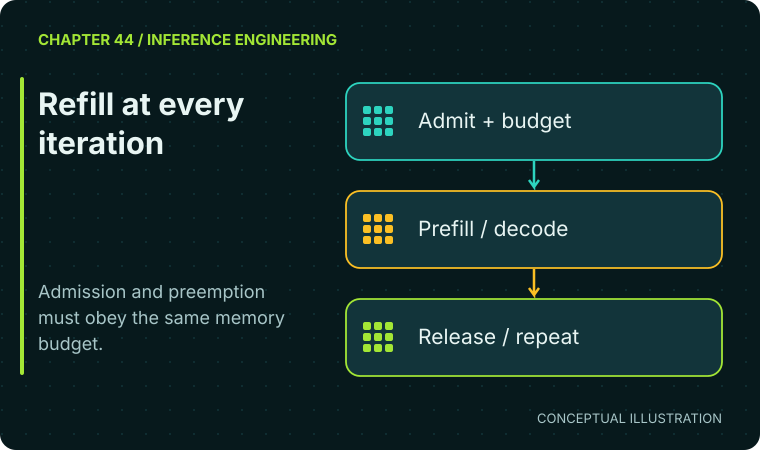

# Chapter 44 — A Continuous-Batching Scheduler with Preemption

[](images/chapter-openers/44-inference.svg)


!!! warning "Evidence status"
    **Run on CPU, in a simulator:** a continuous-batching scheduler with paged-block accounting, preemption by recomputation, a memory watermark and chunked prefill; a static-batching baseline; 14 self-tests; five experiments (`ch44_continuous_batching.py`). Experiment cells show the mean and, in brackets, the minimum–maximum over 3 seeds of 600 requests.
    **Nothing here is measured on a GPU.** The cost of one engine iteration (15 ms fixed + 0.05 ms per prefill token + 0.2 ms per decoding sequence) and the workload (prompts with median 256 tokens, outputs with median 128, Poisson arrivals) are **assumed**. The shapes of the curves are the result; the absolute numbers are not predictions for any real model. The vLLM commands in 44.10 are **UNTESTED** and from memory.
    **Choices that favour the baseline (static batching):** it ignores memory limits, and it streams each request's tokens as they are produced instead of returning them when the whole batch ends.

Chapter 43 built the memory manager. This chapter builds the part that decides *what runs in each step*: the scheduler. It is where an engine's throughput, tail latency and behaviour under memory pressure come from.

## Worked system map

[](images/worked/ch44-inference.svg)


## 44.1 Why batching must be per iteration

One decode step for one sequence reads all the model weights to produce one token, so the cost is dominated by the weight read, not by arithmetic. Running 64 sequences in the same step reads the weights once and so produces 64 tokens for little more than the cost of one. Batching is how a GPU gets its throughput.

**Static batching** forms a batch, runs it until *every* member has finished, then forms the next one. Output lengths vary widely, so a finished sequence's slot sits idle (and is still computed, as padding) until the longest member ends, and new requests wait for the whole batch.

```
static batching, N = 4, time →
 req A  |prefill|dddddd.................|   finished early, slot wasted
 req B  |prefill|dddddddddddddddd.......|
 req C  |prefill|dddd...................|
 req D  |prefill|dddddddddddddddddddddd.|   longest decides batch length
                                         ^ only now can E, F, G, H start

continuous batching: the batch is re-formed every iteration
 req A  |prefill|dddddd|
 req B  |prefill|dddddddddddddddd|
 req C  |prefill|dddd|
 req D  |prefill|dddddddddddddddddddddd|
 req E            |prefill|dddddddd|        joins as soon as C's slot frees
 req F                      |prefill|ddd|
```

This is *iteration-level scheduling*, introduced by the Orca system and adopted by vLLM and SGLang; the memory side (paged blocks, Chapter 43) is what makes it practical, because sequences can then join and leave without moving anyone's KV cache.

Requests require positive integer prompt/output lengths and finite, nonnegative arrival times. Block size, pool size, sequence cap and any explicit token budget must be positive integers; a zero token budget is rejected rather than silently treated as unlimited. These boundary checks prevent invalid workloads from entering a non-progressing scheduling loop.

## 44.2 The model

**Time.** One engine iteration costs `t0 + cp × (prefill tokens) + cd × (decoding sequences)` with `t0 = 15 ms`, `cp = 0.05 ms`, `cd = 0.2 ms` (assumed). One iteration does all of:

1. every running sequence that has finished its prefill decodes one token;
2. prompts (or chunks of prompts) are prefilled;
3. the iteration that finishes a prompt's prefill also emits that request's next token (the first token for a new request).

**Memory.** `n_blocks` blocks of `B = 16` tokens (default 2048 blocks = 32 768 token slots). A request is **admitted** only when the blocks for its whole current prompt are free (above a watermark), and they are allocated at once. A decoding sequence needs one more block each time its KV length reaches a block boundary.

**Policy (the same as vLLM's default behaviour in spirit; not a claim about its code):**

- **Strict FCFS admission.** The head of the waiting queue blocks everyone behind it if it does not fit.
- **Slot cap** `max_num_seqs` on running sequences.
- **Watermark.** Admission leaves a fraction of the pool free, as headroom for decode growth.
- **Preemption by recompute.** If a decoding sequence needs a block and none is free, the *youngest* running sequence is evicted: its blocks are freed and it goes back to the *front* of the waiting queue. When readmitted, it re-prefills its prompt **plus the tokens it had already generated**, then continues. Its first-token time is not reset, since the user already saw that token.
- **No admissions in an iteration that preempted.** Otherwise a new request would take the blocks just freed and the evicted one would loop.
- **Rejection.** A request whose prompt plus output could never fit in the pool is rejected on arrival; without that rule it would block the head of the queue forever.
- **Chunked prefill.** A per-iteration token budget `max_batched_tokens`, shared between decode tokens (one each) and prefill tokens. A long prompt is spread over several iterations.

The scheduler does not know output lengths in advance. The simulator knows them only to decide when a sequence ends.

## 44.3 The scheduling loop

```
loop while any request is unfinished:
    advance clock to the next arrival if nothing is running or waiting
    enqueue arrivals; reject any that can never fit
    # 1. decode set
    for seq in running (oldest first):
        if seq.kv_len % B == 0:                # needs a new block
            while no free block:
                victim = running[-1]           # youngest
                preempt(victim)                # free blocks, requeue at front
                if victim is seq: break
            if seq was preempted: continue
            take a block
        add seq to decode set
    # 2. prefill
    budget = max_batched_tokens - len(decode set)
    continue partially prefilled running sequences, then
    admit from waiting while: slots free, budget left, blocks(head) <= free - watermark
    # 3. execute
    dt = t0 + cp*prefill_tokens + cd*len(decode set)
    advance the clock; emit tokens; free finished sequences
```

Because victims are taken from the back and sequences are visited oldest first, a victim has never already been scheduled in the same iteration.

## 44.4 Self-tests (14, all pass)

| # | What is checked |
|---|---|
| 1 | one request's first-token and finish times match the closed form |
| 2 | a one-token output finishes with its prefill iteration; the clock jumps over idle time |
| 3 | continuous with one slot reproduces static batch-size-1 *exactly*, for 60 requests |
| 4 | 24 runs (12 seeds × a roomy and a tiny pool): every admitted request emits exactly `out` tokens, arrival ≤ first token ≤ finish, and after **every iteration** the block count equals the sum over running sequences and no sequence holds the wrong number of blocks (832 preemptions exercised) |
| 5 | heavy memory pressure terminates and returns every block |
| 6 | a request bigger than the whole pool is rejected; the request behind it proceeds |
| 7 | with no preemption, total prefill work equals the sum of prompt lengths |
| 8 | with preemption, prefill work exceeds that sum |
| 9 | chunked prefill keeps every iteration's duration within the budget's bound |
| 10 | strict FCFS: first-token times are non-decreasing in arrival order when nothing is preempted |
| 11 | same seed, same result |
| 12 | static batch: a finished slot still costs compute (exact times for a 2-token and a 100-token request) |
| 13 | continuous throughput ≥ static (N = 32) on 5 of 5 seeds |
| 14 | block count after L tokens is `⌈L/B⌉`, checked against the Chapter 43 cache |

**Hand check (test 1).** Prompt 100, output 11: prefill iteration `0.015 + 100 × 0.00005 = 0.020 s` (first token), then 10 decode iterations of `0.015 + 0.0002 = 0.0152 s` each: `0.020 + 0.152 = 0.172 s`.

## 44.5 Experiment 1 — static versus continuous batching

Workload: prompt median 256 (mean 351), output median 128 (mean 199). The continuous scheduler has 2048 blocks. The "attain" column is the fraction of requests meeting the SLO: time to first token ≤ 2 s **and** mean time per output token ≤ 80 ms. Goodput counts only the tokens of requests that met it.

| rate (req/s) | scheme | tokens/s | TTFT p50 (s) | TTFT p99 (s) | attain |
|---|---|---|---|---|---|
| 0.5 | static N=8 | 103 [97–109] | 3.55 | 17.0 | 0.35 |
| 0.5 | static N=32 | 103 [97–109] | 3.17 | 15.1 | 0.37 |
| 0.5 | **continuous** | 103 [97–109] | **0.035** | **0.104** | **1.00** |
| 1 | static N=8 | 162 [159–166] | 83.9 | 155 | 0.02 |
| 1 | static N=32 | 200 [188–210] | 6.5 | 19.2 | 0.16 |
| 1 | **continuous** | 204 [191–217] | **0.037** | **0.107** | **1.00** |
| 2 | static N=8 | 164 [163–168] | 222 | 434 | 0.01 |
| 2 | static N=32 | 313 [308–322] | 41.9 | 86.3 | 0.03 |
| 2 | **continuous** | 400 [373–426] | **0.039** | **0.108** | **1.00** |
| 5 | static N=8 | 166 [163–168] | 311 | 603 | 0.01 |
| 5 | static N=32 | 323 [321–325] | 121 | 242 | 0.02 |
| 5 | **continuous** | 920 [869–975] | **0.045** | **0.127** | **1.00** |
| 8 | static N=8 | 166 [162–168] | 338 | 651 | 0.01 |
| 8 | static N=32 | 324 [322–325] | 147 | 289 | 0.02 |
| 8 | **continuous** | 1350 [1290–1420] | **0.062** | 1.85 [0.15–4.11] | 0.965 [0.90–1.00] |
| 12 | static N=8 | 164 [162–168] | 355 | 684 | 0.01 |
| 12 | static N=32 | 323 [317–325] | 155 | 314 | 0.02 |
| 12 | continuous | 1500 [1450–1540] | 6.67 | 15.1 | 0.36 |

What the table shows:

- **At 0.5 req/s all three have the same throughput** (103 tokens/s, simply arrivals times mean output length: the server is not saturated), but static batching makes a new request wait for the batch in flight: first-token latency is 3 s instead of 35 ms. The throughput gain from continuous batching appears only when load is high. The latency gain appears at any load.
- **Static batching has a hard capacity**, which the analysis predicts. A batch of `N` lasts `t0 + cp × (sum of prompts) + (max output − 1) × (t0 + cd × N)`. With the workload's mean maximum output over a batch (563 tokens for N = 8, 856 for N = 32), that gives 9.49 s and 18.88 s per batch: **0.84 req/s (168 tokens/s) for N = 8 and 1.70 req/s (338 tokens/s) for N = 32**. The simulation measured 166 and 324 at saturation. Only 35% (N = 8) and 23% (N = 32) of the slot-iterations produce a needed token (mean output ÷ mean batch maximum). Above those rates the queue grows without bound: the TTFT of hundreds of seconds is a backlog over a finite 600-request run, not a steady state.
- **Continuous batching kept up to about 8 req/s with 2048 blocks**, about 4.7 times the capacity of the better static configuration (1.7 req/s). At 12 req/s it falls over, but the cause is memory, not compute (next experiment): with 4096 blocks it sustains 12 req/s with every request in its SLO (Experiment 5, 128 slots).

## 44.6 Experiment 2 — memory pressure and preemption (8 req/s)

| blocks | token slots | tokens/s | preemptions | extra prefill work | TTFT p99 (s) | e2e p99 (s) |
|---|---|---|---|---|---|---|
| 4096 | 65 536 | 1350 [1290–1420] | 0 | 0% | 0.16 | 28.3 |
| 2048 | 32 768 | 1350 [1290–1420] | 8.7 [0–18] | 1.2% | 1.85 [0.15–4.1] | 28.6 |
| 1024 | 16 384 | 1070 [1040–1090] | 93 [87–98] | 17.7% | 25.1 [20–30] | 39.8 |
| 512 | 8192 | 688 [663–700] | 190 [178–200] | 34.5% | 90 [83–100] | 96.7 |
| 256 | 4096 | 377 [359–388] | 246 [201–285] | 43.3% | 236 [222–251] | 241 |

(*Extra prefill work* is the prefill tokens computed beyond the sum of prompt lengths, as a percentage: the cost of recomputation.) The scheduler degrades gradually rather than failing: halving the pool from 4096 to 2048 blocks costs nothing visible except a few preemptions, but from 1024 down, throughput falls by 21%, 49% and 72% while the tail latency grows by orders of magnitude. **The KV pool size is a capacity parameter of the whole service**, which is why Chapter 43's block arithmetic matters.

## 44.7 Experiment 3 — the watermark (512 blocks, 8 req/s)

| watermark (fraction kept free) | preemptions | tokens/s | e2e p99 (s) |
|---|---|---|---|
| 0.00 | 299 [267–324] | 682 [659–695] | 98.2 |
| 0.01 | 190 [178–200] | 688 [663–700] | 96.7 |
| 0.05 | 39.7 [35–46] | 683 [659–697] | 97.7 |
| 0.10 | 6.7 [5–10] | 662 [637–677] | 103 |
| 0.20 | 0.3 [0–1] | 604 [580–616] | 120 |

A bigger watermark removes almost all preemptions (299 → 0.3) but, past about 5%, it also lowers throughput and raises the tail, because the headroom is memory that could hold running sequences. Between 0% and 5% the throughput does not change (682–688, with overlapping seed ranges), so in this model preemptions are cheap enough that removing them is worth only a small headroom. The best value depends on the cost of a recompute against the value of the memory, which is a property of the real system.

## 44.8 Experiment 4 — chunked prefill (4 req/s, longer prompts)

Prompts here have median 1000 tokens (clipped to 4096). Without chunking, an iteration that prefills a long prompt stalls every decoding sequence for its whole duration. **ITL** is the inter-token latency, weighted by the number of decoding sequences affected.

| `max_batched_tokens` | ITL p99 (ms) | TTFT p50 (s) | TTFT p99 (s) | tokens/s | attain |
|---|---|---|---|---|---|
| none | 128 [117–133] | 0.090 | 0.36 | 753 | 1.00 |
| 4096 | 129 [117–134] | 0.090 | 0.38 | 753 | 1.00 |
| 1024 | 70.5 [70–71] | 0.111 | 0.45 | 753 | 1.00 |
| 512 | 45.2 [45–46] | 0.143 | 0.63 | 753 | 1.00 |
| 256 | 32.6 [32–33] | 0.256 | 1.28 | 752 | 1.00 |
| 128 | 25.2 [25–25] | 5.54 [0.94–9.86] | 12.3 | 706 | 0.45 |

**Hand check.** A budget of 1024 bounds the iteration at `0.015 + 1024 × 0.00005 + 128 × 0.0002 = 0.092 s`; the measured p99 of 70.5 ms is below it, as it must be.

A smaller budget lowers the stall that decoders see (128 → 25 ms) and raises the time to first token, because a long prompt now takes several iterations (0.09 → 0.26 s at 256). Throughput stays flat down to 256. **At 128 it collapses**: decode tokens count against the budget, so when the decode batch is near the budget there is almost nothing left for prefill, new prompts starve, and TTFT p50 jumps to 5.5 s. Set the budget well above the number of sequences you expect to decode together.

## 44.9 Experiment 5 — the slot cap (12 req/s, 4096 blocks)

| `max_num_seqs` | tokens/s | TTFT p99 (s) | TPOT p99 (ms) | attain |
|---|---|---|---|---|
| 8 | 450 | 208 | 18.8 | 0.03 |
| 16 | 770 | 95.4 | 22.0 | 0.06 |
| 32 | 1170 | 39.0 | 26.8 | 0.14 |
| 64 | 1570 | 11.2 | 37.1 | 0.38 |
| 128 | 1760 | 1.15 [0.17–1.71] | 51.6 | **1.00** |
| 256 | 1760 | 1.15 [0.17–1.71] | 51.7 | **1.00** |

Fewer slots give each token a shorter step (TPOT 18.8 ms at 8 slots against 51.6 ms at 128) but throughput is lower and the queue longer. Going from 128 to 256 changes nothing because the number running never reaches 128 under this load. The slot cap is where a latency-per-token target is traded against throughput; the right value is where TPOT p99 is just inside your SLO.

## 44.10 Failure modes and edge cases

| Situation | What happens | Handled by |
|---|---|---|
| Head-of-line blocking | a large request that does not fit holds back small ones that would | strict FCFS by design; Exercise 3 |
| Request larger than the pool | would block forever | rejected on arrival (test 6) |
| Preemption storms | preempt, readmit, preempt again, doing no useful work | no admission in a preempting iteration; the watermark |
| Recompute cost | prompt + generated tokens are prefilled again | counted as extra prefill work (Experiment 2) |
| Chunk budget below the decode batch | prefill starves | Experiment 4, budget 128 |
| Output length unknown | admission cannot reserve for growth | watermark and preemption |
| Preempting the oldest instead of the youngest | throws away the most work | youngest-first |

**Not modelled:** swapping preempted KV to CPU (Chapter 34, Exercise 7); prefix caching (Chapter 45); the per-iteration cost being really a function of batch composition and sequence lengths (attention cost grows with context); multi-GPU scheduling; priorities and fairness; speculative decoding.

## 44.11 On real hardware (UNTESTED)

Flag and metric names are from memory; check them against `vllm serve --help` and your version's metrics page.

1. Serve with explicit scheduler settings: `vllm serve MODEL --max-num-seqs 128 --max-num-batched-tokens 2048 --enable-chunked-prefill --gpu-memory-utilization 0.90`.
2. Drive it open-loop with the Chapter 36 client at several rates, as in Experiment 1, and record TTFT, TPOT and attainment.
3. Watch the preemption counter (a vLLM metric whose name should contain "preemptions") while shrinking `--gpu-memory-utilization` or raising `--max-model-len`, to reproduce Experiment 2.
4. Sweep `--max-num-batched-tokens` as in Experiment 4 and look for the point where TTFT collapses.
5. Compare against your simulator after replacing `T0`, `CP`, `CD` with values fitted from a short profile (a decode-only run for `t0` and `cd`, a long-prompt run for `cp`).

<!-- BEGIN COMPLETE INFERENCE SOURCE -->
## Complete runnable code

The complete implementation is shown below, including its checks and entry point. The listing and downloadable `.py` file contain exactly the same source. Copy the file under the displayed filename; keep supporting files in the same directory.

[Download all inference examples and supporting modules](examples/inference-systems/inference-systems.zip) or read the [environment and command guide](examples/inference-systems/README.md).

The [follow-up agent audit](inference-adversarial-review-2026-11-25.md) records the corrections, fresh CPU captures and hardware limits for this source.

Read it in three passes: start with `Req` to identify the state; trace `simulate_continuous` and `simulate_static` for one request or token; then follow `selftests` and `summarize` to see how the result is checked.

From the repository root:

```bash
python3 docs/examples/inference-systems/ch44_continuous_batching.py tests
# Run the full chapter demonstrations:
python3 docs/examples/inference-systems/ch44_continuous_batching.py
```

### ch44_continuous_batching.py

[Download ch44_continuous_batching.py](examples/inference-systems/ch44_continuous_batching.py)

```python title="ch44_continuous_batching.py" linenums="1"
#!/usr/bin/env python3
"""Chapter 44 - A continuous-batching scheduler with preemption (CPU simulator).

Run:  python3 ch44_continuous_batching.py          # self-tests + experiments
      python3 ch44_continuous_batching.py tests    # self-tests only

Everything is simulated. The per-iteration cost model and the workload are ASSUMED.
"""
import math
import sys
import time
from collections import deque

import numpy as np

# ---- assumed cost model: seconds per engine iteration ----
T0 = 0.015       # fixed cost (weights streamed once per iteration)
CP = 0.00005     # per prefill token
CD = 0.0002      # per decoding sequence


class Req:
    __slots__ = ("id", "arrival", "prompt", "out", "generated", "computed", "target", "blocks",
                 "first_token", "done", "preempts", "rejected")

    def __init__(self, id, arrival, prompt, out):
        if not math.isfinite(arrival) or arrival < 0:
            raise ValueError("arrival must be finite and nonnegative")
        if any(not isinstance(x, (int, np.integer)) or x <= 0 for x in (prompt, out)):
            raise ValueError("prompt and output lengths must be positive integers")
        self.id, self.arrival, self.prompt, self.out = id, arrival, prompt, out
        self.generated = 0
        self.computed = 0
        self.target = prompt
        self.blocks = 0
        self.first_token = None
        self.done = None
        self.preempts = 0
        self.rejected = False


def make_workload(seed, n, rate, pmed=256, psig=0.8, omed=128, osig=1.0, pmax=2048, omax=1024):
    r = np.random.default_rng(seed)
    arr = np.cumsum(r.exponential(1.0 / rate, n))
    prompts = np.clip(np.rint(np.exp(r.normal(math.log(pmed), psig, n))), 16, pmax).astype(int)
    outs = np.clip(np.rint(np.exp(r.normal(math.log(omed), osig, n))), 1, omax).astype(int)
    return [Req(i, float(arr[i]), int(prompts[i]), int(outs[i])) for i in range(n)]


def clone(reqs):
    return [Req(q.id, q.arrival, q.prompt, q.out) for q in reqs]


# --------------------------------------------------------------------------
# Continuous batching
# --------------------------------------------------------------------------
def simulate_continuous(reqs, n_blocks=2048, B=16, max_seqs=128, max_batched_tokens=None,
                        watermark=0.01, debug=False, t0=T0, cp=CP, cd=CD):
    if any(not isinstance(x, (int, np.integer)) or x <= 0 for x in (n_blocks, B, max_seqs)):
        raise ValueError("n_blocks, B and max_seqs must be positive integers")
    if max_batched_tokens is not None and (not isinstance(max_batched_tokens, (int, np.integer)) or max_batched_tokens <= 0):
        raise ValueError("max_batched_tokens must be None or a positive integer")
    if not math.isfinite(watermark) or not 0 <= watermark < 1:
        raise ValueError("watermark must be finite and in [0, 1)")
    if any(not math.isfinite(x) or x < 0 for x in (t0, cp, cd)):
        raise ValueError("cost constants must be finite and nonnegative")
    wm = int(math.ceil(watermark * n_blocks))
    budget_cap = max_batched_tokens if max_batched_tokens else 10 ** 12
    free = n_blocks
    waiting = deque()
    running = []          # admission order, oldest first
    pending = sorted(reqs, key=lambda q: q.arrival)
    ip = 0
    t = 0.0
    finished = rejected = 0
    n = len(pending)
    stats = {"iters": 0, "prefill_tokens": 0, "preemptions": 0, "itl": [], "batch": [], "util": []}

    def need(tokens):
        return -(-tokens // B)

    def release(q):
        nonlocal free
        free += q.blocks
        q.blocks = 0

    def preempt(q):
        running.remove(q)
        release(q)
        q.computed = 0
        q.target = q.prompt + q.generated
        q.preempts += 1
        stats["preemptions"] += 1
        waiting.appendleft(q)

    while finished + rejected < n:
        # arrivals
        if not running and not waiting and ip < n and pending[ip].arrival > t:
            t = pending[ip].arrival
        while ip < n and pending[ip].arrival <= t:
            q = pending[ip]
            ip += 1
            if need(q.prompt + q.out) > n_blocks - wm:   # could never finish: reject up front
                q.rejected = True
                rejected += 1
            else:
                waiting.append(q)
        if not running and not waiting:
            continue

        preempted_now = False
        # 1. decode sequences: each needs a block when its KV length is at a block boundary
        decoders = []
        for q in list(running):
            if q not in running or q.computed < q.target:
                continue
            if q.computed % B == 0:
                while free == 0 and q in running:
                    victim = running[-1]
                    preempt(victim)
                    preempted_now = True
                if q not in running:
                    continue
                free -= 1
                q.blocks += 1
            decoders.append(q)
        # 2. prefill under the token budget
        budget = budget_cap - len(decoders)
        chunks = []
        for q in running:
            if q.computed < q.target and budget > 0:
                c = min(q.target - q.computed, budget)
                chunks.append((q, c))
                budget -= c
        if not preempted_now:
            while waiting and len(running) < max_seqs and budget > 0:
                q = waiting[0]
                nb = need(q.target)
                if nb > free - wm:
                    break                       # strict FCFS: the head blocks the queue
                waiting.popleft()
                free -= nb
                q.blocks = nb
                running.append(q)
                c = min(q.target - q.computed, budget)
                chunks.append((q, c))
                budget -= c
        pf = sum(c for _, c in chunks)
        dt = t0 + cp * pf + cd * len(decoders)
        assert pf + len(decoders) > 0, "scheduler made no progress"
        t += dt
        stats["iters"] += 1
        stats["prefill_tokens"] += pf
        stats["batch"].append(len(running))
        stats["util"].append(1 - free / n_blocks)
        if decoders:
            stats["itl"].append((dt, len(decoders)))
        for q in decoders:
            q.computed += 1
            q.generated += 1
            if q.generated == q.out:
                q.done = t
                running.remove(q)
                release(q)
                finished += 1
        for q, c in chunks:
            q.computed += c
            if q.computed == q.target:
                q.generated += 1
                if q.first_token is None:
                    q.first_token = t
                if q.generated == q.out:
                    q.done = t
                    running.remove(q)
                    release(q)
                    finished += 1
        if debug:
            used = sum(q.blocks for q in running)
            assert used == n_blocks - free and free >= 0
            for q in running:
                assert q.blocks == need(q.computed) or q.computed < q.target and q.blocks == need(q.target), (q.blocks, q.computed, q.target)
    assert free == n_blocks, "blocks leaked"
    stats["end"] = t
    return stats


# --------------------------------------------------------------------------
# Static batching (streaming completion, memory ignored: favourable to static)
# --------------------------------------------------------------------------
def simulate_static(reqs, N, t0=T0, cp=CP, cd=CD):
    pending = deque(sorted(reqs, key=lambda q: q.arrival))
    t = 0.0
    stats = {"iters": 0, "prefill_tokens": 0, "preemptions": 0, "itl": [], "batch": [], "util": []}
    while pending:
        if pending[0].arrival > t:
            t = pending[0].arrival
        batch = []
        while pending and pending[0].arrival <= t and len(batch) < N:
            batch.append(pending.popleft())
        pf = sum(q.prompt for q in batch)
        t += t0 + cp * pf
        stats["iters"] += 1
        stats["prefill_tokens"] += pf
        for q in batch:
            q.first_token = t
            q.generated = 1
            if q.out == 1:
                q.done = t
        for j in range(1, max(q.out for q in batch)):
            dt = t0 + cd * len(batch)          # finished members still occupy their slot
            t += dt
            stats["iters"] += 1
            stats["batch"].append(len(batch))
            live = [q for q in batch if q.generated < q.out]
            stats["itl"].append((dt, len(live)))
            for q in live:
                q.generated += 1
                if q.generated == q.out:
                    q.done = t
    stats["end"] = t
    return stats


# --------------------------------------------------------------------------
# Metrics
# --------------------------------------------------------------------------
def wpercentile(pairs, p):
    """Weighted percentile of (value, weight) pairs."""
    if not pairs:
        return float("nan")
    v = np.array([x[0] for x in pairs])
    w = np.array([x[1] for x in pairs], dtype=float)
    o = np.argsort(v)
    v, w = v[o], w[o]
    c = np.cumsum(w) / w.sum()
    return float(v[min(np.searchsorted(c, p / 100.0), len(v) - 1)])


def summarize(reqs, stats, slo_ttft=2.0, slo_tpot=0.08):
    ok = [q for q in reqs if q.done is not None]
    ttft = np.array([q.first_token - q.arrival for q in ok])
    e2e = np.array([q.done - q.arrival for q in ok])
    tpot = np.array([(q.done - q.first_token) / (q.out - 1) for q in ok if q.out > 1])
    toks = sum(q.out for q in ok)
    span = stats["end"] - min(q.arrival for q in reqs)
    good = sum(q.out for q in ok if q.first_token - q.arrival <= slo_ttft and
               (q.out == 1 or (q.done - q.first_token) / (q.out - 1) <= slo_tpot))
    return {
        "tput": toks / span,
        "goodput": good / span,
        "attain": sum(1 for q in ok if q.first_token - q.arrival <= slo_ttft and
                      (q.out == 1 or (q.done - q.first_token) / (q.out - 1) <= slo_tpot)) / len(reqs),
        "ttft50": float(np.percentile(ttft, 50)), "ttft99": float(np.percentile(ttft, 99)),
        "e2e50": float(np.percentile(e2e, 50)), "e2e99": float(np.percentile(e2e, 99)),
        "tpot99": float(np.percentile(tpot, 99)),
        "itl99": wpercentile(stats["itl"], 99),
        "preempt": stats["preemptions"], "rejected": sum(1 for q in reqs if q.rejected),
        "prefill_tokens": stats["prefill_tokens"],
        "util": float(np.mean(stats["util"])) if stats["util"] else float("nan"),
    }


# --------------------------------------------------------------------------
# Self-tests
# --------------------------------------------------------------------------
def selftests():
    t0_ = time.time()
    n_ok = 0

    def ok(name):
        nonlocal n_ok
        n_ok += 1
        print(f"  PASS {n_ok:2d}  {name}")

    # 1 closed form for one request
    q = [Req(0, 0.0, 100, 11)]
    simulate_continuous(q)
    exp = T0 + CP * 100 + 10 * (T0 + CD)
    assert abs(q[0].done - exp) < 1e-12, (q[0].done, exp)
    assert abs(q[0].first_token - (T0 + CP * 100)) < 1e-12
    ok("one request: first token and finish times match the closed form")

    # 2 single-token output finishes at the prefill iteration
    q = [Req(0, 1.0, 50, 1)]
    simulate_continuous(q)
    assert q[0].done == q[0].first_token and abs(q[0].done - (1.0 + T0 + CP * 50)) < 1e-12
    ok("a one-token output finishes with its prefill iteration (idle clock jumps to the arrival)")

    # 3 continuous with max_seqs=1 == static N=1, request by request
    w = make_workload(1, 60, 1.0)
    a, b = clone(w), clone(w)
    simulate_continuous(a, max_seqs=1)
    simulate_static(b, 1)
    assert all(abs(x.done - y.done) < 1e-9 and abs(x.first_token - y.first_token) < 1e-9 for x, y in zip(a, b))
    ok("continuous with one slot reproduces static batch-size-1 exactly (60 requests)")

    # 4 every request emits exactly `out` tokens, with and without preemption, many seeds
    pre_total = 0
    for seed in range(12):
        w = make_workload(seed, 120, 6.0, pmed=300, omed=200)
        for nb in (4096, 160):
            c = clone(w)
            st = simulate_continuous(c, n_blocks=nb, debug=True)
            pre_total += st["preemptions"]
            for x in c:
                if not x.rejected:
                    assert x.generated == x.out and x.done is not None
                    assert x.first_token <= x.done and x.arrival <= x.first_token
    assert pre_total > 0
    ok(f"24 runs: every admitted request emits exactly `out` tokens; block accounting invariant holds each iteration ({pre_total} preemptions exercised)")

    # 5 no blocks leak (asserted inside) and the run terminates under heavy pressure
    w = make_workload(3, 150, 20.0, pmed=400, omed=300)
    c = clone(w)
    st = simulate_continuous(c, n_blocks=200, debug=True)
    assert st["preemptions"] > 0 and sum(1 for x in c if x.done) + sum(1 for x in c if x.rejected) == 150
    ok(f"heavy memory pressure: terminates, all blocks returned ({st['preemptions']} preemptions)")

    # 6 a request that can never fit is rejected, not hung
    q = [Req(0, 0.0, 3000, 100), Req(1, 0.0, 100, 10)]
    simulate_continuous(q, n_blocks=100)
    assert q[0].rejected and q[0].done is None and q[1].done is not None
    ok("a request larger than the whole pool is rejected up front; others proceed")

    # 7 prefill tokens equal the sum of prompts when nothing is preempted
    w = make_workload(5, 100, 3.0)
    c = clone(w)
    st = simulate_continuous(c, n_blocks=8192)
    assert st["preemptions"] == 0 and st["prefill_tokens"] == sum(x.prompt for x in c)
    ok("without preemption, total prefill work equals the sum of prompt lengths")

    # 8 with preemption, recompute adds prefill work
    w = make_workload(5, 100, 12.0, pmed=300, omed=300)
    c = clone(w)
    st = simulate_continuous(c, n_blocks=180)
    assert st["preemptions"] > 0 and st["prefill_tokens"] > sum(x.prompt for x in c if not x.rejected)
    ok("with preemption, prefill work exceeds the prompt total (recomputation is real work)")

    # 9 chunked prefill never exceeds the token budget
    w = make_workload(6, 80, 8.0, pmed=600)
    for bud in (64, 256, 1024):
        c = clone(w)
        st = simulate_continuous(c, max_batched_tokens=bud)
        assert all(x.done is not None for x in c)
    c = clone(w)
    st = simulate_continuous(c, max_batched_tokens=100)
    # per-iteration cost is t0 + cp*pf + cd*nd, so pf + nd <= 100 bounds dt
    assert max(dt for dt, _ in st["itl"]) <= T0 + CP * 100 + CD * 100 + 1e-12
    ok("chunked prefill: per-iteration work stays inside max_batched_tokens (bounded step time)")

    # 10 FCFS: without preemption, first tokens come out in arrival order
    w = make_workload(7, 100, 5.0)
    c = clone(w)
    simulate_continuous(c, n_blocks=8192)
    ft = [x.first_token for x in sorted(c, key=lambda x: x.arrival)]
    assert all(a <= b + 1e-12 for a, b in zip(ft, ft[1:]))
    ok("strict FCFS: first-token times are non-decreasing in arrival order (no preemption)")

    # 11 determinism
    a, b = clone(make_workload(8, 100, 5.0)), clone(make_workload(8, 100, 5.0))
    simulate_continuous(a)
    simulate_continuous(b)
    assert [x.done for x in a] == [x.done for x in b]
    ok("same seed, same result")

    # 12 static batching: padding waste is real
    q = [Req(0, 0.0, 50, 2), Req(1, 0.0, 50, 100)]
    st = simulate_static(q, 2)
    assert abs(q[0].done - (T0 + CP * 100 + (T0 + CD * 2))) < 1e-12
    assert abs(q[1].done - (T0 + CP * 100 + 99 * (T0 + CD * 2))) < 1e-9
    ok("static batch: the short request is done early, but the finished slot still costs compute")

    # 13 continuous beats static on the same mixed workload (property, several seeds)
    wins = 0
    for seed in range(5):
        w = make_workload(seed, 300, 6.0)
        a, b = clone(w), clone(w)
        sa = simulate_continuous(a)
        sb = simulate_static(b, 32)
        wins += summarize(a, sa)["tput"] >= summarize(b, sb)["tput"] * 0.999
    assert wins == 5
    ok("continuous batching throughput >= static (N=32) on 5 of 5 seeds")

    # 14 block accounting matches the chapter-43 cache
    try:
        import importlib.util, os
        p = os.path.join(os.path.dirname(os.path.abspath(__file__)), "ch43_paged_kv_cache.py")
        spec = importlib.util.spec_from_file_location("ch43", p)
        m = importlib.util.module_from_spec(spec)
        spec.loader.exec_module(m)
        r = np.random.default_rng(0)
        for B in (4, 16):
            cache = m.PagedKVCache(500, B, 1, 1)
            cache.add_seq("s")
            z = np.zeros((1, 1), np.float32)
            for L in range(1, 200):
                cache.append("s", z, z)
                assert len(cache.seqs["s"]["table"]) == -(-L // B)
        ok("block count after L tokens equals ceil(L / B), as in the Chapter 43 cache")
    except FileNotFoundError:
        ok("(Chapter 43 file not alongside; cross-check skipped)")

    print(f"ALL PASS   ({time.time() - t0_:.0f} s)  [{n_ok} tests]")


# --------------------------------------------------------------------------
# Experiments
# --------------------------------------------------------------------------
def agg(vals):
    v = np.array(vals, dtype=float)
    return f"{v.mean():.3g} [{v.min():.3g}-{v.max():.3g}]"


def experiments():
    SEEDS = (0, 1, 2)
    N = 600
    print("assumed cost model: iteration = %.0f ms + %.2f ms per 1000 prefill tokens + %.2f ms per decoding sequence" % (T0 * 1e3, CP * 1e6, CD * 1e3))
    print("SLO: TTFT <= 2 s and mean time per output token <= 80 ms")
    w = make_workload(0, 20000, 1.0)
    print("workload: prompt median 256 (mean %.0f), output median 128 (mean %.0f)" % (np.mean([q.prompt for q in w]), np.mean([q.out for q in w])))
    mo = np.mean([q.out for q in w])
    print("decode-only upper bound with 128 sequences (ignores prefill and ramp): %.0f tokens/s = %.1f requests/s" % (128 / (T0 + 128 * CD), 128 / (T0 + 128 * CD) / mo))

    print("\n=== Experiment 1: static versus continuous batching (3 seeds; continuous pool 2048 blocks = 32768 tokens) ===")
    print(f"{'rate':>5} {'scheme':>14} {'tokens/s':>22} {'goodput':>22} {'TTFT p50':>20} {'TTFT p99':>20} {'attain':>16}")
    for rate in (0.5, 1, 2, 5, 8, 12):
        rows = {}
        for name, fn in (("static N=8", lambda c: simulate_static(c, 8)), ("static N=32", lambda c: simulate_static(c, 32)),
                         ("continuous", lambda c: simulate_continuous(c))):
            acc = []
            for s in SEEDS:
                c = clone(make_workload(s, N, rate))
                acc.append(summarize(c, fn(c)))
            rows[name] = acc
        for name, acc in rows.items():
            print(f"{rate:5.1f} {name:>14} {agg([a['tput'] for a in acc]):>22} {agg([a['goodput'] for a in acc]):>22} "
                  f"{agg([a['ttft50'] for a in acc]):>20} {agg([a['ttft99'] for a in acc]):>20} {agg([a['attain'] for a in acc]):>16}")

    print("\n=== Experiment 2: memory pressure and preemption (rate 8/s, 3 seeds) ===")
    print(f"{'blocks':>7} {'tokens':>8} {'tokens/s':>22} {'preemptions':>16} {'extra prefill %':>16} {'TTFT p99':>20} {'e2e p99':>20} {'rejected':>9}")
    for nb in (4096, 2048, 1024, 512, 256):
        acc = []
        extra = []
        for s in SEEDS:
            c = clone(make_workload(s, N, 8))
            st = simulate_continuous(c, n_blocks=nb)
            sm = summarize(c, st)
            acc.append(sm)
            base = sum(x.prompt for x in c if not x.rejected)
            extra.append(100 * (st["prefill_tokens"] - base) / base)
        print(f"{nb:7d} {nb * 16:8d} {agg([a['tput'] for a in acc]):>22} {agg([a['preempt'] for a in acc]):>16} {agg(extra):>16} "
              f"{agg([a['ttft99'] for a in acc]):>20} {agg([a['e2e99'] for a in acc]):>20} {agg([a['rejected'] for a in acc]):>9}")

    print("\n=== Experiment 3: the watermark (blocks kept free at admission), 512 blocks, rate 8/s ===")
    print(f"{'watermark':>10} {'preemptions':>16} {'tokens/s':>22} {'e2e p99':>20}")
    for wm in (0.0, 0.01, 0.05, 0.10, 0.20):
        acc = []
        for s in SEEDS:
            c = clone(make_workload(s, N, 8))
            st = simulate_continuous(c, n_blocks=512, watermark=wm)
            acc.append(summarize(c, st))
        print(f"{wm:10.2f} {agg([a['preempt'] for a in acc]):>16} {agg([a['tput'] for a in acc]):>22} {agg([a['e2e99'] for a in acc]):>20}")

    print("\n=== Experiment 4: chunked prefill (max_batched_tokens), rate 4/s, long prompts, 3 seeds ===")
    print(f"{'budget':>8} {'ITL p99 (ms)':>22} {'TTFT p50':>20} {'TTFT p99':>20} {'tokens/s':>22} {'attain':>16}")
    for bud in (None, 4096, 1024, 512, 256, 128):
        acc = []
        for s in SEEDS:
            c = clone(make_workload(s, N, 4, pmed=1000, psig=0.6, pmax=4096))
            st = simulate_continuous(c, n_blocks=4096, max_batched_tokens=bud)
            sm = summarize(c, st)
            sm["itl99"] *= 1000
            acc.append(sm)
        print(f"{str(bud):>8} {agg([a['itl99'] for a in acc]):>22} {agg([a['ttft50'] for a in acc]):>20} {agg([a['ttft99'] for a in acc]):>20} "
              f"{agg([a['tput'] for a in acc]):>22} {agg([a['attain'] for a in acc]):>16}")

    print("\n=== Experiment 5: slot cap (max_num_seqs) at rate 12/s, 3 seeds ===")
    print(f"{'max_seqs':>9} {'tokens/s':>22} {'TTFT p99':>20} {'TPOT p99 (ms)':>22} {'attain':>16}")
    for ms in (8, 16, 32, 64, 128, 256):
        acc = []
        for s in SEEDS:
            c = clone(make_workload(s, N, 12))
            sm = summarize(c, simulate_continuous(c, max_seqs=ms, n_blocks=4096))
            sm["tpot99"] *= 1000
            acc.append(sm)
        print(f"{ms:9d} {agg([a['tput'] for a in acc]):>22} {agg([a['ttft99'] for a in acc]):>20} {agg([a['tpot99'] for a in acc]):>22} {agg([a['attain'] for a in acc]):>16}")


if __name__ == "__main__":
    if len(sys.argv) > 1 and sys.argv[1] == "tests":
        selftests()
    else:
        selftests()
        experiments()
```

<!-- END COMPLETE INFERENCE SOURCE -->

## 44.12 Exercises

1. Compute the finish time of a single request with a 400-token prompt and 21 output tokens with the assumed costs.
2. Using the static-batching formula, estimate the capacity in requests per second of `N = 16` if the mean maximum output length over 16 requests is 700 tokens and the mean prompt is 351.
3. Strict FCFS lets one large request block small ones. Describe a skip-ahead policy, and the starvation it introduces.
4. Why preempt the youngest sequence? Compute the recompute cost of preempting a sequence with a 1000-token prompt and 200 generated tokens.
5. In Experiment 4 the budget of 128 collapsed. With 100 sequences decoding, how many prefill tokens can each iteration carry, and how long does a 1000-token prompt take to prefill?
6. Read Experiment 3 and pick a watermark for the 512-block pool. Say what you would measure on a real system to choose it.
7. Swapping a preempted sequence's KV to CPU and back is an alternative to recomputing. Compare them for the sequence in Exercise 4, for a 70B BF16 model at 320 KiB of KV per token and an assumed 25 GB/s each way.
8. Why does Experiment 1 show equal throughput for all three schemes at 0.5 req/s, and what does that say about when to bother with continuous batching?

### Solutions

1. Prefill iteration: `0.015 + 400 × 0.00005 = 0.035 s` (this also emits token 1). Then 20 decode iterations of 0.0152 s = 0.304 s. Total 0.339 s.
2. Batch time = `0.015 + 0.00005 × 16 × 351 + 699 × (0.015 + 0.0002 × 16)` = `0.015 + 0.281 + 699 × 0.0182` = `0.015 + 0.281 + 12.72` ≈ 13.0 s. Capacity = 16 / 13.0 ≈ 1.2 req/s, about 245 tokens/s at a mean output of 199.
3. Skip-ahead: scan the queue and admit the first request that fits. It improves utilisation when the head is large, but a large request can be passed over indefinitely if small ones keep arriving and keep the pool occupied. A bound fixes it: allow only a limited number of overtakes, or after waiting beyond some time stop skipping and let the pool drain for the head.
4. The youngest has produced the least, so evicting it discards the least work and the oldest sequences, which are closest to finishing, are protected. The recompute prefill is `1000 + 200 = 1200` tokens, so `1200 × 0.00005 = 60 ms` of prefill time plus the wait to be readmitted. Evicting an old sequence with long output would cost far more.
5. Prefill tokens per iteration: `128 − 100 = 28`. A 1000-token prompt needs `⌈1000 / 28⌉ = 36` iterations of about `0.015 + 28 × 0.00005 + 100 × 0.0002 = 0.0364 s`, which is about 1.3 s, before queueing. This is an illustration of the mechanism, not the batch size the simulation actually had.
6. Experiment 3 has no throughput difference between 0 and 5%, preemptions fall from 299 to 40, and past 10% throughput drops. A value around 5% is a reasonable choice for this model. On a real system, measure the preemption rate and e2e p99 at 1%, 3%, 5% and 10% under your traffic at your peak rate, over several seeds, and pick the smallest value that brings preemptions close to zero without lowering throughput.
7. KV size: `1200 × 327 680 B = 393 MB`. At 25 GB/s that is 15.7 ms out and 15.7 ms back, 31 ms in total (copies can overlap with compute, so the visible cost may be lower). Recompute costs 60 ms in the assumed model. Swap is cheaper in these assumed numbers; it needs CPU memory and the transfer bandwidth, and recompute needs neither. Which is better depends on measured prefill speed and PCIe bandwidth. Measure both.
8. At 0.5 req/s the server is idle most of the time, so throughput is set by arrivals, not by the scheduler. Continuous batching matters when the system is busy, and its latency benefit (no waiting for a batch in flight) appears even at low load: TTFT p50 was 35 ms against about 3 s.

## 44.13 Summary

- Batching must be re-decided every iteration. Static batching wastes slots on finished sequences (only 23–35% of slot-iterations were useful in this workload) and makes new requests wait for the batch in flight.
- Its capacity can be computed in closed form and the simulation agrees (166 and 324 tokens/s measured against 168 and 338 predicted). In the simulation continuous batching sustained about 4.7 times the better static capacity (8 against 1.7 req/s).
- Memory sets continuous batching's capacity: a pool of 2048 blocks fell over at 12 req/s where 4096 blocks did not.
- Preemption by recomputation makes memory exhaustion a slow-down, not a crash, but heavy pressure costs throughput and tail latency; the watermark trades preemptions against headroom.
- Chunked prefill trades decode stalls against time to first token, and a budget close to the decode batch size starves prefill.
- All numbers come from an assumed cost model. Fit `t0`, `cp` and `cd` to your own hardware before comparing.

## Files and sources

- Code: `docs/examples/inference-systems/ch44_continuous_batching.py`
- Iteration-level scheduling: Yu et al., "Orca: A Distributed Serving System for Transformer-Based Generative Models" (OSDI 2022). Paged memory management: Kwon et al., "Efficient Memory Management for Large Language Model Serving with PagedAttention" (SOSP 2023). This chapter implements its own simplified version and makes no claim about the internals of vLLM or SGLang.
